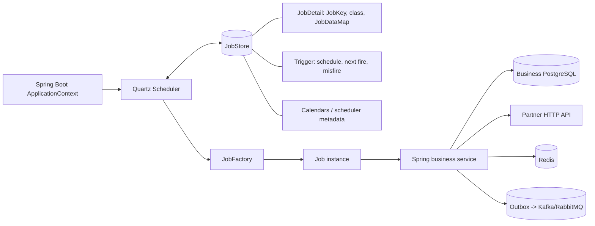
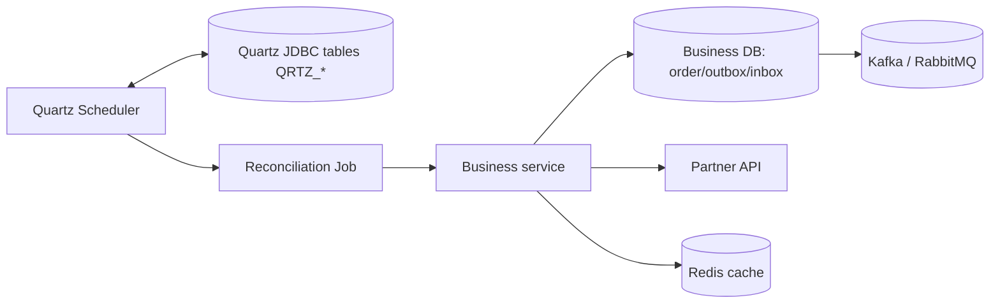
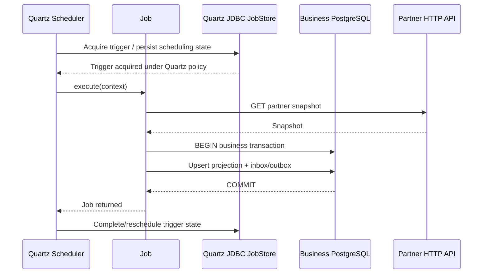
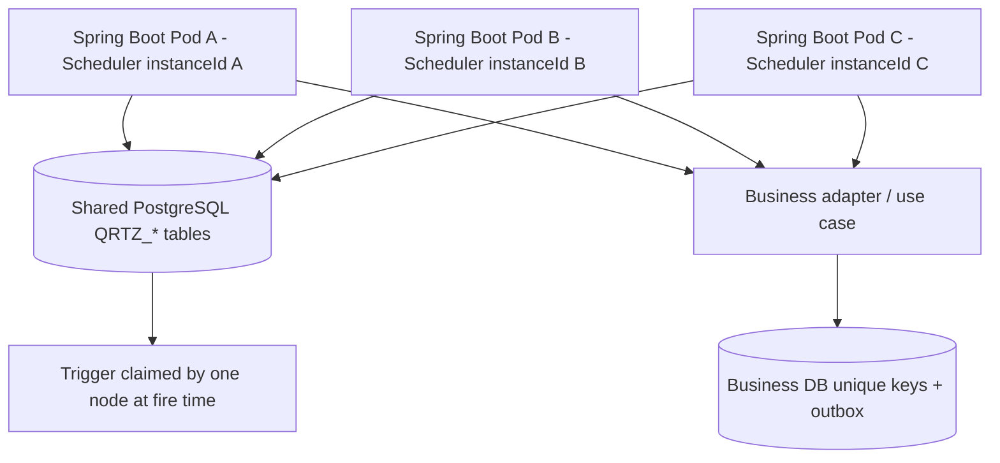
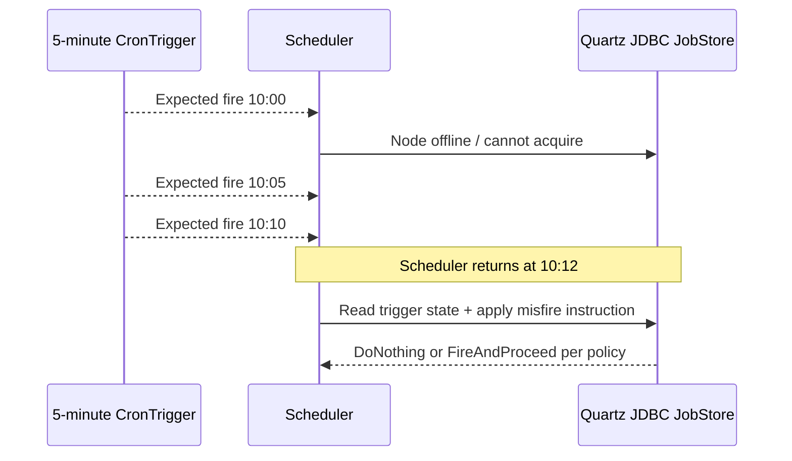

# In-Memory JobStore and JDBC JobStore

In **SPRING_BOOT_INTEGRATION**, a Spring Boot application does not only handle incoming HTTP requests immediately. It may also run scheduled jobs to sync products from partner APIs, reconcile PostgreSQL transactions, purge Redis caches, generate outbox events for Kafka/RabbitMQ, and drive Spring Integration flows. A schedule can be critical enough that it **must survive restarts** and **must not be independently triggered by multiple pods simultaneously**. That is when choosing the **Quartz JobStore** becomes an architectural decision rather than a single line of YAML.

This lesson belongs to the **Quartz** chapter and focuses on the two schedule storage options in Quartz with Spring Boot: **in-memory `RAMJobStore`** and **JDBC JobStore**. We will clarify which scheduler metadata lives in RAM versus a database, how to configure Boot, JDBC JobStore schemas and transactions, restart and cluster behavior, misfires/recovery, idempotency boundaries, and testing/operational observability scenarios. This lesson does not assume Quartz can turn HTTP, databases, caches, and brokers into a single atomic distributed transaction.

> Examples use **Java 17+, Spring Boot 3.x, Quartz 2.x, PostgreSQL**, and Spring JDBC/JPA as needed. Spring Boot may integrate JDBC JobStore via `SchedulerFactoryBean`/`LocalDataSourceJobStore` rather than a standalone Quartz configuration using `JobStoreTX`; use the exact APIs and properties for your version. Server/database names, `JobKey`s, and sample data are illustrative.

## 1. Learning Objectives

After this lesson, you will be able to:

1. Distinguish **Scheduler, JobDetail, Trigger, Calendar, JobStore** from **business outcomes** produced by a Job.
2. Explain strengths and trade-offs of `RAMJobStore` vs. JDBC JobStore across **restarts, transactions, startup, clustering, performance, and operations**.
3. Configure `spring.quartz.job-store-type=memory` or `jdbc` in Spring Boot without mixing conflicting low-level Quartz properties.
4. Prepare `QRTZ_*` tables using database-matched scripts/migrations and choose DataSources and transaction managers deliberately.
5. Understand how **persisted JobDetail/Trigger metadata** differs from **Java Job instances** and from business state in PostgreSQL, Redis, or brokers.
6. Select **misfire, recovery, and concurrency** policies without promising exactly-once execution from JDBC JobStore alone.
7. Run multiple Spring Boot instances on **a shared Quartz JDBC cluster** safely, contrasting it with multiple independent RAMJobStores.
8. Write tests for restarts, job persistence, missed schedules, duplicate side effects, and incident runbooks.

## 2. What Does a JobStore Actually Persist?

A Quartz `Scheduler` manages schedule **definitions** and **state** to know when to execute a Job. `JobStore` is the persistence layer for that information. When a Trigger fires, Quartz uses `JobFactory` to create a **Job instance** and calls `execute(JobExecutionContext)`. That instance is not a "live serialized object stored intact" in the JobStore tables.



| Component | Stored in Quartz JobStore? | Key Takeaway |
| --- | --- | --- |
| `JobDetail` | Yes | `JobKey`, Job class name, durability, recovery flag, `JobDataMap`. |
| `Trigger` | Yes | `TriggerKey`, linked `JobKey`, schedule, next/previous fire times, state, misfire policy. |
| Quartz calendars | Yes when configured | Excluded dates/times for schedules. |
| Scheduler/cluster execution metadata | Yes in supporting tables with JDBC JobStore | Coordinates scheduler instances, trigger acquisition, failover. |
| **Running Job instance** | Not a snapshotted Java object resumed mid-method | Scheduler creates a fresh instance upon firing or recovery. |
| Spring services/HTTP clients/`DataSource` beans | **No** | Beans are created by Spring via application context/DI. |
| Order SQL transactions | **No** | Managed in the separate business database and transaction. |
| Kafka offsets/RabbitMQ acks/Redis TTLs | **No** | Each system maintains its own persistence/recovery state. |
| "Completed reconciliation for order ORD-42" | **No by default** | Requires durable business checkpoints/inboxes/outboxes. |

### 2.1. JobDetail and Trigger Are Separate Identities

```text
JobKey     = integration/catalog-reconciliation
TriggerKey = integration/catalog-every-five-minutes
Job class  = com.example.integration.quartz.CatalogReconciliationJob
Cron       = 0 0/5 * * * ?
Timezone   = UTC
```

A single `JobDetail` can have **multiple Triggers**. Replacing a Trigger does not change the Java Job class, and a single Java class can back multiple `JobDetail`s with distinct `JobKey`s. This matters for `@DisallowConcurrentExecution`: the annotation prevents overlap for the **same `JobKey`**, not across all jobs sharing a class.

### 2.2. JobStore Does Not Create Schedules from Annotations

Quartz requires `JobDetail`s/`Trigger`s to be registered via APIs, Spring Boot beans, or scheduler admin workflows. Spring Framework's `@Scheduled` is a separate mechanism: it does not convert annotated methods into Quartz `JobDetail`s/`Trigger`s. When using Quartz, track where schedules are declared, who can mutate them, and whether the source of truth is **Java configuration** or the **persisted JDBC JobStore**.

## 3. `RAMJobStore`: Storing Schedules in Scheduler Memory

`RAMJobStore` is Quartz's in-memory JobStore. It fits simple configurations where schedules can be re-registered on every startup and do not require cross-node coordination.

```yaml
spring:
  quartz:
    job-store-type: memory
    auto-startup: true
    properties:
      org.quartz.threadPool.threadCount: 5
```

In Spring Boot with the Quartz starter and no custom JobStore override, `memory` selects RAM storage. For simple apps, this is often the default. Check the active auto-configuration/JobStore if your app defines a custom `SchedulerFactoryBean` or sets `org.quartz.jobStore.class`.

**Advantages:**

- No `QRTZ_*` tables, JDBC pool, or schedule migrations required.
- Fewer moving parts for local/dev or tasks that do not need dynamic schedules across restarts.
- Lower metadata overhead since no RDBMS calls occur on schedule/trigger operations.
- Convenient for single-process tests checking misfires/`JobFactory` without persistence setup.

**Limitations:**

- `JobDetail`, `Trigger`, and schedule state **disappear when the scheduler/process stops**.
- No shared cluster state across processes. Two pods using `RAMJobStore` with the same cron will **each execute independently**.
- No durable trigger state to know which firings were missed while the JVM was down.
- Dynamically created API schedules kept only in RAM must be **reconstructed from an external source** to survive restarts.
- `@DisallowConcurrentExecution` only coordinates runs within that single scheduler/job identity, not across separate RAM schedulers.

### 3.1. Restart Scenario with RAMJobStore

```mermaid
sequenceDiagram
    participant A as Spring Boot v1
    participant R as RAMJobStore
    participant H as Partner HTTP API
    A->>R: Register JobDetail + Trigger
    R-->>A: Next fire at 10:05
    A->>H: Job runs at 10:05
    Note over A,R: Process stops at 10:07; RAM lost
    Note over A,R: No scheduler exists at 10:10
    A->>R: App restarts at 10:12 and registers definitions again
    R-->>A: Recalculate next fire using new trigger
```

When restarting at 10:12, if Spring Boot re-registers the cron trigger, Quartz computes **future fire times** from the fresh trigger. Never assume the missed 10:10 run will automatically catch up once: the pre-restart firing is **gone from the JobStore**. To catch up missed windows, the application must rely on a **durable business watermark/checkpoint** in a database or other reliable store.

### 3.2. When Is RAMJobStore Still Reasonable in Production?

`RAMJobStore` is not "wrong" simply because an app runs in production. It can make sense when:

1. A single instance owns the schedule and downtime/skips are acceptable.
2. Schedules are always code-defined and safely rebuilt on startup.
3. The Job only nudges another durable mechanism (outbox/DB polling) that already guards work items.
4. No dynamic schedule management or deployment-independent schedule persistence is needed.
5. External coordination ensures only one scheduler runs across replicas (with tested failover).

Conversely, if **every pod** in a Deployment starts a RAM Scheduler registering a "charge customer" cron, expect **duplicate runs**. Business idempotency must still guard every side effect.

## 4. JDBC JobStore: Persisting Quartz State in a Database

JDBC JobStore persists `JobDetail`s, `Trigger`s, calendars, and scheduler state in Quartz-defined SQL tables. This allows **schedules to survive restarts** and, when properly configured, **multiple scheduler instances to coordinate over a shared JobStore**.

```yaml
spring:
  quartz:
    job-store-type: jdbc
    jdbc:
      initialize-schema: never
    properties:
      org.quartz.threadPool.threadCount: 8
```

`initialize-schema: never` in production means **the application does not execute Quartz table creation scripts**; infrastructure/migrations must ensure tables exist before the scheduler starts. `spring.quartz.job-store-type=jdbc` **does not** create product tables, outbox tables, or any business schemas.

### 4.1. What Does JDBC JobStore Provide?

| Aspect | `RAMJobStore` | JDBC JobStore |
| --- | --- | --- |
| Where `JobDetail`/`Trigger` live | Heap inside scheduler process | Database `QRTZ_*` tables |
| Schedule across process restart | Lost; must be re-registered | Reloaded from DB unless dropped/recreated |
| Runtime dynamic schedules | In-process RAM only | Survive restarts |
| Multi-node scheduler cluster | No shared state | Supported when **sharing JDBC store with clustering properly enabled** |
| DB schema/migrations | No Quartz tables needed | Requires schema matching DB/Quartz version |
| Metadata operation speed | Mostly RAM | Involves DB I/O, locks, network latency, and connection pools |
| Failure modes | Restart/JVM loss | Adds DB unavailability, deadlocks/lock waits, schema drift, pool saturation |
| Business exactly-once | No | **Also no** |
| Secrets management | Business service dependencies | Adds JDBC credentials/connection settings for JobStore |

JDBC JobStore makes **scheduling state durable**; it does not make every Job execution an atomic transaction with partner HTTP APIs, PostgreSQL business data, or Kafka events. Nor is it a specialized job queue replacing Kafka/RabbitMQ: Quartz schedule frequency, job concurrency, and retry semantics still need explicit design.

### 4.2. Diagram of Two Distinct Stores



Even when `QRTZ_*` and `order/outbox` tables reside in the **same PostgreSQL instance**, they serve two separate contracts. Confirming a Quartz trigger in JobStore **does not** confirm an order update or message publish; never treat scheduler database state as the source of truth for business completion.

## 5. JDBC JobStore Variants and Spring Boot Auto-Configuration

Core Quartz documentation typically mentions two variants:

| Variant | Quartz-Layer Meaning | Spring Notes |
| --- | --- | --- |
| `JobStoreTX` | Quartz manages DB transactions directly for scheduling operations via JDBC | Useful in standalone Quartz setups; avoid manually forcing it onto Boot-managed `SchedulerFactoryBean` without checking. |
| `JobStoreCMT` | Designed for container-managed transactions / dual data sources in Quartz's model | Does not merge business JPA transactions and Quartz triggers into one distributed transaction. |
| `LocalDataSourceJobStore` | Spring-managed integration between Quartz JDBC JobStore and Spring's `DataSource`/transaction resources | Typically used by Spring Boot/Spring `SchedulerFactoryBean` when an appropriate `DataSource` is provided. |

Key takeaway: when using **`spring.quartz.job-store-type=jdbc`** and letting Spring Boot auto-configure `SchedulerFactoryBean`, do not manually add:

```properties
# ANTI-PATTERN if you don't understand active Boot integration:
org.quartz.jobStore.class=org.quartz.impl.jdbcjobstore.JobStoreTX
org.quartz.jobStore.dataSource=someOtherPool
```

as if it were "required for JDBC." Doing so can give Quartz and Spring **two conflicting owners for DataSources or transactions**, clash with `LocalDataSourceJobStore`, or use pools outside the Spring context. Pick **one clear configuration path**: Spring Boot-managed Quartz JDBC via properties/`@QuartzDataSource`, or an independently configured standalone Quartz scheduler owning all JDBC/transaction wiring.

### 5.1. Verifying Which JobStore Is Actually Running

Quartz provides `SchedulerMetaData`:

```java
import org.quartz.Scheduler;
import org.quartz.SchedulerMetaData;
import org.springframework.stereotype.Component;

@Component
public final class QuartzStoreDiagnostics {
    private final Scheduler scheduler;

    public QuartzStoreDiagnostics(Scheduler scheduler) {
        this.scheduler = scheduler;
    }

    public String describe() throws org.quartz.SchedulerException {
        SchedulerMetaData meta = scheduler.getMetaData();
        return "store=" + meta.getJobStoreClass().getName()
                + ", persistent=" + meta.isJobStoreSupportsPersistence()
                + ", clustered=" + meta.isJobStoreClustered();
    }
}
```

With `RAMJobStore`, expect `isJobStoreSupportsPersistence() == false`; with JDBC JobStore, expect `true`. `isJobStoreClustered()` is true only when the scheduler is configured and initialized in clustered mode. **Do not hardcode a single class name** as the sole check, since Spring may use `LocalDataSourceJobStore` instead of a plain Quartz class, or framework upgrades may change internal types.

## 6. Preparing `QRTZ_*` Schemas and Migration Strategy

Quartz JDBC JobStore requires **a set of Quartz system tables** matching your SQL dialect/server version and compatible with your Quartz library version. Representative tables:

| Table (default prefix `QRTZ_`) | Primary Purpose |
| --- | --- |
| `QRTZ_JOB_DETAILS` | `JobKey`, Job class, `JobDataMap`, durability/recovery flags. |
| `QRTZ_TRIGGERS` | Core trigger info, state, fire timestamps. |
| `QRTZ_CRON_TRIGGERS` | Cron expression and time zone details. |
| `QRTZ_SIMPLE_TRIGGERS` | Simple trigger details, repeat count/interval. |
| `QRTZ_BLOB_TRIGGERS` | Blob-serialized trigger metadata when needed. |
| `QRTZ_SIMPROP_TRIGGERS` | Simple property-based trigger details. |
| `QRTZ_CALENDARS` | Quartz calendar data. |
| `QRTZ_PAUSED_TRIGGER_GRPS` | Paused trigger groups. |
| `QRTZ_FIRED_TRIGGERS` | State of triggers currently being processed/acquired. |
| `QRTZ_SCHEDULER_STATE` | Tracks scheduler instances/check-ins in a cluster. |
| `QRTZ_LOCKS` | Lock coordination for transactions/trigger acquisition. |

Exact column names, SQL types, constraints, and indexes depend on **official vendor-specific schema scripts**. Never hand-craft a partial set of tables from this list and consider it sufficient. Use the vendor-specific script (PostgreSQL/MySQL/SQL Server/Oracle, etc.) from the Quartz/Boot distribution or place reviewed scripts into Flyway/Liquibase with explicit migration IDs.

### 6.1. Never Use `initialize-schema: always` on a Production Database with Existing Schedules

Spring Boot supports:

```yaml
spring:
  quartz:
    job-store-type: jdbc
    jdbc:
      initialize-schema: never
```

Initialization modes and schema script discovery follow the documentation/configuration metadata for your Boot version. **`always` may run Quartz scripts containing `DROP TABLE`**, wiping or recreating existing `JobDetail`s/`Trigger`s; it is not a safe "create if missing" migration. Reserve auto-initialization like `always` for **ephemeral test containers/databases** in test fixtures; production must use a controlled migration pipeline.

A sound rollout process:

1. Select a **schema version** compatible with your Quartz library and SQL vendor.
2. Create/update tables via migrations running **before scheduler startup**.
3. Verify Quartz's DB account has only the required DML/table/sequence privileges, not superuser.
4. Review indexes and locking behavior for your trigger frequency and instance count.
5. On Quartz upgrades involving schema changes, run upgrade migrations with tested backup/rollback plans—never rely on Hibernate `ddl-auto`.
6. Keep Quartz schema migrations logically separate from business DB migrations, even when sharing a PostgreSQL instance.
7. Maintain **tested backups and restore procedures** when persisted schedules are operational assets.

### 6.2. `tablePrefix` and Multiple Schedulers on One Database

Quartz defaults to `QRTZ_`; if multiple **independent schedulers** share one PostgreSQL database without being **in the same cluster**, isolate them via table prefixes, schemas, or separate databases—for example:

```text
Scheduler A -> schema scheduler_a, tables QRTZ_*
Scheduler B -> schema scheduler_b, tables QRTZ_*
```

Never place two independent schedulers with different responsibilities into the same `QRTZ_*` tables and merely vary `instanceName` hoping for isolation. Schemas, instance names, and locks must be designed consistently; misconfigured shared tables can let a node without the Job class acquire triggers or fire unintended schedules.

## 7. Configuring DataSource for Quartz: Shared vs. Dedicated Business DB

In a Spring Boot app with a JDBC/JPA business datasource and Quartz JDBC JobStore, two setups are common.

### 7.1. Shared DataSource in Small Applications

```yaml
spring:
  datasource:
    url: ${APP_DB_URL:jdbc:postgresql://localhost:5432/integration}
    username: ${APP_DB_USERNAME}
    password: ${APP_DB_PASSWORD}
    hikari:
      maximum-pool-size: 20

  quartz:
    job-store-type: jdbc
    jdbc:
      initialize-schema: never
    auto-startup: true
```

When no dedicated `@QuartzDataSource` is declared, Boot-managed Quartz JDBC can reuse the application `DataSource` via auto-configuration. This is convenient for local/dev or simple systems, though Quartz trigger acquisition/check-in/recovery can **compete for connections** with HTTP services and business transactions. If business queries stall or exhaust the pool, the scheduler slows down too.

**Never** infer from sharing a `DataSource` that Quartz metadata updates join the same transaction as business table writes. Transaction boundaries depend on each API/transaction manager and how Quartz/Spring manage them; even with a single RDBMS, external HTTP/Kafka/Redis side effects never roll back automatically.

### 7.2. Separating Quartz DataSource with `@QuartzDataSource`

Spring Boot provides `@QuartzDataSource` to designate the `DataSource` Quartz should use when multiple sources exist. Example using a custom namespace:

```yaml
app:
  quartz:
    datasource:
      jdbc-url: ${QUARTZ_JDBC_URL:jdbc:postgresql://localhost:5432/scheduler}
      username: ${QUARTZ_DB_USER}
      password: ${QUARTZ_DB_PASSWORD}
      maximum-pool-size: 8

spring:
  quartz:
    job-store-type: jdbc
    jdbc:
      initialize-schema: never
```

```java
import javax.sql.DataSource;
import com.zaxxer.hikari.HikariDataSource;
import org.springframework.boot.autoconfigure.quartz.QuartzDataSource;
import org.springframework.boot.context.properties.ConfigurationProperties;
import org.springframework.context.annotation.Bean;
import org.springframework.context.annotation.Configuration;

@Configuration(proxyBeanMethods = false)
public class QuartzJdbcDataSourceConfiguration {

    @Bean("quartzDataSource")
    @QuartzDataSource
    @ConfigurationProperties("app.quartz.datasource")
    HikariDataSource quartzDataSource() {
        return new HikariDataSource();
    }
}
```

Here `app.quartz.datasource` is an **application-defined namespace**; Boot does not recognize it as a Quartz DataSource without the annotated bean. `HikariDataSource` binds directly to `jdbc-url`/`username`/`password`/`maximum-pool-size`. Verify exact property names and binding behavior for your Spring Boot/Hikari versions.

**Caution with two DataSources:** if the app also needs a business DataSource, declare/qualify that bean explicitly (often requiring `@Primary` or qualifiers) and verify JDBC/JPA repositories do not accidentally bind to the Quartz DB. Defining a custom `quartzDataSource` bean can alter DataSource auto-configuration for the remaining business DataSource.

### 7.3. When Should You Separate Them?

| Criterion | Shared DataSource | Dedicated Quartz DataSource |
| --- | --- | --- |
| Operations | Simpler | Extra credentials, pool, migrations, backups |
| Pool contention | Quartz and business share the pool | Separate quotas/pools easily |
| Permissions | Business and Quartz permissions easily commingled | Clean least-privilege per table/schema |
| DB failures | Single failure domain | Resource isolation when backed by separate cluster/DB |
| Transaction consistency | Not atomic across systems | Still not atomic across systems |
| Testing | Fewer connection configs | Must verify `@QuartzDataSource` and transaction manager wiring |

There is no single right answer; for light workloads, a shared DataSource works fine. For trigger-heavy schedulers, many nodes, or heavily loaded business DBs, separating pools/schemas/permissions reduces risk. **Separating databases does not allow the scheduler to rescue a business workflow when the source of truth is unavailable.**

### 7.4. `@QuartzTransactionManager` and JDBC JobStore

Spring Boot provides `@QuartzTransactionManager` to designate a dedicated transaction manager for Quartz when needed. Understand this as **the scheduler's transaction resource**, not a promise that Quartz trigger transactions wrap all repositories and broker calls.

When using multiple transaction managers:

- Configure bean names/qualifiers/`@QuartzTransactionManager` matching your Boot version.
- Specify `@Transactional(transactionManager = "...")` on **business services** when multiple JDBC/JPA/Neo4j managers exist.
- Test that business transactions actually roll back when application services throw exceptions.
- Never keep Quartz JDBC scheduler locks and slow partner HTTP calls inside one business transaction.
- Never assume PostgreSQL business outbox writes, Redis SETs, and Kafka publishes become atomically committed simply by changing transaction managers.

## 8. Spring Boot Registering JobDetail and Trigger Beans

`JobDetail` and `Trigger` beans declared with `@Bean` are picked up by Quartz auto-configuration when Boot manages `SchedulerFactoryBean`:

```java
import java.util.TimeZone;
import org.quartz.CronScheduleBuilder;
import org.quartz.JobBuilder;
import org.quartz.JobDetail;
import org.quartz.Trigger;
import org.quartz.TriggerBuilder;
import org.springframework.beans.factory.annotation.Qualifier;
import org.springframework.context.annotation.Bean;
import org.springframework.context.annotation.Configuration;

@Configuration(proxyBeanMethods = false)
public class CatalogScheduleConfiguration {

    @Bean("catalogReconciliationJobDetail")
    JobDetail catalogReconciliationJobDetail() {
        return JobBuilder.newJob(CatalogReconciliationJob.class)
                .withIdentity("catalog-reconciliation", "integration")
                .withDescription("Reconcile external catalog projection")
                .usingJobData("partnerId", "catalog")
                .requestRecovery()
                .storeDurably()
                .build();
    }

    @Bean
    Trigger catalogReconciliationTrigger(
            @Qualifier("catalogReconciliationJobDetail") JobDetail job) {
        return TriggerBuilder.newTrigger()
                .withIdentity("catalog-every-five-minutes", "integration")
                .forJob(job)
                .withSchedule(CronScheduleBuilder
                        .cronSchedule("0 0/5 * * * ?")
                        .inTimeZone(TimeZone.getTimeZone("UTC"))
                        .withMisfireHandlingInstructionDoNothing())
                .build();
    }
}
```

**Notes on the example:**

- `JobDetail` references the **Java class**, never stuffing a Spring service instance into the JobStore.
- `.storeDurably()` lets the `JobDetail` exist without an attached Trigger; it does not mean Job business data is persisted.
- `.requestRecovery()` marks the Job as eligible for recovery if the scheduler crashes mid-execution per JobStore mechanics; it **does not** guarantee exactly-once or resuming at the exact Java line interrupted.
- `withMisfireHandlingInstructionDoNothing()` is a **schedule policy** ignoring missed cron firings; it is not a business-window reconciliation system.
- `TimeZone.getTimeZone("UTC")` prevents cron times from shifting across pods with differing OS time zones; if a job requires 09:00 local time with DST, define the `ZoneId`/timezone policy explicitly per business rules.

Each top-level `public` Java type in this lesson belongs in its own `.java` file in a real project. `CatalogReconciliationJob` is shown in a later section.

## 9. Code-Registered Schedules vs. Already-Persisted Schedules

With `RAMJobStore`, restarts clear old metadata so `JobDetail`/`Trigger` beans register into clean memory. With JDBC JobStore, **`JobKey`/`TriggerKey` may already exist** from a prior deployment. You must decide **the source of truth** and how code/YAML cron changes behave.

### 9.1. Do Not Leave `overwrite-existing-jobs` to Chance

Spring Boot provides:

```yaml
spring:
  quartz:
    job-store-type: jdbc
    overwrite-existing-jobs: false
```

When definitions are already persisted, whether new bean definitions **overwrite** or **preserve** old settings depends on policy and registration path. With `overwrite-existing-jobs=false`, editing a cron expression in Java may **not automatically update persisted Triggers**. Enabling overwrite can cause new code deployments to wipe out runtime edits made by operators.

**Two distinct ownership models:**

1. **Code-owned schedules:** schedules in Git/config are the source of truth; roll out `JobDetail`/`Trigger` updates through versioned migrations/procedures with tests and rollback plans.
2. **Operations-owned schedules:** schedules can be edited via admin APIs/database; code only bootstraps missing Job definitions and **never overwrites** operational changes at startup.

Avoid mixing both models without authorization and auditing. If different pods roll out staggered versions/configs while overwriting a shared Trigger at startup, the schedule can flip-flop during rolling deployments.

### 9.2. Renaming a `JobKey` Does Not Edit the Old Schedule

Suppose v1 defines JobKey `integration/catalog-reconciliation`, and v2 renames it to `integration/catalog-sync` with a new trigger. JDBC JobStore still holds the **old `JobDetail`/`Trigger`**, resulting in **both jobs running** unless a migration deletes or pauses the old one. Renaming a Spring bean or Java class does not clean up persisted `JobKey`s. Define **scheduling metadata migrations** whenever renaming, removing, or rehoming jobs.

### 9.3. Moving Java Packages/Classes Can Break Persisted JobDetails

JDBC JobStore persists **the Java Job class name**. If v2 moves `CatalogReconciliationJob` to another package and deletes the old class while old `JobDetail`s remain persisted, the scheduler cannot instantiate the Job. Rolling deployments complicate this further when old and new pods read the same JobStore with different classpaths:

- Keep **compatible Job classes** during rollout windows or migrate metadata in coordinated pre/post steps.
- Never persist arbitrary Spring beans, HTTP clients, or `DataSource`s in `JobDataMap`.
- Use versioned scalar inputs like `partnerId` and `workItemId` instead of Java-package-coupled serialized DTOs.
- Run restart tests against **existing database tables** using the new binary.

### 9.4. JobDataMap in JDBC: Serialization Is a Contract

`JobDataMap` is stored inside `JobDetail`/`Trigger` metadata. In a JDBC store, values may be Java-serialized or restricted to Strings depending on Quartz settings like `org.quartz.jobStore.useProperties`. Putting `DataSource`, Spring `@Service`s, lambdas, `HttpServletRequest`, or secret-containing object graphs into `JobDataMap` is fragile and risks deserialization errors after deployment.

Prefer:

```text
partnerId = catalog
workItemId = sync-20261121-00042
schemaVersion = 1  (if config allows integers; or "1" when String-only)
```

Inside `execute`, validate and fetch the durable business work item from the DB via a Spring service. **`JobDataMap` is not a business checkpoint or inbox/outbox.** Never infer business "message processed" status from persisted scheduler metadata.

## 10. Transactions and Persistence of Scheduler Metadata

JDBC JobStore relies on SQL transactions and locks to update trigger states. Yet multiple distinct commit points exist:



A process crash can happen **after business COMMIT but before Quartz records completion**. Subsequent recovery/retries may re-execute business logic. Conversely, committed Quartz metadata does not guarantee the partner API was called or the business transaction succeeded.

### 10.1. Sharing a PostgreSQL Instance Does Not Mean Sharing a Transaction

Even when `QRTZ_*` and business tables live on the same JDBC server:

- Quartz runs internal transaction/lock boundaries when acquiring and rescheduling triggers.
- Business `@Transactional` boundaries are governed by Spring's transaction manager and service calls.
- HTTP/Kafka/Redis calls do not participate in PostgreSQL transactions.
- No single annotation turns the entire multi-system flow into a distributed atomic commit.

If the requirement is "each sync window applies at most once," enforce a **unique key in the business DB**. If the requirement is "events reach the broker at least once without loss," use a **transactional outbox** paired with consumer inbox/idempotency to tolerate duplicates.

### 10.2. Never Hold Business Transactions Open Waiting on Partner APIs

A Job making a 20-second partner HTTP call inside a `@Transactional` wrapping all of `execute()` holds database connections and locks during slow network I/O, starving both the JobStore and normal traffic if sharing pools. Instead:

```text
1. Validate schedule identity, JobDataMap, and deadline.
2. Call partner HTTP with explicit timeout and limits, outside any business transaction.
3. Normalize and validate payload.
4. Start a SHORT business transaction:
      claim unique business window;
      upsert projection;
      insert outbox;
   COMMIT.
5. Finish Quartz Job; outbox publisher dispatches messages separately.
```

**Idempotency must protect the crash window between steps 4 and 5**—never assume JDBC JobStore "durability" prevents re-execution.

## 11. JDBC JobStore Clustering: Multiple Pods Sharing One Schedule

When a Deployment runs three Spring Boot replicas, using independent RAMJobStores with the same cron lets each pod fire the Job, causing **three calls to the partner API**. With properly configured Quartz clustering, schedulers coordinate through **the same JDBC JobStore** to arbitrate trigger acquisition.



Suggested configuration (adjust DataSource and schema to your deployment):

```yaml
spring:
  quartz:
    scheduler-name: integration-scheduler
    job-store-type: jdbc
    auto-startup: true
    wait-for-jobs-to-complete-on-shutdown: true
    jdbc:
      initialize-schema: never
    properties:
      org.quartz.scheduler.instanceId: AUTO
      org.quartz.jobStore.isClustered: true
      org.quartz.jobStore.clusterCheckinInterval: 15000
      org.quartz.jobStore.misfireThreshold: 60000
      org.quartz.threadPool.threadCount: 8
```

**Mandatory requirements for a single coherent cluster:**

1. All nodes point to the **same JDBC JobStore database/schema/table prefix**.
2. All nodes share a **consistent scheduler name/`instanceName`**, while each process has a **unique `instanceId`** (`AUTO` lets Quartz generate one).
3. `isClustered=true` on **every** cooperating node.
4. Nodes run **compatible Quartz library/schema versions** and compatible Job classes/Trigger semantics during rolling deploys.
5. Node clocks are **well synchronized**; Quartz clustering relies on timestamps and heartbeat/check-ins, so large clock skew causes erratic misfires and failovers.
6. Network, DNS, SQL locks, and connection pools are stable and permit Quartz table reads/writes.
7. No **non-clustered** scheduler accesses the same tables serving the cluster.

`clusterCheckinInterval` and `misfireThreshold` above are in **milliseconds per Quartz property rules**, unlike Spring Boot duration syntax (`15s`, `60s`). Tune values to your Quartz version and DB capacity rather than setting them aggressively low just to chase instant failover.

### 11.1. Clustering Coordinates Triggers, Not Exactly-Once Side Effects

A Quartz cluster minimizes **multiple nodes claiming the same trigger** under normal operation. Yet if node A completes an HTTP POST and crashes before recording completion, node B may recover/refire per policy. The payment system already received node A's POST; if node B generates a fresh idempotency key, it will charge twice.

```text
Pod A: acquire trigger -> POST payment -> partner COMMIT
Pod A: crashes before Quartz/app records completion
Pod B: cluster detects failed A -> recover / fire job
Pod B: POST payment again if idempotency is missing
```

Therefore:

- Derive **stable business operation IDs** (typically from partner + reconciliation window or durable work item).
- Use unique/inbox tables and conditional updates in the business database.
- For HTTP side effects, send `Idempotency-Key` when supported, keeping **the same key across retries** and reconciling unknown outcomes.
- For message brokers, outbox publishers and consumers must handle at-least-once delivery; Quartz tables do not store Kafka offsets or RabbitMQ acks.

### 11.2. `@DisallowConcurrentExecution` in a Cluster

`@DisallowConcurrentExecution` instructs Quartz not to execute instances of the **same `JobKey` concurrently** across a cooperating scheduler/cluster per JobStore rules. However:

| Scenario | Does Quartz Automatically Protect? |
| --- | --- |
| Two triggers on the same `JobKey` in **one** valid JDBC cluster | Typically serialized according to `@DisallowConcurrentExecution`. |
| Two different `JobKey`s targeting the same `paymentId` | **No**; the annotation scopes by `JobKey`, not business `paymentId`. |
| Two separate Kubernetes clusters using **two** JDBC stores | No shared coordination. |
| A standalone RAM scheduler running the same cron alongside the JDBC cluster | Not a cooperating scheduler; will run an extra time. |
| Job completes side effect then process dies before completion | Recovery/refire may occur; **no exactly-once guarantee**. |

To enforce a global limit like "at most 3 concurrent sync jobs," combine Quartz thread pools/bulkheads with application policies and/or distributed concurrency guards by operation type. Setting `threadCount=8` **per pod** allows more than 8 total Quartz workers cluster-wide; it is not a global rate limit.

### 11.3. Separating Clusters vs. Independent Schedulers

Two microservices from different domains using their own JDBC job stores probably **should not** share a Quartz cluster. In a shared cluster, any node can become a candidate to execute registered Job classes; if services carry different classes on their classpaths, acquisition and recovery will fail. Choose your topology explicitly:

- **Dedicated scheduler service:** Quartz jobs only create durable work items; domain workers process them via DB/broker.
- **Per-application cluster:** all pods run identical code/job classes against a shared JDBC Quartz store.
- **Independent domain schedulers:** isolate schemas, databases, prefixes, and scheduler namespaces rather than sharing clusters casually.

## 12. Misfires: How Quartz Handles Missed Schedule Times

**Misfire** occurs when a trigger is due to fire but the scheduler misses the deadline beyond Quartz's misfire threshold—for instance due to app downtime, saturated thread pools, unreachable DB, or lost acquisition locks. Misfires are **distinct** from a Job running and throwing an exception.



### 12.1. Two Common CronTrigger Policies

```java
import java.util.TimeZone;
import org.quartz.CronScheduleBuilder;

var skipMissed = CronScheduleBuilder
        .cronSchedule("0 0/5 * * * ?")
        .inTimeZone(TimeZone.getTimeZone("UTC"))
        .withMisfireHandlingInstructionDoNothing();

var fireOnceNow = CronScheduleBuilder
        .cronSchedule("0 0/5 * * * ?")
        .inTimeZone(TimeZone.getTimeZone("UTC"))
        .withMisfireHandlingInstructionFireAndProceed();
```

| Policy | General Meaning | When Appropriate |
| --- | --- | --- |
| `DoNothing` | Discards missed firings, advances to next valid schedule | Polling not needing every tick; skippable cache refreshes. |
| `FireAndProceed` | Fires once per misfire policy, then resumes cron | Needs one immediate run to recover after downtime, with idempotency. |
| Smart/default policy | Quartz chooses per trigger type/defaults | Use only after testing for your exact version and SLA. |

**`FireAndProceed` does not replay 10:00, 10:05, and 10:10 as three separate business windows.** To avoid missing any window, the Job must read a **durable checkpoint**, compute unprocessed windows, and schedule/catch up work items under load limits. With `RAMJobStore` across a full process restart, even prior cron metadata is gone, so Quartz has no knowledge of missed windows.

### 12.2. SimpleTrigger Policies Differ from CronTrigger

`SimpleTrigger` manages repeat intervals and counts, offering misfire instructions such as fire now or reschedule now/next with distinct repeat-count adjustments. Never copy `CronTrigger` policies blindly to `SimpleTrigger` without checking semantics. Similarly, `CalendarIntervalTrigger` and `DailyTimeIntervalTrigger` define their own misfire behaviors.

**Time and time zones:** a cron for "09:00 daily" in a DST-observing region may encounter days where 09:00 or clock transitions behave unusually; align with real business calendar rules. Financial jobs need **business date/window IDs** independent of trigger execution timestamps.

### 12.3. `misfireThreshold` Is Not a Business Execution Timeout

`org.quartz.jobStore.misfireThreshold` is typically configured in **milliseconds**. It defines how late a trigger can be before Quartz considers it misfired; it **does not** limit how long a Job may execute or how long HTTP requests wait on partners.

To bound a sync Job:

- HTTP transport connect/read/response timeouts.
- JDBC statement/lock acquisition timeouts.
- Overall deadlines for business operations/chunks.
- Quartz thread pool and business concurrency caps.
- Timeout error classification and bounded retry policies.

Never inflate `misfireThreshold` to hours just to "let jobs run longer." Those are two unrelated concepts.

## 13. Recovery: Scheduler Crashes Differ from Business Errors

Quartz can detect a Job running on a dead node and, if requested by `JobDetail`, schedule a **recovery execution** per JobStore/recovery rules.

### 13.1. `requestRecovery()` and `isRecovering()`

```java
JobDetail job = org.quartz.JobBuilder
        .newJob(CatalogReconciliationJob.class)
        .withIdentity("catalog-reconciliation", "integration")
        .requestRecovery()
        .storeDurably()
        .build();
```

Inside the Job:

```java
@Override
public void execute(JobExecutionContext context)
        throws JobExecutionException {
    boolean recovering = context.isRecovering();
    // When recovering == true, DO NOT assume this is the first run.
    // Query committed state using a durable business key.
}
```

These snippets **illustrate the API**, not two definitions to paste into one class without implementation logic. During recovery:

- Quartz **does not** restore thread stacks, in-flight HTTP responses, or heap Java object state.
- The Job starts a **new execution** under recovery rules and may need to reload work items.
- The business DB or partner may have partially or fully committed side effects from the crashed run.
- Recovery cannot infer "orderId already finished" from the JobStore.

Even if a Job does **not** request recovery, future triggers still follow misfire/scheduling rules; not requesting recovery simply means in-flight items at crash time are not automatically retried by Quartz recovery.

### 13.2. Failure Windows and Handling Responsibilities

| Crash Point | What Quartz May Know | What the Application Must Protect |
| --- | --- | --- |
| Before trigger acquisition | JDBC state still shows trigger due | Quartz misfire/acquisition per cluster policy. |
| After acquire, before service call | Execution state recorded in Quartz | Recovery per config; business side effects likely absent. |
| After partner POST commits, before response | Quartz unaware of HTTP side effect | Idempotency key/outcome reconciliation; `UNKNOWN` state. |
| After business SQL commit, before Quartz completion | Quartz unaware service finished | Unique business window/inbox/outbox preventing duplicate runs. |
| After Quartz completion, before broker consumer finishes | Scheduler considers Job done | Monitor outbox/consumer lag; do not infer downstream success. |
| After Redis cache write, before DB commit | Cache holds unconfirmed projection | Invalidation/versioning/source-of-truth; never treat cache as commit log. |

### 13.3. `JobExecutionException` Is Not a Durable Retry Queue

When `execute()` throws `JobExecutionException`, Quartz logs the failure in execution/listeners but **does not automatically provide exponential backoff for arbitrary exceptions**. Although `refireImmediately` exists, misusing it causes rapid retries, ties up worker threads, and hammers struggling partners/DBs.

When work requires durable retries:

1. Persist **business work items** or outbox/inbox rows in a database.
2. Classify transient, permanent, and unknown-outcome errors.
3. Schedule retries with bounded attempts, deadlines, and backoff/jitter.
4. For large item backlogs, use a broker or DB work queue; Quartz can periodically wake up a worker.
5. Route contract-invalid payloads to quarantine/DLT so they do not fail forever.
6. Record actual outcomes and support post-crash reconciliation.

## 14. Put Idempotency in the Business Database, Not the JobStore

Suppose a cron syncs the catalog every five minutes. A good business operation ID is:

```text
partner=catalog
windowStart=2026-11-21T10:30:00Z
operationId=catalog:2026-11-21T10:30:00Z
```

Avoid using Quartz `fireInstanceId` as the unique business ID because recovery/refires generate new execution IDs for **the same window**. When catching up the 10:30 window after downtime, the Job can deterministically reconstruct that exact operation ID from durable checkpoints and schedule rules.

### 14.1. Claim Table Keyed by Business Key

PostgreSQL example:

```sql
CREATE TABLE catalog_sync_run (
    partner_id VARCHAR(64) NOT NULL,
    window_start TIMESTAMPTZ NOT NULL,
    status VARCHAR(24) NOT NULL,
    committed_at TIMESTAMPTZ,
    PRIMARY KEY (partner_id, window_start)
);

CREATE TABLE catalog_projection (
    partner_id VARCHAR(64) PRIMARY KEY,
    source_version VARCHAR(128) NOT NULL,
    item_count BIGINT NOT NULL
);
```

Inside a short transaction:

```text
BEGIN
    INSERT catalog_sync_run(partner, windowStart, COMPLETED)
      ON CONFLICT DO NOTHING
    if claimed == 0:
        return ALREADY_COMMITTED
    UPSERT catalog_projection
    INSERT integration_outbox(eventId, schemaVersion, payload, PENDING)
COMMIT
```

Because the claim, projection, and outbox commit **in the same transaction**, any mid-way failure rolls back the claim so another attempt can retry. If the claim already exists yet payload/source version differs, logic must classify **valid replay vs. conflict** per contract rather than silently ignoring it.

### 14.2. Illustrative Transaction Writer Code

```java
import java.sql.Timestamp;
import java.time.Instant;
import org.springframework.jdbc.core.JdbcTemplate;
import org.springframework.stereotype.Service;
import org.springframework.transaction.annotation.Transactional;

@Service
public class CatalogSyncWriter {
    private final JdbcTemplate jdbc;

    public CatalogSyncWriter(JdbcTemplate jdbc) {
        this.jdbc = jdbc;
    }

    @Transactional
    public boolean apply(
            String partner,
            Instant windowStart,
            String sourceVersion,
            long itemCount) {

        int claimed = jdbc.update("""
                INSERT INTO catalog_sync_run(
                    partner_id, window_start, status, committed_at)
                VALUES (?, ?, 'COMPLETED', CURRENT_TIMESTAMP)
                ON CONFLICT (partner_id, window_start) DO NOTHING
                """, partner, Timestamp.from(windowStart));

        if (claimed == 0) {
            return false;
        }
        jdbc.update("""
                INSERT INTO catalog_projection(
                    partner_id, source_version, item_count)
                VALUES (?, ?, ?)
                ON CONFLICT (partner_id) DO UPDATE SET
                    source_version = EXCLUDED.source_version,
                    item_count = EXCLUDED.item_count
                """, partner, sourceVersion, itemCount);

        // If downstream must be notified, insert outbox here
        // in the SAME transaction using a unique stable event ID.
        return true;
    }
}
```

**This is a simplified idempotency example, not a complete ordering solution.** If the 10:25 window job executes late after 10:30, the upsert above could overwrite newer projections with stale data. Production requires source sequences/watermarks, conditional updates, or ordered checkpoints, publishing completion only when invariants hold.

If the business side effect involves calling a payment API, **do not** casually place a payment POST after claiming but before committing. PostgreSQL rollbacks cannot undo external payments; use outboxes/workflow states and provider-supported idempotency keys.

### 14.3. Deduplication Keys Across Layers

| Identifier | Protects What? | Does Not Replace |
| --- | --- | --- |
| Quartz `JobKey` | `JobDetail` identity, concurrency for the same `JobKey` | Business dedup by order/window. |
| Quartz `TriggerKey` | Identity of a single schedule | Event ID or transaction ID. |
| Quartz `fireInstanceId` | A single scheduler execution | Durable business operation ID. |
| `(partnerId, windowStart)` unique | One sync business window | Dedup of every Kafka event or payment if one window spans multiple tasks. |
| Inbox `(source, eventId)` | Consumer receiving the same event multiple times | Quartz trigger acquisition. |
| Outbox `eventId` | Re-emitting the exact committed event | Consumer side-effect exactly-once. |
| HTTP `Idempotency-Key` | One operation with partner per contract | DB transactions or Quartz persistence. |

## 15. Job Class and Spring Services: Persistence Does Not Mean Storing Spring Beans

When switching `JobStore` from RAM to JDBC, a common mistake is trying to put Spring services into `JobDataMap` so they are "persisted too." Never do that: Spring beans, `DataSource`, `RestClient`/`WebClient`, `KafkaTemplate`, `RedisTemplate`, and `TransactionManager` must be created and managed by the **Spring ApplicationContext**.

A thin Job class:

```java
import java.time.Instant;
import java.util.Date;
import org.quartz.DisallowConcurrentExecution;
import org.quartz.Job;
import org.quartz.JobExecutionContext;
import org.quartz.JobExecutionException;

@DisallowConcurrentExecution
public final class CatalogReconciliationJob implements Job {
    private final CatalogReconciliationUseCase useCase;

    public CatalogReconciliationJob(
            CatalogReconciliationUseCase useCase) {
        this.useCase = useCase;
    }

    @Override
    public void execute(JobExecutionContext context)
            throws JobExecutionException {
        String partner = context.getMergedJobDataMap()
                .getString("partnerId");
        Date expectedFire = context.getScheduledFireTime();

        if (!"catalog".equals(partner) || expectedFire == null) {
            throw new JobExecutionException(
                    new IllegalArgumentException(
                            "Unsupported partner or missing scheduled time"),
                    false);
        }

        Instant scheduledAt = expectedFire.toInstant();
        try {
            useCase.reconcile(partner, scheduledAt,
                    context.isRecovering());
        } catch (Exception cause) {
            // Avoid infinite refireImmediately.
            throw new JobExecutionException(cause, false);
        }
    }
}

public interface CatalogReconciliationUseCase {
    void reconcile(String partner,
                   Instant scheduledAt,
                   boolean recoveryExecution);
}
```

The two top-level `public` types in this snippet belong in **two separate `.java` files**. `CatalogReconciliationUseCase` is the business interface; the Spring service implementation reads the partner API, calculates missing business windows, and calls `CatalogSyncWriter` to write transactions. Never handle HTTP, Redis, and SQL directly inside the Job class.

### 15.1. Creating Jobs with Spring DI

Never assume a `@Component` Job bean is the exact instance Quartz executes. Use a `JobFactory` that instantiates Jobs with Spring dependency injection. An explicit setup supporting constructor injection:

```java
import org.quartz.spi.TriggerFiredBundle;
import org.springframework.beans.factory.config.AutowireCapableBeanFactory;
import org.springframework.boot.autoconfigure.quartz.SchedulerFactoryBeanCustomizer;
import org.springframework.context.annotation.Bean;
import org.springframework.context.annotation.Configuration;
import org.springframework.scheduling.quartz.SpringBeanJobFactory;

@Configuration(proxyBeanMethods = false)
public class QuartzJobFactoryConfiguration {
    @Bean
    SchedulerFactoryBeanCustomizer jobFactoryCustomizer(
            AutowireCapableBeanFactory beans) {
        return factory ->
                factory.setJobFactory(new SpringBeanJobFactory() {
                    @Override
                    protected Object createJobInstance(
                            TriggerFiredBundle bundle) throws Exception {
                        return beans.createBean(
                                bundle.getJobDetail().getJobClass());
                    }
                });
    }
}
```

Spring Boot in some versions/configs already provides job dependency injection by default. This customizer illustrates **an explicit Job creation path** when deterministic constructor injection is desired. If multiple `SchedulerFactoryBeanCustomizer`s exist or you define a custom `SchedulerFactoryBean`, verify **which `JobFactory` wins**. `createBean` creates fresh instances rather than singletons and does not ensure `@PreDestroy` lifecycle calls like registered singletons; Jobs should not own long-lived resources.

### 15.2. Keep Volatile State Out of `JobDataMap`

In JDBC JobStore, `JobDataMap` should only hold small parameters serializable per configuration:

```text
partnerId = catalog
workItemId = catalog-sync-20261121-1030
sourceContractVersion = "1"
```

If you need to resume from page 500 of a 10-million-item batch, use a **business checkpoint table** and `workItemId`. `@PersistJobDataAfterExecution` can save updates to `JobDetail`'s `JobDataMap` per Quartz rules, yet does not protect atomicity across business data, caches, or brokers. Under concurrent runs, pairing `@DisallowConcurrentExecution` is typically needed whenever mutating `JobDataMap`; better yet, avoid using the map as a transaction log.

## 16. Testing `RAMJobStore` and JDBC JobStore with a Real Scheduler

A test verifying only `job-store-type: jdbc` in YAML does not prove the live scheduler uses a JDBC store. Tests should inspect **`SchedulerMetaData`**, register/query `JobDetail`/`Trigger`, and for JDBC, prove data **survives tearing down and recreating the application context** against the same database.

### 16.1. Required Test Layers

| Test Level | Goal | What Cannot Be Inferred |
| --- | --- | --- |
| Unit test `Job` | Validate `JobDataMap`, exceptions, business operation ID | Whether Quartz `JobFactory`, `JobStore`, or clustering work. |
| Spring Boot RAM scheduler test | `JobDetail`/`Trigger` beans registered; `persistence=false` | Survival across process restarts — RAM store actually loses state. |
| Spring Boot JDBC Testcontainers | `persistence=true`, JDBC tables use correct datasource | Multi-node clustering/failover is not yet proven. |
| Restart integration test | Dynamic schedules survive across two Spring contexts/processes | Protection against duplicate business side effects needs separate tests. |
| Two scheduler nodes on shared JDBC store | Trigger acquisition/misfires/check-ins/recovery | HTTP/SQL/Kafka exactly-once is not guaranteed. |
| Fault-injection test | Kill node after business commit or mid-HTTP call | Real idempotency/reconciliation/retry behavior. |

### 16.2. Verifying Metadata for the Active JobStore

A lightweight Spring context test can check:

```java
import static org.junit.jupiter.api.Assertions.*;
import org.junit.jupiter.api.Test;
import org.quartz.JobKey;
import org.quartz.Scheduler;
import org.quartz.TriggerKey;
import org.springframework.beans.factory.annotation.Autowired;
import org.springframework.boot.test.context.SpringBootTest;

@SpringBootTest(properties = {
        "spring.quartz.job-store-type=memory",
        "spring.quartz.auto-startup=false"
})
class QuartzRamStoreIT {

    @Autowired
    Scheduler scheduler;

    @Test
    void keepsDefinitionsInRamNotJdbc() throws Exception {
        assertFalse(scheduler.getMetaData()
                .isJobStoreSupportsPersistence());

        assertNotNull(scheduler.getJobDetail(JobKey.jobKey(
                "catalog-reconciliation", "integration")));
        assertNotNull(scheduler.getTrigger(TriggerKey.triggerKey(
                "catalog-every-five-minutes", "integration")));
    }
}
```

This test **requires an application context importing `CatalogScheduleConfiguration` and related beans**, or a minimal test configuration providing `JobDetail`/`Trigger` beans. It leaves the scheduler stopped because it only checks metadata; to test execution, start the scheduler/fire a trigger and wire Spring service DI.

### 16.3. JDBC JobStore Integration Test with PostgreSQL Testcontainers

With `spring-boot-starter-test`, `spring-boot-starter-quartz`, PostgreSQL driver, `org.testcontainers:postgresql`, and `org.testcontainers:junit-jupiter` in test dependencies, you can spin up an ephemeral database:

```java
import static org.junit.jupiter.api.Assertions.*;

import java.util.UUID;
import org.junit.jupiter.api.Test;
import org.quartz.Job;
import org.quartz.JobBuilder;
import org.quartz.JobDetail;
import org.quartz.JobExecutionContext;
import org.quartz.JobKey;
import org.quartz.Scheduler;
import org.springframework.beans.factory.annotation.Autowired;
import org.springframework.boot.test.context.SpringBootTest;
import org.springframework.test.context.DynamicPropertyRegistry;
import org.springframework.test.context.DynamicPropertySource;
import org.testcontainers.containers.PostgreSQLContainer;
import org.testcontainers.junit.jupiter.Container;
import org.testcontainers.junit.jupiter.Testcontainers;

@Testcontainers
@SpringBootTest(properties = {
    "spring.quartz.job-store-type=jdbc",
    "spring.quartz.jdbc.initialize-schema=always",
    "spring.quartz.auto-startup=false",
    "spring.quartz.overwrite-existing-jobs=false"
})
class QuartzJdbcStoreIT {

    @Container
    static final PostgreSQLContainer<?> postgres =
            new PostgreSQLContainer<>("postgres:16-alpine");

    @DynamicPropertySource
    static void registerDb(DynamicPropertyRegistry props) {
        props.add("spring.datasource.url", postgres::getJdbcUrl);
        props.add("spring.datasource.username", postgres::getUsername);
        props.add("spring.datasource.password", postgres::getPassword);
    }

    @Autowired
    Scheduler scheduler;

    @Test
    void storesDurableJobDefinitionInJdbc() throws Exception {
        assertTrue(scheduler.getMetaData()
                .isJobStoreSupportsPersistence());

        JobKey key = JobKey.jobKey(
                "test-job-" + UUID.randomUUID(), "test");
        JobDetail detail = JobBuilder
                .newJob(NoOpJob.class)
                .withIdentity(key)
                .storeDurably()
                .build();

        scheduler.addJob(detail, false);
        assertNotNull(scheduler.getJobDetail(key));
    }

    public static class NoOpJob implements Job {
        @Override
        public void execute(JobExecutionContext context) {
            // Performs no side effects.
        }
    }
}
```

**Crucial limitation:** this test proves the scheduler uses a persistent JobStore and reads back the `JobDetail` written in **the same context**. It **does not prove survival across restarts**. `initialize-schema=always` is only acceptable here because `PostgreSQLContainer` is an **ephemeral test-only database**; never copy that property to production or multi-node clusters.

### 16.4. Survival-Across-Restart Tests Must Use **Two Contexts**

An integration test scenario should execute:

1. Initialize the **test database** with Quartz schema once.
2. Start application context A with `job-store-type=jdbc` and `initialize-schema=never`.
3. Scheduler A adds a `JobDetail`/`Trigger` with a stable `JobKey` to the JDBC store.
4. Shut down scheduler/context A **completely**.
5. Start context B pointing to **the same JDBC database/schema**, still with `initialize-schema=never`.
6. Assert `schedulerB.getJobDetail(key) != null` and `schedulerB.getTrigger(triggerKey) != null`.
7. Assert schedule/`JobDataMap` settings match and required Job classes remain on the classpath.

With `RAMJobStore`, running the same steps across two independent `Scheduler`/`ApplicationContext` objects **without re-registering the Job** in B leaves **no metadata**. If Boot bootstraps the same `JobDetail`/`Trigger` beans in B, they reappear due to **fresh code registration**, not because `RAMJobStore` persisted them. To prove real persistence, use a **dynamic `JobKey` registered only in context A** and absent from B's bean definitions.

**Never** set `initialize-schema=always` in both test A and test B, because B's schema initializer can wipe persisted definitions before assertions run, yielding misleading results.

### 16.5. Cluster Testing with Two Real Schedulers

To verify clustering:

- Run two Spring Boot application instances (or two independent `SchedulerFactoryBean`s) sharing **one `PostgreSQLContainer`**, schema created exactly once.
- Configure identical `scheduler-name`/`instanceName`, `isClustered=true`, and distinct instance IDs.
- Register one **`JobDetail` with `@DisallowConcurrentExecution`** and one Trigger; observe trigger claims and executions.
- Intentionally stop/kill an active node and verify the surviving scheduler detects the failed check-in and performs recovery/misfire handling.
- Make the Job genuinely **idempotent**, writing side effects to a business table unique per run key; assert final invariants rather than asserting each HTTP call occurred only once.
- Test under network latency or DB failover if production operates under those conditions.

A single JDBC Testcontainer does not simulate every failure mode of PostgreSQL HA or managed databases. To verify network partitions, proxy/TLS/cert rotation, or JDBC pool exhaustion, use dedicated fault-injection environments.

## 17. Migrating from RAMJobStore to JDBC JobStore

Changing one line (`spring.quartz.job-store-type`) **does not migrate RAM schedules into the database**, nor does it guarantee active schedules remain uninterrupted during rollout. You need an ownership and migration plan:

### 17.1. Scenario with Code-Owned Schedules Only

This is the simplest case: every `JobDetail`/`Trigger` is declared in code and no RAM-only dynamic schedules exist.

```text
Phase A
  RAMJobStore / one scheduler
  JobDetail + Trigger registered from code

Phase B
  Create QRTZ_* schema on PostgreSQL
  Deploy new config job-store-type=jdbc
  Startup registers matching JobKey / TriggerKey

Phase C
  Verify JDBC persistent=true
  Verify only one active scheduler owner per schedule
  Shut down old RAM schedulers
  Scale JDBC cluster afterward if needed
```

**Biggest hazard:** during a rolling deployment, the old RAM scheduler and new JDBC scheduler can **both fire the cron**. Execute a controlled cutover (pause old scheduler, single separate deployment, feature flag/leader election, or coordinated rollout steps) with business idempotency as the final safety net.

### 17.2. Scenario with Dynamic Schedules Living Only in RAM

If admin APIs created schedules without saving them elsewhere, they cannot be recovered **after the RAM process dies**. Before cutting over:

1. While the RAM scheduler is alive, enumerate `JobKey`s/`TriggerKey`s/calendars through a controlled admin API.
2. Export definitions into **a dedicated schedule migration manifest** with auditing and schema versioning.
3. Transfer only safely representable metadata: `JobKey`, valid class, cron/time zone, scalar `JobDataMap`, misfire/recovery policies.
4. Validate Job classes exist in the new version and parameter contracts remain compatible.
5. Import into JDBC JobStore before starting the new scheduler.
6. Compare old vs. new schedules and pause the RAM scheduler during the cutover window so both do not fire simultaneously.

If the RAM process is already gone without an export, **dynamic schedules cannot be reconstructed from business tables or YAML files without evidence**. Report missing schedule data and re-register under owner approval.

### 17.3. Rolling Back from JDBC to RAM Does Not Preserve Schedules

If a JDBC rollout fails and must roll back to RAM:

- The RAM scheduler will **not read** `QRTZ_*` tables.
- Dynamic schedules created in JDBC during deployment will not appear in RAM.
- Other JDBC schedulers might still run the same cron; ensure only one execution path remains active.
- Keep backups/manifests of persisted schedules and a rollback plan rather than dropping Quartz tables when reverting to RAM.

If dynamic schedules must survive rollbacks, maintain a **versioned schedule source** or stay on the JDBC store and fix configuration issues rather than toggling back and forth without migrations.

### 17.4. Migrating Between JDBC JobStores Also Requires Planning

For example, switching PostgreSQL databases/schemas or moving from self-hosted to managed SQL:

- Never simply swap the JDBC URL to an empty DB expecting triggers to magically appear.
- Back up and copy Quartz metadata via tested migrations with **compatible schemas and Quartz versions**, avoiding blind SQL dumps across differing dialects.
- Check locks, fired triggers, old node scheduler states, and cutover timing; never let two clusters stay active on two copies of the same schedule data.
- Account for Jobs running at snapshot time; business states require independent reconciliation.
- Verify Job classes/`JobDataMap` serializers on the new runtime.

## 18. Architectural Decision: RAM, JDBC, or Broker Queue?

Quartz is a scheduler. Not every periodic workload needs a JDBC cluster; nor should durable heavy processing tie up a Quartz worker for hours.

| Use Case | Typical Fit | Explanation |
| --- | --- | --- |
| Demo/local dev, single node, code-rebuilt schedules | `RAMJobStore` | Simple, no schema overhead. |
| Cache warm-up where missed runs are tolerable | `RAMJobStore` or `@Scheduled` | No persisted dynamic schedules needed if caches rebuild. |
| Periodic reconciliation needing cron across restarts | JDBC JobStore | Durably stores schedule definitions and misfire/recovery policies. |
| Multiple pods needing one clustered scheduler | JDBC JobStore cluster | Coordinates trigger claims when DB/instances are configured properly. |
| Operators creating/editing schedules dynamically | JDBC JobStore | Persists schedules, provided admin auth/audit/overwrite policies exist. |
| Millions of heavy work items needing retry/backpressure | Quartz only **creates durable batches**; broker/DB work queue processes items | Avoids overloading JobStore as a business queue. |
| Payment system that must never double-charge | Business DB idempotency + provider key + reconciliation | JDBC JobStore **is not enough** to protect side effects. |
| Kafka consumer needing redelivery/event ordering | Kafka/RabbitMQ consumer + inbox/outbox | Quartz does not replace broker offsets/acks. |
| Spring Integration file/FTP/Redis adapter poller | Spring Integration poller/flow per contract | Quartz can trigger it if persisted schedules are needed, though adapter semantics remain. |

### 18.1. When Can JDBC JobStore Become Too Expensive?

A scheduler handling hundreds of thousands of triggers per minute generates substantial DB I/O and lock contention; spawning thousands of `CronTrigger`s to model individual items in a massive queue adds unnecessary complexity. Prefer:

```text
Quartz cron -> enqueue durable batch record/outbox
                 -> Kafka/RabbitMQ/DB workers
                 -> process per item (idempotent)
                 -> update progress/checkpoint
```

With that pattern, Quartz governs "when to create a batch," while the broker/DB governs "what work remains." When the Job only enqueues work, a Quartz `SUCCESS` outcome **only means durable enqueueing succeeded**, not that the entire batch completed.

### 18.2. When Does RAMJobStore Still Need a Business Checkpoint?

Even if the schedule itself does not need durability, the data being processed might. A 1-minute RAM cron polling a `pending_order` table and claiming rows via SQL survives restarts because **the DB retains unprocessed rows**. Choose the JobStore based on **schedule durability and coordination requirements**, not merely how "important" the task feels. Sometimes `RAMJobStore` + a durable DB queue + proper leader coordination is simpler than a JDBC Quartz cluster; however, with multiple pods, poller coordination must still be proven.

## 19. Security, Observability, and Troubleshooting Quartz JobStore

Moving from `RAMJobStore` to JDBC JobStore brings persistence, yet adds **operational dependencies**: database availability, account permissions, pool capacity, migrations, clocks, and cluster state. During incidents, distinguish whether the scheduler fired from whether the business workflow finished.

### 19.1. Signals to Measure

| Signal | Data Source | What It Reveals |
| --- | --- | --- |
| JobStore persistence/cluster mode | `SchedulerMetaData` | Is the node running RAM or JDBC, and is clustering truly enabled? |
| Scheduler started/standby/shutdown | Quartz Scheduler state/Actuator | Is the node actively acquiring triggers to fire? |
| Scheduled fire time vs actual fire time | `JobExecutionContext` | Is there scheduler lag, misfires, or thread pool saturation? |
| `JobKey`/`TriggerKey`/next fire time | Scheduler APIs, Quartz management endpoint | Does the schedule exist in the expected state? |
| Quartz thread pool size, executing jobs | Quartz scheduler metadata/APIs | Are workers available, or are Jobs hung on I/O? |
| QRTZ scheduler check-ins | JDBC JobStore/DB monitoring | Which nodes are alive; are stale nodes lingering? |
| Trigger acquisition/lock wait & DB pool wait | Quartz logging, Hikari/DB metrics | Is metadata DB locked or is the app starving for connections? |
| Misfire counts and recovery executions | Quartz listeners/business metrics | Are schedules missed or recovering after crashes? |
| Business committed windows/checkpoints | Business PostgreSQL tables | Up to what point has real work committed? |
| Inbox duplicates/conflicts and outbox backlog | Business DB, broker metrics | Did recovery cause duplicates or is downstream behind? |
| HTTP partner timeouts/429/5xx | HTTP client observations | Is the Quartz Job slow due to the partner rather than JobStore? |
| Redis cache misses/stale & Kafka consumer lag | Redis/Broker telemetry | Is downstream keeping up with periodic runs? |

Spring Boot Actuator (with the starter and proper exposure/security config) exposes a **Quartz actuator endpoint** on supported Boot versions to inspect jobs/triggers/groups. Do not assume every deployment enables it or allows public exposure; schedule data can reveal job names, cron timings, and operational metadata. Protect it with authentication, authorization, and network controls.

### 19.2. Instrumentation with JobListener

A `JobListener` can capture firings and outcomes:

```java
import org.quartz.JobExecutionContext;
import org.quartz.JobExecutionException;
import org.quartz.listeners.JobListenerSupport;
import org.springframework.stereotype.Component;

@Component
public final class QuartzExecutionObserver extends JobListenerSupport {

    @Override
    public String getName() {
        return "quartz-execution-observer";
    }

    @Override
    public void jobWasExecuted(
            JobExecutionContext context,
            JobExecutionException error) {

        var key = context.getJobDetail().getKey();
        boolean recovering = context.isRecovering();
        long durationMs = context.getJobRunTime();
        boolean success = (error == null);

        // Wire to Micrometer/logging with bounded labels:
        // Job group/name, success/failure, recovery, duration.
        // Avoid logging full JobDataMap or raw exceptions with secrets.
        recordMetric(key.getGroup(), key.getName(),
                recovering, success, durationMs);
    }

    private void recordMetric(
            String group, String name,
            boolean recovering, boolean success, long durationMs) {
        // Integration hook for app-provided MeterRegistry/logger.
    }
}
```

**This marks where to attach instrumentation, not a complete metric implementation**: `recordMetric` still needs wiring to a real `MeterRegistry`/tracing policy. Register the listener via `SchedulerFactoryBeanCustomizer` or the Quartz API in one central configuration, and verify `JobListener` invocation in an integration test. Avoid making HTTP calls or critical business DB writes inside listeners; listener errors lack reliable transactional recovery.

### 19.3. Metric Cardinality and Auditing

`JobKey`/`TriggerKey` make reasonable labels when drawn from a small static set; however, creating a separate `JobKey` **per order ID** across millions of orders turns them into high-cardinality labels. Never put raw `fireInstanceId`, user IDs, unbounded tenant IDs, Kafka offsets, or parameterized HTTP URLs into metric tags.

In authorized audits/logs, record `scheduler instanceId`, `JobKey`, `TriggerKey`, scheduled/actual fire times, recovery flag, business operation ID, and result category. Never log raw `JobDataMap`s containing PII/secrets, raw SQL/HTTP bodies, or Bearer tokens. Keep correlation IDs in protected traces/logs while keeping metrics grouped by fixed operation/error types.

### 19.4. Symptoms and Causes Table

| Symptom | Possible Cause | Check / Resolution |
| --- | --- | --- |
| Startup fails with **QRTZ table not found** | JDBC chosen without running schema migrations | Check datasource/schema/`search_path`/table prefix and vendor-matched script. |
| `QRTZ_*` tables disappear on restart | `initialize-schema=always` ran drop/create scripts | Switch production to migrations + `never`, restore backup if needed. |
| `SchedulerMetaData` still reports nonpersistent | JDBC config not applied by Boot; custom `SchedulerFactoryBean`/JobStore overrode it | Check active properties, beans/config, and actual `JobStore` class. |
| Two pods run the same cron | Per-pod RAM store, wrong cluster flags, or separate stores | Check shared JDBC tables/`instanceName`/unique IDs and business idempotency. |
| Job "lost" after renaming class/package | Persisted `JobDetail` points to class no longer on classpath | Migrate `JobDetail`/class compatibility with controlled rollout. |
| Edited cron in code yet old schedule runs | Persisted JDBC Trigger retained by overwrite policy | Confirm schedule source of truth and `overwrite-existing-jobs`; use schedule migrations. |
| Deployment leaves **two** cron Jobs running | Renamed `JobKey` created new job without removing/pausing old one | Enumerate persisted `JobKey`s and migrate/delete legacy schedules. |
| Scheduler halts when DB briefly drops | JDBC JobStore depends on DB availability | Monitor pools/reconnects/DB HA and recovery; never treat JDBC as an offline scheduler. |
| Triggers fire very late | Saturated thread pool, slow Job, DB locks, clock skew | Measure scheduled vs actual times, pool waits/DB locks/cluster clocks. |
| Job double-runs despite `@DisallowConcurrentExecution` | Different `JobKey`s, independent schedulers, or crash recovery | Check `JobKey`/clustering and business unique constraints. |
| JDBC deadlocks/lock waits | Contention on `QRTZ_LOCKS`/`QRTZ_TRIGGERS` or heavy DB load | Inspect execution plans/indexes, trigger/node counts, DB pool; tune with measurements. |
| Job reports success yet Kafka event never arrives | Job only enqueues/writes outbox or publishes async | Monitor outbox/consumer lag; decouple scheduler success from business completion. |
| RAMJobStore "persists" schedules across restart | Re-bootstrapped from code, **not persisted** | Test a dynamic `JobKey` absent from code across two contexts. |
| `JobDataMap` deserialization failure | Persisted Java object/class changed or non-serializable | Convert map to scalar keys; migrate metadata using trusted sources. |
| Job recovery repeats partner POST | Crashed after external commit before completion | Stable `Idempotency-Key`, state reconciliation; never trust JobStore for exactly-once. |
| Quartz starves JDBC/JPA API connections | Shared DataSource/pool too small or Job holds long transactions | Separate pools/`QuartzDataSource`, cap concurrency, shorten transactions. |
| Job missing right after startup | `auto-startup=false`, paused/standby trigger, missing bean | Check Scheduler state, `JobDetail`/`Trigger` bean registration, and JDBC state. |
| SQL cluster check-in errors across nodes | Clock skew, DNS, DB unavailable, duplicate instance IDs | Synchronize clocks, check IDs/connections/DB locks, and cluster config. |

### 19.5. Layered Investigation Runbook

When a job "doesn't run" or "runs twice":

1. **Identify instances:** how many Spring Boot pods/schedulers exist, what are their scheduler names/`instanceId`s and classpath versions?
2. **Verify actual JobStore:** check `SchedulerMetaData.isJobStoreSupportsPersistence()` and `isJobStoreClustered()`. Do not trust YAML alone.
3. **Verify tables/connections:** does the Quartz schema match the DB, table prefix, privileges, pool, and migration version?
4. **Verify definitions:** do `JobKey`/`TriggerKey` exist, are they paused/complete/error, and what is `nextFireTime`?
5. **Verify schedule:** cron/time zone, misfire policy, scheduled vs actual fire time, cluster check-ins/clock skew.
6. **Verify execution:** did `JobFactory`/DI instantiate the Job, did error listeners log anything, which downstream is blocking worker threads?
7. **Verify business state:** unique run keys, source snapshot versions, DB commits/outbox/inbox, and unknown HTTP outcomes.
8. **Assess recovery:** should you reschedule, replay durable work items, invalidate caches, or reconcile with the partner? Avoid blindly rerunning commands with side effects.
9. **Validate fix:** run integration/fault-injection tests and watch duplicate/misfire/recovery counters before clearing alerts.

Never fix schema errors by raising Quartz `threadCount`; never fix slow HTTP by lowering `misfireThreshold`; never fix non-atomic transactions by forcing `isClustered=true` onto `RAMJobStore`.

### 19.6. Securing JDBC JobStore and Admin APIs

For JDBC Quartz:

- Grant the DB principal **least-privilege** access on required Quartz tables/schemas; avoid DDL/superuser rights at runtime.
- Separate migration credentials (DDL) from runtime scheduler credentials (DML/locks) where workflows allow.
- Protect DB credentials/TLS, certificate/secret rotation, and backups.
- Restrict **pause/resume/delete/triggerJob/reschedule** in admin APIs, auditing actor, reason, and old/new cron expressions.
- Never allow HTTP input to choose arbitrary Job classes, trigger names, Redis keys, tenants, or outbound URLs; enforce server-side registries/allowlists.
- Avoid Java object serialization of untrusted data in `JobDataMap` or JobStore; app classpaths often carry libraries with deserialization risks.
- When handling personal data deletion requests, include `JobDataMap`, logs, outbox payloads, backups, and DLTs; scheduler metadata is not exempt from retention policies.

## 20. JobStore Selection and Implementation Checklist

Before choosing `RAMJobStore` or JDBC JobStore for an integration flow:

1. **Schedule requirements:** must schedules survive restarts, support dynamic edits, and be audited, or are they strictly code-bootstrapped?
2. **Instance count:** single scheduler or multiple pods; do you need real Quartz clustering or external leader election?
3. **JobStore type:** confirm `SchedulerMetaData` accurately reflects RAM/persistent/cluster mode, not just YAML.
4. **JDBC schema:** is the vendor-specific `QRTZ_*` table set provisioned via versioned migrations before startup?
5. **Schema safety:** does production use controlled migrations rather than `initialize-schema=always` wiping schedules?
6. **DataSource:** does Quartz use a dedicated `@QuartzDataSource` or shared business datasource, with clear pool/privileges/transaction manager?
7. **Auto-config:** avoided forcing low-level `JobStoreTX`/dataSource overrides that conflict with Boot-managed `LocalDataSourceJobStore`?
8. **Scheduler identity:** consistent `scheduler-name`/`instanceName`, unique `instanceId`s, proper table prefix/schema?
9. **Clocks/clustering:** synchronized clocks, `isClustered=true`, and cluster check-in/misfire intervals tested across multiple nodes?
10. **Code-owned vs DB-owned schedules:** clear source of truth, `overwrite-existing-jobs` setting, and admin audit policy?
11. **JobDetail migrations:** migration plan ready for `JobKey`, `TriggerKey`, Java Job class/package, or `JobDataMap` schema changes?
12. **Job instances:** Spring `JobFactory`/constructor DI verified; no services/HTTP clients persisted in `JobDataMap`?
13. **Concurrency:** `@DisallowConcurrentExecution` only guards the same `JobKey` in cooperating schedulers; global/business concurrency policies enforced?
14. **Misfires/recovery:** `CronTrigger` policies and `requestRecovery()` properly chosen without mistaking them for full business-window replay?
15. **Business durability:** checkpoints, unique window IDs, DB transactions, inbox/outbox, and provider idempotency guarding crashes/redeliveries?
16. **Bounded work:** Quartz thread pool, HTTP/SQL timeouts, bulkheads/rate limits, retry budgets, and batch limits protecting scheduler capacity?
17. **Multi-system:** Redis/Kafka/RabbitMQ/Spring Integration never treated as sharing a transaction with Quartz DB; acks/offsets/deliveries have explicit owners?
18. **Tests:** RAM metadata, JDBC Testcontainers persistence, two-context restarts, multi-node clustering, failover, job recovery, and duplicate side effects?
19. **Migration cutover:** RAM → JDBC prevents old and new schedulers running concurrently; dynamic schedule manifests/backups and rollback plans prepared?
20. **Observability/security:** tracking schedule lag, QRTZ DB pools/locks, cluster check-ins, business committed windows, job statuses; admin APIs and secrets secured?

**Takeaway:** **`RAMJobStore`** fits when schedules are rebuilt from code, downtime skips are acceptable, and Quartz clustering is unnecessary. **JDBC JobStore** stores `JobDetail`s/`Trigger`s in SQL so schedules survive restarts and multiple nodes coordinate when clustering is configured properly—at the cost of schemas, DBs, locks, transactions, and migrations. **Neither JobStore guarantees exactly-once execution for external business side effects.** In Spring Boot Integration, keep **scheduler state** separate from **business state**: use the JobStore to decide *when to fire*, Spring services to handle *what to do*, database unique keys/outbox/inbox to know *what committed*, and monitoring/reconciliation to recover HTTP, SQL, Redis, Kafka/RabbitMQ, and Spring Integration cleanly after failures.
