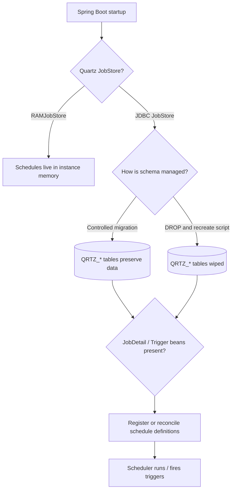
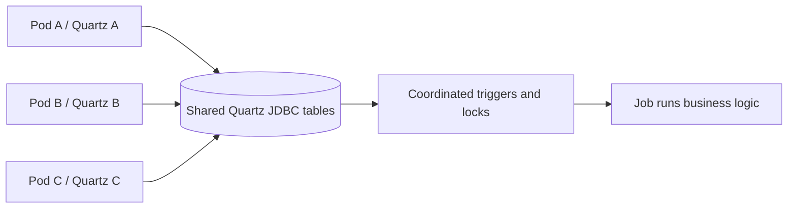
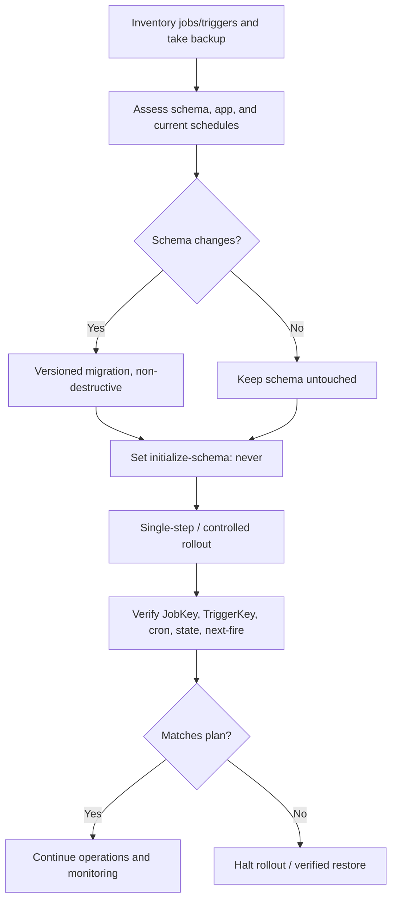

# Schema Initialization, Existing Schedule Data, and Overwrite Risks

## 1. Problem: Should Restarting the Application Wipe Quartz Schedules?

In **Spring Boot Integration**, Quartz routinely runs periodic jobs such as syncing data with partner systems, reconciling payments, sweeping outboxes, purging caches, or emitting events to message brokers. Applications must manage connection settings, state, errors, transactions, deduplication, and observability for these flows. A schedule often outlives the lifecycle of any single Spring Boot instance.

Suppose a reconciliation service defines trigger `settlement/reconcile-cron`, declared in code to run at 01:30, which an operator later adjusts to 02:00. Subsequently, a new application version deploys. If Quartz schema initialization **drops and recreates the schedule tables**, persisted schedules can disappear or revert to default settings. Even if the schema survives, if the application **overwrites job/trigger definitions** in the persistent store, runtime operational edits can still be clobbered.

To prevent these failures, separate three concerns:

1. **Schema initialization:** creating or altering `QRTZ_*` tables in the database. This is a DDL/migration responsibility.
2. **Schedule definition registration:** adding or updating `JobDetail`, `Trigger`, and `Calendar` entries with specific identities and settings. This is a scheduler and configuration code responsibility.
3. **Schedule execution:** Quartz determining when a trigger is due, acquiring locks/connections, invoking `Job.execute`, and updating schedule state in the JobStore.

These three carry different risk levels. `spring.quartz.jdbc.initialize-schema` controls **table initialization** under JDBC setups; `spring.quartz.overwrite-existing-jobs` controls **overwriting existing job/trigger definitions** from Spring-created beans. Disabling definition overwrites **cannot save data if the tables were dropped**.



## 2. RAMJobStore and JDBC JobStore Have Different Implications

| JobStore Type | Where Jobs/Triggers Live | Behavior After Restart | Main Risks |
| --- | --- | --- | --- |
| `RAMJobStore` | Memory of the Quartz process | Runtime-created schedule data is not recovered from RAM; config-declared schedules must be rebuilt | Schedules lost on restart; unsuitable when long-term persistence is needed. |
| JDBC JobStore | Database via Quartz tables | Jobs, triggers, and metadata reload after restart **if schema and data stay intact** | DDL scripts dropping tables, definition overwrites, incompatible migrations, wrong cluster config. |

In Spring Boot, Quartz defaults to an in-memory store unless JDBC is chosen. To persist schedules, you need the right dependencies, a `DataSource`, and `spring.quartz.job-store-type=jdbc`. Persistence also relies on backups, database reliability, and schema deployment practices; enabling JDBC alone does not guarantee schedules cannot be lost.

### 2.1. Common Quartz Tables

With the default `QRTZ_` table prefix, Quartz's JDBC schema typically contains:

| Table | Main Role | Why Preserve It? |
| --- | --- | --- |
| `QRTZ_JOB_DETAILS` | Job definitions by name, group, execution class, `JobDataMap`, and flags | Losing rows removes registered jobs. |
| `QRTZ_TRIGGERS` | General trigger metadata, job links, states, next fire times | Losing rows destroys active schedules and trigger states. |
| `QRTZ_CRON_TRIGGERS` | Cron expressions and time zones for cron triggers | Needed to restore exact cron schedules. |
| `QRTZ_SIMPLE_TRIGGERS` | Repeat counts, intervals, and times triggered for simple triggers | Needed to resume interval schedules accurately. |
| `QRTZ_BLOB_TRIGGERS`, `QRTZ_SIMPROP_TRIGGERS` | Specialized storage for certain trigger types | Required by triggers using those storage formats. |
| `QRTZ_CALENDARS` | Exclusion calendars for dates/times | Directly affects next fire time calculation. |
| `QRTZ_FIRED_TRIGGERS` | Metadata for active/fired triggers handled by schedulers | Tied to recovery and operational state; never delete manually to "fix schedules." |
| `QRTZ_SCHEDULER_STATE`, `QRTZ_LOCKS` | Node status and locking in JDBC/cluster mode | Needed for coordination, not business schedules to hand-edit. |
| `QRTZ_PAUSED_TRIGGER_GRPS` | Paused trigger groups | Deleting rows overrides operational pause intentions. |

Exact table names depend on `org.quartz.jobStore.tablePrefix` and the schema for your Quartz/database version. Quartz stores **scheduling metadata**—it does not guarantee saving full business outcomes of jobs. For example, whether a reconciliation batch already settled a payment still relies on payment-system data and idempotency keys.

### 2.2. Job and Trigger Identities Must Stay Stable

Quartz distinguishes:

- `JobKey(name, group)`: job identity.
- `TriggerKey(name, group)`: trigger identity.
- `JobDataMap`: data attached to definitions or firings; evaluate serializability and version compatibility.

Changing a job/trigger `name` or `group` in a new release can create **a separate definition** instead of updating the old schedule. If the old schedule remains, two triggers can fire the same business logic concurrently. Names and groups are therefore part of your operational contract across upgrades.

## 3. `spring.quartz.jdbc.initialize-schema`: The Risk Lies in DDL Scripts

Spring Boot supports initializing the Quartz schema when using JDBC JobStore. Common values for `spring.quartz.jdbc.initialize-schema`:

| Value | Meaning | Usage |
| --- | --- | --- |
| `always` | Runs the schema initialization script on startup when configured | Suitable only for disposable/test environments where wiping data is acceptable, or with tightly controlled custom non-destructive scripts. |
| `embedded` | Auto-initializes only when Spring Boot detects an embedded database | Common in dev/test, though scripts and existing data still need review. |
| `never` | Skips automatic Quartz schema initialization at startup | The clear choice when production manages schemas via Flyway/Liquibase or DBA workflows. |

**Critical hazard:** standard Quartz schema scripts bundled with Spring Boot may contain **DROP TABLE followed by CREATE TABLE** statements. Spring Boot documentation warns that default initialization scripts can erase existing trigger data on every application startup. In particular, `initialize-schema: always` paired with DROP scripts risks wiping live schedules in JDBC JobStore.

Even with customized scripts, re-running DDL concurrently across multiple starting instances is rarely safe. You must control schema compatibility, migration ordering, deployment locks, and existing data. Nor is `CREATE TABLE IF NOT EXISTS` a complete migration strategy when Quartz upgrades change indexes, constraints, or column definitions.

### 3.1. Distinguishing `initialize-schema` from `overwrite-existing-jobs`

These two independent properties govern two separate layers:

| Property | Primary Effect | What It Cannot Guarantee |
| --- | --- | --- |
| `spring.quartz.jdbc.initialize-schema: never` | Skips Boot's automatic schema initialization step | Does not stop external migrations or custom code from dropping tables or modifying jobs/triggers. |
| `spring.quartz.jdbc.initialize-schema: always` | Executes initialization scripts on startup | Does not protect existing data; depending on the script, may DROP tables. |
| `spring.quartz.overwrite-existing-jobs: false` | Avoids overwriting existing job/trigger definitions in JobStore from startup beans | Does not protect against dropped tables, `Scheduler.deleteJob(...)`, manual rescheduling code, or raw DDL. |
| `spring.quartz.overwrite-existing-jobs: true` | Lets application bean definitions overwrite existing persisted entries during Spring registration | Not a schema management switch, and does not mean schedule changes are business-safe. |

Example: at 09:00, an operator changes trigger `settlement/reconcile-cron` from 01:30 to 02:00; at 10:00, a new release deploys. With `overwrite-existing-jobs=true`, code-declared trigger config can force the schedule back to 01:30. With `initialize-schema=always` running drop scripts, all schedule data in those tables can vanish **before overwrite logic is even evaluated**.

Never use one property to "patch" misbehavior in the other. First decide **whether schemas must survive restarts**, then define **rules for updating schedule definitions**.

## 4. Spring Boot Configuration for Preserving Schedules Durably

Assuming Quartz schemas are provisioned and managed by a dedicated migration pipeline, use a configuration like:

```yaml
spring:
  quartz:
    job-store-type: jdbc
    jdbc:
      initialize-schema: never
    overwrite-existing-jobs: false
    auto-startup: true
    properties:
      org.quartz.scheduler.instanceName: integrationScheduler
      org.quartz.scheduler.instanceId: AUTO
      org.quartz.jobStore.tablePrefix: QRTZ_
      org.quartz.jobStore.isClustered: true
      org.quartz.jobStore.clusterCheckinInterval: 20000
      org.quartz.threadPool.threadCount: 8
```

Explanation:

1. `job-store-type: jdbc` selects a persistent JobStore backed by the Spring-managed `DataSource`.
2. `initialize-schema: never` requires deployments to **prepare schemas before the scheduler runs**, rather than running DDL from every starting pod.
3. `overwrite-existing-jobs: false` preserves existing persisted definitions when Spring registers job/trigger beans; schedule updates follow a separate process.
4. `instanceName` must match across nodes joining the same Quartz cluster; `instanceId: AUTO` gives each scheduler instance a unique ID.
5. `isClustered: true` applies only when multiple Quartz nodes truly share **the same JDBC JobStore** for cluster coordination; single-node or alternative topologies should match reality.
6. `threadCount` must fit resource limits and downstream services. Raising thread counts does not give databases or HTTP APIs extra capacity automatically.

**This is an illustrative configuration for a clustered JDBC deployment.** Do not copy cluster settings blindly to every app. A Quartz cluster requires synchronized clocks, identical database/schema/prefix targets, and consistent scheduler configs; mixing clustered and non-clustered nodes on the same tables corrupts schedule state or causes duplicate runs.

### 4.1. Using a Dedicated DataSource and Transaction Manager for Quartz

When Spring Boot connects to multiple databases, designate a dedicated datasource for Quartz via `@QuartzDataSource`, and a matching transaction manager via `@QuartzTransactionManager` where applicable. Example using a custom namespace:

```yaml
app:
  quartz:
    datasource:
      url: ${QUARTZ_JDBC_URL}
      username: ${QUARTZ_DB_USER}
      password: ${QUARTZ_DB_PASSWORD}
      driver-class-name: org.postgresql.Driver
```

Create `DataSourceProperties` and mark the Quartz datasource:

```java
import javax.sql.DataSource;
import org.springframework.beans.factory.annotation.Qualifier;
import org.springframework.boot.autoconfigure.jdbc.DataSourceProperties;
import org.springframework.boot.autoconfigure.quartz.QuartzDataSource;
import org.springframework.boot.context.properties.ConfigurationProperties;
import org.springframework.context.annotation.Bean;
import org.springframework.context.annotation.Configuration;

@Configuration
class SchedulerDataSourceConfiguration {
    @Bean("quartzDataSourceProperties")
    @ConfigurationProperties(prefix = "app.quartz.datasource")
    DataSourceProperties quartzDataSourceProperties() {
        return new DataSourceProperties();
    }

    @Bean
    @QuartzDataSource
    DataSource quartzDataSource(
            @Qualifier("quartzDataSourceProperties") DataSourceProperties props) {
        return props.initializeDataSourceBuilder().build();
    }
}
```

This assumes a matching JDBC driver and pool are on the classpath and secrets come from the environment. Configuring additional business datasources may require `@Primary`, `@Qualifier`, or extra config depending on your Spring Boot version. Use a least-privilege database/schema account for Quartz, monitor the connection pool, and understand how Quartz transaction management interacts with that datasource.

Avoid setting `org.quartz.jobStore.class` from plain Quartz tutorials when using Spring Boot-managed JDBC JobStore. Spring's managed JobStore has its own connection and transaction hooks; forcing another JobStore class can cause conflicts. Verify deep customizations against your exact Spring Boot, Spring Framework, and Quartz versions.

## 5. Safe Schema Initialization via Controlled Migrations

For production systems holding schedule data, the reliable approach is **versioned migrations** rather than re-running table creation scripts on every restart.

### 5.1. Initial Deployment: Schema Does Not Exist Yet

Recommended steps:

1. Pick the **schema script matching your exact DBMS and Quartz version** (PostgreSQL, MySQL, Oracle, SQL Server, etc. differ in types, indexes, keys, and syntax).
2. Place the table creation DDL into a versioned initial migration, such as `V1__create_quartz_tables.sql` for Flyway. Review the script first and remove any DROP/reset statements incompatible with data preservation.
3. Run the migration **once via the migration pipeline** before multiple scheduler instances query or write the tables.
4. Set `spring.quartz.jdbc.initialize-schema: never` in the application.
5. Start the scheduler and verify jobs/triggers register, SQL queries succeed, and schedules fire accurately.

This is a *process pattern*, not a requirement to invent SQL files manually. Never grab a generic Quartz schema for all databases; always base it on DDL compatible with your Quartz release, DBMS, and DBA standards. Subsequent changes must migrate incrementally from old to new state rather than recreating tables from scratch.

### 5.2. Database Already Contains Tables and Live Schedules

Before any schema change or Quartz upgrade:

1. **Inventory state:** record counts of jobs, triggers, crons, paused groups, key `JobKey`/`TriggerKey` entries, and upcoming fire times.
2. **Verified backup:** take a consistent database backup with a tested restore plan. Include application version info if Quartz tables still store Java-class-coupled serialized data.
3. **Identify schedule ownership:** which triggers are declared in code, which are dynamically created by admin/API, and which are allowed to update during deployment?
4. **Review DDL:** diff the current schema against the target schema, prepare non-destructive migrations, and test rollback paths.
5. **Coordinate rollout:** execute migrations from a single control point before starting schedulers; never let multiple pods mutate schemas while firing triggers.
6. **Post-upgrade checks:** verify jobs/triggers, paused states, and next fire times, and monitor logs for errors as schedules come due.

If an existing script contains `DROP TABLE QRTZ_*`, **never run it on a database holding live schedules** just because a new release asks to "initialize schema." Explicitly check what migrations do and control data-level changes.

### 5.3. Three Environments with Different Strategies

| Environment | Appropriate Schema Policy | Goal |
| --- | --- | --- |
| Unit/integration tests with ephemeral DB | Can recreate schema within test lifecycle, wiping test data | Repeatable, isolated test runs. |
| Staging holding production-like schedules | Versioned migrations and `initialize-schema: never` | Catch upgrade, restart, backup/restore, and overwrite bugs. |
| Production | Approved migrations, backups, `initialize-schema: never` | Preserve schedules and state across rollouts and restarts. |

Even in tests, guard against accidentally pointing to shared or production databases via misconfigured environment variables. Destructive DROP test scripts must only target verified **disposable** data sources.

## 6. Registering `JobDetail`, `Trigger`, and Overwrite Policies

When `JobDetail` and `Trigger` are defined as beans, Spring Boot registers them with the auto-configured `Scheduler`. Stable identities let code reconcile against persisted schedules:

```java
import java.util.TimeZone;
import org.quartz.CronScheduleBuilder;
import org.quartz.Job;
import org.quartz.JobBuilder;
import org.quartz.JobDetail;
import org.quartz.JobExecutionContext;
import org.quartz.JobExecutionException;
import org.quartz.Trigger;
import org.quartz.TriggerBuilder;
import org.quartz.DisallowConcurrentExecution;
import org.springframework.context.annotation.Bean;
import org.springframework.context.annotation.Configuration;

@DisallowConcurrentExecution
public class ReconcileJob implements Job {
    @Override
    public void execute(JobExecutionContext context)
            throws JobExecutionException {
        // In real code: invoke an idempotent business service
        // with timeouts, metrics, error classification, and logging.
    }
}

@Configuration
class ReconcileScheduleConfiguration {
    @Bean
    JobDetail reconcileJobDetail() {
        return JobBuilder.newJob(ReconcileJob.class)
                .withIdentity("reconcile-nightly", "settlement")
                .storeDurably()
                .build();
    }

    @Bean
    Trigger reconcileTrigger(JobDetail reconcileJobDetail) {
        return TriggerBuilder.newTrigger()
                .withIdentity("reconcile-cron", "settlement")
                .forJob(reconcileJobDetail)
                .withSchedule(CronScheduleBuilder
                        .cronSchedule("0 30 1 * * ?")
                        .inTimeZone(TimeZone.getTimeZone("UTC"))
                        .withMisfireHandlingInstructionDoNothing())
                .build();
    }
}
```

In this example, `JobKey` is `settlement/reconcile-nightly` and `TriggerKey` is `settlement/reconcile-cron`. The cron expression illustrates 01:30 daily in UTC. For local business schedules, pick an approved time zone rather than implicitly relying on the server OS zone; changing time zones or cron expressions shifts future fire times.

`storeDurably()` keeps the `JobDetail` even when no trigger is temporarily attached. `@DisallowConcurrentExecution` prevents overlapping runs **of the same `JobKey`** under Quartz rules; it does not block overlapping runs across different `JobKey`s or guarantee single side effects across restarts/failovers. In reconciliation or broker-publishing tasks, enforce idempotency keys per event or processing period.

### 6.1. What Does `overwrite-existing-jobs: false` Preserve and Not Preserve?

When the application registers `JobDetail`/`Trigger` beans matching keys already present in the persistent store, Spring's Quartz integration honors existing definitions rather than overwriting them at startup, depending on registration path and version. With `overwrite-existing-jobs=false`, the goal is **avoiding accidental overwrites of existing jobs from startup bean configs**.

Still verify behavior against **real triggers** in your version:

- An existing trigger might carry an operator-edited cron; reading the Java bean cron alone does not reveal the active persisted cron.
- Calling `Scheduler.scheduleJob(...)` for an existing key may throw `ObjectAlreadyExistsException`; calling `rescheduleJob(...)` updates the schedule. Startup bean policies do not govern direct `Scheduler` API calls.
- Deleting a bean from code does not automatically delete the old definition from the JDBC store. Decommission obsolete schedules explicitly by identity.
- Renaming keys creates parallel schedules even when `overwrite-existing-jobs=false`.

### 6.2. When Should You Enable `overwrite-existing-jobs: true`?

Only when system policy designates **code configuration as the single source of truth** for Spring-registered jobs/triggers and operations teams accept replacing persisted definitions on deploy. Before enabling it, verify:

| Question | Risk if Ignored |
| --- | --- |
| Could admins/APIs have modified cron, time zone, or misfire policies? | Rollout silently reverts valid operational changes. |
| Do new triggers keep the exact `TriggerKey` and `JobKey`? | Creates duplicate schedules or orphans old ones. |
| Does the new definition alter class, `JobDataMap`, or recovery flags? | Jobs may fail to run, fail deserialization, or alter side effects. |
| Do multiple instances register definitions into one store concurrently? | Races and inconsistent updates during staggered-version rollouts. |
| Are backups and pre/post schedule diff tests in place? | Difficult to recover from accidental overwrites. |

It is usually safer to execute **controlled schedule updates** via dedicated admin APIs/commands with authorization, auditing, existence checks, and optimistic preconditions rather than overwriting at every instance startup.

## 7. Rescheduling Existing Triggers Intentionally via API

If a business requirement calls for changing a specific trigger's cron, perform it intentionally via `Scheduler.rescheduleJob`:

```java
import java.util.Date;
import java.util.TimeZone;
import org.quartz.CronScheduleBuilder;
import org.quartz.Trigger;
import org.quartz.TriggerBuilder;
import org.quartz.TriggerKey;
import org.quartz.Scheduler;
import org.quartz.SchedulerException;

public class ScheduleChangeService {
    private final Scheduler scheduler;

    public ScheduleChangeService(Scheduler scheduler) {
        this.scheduler = scheduler;
    }

    public Date changeCron() throws SchedulerException {
        TriggerKey key = TriggerKey.triggerKey(
                "reconcile-cron", "settlement");
        Trigger current = scheduler.getTrigger(key);
        if (current == null) {
            throw new IllegalStateException("Trigger does not exist: " + key);
        }

        Trigger updated = current.getTriggerBuilder()
                .withSchedule(CronScheduleBuilder
                        .cronSchedule("0 0 2 * * ?")
                        .inTimeZone(TimeZone.getTimeZone("UTC"))
                        .withMisfireHandlingInstructionDoNothing())
                .build();

        return scheduler.rescheduleJob(key, updated);
    }
}
```

This illustrative code shifts the schedule to 02:00 UTC; `rescheduleJob` returns the next fire `Date`, or `null` if the trigger could not be updated per API contract. In production, require an authorized actor, change reason, old/new schedule logging, optimistic checks or confirmation steps, and audit trails. The snippet above does not implement administrative concurrency locking.

**Never hand-edit `QRTZ_CRON_TRIGGERS` or `QRTZ_TRIGGERS` rows with manual SQL `UPDATE` statements** while Quartz is running; related fields, caches, and locks must be coordinated through the Quartz API. Direct SQL should only be used for controlled schema migrations and read-only diagnostic queries per Quartz guidance.

## 8. Starting Multiple Quartz Instances Against One Database

When multiple Spring Boot pods **share a persistent JobStore**, treat them as a single Quartz cluster rather than unrelated standalone schedulers.



Cluster requirements:

- All instances use the same `scheduler.instanceName`, matching DB/schema/`tablePrefix`, and consistent cluster settings.
- Each instance has a unique `instanceId`, typically via `AUTO`.
- Node system clocks are synchronized; Quartz relies on trigger timestamps and check-in heartbeats.
- Schema migrations run from **one coordinated point/step**. Never let pods run DROP/CREATE scripts during parallel rollouts.
- Size DB connection pools, thread pools, downstream rate limits, and retry budgets for the total pod count.
- Never point two unrelated applications into the same `QRTZ_*` tables without clear namespace isolation and permissions.

Even with clustering, crashing after a job writes data or makes an HTTP call—yet before Quartz marks completion—can trigger recovery or retries. Never claim "clustered Quartz guarantees business exactly-once"; enforce idempotency keys, processing states, and outboxes where needed.

### 8.1. Misfires and Restarting After Downtime

If a job was due at 01:30 while the system was down until 03:00, Quartz applies the trigger's **misfire instruction**:

- For `CronTrigger`, `DoNothing` discards missed due times and advances to the next valid schedule.
- `FireAndProceed` fires once immediately to catch up and then continues normally.
- `SimpleTrigger` offers distinct policies governing repeat counts and intervals that must be chosen carefully.

Misfire handling is independent of schema overwrites, yet **preserving schedules across restarts** is incomplete without deciding how missed runs behave. For financial tasks, catch-up vs. skip decisions must rely on explicit business periods and idempotent design.

## 9. JobDataMap Data and Version Upgrade Compatibility

With JDBC JobStore, beyond table schemas, deployments can break reading persisted `JobDataMap` entries:

1. Avoid storing custom Java objects or secrets in `JobDataMap` that get serialized and later fail to load on newer classpaths. Prefer business IDs and small, explicitly versioned configuration fields.
2. Quartz provides `org.quartz.jobStore.useProperties` for a more compatible map format, which restricts values to Strings. Never toggle it on a live store without testing and migrating existing entries.
3. Renaming a job's package or class can leave `QRTZ_JOB_DETAILS` pointing to an obsolete class name. Plan backward compatibility or controlled metadata updates.
4. Back up schemas alongside application versions and migration history. Restoring an older DB snapshot against incompatible new code can crash job loading.
5. Enforce clear **ownership** over schedule definitions and job states: who may create, pause, resume, delete, or reschedule, and which actions require audits.

When jobs call HTTP APIs or emit events, `JobDataMap` is not the primary progress store for distributed transactions. Use the business database, idempotency keys, and transactions/outboxes to track which orders or reconciliation periods are completed.

## 10. Inspecting State Before and After Deployment

Before deploying, take a read-only inventory from the Quartz database. The queries below assume the default prefix; table/schema names may vary with configuration:

```sql
-- Count of job and trigger definitions
SELECT COUNT(*) AS total_jobs FROM QRTZ_JOB_DETAILS;
SELECT COUNT(*) AS total_triggers FROM QRTZ_TRIGGERS;

-- Trigger states (NORMAL, PAUSED, ERROR, ...)
SELECT TRIGGER_STATE, COUNT(*) AS total
FROM QRTZ_TRIGGERS
GROUP BY TRIGGER_STATE
ORDER BY TRIGGER_STATE;

-- Cron triggers and next fire times (Unix epoch milliseconds)
SELECT t.SCHED_NAME, t.TRIGGER_GROUP, t.TRIGGER_NAME,
       t.JOB_GROUP, t.JOB_NAME,
       t.TRIGGER_STATE, t.NEXT_FIRE_TIME,
       c.CRON_EXPRESSION, c.TIME_ZONE_ID
FROM QRTZ_TRIGGERS t
JOIN QRTZ_CRON_TRIGGERS c
  ON c.SCHED_NAME = t.SCHED_NAME
 AND c.TRIGGER_GROUP = t.TRIGGER_GROUP
 AND c.TRIGGER_NAME = t.TRIGGER_NAME
ORDER BY t.TRIGGER_GROUP, t.TRIGGER_NAME;
```

`NEXT_FIRE_TIME` in Quartz tables is typically stored as **epoch milliseconds**. Convert to the appropriate time zone when reporting rather than reading raw integers as local time. Exact columns and statuses depend on your Quartz schema and version.

You can also inspect via the Quartz API (on a scheduler pointing to the same JobStore) rather than querying tables directly:

```java
import org.quartz.JobKey;
import org.quartz.Scheduler;
import org.quartz.Trigger;
import org.quartz.TriggerKey;

void inspect(Scheduler scheduler) throws Exception {
    JobKey jobKey = JobKey.jobKey(
            "reconcile-nightly", "settlement");
    TriggerKey triggerKey = TriggerKey.triggerKey(
            "reconcile-cron", "settlement");

    boolean jobExists = scheduler.checkExists(jobKey);
    Trigger trigger = scheduler.getTrigger(triggerKey);

    System.out.println("job exists: " + jobExists);
    System.out.println("trigger exists: " + (trigger != null));
    if (trigger != null) {
        System.out.println("next fire: " + trigger.getNextFireTime());
        System.out.println("state: " + scheduler.getTriggerState(triggerKey));
    }
}
```

Compare **before vs. after**:

| Data to Compare | Why It Matters |
| --- | --- |
| Job/trigger counts and key lists | Catches full resets, missing schedules, or duplicate schedules. |
| Cron, time zone, misfire policy | Catches overwritten schedules even when row counts stay identical. |
| Trigger states and paused groups | Prevents silently unpausing admin-paused schedules. |
| `NEXT_FIRE_TIME` | Catches unexpected shifts in the next scheduled run. |
| `JobDataMap`/job class compatibility | Avoids jobs sitting in DB that fail to instantiate at fire time. |
| Actual execution counts and side effects | Detects reruns caused by recovery, misfires, or retries. |

Keep SQL checks strictly **read-only**; never run `DELETE` or `TRUNCATE` to "clean up tables," as doing so destroys schedules and breaks table relationships.

## 11. Real-World Incident Scenarios

### 11.1. Restart Wipes Out All Triggers

**Symptom:** hundreds of triggers existed before deploy; only a handful declared in source code remain afterward.

**Diagnosis:**

1. Check effective `spring.quartz.job-store-type` and `spring.quartz.jdbc.initialize-schema` on the newly started instance.
2. Check schema initializer/migration logs, scripts configured via `spring.quartz.jdbc.schema`, and whether DDL contains `DROP TABLE` or delete statements.
3. Verify the target database/schema/`tablePrefix` matches the environment; do not confuse pointing at an empty new DB with wiping live data.
4. Cross-check backups, deployment logs, and pre-rollout job/trigger snapshots.
5. If a reset is confirmed, **halt any processes still resetting tables**, coordinate a consistent restore, and audit side effects of any jobs that ran during the incident window.

**Root fix:** move production schemas to controlled migrations, set `initialize-schema: never`, test restarts against populated databases, and lock down DDL changes.

### 11.2. Schema Survives, Yet Cron Reverts to Old Value

**Symptom:** `QRTZ_TRIGGERS` rows remain intact, yet a trigger's cron reverts from 02:00 back to 01:30 upon deployment.

**Diagnosis:** check for `overwrite-existing-jobs=true`, matching `JobDetail`/`Trigger` bean keys, or startup code calling `rescheduleJob`. Identify whether admin/API edits occurred and clarify the source of truth.

**Root fix:** align schedule configuration ownership, keep overwrite disabled by default when appropriate, move schedule updates to audited commands, and test before/after diffs.

### 11.3. After Upgrade, Triggers Remain Yet Jobs Fail

**Symptom:** Quartz sees the trigger, yet fails to instantiate the job class or read job data.

**Diagnosis:** compare `JOB_CLASS_NAME` in `QRTZ_JOB_DETAILS` against new code; check classpath, serialized `JobDataMap`, schema, and Quartz version.

**Root fix:** provide compatibility migrations for job classes and persisted data, keep bridge classes during transition windows, and roll back cleanly if legacy data cannot be read.

### 11.4. Multiple Pods Execute the Same Reconciliation Period

**Symptom:** two instances perform identical work, issuing duplicate HTTP calls or messages.

**Diagnosis:** check whether instances genuinely share one JDBC cluster, use the same `JobKey`, introduced new triggers via renamed keys, or experienced crash recovery.

**Root fix:** enforce consistent cluster settings, use `@DisallowConcurrentExecution` on shared `JobKey`s where appropriate, and enforce idempotency at the business layer. Never treat Quartz clustering as proof of exactly-once execution.

## 12. Safe Rollout Workflow with Existing Schedule Data



Release checklist:

1. **Before deploy:** capture an inventory of schedule identities, crons, time zones, paused states, and next fire times; verify backups can restore.
2. **Configuration:** correct persistent store; `initialize-schema: never` where schedules must survive; `overwrite-existing-jobs` aligned with ownership.
3. **Schema:** migrations matched to DBMS and Quartz version; no per-pod DROP/CREATE scripts.
4. **Schedule registration:** preserve `JobKey`/`TriggerKey` or run explicit identity migrations; review all cron/misfire/data-map edits.
5. **Clustering:** shared store, consistent cluster config, unique node IDs, synchronized clocks, and sufficient datasource capacity.
6. **Observability:** watch scheduler startup errors, trigger counts, paused/error states, misfires, job latency, and retries.
7. **Recovery:** have procedures to pause/stop jobs, restore/reconcile, and compensate business state rather than blindly replaying jobs with side effects.

## 13. Self-Check Questions

1. Why does `spring.quartz.overwrite-existing-jobs=false` fail to protect schedules if schema scripts execute `DROP TABLE`?
2. When the database holds dynamically created triggers, why does restarting with JDBC JobStore behave differently from `RAMJobStore`?
3. During a three-pod rollout, what can go wrong if every pod runs `initialize-schema=always` against the same database?
4. When source code edits a cron expression while production holds API-edited schedules, which should be the source of truth and what approval flow is needed?
5. Why can renaming a `JobKey` or `TriggerKey` create duplicate executions even when overwrites are disabled?
6. Can rows in `QRTZ_TRIGGERS` prove a reconciliation period settled payment exactly once? What must be added in the business database?
7. When schedules are wiped accidentally, why must you inspect business side effects before restoring and running catch-up?

**Key takeaway:** In Quartz with JDBC JobStore, **preserving the schema** and **preserving schedule definitions** are two independent decisions. Use controlled migrations, set `spring.quartz.jdbc.initialize-schema: never` wherever schedules must persist, align `overwrite-existing-jobs` with schedule ownership, keep identities stable, and verify state before and after rollouts. When Quartz orchestrates Spring Boot integration flows across databases, HTTP APIs, or brokers, timely schedule firing must still be paired with transactions, bounded retries, idempotency, and business-level observability.
