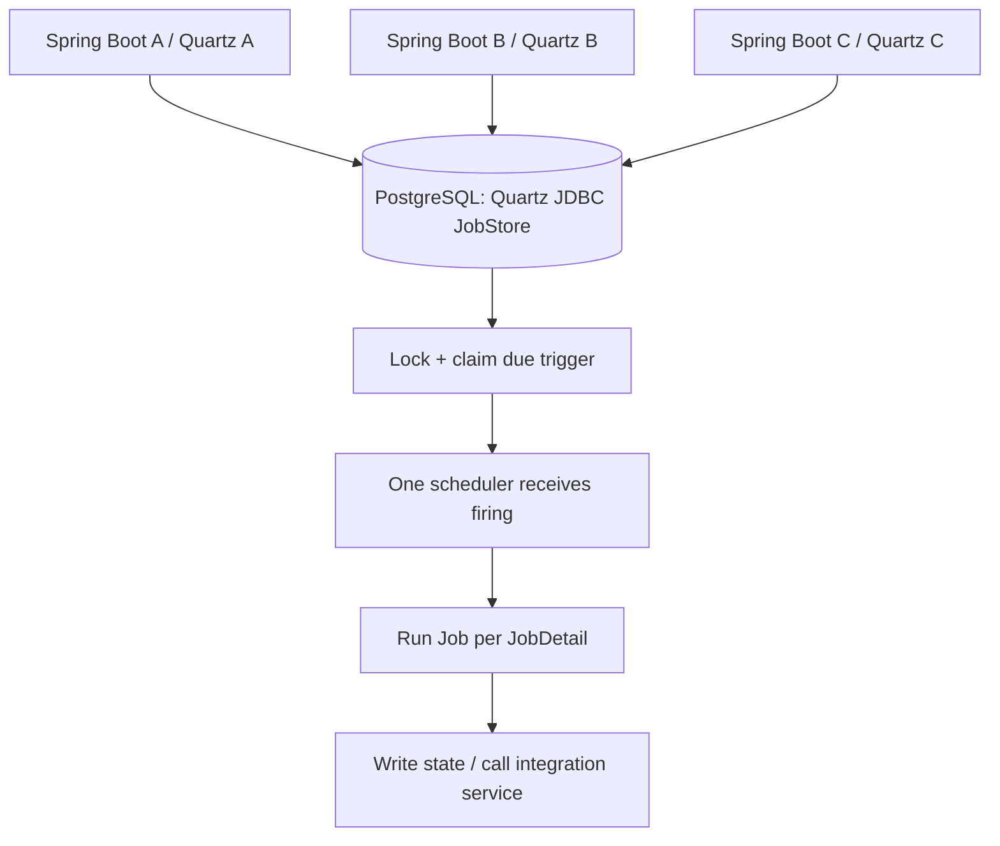
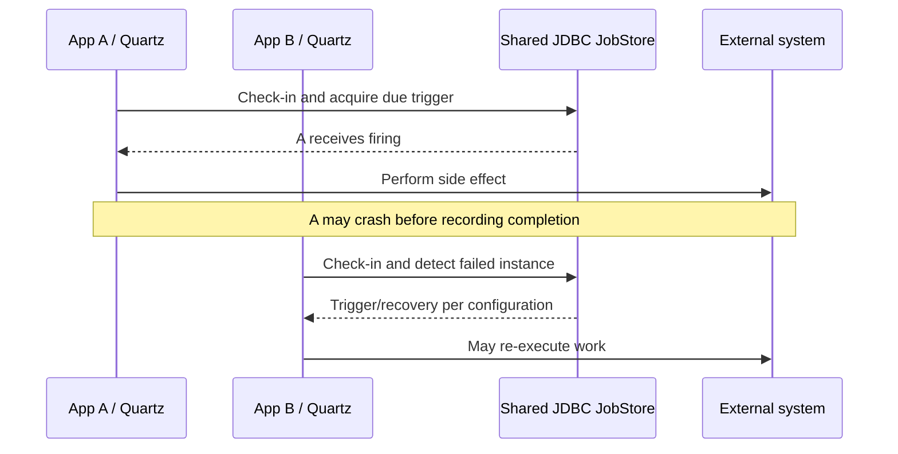

# Clustering and Ensuring Only One Node Executes a Job

## 1. Problem: One Schedule Across Multiple Spring Boot Instances

In the **SPRING_BOOT_INTEGRATION** module, a Spring Boot application may need to run periodic tasks to reconcile payments, sync orders from HTTP APIs, check pending outbox records, refresh caches, or send messages to brokers. When running multiple instances for high availability, a key question arises: **at a scheduled due time, which instance is allowed to execute the job?**

Suppose three instances `app-A`, `app-B`, and `app-C` all define a reconciliation task every 5 minutes. If each instance runs `@Scheduled` independently, all three can call the partner API and update the same records simultaneously. For some workloads, triple execution merely wastes resources; for payments or fulfillment, duplicate side effects cause data corruption.

**Quartz clustering** allows multiple schedulers to share a **JDBC JobStore** to coordinate trigger acquisition. When a cluster is properly configured, **a specific trigger firing** is claimed and executed by only one scheduler instance via Quartz's locking and coordination mechanism.

Distinguish this from two other requirements:

| Practical Requirement | How Much Does Quartz Support? |
|---|---|
| Each time a trigger is due, only **one node** claims that firing | JDBC clustering coordinates trigger acquisition through a shared database |
| No two overlapping runs of the **same `JobDetail`** | Add `@DisallowConcurrentExecution` on the Job class; scoped to the same `JobKey` |
| Business side effects occur **exactly once** despite crashes/retries | Not guaranteed automatically; requires idempotency, transactions, data constraints, and recovery |
| One single node performs **every** job in the cluster | Not the default goal; different firings can run on different nodes |

For example: at 10:00, `app-A` acquires one firing of the reconciliation job; at 10:05, `app-C` may acquire the next firing. That is completely normal. A Quartz cluster does not require a permanent pinned leader node.

## 2. How Does Quartz Distribute Work in a Cluster?

### 2.1. Concepts to Distinguish

- **Scheduler instance:** a Quartz scheduler process/instance running inside a Spring Boot application.
- **JobDetail:** describes the job, including `JobKey` (group + name), Job class, and `JobDataMap`.
- **Trigger:** defines firing timestamps and schedule rules, such as every 5 minutes or once at a specific instant.
- **Fire / execution:** a single execution spawned by a trigger. `fireInstanceId` identifies that run, though it is not necessarily a valid business deduplication key across retries or recovery.
- **JDBC JobStore:** Quartz database tables storing schedules, triggers, scheduler states, and coordination metadata.

When multiple schedulers belong to **the same Quartz cluster**, they access the same Quartz tables. Each scheduler checks for due triggers, while state transitions and trigger acquisition are coordinated via JobStore locks and transactions. Under normal conditions, two nodes will not claim the same trigger firing.



Common tables with the default `QRTZ_` prefix:

| Table Group | General Role |
|---|---|
| `QRTZ_JOB_DETAILS`, `QRTZ_TRIGGERS`, `QRTZ_CRON_TRIGGERS` | Store `JobDetail` and schedule metadata |
| `QRTZ_LOCKS` | Coordinate required locks among schedulers |
| `QRTZ_FIRED_TRIGGERS` | Track triggers acquired/executing for management and recovery |
| `QRTZ_SCHEDULER_STATE` | Record status/check-ins of cluster instances |

These tables represent **Quartz internal state**; applications should never edit them directly to "force" a node to run a job. To create, update, or stop schedules, use the `Scheduler` API or controlled configuration workflows.

### 2.2. Not Application-Wide Leader Election

Quartz does not elect `app-A` as permanent leader, nor does it ensure "only one instance of the app executes all business logic." It coordinates **acquiring and firing triggers** across schedulers sharing a JobStore.

If the application also runs `@Scheduled` methods, Kafka listeners, RabbitMQ consumers, or external crons, Quartz clustering does not coordinate those. If two jobs with **different `JobKey`s** touch the same orders table, Quartz does not stop them from modifying the same record either. Data consistency at the business layer still needs separate protection.

## 3. Mandatory Conditions for Multiple Nodes to Truly Form One Cluster

Simply scaling pods/VMs or adding the Quartz dependency is not enough. All of the following must hold simultaneously:

| Condition | Configuration / Meaning |
|---|---|
| **JDBC JobStore** | Use a shared DB-backed JobStore; each node's `RAMJobStore` is isolated and does not cluster |
| **Same database and Quartz table set** | All nodes share the same schema, tables, table prefix, and schedule data |
| **Clustering enabled on every node** | `org.quartz.jobStore.isClustered=true` must be set consistently |
| **Same scheduler name** | `org.quartz.scheduler.instanceName` identical across nodes in the cluster |
| **Unique scheduler instance IDs** | `org.quartz.scheduler.instanceId=AUTO` or explicitly unique IDs per node |
| **Identical Job/Trigger definitions** | Job classes loadable on every node; `JobKey`, `TriggerKey`, and cron/time zones deployed consistently |
| **Synchronized clocks** | Hosts must keep time synchronized (e.g., NTP); large clock skew breaks firing/check-ins/misfires |
| **Stable DB connections and transactions** | Sufficient connections, proper DB locking, appropriate check-in intervals |
| **Non-overlap rules where business requires** | Apply `@DisallowConcurrentExecution` to executions sharing a `JobKey` |
| **Safe retry capability** | Jobs are idempotent or have recovery mechanisms for external side effects |

If node A uses `integration-cluster` while node B uses `integration-cluster-v2`, Quartz treats them as two separate clusters. If node B points to a different Quartz database, they cannot coordinate trigger claims either.

### 3.1. Spring Boot Configuration with JDBC JobStore

Example `application.yml` for PostgreSQL where Quartz schemas are already provisioned via migrations:

```yaml
spring:
  quartz:
    job-store-type: jdbc
    jdbc:
      initialize-schema: never
    overwrite-existing-jobs: false
    properties:
      org.quartz.scheduler.instanceName: integration-quartz-cluster
      org.quartz.scheduler.instanceId: AUTO
      org.quartz.jobStore.isClustered: true
      org.quartz.jobStore.clusterCheckinInterval: 20000
      org.quartz.jobStore.misfireThreshold: 60000
      org.quartz.threadPool.threadCount: 8
```

All nodes use **the same** cluster config above, pointing securely to the live database via `spring.datasource.*` or your secret configuration source. When Spring Boot auto-configures `SchedulerFactoryBean` with a `DataSource`, do not arbitrarily override `org.quartz.jobStore.class` with another JobStore type; check compatibility with your Spring Boot/Quartz versions.

Meaning:

- `job-store-type: jdbc`: persists `JobDetail`/`Trigger` via JDBC JobStore instead of per-node RAM schedules.
- `initialize-schema: never`: skips automatic DDL on startup. **Provision Quartz tables beforehand** using scripts/migrations matching your database and Quartz version. In production, avoid `initialize-schema: always` because some init scripts drop and recreate tables, wiping saved schedules.
- `instanceName`: shared identifier naming the scheduler cluster.
- `instanceId: AUTO`: lets Quartz generate unique per-instance IDs. If set statically, each node must have a distinct value.
- `isClustered: true`: enables cluster coordination with JDBC JobStore. Never mix clustered and non-clustered nodes on the same tables.
- `clusterCheckinInterval: 20000`: check-in interval in milliseconds; a recovery tuning parameter, not a strict failover guarantee time.
- `misfireThreshold: 60000`: delay threshold in milliseconds before Quartz treats a trigger as misfired; exact handling depends on trigger type.
- `overwrite-existing-jobs: false`: avoids overwriting persisted `JobDetail`/`Trigger` entries merely because startup bean definitions change. Production cron updates should go through intentional updates rather than letting pods of mixed versions overwrite triggers on deploy.

When nodes share a database, restrict DB permissions to prevent targeting the wrong schema or running incompatible migrations between app versions.

### 3.2. Common Misconfigurations

```yaml
# Example config that DOES NOT form a valid Quartz cluster:
spring:
  quartz:
    job-store-type: memory
```

Here each instance keeps its JobStore in RAM. Three nodes may define identically named schedules yet still run three independent copies. Likewise, configuring JDBC per node pointing to **three separate databases** does not create a cluster.

Do not substitute Quartz clustering with an assumption that "the load balancer routes requests to one node": Quartz schedules fire internally inside schedulers, never passing through an HTTP load balancer.

## 4. JobKey, TriggerKey, and `@DisallowConcurrentExecution`

### 4.1. One Firing Does Not Mean Zero Overlapping Executions

Suppose a reconciliation job is scheduled every minute but takes 3 minutes to finish. At the next minute, a **new** firing can occur before the previous run finishes. Quartz clustering prevents two nodes from claiming **the same firing**, yet does not inherently stop two different firings from running in parallel.

Add `@DisallowConcurrentExecution` to the Job class to prevent executions of the **same `JobDetail`/`JobKey`** from overlapping:

```java
@DisallowConcurrentExecution
public class ReconcileShipmentJob implements Job {
    private static final Logger log =
        LoggerFactory.getLogger(ReconcileShipmentJob.class);

    @Override
    public void execute(JobExecutionContext context)
            throws JobExecutionException {
        try {
            String nodeId =
                context.getScheduler().getSchedulerInstanceId();
            log.info(
                "jobKey={}, fireId={}, node={}, scheduledAt={}, recovering={}",
                context.getJobDetail().getKey(),
                context.getFireInstanceId(),
                nodeId,
                context.getScheduledFireTime(),
                context.isRecovering()
            );

            // Call business service via DI-capable JobFactory if needed.
            // Service must still be idempotent and manage DB transactions.
        } catch (SchedulerException e) {
            throw new JobExecutionException(e);
        }
    }
}
```

This annotation **does not lock the entire Java class**. For example:

| JobDetail | Java Class | Can Run Concurrently? |
|---|---|---|
| `integration.reconcile-all` | `ReconcileShipmentJob` | Firings of **this specific `JobKey`** do not overlap when annotated |
| `integration.reconcile-east` and `integration.reconcile-west` | Same `ReconcileShipmentJob` | Two distinct `JobKey`s can still run concurrently |
| `integration.reconcile-all` and `integration.expire-orders` | Two different classes | Can still run concurrently |

If both `JobKey`s write to the same records, enforce additional database/business constraints, locks, or work partitioning.

The annotation relies on Quartz maintaining healthy JobStore and scheduler state. It does not replace a target system's **fencing token/lease** when strict write exclusion is required across network partitions, crash recovery, or zombie processes still emitting side effects.

### 4.2. Declaring Stable JobDetails and Cron Triggers

Spring Boot registers `JobDetail`/`Trigger` beans into the configured scheduler. Example:

```java
@Configuration
class ReconcileQuartzConfiguration {

    @Bean
    JobDetail reconcileShipmentJobDetail() {
        return JobBuilder.newJob(ReconcileShipmentJob.class)
            .withIdentity("reconcile-shipments", "integration")
            .storeDurably()
            .requestRecovery(true)
            .build();
    }

    @Bean
    Trigger reconcileShipmentTrigger(
            @Qualifier("reconcileShipmentJobDetail") JobDetail jobDetail) {
        return TriggerBuilder.newTrigger()
            .withIdentity("reconcile-shipments-cron", "integration")
            .forJob(jobDetail)
            .withSchedule(
                CronScheduleBuilder.cronSchedule("0 0/5 * * * ?")
                    .inTimeZone(TimeZone.getTimeZone("UTC"))
                    .withMisfireHandlingInstructionDoNothing()
            )
            .build();
    }
}
```

In this example:

- `JobKey = integration.reconcile-shipments`, identical on every node.
- `TriggerKey = integration.reconcile-shipments-cron`, a shared schedule in JDBC JobStore.
- `requestRecovery(true)` asks Quartz to consider re-running the `JobDetail` if the node executing it fails. **Not an exactly-once guarantee.**
- `withMisfireHandlingInstructionDoNothing()` chooses to **skip missed cron timestamps** and wait for the next valid slot; select only if business rules tolerate skipping periods.

On startup, nodes may simultaneously attempt to register schedule definitions. Keep job creation/updates consistent: use fixed `JobKey`/`TriggerKey`s, version cron changes, and establish schedule bootstrap/migration procedures. Never generate random `JobKey`s with hostnames or UUIDs on startup when aiming for **one shared `JobDetail`**. For API-driven registration, `checkExists()` followed by `scheduleJob()` across nodes still races; designate a single registration path or handle already-exists errors cleanly.

> **Dependency injection note:** Quartz instantiates `Job` directly via `JobFactory`. If a Job calls Spring services, use a DI-capable `JobFactory` and verify your Spring Boot setup. You can use `SchedulerFactoryBeanCustomizer` to wire an appropriate `JobFactory` rather than assuming every Job is automatically a Spring bean. In the example above, the Job only logs, so no dependency injection was needed.

## 5. What Happens When an Executing Node Fails?

### 5.1. Startup, Disconnection, and Recovery

A typical sequence:



Quartz tracks each instance's check-ins. When a node stops checking in on time, live nodes detect the failure and handle pending work based on JobStore state, recovery requests, and misfire policies. Recovery timing is not a fixed constant number of seconds; it depends on check-in intervals, DB latency, busy workers, and trigger policies.

| Failure Timing | Expected / Testable Outcome |
|---|---|
| Node dies before acquiring firing | Another node acquires the firing when due |
| Node acquired firing then died before processing | Quartz performs recovery/misfire handling per config; verify work gets processed |
| Node succeeded HTTP call then died before saving state | Another node may rerun and repeat the HTTP call without idempotency |
| Node temporarily loses DB connection | Do not guess instantly whether another run occurred; check actual state and recovery |
| All nodes down across multiple cron ticks | Misfire policy decides whether missed ticks are skipped or processed otherwise |
| Job runs longer than cron interval | Requires `@DisallowConcurrentExecution` if same `JobKey` must not overlap |

**Recovery is not general business retry.** `requestRecovery(true)` targets scheduler instance crashes mid-execution. If `execute()` throws `JobExecutionException` because a partner API returns 503, Quartz does not automatically provide safe retries for every case. Design retry/backoff, misfire handling, or explicit rescheduling per requirement.

### 5.2. Misfires Are Not Crash Recovery

A **misfire** occurs when a trigger falls behind schedule past the configured threshold. Common policies for cron triggers:

| Policy | Business Meaning |
|---|---|
| `DoNothing` | Discards missed cron runs, waits for future slots |
| `FireAndProceed` | Fires once to handle missed slots, then resumes schedule |
| Default smart policy | Quartz picks per trigger type; verify actual behavior before production |

If business rules require reconciling **every single day**, never rely on misfires alone to cover every day. Store completed business timestamps/periods and sweep missing gaps; misfires govern trigger activation, whereas business data governs **what work remains undone**.

## 6. "One Node Executes" Still Requires Protecting Business Logic from Duplicates

In system integration, Quartz only coordinates **when and which scheduler runs a Job**. It does not create a distributed transaction spanning databases, HTTP clients, caches, brokers, and Spring Integration adapters.

Suppose a job reads 500 pending orders and calls a partner HTTP API. Node A succeeds for 300 orders and crashes before recording results; Quartz triggers recovery on node B. If node B reprocesses all 500 orders from scratch, duplicate requests go out.

To design safely:

1. **Define stable business keys.** E.g., `(jobName, businessDate)` for daily reconciliation or `orderId` for order submission. Never use `fireInstanceId` as the unique business key if recovery must recognize the same logical task.
2. **Enforce constraints where state lives.** Unique constraints or conditional status updates guard single-application state transitions.
3. **Decouple external I/O from DB.** Use transactional outboxes for durable broker publishing; for HTTP, use idempotency keys or receiver status-lookup APIs.
4. **Support resuming after failure.** Checkpoint per record or batch and reclaim interrupted items cleanly. `IN_PROGRESS` rows need clear leases/timeouts/reclaim logic so they never hang forever after crashes.
5. **Bound concurrency.** `@DisallowConcurrentExecution` prevents overlaps for the same `JobKey`; if distinct jobs touch the same resources, add business-level locks/constraints.

### 6.1. Example Constraint: "A Business Period Completes Only Once"

A checkpoint table can track reconciliation periods by unique key:

```sql
CREATE TABLE reconciliation_run (
    job_name        VARCHAR(80) NOT NULL,
    business_period VARCHAR(40) NOT NULL,
    state           VARCHAR(20) NOT NULL,
    claimed_at      TIMESTAMP WITH TIME ZONE,
    completed_at    TIMESTAMP WITH TIME ZONE,
    PRIMARY KEY (job_name, business_period)
);
```

Before processing, the service can attempt to claim the exact period **atomically inside a database transaction** and proceed only if the claim succeeds, updating to `COMPLETED` afterward. In PostgreSQL, `INSERT ... ON CONFLICT DO NOTHING` initiates non-duplicate claims, yet **inserting once is not enough**: if the process dies after inserting `IN_PROGRESS`, subsequent runs must know when to reclaim and how to stop stale workers from writing late. High-exclusivity workflows may require **leases with fencing tokens** validated by the target system.

Never wrap long HTTP calls inside a database transaction just to "hold a lock"; that prolongs transactions, raises contention, and still cannot roll back committed HTTP side effects. Use short claim/checkpoint transactions with idempotent tasks instead.

### 6.2. When the Job Polls an Outbox or Invokes Spring Integration

A Quartz job sweeping an outbox table can serve as the **periodic trigger** for a Spring Integration flow. Clustering ensures Quartz nodes coordinate receiving the trigger, while the outbox processor still must:

- Claim records safely when multiple consumers/workers run concurrently.
- Avoid losing events if the broker refuses connections or an instance dies between publish and marking `SENT`.
- Use stable `eventId`/business keys so consumers handle duplicates safely.
- Provide retries, dead-letter handling, and observable failure states.

If the Quartz Job hands messages to an in-memory `ExecutorChannel` or `QueueChannel`, `execute()` returning success only proves handoff to the channel—it **does not prove downstream workers finished**. If the app crashes after Quartz marks the Job done yet before consumers finish, work can be lost. Use durable outboxes/brokers or wait for acknowledgments aligned with your business contract.

## 7. Testing the "Single-Node Execution" Condition with Two Real Instances

Unit testing a Job class only checks `execute()` logic; it does not prove Quartz clustering coordinates multiple nodes. Cluster verification tests should spin up **two separate Spring Boot/Quartz instances** pointing to the same PostgreSQL/Testcontainers database and Quartz schema with distinct `instanceId`s.

### 7.1. Normal Execution Scenario

1. Initialize Quartz schema and start nodes A and B with the same `instanceName`, `isClustered=true`, and shared database.
2. Register **one** `JobDetail` with a fixed `JobKey` and **one** trigger firing at a controlled time; avoid generating per-node `JobKey`s.
3. Have the Job insert an audit row into a test business table recording `jobKey`, `scheduledFireTime`, `fireInstanceId`, `schedulerInstanceId`, and start/end timestamps.
4. Wait for execution using a bounded timeout condition (e.g., Awaitility), then query the audit table after transaction commit.
5. Verify **only one execution row exists for the tested fire time**, executed by one of the two nodes. Run across multiple ticks to verify both nodes can pick up work over time when scheduling permits.

```text
Expected log example:
10:00:00 INFO job=integration.reconcile-shipments
              scheduledAt=10:00:00 node=app-B fireId=<id-1>
10:05:00 INFO job=integration.reconcile-shipments
              scheduledAt=10:05:00 node=app-A fireId=<id-2>

Both nodes should never log a firing for 10:00.
```

In logs, `schedulerInstanceId` is Quartz's ID, not necessarily the pod name or hostname. Include application instance metadata for clear tracing.

### 7.2. Testing `@DisallowConcurrentExecution`

Attach **two closely spaced triggers to one `JobKey`** with a controlled slow handler. Track concurrent active job executions:

- With the annotation: executions of the same `JobDetail` never overlap, even across a multi-scheduler cluster.
- Without the annotation: distinct firings can overlap depending on thread pool and trigger timing.
- With two different `JobKey`s using the same Job class: the annotation does not serialize the two `JobKey`s against each other.

In tests, record `startTime`/`endTime` to compute interval overlap or use synchronized counters; never infer concurrency safety solely from the order of two log lines.

### 7.3. Crash and Recovery Scenario

1. Register a job with `requestRecovery(true)` that starts processing and pauses at a controllable checkpoint.
2. After confirming node A claimed the firing, **terminate process A abruptly** instead of calling graceful shutdown.
3. Keep node B running and wait for the check-in/recovery window within test timeouts.
4. Confirm node B detects the dead instance and launches recovery per configuration; record `context.isRecovering()` alongside business state.
5. Deliberately have node A write a side effect before dying. After recovery, confirm final state was not applied twice thanks to idempotency/unique constraints.

You cannot prove exactly-once merely by counting `execute()` calls: a job may legitimately run twice under recovery while **business outcomes** remain exact.

### 7.4. Misfires and Configuration Drift Scenarios

Test these additional cases:

| Test Case | Assertion |
|---|---|
| Stop all nodes across several cron ticks, then restart | Skip or catch-up matches misfire policy |
| Node A and B run with different `instanceName`s | Do not form a single cluster; misconfiguration detected |
| One node accidentally uses `RAMJobStore` | Shared coordination fails; caught before production |
| Same business key submitted twice | Side effect applies only once per idempotency rules |
| Trigger becomes due while prior run is active | No overlap for the same `JobKey` under `@DisallowConcurrentExecution` |
| Quartz database briefly unreachable | Observe scheduler errors, recovery time, missed triggers, and resumption behavior |

For repeatable tests, use an isolated database per test suite, deterministic identities/fixtures scoped to the test, bounded wait assertions, and full scheduler/container cleanup afterward. Avoid relying purely on fixed `Thread.sleep()` calls, which turn flaky under CI thread contention.

## 8. Operating a Cluster: What to Monitor and What to Avoid

### 8.1. Monitoring Scheduler and Work State

| Signal | Interpretation |
|---|---|
| Active checking-in schedulers | Detects disconnected nodes or nodes missing from the cluster |
| Due triggers not executing | Indicates misfires, saturated thread pools, DB errors, or paused/blocked jobs |
| Active execution counts and durations | Flags jobs running longer than their cron period |
| Job failures, recoveries, misfires | Tracks error rates per `JobKey` and `TriggerKey` |
| Database lock waits / pool exhaustion | Surfaces contention on JDBC JobStore |
| HTTP/broker call counts and idempotency hits | Reveals duplicate side effects and external integration errors |
| Latency from scheduled fire to business completion | Measures end-to-end delay, not just trigger lag |

Include at least `jobKey`, `triggerKey`, `scheduledFireTime`, `fireInstanceId`, `schedulerInstanceId`, `businessKey`, and `recovery flag` in logs/traces. For integrations, add HTTP/message correlation IDs to trace across databases, brokers, and adapters.

You can inspect `QRTZ_SCHEDULER_STATE` to diagnose check-ins, though it is not a business success audit table. A killed Job can still leave unfinished business work; maintain business audits independently.

### 8.2. Operational Guardrails

**Never run destructive schema initialization on startup.** In JDBC JobStore, dropping/recreating Quartz tables destroys schedules and recovery state; manage DDL via controlled migrations.

**Never assign identical instance IDs across multiple nodes.** Quartz must distinguish individual schedulers during check-ins and recovery.

**Never auto-generate fresh job/schedule identities per node.** Two `JobKey`s differing only by hostname suffix are two completely independent jobs to Quartz.

**Never mistake graceful shutdown for a crash test.** Graceful shutdown waits for jobs to finish; node failures must be tested abruptly.

**Never substitute idempotency with `@DisallowConcurrentExecution`.** The annotation does not guard across distinct `JobKey`s or undo side effects applied before a crash.

**Never assume identical dates/times cluster-wide.** Crons need explicit time zones and synchronized host clocks; daylight saving transitions (DST) require explicit checks when using DST-observing zones.

**Never equate "scheduler healthy" with "business complete."** Quartz can fire triggers right on time while HTTP clients, database transactions, or brokers fail downstream.

## 9. Checklist to Verify "Single-Node Execution" Is Implemented Correctly

Before going to production, verify each item:

1. Every node shares the same **JDBC JobStore** and Quartz schema, identical `instanceName`, `isClustered` enabled, and unique `instanceId`s.
2. `JobDetail`/`Trigger` have fixed keys and are not duplicated into per-instance schedules at startup.
3. Clocks and time zones are consistent; schema initialization cannot wipe schedules.
4. Non-overlapping jobs use `@DisallowConcurrentExecution` and are tested on **the same `JobKey`**.
5. Jobs calling HTTP, caches, databases, and brokers enforce business keys, idempotency, transactions, and recovery policies.
6. Tested **two nodes running simultaneously**, **mid-job node crashes**, **misfires**, and **load/DB interruptions**.
7. Logs/metrics show which node claimed each firing, which firings succeeded, which business keys completed, and whether retries/recoveries ran.

**Technical conclusion:** Quartz JDBC clustering coordinates schedulers so that **one node claims each firing** under healthy operations. `@DisallowConcurrentExecution` adds non-overlapping execution for the **same `JobKey`**. To guarantee a Spring Boot integration transaction produces business side effects only once even across crashes, you must also enforce business state tracking, idempotency, recovery, and external system reconciliation.
