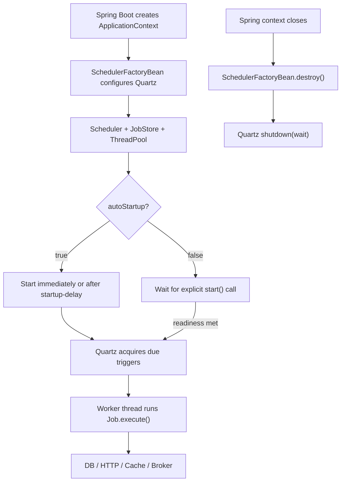
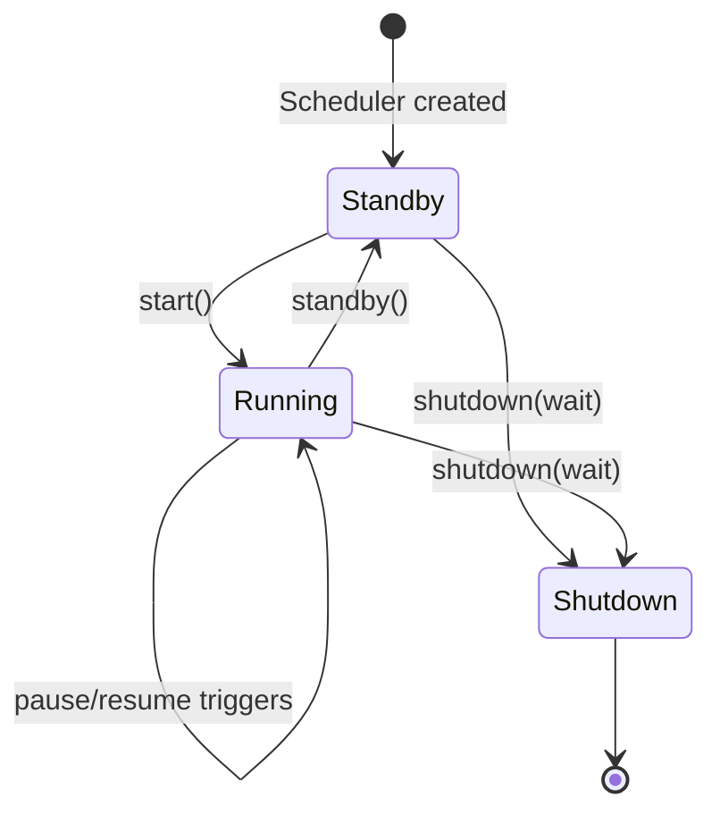
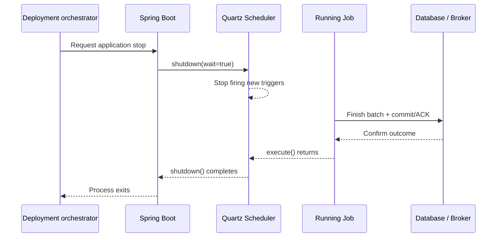
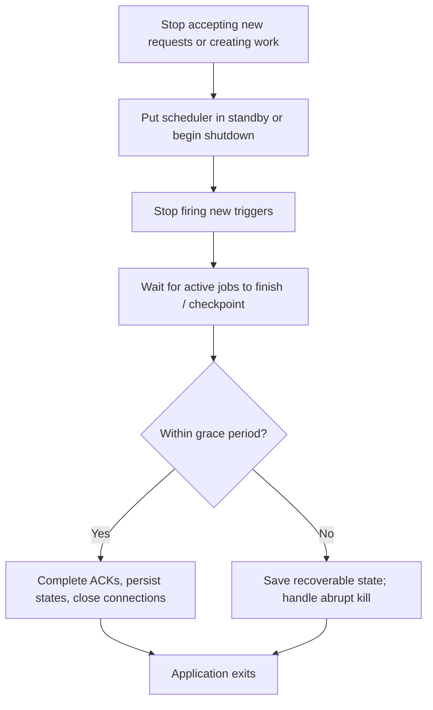

# Startup Delay, Stopping the Scheduler, and Waiting for Running Jobs

In a Spring Boot service with Quartz, background tasks can start running the moment the application boots: sweeping unsynced orders, calling partner APIs, writing states to NoSQL, refreshing caches, or publishing events to a broker. If Quartz fires triggers before schemas, credentials, HTTP clients, or downstream consumers are ready, the app suffers cascading failures, retry bursts, and duplicate record processing. During new version rollouts or shutdowns, stopping the scheduler too abruptly can also cut off in-flight work.

In the **SPRING_BOOT_INTEGRATION** module, Quartz is one piece of an integrated system rather than a standalone timer. Lifecycle control must align with **configuration, data contracts, transactions, error handling, deduplication, testing, and end-to-end observability** spanning databases, HTTP, caches, brokers, and adapters. This lesson explains:

- How auto-startup and **startup delay** work in Spring Boot with Quartz.
- When to use `Scheduler.standby()`, `start()`, `shutdown()`, or trigger pausing.
- What **waiting for running jobs to finish on shutdown** guarantees—and what it does not.
- How to deploy, test, and operate Quartz to minimize lost work, duplicate work, or ungraceful terminations.

## 1. Two Coordinating Lifecycles: Spring Container and Quartz Scheduler

Spring Boot typically initializes Quartz via `spring-boot-starter-quartz`. Spring Framework provides `SchedulerFactoryBean` to create and manage an `org.quartz.Scheduler`. Spring Boot configures the factory from `spring.quartz.*` properties and registers bean-declared `JobDetail`/`Trigger` instances automatically.



| Object | Responsibility | Boundary to Understand |
| --- | --- | --- |
| Spring `ApplicationContext` | Creates beans, manages lifecycles, and closes the context. | Having a `JobDetail` bean does not mean any job is running yet. |
| `SchedulerFactoryBean` | Creates/configures `Scheduler`, controls auto-start and shutdown alongside context. | Factory shutdown settings determine whether to wait for running jobs. |
| `Scheduler` | Manages triggers, job store, thread pool, and start/standby/shutdown states. | `start()` does not mean all downstream dependencies are ready. |
| `JobDetail` | Describes the job type, `JobKey`, and attached data. | Not a running thread or active task. |
| `Trigger` | Defines when work becomes eligible to fire. | Triggers coming due while the scheduler waits may become *misfires*. |
| `Job.execute(JobExecutionContext)` | Runs one execution on a Quartz worker thread. | May keep running after new trigger firings are stopped. |

Distinguish two states: **the scheduler has started** vs. **a job has finished an execution**. A scheduler can be started with no triggers due yet; conversely, putting a scheduler into standby while a job is mid-run does not automatically halt that active execution.

## 2. Three Key Spring Boot Lifecycle Properties

Basic configuration:

```yaml
spring:
  quartz:
    auto-startup: true
    startup-delay: 30s
    wait-for-jobs-to-complete-on-shutdown: true
    job-store-type: memory
```

| Property | Effect | How to Choose |
| --- | --- | --- |
| `spring.quartz.auto-startup` | Allows Spring to start Quartz automatically on application boot. | Set `false` when external readiness checks must pass before calling `Scheduler.start()`. |
| `spring.quartz.startup-delay` | Delays **automatic** scheduler start by the configured duration. | Use when a known operational warm-up window helps; `30s` is an example, not a universal recommendation. |
| `spring.quartz.wait-for-jobs-to-complete-on-shutdown` | Passes wait flag when the factory shuts down Quartz so active jobs can finish. | Consider `true` for time-bounded jobs that should finish before exit. |

Typically, auto-startup defaults to enabled, startup-delay to zero, and wait-on-shutdown to disabled when omitted; check defaults for your exact Spring Boot version. `job-store-type: memory` in this example fits experiments or non-persistent tasks. For schedules that must survive restarts, evaluate `jdbc` and clustering requirements.

**A common misconception:** `startup-delay: 30s` waits strictly by wall clock before starting scheduling—it **does not** wait for a healthy database, active broker consumers, ready HTTP APIs, or completed migrations. Starting later merely reduces race probability in some environments; it does not enforce dependency readiness.

### When to Use a Time-Based Delay?

- A brief warm-up task has predictable duration and delaying jobs for that window is acceptable.
- You want to stagger heavy background startup load right after deployment.
- Real health/readiness checks and retries already exist, and the delay only smooths initial bursts.

When dependency readiness varies unpredictably, use **`auto-startup: false` + readiness checks + explicit `Scheduler.start()`**. With multiple instances, a startup delay never replaces leader election or cluster coordination, nor does it stop multiple memory-store instances from running the same business job concurrently.

## 3. Distinguishing start, standby, pause, and shutdown

Quartz provides operations with distinct semantics:

| Operation | Effect on New Triggers | Effect on Running Jobs | Resumable? |
| --- | --- | --- | --- |
| `scheduler.start()` | Allows Quartz to resume processing due triggers. | Does not resurrect work lost outside the JobStore. | Yes, if scheduler is not shut down. |
| `scheduler.standby()` | Stops firing future triggers while in standby mode. | Does not interrupt already-started `execute()` calls. | Yes, call `start()`. |
| `scheduler.pauseAll()` | Pauses **all triggers** in trigger state. | Does not interrupt currently executing jobs. | Yes, call `resumeAll()` for triggers to resume. |
| `scheduler.pauseJob(jobKey)` | Pauses triggers associated with the selected `JobKey`. | Does not interrupt an already-started run. | Yes, call `resumeJob(jobKey)`. |
| `scheduler.shutdown(false)` | Closes scheduler; no further jobs will fire. | Returns without waiting for running jobs to finish. Does not forcefully kill them. | **No**; cannot restart the same scheduler after shutdown. |
| `scheduler.shutdown(true)` | Closes scheduler; no further jobs will fire. | Waits for active executions to finish before returning. | **No**; cannot restart the same scheduler after shutdown. |

**Pick the operation matching your intent:** for temporary maintenance, use `standby()` or pause triggers at the right scope. For application shutdown, rely on Spring's shutdown lifecycle with the right wait flag. Never call `shutdown()` as a "pause button," because a shut-down scheduler cannot accept `start()` again.



This is an operational state model, not every internal Quartz state. For instance, `isStarted()` indicates whether the scheduler **has ever been started**, and may remain `true` while in standby. To inspect accurately, check both `isInStandbyMode()` and `isShutdown()`.

### Control Methods in a Spring Component

```java
import org.quartz.Scheduler;
import org.quartz.SchedulerException;
import org.springframework.stereotype.Component;

@Component
public class QuartzOperations {
    private final Scheduler scheduler;

    public QuartzOperations(Scheduler scheduler) {
        this.scheduler = scheduler;
    }

    // Stop firing new triggers during maintenance.
    public void pauseForMaintenance() throws SchedulerException {
        scheduler.standby();
    }

    // Reopen once operational conditions are verified.
    public void resumeAfterMaintenance() throws SchedulerException {
        if (scheduler.isShutdown()) {
            throw new IllegalStateException("Scheduler has been shut down");
        }
        scheduler.start();
    }

    public boolean isAcceptingTriggers() throws SchedulerException {
        return !scheduler.isShutdown() && !scheduler.isInStandbyMode();
    }
}
```

For apps with many job groups, `pauseJob` or `pauseTriggers` can be preferable to `standby()` so unrelated triggers stay active. Never expose admin endpoints without authentication; restrict access to authorized operators or trusted automation, auditing who paused and when work resumed.

## 4. Starting Only After Application and Infrastructure Reach Readiness

Suppose a periodic job reads unsent records from a database and calls a partner HTTP API. To ensure schemas, credentials, and target endpoints are ready before Quartz accepts triggers, disable auto-start:

```yaml
spring:
  quartz:
    auto-startup: false
    wait-for-jobs-to-complete-on-shutdown: true
```

Then verify dependencies before calling `start()`. Intentionally minimal example:

```java
import org.quartz.Scheduler;
import org.quartz.SchedulerException;
import org.springframework.boot.context.event.ApplicationReadyEvent;
import org.springframework.context.event.EventListener;
import org.springframework.stereotype.Component;

@Component
public class QuartzReadinessGate {
    private final Scheduler scheduler;
    private final IntegrationDependencies dependencies;

    public QuartzReadinessGate(
            Scheduler scheduler,
            IntegrationDependencies dependencies) {
        this.scheduler = scheduler;
        this.dependencies = dependencies;
    }

    @EventListener(ApplicationReadyEvent.class)
    public void onApplicationReady() throws SchedulerException {
        if (dependencies.canRunScheduledJobs()) {
            scheduler.start();
        }
        // If not ready yet, keep Quartz in standby.
        // A reliable orchestrator must recheck and call start() later.
    }
}

// Contract implemented by the application:
interface IntegrationDependencies {
    boolean canRunScheduledJobs();
}
```

In production, `IntegrationDependencies` might check database schema versions, config locks, broker access, or run a lightweight probe against target services. If not ready yet, provide a **bounded retry path**, backoff, and operational alerts; an `ApplicationReadyEvent` listener runs once and does not loop automatically. Never let an external check hang startup indefinitely.

`ApplicationReadyEvent` fires after most Spring Boot initialization finishes, yet **does not automatically prove** databases, caches, brokers, external APIs, or schemas are ready. If background jobs are core functionality, reflect unstarted scheduler status in application readiness checks so orchestrators do not prematurely advertise full service readiness.

Do not confuse `SchedulerFactoryBean`'s `startup-delay` property with Quartz's `Scheduler.startDelayed(int seconds)` API. Both are purely time-based delays; the pattern above gates startup on **real readiness checks**.

## 5. End-to-End Example: Registering JobDetail and Trigger Before Scheduler Start

Spring Boot registers jobs and triggers during context initialization, only firing executions once the scheduler starts. The example below uses `RAMJobStore` for illustration:

```java
import org.quartz.Job;
import org.quartz.JobExecutionContext;
import org.quartz.JobExecutionException;
import org.slf4j.Logger;
import org.slf4j.LoggerFactory;

public class SyncOrdersJob implements Job {
    private static final Logger log =
            LoggerFactory.getLogger(SyncOrdersJob.class);

    @Override
    public void execute(JobExecutionContext context)
            throws JobExecutionException {
        // In practice: fetch batch from DB, send HTTP/broker with idempotency key,
        // update checkpoint transactionally per retry policy.
        log.info("Sync tick: {}", context.getFireInstanceId());
    }
}
```

```java
import org.quartz.CronScheduleBuilder;
import org.quartz.JobBuilder;
import org.quartz.JobDetail;
import org.quartz.Trigger;
import org.quartz.TriggerBuilder;
import org.springframework.context.annotation.Bean;
import org.springframework.context.annotation.Configuration;

@Configuration(proxyBeanMethods = false)
public class QuartzJobConfiguration {

    @Bean
    JobDetail syncOrdersDetail() {
        return JobBuilder.newJob(SyncOrdersJob.class)
                .withIdentity("syncOrders", "integration")
                .storeDurably()
                .build();
    }

    @Bean
    Trigger syncOrdersTrigger(JobDetail syncOrdersDetail) {
        return TriggerBuilder.newTrigger()
                .withIdentity("syncOrdersTrigger", "integration")
                .forJob(syncOrdersDetail)
                .withSchedule(
                        CronScheduleBuilder.cronSchedule("0 */5 * * * ?")
                                .withMisfireHandlingInstructionDoNothing())
                .build();
    }
}
```

This trigger schedules a run every five minutes using Quartz cron syntax. Choosing `withMisfireHandlingInstructionDoNothing()` means slots missed while the scheduler was down long enough may be **skipped** rather than fired in a burst on startup. This is just one illustrative policy: financial, state-sync, or reporting jobs may need different policies and queries to catch up unprocessed records.

**Acceptance criteria:** `JobKey` and `TriggerKey` must remain stable across deployments; cron/time zone must match business rules; jobs must use deduplication keys; failed runs must log and support replay. With `JDBCJobStore`, redeployments must account for existing triggers/jobs and Boot's overwrite settings. Never rely on a startup delay to prevent duplicates across replicas.

## 6. Shutdown: What Does `wait-for-jobs-to-complete-on-shutdown` Do?

With configuration:

```yaml
spring:
  quartz:
    wait-for-jobs-to-complete-on-shutdown: true
```

when `SchedulerFactoryBean` is destroyed during Spring lifecycle shutdown, the factory invokes Quartz shutdown asking it to **wait for executing jobs to complete**. In the Quartz API, this corresponds to `Scheduler.shutdown(true)`. Disabling this option means shutdown typically returns without waiting for running jobs to finish.



### What This Property **Does** and **Does Not** Guarantee

| What You Can Expect | What You Must Not Infer |
| --- | --- |
| On normal shutdown with `wait=true`, Quartz waits for active `execute()` calls to return. | Does not break a job out of a hung HTTP call or infinite loop. |
| Scheduler stops firing new jobs during shutdown. | Does not persist unexecuted triggers if using memory store. |
| Gives the app a chance to finish the batch and write checkpoints/ACKs. | Does not guarantee atomicity across database, HTTP, and broker. |
| Spring closes the scheduler per bean lifecycle. | Cannot keep the process alive if the orchestrator sends SIGKILL or power fails. |
| Jobs can finish if dependencies remain operational. | Does not guarantee DB/HTTP client connections stay open unless bean cleanup order and timeouts align. |

**Specifically:** `shutdown(true)` is **not** "interrupt all jobs and wait." It waits for running work to finish naturally. Nor does `shutdown(false)` forcefully terminate threads. If a job blocks indefinitely on I/O, `wait=true` can hang shutdown past deadlines; always enforce HTTP/DB timeouts, business deadlines, and crash recovery plans.

### Shutting Down Infrastructure in an Order That Lets Work Finish

If a job calls HTTP and then commits to DB, the scheduler must be able to finish work before HTTP clients and datasources close. Inspect specific Spring bean lifecycles and dependencies in your app; never assume every resource stays open simply because one wait flag is true. In Spring Boot, `spring.lifecycle.timeout-per-shutdown-phase` bounds shutdown phases of `SmartLifecycle` groups on supported versions, yet does not replace I/O timeouts or Quartz job timeouts. Meanwhile, grace periods configured in Kubernetes/systemd/container runtimes must cover the real shutdown duration.

## 7. Long Jobs, Cooperative Stopping, and `InterruptableJob`

Sometimes you cannot wait minutes or hours for a job to finish. Design jobs to run in **small, checkpointed batches** and support cooperative cancellation.

Quartz offers `InterruptableJob` so the scheduler can signal cancellation via `Scheduler.interrupt(JobKey)` or matching hooks, **only for jobs implementing interrupt support**. Receiving the signal does not guarantee instant termination: the job itself must poll the flag and exit at a safe point.

```java
import java.util.concurrent.atomic.AtomicBoolean;
import org.quartz.InterruptableJob;
import org.quartz.JobExecutionContext;
import org.quartz.JobExecutionException;
import org.quartz.UnableToInterruptJobException;

public class BatchSyncJob implements InterruptableJob {
    private final AtomicBoolean stopRequested = new AtomicBoolean(false);

    @Override
    public void execute(JobExecutionContext context)
            throws JobExecutionException {
        for (int batch = 0; batch < 100; batch++) {
            if (stopRequested.get()) {
                // Exit cleanly at batch boundary after safe checkpoint.
                return;
            }
            // loadBatch(batch);
            // sendIdempotently();
            // commitCheckpoint();
        }
    }

    @Override
    public void interrupt() throws UnableToInterruptJobException {
        stopRequested.set(true);
    }
}
```

This snippet illustrates a cancellation flag, not complete business logic. If mid-transaction or mid-HTTP call, exit only after committing, rolling back, or writing a contract-safe checkpoint. Calling `interrupt()` here **does not unblock a hanging socket read**. Configure explicit timeouts on HTTP clients, databases, and brokers, and persist durable progress so the next run resumes cleanly.

For graceful deployment drains, usually prefer **stopping new triggers and letting active batches finish**. Only trigger interrupts when cancellation rules, safe checkpoints, and replay behavior are explicitly defined. With multi-batch checkpointed jobs, account for races between `interrupt()` and checkpoint commits.

## 8. Misfires, Restarts, and Deduplication

**Misfire** occurs when a trigger misses its scheduled fire time beyond Quartz's threshold and policy—such as during standby, app shutdown, or thread pool exhaustion. When using delayed startup or prolonged shutdowns, plan misfires explicitly.

| Illustrative Policy | Effect | Business Risk |
| --- | --- | --- |
| Cron `withMisfireHandlingInstructionDoNothing()` | Discards missed slots, waits for next valid slot. | May skip a required sync period. |
| Cron `withMisfireHandlingInstructionFireAndProceed()` | May fire once right after misfire, then resume schedule. | Can cause load spikes or reprocess overlapping transition work. |
| Default / smart policy | Quartz infers per trigger type. | Avoid guessing; verify for exact trigger type and version. |
| Backlog sweep from business data | Job proactively queries unprocessed records from DB/queue. | Requires idempotency, checkpoints, and batch limits; independent of cron ticks. |

**Quartz triggers are not a business event queue.** If every invoice or message must be processed, persist pending work in a durable database or broker; Quartz only orchestrates when to check the backlog. When a cron misses a slot, you cannot infer that corresponding business events stayed preserved automatically.

To avoid running the same logic twice across duplicate triggers or multi-replica deploys:

1. Define an **idempotency key** per business entity, e.g., `partnerId + orderId + operationType`.
2. Persist status or checkpoints with proper consistency constraints; use a transactional outbox to publish post-commit events when needed.
3. Implement bounded backoff retries and distinguish transient errors from non-retryable data errors.
4. Reconcile unsent and un-ACKed records after restarts rather than relying solely on `JobExecutionContext.getFireInstanceId()`.
5. Apply `@DisallowConcurrentExecution` when **runs of the same `JobDetail`** must not overlap, while remembering it does not replace external system idempotency.

Example:

```java
import org.quartz.DisallowConcurrentExecution;
import org.quartz.Job;

@DisallowConcurrentExecution
public class ReconciliationJob implements Job {
    @Override
    public void execute(org.quartz.JobExecutionContext context) {
        // Process using business keys and durable checkpoints.
    }
}
```

With multiple instances, **each instance's `RAMJobStore` is isolated**: every scheduler runs the same work independently. Using **`JDBCJobStore` with properly configured clustering**, nodes in the same Quartz cluster coordinate trigger acquisition. Even then, failovers and external side effects can still necessitate retries, so idempotency remains mandatory. Never turn on clustering with a single flag without provisioning the database, Quartz tables, permissions, unique `instanceId`s, and migrations.

## 9. Safe Shutdown Procedure in Real Deployments

Treat shutdown as a multi-step operational protocol:



1. **Stop new work:** remove instance from traffic routing if needed; stop other adapters/producers feeding the same work or resources.
2. **Prevent new triggers:** let context shutdown close Quartz via lifecycle, or call `standby()` for proactive draining. Never call `shutdown()` manually expecting to restart the scheduler later.
3. **Wait for active jobs:** enable `wait-for-jobs-to-complete-on-shutdown` when runtimes are bounded and policy calls for it; monitor active jobs, latency, and deadlines.
4. **Finalize transactions and side effects:** for DB/HTTP/brokers, write checkpoints and ACKs accurately; avoid marking done before downstream confirms.
5. **Close context and process:** let schedulers and resources finish cleanly within allowed grace windows; if orchestrators may forcefully kill processes, ensure post-restart replay and deduplication work.

A job may return from `execute()` before external messages are ACKed if asynchronous work was handed off to another thread. In that case, `shutdown(true)` only waits for **the Quartz job thread**, not detached executors, async HTTP callbacks, or external services. When jobs dispatch async work, define completion boundaries explicitly and drain in-flight work at the responsible component.

## 10. Automated Lifecycle Testing

Do not stop at unit testing `execute()`. Test the scheduler at the integration level, especially startup, pause, and shutdown behaviors.

### 10.1. Testing Disabled Auto-Startup

Run tests under an isolated profile with Quartz memory store and without triggers causing real external side effects:

```java
import static org.assertj.core.api.Assertions.assertThat;

import org.junit.jupiter.api.Test;
import org.quartz.Scheduler;
import org.quartz.SchedulerException;
import org.springframework.beans.factory.annotation.Autowired;
import org.springframework.boot.test.context.SpringBootTest;

@SpringBootTest(properties = {
        "spring.quartz.auto-startup=false",
        "spring.quartz.job-store-type=memory"
})
class QuartzLifecycleTest {
    @Autowired
    Scheduler scheduler;

    @Test
    void schedulerStartsOnlyWhenRequested() throws SchedulerException {
        assertThat(scheduler.isStarted()).isFalse();
        assertThat(scheduler.isInStandbyMode()).isTrue();

        try {
            scheduler.start();
            assertThat(scheduler.isInStandbyMode()).isFalse();

            scheduler.standby();
            assertThat(scheduler.isInStandbyMode()).isTrue();
        } finally {
            // Return scheduler to standby so other tests do not accidentally fire triggers.
            if (!scheduler.isShutdown()) {
                scheduler.standby();
            }
        }
    }
}
```

In a test suite sharing an `ApplicationContext`, mutating scheduler state affects shared state. Isolate contexts, profiles, or reset state between tests. `isStarted()` may remain `true` after `start()` even when returned to standby, so assert `isInStandbyMode()` as needed.

### 10.2. Testing Shutdown Waiting for Active Jobs

Create a test job using two `CountDownLatch` instances: **one signaling entry into `execute()`** and **one releasing completion**. Run Quartz in an isolated test fixture; once the job enters `execute()`, call `scheduler.shutdown(true)` on a background thread. Assert the shutdown thread blocks until the release latch opens, then open it and assert shutdown returns cleanly. Always release latches and join threads in `finally` blocks so the suite never hangs. Because a shut-down scheduler cannot restart, isolate this test with its own scheduler rather than sharing a context bean.

Additional test cases to cover:

| Test Case | Expectation |
| --- | --- |
| `auto-startup=false` | Scheduler exists yet fires no triggers until `start()` is called. |
| `startup-delay` | Triggers begin firing only after the configured delay, within reasonable scheduler jitter. |
| `standby()` then `start()` | No new triggers fire during standby; resumes cleanly after start. |
| `pauseJob()`/`resumeJob()` | Only targeted job/trigger pauses; unrelated jobs keep running. |
| `shutdown(true)` with active job | Shutdown waits for `execute()` to return; no new triggers fire. |
| Job with I/O timeout or cooperative interrupt | Produces clean checkpoints/rollbacks and clear replay behavior. |
| Downtime crossing cron ticks and restart | Misfire behavior follows policy; backlog jobs lose no business data. |
| Multiple replicas with JDBCJobStore cluster | Two instances never double-fire the same trigger; side effects stay idempotent. |

Tests relying solely on `Thread.sleep()` easily flake under CI load and clock resolution variance. Prefer latches/barriers, bounded `Awaitility` checks, or controllable schedulers/clocks. For JDBCJobStore, test against real databases or Testcontainers matching production; memory store does not verify cluster behavior.

## 11. Observing Startup and Shutdown Issues

When Quartz fails to fire on schedule or the application hangs on shutdown, inspect both scheduler and infrastructure state:

| Symptom | Common Cause | First Check |
| --- | --- | --- |
| Job never runs after deploy | `auto-startup=false` with nothing calling `start()`; delay still active; paused trigger. | `isInStandbyMode()`, `isShutdown()`, trigger state, active profile config. |
| Scheduler running yet job never triggers | Trigger not yet due, misfire policy, thread pool exhausted, wrong cron/time zone. | `nextFireTime`, cron expression, busy worker count, trigger/misfire logs. |
| Every deploy causes duplicate jobs | Multiple replicas with `RAMJobStore`, non-idempotent job, retries after timeout. | Active scheduler count, job keys, idempotency keys, cluster configuration. |
| Shutdown hangs indefinitely | Job stuck on I/O, infinite loop, `shutdown(true)` waiting. | Job stack traces, HTTP/DB timeouts, active jobs, termination grace period. |
| Side effects occur after shutdown finishes | Job dispatched work to async executor/HTTP without awaiting completion. | Completion/ACK boundary, threads or callbacks outside Quartz. |
| Lost work after restart | Ephemeral `RAMJobStore`, skipped misfire policy, unsaved checkpoints. | JobStore type, trigger misfire policy, backlog records in DB/broker. |

You can add `JobListener`/`TriggerListener` or `SchedulerListener` to measure fire times, durations, errors, and lifecycle events. Spring Boot Actuator/Micrometer may expose Quartz metrics depending on config and version; verify registered metrics explicitly. Key metrics include running job counts, success/failure counts, p95/p99 runtimes, next fire times, trigger misfires, business backlogs, retries, and prevented duplicate writes—not just CPU or process liveness.

### Operations Checklist

- [ ] Choose `auto-startup` and `startup-delay` based on readiness contracts, with retries if dependency checks fail.
- [ ] Distinguish temporary pausing (`standby()/pause`) from permanent closing (`shutdown()`); document trigger recovery steps.
- [ ] Define explicitly which jobs may run to completion, which support checkpointed cooperative cancellation, and mandatory I/O timeouts.
- [ ] Configure `wait-for-jobs-to-complete-on-shutdown` appropriately; align process grace periods with job durations.
- [ ] Document cron expressions, time zones, misfire policies, JobStore type, and cluster topology.
- [ ] Enforce idempotency keys, backoff retries, checkpoints, and post-restart backlog reconciliation.
- [ ] Test delayed startup, manual startup, standby, misfires, waiting shutdown, and network/DB disconnects.
- [ ] Monitor scheduler state, active jobs, triggers, backlogs, and downstream commits/ACKs in production.

### Official Documentation References

- [Spring Boot — Quartz Scheduler](https://docs.spring.io/spring-boot/reference/io/quartz.html): configuring Quartz in Spring Boot, JobStores, and Spring Boot properties.
- [Spring Boot — QuartzProperties](https://docs.spring.io/spring-boot/api/java/org/springframework/boot/autoconfigure/quartz/QuartzProperties.html): `autoStartup`, `startupDelay`, and `waitForJobsToCompleteOnShutdown` settings.
- [Spring Framework — SchedulerFactoryBean](https://docs.spring.io/spring-framework/docs/current/javadoc-api/org/springframework/scheduling/quartz/SchedulerFactoryBean.html): lifecycle, start delay, and shutdown.
- [Quartz Scheduler API](https://www.quartz-scheduler.org/api/2.3.0/org/quartz/Scheduler.html): `start()`, `standby()`, `pauseAll()`, and `shutdown(boolean)`.
- [Quartz InterruptableJob API](https://www.quartz-scheduler.org/api/2.3.0/org/quartz/InterruptableJob.html): cooperative job cancellation contract.
- [Quartz Tutorials](https://www.quartz-scheduler.org/documentation/quartz-2.3.0/tutorials/): triggers, misfires, JobStores, and clustering.

**Conclusion:** `startup-delay` is a time-based wait; `auto-startup=false` lets you verify real preconditions before starting the scheduler; `standby()` is for temporary pauses, while `shutdown()` permanently closes the scheduler. Enabling `wait-for-jobs-to-complete-on-shutdown=true` waits for active `execute()` calls to finish during normal shutdown, yet overall safety still depends on timeouts, grace periods, durable state, ACK contracts, and deduplication across the entire integration flow.
