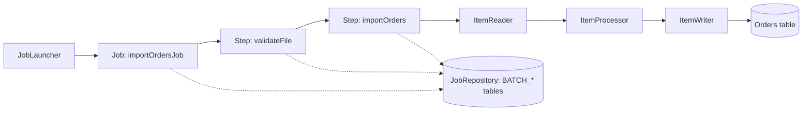
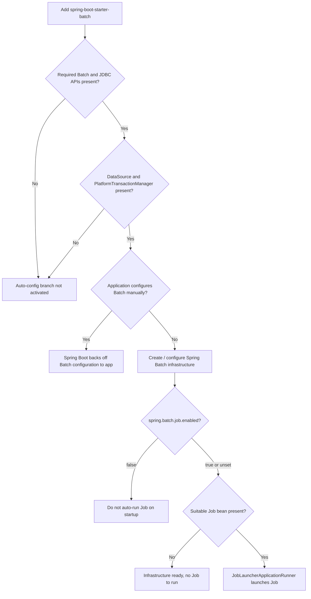

# `spring-boot-starter-batch` and Auto-Configuration Conditions

## 1. Where Does Spring Batch Fit in an Integration System?

In a real-world integration system, not every task should be processed immediately within an HTTP request or when receiving a message from a broker. Importing millions of records from a partner, synchronizing customer data nightly, generating reconciliation reports, or transforming data before sending it to another system are tasks that need to **run in batches, track progress, and be restartable upon failure**. Spring Batch provides the model and infrastructure for this class of problems.

In the **SPRING_BOOT_INTEGRATION** module, Spring Batch adds a structured way to organize integration flows alongside HTTP clients, databases, caches, message brokers, and Spring Integration adapters. The key is coordinating **data contracts, connection configurations, transactions, error handling, deduplication, testing, and observability** across a process that can take minutes or hours.

Running example: a Spring Boot application receives an order data file from an ERP every night, validates each line, normalizes the data, and writes it to PostgreSQL. If the process stops at line 80,000, the operations team needs to know which job failed, which step completed, how to re-run the unprocessed portion, and how to avoid creating duplicate orders.

Spring Boot helps wire Spring Batch components together through its starter and **auto-configuration** mechanism. However, simply adding a dependency does not mean every Job is configured and runs properly: you must understand the activation conditions, the presence of a `DataSource`/transaction manager, where metadata is stored, and the rules for running jobs at application startup.

After this lesson, you will be able to:

- Explain what capabilities `spring-boot-starter-batch` adds and what parts it does not handle automatically.
- Distinguish between `Job`, `Step`, `JobRepository`, `JobLauncher`, `JobExplorer`, `JobExecution`, and `JobParameters`.
- Determine when Spring Boot auto-creates Spring Batch infrastructure and when this mechanism backs off in favor of manual configuration.
- Configure how metadata tables are initialized, disable/enable job execution at startup, and select the right transaction manager.
- Investigate issues involving missing beans, missing `BATCH_*` tables, unintended job runs, jobs not running, or unrestartable jobs.

## 2. What Does the Starter Add?

`spring-boot-starter-batch` is an **aggregator dependency** for Spring Boot to integrate Spring Batch into the application context. In the Spring Boot 3.x ecosystem, this starter typically brings in Spring Batch Core and the JDBC libraries needed to persist execution metadata. It works with Spring Boot's auto-configuration mechanism to create infrastructure components when the application satisfies the required conditions.

Gradle declaration:

```kotlin
dependencies {
    implementation("org.springframework.boot:spring-boot-starter-batch")

    // Choose the driver matching the project's metadata database.
    runtimeOnly("org.postgresql:postgresql")
}
```

Or with Maven:

```xml
<dependency>
  <groupId>org.springframework.boot</groupId>
  <artifactId>spring-boot-starter-batch</artifactId>
</dependency>

<dependency>
  <groupId>org.postgresql</groupId>
  <artifactId>postgresql</artifactId>
  <scope>runtime</scope>
</dependency>
```

The examples above assume the project uses Spring Boot dependency version management. If you use a different BOM or Spring Boot version, check the dependency graph and corresponding APIs; the Java examples later in this lesson illustrate the **Spring Batch 5 / Spring Boot 3.x** model, as newer versions may change packages, APIs, or auto-configuration.

**The starter does not create data processing business logic on its own.** The application still needs to define `Job`, `Step`, reader/processor/writer or `Tasklet`, business data sources, schedules, or triggering mechanisms when needed. Nor does the starter guarantee that all external systems share a single transaction.

## 3. Core Components and State Data

| Concept | Role | Example in Order Import Problem |
|---|---|---|
| `Job` | Defines a batch process consisting of one or more steps. | `importOrdersJob`. |
| `Step` | Unit of execution of a Job; can be a tasklet or chunk-oriented processing. | Read, normalize, and write orders. |
| `ItemReader` | Provides input items one at a time for a chunk-oriented step. | Read CSV lines. |
| `ItemProcessor` | Transforms or filters items before writing. | Validate SKU, normalize currency. |
| `ItemWriter` | Writes a group of items after processing. | Write a batch to PostgreSQL. |
| `JobRepository` | Persists and queries metadata for Job/Step executions. | Record how many steps a run completed. |
| `JobLauncher` | Starts a Job with a set of parameters. | Run import for file `orders-2026-11-21.csv`. |
| `JobExplorer` | Reads metadata and execution history. | Look up running or failed jobs. |
| `JobParameters` | Parameters that define and control a run; some participate in identifying a `JobInstance`. | `fileName`, `businessDate`, `requestId`. |

Three state objects that are frequently confused:

- **`JobInstance`** represents a logical instance of a Job, identified by the Job name and **identifying JobParameters**. Two runs with the same Job name and the same identifying parameters point to the same JobInstance.
- **`JobExecution`** is a *single attempt to execute* that JobInstance. When a previous run fails, a valid restart can create a new JobExecution for the same JobInstance.
- **`StepExecution`** records a single execution of a Step, including status, timestamps, read/write counts, commit/rollback counts, and corresponding recovery information.

`JobRepository` typically uses the tables `BATCH_JOB_INSTANCE`, `BATCH_JOB_EXECUTION`, `BATCH_JOB_EXECUTION_PARAMS`, `BATCH_STEP_EXECUTION`, and related context/sequence tables. This is **operational metadata**, not business tables storing orders. Never arbitrarily delete metadata just to "let a job run again": doing so can destroy traceability, restart capability, and reconciliation.



For a chunk-oriented step, the framework manages transaction boundaries per chunk: reading and processing items, writing in groups, and updating status accordingly. Restartability also depends on whether the reader/writer manage state properly and whether external side effects are idempotent.

## 4. How Does Spring Boot Auto-Configuration Work?

Spring Boot inspects **classes on the classpath**, **existing beans**, **user configurations**, and **activation conditions** before adding Spring Batch infrastructure to the application context. Adding the starter only puts the relevant classes on the classpath; it is not enough by itself to guarantee all conditions are met.

In the standard setup of **Spring Boot 3.x with Spring Batch 5**, `BatchAutoConfiguration` activates when the required Spring Batch/JDBC APIs are present, a `DataSource` and `PlatformTransactionManager` exist, and the application has not explicitly taken over batch configuration via `@EnableBatchProcessing` or a configuration class extending `DefaultBatchConfiguration`. Class names and condition details may change across Spring Boot versions; when you need exact confirmation, check the *Condition Evaluation Report* for the version you are running.



This diagram is a **mental model** for a standard configuration, not a substitute for checking the conditions of a specific Spring Boot version. In an application with multiple Jobs, you must explicitly specify which Job runs at startup rather than assuming execution order or default behavior.

### 4.1. Classpath Conditions

The starter brings Spring Batch and required integration components onto the classpath. Missing key libraries or excluded dependencies can cause the auto-configuration branch not to match. When encountering a missing `JobRepository`, the first step is checking dependency resolution and version conflicts, especially when manually pinning a Spring Batch version different from the Spring Boot BOM.

### 4.2. `DataSource` and Transaction Manager Conditions

Spring Batch needs a mechanism to persist job/step metadata and manage transactions. In a typical JDBC configuration, Spring Boot needs to find:

1. `DataSource`: connection to the database containing batch metadata tables.
2. `PlatformTransactionManager`: coordinates transactions serving Batch infrastructure and/or processing steps.

For an application that only adds the starter without a database driver, JDBC URL, or embedded database, Spring Boot may **fail early during DataSource configuration**. If the application uses a custom data setup that does not produce an appropriate `DataSource`/transaction manager, the Batch auto-configuration branch may not apply.

Note: **JPA is not a mandatory requirement for Spring Batch.** Spring Batch can use JDBC metadata even when business logic processes files, calls HTTP APIs, or sends messages to a broker. If both JPA and JDBC or multiple databases exist, verify exactly which transaction manager is bound to each Step.

### 4.3. "Back Off" Conditions When the Application Configures Batch Manually

In Spring Boot 3.x, signals like `@EnableBatchProcessing` or `DefaultBatchConfiguration` cause Boot to **yield Batch infrastructure configuration to application code**. This often catches developers off guard when they add `@EnableBatchProcessing` from a plain Spring Batch tutorial to a project already using the Boot starter.

```java
// With Spring Boot 3.x, you normally DO NOT need this annotation
// just to run a Job when using spring-boot-starter-batch.
// @EnableBatchProcessing
@SpringBootApplication
public class IntegrationApplication {
    public static void main(String[] args) {
        SpringApplication.run(IntegrationApplication.class, args);
    }
}
```

Use manual configuration only when there is a specific requirement: a custom repository, multiple data sources, a different state storage mechanism, or customization not supported by auto-configuration. Once you switch to manual configuration, you take responsibility for providing all remaining beans and configurations; do not assume Boot properties still apply as before.

### 4.4. Conditions for Auto-Launching a Job

Creating **Batch infrastructure** is different from **auto-launching a Job**. In a standard Boot setup, when a Job bean exists and `spring.batch.job.enabled` remains at its default enabled state, Spring Boot can use `JobLauncherApplicationRunner` to run the job on application startup.

To run Jobs on a schedule, via an internal REST endpoint, or from a broker message, disable auto-run on startup:

```yaml
spring:
  batch:
    job:
      enabled: false
```

This configuration **does not disable Spring Batch**. The `Job`, `Step`, `JobRepository`, and `JobLauncher` beans can still exist and be invoked explicitly. If multiple Jobs exist and you want to select one at startup, the property supported in Spring Boot 3.x is `spring.batch.job.name`; verify the exact behavior of your version and avoid running all Jobs unintentionally.

## 5. Safe Metadata Database Configuration

With PostgreSQL, an illustrative configuration:

```yaml
spring:
  datasource:
    url: ${BATCH_DB_URL}
    username: ${BATCH_DB_USERNAME}
    password: ${BATCH_DB_PASSWORD}

  batch:
    jdbc:
      initialize-schema: never
    job:
      enabled: false
```

In a simple setup, this `DataSource` can serve both Spring Batch metadata and business data. At larger scale or with multiple data sources, decide whether to separate the metadata database/pool, and clearly configure the relationship between `DataSource`, `JobRepository`, and the transaction manager.

The `spring.batch.jdbc.initialize-schema` property controls whether Spring Boot runs schema initialization scripts for Batch metadata in the corresponding auto-configuration cases. Notable values:

| Value | Practical Meaning | Common Environment |
|---|---|---|
| `embedded` | Initializes schema for supported embedded databases. | Common default in applications using H2/HSQL/Derby. |
| `always` | Attempts to run schema initialization scripts even on non-embedded databases. | Demos or dev environments with an empty database; check script re-run behavior. |
| `never` | Prevents this mechanism from automatically running schema scripts. | Production with a managed migration workflow. |

In production, the sustainable approach is **managing `BATCH_*` tables with Flyway, Liquibase, or controlled operational migrations**. Obtain schema scripts matching the actual Spring Batch version; never hand-craft tables from memory or reuse scripts from an older version without checking compatibility.

Distinguish `spring.batch.jdbc.initialize-schema` from `spring.sql.init.mode`: these two properties serve different SQL initialization paths. Having business tables created by Hibernate/JPA also does not guarantee that Spring Batch metadata tables exist.

### 5.1. Database State Is Also an Operational Condition

An application can **start up successfully and create Batch beans**, yet fail only when launching a Job due to a missing `BATCH_JOB_INSTANCE` table, sequence table, or missing SELECT/INSERT/UPDATE privileges. Therefore, verify separately:

- Database driver, connectivity, TLS certificates, network, and credentials.
- Metadata schema/migrations matching the Spring Batch version.
- Permissions on relevant tables and sequences.
- Multiple application instances sharing `JobRepository` concurrently and proper transaction isolation configuration.

Avoid sharing the same Batch metadata schema across independent environments if Job names and `JobParameters` could collide; metadata identifies a JobInstance by name and parameters, so unintended collisions can cause a job to be treated as already completed.

### 5.2. Multiple `DataSource`s in One Application

An integration application may need one database for Batch metadata, one business database, and another JDBC source to read partner data. In supported Spring Boot versions, the `@BatchDataSource` annotation can designate the DataSource dedicated to batch infrastructure. However, you must also configure the **corresponding transaction manager**, bean qualification, and reader/writer connections. Do not assume marking a DataSource automatically makes every Step use the right business transaction manager.

A common architectural decision:

| Design | Advantages | Must Be Controlled |
|---|---|---|
| Single database for metadata and business | Simple configuration; can coordinate within the same database transaction when designed properly. | Lock/contention, access permissions, and blast radius during DB outages. |
| Batch metadata in a separate database | Isolates operational load and access privileges. | No automatic ACID transaction across metadata and business DB. |
| Read from external source, write to internal DB | Fits ETL flows. | Data re-readability, checkpointing, and idempotency on restart. |

## 6. Example Job and Step Using Auto-Configuration

The example below is for Spring Boot 3.x / Spring Batch 5: creating a `Tasklet` Step that checks an input file, followed by a Job. It assumes the starter, `DataSource`, transaction manager, and Batch metadata tables are ready from configuration. **No `@EnableBatchProcessing` is needed** in a standard Boot configuration.

```java
import org.springframework.batch.core.Job;
import org.springframework.batch.core.Step;
import org.springframework.batch.core.job.builder.JobBuilder;
import org.springframework.batch.core.step.builder.StepBuilder;
import org.springframework.batch.repeat.RepeatStatus;
import org.springframework.batch.core.repository.JobRepository;
import org.springframework.context.annotation.Bean;
import org.springframework.context.annotation.Configuration;
import org.springframework.transaction.PlatformTransactionManager;

@Configuration
public class ImportOrdersBatchConfiguration {

    @Bean
    public Step validateInputStep(
            JobRepository jobRepository,
            PlatformTransactionManager transactionManager) {

        return new StepBuilder("validateInputStep", jobRepository)
                .tasklet((contribution, chunkContext) -> {
                    // Illustration: validate metadata/readiness of the input file.
                    // In production, call a tested service with explicit error handling.
                    return RepeatStatus.FINISHED;
                }, transactionManager)
                .build();
    }

    @Bean
    public Job importOrdersJob(
            JobRepository jobRepository,
            Step validateInputStep) {

        return new JobBuilder("importOrdersJob", jobRepository)
                .start(validateInputStep)
                .build();
    }
}
```

Here `JobRepository` and `PlatformTransactionManager` are injected by Spring from the application context. The builder classes reflect the Spring Batch 5 API; code using `JobBuilderFactory`/`StepBuilderFactory` from older guides must be adapted when upgrading versions.

To launch explicitly after disabling the startup runner, a service can invoke `JobLauncher` with `JobParameters`:

```java
import java.time.LocalDate;
import org.springframework.batch.core.Job;
import org.springframework.batch.core.JobExecution;
import org.springframework.batch.core.JobParametersBuilder;
import org.springframework.batch.core.launch.JobLauncher;
import org.springframework.stereotype.Service;

@Service
public class OrderImportService {

    private final JobLauncher jobLauncher;
    private final Job importOrdersJob;

    public OrderImportService(JobLauncher jobLauncher, Job importOrdersJob) {
        this.jobLauncher = jobLauncher;
        this.importOrdersJob = importOrdersJob;
    }

    public JobExecution importBusinessDate(LocalDate businessDate) throws Exception {
        var params = new JobParametersBuilder()
                .addString("businessDate", businessDate.toString(), true)
                .toJobParameters();

        return jobLauncher.run(importOrdersJob, params);
    }
}
```

`businessDate` is marked as an **identifying parameter**: the same date maps to the same JobInstance. If a previous run `COMPLETED`, attempting to re-run the same job/identifying parameters will not simply create a new run; the framework can throw `JobInstanceAlreadyCompleteException`. If the run failed and the job is restartable, that JobInstance can be restarted according to Spring Batch rules. For intentional data re-imports, design explicit identity and idempotency rules; never append a random parameter to every run just to bypass repository checks.

> The service example illustrates direct launching. If `JobLauncher` runs synchronously, the call can hold the REST request thread until the job completes. For long-running tasks, design an asynchronous trigger mechanism, queue/worker, job ID, and status lookup API; avoid keeping HTTP connections waiting for the entire batch process.

## 7. From `Tasklet` to Chunk-Oriented Processing

A `Tasklet` suits bounded operations such as checking a file, moving a file, preparing data, or calling a controlled service. For hundreds of thousands of rows, **chunk-oriented processing** is more appropriate because it manages reading, processing, writing, committing, and restarting in batches.

```java
@Bean
Step processOrdersStep(JobRepository jobRepository,
                       PlatformTransactionManager transactionManager,
                       ItemReader<OrderRow> reader,
                       ItemProcessor<OrderRow, OrderEntity> processor,
                       ItemWriter<OrderEntity> writer) {

    return new StepBuilder("processOrdersStep", jobRepository)
            .<OrderRow, OrderEntity>chunk(100, transactionManager)
            .reader(reader)
            .processor(processor)
            .writer(writer)
            .build();
}
```

The snippet above is a configuration skeleton; `OrderRow`, `OrderEntity`, and the reader/processor/writer beans must be defined by the application. A chunk size of `100` is only an example and should be tuned based on memory, database latency, batch write limits, and transaction characteristics.

In a batch job writing to external systems, **a database commit cannot automatically roll back an HTTP request or message already sent**. Suppose the writer sends data via SOAP and then the metadata transaction rolls back: restarting could send that same record again. You need idempotency keys, outbox patterns, or business reconciliation. Chunk size is no substitute for deduplication rules.

### `ExecutionContext` and Checkpoints

Spring Batch can persist recovery state into `ExecutionContext` so a reader/step can resume after failure when the component supports saving and restoring state. However, restartability also depends on whether the source data remains stable. For instance, a CSV file modified between two runs can cause saved offsets to no longer match the same records. Lock/version inputs, verify checksums, or ensure that a file within a JobInstance does not change.

## 8. Auto-Configuration Pitfalls That Cause Confusion

| Symptom | Root Cause to Check | Resolution |
|---|---|---|
| Missing `JobRepository` bean | Missing dependency; missing `DataSource`/transaction manager; Boot backed off. | Inspect the Condition Evaluation Report and existing beans before adding manual configuration. |
| App fails to configure `DataSource` | Missing JDBC URL, driver, or embedded DB. | Add the driver and datasource appropriate for the environment. |
| `BadSqlGrammarException` or missing `BATCH_*` tables | Metadata schema uninitialized or in wrong schema/database. | Check migrations, URL, default schema, and DB permissions. |
| Job runs on startup even though it should only run on schedule | Default startup runner is enabled. | Set `spring.batch.job.enabled=false`; use a scheduler or explicit trigger. |
| Job does not run on startup | Runner disabled, no suitable Job bean, backed off, or wrong job name configured. | Check `spring.batch.job.enabled`, `spring.batch.job.name`, Condition Report, and logs. |
| Adding `@EnableBatchProcessing` changes beans/config | Application took over Batch configuration from Boot. | Determine whether custom infrastructure is genuinely needed. |
| Re-running job throws `JobInstanceAlreadyCompleteException` | Same identifying parameters already completed. | Design `JobParameters` around processing and restart needs; do not delete metadata. |
| Multiple job executions duplicate data | Retry/restart with non-idempotent side effects. | Use business keys, unique constraints, idempotency, and reconciliation. |
| Tests accidentally auto-run Jobs | Test context has startup runner enabled. | Disable startup runner in tests and launch the specific job under test. |
| Multiple `DataSource`s or transaction managers cause bean selection errors | Missing primary/qualifier configuration or wrong transaction manager selected. | Explicitly wire the batch datasource and transaction manager for the repository/Step. |

Two common misconceptions to avoid: **adding the starter does not mean a Job exists**, and **`spring.batch.job.enabled=false` does not disable Batch infrastructure**.

## 9. Observing Auto-Configuration Conditions

When you suspect a bean should have been created but is missing, Spring Boot can print the **Condition Evaluation Report**. In a development environment, run:

```bash
java -jar integration-app.jar --debug
```

Then search for branches related to `BatchAutoConfiguration`, `DataSourceAutoConfiguration`, `TransactionAutoConfiguration`, and **matched/did not match** details. Read the exact reason: missing class, missing bean, another configuration already applied, or a property causing the configuration branch to be skipped.

If Spring Boot Actuator is integrated, the `conditions` endpoint can inspect why auto-configuration was applied or excluded when properly enabled and authorized. Never expose this diagnostic endpoint publicly on the Internet because it reveals internal application structure.

An effective investigation sequence:

1. Check whether Spring Boot, Spring Batch versions, and the dependency graph are compatible.
2. Verify the context actually has an appropriate `DataSource` and `PlatformTransactionManager`.
3. Confirm whether `@EnableBatchProcessing` or a `DefaultBatchConfiguration` subclass is present.
4. Inspect the Condition Evaluation Report for Batch auto-configuration.
5. Check `JobRepository`, `JobLauncher`, Job bean names, and `spring.batch.job.enabled`.
6. If beans exist but the Job fails, move on to checking metadata schema, transactions, `JobParameters`, and Step exceptions.

Do not try to "fix" every error by manually creating a second `JobRepository`: this can cause overlapping infrastructure and cause jobs to use the wrong metadata database.

## 10. Transactions, Restarts, and Integration Correctness

Spring Batch provides checkpointing and execution history infrastructure, but **it does not guarantee exactly-once delivery for side effects outside a transaction**. Especially in integration modules, a reader may read JDBC while a writer calls HTTP, publishes to Kafka/RabbitMQ, or writes to another database. These steps do not automatically join a single ACID transaction just because the code sits inside the same Step.

Key design decisions:

| Scenario | Risk | Mitigation |
|---|---|---|
| Writing to a database within the same chunk transaction | Chunk rolls back when writer fails. | Ensure the writer uses the right transaction manager; choose sensible commit intervals and locking. |
| Calling an order-creation API inside a writer | API processes the request, client times out, job restart re-sends it. | Idempotency keys, status lookups, and reconciliation before retry. |
| Sending a message before DB commit | Message reaches broker even if DB rolls back. | Outbox pattern or compensation/reconciliation rules. |
| Reading mutable source data while job runs | Data changes between chunks or restarts. | Snapshots, locking by business period, watermarks, or versioned inputs. |
| Concurrent runs of the same batch for a period | Duplicate processing, lock contention. | Design identifying parameters, scheduler coordination, and unique constraints. |
| Re-executing a step after failure | Already-written records get written again. | Conditional upserts, unique business keys, or safe checkpoints. |

*Restartability* must be designed across all three layers simultaneously: **JobRepository/ExecutionContext**, **input data**, and **output side effects**. You cannot rely solely on persisted `JobExecution` records to guarantee no duplicate transactions occur.

## 11. Testing Auto-Configuration and Job Behavior

For a production project, testing can be divided into three groups:

**Configuration tests:** load the Spring context with `spring.batch.job.enabled=false` and verify `JobRepository`, `JobLauncher`, and `Job`/`Step` beans are created. Verify profiles using an embedded database or a test database with properly initialized Batch schema. The goal is catching missing dependencies, missing beans, or misconfigurations.

**Job/Step tests:** use `spring-batch-test` (for example `@SpringBatchTest` together with `@SpringBootTest`) to launch a Job/Step with explicit JobParameters; assert `BatchStatus`, read/write counts, output data, and skip/retry scenarios. When multiple Jobs exist, specify which Job is under test rather than relying on default selection.

**Restart tests:** force the writer to fail after a few chunks, verify metadata is saved, then re-launch with **the same identifying parameters** to prove the job resumes properly and does not duplicate writes. For non-database integrations, use mocks/stubs or test environments that detect duplicate side effects.

Valuable tests for the order import system:

- A valid file imports completely; Job and Step report `COMPLETED`.
- A malformed file fails the job in a controlled manner with sufficient logs and status for reconciliation.
- The reader handles `null` values, monetary amounts, timezones, and encodings according to the data contract.
- The database disconnects mid-run, the transaction rolls back, and restarting creates no duplicate orders.
- The Job does not auto-run when the test context starts because `spring.batch.job.enabled=false` is set.
- Re-running an already `COMPLETED` JobInstance is handled as a duplicate run per policy.

Tests strengthen confidence in auto-configuration, but **never stop at checking bean existence**; all beans can be present alongside an incorrect metadata schema, wrong identifying parameters, or a writer that is unsafe on retry.

## 12. Observability and Operations for Batch Jobs

In production, you need enough telemetry to answer: which Job is running, which period its data belongs to, which Step failed, whether a restart is needed, and what side effects partial work has already caused.

Useful signals:

- **Job identity:** Job name, `JobInstance`, `JobExecution`, business date/import batch, and sanitized file identifier.
- **Progress:** start/end timestamps, status, read/write/filter/skip counts, and commit/rollback counts per Step.
- **Performance:** duration per Job/Step, record throughput, database latency, external API wait times, retry counts.
- **Errors:** categorized error types, failing step, input reference, and correlation ID; avoid logging full customer records or credentials.
- **Operations:** authorized launch/restart commands, duplicate-run locking mechanisms, and runbooks for handling `UNKNOWN` states from external systems.

Spring Boot Actuator and Micrometer can provide metrics and observability depending on the enabled versions/libraries; do not assume all business measurements are available out of the box. Applications typically need custom metrics by Job/Step name and outcome status, while avoiding `customerId`, `requestId`, or arbitrary file paths as metric tags to prevent high cardinality.

If a batch is triggered from a Spring Integration flow or a broker consumer, clearly define **message acknowledgment** and **asynchrony**: acknowledging a message immediately after requesting a Job launch can lose retry capability if the Job subsequently fails. Persist the link between message/event ID and JobExecution and track outcomes/reconciliation according to business policy.

## 13. When to Use Spring Batch vs. Other Solutions?

| Requirement | Recommendation |
|---|---|
| Reading large datasets, chunk processing, checkpoint/restart | Spring Batch is a strong fit. |
| Syncing a few objects with low latency on an HTTP request | A synchronous service/HTTP client may be simpler. |
| Continuous event stream processing via broker, scaling consumers | Spring Kafka/AMQP or a Spring Integration flow is usually better; Batch can be triggered for periodic jobs. |
| Running a simple function on schedule | A scheduler may suffice; use Spring Batch when you need metadata, restarts, chunks, or multi-step workflows. |
| Multi-system workflows spanning multiple days | Requires a state machine/orchestrator, outbox, and reconciliation; Batch can be one step in the workflow. |

Spring Batch is not a complete distributed scheduling system. It manages Job definitions, execution, and metadata; deciding when to run, managing multiple workers, distributing tasks, or cross-system orchestration belongs to a scheduler, platform orchestration, or other integration components.

## 14. Checklist for an Application Using `spring-boot-starter-batch`

- [ ] Choose compatible Spring Boot and Spring Batch versions; do not arbitrarily pin dependencies outside the BOM.
- [ ] Declare the starter and required metadata DB driver.
- [ ] Provide an appropriate `DataSource` and `PlatformTransactionManager` for Batch infrastructure.
- [ ] Decide whether Boot manages Batch auto-configuration or the application explicitly uses `@EnableBatchProcessing`/`DefaultBatchConfiguration`.
- [ ] Create/migrate version-matched `BATCH_*` tables with necessary permissions.
- [ ] Define `spring.batch.job.enabled`, Job selection, and the actual trigger mechanism.
- [ ] Design `JobParameters` to distinguish data periods, restarts, and intentional re-imports.
- [ ] Use suitable reader/processor/writer or tasklet; design transactions, chunks, and checkpoints.
- [ ] Guarantee idempotency for database, HTTP, or broker writes on retry/restart.
- [ ] Test startup configuration, Job completion, mid-run failure, and restart with the same identifying parameters.
- [ ] Monitor JobExecution/StepExecution, record counts, timeouts, errors, and states requiring reconciliation.

## 15. Conclusion

`spring-boot-starter-batch` brings Spring Batch into a Spring Boot application and **can** activate infrastructure automatically when dependency, `DataSource`, transaction manager, and configuration ownership conditions are all satisfied. Separate three concerns: **creating batch infrastructure**, **defining Jobs/Steps**, and **deciding when Jobs run**. `spring.batch.job.enabled=false` only controls automatic Job execution at startup in the relevant configuration.

For integration systems, Spring Batch's value lies in persisting state and recovering multi-step processes. Combine JobRepository, metadata schemas, JobParameters, transactions, error control, idempotency, testing, and observability so every re-run is explainable and controlled. Whenever you are unsure why auto-configuration was enabled or skipped, the **Condition Evaluation Report** for the running version is the most authoritative place to check.
