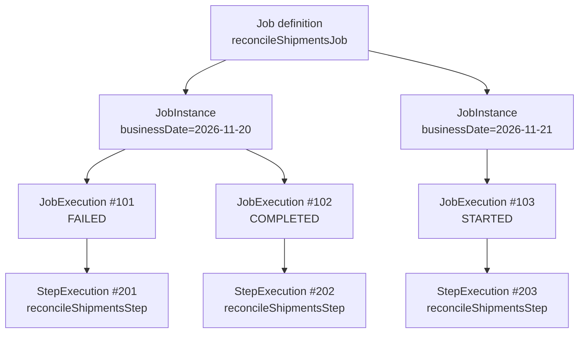
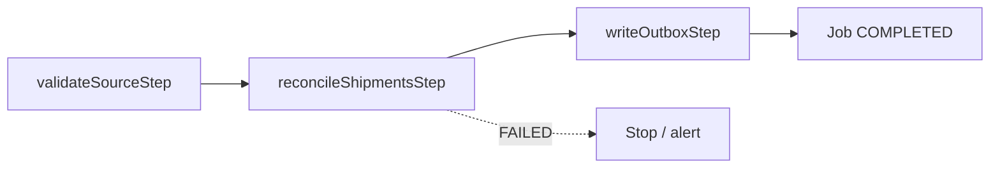
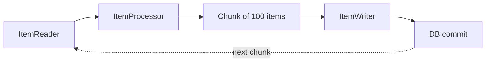
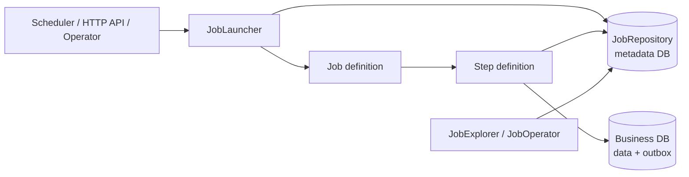

# Job, Step, JobInstance, JobExecution, and JobParameters

> **Chapter:** Spring Batch  
> **Module:** `SPRING_BOOT_INTEGRATION` — organizing system integration in Spring Boot via HTTP clients, databases, caches, message brokers, and Spring Integration adapters, focusing on configuration, data contracts, transactions, errors, deduplication, testing, and observability.

## 1. The Problem: Same Task, Multiple Runs, Different Outcomes

A logistics system receives delivery data from partners and must reconcile shipments every day. Each reconciliation run may read hundreds of thousands of records, normalize data, write a results table, and create outbox events for other systems to refresh caches or send notifications.

Suppose the job processing data for `2026-11-20` reaches record 70,000 and loses its database connection. Upon recovery, the question is not merely "which method do we call again?" but also:

- Where is the work to be performed defined?
- Which **business date** does this run belong to?
- Can the failed run **resume** from the last committed point, or must it start from scratch?
- Does restarting the program create a new task or merely re-launch the same task?
- How do we know which run succeeded, failed, or is currently running?
- If a record already sent an HTTP request to a partner before the crash, will retrying cause a double effect?

Spring Batch provides the **Job**, **Step**, **JobInstance**, **JobExecution**, and **JobParameters** model, along with `JobRepository` and operational metadata, to answer these questions. This model is especially useful for data ingestion, reconciliation, report generation, controlled migrations, and scheduled data synchronization in Spring Boot applications.

**Learning objectives:** accurately distinguish the five concepts in the title, apply identifying parameters, understand restarts and metadata, recognize transaction boundaries within each step, and wire them into a practical integration flow with recovery and observability.

## 2. Five Core Concepts

| Concept | Nature | Shipment Reconciliation Example |
|---|---|---|
| **Job** | **Defines a batch process** consisting of one or more steps and their sequence/transition conditions. | `reconcileShipmentsJob` |
| **Step** | **Defines a processing phase** within a job, having a reader/processor/writer or tasklet. | `reconcileShipmentsStep` |
| **JobParameters** | Parameter set for a launch; parameters marked **identifying** participate in defining `JobInstance` identity. | `businessDate=2026-11-20` |
| **JobInstance** | **A logical run of a Job**, identified by the Job name and identifying JobParameters. | "Shipment reconciliation for 2026-11-20" |
| **JobExecution** | **A single execution attempt** of a JobInstance, having an ID, status, timestamps, and error info. | Attempt 1 `FAILED`, attempt 2 `COMPLETED` |

Beyond those five concepts, there is **StepExecution**: a single execution of a Step belonging to a JobExecution. If a Step ran in a failed attempt and is executed again on restart, the system has multiple StepExecutions for the same Step definition across different JobExecutions.

### 2.1. Relationship Diagram



From the diagram, keep in mind:

- **A Job definition can run for many different JobInstances**, depending on the set of identifying parameters.
- **A JobInstance can have multiple JobExecutions** if it previously failed/stopped and was validly restarted.
- **JobExecution is the history of one attempt**, not a business identifier for deduplicating all data.
- **StepExecution is tied to a specific JobExecution**; there is no rule that "each Step only ever has one StepExecution".
- `JobParameters` are inputs to an execution; their identifying subset determines the corresponding JobInstance.

## 3. Job: Describing the Batch Process to Execute

A `Job` is the high-level definition of a batch workload. It describes the job name, its steps, and how control flows from one step to another. For example:



The flow above represents three stages:

1. Verify that the source data for the target date exists and is valid.
2. Read data, reconcile, and update records.
3. Prepare outbox messages for downstream consumers.

In real implementations, if step 2 writes data changes and needs to emit events atomically with those changes, **outbox records must be written in the same transaction as the corresponding update step**; you should not always place outbox writing in a separate step after business commits if the crash window between two steps is unacceptable. The diagram only illustrates step structure; transaction design must be determined separately.

### 3.1. Job Definition Is Not JobExecution

Declaring a `Job` bean does not immediately process data. The Job must be **launched** via `JobLauncher` or an equivalent orchestration mechanism.

Nor is a job definition a running Java thread. Depending on configuration, a Job may execute synchronously or be dispatched asynchronously by the launcher. **JobExecution** status tells you where an execution attempt stands; the job name and bean configuration only tell you what the work will do.

### 3.2. Jobs Should Have Stable Names

`reconcileShipmentsJob` is a logical name used in metadata. Renaming a job from `reconcileShipmentsJob` to `shippingDailyJob` causes Spring Batch to treat it as a different job identity when matching against historical metadata. Plan a migration/compatibility strategy before renaming jobs in production.

## 4. Step: A Stage with Its Own Processing Boundary

A `Step` is a stage within a Job with its own state and metadata. Two common patterns are:

| Step Type | How It Works | Suitable Scenarios |
|---|---|---|
| **Tasklet step** | Performs a unit of work and returns `RepeatStatus`, potentially repeating per step policy. | Checking input files, cleaning temporary data, creating short-lived snapshots. |
| **Chunk-oriented step** | Reads item by item, optionally processes, groups into chunks, and writes; typically commits per chunk. | Reconciling hundreds of thousands of shipments, importing CSVs, paged normalization. |

### 4.1. Chunk-Oriented Processing



In a simple chunk configuration `chunk(100, transactionManager)`, the framework reads and processes items and calls the writer in batches within a chunk transaction. If the writer fails before commit, changes **belonging to the same database transaction** can roll back. Previously committed chunks normally remain persisted if the job fails later.

Keep in mind:

- A commit interval of `100` does not automatically guarantee "each item is processed exactly once" for side effects outside the database.
- A stateful `ItemReader` needs proper checkpoint/restart support (`ItemStream` and `ExecutionContext` where applicable).
- `ItemProcessor` should be as pure as possible; avoid HTTP calls with side effects inside the processor since rollbacks/retries can invoke it again.
- `ItemWriter` should be idempotent and backed by unique constraints in case data is re-written after a crash.
- A step may fail before the overall Job reaches its final state; how the Job proceeds depends on flow transitions.

### 4.2. StepExecution Differs from Step Definition

A `Step` is the configuration definition `reconcileShipmentsStep`. Each time it actually runs, it creates a **StepExecution** tied to a specific JobExecution; StepExecution records counts/metrics such as read, write, filter, skip, commit, rollback counts (depending on step type), status, and exceptions.

Use `StepExecution` to diagnose "how many items were read on attempt two?"; use the `Step` name to identify "which stage in the job definition?".

## 5. JobParameters: Inputs and Identity Keys

`JobParameters` are the parameters passed when launching a job. These parameters typically include business date, tenant, import source, snapshot version, or reconciliation scope.

The easiest mistake to make involves **identifying** parameters:

- **Identifying parameter:** participates in forming the `JobInstance` recognition key alongside the job name.
- **Non-identifying parameter:** stores additional run information without **creating a new JobInstance**.

### 5.1. JobParametersBuilder Example

Example using the Spring Batch 5 API with Spring Boot 3:

```java
import org.springframework.batch.core.JobParameters;
import org.springframework.batch.core.JobParametersBuilder;

JobParameters parameters = new JobParametersBuilder()
    .addString("businessDate", "2026-11-20", true)
    .addString("region", "south", true)
    .addString("requestedBy", "scheduler", false)
    .toJobParameters();
```

The identifying parameters here are `businessDate` and `region`. With the same Job name and these same two values, the run resolves to the same `JobInstance`, even if `requestedBy` changes from `scheduler` to `operator`.

**Do not collapse genuinely different data sources into one JobInstance** by mistakenly marking parameters non-identifying. If `sourceFileChecksum`, `tenant`, or `snapshotVersion` affects which data is processed, it may need to participate in identity or be pinned in persistent job state.

### 5.2. JobInstance Identity Matrix

Assume the Job is always named `reconcileShipmentsJob`:

| Launch | Identifying JobParameters | Non-identifying | JobInstance |
|---|---|---|---|
| A | `businessDate=2026-11-20`, `region=south` | `requestedBy=scheduler` | I-1 |
| B | `businessDate=2026-11-20`, `region=south` | `requestedBy=operator` | **I-1** |
| C | `businessDate=2026-11-21`, `region=south` | `requestedBy=scheduler` | **I-2** |
| D | `businessDate=2026-11-20`, `region=north` | `requestedBy=scheduler` | **I-3** |

Launch B **does not automatically become a new successful run**: if I-1 already `COMPLETED`, Spring Batch normally rejects re-launching the completed JobInstance. If I-1 is currently running, a concurrent launch for the same instance is also normally rejected. If I-1 `FAILED` and the job is restartable, launch B can create a **new JobExecution for I-1**.

### 5.3. Choosing Identity Keys by Business Unit

A good key describes **exactly one logical batch of data**:

- Daily reconciliation batch: `businessDate` and `region`.
- File import: `sourceSystem`, `fileId`, or checksum/snapshot version per contract.
- Per-tenant batch: `tenantId`, `businessDate`.
- Independent correction run: can add an identifying `correctionVersion` to create a **new logical batch**.

Do not use the current timestamp as an identifying parameter just to bypass the "already complete" error when the goal is **restarting a failed run**. Doing so creates a new JobInstance, breaks restart/checkpoint continuity with the old instance, and risks duplicating data processing.

### 5.4. RunIdIncrementer Does Not Mean Restart

`RunIdIncrementer` typically increments the `run.id` parameter to produce different identifying parameters across launches. When `run.id` changes and is identifying, the system creates a **new JobInstance**, not a JobExecution restarting the previous instance.

Use an incrementer when you genuinely want to run **a new logical job** each time; use **the same identifying parameters** when you need to restart a failed or stopped batch, provided the Job allows restarts.

### 5.5. Validation, Security, and Immutability

- Validate `businessDate` format and semantics so it stays within allowed bounds.
- Never store passwords, tokens, or secrets in `JobParameters`; they are persisted in **JobRepository metadata** and may appear in dashboards/logs.
- JobParameters are not the place to store huge JSON payloads; store a reference to an immutable data source if needed.
- If a job is restartable, input data must be stably re-readable or you must explicitly handle changed sources.
- Supported parameter types and storage formats vary across Spring Batch versions; ensure serialization/conversion remains compatible across upgrades.

## 6. JobInstance: Identity of One Logical Batch

A `JobInstance` represents **one logical unit of work by definition**:

```text
JobInstance = Job name + identifying JobParameters
```

Do not equate `JobInstance` with a JVM process, HTTP request, cron tick, or single execution attempt. A JobInstance can span multiple process restarts if `JobRepository` stores persistent metadata and the system re-runs with the exact same identifying parameters.

Example for shipment reconciliation on `2026-11-20`:

1. The first run processes 70,000 records and becomes `FAILED`.
2. The system retains the JobInstance I-1 record in the repository.
3. An operator re-launches the same date/region, creating a new JobExecution under **I-1** if restart conditions are valid.
4. Chunk reader/writer resume using the checkpoint and committed state, re-executing the partial boundary safely as needed.

JobInstance alone does not guarantee every step restarts from the exact last byte or record; that also depends on **reader state, transactions, input stability, checkpoints, and idempotency design**.

### 6.1. What If It Is Already COMPLETED?

Under standard Spring Batch operational rules, **a COMPLETED JobInstance cannot be run again with the same identifying parameters**. To intentionally reprocess an earlier date's data, choose:

- **Correction/new run:** create a distinct JobInstance using a new business-meaningful identifying parameter, such as `correctionVersion=2`.
- **Rebuild projection:** design a dedicated Job with an explicit rebuild contract and idempotency.
- **Do not manually edit metadata** to trick the framework into thinking the instance is incomplete.

If you only want to read history, query `JobExplorer` or the dashboard/job repository rather than trying to re-launch.

## 7. JobExecution: One Execution Attempt and Its Outcome

`JobExecution` describes **one execution attempt** of a JobInstance. It has its own execution ID, start/end timestamps (depending on state), `BatchStatus`, `ExitStatus`, failure information, and collection of `StepExecution`s.

Common `BatchStatus` values:

| Status | Meaning |
|---|---|
| `STARTING` | Entered the startup preparation phase. |
| `STARTED` | Currently executing. |
| `STOPPING` | Requested to stop and processing shutdown. |
| `STOPPED` | Stopped. Can be restarted depending on configuration/state. |
| `COMPLETED` | Completed successfully according to the flow definition. |
| `FAILED` | Run failed. Can be restarted if conditions are met. |
| `ABANDONED` | Marked skipped/not restartable through normal paths. |
| `UNKNOWN` | Indeterminate status; requires investigation before intervention. |

Do not treat `FAILED` and `ABANDONED` as synonymous. Jobs or steps marked abandoned typically require different operational decisions than normal failure restarts.

### 7.1. BatchStatus and ExitStatus

- **`BatchStatus`:** lifecycle status of a `JobExecution`/`StepExecution`.
- **`ExitStatus`:** result code used in **flow transitions**, which can default to values like `COMPLETED`/`FAILED` or be customized for business conditions.

For example, a step may finish normally at the processing level yet carry a custom `ExitStatus` of `NO_DATA` so the Job decides to skip the result-sending step. Never assume every custom `ExitStatus` maps one-to-one to a `BatchStatus` value.

### 7.2. One JobInstance Can Have Multiple JobExecutions

| JobInstance | JobExecution | Status | Meaning |
|---|---|---|---|
| I-1 (`2026-11-20, south`) | E-101 | `FAILED` | Attempt 1 stopped after 70,000 records |
| I-1 (`2026-11-20, south`) | E-102 | `COMPLETED` | Valid restart, completed batch I-1 |
| I-2 (`2026-11-21, south`) | E-103 | `COMPLETED` | Another date's batch |
| I-3 (`2026-11-20, north`) | E-104 | `STARTED` | Another region's batch currently running |

The IDs above are illustrative only. Actual IDs are managed by `JobRepository`; never use an execution ID as a unique business key in result tables, because restarting the same JobInstance produces a new execution ID.

## 8. StepExecution and ExecutionContext: Per-Step Tracking and Checkpoints

`StepExecution` records the state and statistics of a single Step execution: `readCount`, `writeCount`, `filterCount`, `skipCount`, `commitCount`, `rollbackCount` (appropriate to the step type), and exceptions. This is a primary source for investigating where a batch stopped.

**`ExecutionContext`** is a technical key/value state store managed by Spring Batch for a JobExecution or StepExecution. It can hold reader positions, processed counts, checkpoints, or operational data needed for restarts.

| Object | Used For | Do Not Confuse With |
|---|---|---|
| `JobParameters` | Inputs and identity of the logical batch | Checkpoints changing every chunk |
| `JobExecution` | History of one run attempt | Job definition or JobInstance |
| `StepExecution` | History and statistics of a step in that attempt | Step definition |
| `ExecutionContext` | Technical state for restart/resumption | Source of truth for all external business state |

### 8.1. Checkpoints Do Not Guarantee Exactly-Once

Suppose a chunk writes 100 rows to the database and commits. After commit, the process crashes before confirming all related side effects. On restart, the reader may re-read some items depending on how checkpoints and transactions are coordinated. Therefore:

1. Item readers must support position restoration or actively build an idempotent re-read model.
2. Writers should have **unique constraints**/upserts or version checks to prevent duplicate writes.
3. HTTP/broker side effects outside the database transaction need idempotency keys or an outbox.
4. Input changes between runs can invalidate saved offsets; paging should use stable ordering.
5. Test restarts after crashes at sensitive boundaries: before commit, after commit, and when an external API processed the request before the response arrived.

`ExecutionContext` is managed inside `JobRepository`, not a document for operators to manually edit to "fix" a stuck job.

## 9. JobRepository, JobLauncher, and Operational Components

To understand the five concepts fully, you need to know the infrastructure that stores their metadata and launches them.



- **`JobRepository`:** persists JobInstance, JobExecution, StepExecution, parameters, and ExecutionContext. To restart across process crashes, the repository must use **persistent storage**, usually a database.
- **`JobLauncher`:** used to start a `Job` with a set of `JobParameters`, returning a `JobExecution` or throwing an exception if the launch is invalid.
- **`JobExplorer`:** read-only API for metadata/history, supporting status lookups.
- **`JobOperator`:** operational management API such as start/stop/restart depending on Spring Batch version and configuration.
- **`Job`/`Step`:** logical definitions; execution metadata is tracked by the repository.

### 9.1. Typical Metadata Tables

When using a JDBC JobRepository, Spring Batch manages a set of tables like:

```text
BATCH_JOB_INSTANCE
BATCH_JOB_EXECUTION
BATCH_JOB_EXECUTION_PARAMS
BATCH_JOB_EXECUTION_CONTEXT
BATCH_STEP_EXECUTION
BATCH_STEP_EXECUTION_CONTEXT
BATCH_*_SEQ  (or database-specific ID generation mechanism)
```

Column names, parameter formats, and schema scripts depend on the **Spring Batch version**/database. Use migrations/schema scripts compatible with the running version; do not recreate tables with DDL from memory. Never delete metadata rows to "allow" re-running a COMPLETED job: doing so destroys history, breaks restarts, and can cause referential errors.

### 9.2. Metadata Database vs. Business Database

`JobRepository` may share a database with business data or reside in a separate database. **Do not assume changes in both places participate in the same transaction** if they use different datasources or transaction managers. When exact coordination between batch state and business writes is needed, inspect transaction boundaries, checkpoints, and recovery capabilities; never assume saving metadata guarantees atomicity across multiple datasources.

## 10. Spring Boot Configuration and Job/Step Example

The example below illustrates a shipment reconciliation job using a **chunk-oriented Step**, following the Spring Batch 5 builder API style with Spring Boot 3. For newer versions, verify API signatures and auto-configuration for your project's version. The sample assumes the database already has appropriate batch and business schemas.

### 10.1. Dependencies

Gradle Groovy DSL:

```gradle
dependencies {
    implementation("org.springframework.boot:spring-boot-starter-batch")
    implementation("org.springframework.boot:spring-boot-starter-jdbc")
    runtimeOnly("org.postgresql:postgresql")

    testImplementation("org.springframework.boot:spring-boot-starter-test")
    testImplementation("org.springframework.batch:spring-batch-test")
}
```

Spring Boot dependency management/BOM should manage compatible versions. For batches using JPA, you can add Spring Data JPA and an appropriate transaction manager. Not every job needs JPA; JDBC or other readers/writers are often sufficient.

### 10.2. `application.yml` for a Schema-Managed Environment

```yaml
spring:
  datasource:
    url: ${DB_JDBC_URL}
    username: ${DB_USERNAME}
    password: ${DB_PASSWORD}
  batch:
    job:
      enabled: false
    jdbc:
      initialize-schema: never
```

`spring.batch.job.enabled: false` is used when you want **controlled launching via scheduler/API/operator**, avoiding Boot automatically triggering jobs at startup. `initialize-schema: never` assumes batch tables were created via migrations or an environment provisioning step.

In a local demo, you can use schema initialization supported by Boot for your version, but production should manage batch schemas with versioned migrations and backups. If you customize `@EnableBatchProcessing` or declare custom infrastructure beans, Boot auto-configuration behavior can change; do not add these annotations just because you saw them in an older example.

### 10.3. Defining Job and Step

```java
import org.springframework.batch.core.Job;
import org.springframework.batch.core.Step;
import org.springframework.batch.core.job.builder.JobBuilder;
import org.springframework.batch.core.repository.JobRepository;
import org.springframework.batch.core.step.builder.StepBuilder;
import org.springframework.batch.item.ItemProcessor;
import org.springframework.batch.item.ItemReader;
import org.springframework.batch.item.ItemWriter;
import org.springframework.context.annotation.Bean;
import org.springframework.context.annotation.Configuration;
import org.springframework.transaction.PlatformTransactionManager;

@Configuration
public class ShipmentBatchConfiguration {

    @Bean
    Job reconcileShipmentsJob(JobRepository jobRepository,
                              Step reconcileShipmentsStep) {
        return new JobBuilder("reconcileShipmentsJob", jobRepository)
            .start(reconcileShipmentsStep)
            .build();
    }

    @Bean
    Step reconcileShipmentsStep(
            JobRepository jobRepository,
            PlatformTransactionManager transactionManager,
            ItemReader<ShipmentRow> shipmentReader,
            ItemProcessor<ShipmentRow, OutboxRecord> processor,
            ItemWriter<OutboxRecord> outboxWriter) {

        return new StepBuilder("reconcileShipmentsStep", jobRepository)
            .<ShipmentRow, OutboxRecord>chunk(100, transactionManager)
            .reader(shipmentReader)
            .processor(processor)
            .writer(outboxWriter)
            .build();
    }
}
```

**`ShipmentRow`**, **`OutboxRecord`**, and the reader/processor/writer beans are **application-defined components**. This snippet illustrates wiring and the builder skeleton, not a runnable application without a datasource, schema, and those beans.

Recommended design:

- The reader fetches shipments for `businessDate` in a stable order; if using a paging reader, configure a unique sort key and proper checkpoints.
- The processor validates/normalizes data and **never makes HTTP calls with side effects** per item.
- The writer updates results and inserts outbox records in **the same database transaction** (when consistency between data and events is required).
- An independent relay reads the outbox to send to Kafka/RabbitMQ after commit. Events have stable IDs so consumers can deduplicate.
- If the writer writes to a datasource different from the Step's transaction manager, redesign transaction boundaries; do not assume the chunk transaction covers everything.

### 10.4. Late Binding a JobParameter into a Reader

Many readers need a `businessDate` value that only exists at Job execution time. You can use `@StepScope` and SpEL:

```java
import org.springframework.batch.core.configuration.annotation.StepScope;
import org.springframework.beans.factory.annotation.Value;
import org.springframework.context.annotation.Bean;

@Bean
@StepScope
ItemReader<ShipmentRow> shipmentReader(
        @Value("#{jobParameters['businessDate']}") String businessDate,
        ShipmentReaderFactory readerFactory) {
    return readerFactory.createForDate(businessDate);
}
```

`ShipmentReaderFactory` is an application-written factory. `@StepScope` creates the bean within the context of a StepExecution rather than attempting to resolve `jobParameters` when the ApplicationContext starts. For stateful readers, the factory must return an implementation that supports proper checkpointing/restarting; creating a list reader over mutable data does not automatically guarantee accurate restarts.

## 11. Launching a Job with JobLauncher

Once the application has a Job bean and `JobLauncher`:

```java
import org.springframework.batch.core.Job;
import org.springframework.batch.core.JobExecution;
import org.springframework.batch.core.JobParameters;
import org.springframework.batch.core.JobParametersBuilder;
import org.springframework.batch.core.launch.JobLauncher;

JobParameters params = new JobParametersBuilder()
    .addString("businessDate", "2026-11-20", true)
    .addString("region", "south", true)
    .addString("requestedBy", "operator", false)
    .toJobParameters();

JobExecution execution =
    jobLauncher.run(reconcileShipmentsJob, params);

Long executionId = execution.getId();
```

`jobLauncher` and `reconcileShipmentsJob` are beans injected into a service/controller/runner. This code assumes it is inside a method handling the checked exceptions of `JobLauncher.run(...)`.

**Important:** the launcher can be configured to run a Job **synchronously or asynchronously**, so when `run(...)` returns depends on the launcher's executor. Never assume the returned value is already `COMPLETED`. If exposing an HTTP API to trigger jobs, enforce authentication, prevent duplicate launches, apply concurrency limits, and return `executionId`/status according to the API contract. When you want a fast `202 Accepted`, actively choose an appropriate launcher/queue model instead of merely changing the HTTP status code.

### 11.1. Launch Cases That Must Be Handled

| Scenario | Expected Framework-Level Behavior | Application Handling |
|---|---|---|
| No instance with same identity exists | Creates new JobInstance and JobExecution | Record execution ID and status |
| Instance already `COMPLETED` | Typically rejected with already-completed error | Return "already processed" or schedule an explicit correction run |
| Instance is currently running | Concurrent run for same instance typically rejected | Display active execution, prevent duplicate triggers |
| Instance `FAILED` or `STOPPED` | Can create new JobExecution if restartable and state is valid | Verify checkpoint/source before restarting |
| Job marked non-restartable | Re-launch may be rejected | Investigate root cause, choose alternative recovery |
| Missing/invalid parameters | Validator or input-reading logic rejects | Validate early, return clear contract error |

Common exceptions include `JobInstanceAlreadyCompleteException`, `JobExecutionAlreadyRunningException`, `JobRestartException`, and `JobParametersInvalidException`; HTTP/operator mapping should reflect the contract and actual instance state.

## 12. Sequence Example: Failed, Restart, and New Instance

Consider a Job with identifying parameters `businessDate=2026-11-20` and `region=south`.

```mermaid
sequenceDiagram
    participant Op as Operator/Scheduler
    participant JL as JobLauncher
    participant JR as JobRepository
    participant Worker as Chunk Step
    participant DB as Business DB

    Op->>JL: launch same identifying params
    JL->>JR: create I-1 / E-1
    JL->>Worker: execute step
    Worker->>DB: commit chunks 1..700
    Worker--xDB: DB connection failure
    Worker->>JR: E-1 FAILED; checkpoint metadata
    Op->>JL: restart I-1 (same identifying params)
    JL->>JR: create E-2 of I-1
    JL->>Worker: execute pending/restarted step
    Worker->>DB: continue / safely replay as needed
    Worker->>JR: E-2 COMPLETED
    Op->>JL: launch same identifying params again
    JL-->>Op: already completed instance
```

With a chunk size of 100, "700 committed chunks" is an illustrative number. The exact restart position depends on the reader, persisted metadata, and transactions. If the system loses the input data source between two runs, no mechanism can reconstruct the old file/snapshot solely from a JobInstance ID.

### 12.1. Restart and Rerun Are Two Different Operations

- **Restart:** re-runs **the same JobInstance** that failed/stopped, creating a new JobExecution and using Step/ExecutionContext recovery mechanisms.
- **Rerun/new instance:** starts a different JobInstance because identifying parameters differ. It may reprocess the same historical data if the contract allows, but it is a new logical batch and does not use the old instance's checkpoint.
- **Replay/rebuild:** business workflows may need an independent job to rebuild a projection; this is not necessarily the same as restarting or rerunning an import job.

Do not lump all three situations behind a single "Run again" button without explaining it to operators, because idempotency and data outcomes can differ.

## 13. Transactions, Retries, and Idempotency in Integration Batches

Spring Batch provides retry/skip/restart at boundaries controlled by the framework, but the application must manage **side effects outside a single database transaction**.

### 13.1. Chunk Transactions and External Systems

Suppose an ItemWriter calls a partner HTTP endpoint to create a shipment:

```text
Read item A
→ HTTP POST /shipments: partner created the shipment
→ Database update/commit fails
→ Chunk rolls back and retries
→ HTTP POST /shipments again
```

If the partner lacks an idempotency key, **two shipments** could be created. Chunk rollback only rolls back resources enlisted in that same transaction; it does not undo an HTTP request.

A safer design in many cases:

1. The Step reads and reconciles data.
2. In the same database transaction, persist the updated state and an outbox command/event with a stable ID.
3. A separate relay/consumer dispatches HTTP/broker calls with retries, timeouts, and idempotency keys.
4. Record responses and processing state separately; reconcile when timeouts leave outcomes unknown.

If HTTP must be called directly inside a step, make sure it is safe to repeat; require partner-side idempotency keys, timeouts, circuit breakers/rate limits, and reconciliation before retrying.

### 13.2. Retry, Skip, and Restart Are Not the Same

| Mechanism | When Does It Happen? | Purpose |
|---|---|---|
| **In-step retry** | When processing an operation/item encounters a retryable error | Retry transient errors before considering the item/step failed |
| **Skip item** | When an item has an allowed skippable error, within configured limits | Continue the batch while recording failed items under clear business policy |
| **Restart job** | After a `FAILED`/`STOPPED` JobExecution for a restartable instance | Continue the logical batch via a new JobExecution |
| **Replay message/outbox** | When external publish/consume flows need redelivery | Ensure result delivery across systems; may cause duplicate messages |

Skip may be appropriate for a malformed CSV row, but it is **never** appropriate to silently skip payment capture failures or lose critical records. Retries need limits, backoff, and error classification; never infinitely retry a validation error.

### 13.3. Designing Idempotent Inputs/Outputs

A batch needs relatively stable business keys:

- `businessDate + region + shipmentId` to upsert reconciliation records.
- `sourceSystem + eventId` to ingest webhooks/records once.
- `outboxEventId` for replayed events.
- `commandId` sent to partner HTTP APIs so the target can deduplicate if supported.

**Never use JobExecution ID as a deduplication key** for side effects, because restarting creates a new JobExecution and the same item may be executed again.

## 14. Coordinating with HTTP, Databases, Caches, Brokers, and Spring Integration

In `SPRING_BOOT_INTEGRATION`, Spring Batch typically handles **batch processing**, while other libraries handle communication per adapter.

| Component | Role in Batch Flow | Risks Requiring Design |
|---|---|---|
| HTTP client (`RestClient`/`WebClient`) | Fetch sources, push data, or perform batch lookups | Timeouts, rate limits, uncertain outcomes, idempotent retries |
| JDBC/JPA/R2DBC | Read and write business data | Correct transaction manager, locks, checkpoints, unique constraints |
| Cache/Redis | Refresh read data after batch | Stale cache, race with events, invalidation not atomic with DB |
| Kafka/RabbitMQ/JMS | Publish results or receive processing requests | Duplicate publishes, ACK/offsets, DLT/DLQ, preserving event IDs |
| Spring Integration | Connect adapters, route, or transform messages with batch flows | Distinguishing in-memory channels from durable brokers |
| Spring Batch | Split work into Job/Step, metadata, restart, chunks, retry/skip | Does not automatically guarantee exactly-once across HTTP + DB + broker |

### 14.1. Do Not Use JobRepository as an Inbox/Outbox

`JobRepository` manages **batch execution history**; it does not automatically provide unique constraints for individual partner events or a durable message queue. If a file contains the same event twice, the file's JobInstance only identifies the import batch—it does not prevent two rows from producing two side effects.

- **Inbox/dedup:** deduplicates at the consumer's event/command level.
- **Outbox:** records the intent to send a message within the same DB transaction.
- **JobRepository:** manages batch instances, executions, and checkpoints.

They solve different problems and can work together in the same system.

### 14.2. JobParameters Are Not a Queueing Mechanism

Two HTTP requests both asking to "run reconciliation for date X" should not rely on generating distinct JobParameters just to queue runs. If every request adds an identifying timestamp, the system can spawn multiple concurrent JobInstances and write duplicate data.

Define **a single logical batch**, enforce duplicate-trigger checks, launch authorization, and quotas. If the requirement is durably accepting jobs over an API, consider a job request table/broker and a service that coordinates batch launches.

## 15. Concurrency, Schedulers, and Multiple Application Instances

In a multi-pod/multi-instance environment, multiple schedulers may fire triggers for the same businessDate. JobRepository can detect an active run of **the same JobInstance** and reject duplicate launches accordingly. However:

- Two JobInstances with **different identifying parameters** can still process overlapping datasets.
- The same job name across two apps using **different JobRepositories** does not share identity/concurrency state.
- A process dying while metadata remains `STARTED` may require an operational state-recovery/investigation procedure; never manually edit metadata tables arbitrarily.
- Parallel steps, partitioning, or multi-threaded execution change reader/writer thread-safety requirements and processing order.
- Databases and partner APIs have their own connection limits, transaction locks, and rate limits; increasing concurrency can slow down the entire cluster.

With Spring Boot cron, `@Scheduled` only generates time-based triggers; it does not replace JobRepository, locking, or guarantee cluster-wide single execution by default. When running multiple replicas, use centralized orchestration or an infrastructure-appropriate leader/lock mechanism.

### 15.1. JobInstance State Is Not an HTTP Session

If an HTTP client disconnects after requesting a launch, the job **may still be running**, depending on how the launcher executes. Do not cancel a JobExecution merely because the HTTP connection closed if business rules require the batch to finish. Return the execution ID and provide a status-lookup mechanism along with an intentional job-stop procedure.

## 16. Observability, Reconciliation, and Operations

Each Spring Batch object serves a different level of observability:

| Question | Data Source |
|---|---|
| Which workload is running? | `Job` name, JobExecution with an active `BatchStatus` |
| Which date and region batch? | Identifying `JobParameters` / `JobInstance` |
| How many attempts have run? | List of `JobExecution`s for the JobInstance |
| Where did it fail? | `StepExecution`, exit status, failure exceptions |
| How many records were processed? | Step read/write/filter/skip/commit/rollback counts |
| Where can it restart from? | Step state and `ExecutionContext`, plus source stability |
| Did the broker receive the results? | Outbox status, producer acks, broker metrics |
| Did downstream apply the business changes? | Consumer state, inbox/dedup, correlation/event IDs |

What to monitor:

1. **Job duration** and `COMPLETED`/`FAILED` rates by job name (avoid overly high-cardinality labels).
2. **Step duration** and read/write/skip/retry counts; alert when skip rate exceeds business thresholds.
3. **Number of pending/running JobExecutions** and age of stalled executions.
4. **DB/pool wait times**, lock waits, slow queries, batch item throughput.
5. **Age of oldest outbox record**, publish retries, consumer lag, and dead-letter counts.
6. **Correlation IDs/batch business keys** linking batch executions with HTTP requests, broker events, and downstream logs.
7. **Result integrity**: total input/output counts, rejected record counts, reconciliation reports, and final acceptance criteria.

Spring Boot Actuator, Micrometer, and Spring Batch instrumentation can provide metrics, though exact metric lists and names depend on versions/registries/configurations. Never treat `Job COMPLETED` as proof that all external side effects finished if the pipeline includes asynchronous relays or consumers.

## 17. Testing Job, JobInstance, and Restartability

### 17.1. Testing Jobs in a Spring Context

You can use `spring-batch-test` and `@SpringBatchTest` together with `@SpringBootTest`:

```java
import static org.assertj.core.api.Assertions.assertThat;

import org.junit.jupiter.api.Test;
import org.springframework.batch.core.BatchStatus;
import org.springframework.batch.core.JobExecution;
import org.springframework.batch.core.JobParametersBuilder;
import org.springframework.batch.test.JobLauncherTestUtils;
import org.springframework.batch.test.context.SpringBatchTest;
import org.springframework.beans.factory.annotation.Autowired;
import org.springframework.boot.test.context.SpringBootTest;

@SpringBootTest
@SpringBatchTest
class ShipmentBatchJobTest {

    @Autowired
    private JobLauncherTestUtils launcher;

    @Test
    void reconcilesDay() throws Exception {
        JobExecution execution = launcher.launchJob(
            new JobParametersBuilder()
                .addString("businessDate", "2026-11-20", true)
                .addString("region", "south", true)
                .toJobParameters()
        );

        assertThat(execution.getStatus()).isEqualTo(BatchStatus.COMPLETED);
    }
}
```

This example assumes only one Job is under test or `JobLauncherTestUtils` has the target Job set; if multiple Job beans exist, explicitly select the Job to launch. The test also requires a database/schema, valid reader/processor/writer, and prepared input data. Never reuse the same identifying parameters across multiple tests on an unreset metadata DB, because a completed instance cannot be launched again.

### 17.2. Meaningful Test Cases

| Scenario | What to Verify |
|---|---|
| First launch for date D | Creates a new JobInstance and corresponding JobExecution |
| Re-launch date D after COMPLETED | Rejected per contract; does not create an unintended duplicate batch |
| Launch date D+1 | Creates a distinct JobInstance |
| Change non-identifying parameter | Does not create a new JobInstance when identifying parameters stay the same |
| Fail mid-chunks | Committed chunks remain intact; failed chunk data rolls back properly |
| Restart same instance | Creates a new JobExecution; checkpoint/reader state is valid |
| Re-read already-written item after crash | Unique key/idempotency prevents duplicate side effects |
| Database and broker disconnect | Outbox/retry does not drop committed results |
| Input file changes between attempts | Batch detects discrepancy or relies on immutable snapshots |
| Two concurrent triggers for same batch | Does not run duplicates beyond policy |
| Step has no input data | Exit status/flow follows contract |
| Schema/JobRepository unavailable | Fails informatively without falsely marking COMPLETED |

For transaction/restart logic, use a production-equivalent database in integration tests (such as Testcontainers for PostgreSQL). When testing publishers/consumers, use an appropriate broker or test environment capable of simulating ACKs, redeliveries, and failures. A mocked `ItemWriter` cannot prove database transaction atomicity or unique constraints.

## 18. Common Mistakes and Misconceptions

| Misconception/Mistake | Reality | How to Handle |
|---|---|---|
| "A Job is a single run." | A Job is a **definition**; JobExecution is an attempt. | Inspect metadata by JobInstance/JobExecution. |
| "Each JobInstance has only one JobExecution." | An instance can have multiple attempts via restarts. | Preserve identifying parameters for valid restarts. |
| "Add a timestamp to JobParameters to restart." | If the timestamp is identifying, it creates a new instance. | Never change identity when a restart is intended. |
| "Changing a non-identifying parameter creates a new batch." | Non-identifying parameters do not participate in the instance key. | Mark parameters identifying whenever they affect actual data. |
| "Once COMPLETED, you can re-launch with the same params." | Normally rejected for completed instances. | Create an intentional correction/new instance. |
| "ExecutionContext is the same as JobParameters." | ExecutionContext is updatable checkpoint/state; parameters describe inputs/identity. | Use each object for its intended lifecycle. |
| "Chunk commit guarantees HTTP POST happens only once." | HTTP outside the DB transaction does not automatically roll back. | Idempotency keys/outbox/reconciliation. |
| "@Scheduled guarantees running once across the cluster." | Multiple instances can fire the same trigger. | Cluster-level coordination and a shared JobRepository. |
| "JobRepository is a business queue." | It stores batch metadata, not inbox/outbox work items. | Store work to be dispatched in appropriate durable storage. |
| "FAILED means guaranteed restartable." | Depends on restartable flag, step state, metadata, data source, and system state. | Check cause, status, and checkpoint. |
| "Job COMPLETED means Kafka consumers updated the cache." | The batch may only have written outbox rows; consumers run later. | Track end-to-end with event IDs. |
| "You can delete BATCH_* rows to re-run." | Destroys history and restartability. | Design valid correction runs and recovery workflows. |

## 19. Pre-Production Checklist for Integration Jobs

- **Logical batch unit:** choose a Job name and identifying parameters accurately reflecting the data source/date/tenant/version.
- **Inputs:** ensure immutable sources, validation, schema/versioning, and reliable re-reads on restart.
- **Step structure:** separate stages with clear responsibilities, pick tasklet or chunk, and define transition/exit status rules.
- **Checkpoints:** stateful readers with stable ordering; test restarts after crashes.
- **Transactions:** select the right transaction manager, commit interval, and transaction boundaries with HTTP/brokers.
- **Idempotency:** unique constraints, stable business keys, and protection against external side effects.
- **Metadata:** persistent JDBC JobRepository, version-matched schema, backups/migrations, and access permissions.
- **Operations:** launch via authorized launcher/operator, status tracking, duplicate-run locks, and stop/restart procedures.
- **Overload protection:** concurrency limits, connection pooling, partner rate limits, skip/retry budgets, and dead-letter handling.
- **Observability:** dashboards for job/step executions, backlogs, errors, latency, and correlation IDs.
- **Testing:** unit/step tests, DB/broker integration tests, failure injection, replay, and multi-instance tests.

## 20. Self-Check Questions

**Question 1:** Same Job name, same identifying parameters; the first run is `FAILED`, and the next launch succeeds. How many JobInstances exist?  
**Answer:** One JobInstance; typically two JobExecutions (two attempts) if it was a valid restart.

**Question 2:** You change `requestedBy` from `scheduler` to `admin`, and this parameter is non-identifying. Does it create a new JobInstance?  
**Answer:** No. The identifying portion of the parameters did not change.

**Question 3:** A JobInstance is already `COMPLETED`. You want to reprocess that day's data for an independent correction; should you delete metadata?  
**Answer:** No. Create a JobInstance/correction workflow with its own identity and data policy.

**Question 4:** Are `JobExecution` and `StepExecution` the same?  
**Answer:** No. JobExecution records one attempt to run the entire Job; StepExecution records one execution of a specific Step inside that JobExecution.

**Question 5:** The reader checkpointed, but the writer called an external HTTP endpoint and the chunk rolled back. Does restarting guarantee HTTP is not sent twice?  
**Answer:** No. HTTP side effects do not roll back with the database; idempotency keys/outbox or reconciliation are required.

**Question 6:** Spring Boot has Spring Batch enabled; do you still need inbox/outbox design?  
**Answer:** Yes, whenever a flow must prevent duplicate events or update DB state and reliably emit messages. JobRepository only manages batch metadata.

---

In `SPRING_BOOT_INTEGRATION`, tie each concept to its exact question: **Job** describes *which process*; **Step** describes *which stage*; **JobParameters** specify *inputs and batch identity*; **JobInstance** represents *one logical batch*; **JobExecution** records *one execution attempt*. Mastering these boundaries is the foundation for building restartable, deduplicated, and observable HTTP–database–cache–broker integration flows in Spring Boot.
