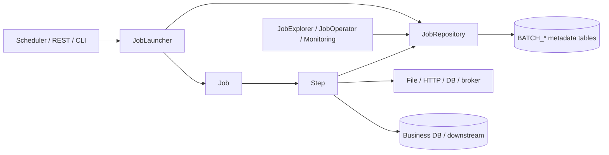
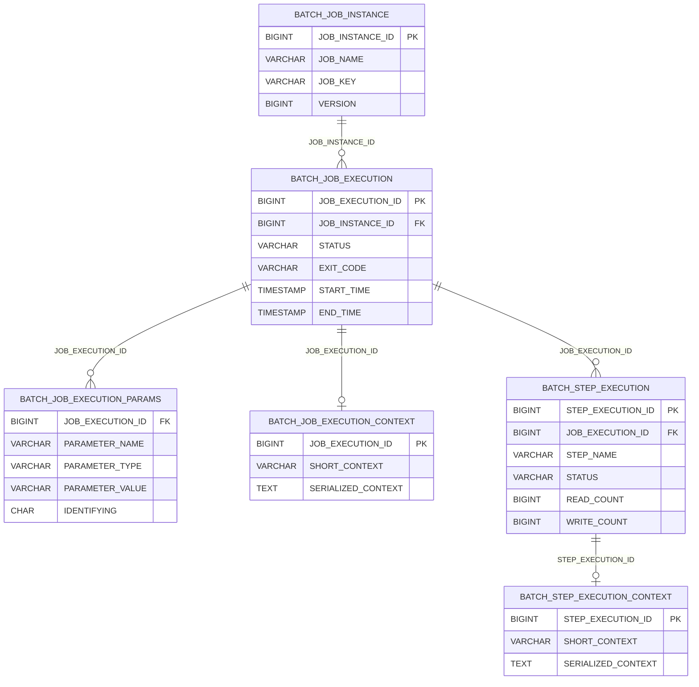
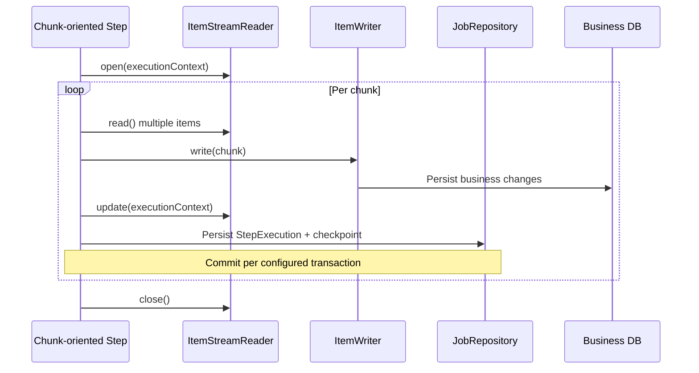
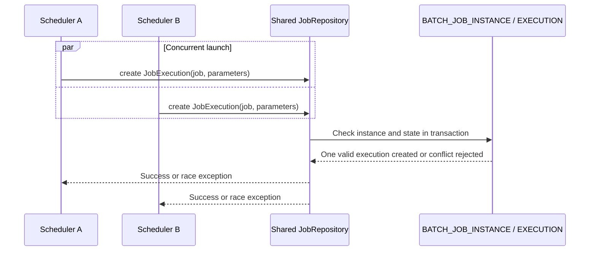

# JobRepository and Metadata Storage Schema

> **Chapter:** Spring Batch  
> **Module:** SPRING_BOOT_INTEGRATION — integrating Spring Boot with HTTP clients, databases, caches, message brokers, and Spring Integration; focusing especially on configuration, data contracts, transactions, error/deduplication handling, testing, and observability of real-world integration flows.

## 1. Why Does Spring Batch Need JobRepository?

Suppose a system receives transaction files every night. A job reads 100,000 lines, normalizes the data, writes to PostgreSQL, and produces events to Kafka. After processing 60,000 lines, the application shuts down unexpectedly. On the next startup, the system must answer:

- Which job ran, and with which **business parameter set**?
- Did the previous run complete, fail, stop, or remain recorded as running?
- How many records did each step process; where was the latest checkpoint?
- Can that **exact JobInstance be restarted**, or should a new JobInstance be created?
- Is another scheduler concurrently launching the same workload?

`JobRepository` is Spring Batch's central infrastructure for **persisting and updating Job and Step metadata**. When using a JDBC repository, metadata resides in the database's `BATCH_*` tables. This is operational data supporting state management and restartability, not the core business data of orders or transactions.



**Critical boundary:** the repository records **Spring Batch state**; it does not automatically make HTTP payment calls, Kafka sends, or writes to another database exactly-once. You must design idempotency, transaction boundaries, and recovery for external side effects.

### 1.1. Learning Objectives

After this lesson, you will be able to:

1. Distinguish `Job`, `JobInstance`, `JobExecution`, `StepExecution`, `JobParameters`, and `ExecutionContext`.
2. Explain the relationship diagram and purpose of the **six metadata tables** in Spring Batch 5.x.
3. Configure `spring-boot-starter-batch`, `DataSource`, and schema initialization in Spring Boot 3.x.
4. Distinguish a **new run** from a **restart** based on identifying JobParameters.
5. Use `JobBuilder`, `StepBuilder`, `JobLauncher`, and `JobExplorer` with JobRepository.
6. Design appropriate checkpoints, transactions, isolation, idempotency, and retention.
7. Test database metadata with Testcontainers and observe real failure/restart behavior.

## 2. Six Spring Batch Concepts You Must Distinguish

| Object | Meaning | Example |
| --- | --- | --- |
| **`Job`** | Defines a batch flow consisting of one or more Steps | `dailyOrderImportJob` |
| **`JobInstance`** | One **logical work identity** defined by `Job name + identifying JobParameters` | Importing file `orders-2026-11-21.csv` |
| **`JobExecution`** | One **execution attempt** of a JobInstance; has status, timestamps, exit code | First attempt FAILED, subsequent restart COMPLETED |
| **`Step`** | Defines a processing stage | `parseOrdersStep`, `writeOrdersStep` |
| **`StepExecution`** | Status/progress of a Step within a JobExecution | readCount=6000, writeCount=5900, rollbackCount=1 |
| **`JobParameters`** | Job parameters, where *identifying* parameters participate in JobInstance identity | `businessDate=2026-11-21` |
| **`ExecutionContext`** | Serializable checkpoint state map; job-scoped or step-scoped | current file offset, last processed record ID |

### 2.1. Job vs. JobInstance

`dailyOrderImportJob` is a **Java definition**; the same definition can run for many dates. If the identifying parameter `businessDate` is `2026-11-21`, that is one `JobInstance`. Date `2026-11-22` will be a different JobInstance.

**A JobInstance can have multiple JobExecutions** if the previous run FAILED/STOPPED and the job is restartable. Do not assume every call to `JobLauncher.run(...)` creates a new JobInstance.

### 2.2. Failure and Restart Timeline Example

```text
Job = dailyOrderImportJob
Identifying JobParameters = businessDate=2026-11-21

JobInstance #101
  ├── JobExecution #501  STATUS=FAILED
  │     ├── StepExecution parseOrdersStep  READ_COUNT=6000  STATUS=COMPLETED
  │     └── StepExecution writeOrdersStep  WRITE_COUNT=3200 STATUS=FAILED
  └── JobExecution #502  STATUS=COMPLETED  (restart)
        └── StepExecution writeOrdersStep  STATUS=COMPLETED

JobInstance #102
  └── businessDate=2026-11-22 (a different logical job)
```

The illustration assumes restartable Steps and that the first step's status was properly recorded. On restart, a `COMPLETED` Step is normally skipped by default; a failed Step can re-run from the state stored in `ExecutionContext`. Actual behavior depends on job/step configuration, reader checkpointing, and runtime parameters—not every job automatically resumes at the exact line number.

### 2.3. When Is Re-Invocation Rejected?

With the same Job name and same **identifying parameters**:

- Already `COMPLETED`: Spring Batch normally rejects re-running that JobInstance (`JobInstanceAlreadyCompleteException`).
- Currently `STARTING/STARTED`: the repository guards against creating duplicate executions under supported conditions (e.g., `JobExecutionAlreadyRunningException`).
- `FAILED/STOPPED`: can create a new JobExecution if the Job allows restarts and checkpoint/state are valid.
- If the `Job` is marked **non-restartable**, re-launching the existing instance is rejected per framework rules.

An `UNKNOWN` state or an execution stuck in `STARTED` due to a dead process requires an **operational verification procedure**; never directly update status via SQL and treat recovery as consistent.

## 3. What Does JobRepository Do and Not Do?

On the application side, commonly involved components include:

| API | Function | Usage |
| --- | --- | --- |
| `JobRepository` | Creates/updates JobExecution, StepExecution, ExecutionContext, statuses; persists metadata | Called by framework during launch and execution |
| `JobLauncher` | Accepts Job + JobParameters to create an execution and run the job | Scheduler, CLI, REST trigger |
| `JobExplorer` | **Reads** JobInstances, executions, step executions from metadata | Dashboards, status APIs, investigation |
| `JobOperator` | Operational actions like start, stop, restart (depending on version/config) | Authorized job administration tools |
| `PlatformTransactionManager` | Repository transactions and/or chunk processing | Must distinguish metadata manager from business manager |
| `JobRegistry` | Catalog of Jobs retrievable by name | Useful when operating many jobs |

JobRepository **is not** a queue for storing business messages, nor an in-memory cache for an entire imported file. Metadata is valuable because it provides continuity across processes when backed by a persistent database, yet by itself it provides no durability for data that an ItemWriter sends to HTTP/Kafka.

### 3.1. Why Does a Persistent Database Matter?

If using an in-memory database like H2 for testing, metadata vanishes when the JVM exits. Losing metadata means:

- No accurate history remains to tell whether an instance succeeded or failed.
- Checkpoints may no longer exist to resume at the right spot.
- An import batch could be re-run as a new instance, creating duplicates in the business DB.

In production, use a **durable, backed-up, properly authorized** SQL database; it can reside on the same server as the business DB, but metadata schema, transactions, and permissions should be managed distinctly.

## 4. JDBC Schema: How Do the Six `BATCH_*` Tables Relate?

In Spring Batch **5.x**, the JDBC JobRepository typically uses six metadata tables; tables are created from DDL matching the **database vendor** in the Spring Batch library, such as PostgreSQL/H2/MySQL.



This diagram is simplified and **not a complete SQL DDL**; types like `TEXT` are conceptual, while real DDL uses `CLOB`/`TEXT`/vendor equivalents. Exact column names, types, lengths, foreign keys, indexes, and sequences must match the Spring Batch scripts **for your exact version**. Never use this diagram to hand-create tables in production.

| Table | Stored Data | Relationship |
| --- | --- | --- |
| **`BATCH_JOB_INSTANCE`** | Job name, key of identifying parameters, version | One instance → many executions |
| **`BATCH_JOB_EXECUTION`** | Each attempt: create/start/end/last updated, status, exit code/message, version | FK to JobInstance |
| **`BATCH_JOB_EXECUTION_PARAMS`** | Parameters of each execution, type, value, identifying flag | FK to JobExecution |
| **`BATCH_JOB_EXECUTION_CONTEXT`** | Serialized job-scoped state for restart | One context per JobExecution |
| **`BATCH_STEP_EXECUTION`** | Step name, status, read/write/commit/rollback/skip counters, version, timestamps | FK to JobExecution |
| **`BATCH_STEP_EXECUTION_CONTEXT`** | Step checkpoint state | One context per StepExecution |

### 4.1. `BATCH_JOB_INSTANCE`: Logical Identity

Key columns in the Spring Batch 5.2 reference DDL:

```sql
-- Conceptual schema illustration; do not run instead of vendor scripts.
CREATE TABLE BATCH_JOB_INSTANCE (
    JOB_INSTANCE_ID BIGINT PRIMARY KEY,
    VERSION BIGINT,
    JOB_NAME VARCHAR(100) NOT NULL,
    JOB_KEY VARCHAR(32) NOT NULL
);
```

`JOB_KEY` is generated by Spring Batch from **identifying JobParameters**, not an arbitrary hash of a business payload. Changing a non-identifying parameter's value does not create a new JobInstance. Keep job names stable over time so the repository can recognize instances accurately on restart.

### 4.2. `BATCH_JOB_EXECUTION` and Terminal States

Each attempt generates a new `JOB_EXECUTION_ID` and references `JOB_INSTANCE_ID`. Meaningful columns include:

| Column | Meaning |
| --- | --- |
| `CREATE_TIME` | Timestamp when the execution was created |
| `START_TIME` | Timestamp when execution began |
| `END_TIME` | Timestamp when execution ended; may be null while running or if crashed before writing final status |
| `STATUS` | `BatchStatus`: STARTING, STARTED, COMPLETED, FAILED, STOPPED... |
| `EXIT_CODE` | ExitStatus (e.g., COMPLETED, FAILED, or custom code) |
| `EXIT_MESSAGE` | Error/result description; do not store sensitive data |
| `LAST_UPDATED` | Most recent metadata update timestamp |
| `VERSION` | Optimistic locking when multiple processes access concurrently |

**`BatchStatus` differs from `ExitStatus`:** `BatchStatus` is the internal lifecycle status; `ExitStatus` expresses the outcome used to decide next flow transitions and can be customized. Do not rely solely on a free-form `EXIT_MESSAGE` string to decide restarts.

### 4.3. `BATCH_JOB_EXECUTION_PARAMS`: Identifying or Not?

In Spring Batch 5.x, the parameter table uses the columns **`PARAMETER_NAME`, `PARAMETER_TYPE`, `PARAMETER_VALUE`, `IDENTIFYING`**. Example:

| JOB_EXECUTION_ID | PARAMETER_NAME | PARAMETER_TYPE | PARAMETER_VALUE | IDENTIFYING |
| --- | --- | --- | --- | --- |
| 501 | businessDate | java.lang.String | 2026-11-21 | Y |
| 501 | sourceFile | java.lang.String | orders-2026-11-21.csv | Y |
| 501 | requestedBy | java.lang.String | scheduler-a | N |
| 502 | businessDate | java.lang.String | 2026-11-21 | Y |
| 502 | sourceFile | java.lang.String | orders-2026-11-21.csv | Y |
| 502 | requestedBy | java.lang.String | recovery-operator | N |

Executions 501 and 502 belong to the same JobInstance because the identifying values did not change, even though `requestedBy` differs. This data is **illustrative**, not rows queried from a live database.

Upgrade differences that commonly cause errors:

- **Spring Batch 4.x** used columns such as `TYPE_CD`, `KEY_NAME`, `STRING_VAL`, `DATE_VAL`, `LONG_VAL`, `DOUBLE_VAL`.
- **Spring Batch 5.x** moved to `PARAMETER_NAME`, `PARAMETER_TYPE`, `PARAMETER_VALUE`, and the `IDENTIFYING` flag. Upgrading from 4 to 5 **requires migrating the metadata schema**, not just bumping the dependency version.
- The `PARAMETER_TYPE` column stores the parameter type; when using custom types, ensure converters can still deserialize values after a restart or code upgrade.

**Never store API keys, passwords, tokens, or unnecessary PII in JobParameters.** They are persisted to metadata tables and can be read by operational tools, backups, or other jobs with read privileges.

### 4.4. `BATCH_STEP_EXECUTION`: Progress Data and Counters

Spring Batch records a `StepExecution` for each step execution. Key columns:

| Column | Purpose |
| --- | --- |
| `STEP_EXECUTION_ID` | Unique ID for one step attempt |
| `JOB_EXECUTION_ID` | Links the step attempt to the job attempt |
| `STEP_NAME` | Stable step name used in restart handling |
| `STATUS`, `EXIT_CODE` | Step lifecycle status and exit result |
| `READ_COUNT` | Number of items read via reader |
| `FILTER_COUNT` | Number of items filtered by processor |
| `WRITE_COUNT` | Number of items processed/written per writer counters |
| `COMMIT_COUNT` | Number of chunk transactions committed |
| `ROLLBACK_COUNT` | Number of rollbacks; may include retries/skip-recovery |
| `READ_SKIP_COUNT`, `PROCESS_SKIP_COUNT`, `WRITE_SKIP_COUNT` | Items skipped by failure phase |
| `CREATE_TIME`, `START_TIME`, `END_TIME`, `LAST_UPDATED` | Timestamps and last metadata save time |
| `VERSION` | Metadata optimistic locking |

From `READ_COUNT` and `WRITE_COUNT` alone, you cannot infer that all HTTP/Kafka side effects completed exactly-once. If a writer sends a message without waiting for broker ACK or executes HTTP outside the transaction, counters merely reflect how writer code executed.

### 4.5. Two ExecutionContext Tables: Persistent Checkpoint State

| Table | Contents | When Used |
| --- | --- | --- |
| `BATCH_JOB_EXECUTION_CONTEXT` | Key/value map at **job scope** | Passing/storing state needed across steps |
| `BATCH_STEP_EXECUTION_CONTEXT` | Key/value map at **step scope** | File read position, checkpoints, pagination tokens, reader state |

The reference schema has `SHORT_CONTEXT` and `SERIALIZED_CONTEXT` columns. Context data must be serializable and readable upon restart; in Spring Batch 5.x, the default serializer and serialized payload representation **are not identical to all prior Spring Batch generations**.

A context should stay small and clear:

```text
StepExecutionContext:
  reader.current.count = 6000
  sourceFileId = "file-2026-11-21"
  lastConfirmedRecordId = "r-5999"

Do NOT store:
  - 6000 raw data records
  - connections, HTTP clients, InputStreams, or entity managers
  - passwords, API keys, JWTs
  - non-serializable or upgrade-fragile Java objects
```

**Checkpoints are not a final guarantee of business side effects.** They are only persisted at the points where the framework saves context/commits the transaction. If a writer triggers an HTTP side effect before the checkpoint commits, restarting may re-send the same operation. Readers and writers must be designed for safe replay.

### 4.6. Sequences and `VERSION` in Metadata

Primary IDs for `JobInstance`, `JobExecution`, and `StepExecution` are allocated via sequences or database-vendor equivalents, **not automatically relying on an application table's `AUTO_INCREMENT`**.

In the **Spring Batch 5.2** PostgreSQL reference schema, common names are:

```sql
-- Reference sequence names for Batch 5.2 PostgreSQL.
CREATE SEQUENCE BATCH_JOB_SEQ;
CREATE SEQUENCE BATCH_JOB_EXECUTION_SEQ;
CREATE SEQUENCE BATCH_STEP_EXECUTION_SEQ;
```

Vendors lacking the same sequence syntax use alternative tables/DDL. **Do not guess names from Spring Batch 6.x** or copy DDL from old blog posts into a 5.x schema: always pick the script matching the Spring Batch Core artifact in your application.

`VERSION` columns enforce metadata **optimistic locking**. When two processes attempt to update an execution with a stale version, the framework may throw `OptimisticLockingFailureException`. Never edit `VERSION` via SQL or drop constraints to "fix" collisions; investigate concurrent launches, transaction isolation, and shared JobRepository configuration.

## 5. Initializing Metadata Schema: Local vs. Production

### 5.1. Dependencies for Spring Boot 3.x

With Spring Boot 3.x, Java 17+, and PostgreSQL:

```groovy
// build.gradle — project already uses Spring Boot plugin/BOM
dependencies {
    implementation 'org.springframework.boot:spring-boot-starter-batch'
    runtimeOnly 'org.postgresql:postgresql'

    testImplementation 'org.springframework.boot:spring-boot-starter-test'
    testImplementation 'org.springframework.batch:spring-batch-test'
}
```

Maven equivalent:

```xml
<dependency>
    <groupId>org.springframework.boot</groupId>
    <artifactId>spring-boot-starter-batch</artifactId>
</dependency>
<dependency>
    <groupId>org.postgresql</groupId>
    <artifactId>postgresql</artifactId>
    <scope>runtime</scope>
</dependency>
```

Let the **Spring Boot BOM** select compatible Spring Batch 5.x/JDBC driver versions for your Boot version. If upgrading to Boot 4.x / Spring Batch 6.x, APIs, auto-configuration, repository stores, and DDL may change: never copy 5.x schemas to a new major version without consulting the migration guide.

### 5.2. `application.yml`: JDBC Metadata Database

```yaml
spring:
  datasource:
    url: ${BATCH_JDBC_URL}
    username: ${BATCH_DB_USER}
    password: ${BATCH_DB_PASSWORD}
  batch:
    jdbc:
      initialize-schema: never
    job:
      enabled: false
```

Meaning:

- `spring.datasource.*` creates the `DataSource` used by the repository to persist metadata (and potentially business data if designed that way).
- `spring.batch.jdbc.initialize-schema=never` instructs Boot **not to run table creation scripts automatically**. In production, use Flyway/Liquibase or DBA-reviewed migrations before running jobs.
- `spring.batch.job.enabled=false` **only disables Boot auto-running Jobs at startup**; it does not disable Spring Batch, remove JobRepository, or prevent launching jobs via scheduler/JobLauncher.
- Never commit `BATCH_DB_PASSWORD` to Git; never supply a default production password in YAML.

### 5.3. Three `initialize-schema` Modes

| Mode | Spring Boot 3.x Behavior | When to Use |
| --- | --- | --- |
| `embedded` (common default) | Automatically runs script when using a compatible embedded database | Local/test with H2/HSQL/Derby; do not assume production PostgreSQL tables exist |
| `always` | Attempts to run schema scripts at startup for supported databases | Dev/test or deployments with strict controls |
| `never` | Does not automatically run Batch schema initialization scripts | **Production** where schemas are managed via migrations |

Local H2 example:

```yaml
# application-local.yml — for experimental environments only
spring:
  datasource:
    url: jdbc:h2:mem:batchdemo;DB_CLOSE_DELAY=-1
    username: sa
    password: ""
  batch:
    jdbc:
      initialize-schema: always
    job:
      enabled: false
```

Do not use H2 setups to prove PostgreSQL transaction isolation, locking, or DDL compatibility. If you disable `initialize-schema` without creating tables, job execution will fail with errors like "relation `batch_job_instance` does not exist" when the repository accesses metadata.

### 5.4. Version-Matched, Database-Matched Schema Scripts

In Spring Batch Core 5.x, sample DDL scripts typically follow the form:

```text
classpath:org/springframework/batch/core/schema-h2.sql
classpath:org/springframework/batch/core/schema-postgresql.sql
classpath:org/springframework/batch/core/schema-mysql.sql
...
```

**Reference paths only**; verify the actual script present in your build's Spring Batch Core artifact. Spring Boot can detect the database vendor and run the matching script. You can customize the schema location via `spring.batch.jdbc.schema` when a custom script is required, though if using Flyway/Liquibase, standardize on **a single schema management system** to avoid initialization conflicts.

Example risk: production starts multiple replicas with `initialize-schema=always`, and each instance attempts to create the same tables/sequences, causing startup failures or uncontrolled migrations. **Never use `continue-on-error` to mask a schema mismatch** and force jobs to run.

### 5.5. The Schema Is an Operational Asset, Not Temporary Tables

Metadata does not just serve the current run: it retains history and checkpoints for future restarts. Therefore:

1. Store metadata schemas on persistent storage; test backups and restores regularly.
2. Define database/schema owners and appropriate read/write grants for the app, operators, and migrations.
3. Version migrations with approvals, backups, and rollback plans; never auto-DROP/CREATE tables on deploy.
4. When restoring separate business and metadata DBs, account for **consistency between the two backup timestamps**.
5. Separate business tables and metadata tables by schema/database when needed for access control or reducing contention.

Proper metadata schema management directly affects the reliability of data integration flows, especially when jobs read a source and emit HTTP/Kafka calls or write across multiple systems.

## 6. How Does Spring Boot Auto-Configure JobRepository?

In Spring Boot 3.x with `spring-boot-starter-batch`, a `DataSource`, and an appropriate `PlatformTransactionManager`, Boot can configure batch infrastructure including `JobRepository`, `JobLauncher`, `JobExplorer`, and the startup runner. Bean conditions depend on classpath, transaction managers, user-declared beans, and the Boot version.

### 6.1. Avoid Unnecessary `@EnableBatchProcessing`

In Boot 3.x apps **relying on auto-configuration**, normally **do not** write:

```java
// DO NOT ADD JUST TO USE JobRepository:
// @EnableBatchProcessing
```

Adding `@EnableBatchProcessing` or extending `DefaultBatchConfiguration` explicitly switches to **manual Spring Batch configuration**, causing **Boot Batch auto-configuration to back off**, including Boot's automatic metadata schema initialization. The application must then configure JobRepository, transaction manager, schema, and related beans explicitly.

If `BATCH_JOB_INSTANCE` is missing at startup, do not try to fix it by randomly adding `@EnableBatchProcessing`. Verify whether Boot owns auto-configuration or the app intentionally replaced it, and confirm the schema was actually created with the proper DDL.

### 6.2. Boot Auto-Running a Job at Startup

When batch auto-configuration is active, Boot can automatically launch a **single Job bean** at startup. With multiple Job beans, you typically must specify which job name to run.

```yaml
spring:
  batch:
    job:
      enabled: false
```

For HTTP services whose batch jobs are triggered by a scheduler or authorized API, **disabling auto-run at startup** is usually safer so rolling deployments do not accidentally re-run imports. Schedulers must coordinate with JobInstance identity and guard against concurrent launches rather than relying solely on bean existence.

### 6.3. JobRepository and Business DataSource

Two designs exist:

| Approach | Characteristics | Trade-offs |
| --- | --- | --- |
| **Shared single DataSource** | `BATCH_*` tables and business tables share one database (possibly different schemas) | Simple setup, single transaction manager when properly wired; requires grants/indexes and pool sizing |
| **Separate metadata DataSource** | Another database or schema/cluster for JobRepository | Better load/permission isolation, but metadata commit and business commit are **no longer automatically atomic** |

In Boot 3.x, if a separate DataSource is needed, use the `@BatchDataSource` mechanism per your version's docs, along with `@BatchTransactionManager` if a dedicated transaction manager is required. With multiple `DataSource`s, mark `@Primary` or restrict default candidates explicitly to avoid ambiguity.

**Warning:** for a chunk step whose business DB transaction manager differs from JobRepository's transaction manager, committing business data and updating checkpoints **do not default to a single atomic transaction**. If a crash happens after the business commit but before the metadata update, the step may re-run and write duplicates. Idempotent writers and recovery design are mandatory.

### 6.4. Table Prefixes and Multiple Schema Sets

By default tables are named `BATCH_*`. Spring Batch 5.x allows configuring the repository **table prefix**, e.g., `TENANT_A_BATCH_` or a schema-qualified prefix in manual configuration:

```java
// Illustrative only when EXPLICITLY using manual Spring Batch configuration.
@EnableBatchProcessing(
    tablePrefix = "APP_BATCH_",
    isolationLevelForCreate = "SERIALIZABLE")
```

When changing the prefix:

1. **Create or migrate the set of tables/sequences matching the new prefix**; do not expect the property to rename existing tables.
2. `JobRepository` and `JobExplorer` must use **the same prefix/schema**.
3. Operators, reporting SQL, and retention jobs must query the right tables.
4. Default DDL scripts use the default prefix; if generating custom schemas, review all constraint/sequence/index names.

The annotation snippet above is **not a complete Java class**, only a fragment showing where configuration belongs in manual mode. In Spring Boot 3.x, do not combine manual `@EnableBatchProcessing` while expecting all Boot `spring.batch.jdbc.*` properties to continue working automatically.

## 7. Job Pattern Using JobRepository: Java 17 / Batch 5.x

A Spring Batch 5.x configuration uses the newer `JobBuilder` and `StepBuilder` accepting `JobRepository` in their constructors. The snippet below intentionally performs minimal business work: it focuses on **metadata lifecycle**, not complex reader/writer implementation.

### 7.1. Two-Step Job

```java
import org.springframework.batch.core.Job;
import org.springframework.batch.core.Step;
import org.springframework.batch.core.job.builder.JobBuilder;
import org.springframework.batch.core.repository.JobRepository;
import org.springframework.batch.core.step.builder.StepBuilder;
import org.springframework.batch.repeat.RepeatStatus;
import org.springframework.beans.factory.annotation.Qualifier;
import org.springframework.context.annotation.Bean;
import org.springframework.context.annotation.Configuration;
import org.springframework.transaction.PlatformTransactionManager;

@Configuration(proxyBeanMethods = false)
public class DailyOrderBatchConfiguration {

    @Bean
    Step validateSourceStep(JobRepository jobRepository,
                            PlatformTransactionManager txManager) {
        return new StepBuilder("validateSourceStep", jobRepository)
                .tasklet((contribution, chunkContext) -> {
                    Object sourceFile = chunkContext.getStepContext()
                            .getJobParameters().get("sourceFile");
                    if (!(sourceFile instanceof String file)
                            || file.isBlank()) {
                        throw new IllegalArgumentException(
                                "sourceFile job parameter is required");
                    }
                    contribution.getStepExecution()
                            .getExecutionContext()
                            .putString("validatedSourceFile", file);
                    return RepeatStatus.FINISHED;
                }, txManager)
                .build();
    }

    @Bean
    Step importOrdersStep(JobRepository jobRepository,
                          PlatformTransactionManager txManager) {
        return new StepBuilder("importOrdersStep", jobRepository)
                .tasklet((contribution, chunkContext) -> {
                    Object fail = chunkContext.getStepContext()
                            .getJobParameters().get("simulateFailure");
                    if ("true".equalsIgnoreCase(String.valueOf(fail))) {
                        throw new IllegalStateException(
                                "Simulated failure before importing");
                    }

                    // Demo: no business side effects.
                    // A real import would use a restartable reader/writer.
                    contribution.getStepExecution()
                            .getExecutionContext()
                            .putString("importPhase", "completed");
                    return RepeatStatus.FINISHED;
                }, txManager)
                .build();
    }

    @Bean
    Job dailyOrderImportJob(JobRepository jobRepository,
                            @Qualifier("validateSourceStep") Step validateSourceStep,
                            @Qualifier("importOrdersStep") Step importOrdersStep) {
        return new JobBuilder("dailyOrderImportJob", jobRepository)
                .start(validateSourceStep)
                .next(importOrdersStep)
                .build();
    }
}
```

**Explanation:**

- `new JobBuilder(name, jobRepository)` and `new StepBuilder(name, jobRepository)` represent the **Spring Batch 5.x** API style. Do not copy older Batch 4 examples using `JobBuilderFactory`/`StepBuilderFactory` assuming they fit.
- `tasklet(..., txManager)` explicitly specifies the step's transaction manager. If multiple managers exist, pick the right one; avoid ambiguous injection.
- Step `ExecutionContext` can store small checkpoints. Here it only holds an illustrative string; without a real `ItemStream`/reader, **restarting from the last file line is not yet guaranteed**.
- `simulateFailure` demonstrates a failed execution. **Never include failure-simulation flags in production**; in this demo it is passed as a non-identifying parameter.
- Chunk-oriented steps use `.<I,O>chunk(size, txManager).reader(...).processor(...).writer(...)` and persist checkpoints per chunk. Keep Step names stable across deployments for accurate history and restarts.

### 7.2. Passing Identifying and Non-Identifying JobParameters

```java
import java.time.LocalDate;
import org.springframework.batch.core.Job;
import org.springframework.batch.core.JobExecution;
import org.springframework.batch.core.JobParameters;
import org.springframework.batch.core.JobParametersBuilder;
import org.springframework.batch.core.launch.JobLauncher;
import org.springframework.beans.factory.annotation.Qualifier;
import org.springframework.stereotype.Service;

@Service
public class DailyImportLauncher {
    private final JobLauncher jobLauncher;
    private final Job job;

    public DailyImportLauncher(
            JobLauncher jobLauncher,
            @Qualifier("dailyOrderImportJob") Job job) {
        this.jobLauncher = jobLauncher;
        this.job = job;
    }

    public Long start(LocalDate businessDate, String sourceFile,
                      boolean simulateFailure) throws Exception {
        JobParameters parameters = new JobParametersBuilder()
                .addString("businessDate", businessDate.toString(), true)
                .addString("sourceFile", sourceFile, true)
                .addString("simulateFailure",
                        Boolean.toString(simulateFailure), false)
                .toJobParameters();

        JobExecution execution = jobLauncher.run(job, parameters);
        return execution.getId();
    }
}
```

In `addString(name, value, identifying)`, the last parameter determines whether it participates in computing `JobInstance` identity. Running:

```text
start(2026-11-21, "orders-21.csv", true)  → JobInstance A, JobExecution 1 FAILED
start(2026-11-21, "orders-21.csv", false) → JobInstance A, JobExecution 2 COMPLETED
start(2026-11-22, "orders-22.csv", false) → JobInstance B, JobExecution 3 COMPLETED
```

These IDs/scenarios are **illustrative only**; actual failures/execution IDs depend on state and job execution. If file contents change while keeping the same filename, JobParameters may fail to detect that **the logical work changed**. Include a source ID, checksum, or immutable input version in identifying parameters when needed.

**Operational note:** `JobLauncher.run(...)` is not guaranteed to return immediately; if the launcher uses a synchronous executor, the method only returns once the job finishes. If you want an HTTP endpoint to return `202 Accepted` immediately with an execution ID, design an async launcher/task executor, queue, and status-query mechanism. Never pass unvalidated/unauthorized user input directly into a Job name or file path.

### 7.3. Reading Metadata via JobExplorer

```java
import java.util.Optional;
import org.springframework.batch.core.JobExecution;
import org.springframework.batch.core.explore.JobExplorer;
import org.springframework.stereotype.Service;

record JobExecutionSummary(
        Long executionId,
        Long instanceId,
        String jobName,
        String batchStatus,
        String exitCode) {
}

@Service
public class BatchStatusService {
    private final JobExplorer explorer;

    public BatchStatusService(JobExplorer explorer) {
        this.explorer = explorer;
    }

    public Optional<JobExecutionSummary> find(Long executionId) {
        JobExecution execution = explorer.getJobExecution(executionId);
        if (execution == null) {
            return Optional.empty();
        }
        return Optional.of(new JobExecutionSummary(
                execution.getId(),
                execution.getJobInstance().getId(),
                execution.getJobInstance().getJobName(),
                execution.getStatus().name(),
                execution.getExitStatus().getExitCode()));
    }
}
```

`JobExplorer` is designed for reading history; avoid manually modifying status columns with SQL when framework operational APIs exist. When exposing a status endpoint, check **authorization to view the execution/tenant** and never return raw `JobParameters`, `ExitMessage`, or `ExecutionContext` if they could contain sensitive data.

### 7.4. Why Not Call `JobRepository.createJobExecution` Manually?

You normally **do not need** to call `jobRepository.createJobExecution(...)` directly from a controller. `JobLauncher` already coordinates status validation, execution creation, and Job invocation. A custom scheduler should use `JobLauncher`, dashboards should use `JobExplorer`, and stop/restart actions belong to `JobOperator`.

Manually inserting into `BATCH_JOB_EXECUTION` via SQL, picking `JOB_EXECUTION_ID` values, or setting `STATUS=COMPLETED` by hand breaks instance detection, versioning, transactions, and restarts.

## 8. Inspecting Metadata with Read-Only SQL

In test/investigation environments with read privileges, you can use the following SQL (`LIMIT` syntax shown for PostgreSQL).

### 8.1. Recent Executions of a Job

```sql
SELECT ji.JOB_NAME,
       ji.JOB_INSTANCE_ID,
       je.JOB_EXECUTION_ID,
       je.STATUS,
       je.EXIT_CODE,
       je.CREATE_TIME,
       je.START_TIME,
       je.END_TIME,
       je.LAST_UPDATED
FROM BATCH_JOB_INSTANCE ji
JOIN BATCH_JOB_EXECUTION je
  ON je.JOB_INSTANCE_ID = ji.JOB_INSTANCE_ID
WHERE ji.JOB_NAME = 'dailyOrderImportJob'
ORDER BY je.CREATE_TIME DESC, je.JOB_EXECUTION_ID DESC
LIMIT 20;
```

If a JobInstance has two attempts, the same `JOB_INSTANCE_ID` appears across two rows with different `JOB_EXECUTION_ID`s. A row staying `STARTED` for a long time could be an actively running job or a process that died before updating its final state: cross-check workers, heartbeats/logs, and orchestration.

### 8.2. Viewing Stored Identifying Parameters

```sql
SELECT p.JOB_EXECUTION_ID,
       p.PARAMETER_NAME,
       p.PARAMETER_TYPE,
       p.PARAMETER_VALUE,
       p.IDENTIFYING
FROM BATCH_JOB_EXECUTION_PARAMS p
WHERE p.JOB_EXECUTION_ID = :execution_id
ORDER BY p.PARAMETER_NAME;
```

`:execution_id` is a named SQL parameter supported by tooling/JDBC layers, not native `psql` paste-and-run syntax. If your SQL client does not support named params, use its bind parameter syntax or substitute an ID **not sourced from unvalidated input**. Do not arbitrarily SELECT and share this table with users who lack permission to view operational parameters.

### 8.3. Observing StepExecution Progress

```sql
SELECT se.JOB_EXECUTION_ID,
       se.STEP_NAME,
       se.STEP_EXECUTION_ID,
       se.STATUS,
       se.READ_COUNT,
       se.FILTER_COUNT,
       se.WRITE_COUNT,
       se.COMMIT_COUNT,
       se.ROLLBACK_COUNT,
       se.READ_SKIP_COUNT,
       se.PROCESS_SKIP_COUNT,
       se.WRITE_SKIP_COUNT,
       se.LAST_UPDATED
FROM BATCH_STEP_EXECUTION se
WHERE se.JOB_EXECUTION_ID = :execution_id
ORDER BY se.STEP_EXECUTION_ID;
```

These counters help investigate throughput and rollbacks/skips, but never use them as proof that all downstream services committed. If a step requires exactly-once business semantics, inspect side-effect stores, idempotency keys, and replay behavior.

## 9. Restartability: ExecutionContext and Checkpoint Timing

`ExecutionContext` is one of the primary reasons to keep metadata **persistent and consistent**. A reader processing a 100,000-line file should not always start over from line 1 when the JVM crashes at line 60,000. The reader needs to implement the `ItemStream` contract so it knows how to restore its position.

### 9.1. `ItemStream` and State Save Points

For a chunk-oriented step:

1. The framework opens the reader/stream and calls `open(executionContext)` to restore any saved checkpoint.
2. `ItemReader.read()` returns items one by one; the processor transforms or filters; the writer handles the chunk.
3. Prior to the appropriate commit point, `update(executionContext)` lets streams write updated checkpoint state.
4. Metadata and business transactions commit according to the configured transaction boundaries.
5. On completion, `close()` releases resources.



This diagram shows the logical order, not every internal JDBC command or transaction synchronization; if metadata and the business DB use two different transaction managers, there is **no default atomic commit** across those steps.

### 9.2. Example `ItemStreamReader` Saving Item Index

This is a minimal example to understand the contract. The input list must **remain unchanged between restarts**; for real files or pagination, ensure an immutable data source and proper position tracking.

```java
import java.util.List;
import org.springframework.batch.item.ExecutionContext;
import org.springframework.batch.item.ItemStreamReader;

public final class RestartableListReader
        implements ItemStreamReader<String> {
    private static final String KEY = "orders.reader.nextIndex";
    private final List<String> items;
    private int nextIndex;

    public RestartableListReader(List<String> items) {
        this.items = List.copyOf(items);
    }

    @Override
    public void open(ExecutionContext context) {
        nextIndex = context.getInt(KEY, 0);
    }

    @Override
    public String read() {
        if (nextIndex >= items.size()) {
            return null;
        }
        return items.get(nextIndex++);
    }

    @Override
    public void update(ExecutionContext context) {
        context.putInt(KEY, nextIndex);
    }

    @Override
    public void close() {
        // No stream/socket to close in this example.
    }
}
```

This is a **simulated restartable reader**, not a production adapter. When using `FlatFileItemReader`, `JdbcPagingItemReader`, or cursor readers, review `saveState`, `name`, paging/order, and transaction behavior. For stateful readers, use `@StepScope` or create a dedicated instance per StepExecution so multiple jobs never share a mutable cursor.

**Warning about ordering and changing data:** if rows are inserted into or deleted from the source dataset, restarting at index 6000 can skip or duplicate records. For files, use file checksums/versions; for DB reads, use stable ordering and suitable snapshots/keysets/cursors; for message brokers, rely on native broker offsets/checkpoints and idempotency.

### 9.3. How Chunk Size Affects Recovery

Suppose each chunk processes 100 records:

```text
Chunks 1..59: committed successfully and checkpoint ≈ 5900 items
Chunk 60:     read/write up to 5970 then failed before commit
Restart:      re-read from latest checkpoint, reprocess uncommitted chunk
```

When the writer uses the same transactional database and appropriate manager, uncommitted writes can roll back together with metadata; however, if the writer sent HTTP, email, or Kafka directly, those side effects **may already have occurred** before the chunk rolled back. Therefore:

- Do not send payments/emails directly inside a chunk without idempotency/reconciliation.
- Use a **transactional outbox** for DB → Kafka when durability is required, paired with idempotent consumers.
- Use unique business keys or processed-event tables so chunk replays do not duplicate side effects.
- Do not increase chunk size indefinitely: large chunks reduce commit count at the cost of memory, lock duration, and larger replay volume on failure.

### 9.4. Restart, Rerun, and Re-Running Completed Steps

In Spring Batch 5.x:

- **Restart:** same Job name and same identifying parameters → new JobExecution of the **existing JobInstance**.
- **New instance:** changed identifying parameters → a new logical unit of work; can reprocess the entire source if not guarded carefully.
- **Completed Step:** on restart, a COMPLETED step is normally skipped; if it genuinely must re-run, configure `allowStartIfComplete(true)`.
- **Limiting Step runs:** `startLimit(n)` caps attempts of a step within a JobInstance; it does not replace item-level retries.
- **Disallowing restarts:** `new JobBuilder("...", repository).preventRestart()` for jobs meant to run only once per contract.

```java
// Spring Batch 5.x illustrative fragments.
new StepBuilder("validateSourceStep", jobRepository)
        .tasklet(validationTasklet, transactionManager)
        .allowStartIfComplete(true)
        .build();

new JobBuilder("oneShotJob", jobRepository)
        .preventRestart()
        .start(oneShotStep)
        .build();
```

These two fragments assume `jobRepository`, `validationTasklet`, `transactionManager`, and `oneShotStep` are already defined. Enable `allowStartIfComplete(true)` only when re-running a completed step is **semantically valid and safe**; never enable it on non-idempotent invoice-creation or payment-dispatch steps.

### 9.5. Do Not Let Class Names in ExecutionContext Break Restarts

In Spring Batch 5.x, `ExecutionContext` has a customizable serializer, and its data will be read back after restarts or new version deployments. If you serialize complex Java objects and later refactor packages/classes/`serialVersionUID`, restoration may fail even if the SQL schema has not changed.

Best practices:

- Prefer strings, numbers, IDs, cursors, and very small, stable checkpoints.
- Never store sockets/connections, transaction objects, JPA entities, raw file contents, or credentials.
- Test restarting from metadata produced by **the old code version onto the new code version** when upgrading long-lived jobs.
- Plan a context format/serializer migration if representations change.

## 10. JobRepository Transactions and Concurrency Handling

### 10.1. Isolation When Creating a JobExecution

Spring Batch uses transactional advice around key JobRepository operations. When two schedulers attempt to create an execution with the same Job name + identifying parameters:



In the Spring Batch 5.x reference configuration, the default `isolationLevelForCreate` is typically `SERIALIZABLE` to protect job creation under concurrency. You can adjust it based on database/workload, but you must **verify real concurrent launches**, unique constraints, and transaction behavior. Never lower it to `READ_UNCOMMITTED` just to reduce locking at the expense of duplicate business runs.

**Condition for effective coordination:** application instances coordinating a Job must point to **the same JobRepository and identifying parameter contract**. If each pod uses in-memory H2 or a separate metadata DB, pod A's repository has no visibility into what pod B is running.

### 10.2. Metadata Transactions vs. Chunk Transactions

| Scope | What the Transaction Manages | Risk |
| --- | --- | --- |
| JobRepository | Job/Step/ExecutionContext metadata | Lost checkpoint if metadata update fails |
| Chunk with same DB/manager | Business records + metadata updated at appropriate commit point | Must verify transaction participation; do not assume for every writer |
| Chunk business DB differs from metadata DB | Two transactions/resource managers | Crash window creates duplicates if business commits before checkpoint saves |
| HTTP/Kafka inside ItemWriter | Side effects outside JDBC local transaction | Cannot be rolled back by `DataSourceTransactionManager` |

If the metadata database is PostgreSQL A while business data lives in PostgreSQL B or MongoDB, a local transaction cannot atomically commit both. Choose idempotency keys, outbox/inbox, or sagas/reconciliation depending on required consistency. Never present "restartable Batch" as synonymous with end-to-end exactly-once.

### 10.3. Repository Errors Worth Distinguishing

| Error or Symptom | Likely Cause | Action |
| --- | --- | --- |
| `JobExecutionAlreadyRunningException` | Same instance is currently running | Return running status; do not launch a duplicate |
| `JobInstanceAlreadyCompleteException` | JobInstance already completed | Return existing result or request a new job with different identifying params if business-valid |
| `JobRestartException` | Job is non-restartable, or state/metadata forbids restart | Investigate contract and history before altering parameters |
| `OptimisticLockingFailureException` | Two threads modified the same metadata/version | Investigate concurrent execution and transaction isolation |
| SQL relation/table does not exist | Schema not created, wrong schema/search_path | Check migrations, DataSource, and prefix |
| Duplicate key/deadlock/serialization failure | Launch contention, DB locks, isolation | Retry **with limits** only when semantics are understood |
| Context serialization/deserialization error | Context data incompatible with class/version | Restore/migrate with backups; do not delete arbitrarily |

### 10.4. Treating Failures as Unknown Outcomes

If a job sends an HTTP POST payment and the worker dies before JobRepository persists the final state, metadata may still say `STARTED` or `FAILED` even though the partner processed the payment. Never blindly set `STATUS=FAILED` and restart without checking downstream status.

For HTTP side effects, maintain idempotency keys tied to **record/job business identity**; for Kafka producers, keep eventIds and an outbox; for SQL data, use unique business keys and a transactional inbox. If the metadata DB and downstream diverge after recovery, run a **reconciliation** process.

## 11. Schema Migration, Retention, and Metadata Recovery

### 11.1. Upgrading from Batch 4.x to 5.x

This is a **real schema migration**, not just changing Maven/Gradle dependencies. Notable changes include:

| Area | V4.x | V5.x (per reference schema) |
| --- | --- | --- |
| Table `BATCH_JOB_EXECUTION_PARAMS` | `KEY_NAME`, `TYPE_CD`, and multiple typed value columns | `PARAMETER_NAME`, `PARAMETER_TYPE`, `PARAMETER_VALUE`, `IDENTIFYING` |
| Table `BATCH_STEP_EXECUTION` | Older timestamp layout | Added `CREATE_TIME`; `START_TIME` nullability changed |
| JobParameters storage | Restricted to standard type set | Supports new parameter type/conversion model |
| ExecutionContext serialization | Could use legacy mechanisms | Default serializer/format changed in v5 |

Upgrade plan:

1. Identify the **current Spring Batch version** and the official migration scripts under `org/springframework/batch/core/migration` in the corresponding artifact.
2. Back up metadata tables, sequences, and related business data.
3. Stop schedulers/workers or isolate the environment so no active executions update the schema during migration.
4. Run the migration on a **staging copy with real historical data**, verifying rows, indexes, JobParameter types, and legacy contexts.
5. Start the new application version and test **restarting a failed job from legacy metadata**.
6. Roll out only after verifying the rollback plan, grants/schemas, and metrics.

Never run `DROP TABLE BATCH_*` and recreate them to "fix" migration errors: doing so treats completed jobs as never run, erases checkpoints, and re-executes side effects.

### 11.2. When Should Metadata Be Purged?

Every job run adds records. Over years, metadata tables grow large, slowing down dashboard/retention queries. However:

- An unresolved FAILED/STOPPED JobInstance may still need its `ExecutionContext` for restart.
- Preventing duplicate runs via identifying params depends on COMPLETED JobInstance history.
- Audit/compliance may mandate longer retention than business data retention.
- Tables reference each other via foreign keys, sequences, and related metadata.

Therefore, retention must be **an operated and verified workflow**, not a scheduled `TRUNCATE BATCH_JOB_INSTANCE`:

1. Set policy: keep N days for COMPLETED, retain FAILED/UNKNOWN/IN_PROGRESS separately, protect restart-eligible jobs.
2. Select only candidates that are truly closed and no longer needed for dedup/restart checks.
3. Archive executions/parameters/contexts in dependency order for investigation and audit.
4. Delete per reviewed policy with bounded transactions/batch sizes and a recovery plan.
5. Test restarts after retention runs, as well as dashboard/`JobExplorer` queries.

Allowing the same JobParameters to be accepted again after purging history is an **intentional change in business semantics**, not harmless housekeeping.

### 11.3. Backups, Restores, and Synchronizing Data Points

Suppose the metadata database is backed up at 02:00 and the business DB at 02:05. Restoring mismatched timestamps after an incident leaves business side effects committed that JobRepository has not recorded. Restarting could then reprocess records.

Recovery policies must account for:

- Backing up/restoring PostgreSQL metadata, business DB, and broker state.
- Replay conventions, unique keys, idempotent writers, and recovery operators.
- Boundaries of a single local transaction versus independent transactions.
- Selecting existing JobInstances to restart without arbitrarily changing identifying parameters.
- Who is authorized to stop/restart and how state changes are audited.

### 11.4. Customizing Table Prefix/Schema Is Not Automatic Migration

Switching from `BATCH_` to `OPS_BATCH_` or a separate schema by changing only an application property **does not migrate historical data**. You must migrate table names, sequences, FKs, indexes, grants, `search_path`, or schema qualifications, and verify `JobRepository`, `JobExplorer`, and SQL monitoring all point to the same place.

All DDL changes must match your exact Spring Batch release; never use Mermaid diagrams or generic lesson SQL snippets as official DDL.

## 12. Testing Metadata and Restarts on PostgreSQL

### 12.1. Required Testing Levels

| Level | Tools | What It Proves |
| --- | --- | --- |
| Unit test | Fake reader/writer, mock business ports | Input validation, retry/skip policies, idempotent writer logic |
| Batch test | `spring-batch-test`, `@SpringBatchTest`, `JobLauncherTestUtils` | Job/Step flows, parameters, statuses, metadata-driven restarts |
| JDBC integration | PostgreSQL Testcontainers or isolated test DB | Table creation, DDL, JobRepository isolation, schema version, real transactions |
| End-to-end | DB + file/HTTP + broker + scheduler | Crash windows, checkpoint replay, outbox/inbox, non-duplicate side effects |

In-memory H2 is convenient for unit/slice tests, yet it **does not prove** production PostgreSQL concurrency, isolation, or locking. For durable restart requirements, maintain at least one integration test against the actual database vendor.

### 12.2. Test Dependencies

Gradle example for **Spring Boot 3.2–3.5**:

```groovy
dependencies {
    implementation 'org.springframework.boot:spring-boot-starter-batch'
    runtimeOnly 'org.postgresql:postgresql'

    testImplementation 'org.springframework.boot:spring-boot-starter-test'
    testImplementation 'org.springframework.batch:spring-batch-test'
    testImplementation 'org.springframework.boot:spring-boot-testcontainers'
    testImplementation 'org.testcontainers:junit-jupiter'
    testImplementation 'org.testcontainers:postgresql'
}
```

Use versions managed by the Boot BOM where compatible. CI infrastructure needs a Docker/container runtime and image pull access; tests must never connect to a production database.

### 12.3. Testing Two JobExecutions for the Same JobInstance

The example below uses the job configuration from Section 7, Spring Batch 5.x, and PostgreSQL Testcontainers. `spring.batch.jdbc.initialize-schema=always` is **for tests only**; production in Section 5 uses `never` and controlled migrations.

```java
import java.util.UUID;
import org.junit.jupiter.api.Test;
import org.springframework.beans.factory.annotation.Autowired;
import org.springframework.boot.test.context.SpringBootTest;
import org.springframework.boot.testcontainers.service.connection.ServiceConnection;
import org.springframework.batch.core.BatchStatus;
import org.springframework.batch.core.JobExecution;
import org.springframework.batch.core.JobParameters;
import org.springframework.batch.core.JobParametersBuilder;
import org.springframework.batch.core.explore.JobExplorer;
import org.springframework.batch.test.JobLauncherTestUtils;
import org.springframework.batch.test.context.SpringBatchTest;
import org.testcontainers.containers.PostgreSQLContainer;
import org.testcontainers.junit.jupiter.Container;
import org.testcontainers.junit.jupiter.Testcontainers;

import static org.assertj.core.api.Assertions.assertThat;

@SpringBatchTest
@Testcontainers
@SpringBootTest(properties = {
        "spring.batch.job.enabled=false",
        "spring.batch.jdbc.initialize-schema=always"
})
class DailyImportMetadataIntegrationTest {

    @Container
    @ServiceConnection
    static final PostgreSQLContainer<?> postgres =
            new PostgreSQLContainer<>("postgres:16-alpine");

    @Autowired
    JobLauncherTestUtils launcher;

    @Autowired
    JobExplorer explorer;

    @Test
    void failedJobCanRestartSameInstance() throws Exception {
        String uniqueFile = "orders-" + UUID.randomUUID() + ".csv";

        JobParameters firstParameters = new JobParametersBuilder()
                .addString("businessDate", "2026-11-21", true)
                .addString("sourceFile", uniqueFile, true)
                .addString("simulateFailure", "true", false)
                .toJobParameters();

        JobExecution first = launcher.launchJob(firstParameters);
        assertThat(first.getStatus()).isEqualTo(BatchStatus.FAILED);

        JobParameters restartParameters = new JobParametersBuilder()
                .addString("businessDate", "2026-11-21", true)
                .addString("sourceFile", uniqueFile, true)
                .addString("simulateFailure", "false", false)
                .toJobParameters();

        JobExecution second = launcher.launchJob(restartParameters);
        assertThat(second.getStatus()).isEqualTo(BatchStatus.COMPLETED);
        assertThat(second.getId()).isNotEqualTo(first.getId());
        assertThat(second.getJobInstance().getId())
                .isEqualTo(first.getJobInstance().getId());

        assertThat(explorer.getJobExecutions(first.getJobInstance()))
                .hasSize(2);
    }
}
```

The test context must contain **one Job bean** (here `dailyOrderImportJob`) or call `launcher.setJob(jobUnderTest)` if multiple jobs exist. `@ServiceConnection` from `spring-boot-testcontainers` supplies container connection metadata so Boot configures JDBC without hard-coding localhost ports.

Once a run is `COMPLETED`, calling again with **the same identifying parameters** must be rejected per `JobInstanceAlreadyCompleteException` rules; an additional test can assert that failure. Avoid parameterless `launcher.launchJob()` for identity tests, as the helper can auto-generate random parameters that create a new JobInstance.

### 12.4. Testing JobRepository Schema and Failure States

To verify the real schema in PostgreSQL:

1. Assert all six tables and sequences exist matching your version/DB vendor.
2. Launch a failing job; use `JobExplorer` or read-only SQL to verify `BATCH_JOB_EXECUTION.STATUS=FAILED` and `BATCH_STEP_EXECUTION.STATUS=FAILED` on the expected step.
3. Inspect rows in `BATCH_JOB_EXECUTION_PARAMS` for accurate `PARAMETER_TYPE`, `PARAMETER_VALUE`, and `IDENTIFYING`.
4. Restart with **the exact same identifying parameters**; assert two JobExecutions exist under **one JobInstance**.
5. With a real reader, inspect `BATCH_STEP_EXECUTION_CONTEXT` after commit and verify the writer does not duplicate records on restart.
6. Attempt two concurrent launchers with the same parameters; verify only valid business execution occurs without parallel contract violations.
7. Deliberately make the metadata DB unavailable; ensure business writers and runners fail properly rather than continuing to write side effects without checkpoints.

Never run `DELETE FROM BATCH_*` SQL directly in a test running concurrently with other jobs; if resetting the test repository, isolate the database or use scoped test utilities safely.

### 12.5. Testing Schema Upgrades with Historical Data

Migration tests are most valuable when starting from legacy metadata **already containing FAILED executions and real ExecutionContexts**, running the migration script, and starting the new code to perform a restart. Tests that only initialize a fresh schema from scratch miss parameter type conversion issues, serialized context incompatibilities, and index constraints.

## 13. Observability, Alerting, and Diagnosing JobRepository

### 13.1. Metrics to Collect

| Signal | Operational Question |
| --- | --- |
| Job executions by `jobName` and `status` | Are there excessive FAILED/STOPPED runs or missed schedules? |
| Step read/write/filter/skip/rollback counts | Is there a data-quality issue or a retry storm in the batch? |
| Job/Step duration p50/p95, schedule lag | Is downstream or the database slowing down? |
| Executions stuck `STARTED` beyond SLA | Is a process dead with stale metadata, or is the job genuinely running? |
| Repository DB availability, connection pool, SQL latency | Is the metadata DB becoming a bottleneck under multiple workers? |
| Optimistic lock/serialization/duplicate launch errors | Are schedulers overlapping, or is transaction isolation mismatched? |
| Transaction/chunk hold time and commit frequency | Are there lock/contention issues, oversized chunks, or sparse checkpoints? |
| Outbox backlog and age of unsent events | Did the job report COMPLETED while downstream still has not received events? |
| Checkpoint age/records since last commit | If it crashes right now, how many items will have to replay? |

Spring Boot Actuator, Micrometer, and Spring Batch provide instrumentation/metrics depending on version and configuration. **Never assume** every metric or trace appears automatically just by adding a starter; verify registries, exporters, listeners, and how Jobs/Steps are instrumented. Never attach PII-containing source file paths, arbitrary JobParameters, or unbounded execution IDs as metric labels.

### 13.2. Distinguishing Three Types of State

**Runtime state (ephemeral):** live processes/containers, running threads, active SQL transactions, Kafka send futures.

**Metadata status (persistent):** committed `BATCH_JOB_EXECUTION.STATUS`, `BATCH_STEP_EXECUTION.STATUS`, and `ExecutionContext`.

**Business completion:** file fully ingested, PostgreSQL records accurately written, Kafka consumers received and applied events, partner API confirmed outcomes.

One of these three can be healthy while the other two are broken. For instance, metadata may show `COMPLETED` if a writer merely enqueued asynchronous work and returned before Kafka ACK. Thus JobRepository is the **source of truth for the Batch lifecycle**, not standalone proof of end-to-end completion.

### 13.3. Common Error Runbook

| Symptom | Check First | Resolution |
| --- | --- | --- |
| `BATCH_JOB_INSTANCE` does not exist | `initialize-schema`, migration state, DataSource, and schema/`search_path` | Create/migrate schema for exact vendor/version; do not hand-craft tables |
| `@EnableBatchProcessing` present, Boot skips schema creation | Auto-config backed off | Switch back to Boot-managed or manage full schema manually |
| Job auto-runs on every service restart | Default `spring.batch.job.enabled` and number of Job beans | Disable auto-run; trigger via authorized scheduler/launcher |
| `JobInstanceAlreadyCompleteException` | Identifying params match an already-completed job | Return old result or launch a valid new unit of work; do not randomize params to bypass checks |
| `JobExecutionAlreadyRunningException` | Same instance launched across multiple workers | Detect active run, query `JobExplorer`, check scheduler |
| Execution stays `STARTED` long after pod died | Final status never written due to crash | Verify live process, metadata, checkpoint, and side effects before recovery |
| `OptimisticLockingFailureException` on metadata | Concurrent updates, transaction isolation, or multiple repo clients | Investigate concurrent launches, versions, and isolation; never edit `VERSION` directly |
| Restart reads file from the beginning | Reader does not implement `ItemStream` or context lost | Check `open/update`, state, scope, and immutable source |
| Restart fails to deserialize context | Class/serializer changed across deployment | Restore from backup, migrate format, and run compatibility tests |
| Job reports COMPLETED but Kafka lacks events | Writer did not await ACK or crashed between DB → Kafka | Use outbox, check producer receipts, idempotent replay |
| Metadata DB pool exhausted | Many workers, slow DB, locks/indexes/queries | Check pool limits, SQL latency, transaction duration, indexes, job count |
| Metadata growing too fast | Missing retention, excessive scheduler attempts | Implement archive/retention protecting restarts/audits |

### 13.4. Security and Auditing

JobParameters, `EXIT_MESSAGE`, and `SERIALIZED_CONTEXT` can contain file paths, customer IDs, or exception details. Therefore:

- Never store passwords, API tokens, authorization headers, or credentials in JobParameters/ExecutionContext.
- Restrict `SELECT` access on `BATCH_*`, dashboards, and status endpoints by role/tenant.
- Mask personal information in error messages while retaining stable error codes for investigation.
- Audit stop/restart/relaunch actions; never expose `JobOperator` over public REST without authorization.
- Set retention, encryption-at-rest, and backup policies matching metadata sensitivity.

## 14. Hands-On Exercise and Architecture Checklist

**Problem statement:** A Spring Boot application runs a scheduled nightly order import. The source is a file with an immutable checksum, and the targets are PostgreSQL and Kafka. Metadata must enable accurate restarts after failure without duplicating orders or events.

### 14.1. Practice Steps

1. Use Spring Boot 3.x, `spring-boot-starter-batch`, and PostgreSQL Testcontainers. Enable schema initialization **only in tests**; use migrations in production.
2. Define identifying JobParameters: `businessDate` and `sourceFileId/checksum`; non-identifying: `requestedBy` or `correlationId`.
3. Create a Job with `validateFileStep` and `importOrdersStep`, using Spring Boot's `JobRepository`.
4. Implement a stateful reader (such as `FlatFileItemReader`) with proper `ItemStream`/checkpointing after chunk commit; ensure the writer enforces a unique business key.
5. Add an outbox for events destined for Kafka; never publish messages inside the transaction assuming atomic commits across Kafka.
6. Inject a deliberate crash after several chunks; inspect rows in `BATCH_JOB_INSTANCE`, `BATCH_JOB_EXECUTION`, `BATCH_STEP_EXECUTION`, and `BATCH_STEP_EXECUTION_CONTEXT`.
7. Re-run with **the exact same identifying parameters**, confirming JobInstance ID stays identical while JobExecution ID increments, with no lost or duplicated business rows.
8. Run a new JobInstance with a different checksum; verify identity, schema, and business deduplication policies work properly.
9. Test two concurrent schedulers and an unavailable metadata DB to verify error handling and alerting.
10. Measure counters, elapsed time, outbox backlog, and checkpoint age; write a runbook for safe operator stop/restart.

### 14.2. Pre-Deployment Checklist

- [ ] Compatible Spring Boot/Spring Batch versions and DDL schema selected?
- [ ] All six metadata tables and sequences/vendor-specific key generators present?
- [ ] Metadata DB persistent, backed up, and not using in-memory H2 in production?
- [ ] `spring.batch.jdbc.initialize-schema=never` in production when using migrations?
- [ ] No accidental `@EnableBatchProcessing` disabling Boot schema auto-init?
- [ ] `spring.batch.job.enabled` explicitly configured to avoid unintended auto-runs on rolling restarts?
- [ ] Job name, Step names, and identifying JobParameters stable and aligned with business identity?
- [ ] Proper reader checkpoints and immutable input data on restart?
- [ ] Metadata and chunk transaction managers configured properly; non-atomic commit windows understood?
- [ ] HTTP/Kafka writers backed by idempotency, outbox, or reconciliation?
- [ ] Concurrency tests, failed→restart tests, and historical-metadata migration tests in place?
- [ ] `JobExplorer`/`JobOperator` secured, with metrics and runbooks for stale `STARTED`/`FAILED`?
- [ ] Retention does not purge metadata for JobInstances still needed for restart or audit?

### 14.3. Self-Check Questions

1. How do a JobInstance and a JobExecution differ? On restart after FAILED, which object is newly created?
2. Why should `businessDate` be an identifying parameter while `requestedBy` normally is not?
3. How many core metadata tables exist in Spring Batch 5.x? What data does each table hold?
4. Which column names changed in `BATCH_JOB_EXECUTION_PARAMS` between Batch 4.x and 5.x?
5. How does data in `BATCH_STEP_EXECUTION_CONTEXT` aid restarts? When is the context committed?
6. Why must you never delete all `BATCH_*` rows after a FAILED job run?
7. Does `spring.batch.job.enabled=false` disable JobRepository or drop the schema?
8. Why can adding `@EnableBatchProcessing` in a Boot application prevent schema initialization from running?
9. If metadata lives in PostgreSQL A and the writer writes to PostgreSQL B, how can a crash cause duplicates?
10. Why does JobRepository reporting COMPLETED not prove a Kafka consumer received and processed the event?
11. When two schedulers launch the same JobInstance concurrently, what roles do transaction isolation and a shared repository play?
12. When upgrading Spring Batch 4 to 5, besides updating Java dependencies, what else must be addressed?

**Key takeaway:** `JobRepository` is **Spring Batch's durable state log**. `JobInstance` is identified by Job name and identifying parameters; `JobExecution` tracks each run attempt; `StepExecution` and `ExecutionContext` record progress/checkpoints. Truly safe restarts require **version-matched schemas, accurate transaction boundaries, reader checkpoints, idempotent writers, failure/restart testing, metadata protection, and monitoring** — not just six `BATCH_*` tables.

### Official References

- [Spring Batch 5.2 — Meta-Data Schema](https://docs.spring.io/spring-batch/reference/5.2/schema-appendix.html)
- [Spring Batch 5.2 — Configuring a JobRepository](https://docs.spring.io/spring-batch/reference/5.2/job/configuring-repository.html)
- [Spring Batch 5.2 — Advanced Metadata Usage (JobExplorer, JobOperator)](https://docs.spring.io/spring-batch/reference/5.2/job/advanced-meta-data.html)
- [Spring Batch 5.2 — Configuring a Step for Restart](https://docs.spring.io/spring-batch/reference/5.2/step/chunk-oriented-processing/restart.html)
- [Spring Batch 5.2 — Unit and Integration Testing](https://docs.spring.io/spring-batch/reference/5.2/testing.html)
- [Spring Boot 3.5 — Batch Applications](https://docs.spring.io/spring-boot/3.5/how-to/batch.html)
- [Spring Boot 3.5 — Database Initialization](https://docs.spring.io/spring-boot/3.5/how-to/data-initialization.html)
- [Spring Batch 5.0 Migration Guide](https://github.com/spring-projects/spring-batch/wiki/Spring-Batch-5.0-Migration-Guide)
