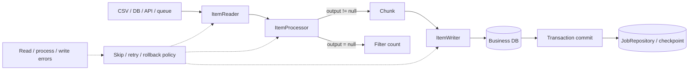
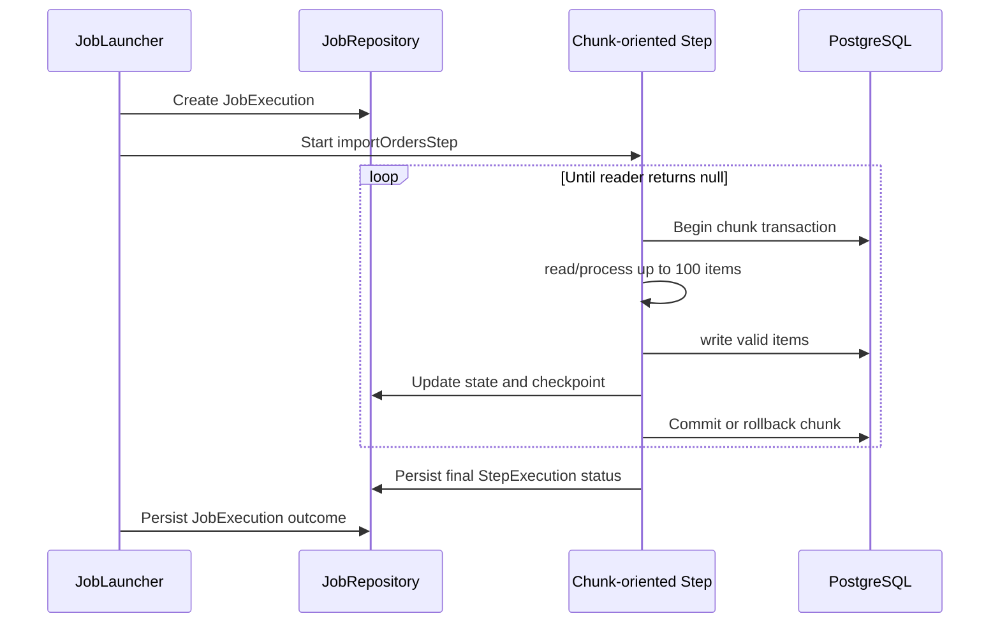
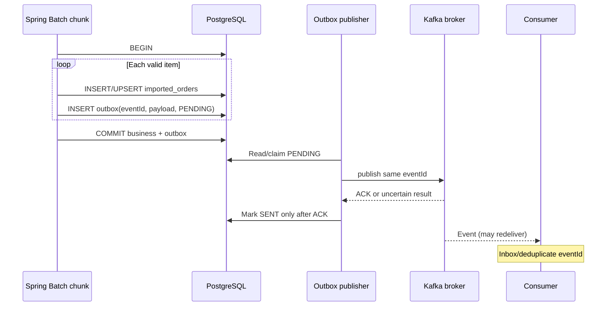
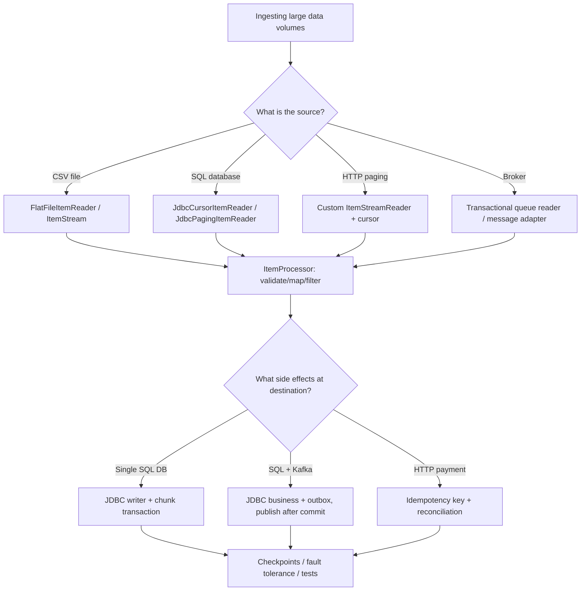

# ItemReader, ItemProcessor, ItemWriter, and Chunk-Oriented Processing

> **Chapter:** Spring Batch  
> **Module:** SPRING_BOOT_INTEGRATION — system integration in Spring Boot via HTTP clients, databases, caches, message brokers, and Spring Integration adapters. This lesson focuses on data contracts, transaction scopes, errors, deduplication, checkpoints, testing, and observability during batch ingestion.

## 1. Why Do We Need the Reader → Processor → Writer Model?

Suppose every night an e-commerce platform exports a CSV file containing 2 million orders. A Spring Boot application needs to read each row, validate the data, skip rows explicitly marked not to import, write valid records to PostgreSQL, and then forward changes to Kafka.

If you write a single method to read the entire file into a `List`, transform it, and call `saveAll(...)`:

- You can run out of heap memory when the file is large.
- There is no clear checkpoint if the JVM dies at row 900,000.
- It is hard to decide which malformed records may be skipped and which errors must halt the job.
- Retrying the entire file can produce duplicate records or duplicate events.
- There are no granular metrics on how many lines were read, filtered, written, skipped, and rolled back.

**Spring Batch** solves the core problem with *chunk-oriented processing*: reading a bounded group of items, processing each item, writing the resulting group, and committing along a transaction boundary. The three main contracts are:

| Component | Spring Batch 5.x API | Responsibility |
| --- | --- | --- |
| **`ItemReader<I>`** | `I read() throws Exception` | Supplies one item per call; returns `null` when input is exhausted |
| **`ItemProcessor<I,O>`** | `O process(I item) throws Exception` | Transforms/validates input; returns `null` to **filter** an item |
| **`ItemWriter<O>`** | `void write(Chunk<? extends O> chunk) throws Exception` | Receives a batch of output items to write to the destination |



This diagram is a conceptual model: exact metadata update and commit timing depend on the transaction manager, `ItemStream`, configuration, and resources used. **Do not assume DB writes, Kafka publishing, and checkpoint updates always form a single distributed transaction.**

### 1.1. Learning Objectives

After this lesson, you will be able to:

1. Distinguish the responsibilities and lifecycles of `ItemReader`, `ItemProcessor`, and `ItemWriter` in Spring Batch 5.
2. Build chunk-oriented `Step`s with `JobRepository` and `PlatformTransactionManager`.
3. Understand commit intervals, filtering, skipping, retrying, rolling back, and `StepExecution` counters.
4. Write a CSV reader, a validating/transforming processor, and a duplicate-safe JDBC writer.
5. Manage checkpoints using `ItemStream`, `@StepScope`, and identifying `JobParameters`.
6. Handle tricky boundaries: HTTP, brokers, Redis, multiple datasources, and restarts.
7. Test chunk transactions, transient failures, skip/retry, and metadata against a real database.

## 2. Understanding a Chunk Lifecycle Properly

Suppose `chunk(3, transactionManager)` is configured and the file has five lines:

```text
1. web-101, customer-A, 10.00, USD, IMPORT
2. web-102, customer-B, 20.00, USD, SKIP
3. web-103, customer-C, 30.00, USD, IMPORT
4. web-104, customer-D, 40.00, USD, IMPORT
5. web-105, customer-E, 50.00, USD, IMPORT
```

Typical processing cycle:

1. The framework opens the step's `ItemStream`s (if any), restoring state from `ExecutionContext`.
2. Within a chunk transaction, it reads up to **3 input items**.
3. It calls the processor for each input; line 2 returns `null` to be **filtered**, so the output chunk contains only lines 1 and 3.
4. It invokes the writer with a `Chunk<Output>` containing **2** elements.
5. It writes checkpoints/step metadata per framework lifecycle and commits the transaction.
6. It continues reading lines 4–5, after which the reader returns `null` to signal EOF; it processes the final chunk and completes the step.

| Logical Chunk | Inputs Read | Filtered | Outputs Passed to Writer | Illustrative Chunk Commits |
| --- | ---: | ---: | ---: | ---: |
| First chunk | 3 | 1 | 2 | 1 |
| Second chunk | 2 | 0 | 2 | 1 |
| Total | 5 | 1 | 4 | 2 |

These numbers illustrate a clean success path without retries/skips/rollbacks. Actual `COMMIT_COUNT` is also affected by how Spring Batch handles the EOF read cycle and internal transactions; **never treat an illustrative table as a rigid formula for every configuration**.

### 2.1. Commit Interval Is Not JDBC Batch Size

`chunk(100, txManager)` means Spring Batch structures **transactions/checkpoints** around a number of inputs per completion policy; it does not guarantee `ItemWriter` sends a single JDBC batch of 100 statements every time. `ItemWriter` might:

- Loop calling `JdbcTemplate.update(...)` 100 times in one transaction.
- Call `JdbcBatchItemWriter` or `JdbcTemplate.batchUpdate(...)` to batch SQL statements.
- Send messages to a broker; each item may produce a separate network call.
- Call a bulk API whose own limit differs from the chunk size.

Tuning chunk size and JDBC batch size are **related but distinct knobs**.

### 2.2. Filter vs. Skip

| Case | Mechanism | Meaning |
| --- | --- | --- |
| Order validly has `action=SKIP` | Processor returns `null` | **Filtered** per business rule, not an error |
| Malformed CSV row | Reader throws exception | **Read error**; may be skipped if policy allows |
| Negative amount or unsupported currency | Processor throws exception | **Process error**; typically stops or skips with audit |
| Inappropriate SQL unique-key conflict | Writer throws exception | **Write error**; never silently filtered as success |
| Temporary PostgreSQL disconnect | Writer throws transient exception | May be **boundedly retried**; requires safe rollback/replay |

An error bypassed by a skip policy is still an error for which the framework permitted **skipping the item**. An item returning `null` from a processor is **validly filtered** and does not increment `SKIP_COUNT`.

### 2.3. A Chunk Is Not a Job-Wide Transaction

A job with 20,000 chunks that commits 19,000 chunks and then crashes **will not automatically roll back those 19,000 committed chunks**. Chunk processing deliberately trades whole-file atomicity for durable progress, bounded memory, and restartability. When the job re-runs, never assume previously committed records vanished.

## 3. Version Selection, Dependencies, and Boot Configuration

Examples in this lesson target **Java 17+, Spring Boot 3.2–3.5, and Spring Batch 5.x**, focusing on JDBC/PostgreSQL. Spring Batch 5 uses `ItemWriter.write(Chunk<? extends T>)`; many online examples for Batch 4 using `write(List<? extends T>)` **no longer match the API signature**.

### 3.1. Gradle

```groovy
// Spring Boot plugin and corresponding BOM already applied.
dependencies {
    implementation 'org.springframework.boot:spring-boot-starter-batch'
    implementation 'org.springframework.boot:spring-boot-starter-jdbc'
    runtimeOnly 'org.postgresql:postgresql'

    testImplementation 'org.springframework.boot:spring-boot-starter-test'
    testImplementation 'org.springframework.batch:spring-batch-test'
}
```

`spring-boot-starter-batch` provides Spring Batch infrastructure, while the JDBC driver and JDBC starter support `JdbcTemplate` in writers. Let Boot manage dependency versions; if your application uses Boot 4/Batch 6, verify APIs, auto-config beans, and metadata schemas for that major version.

### 3.2. `application.yml` Configuration

```yaml
spring:
  datasource:
    url: ${ORDERS_DB_URL}
    username: ${ORDERS_DB_USERNAME}
    password: ${ORDERS_DB_PASSWORD}
    hikari:
      maximum-pool-size: 12

  batch:
    job:
      enabled: false
    jdbc:
      initialize-schema: never
```

Meaning:

- `spring.batch.job.enabled=false` disables **auto-running Jobs on Spring Boot startup**. Jobs can still be triggered via `JobLauncher` or controlled operational tools.
- `spring.batch.jdbc.initialize-schema=never` suits **production environments using migrations** to manage the six `BATCH_*` tables and sequences. In tests, dedicated schema initialization or matching migrations can be used.
- `ORDERS_DB_PASSWORD` must be supplied from a secret manager/secure environment, never committed.
- Verify the JDBC datasource, PostgreSQL driver, transaction manager, and schema are ready before running jobs.

In Boot 3.x relying on Batch auto-configuration, **do not add `@EnableBatchProcessing` just to "turn on Batch"**: that annotation or manual Batch configuration causes Boot Batch auto-configuration (including schema initialization) to back off. When configuring manually, you own the infrastructure and migrations.

### 3.3. Where Is Metadata Stored?

JobRepository writes `JobInstance`, `JobExecution`, `StepExecution`, and `ExecutionContext` into `BATCH_*` tables. In this lesson, the focus is chunk processing:

| Metadata Table | Role in Chunking/Restart |
| --- | --- |
| `BATCH_JOB_INSTANCE` | Identifies job by name + identifying parameters |
| `BATCH_JOB_EXECUTION` | Run/restart attempts and overall job status |
| `BATCH_STEP_EXECUTION` | Read, write, filter, skip, rollback, commit counts, and step status |
| `BATCH_STEP_EXECUTION_CONTEXT` | Reader/stream checkpoint within the step |
| `BATCH_JOB_EXECUTION_CONTEXT` | State shared across job scope |
| `BATCH_JOB_EXECUTION_PARAMS` | Parameters and identifying flags used at launch |

Exact columns, indexes, and sequences depend on the **Spring Batch version and SQL vendor schema**. Use official migrations; never build these tables from a simplified diagram in study material.

## 4. `ItemReader<I>`: Reading One Item Per Call

Minimal contract:

```java
@FunctionalInterface
public interface ItemReader<T> {
    T read() throws Exception;
}
```

This is a simplified view showing the intent; the official Spring Batch interface has its own Javadoc/annotations. **`null` from `read()` means input is exhausted**, not an item whose value is null. If a data source allows null-valued entries, the adapter must represent them with a valid wrapper/marker object instead of returning null mid-stream.

### 4.1. A Reader Must Return an Item or Signal EOF

Simple reader suitable only for unit tests:

```java
import java.util.Iterator;
import java.util.List;
import org.springframework.batch.item.ItemReader;

public final class ListOrderReader implements ItemReader<String> {
    private final Iterator<String> iterator;

    public ListOrderReader(List<String> values) {
        this.iterator = List.copyOf(values).iterator();
    }

    @Override
    public String read() {
        return iterator.hasNext() ? iterator.next() : null;
    }
}
```

This reader is **not restartable**: the iterator lives only in the current instance's memory. If the JVM dies, there is no checkpoint to know the committed position. Never use it as a production adapter for large files.

### 4.2. `FlatFileItemReader` for Reading CSV

Suppose the input file is:

```csv
externalOrderId,customerId,amount,currency,action
web-101,cus-A,10.00,USD,IMPORT
web-102,cus-B,20.00,USD,SKIP
web-103,cus-C,30.00,USD,IMPORT
```

Define a **raw input** record, keeping `amount` as a string so the processor controls validation:

```java
public record OrderCsvRow(
        String externalOrderId,
        String customerId,
        String amount,
        String currency,
        String action) {
}
```

Spring Batch 5 provides `FlatFileItemReaderBuilder<T>`:

```java
import java.nio.file.Path;
import org.springframework.batch.core.configuration.annotation.StepScope;
import org.springframework.batch.item.file.FlatFileItemReader;
import org.springframework.batch.item.file.builder.FlatFileItemReaderBuilder;
import org.springframework.beans.factory.annotation.Value;
import org.springframework.context.annotation.Bean;
import org.springframework.context.annotation.Configuration;
import org.springframework.core.io.FileSystemResource;

@Configuration(proxyBeanMethods = false)
public class OrderReaderConfiguration {

    @Bean
    @StepScope
    FlatFileItemReader<OrderCsvRow> orderCsvReader(
            @Value("#{jobParameters['sourceFile']}") String sourceFile) {
        if (sourceFile == null || sourceFile.isBlank()) {
            throw new IllegalArgumentException(
                    "sourceFile job parameter is required");
        }

        return new FlatFileItemReaderBuilder<OrderCsvRow>()
                .name("orderCsvReader")
                .resource(new FileSystemResource(Path.of(sourceFile)))
                .linesToSkip(1)
                .delimited()
                .names("externalOrderId", "customerId",
                        "amount", "currency", "action")
                .fieldSetMapper(fieldSet -> new OrderCsvRow(
                        fieldSet.readString("externalOrderId"),
                        fieldSet.readString("customerId"),
                        fieldSet.readString("amount"),
                        fieldSet.readString("currency"),
                        fieldSet.readString("action")))
                .build();
    }
}
```

Key points:

1. `@StepScope` creates a new instance per `StepExecution` and resolves `jobParameters['sourceFile']` when the step runs, rather than when the application context starts.
2. `.name("orderCsvReader")` sets the checkpoint key prefix when `saveState` is active. This name must remain **stable across restarts**.
3. `FlatFileItemReader` is an `ItemStreamReader`: it opens/closes the resource and saves the read position into `ExecutionContext` at commit boundaries.
4. `.linesToSkip(1)` only skips the example CSV header row—it is not a skip policy for malformed records.
5. For CSVs with commas inside quoted fields, special encodings, embedded newlines, or vendor-specific formats, test the tokenizer/encoding against real fixtures; never assume every `.csv` file follows the same dialect.
6. `sourceFile` must come from a trusted scheduler or be validated against an allowed directory, canonical path, file permissions, and checksum. Never accept an arbitrary path from an HTTP user and read from the filesystem.

**Watch out for thread safety:** `FlatFileItemReader` is stateful (tracks read position) and is not inherently safe for concurrent reads across multiple threads. Never share one instance across step executions or use a multi-threaded step without addressing synchronization and checkpointing.

### 4.3. Choosing a Reader by Data Source

| Data Source | Common Reader | Common Pitfalls |
| --- | --- | --- |
| CSV/plain text | `FlatFileItemReader` | Encoding, tokenizer, headers, state/offset, and modified files |
| XML | `StaxEventItemReader` | XML schema, fragment root, encoding, data errors |
| JDBC cursor | `JdbcCursorItemReader` | Connection/cursor lifecycle, driver fetch size, source mutation on restart |
| JDBC paging | `JdbcPagingItemReader` | Unique/stable sort key, page boundaries, snapshot consistency |
| JPA paging | `JpaPagingItemReader` | Persistence context, fetch plan, page ordering, transaction semantics |
| MongoDB | Spring Batch/Spring Data Mongo reader matching version | Paging, sorting, ObjectId, resume/restart semantics |
| Cursor-based HTTP | Custom reader implementing `ItemStreamReader` | Retries/rate limits, cursor expiry, checkpoints, and dedup |
| Kafka/JMS | Message-driven/broker adapter or dedicated reader | Ack/offset differs from JDBC transactions, redeliveries |

**Do not choose a reader solely because its name matches the source.** Understand whether the source mutates while the job runs, whether ordering is stable, whether resume is supported, and whether checkpoints accurately reproduce the next item on restart.

### 4.4. Readers Should Not Perform Business Side Effects

Ideally, a reader only **fetches source data and yields items**. If `read()` simultaneously deletes messages, transfers money, or updates business status, a chunk rollback may cause the framework to re-read the item while the side effect already occurred. For queues with their own transactions/acks, explicitly configure how broker acknowledgment relates to chunk commits; never assume `read()` returning an item means it was processed.

## 5. `ItemProcessor<I,O>`: Filter, Validate, Transform

`ItemProcessor<I,O>` separates raw input structure from validated data; in this pipeline, `I = OrderCsvRow` and `O = ImportOrder`.

### 5.1. Normalized Output DTO

```java
import java.math.BigDecimal;

public record ImportOrder(
        String externalOrderId,
        String customerId,
        BigDecimal amount,
        String currency) {
}
```

In this record, `amount` is already a `BigDecimal`, `currency` is normalized uppercase, and IDs have been checked. If currency units, precision rules, or tax calculations are more complex, use value objects/domain validators rather than trusting CSV formatting.

### 5.2. A Processor with Clear Filter and Validation Rules

```java
// InvalidOrderRowException.java
public final class InvalidOrderRowException extends RuntimeException {
    public InvalidOrderRowException(String message) {
        super(message);
    }

    public InvalidOrderRowException(String message, Throwable cause) {
        super(message, cause);
    }
}
```

```java
// OrderRowProcessor.java
import java.math.BigDecimal;
import java.util.Locale;
import java.util.Set;
import org.springframework.batch.item.ItemProcessor;
import org.springframework.stereotype.Component;

@Component
public class OrderRowProcessor
        implements ItemProcessor<OrderCsvRow, ImportOrder> {

    private static final Set<String> SUPPORTED_CURRENCIES =
            Set.of("USD", "EUR");

    @Override
    public ImportOrder process(OrderCsvRow input) {
        String action = normalize(input.action());
        if ("SKIP".equals(action)) {
            return null; // Intentional filter, not an error.
        }
        if (!"IMPORT".equals(action)) {
            throw new InvalidOrderRowException(
                    "Unsupported action");
        }

        String orderId = trim(input.externalOrderId());
        String customerId = trim(input.customerId());
        String currency = normalize(input.currency());

        if (orderId.isEmpty() || customerId.isEmpty()) {
            throw new InvalidOrderRowException(
                    "Missing business identifier");
        }
        if (!SUPPORTED_CURRENCIES.contains(currency)) {
            throw new InvalidOrderRowException(
                    "Unsupported currency");
        }

        BigDecimal amount;
        try {
            amount = new BigDecimal(trim(input.amount()));
        } catch (NumberFormatException ex) {
            throw new InvalidOrderRowException(
                    "Invalid amount format", ex);
        }
        if (amount.signum() <= 0 || amount.scale() > 2) {
            throw new InvalidOrderRowException(
                    "Amount must be positive with at most 2 decimals");
        }

        return new ImportOrder(orderId, customerId, amount, currency);
    }

    private static String trim(String text) {
        return text == null ? "" : text.trim();
    }

    private static String normalize(String text) {
        return trim(text).toUpperCase(Locale.ROOT);
    }
}
```

**Two distinct outcomes:**

- `process(...) == null` for `SKIP` action → Spring Batch increments **filterCount** while processing the item.
- `throw InvalidOrderRowException` for invalid amount or currency → the step **fails**, unless a fault-tolerant policy allows skipping and skip budget remains.

Processors should be **stateless**, deterministic given their input, and free of side effects: the framework may invoke a processor again during chunk rollback/retry depending on caching settings. Calling an invoice-creation API or publishing to Kafka inside `process(...)` is risky if chunks re-execute.

### 5.3. Valid Filtering Does Not Replace Auditing Skipped Data

If the business needs to know why a row was excluded, you can:

1. Define valid action states (`SKIP` is a source directive).
2. Count filters and emit metrics with **low-cardinality reason codes**.
3. If every filtered row must be persisted for auditing, build a dedicated side-output/durable audit mechanism rather than writing outside the DB transaction without recovery.

Do not abuse filtering to swallow all errors: if `amount="not-a-number"`, returning `null` makes the job report "COMPLETED" while data is silently lost with no error signal.

### 5.4. Chaining Multiple Processors

Spring Batch provides `CompositeItemProcessor<I,O>` to chain normalization, validation, and transformation steps when consecutive types match:

```java
import java.util.List;
import org.springframework.batch.item.ItemProcessor;
import org.springframework.batch.item.support.CompositeItemProcessor;

ItemProcessor<OrderCsvRow, OrderCsvRow> identity = row -> row;
ItemProcessor<OrderCsvRow, ImportOrder> pipeline =
        new CompositeItemProcessor<>(List.of(
                identity,                   // Example delegate with same input/output type.
                new OrderRowProcessor()));  // Validate + transform.
```

This fragment only illustrates pipeline typing; the first processor is an identity processor and has **no real business utility**. In real projects, each delegate should have a distinct responsibility, e.g., `OrderCsvRow → CanonicalOrder → ImportOrder`, injected as Spring beans. When any delegate returns `null`, the item is filtered instead of passing to subsequent delegates.

Do not split processors into too many layers just for abstraction's sake: what matters most are **error paths, repeatability, and data boundaries**.

## 6. `ItemWriter<O>`: Chunk Writing and Protecting Committed Data

In Spring Batch 5, writers receive **`Chunk<? extends O>`**, not `List<O>` as in older Batch 4 examples. A writer should treat the chunk as a transactional group; one failing row normally rolls back the chunk unless a fault-tolerant step defines special skip/retry rules.

### 6.1. PostgreSQL Schema for the Writer

This is **illustrative DDL for application tests/migrations**, not the `BATCH_*` schema:

```sql
CREATE TABLE imported_orders (
    external_order_id VARCHAR(120) PRIMARY KEY,
    customer_id VARCHAR(120) NOT NULL,
    amount NUMERIC(19, 2) NOT NULL CHECK (amount > 0),
    currency VARCHAR(3) NOT NULL,
    imported_at TIMESTAMPTZ NOT NULL DEFAULT CURRENT_TIMESTAMP
);
```

`external_order_id` acts as the **business deduplication key**. Every re-import of the same order must preserve a stable ID. The DB index is the final safeguard when two jobs/requests run concurrently; checking `existsById` before inserting is insufficient against race conditions.

### 6.2. Idempotent JDBC Writer That Does Not Silently Drop Changed Data

A suitable writer for the PostgreSQL import problem:

```java
// JdbcImportOrderWriter.java
import java.math.BigDecimal;
import java.util.Objects;
import org.springframework.batch.item.Chunk;
import org.springframework.batch.item.ItemWriter;
import org.springframework.jdbc.core.JdbcTemplate;
import org.springframework.stereotype.Component;

@Component
public class JdbcImportOrderWriter implements ItemWriter<ImportOrder> {
    private final JdbcTemplate jdbc;

    public JdbcImportOrderWriter(JdbcTemplate jdbc) {
        this.jdbc = jdbc;
    }

    @Override
    public void write(Chunk<? extends ImportOrder> chunk) {
        for (ImportOrder order : chunk.getItems()) {
            int inserted = jdbc.update("""
                    INSERT INTO imported_orders
                        (external_order_id, customer_id, amount, currency)
                    VALUES (?, ?, ?, ?)
                    ON CONFLICT (external_order_id) DO NOTHING
                    """,
                    order.externalOrderId(),
                    order.customerId(),
                    order.amount(),
                    order.currency());

            if (inserted == 0) {
                ImportOrder existing = jdbc.queryForObject("""
                        SELECT external_order_id, customer_id,
                               amount, currency
                          FROM imported_orders
                         WHERE external_order_id = ?
                        """,
                        (rs, index) -> new ImportOrder(
                                rs.getString("external_order_id"),
                                rs.getString("customer_id"),
                                rs.getBigDecimal("amount"),
                                rs.getString("currency")),
                        order.externalOrderId());

                if (!sameBusinessPayload(existing, order)) {
                    throw new IllegalStateException(
                            "Conflicting payload for existing order ID");
                }
            }
        }
    }

    private static boolean sameBusinessPayload(
            ImportOrder a, ImportOrder b) {
        return Objects.equals(a.externalOrderId(), b.externalOrderId())
                && Objects.equals(a.customerId(), b.customerId())
                && a.amount().compareTo(b.amount()) == 0
                && Objects.equals(a.currency(), b.currency());
    }
}
```

**Writer semantics:**

1. Item ID not yet present → insert.
2. Item already exists with **identical business payload** → safe replay; no second row created.
3. ID already exists with a different payload → throw error; **do not** treat conflict as duplicate success.
4. If part of the chunk has been written and the next item throws an error, the JDBC transaction manager for that datasource must **roll back the entire chunk**.

This example prioritizes **correctness and clarity of idempotency** by issuing multiple `jdbc.update` calls within the same chunk transaction. At high volume, optimize using `JdbcBatchItemWriter`, bulk/upserts, or staging tables, while preserving conflict-handling policies (duplicate replay vs. changed payload) via SQL/constraints and tests. Never rely on `ON CONFLICT DO NOTHING` alone to swallow genuine data changes.

**Limitation:** `sameBusinessPayload` assumes ID, customer, amount, and currency represent the entire business fingerprint. In real systems, define a canonical payload/hash and contract version; currency/precision rules must be normalized rather than comparing raw JSON.

### 6.3. Which Transaction Does the Writer Actually Use?

If the Step is configured with `chunk(..., jdbcTransactionManager)` and the writer's `JdbcTemplate` points to **that same datasource**, JDBC updates join the chunk transaction through Spring resource binding. If the writer uses another datasource or opens raw connections outside Spring transactions, you cannot expect it to roll back with metadata/step transactions.

**Never assume:** `write(...)` does not automatically create a database transaction just because it receives a `Chunk`. Transactions originate from **Step configuration, the transaction manager, and bound resources**, and should be verified with tests that force an exception mid-chunk.

### 6.4. When to Use `JdbcBatchItemWriter`?

For straightforward SQL, `JdbcBatchItemWriter` sends multiple items to JDBC as a batch:

```java
import javax.sql.DataSource;
import org.springframework.batch.item.database.JdbcBatchItemWriter;
import org.springframework.batch.item.database.builder.JdbcBatchItemWriterBuilder;

JdbcBatchItemWriter<OrderBean> writer =
        new JdbcBatchItemWriterBuilder<OrderBean>()
                .dataSource(dataSource)
                .sql("""
                     INSERT INTO imported_orders
                          (external_order_id, customer_id, amount, currency)
                     VALUES (:externalOrderId, :customerId, :amount, :currency)
                     """)
                .beanMapped()
                .build();
```

This fragment assumes `OrderBean` is a **JavaBean with getters** `getExternalOrderId()`, `getCustomerId()`, `getAmount()`, and `getCurrency()`, and `dataSource` is properly injected. The example uses plain SQL `INSERT` to illustrate parameter mapping; for replay/idempotency, add unique-key handling and conflict detection separately. Do not swap `OrderBean` for a Java record without verifying record name-binding support in your library version.

### 6.5. What Does Sending Kafka/HTTP Inside a Writer Mean?

An `ItemWriter` calling `kafkaTemplate.send(...)` or HTTP POST **does not automatically gain atomicity with the JDBC transaction**:

```text
Chunk starts JDBC transaction
  DB UPDATE successful
  HTTP POST payment successful
  Kafka send accepted asynchronously
  Next item fails -> JDBC transaction rollback

Result:
  DB changes may rollback
  HTTP payment may remain
  Kafka record may already be published
```

Never design a writer that "writes DB then sends Kafka" and claim exactly-once based merely on `@Transactional`. For events that must be emitted after DB commit, prefer a **transactional outbox** in the same DB, followed by a separate publisher sending to the broker and consumers deduplicating by event ID. For HTTP side effects, use idempotency keys and reconciliation.

## 7. Wiring Reader, Processor, and Writer into a Chunk-Oriented Step

Spring Batch 5.x creates steps via `StepBuilder` taking `JobRepository`; the chunk method takes **commit interval/completion policy and transaction manager**. Do not copy legacy `StepBuilderFactory` or `ItemWriter.write(List<?>)` from Batch 4 as if they were the same API.

### 7.1. Step Configured with Commit Interval 100

```java
// ImportJobConfiguration.java
import org.springframework.batch.core.Job;
import org.springframework.batch.core.Step;
import org.springframework.batch.core.job.builder.JobBuilder;
import org.springframework.batch.core.repository.JobRepository;
import org.springframework.batch.core.step.builder.StepBuilder;
import org.springframework.beans.factory.annotation.Qualifier;
import org.springframework.context.annotation.Bean;
import org.springframework.context.annotation.Configuration;
import org.springframework.transaction.PlatformTransactionManager;
import org.springframework.batch.item.file.FlatFileItemReader;

@Configuration(proxyBeanMethods = false)
public class ImportJobConfiguration {

    @Bean
    Step importOrdersStep(
            JobRepository jobRepository,
            PlatformTransactionManager transactionManager,
            @Qualifier("orderCsvReader")
            FlatFileItemReader<OrderCsvRow> reader,
            OrderRowProcessor processor,
            JdbcImportOrderWriter writer) {

        return new StepBuilder("importOrdersStep", jobRepository)
                .<OrderCsvRow, ImportOrder>chunk(100, transactionManager)
                .reader(reader)
                .processor(processor)
                .writer(writer)
                .build();
    }

    @Bean
    Job importOrdersJob(
            JobRepository jobRepository,
            @Qualifier("importOrdersStep") Step importOrdersStep) {

        return new JobBuilder("importOrdersJob", jobRepository)
                .start(importOrdersStep)
                .build();
    }
}
```

This example assumes the application uses **a single PostgreSQL `DataSource`** for the writer, JobRepository, and manager auto-configured by Boot 3.x. If multiple managers exist, qualify the `transactionManager` parameter with `@Qualifier("ordersJdbcTransactionManager")`; verify all resources belong to the same transaction boundary.

**Invocation order** inside a chunk: reader supplies item → processor handles it → writer receives `Chunk<ImportOrder>` → metadata/checkpoint updates and chunk commits. Records are not all buffered in heap until the entire Job completes.

### 7.2. `JobLauncher` Receiving Identifying Parameters

```java
// ImportJobLauncher.java
import org.springframework.batch.core.Job;
import org.springframework.batch.core.JobExecution;
import org.springframework.batch.core.JobParameters;
import org.springframework.batch.core.JobParametersBuilder;
import org.springframework.batch.core.launch.JobLauncher;
import org.springframework.beans.factory.annotation.Qualifier;
import org.springframework.stereotype.Service;

@Service
public class ImportJobLauncher {
    private final JobLauncher jobLauncher;
    private final Job job;

    public ImportJobLauncher(
            JobLauncher jobLauncher,
            @Qualifier("importOrdersJob") Job job) {
        this.jobLauncher = jobLauncher;
        this.job = job;
    }

    public long start(String sourceFile, String sourceChecksum,
                      String requestedBy) throws Exception {
        JobParameters parameters = new JobParametersBuilder()
                .addString("sourceFile", sourceFile, true)
                .addString("sourceChecksum", sourceChecksum, true)
                .addString("requestedBy", requestedBy, false)
                .toJobParameters();

        JobExecution execution = jobLauncher.run(job, parameters);
        return execution.getId();
    }
}
```

`sourceFile` and `sourceChecksum` identify the **logical work**; `requestedBy` is non-identifying metadata. In production, validate checksums/paths consistently across pods. If two processes share a filename with different contents, line-count checkpoints become invalid—so a checksum or immutable object ID is essential.

**Same identifying parameters:**

- If the JobInstance already `COMPLETED`: the framework normally blocks re-launching that instance.
- If `FAILED`/`STOPPED` and restartable: creates a **new JobExecution** under the existing JobInstance.
- If an instance is currently running: the repository guards concurrent execution according to framework/DB semantics.

`JobLauncher.run(...)` may block the caller if using a synchronous launcher. If an HTTP endpoint must return `202 Accepted` immediately, configure an asynchronous launcher or enqueue the job onto a durable queue and expose a status endpoint; never assume `JobLauncher` returns before the job finishes.

### 7.3. Job/Step Execution Is Not a Single Transaction



The diagram shows logical flow. JobRepository also executes its own metadata transactions; if reader/writer, metadata, or message brokers use separate resources, commit timings can diverge. Verify with integration tests rather than relying solely on the diagram.

## 8. Commit, Rollback, and Checkpoints Inside a Chunk

### 8.1. What Happens If the 81st Item Fails?

Suppose `chunk(100, transactionManager)` is used and the 7th chunk is processing items 601–700:

```text
Chunk 1..6: committed (input 1..600)
Chunk 7:    read/process items 601..680
            item 681 -> exception

No fault tolerance configured:
  - Chunk 7 fails and DB writes within its transaction roll back.
  - Previous committed chunks remain committed.
  - StepExecution/JobExecution record the failure.
  - Restart uses persisted checkpoint/state (if reader is restartable).
```

When errors occur in the **reader**, processor, or writer, exact framework buffering/re-read details depend on transaction settings; the fundamental rule is that **the uncommitted chunk is not durably persisted** if all writes are within the same DB transaction.

### 8.2. `ItemStream.open`/`update`/`close`

`FlatFileItemReader` supports `ItemStream`:

| Callback | When Called by Framework | Responsibility |
| --- | --- | --- |
| `open(ExecutionContext)` | Before step starts reading | Restore state/cursor from saved checkpoint |
| `read()` | When next item is needed | Return item or null at EOF |
| `update(ExecutionContext)` | At state-save points, typically near chunk commit | Write updated position to ExecutionContext |
| `close()` | When closing stream/step | Release file, cursor, socket |

**Note:** `ExecutionContext` is not a business transaction. It only stores **recoverable position** and small metadata; never put full record lists or credentials into context.

### 8.3. Example Custom `ItemStreamReader` with Checkpoint

To understand internal mechanics, here is a reader backed by an **immutable list**:

```java
import java.util.List;
import org.springframework.batch.item.ExecutionContext;
import org.springframework.batch.item.ItemStreamReader;

public final class RestartableListReader
        implements ItemStreamReader<String> {
    private static final String KEY = "orders.reader.nextIndex";
    private final List<String> items;
    private int index;

    public RestartableListReader(List<String> items) {
        this.items = List.copyOf(items);
    }

    @Override
    public void open(ExecutionContext context) {
        index = context.getInt(KEY, 0);
    }

    @Override
    public String read() {
        return index >= items.size() ? null : items.get(index++);
    }

    @Override
    public void update(ExecutionContext context) {
        context.putInt(KEY, index);
    }

    @Override
    public void close() {
        // No external resources.
    }
}
```

This reader restarts accurately **only if the input list and ordering remain unchanged**. Every `ItemStream` in a step needs non-colliding state keys: in real readers, use a stable name as a namespace or explicit key structure.

If a reader iterates over a paginated HTTP source:

- Save the cursor/offset after chunk commit.
- Ensure cursors are replayable and have not expired when the job restarts.
- If the API does not guarantee snapshots or stable cursors, use order IDs and an idempotent writer to handle duplicates/gaps.
- Never cache access tokens or credentials inside `ExecutionContext`.

### 8.4. How Do Checkpoints Relate to Business Commits?

If JobRepository and the JDBC writer share **the same datasource and appropriate transaction manager**, the framework can persist step metadata/checkpoints and business changes within compatible chunk transaction boundaries. This narrows the crash window between business writes and checkpoint updates.

If metadata resides in **PostgreSQL A** while the writer writes to **PostgreSQL B**, or the writer calls Kafka/HTTP:

```text
DB B commit business rows            SUCCESS
Process crashes                      CRASH
DB A checkpoint was not committed    STALE
Restart reads rows again             REPLAY
```

In this scenario, an **idempotent writer** and outbox/inbox are architectural requirements, not optional optimizations. Never call a step "restartable" if re-running it can double-charge or dispatch orders twice.

### 8.5. Changing Chunk Size Alone Does Not Fix Broken Transactions

Increasing `chunk(100)` to `chunk(10_000)` may reduce commit count, yet it also:

- Increases input/output items held in memory.
- Extends connection/lock hold times.
- Increases items replayed after a rollback.
- Can create traffic spikes on writers or brokers.

Conversely, chunk size 1 increases commits/checkpoints and overhead. Choose via **real benchmarks and SLAs**: measure throughput, heap, lock wait, pool saturation, rollback frequency, and restart cost, rather than picking a universal "magic number."

## 9. Fault-Tolerant Step: Retry, Skip, and Rollback

In systems mixing transient failures and permanent bad records, fault tolerance can be enabled. However, **never use a broad skip policy to force Jobs to report COMPLETED** while important data is dropped.

### 9.1. Example Configuration for Bounded Skip and Retry

When **replacing the Step configuration in Section 7.1** with a fault-tolerant version, add:

```java
import org.springframework.batch.item.file.FlatFileParseException;
import org.springframework.dao.TransientDataAccessException;

return new StepBuilder("importOrdersStep", jobRepository)
        .<OrderCsvRow, ImportOrder>chunk(100, transactionManager)
        .reader(reader)
        .processor(processor)
        .writer(writer)
        .faultTolerant()
        .skip(FlatFileParseException.class)
        .skip(InvalidOrderRowException.class)
        .skipLimit(20)
        .retry(TransientDataAccessException.class)
        .retryLimit(3)
        .build();
```

This is a **replacement fragment for the `return ...build()` block** in Section 7's configuration method, not a second Step bean with the same name. Meaning:

- `skip(FlatFileParseException.class)`: allows skipping corrupt CSV lines if business policy permits.
- `skip(InvalidOrderRowException.class)`: allows skipping items failing domain validation, provided they are audited/quarantined per policy.
- `skipLimit(20)`: total skips across the step are capped; exceeding the limit fails the step.
- `retry(TransientDataAccessException.class)`: only a **potentially transient error category** is retried.
- `retryLimit(3)`: sets the retry budget; exact attempt/retry counting should be verified via tests for your framework version.

Never add `.skip(Exception.class)` or `.retry(Exception.class)` merely to reduce FAILED runs. In particular, `DuplicateKeyException` caused by a **payload conflict** must never be swallowed as a successful skip; in PostgreSQL, duplicates can stem from distinct unique keys and require classification.

### 9.2. Which Errors to Retry, Skip, or Fail?

| Scenario | Recommended Policy | Rationale |
| --- | --- | --- |
| CSV row with wrong column count | Bounded skip **if contract allows**, quarantine | Permanently malformed record |
| Non-numeric amount | Skip or fail-fast depending on data criticality | Retrying identical input will not fix the amount |
| Unsupported currency | Usually fail/quarantine; skip only if explicitly approved | Never guess a default currency |
| Brief PostgreSQL connection glitch | Bounded retry, backoff, and deadline | Potentially transient, though commit outcome must be verified |
| Missing DB schema column | Fail | Misconfiguration/missing migration; retry cannot help |
| Unique conflict with different content | Fail/domain conflict | Never create two logical orders or ignore discrepancies |
| Expired HTTP token in reader | Refresh/recover per policy | Never log tokens |
| HTTP 429 with Retry-After | Wait within budget, throttle concurrent requests | Respect rate limiting |
| Kafka publish timeout | Reconcile and replay same eventId | Resending may produce duplicates |

**Retry at only one clearly responsible layer.** If the HTTP client, ItemReader, Spring Batch fault-tolerant step, and scheduler all retry without sharing a budget, 3 attempts per layer multiply requests exponentially. Enforce an overall deadline, backoff/jitter, and attempt metrics.

### 9.3. Skip Listener for Recording Failures

```java
import org.springframework.batch.core.SkipListener;
import org.springframework.stereotype.Component;

@Component
public class ImportSkipListener
        implements SkipListener<OrderCsvRow, ImportOrder> {

    @Override
    public void onSkipInRead(Throwable error) {
        // Increment read_skipped metric with fixed reason code.
    }

    @Override
    public void onSkipInProcess(OrderCsvRow item, Throwable error) {
        // Record normalized reason code; do not log full PII.
    }

    @Override
    public void onSkipInWrite(ImportOrder item, Throwable error) {
        // Write to quarantine store/transaction as required.
    }
}
```

Register the listener in the Step builder: `.listener(importSkipListener)`. In a fault-tolerant chunk, skip listeners have lifecycles aligned by Spring Batch near commits; however, **writing to systems outside the DB transaction inside a listener can still duplicate or drop on JVM crash**. For durable auditing, design a quarantine/outbox table and test crash windows.

### 9.4. Writer Retry May Re-Execute the Entire Chunk

When a writer fails, the framework can roll back the chunk and **retry**; some fault-tolerant configurations fall back to item-by-item processing to isolate the offending item. Consequently:

- Processors must be side-effect-free and independent of mutable state outside checkpoints.
- Writers must tolerate seeing **the same item again**.
- Unique constraints/idempotency protect results when commit outcomes are uncertain.
- Never assume `write(...)` is called exactly once per output item.

If an ItemReader reads from a **transactional queue**, Spring Batch offers specific settings (such as `readerIsTransactionalQueue` in supported versions) regarding buffering and redelivery. Reading from files and reading from queues **do not share rollback semantics**, so test interactions between DB transactions and broker acknowledgments.

## 10. Restarts, State, and Data Changing Between Runs

### 10.1. Restart vs. Running a New JobInstance

Spring Batch identifies a `JobInstance` by **Job name and identifying JobParameters**. When a job is restartable after FAILED/STOPPED, Spring Batch creates a **new JobExecution** for **the same JobInstance**, using persisted `ExecutionContext` state to resume.

```text
Job name: importOrdersJob
Identifying JobParameters:
  sourceFile=/srv/orders/inbound/orders-2026-11-21.csv
  sourceChecksum=sha256:abcd...

JobInstance #101:
  JobExecution #501: FAILED
    StepExecution #601: committed 10 chunks, failed in 11th
  JobExecution #502: COMPLETED (restart)
    StepExecution #602: resumes from checkpoint
```

This example only illustrates identity and checkpoints; exact replayed items depend on transactions, reader buffering, file stability, skip/retry, and chunk configuration. Never create a new JobInstance by appending `run.id=timestamp` on every error: doing so can cause **the entire file to be re-imported from the start** and bypass restart semantics.

### 10.2. Sources Must Be Immutable or Have a Resume Contract

If a file is edited, overwritten, or re-sorted after earlier chunks committed, `reader.current.count=5000` no longer means the old 5,000 records were processed. Protections:

- Give files/objects an **immutable key**, checksum, and version.
- Persist identifying parameters sufficient to pinpoint **the exact source**; paths can vary across pods, so avoid relying solely on paths unless immutable.
- Keep reader format, encoding, tokenizer, and line-skip settings identical across restarts.
- Back writers with unique business keys to survive replays, even if checkpoints/metadata diverge during a crash.
- Define a clear policy when the source disappears or its checksum changes — usually **fail**, rather than silently continuing with a different file.

With HTTP paging, cursors can expire after hours. If a job restarts the next day and the cursor is invalid, have a mechanism to acquire a new snapshot, resume from an ID/order key, or run a reconciliation job; never treat an expired token as "EOF".

### 10.3. JobParameters, ExecutionContext, and Business Data

| Data Type | Where to Store | Rationale |
| --- | --- | --- |
| File ID/checksum, business date | Identifying `JobParameters` | Identifies the logical unit of work |
| Triggering user/scheduler | Non-identifying `JobParameters` if non-sensitive | Does not alter JobInstance identity |
| Committed row count/cursor | `StepExecutionContext` | Supports restart/checkpointing |
| Completed output filename for next step | Job-scoped `ExecutionContext` or business DB | Shares small job-scoped state per job rules |
| Millions of order records | Business database/object storage | Prevents bloating metadata tables |
| Passwords, API keys, access tokens | Secret manager | Never persist in metadata/backups |
| EventId and Kafka publish state | Outbox/broker/inbox store | Durable recovery outside Batch lifecycle |

**ExecutionContext is not an unbounded store.** Serializers require stored objects to remain compatible across serialization/deserialization. When upgrading code or Spring Batch major versions, test restarting from historical metadata to catch incompatible context payloads.

### 10.4. Note on Registering `ItemStream` with a Step

A stateful reader must be recognized by the framework as an `ItemStream` so `open/update/close` are called. When declaring `@StepScope @Bean`, **declare a sufficiently specific return type** such as `FlatFileItemReader<OrderCsvRow>` or `ItemStreamReader<OrderCsvRow>` so proxies/Steps detect the required interfaces. If you only declare the return type `ItemReader<OrderCsvRow>`, some configurations may fail to auto-detect the `ItemStream` lifecycle.

For auxiliary streams not declared directly as the reader/writer, register them explicitly via `StepBuilder.stream(...)` per your API version. Never assume resources get cleaned up and checkpointed merely because a bean exists in the context.

### 10.5. Parallel Execution and Reader Safety

| Throughput Strategy | Benefit | Risks to Evaluate |
| --- | --- | --- |
| Increase chunk size | Fewer commits | Longer resource/lock holds, costlier rollbacks |
| JDBC batch writer | Fewer SQL round trips | More complex conflict/partial-batch error handling |
| Multi-threaded Step | Multiple chunks run concurrently | Reader state/thread-safety, processing order, checkpoints |
| Partitioned Step | Split input into separate ranges | Partition boundaries, duplicate input, worker recovery |
| Remote chunking | Send chunks to workers via broker | Message duplication, ACK/transactions, serialization, backpressure |
| Parallel Steps | Run independent steps concurrently | Resource contention, dependency ordering, job state |

Stateful readers like `FlatFileItemReader` are **not inherently thread-safe**. `SynchronizedItemStreamReader` can guard `read` calls where appropriate, yet out-of-order chunk processing/commits still complicate **restartability**; enable concurrency only after testing crashes and resumes. When data splits cleanly by ID/date/range, partitioning—where each partition has its own source, name, and checkpoint—is usually clearer.

## 11. Integrating HTTP, Kafka, Redis, and Spring Integration with Chunks

Real integration chains rarely consist of just a file and a single database. Yet a Step's transaction does not automatically cover every external resource.

### 11.1. `ItemReader` Calling an HTTP API

Suppose a partner exposes:

```http
GET /v1/orders?limit=100&cursor=opaque-page-2
Accept: application/json

HTTP/1.1 200 OK
Content-Type: application/json

{
  "items": [
    {"externalOrderId":"web-101","customerId":"cus-A","amount":"10.00"}
  ],
  "nextCursor": "opaque-page-3"
}
```

This is a **hypothetical API example**, not a universal pagination protocol for all HTTP partners. An HTTP-based `ItemStreamReader` needs to manage at least:

1. `currentPageCursor` and `nextItemIndex` within the page.
2. `read()` returning **one item** from the loaded page; fetching the next page when exhausted.
3. `update(executionContext)` persisting cursor + index sufficient to reconstruct the exact next item after commit.
4. Timeouts, rate limits, budgeted retries, and page/item limits; never loop endlessly if the server returns a stale cursor.
5. Type-safe JSON mapping, e.g., `CursorPage<OrderDto>` via `ParameterizedTypeReference`, followed by schema validation.
6. When HTTP returns 503/429 or malformed JSON, **never return null** pretending it is EOF; raise an error to retry/fail per policy.

**An HTTP GET 200 is not atomic with a SQL chunk.** If the API does not provide durable cursors, the reader needs a bookmark by business ID or a reliable snapshot mechanism. Never buffer millions of items in memory as a substitute for checkpoints.

### 11.2. `ItemWriter` Writing JDBC then Sending Kafka: Why Use an Outbox?

Anti-pattern:

```java
// Anti-pattern: DB write and Kafka send are not in an atomic transaction.
for (ImportOrder item : chunk.getItems()) {
    jdbc.update("INSERT INTO imported_orders ...", /* params */);
    kafkaTemplate.send("orders.imported", item.externalOrderId(), event);
}
```

This is **pseudocode**, not complete SQL/Java. Dangerous failure modes:

- SQL write succeeds, then Kafka send times out after the broker already received it.
- Kafka ACK succeeds, then the SQL chunk rolls back at the end of the chunk.
- Chunk commits to DB, then JVM crashes before sending to Kafka.
- Consumer receives the same message again due to broker redelivery.

**Solution:** inside the same JDBC chunk transaction, insert both the business record and an outbox row with a stable `eventId`. A separate worker publishes outbox rows after commit and marks `SENT` upon broker ACK. Consumers use the unique event ID to deduplicate.



An event ID can be generated **deterministically from the logical event identity**, or generated once and persisted durably with the record. When retrying the same data, never create a new logical event ID by generating a fresh UUID on each attempt. When an event genuinely represents a new versioned update, the ID must distinguish version/transition per contract.

### 11.3. JDBC Outbox Fragment with Stable Event ID

Example outbox schema:

```sql
CREATE TABLE order_import_outbox (
    event_id VARCHAR(100) PRIMARY KEY,
    aggregate_id VARCHAR(120) NOT NULL,
    event_type VARCHAR(80) NOT NULL,
    payload_json TEXT NOT NULL,
    status VARCHAR(20) NOT NULL DEFAULT 'PENDING',
    created_at TIMESTAMPTZ NOT NULL DEFAULT CURRENT_TIMESTAMP
);
```

Fragment to add inside the writer after inserting or verifying an identical payload:

```java
import java.nio.charset.StandardCharsets;
import java.util.UUID;

String eventId = UUID.nameUUIDFromBytes(
        ("OrderImported:v1:" + order.externalOrderId())
                .getBytes(StandardCharsets.UTF_8)).toString();

String json = objectMapper.writeValueAsString(
        new OrderImportedEvent(eventId, order.externalOrderId()));

jdbc.update("""
        INSERT INTO order_import_outbox
            (event_id, aggregate_id, event_type, payload_json)
        VALUES (?, ?, 'OrderImported', ?)
        ON CONFLICT (event_id) DO NOTHING
        """,
        eventId,
        order.externalOrderId(),
        json);
```

This is an **illustrative fragment**, assuming `objectMapper` and `OrderImportedEvent` exist, `order` is an `ImportOrder` in the writer loop, and both tables live in **the same PostgreSQL transaction**. `UUID.nameUUIDFromBytes` supplies a stable key for this example rather than replacing formal event ID/versioning design; if the event key contains sensitive data, never log the raw input string.

If an existing order is re-imported with a different payload, the writer in Section 6 **throws a conflict error before creating a new outbox row**. This prevents silently publishing a bogus event when source data conflicts.

### 11.4. Redis for Caching vs. Redis for Deduplication

If a StepProcessor queries Redis for a display name with a short TTL, a Redis outage can be handled via cache-miss/degradation policy. However, if Redis holds an **idempotency key** or distributed lock deciding whether to charge money or emit events, bypassing Redis on failure can break correctness.

Never buffer whole chunks in Redis to avoid SQL checkpoints. Caches do not replace `JobRepository` metadata or database unique business constraints.

### 11.5. Spring Integration Adapters and Transaction Boundaries

A Spring Integration flow may receive a file via an inbound adapter, send a message to a `QueueChannel`, and trigger a Spring Batch job. Crossing queues, executors, pollers, Kafka/JMS, or reactive adapters can switch thread/transaction scopes. If a batch writer uses `JdbcTransactionManager`, only operations using **the same Spring-managed datasource** naturally participate in the chunk transaction.

Explicitly document who owns each step:

- Receiving and verifying the source file.
- Identifying the `JobInstance` so schedulers never run the same input concurrently.
- Reading/transforming/writing per chunk.
- Saving checkpoints and error/quarantine records.
- Publishing outbox rows, handling ACKs, retrying, and consumer deduplication.
- Reconciling when external systems time out or return indeterminate statuses.

## 12. Testing Reader, Processor, Writer, and Chunk Rollbacks

Batch testing should span multiple layers because **a mocked ItemWriter cannot prove JDBC transactions**, and a single happy-path integration test cannot prove crash-safe restarts.

### 12.1. Choosing Test Types

| Test Type | Tools | What It Proves |
| --- | --- | --- |
| Unit Processor | JUnit 5 + AssertJ | Exact validation, filtering, and output mapping |
| Unit Reader | Small file fixtures + `FlatFileItemReader` | CSV parsing, headers, encoding, EOF |
| Unit Writer | Fake/Mock `JdbcTemplate` or repository contract test | SQL mapping, conflict policy (does not verify DB transactions) |
| Batch integration | `@SpringBatchTest`, `JobLauncherTestUtils` | Reader → processor → writer, StepExecution counters, and Job status |
| PostgreSQL integration | Testcontainers + real JDBC schema | Chunk rollbacks, unique constraints, real DB behavior |
| Restart integration | Durable JobRepository + failure injection | Checkpoints, JobInstance identity, and replay |
| End-to-end | File/HTTP + DB + outbox + Kafka | Side effects, ACKs, duplicates, and crash windows |

### 12.2. Processor Unit Test

```java
import java.math.BigDecimal;
import org.junit.jupiter.api.Test;
import static org.assertj.core.api.Assertions.assertThat;
import static org.assertj.core.api.Assertions.assertThatThrownBy;

class OrderRowProcessorTest {
    private final OrderRowProcessor processor =
            new OrderRowProcessor();

    @Test
    void filtersRowsExplicitlyMarkedSkip() {
        OrderCsvRow row = new OrderCsvRow(
                "web-102", "cus-B", "20.00", "USD", "SKIP");
        assertThat(processor.process(row)).isNull();
    }

    @Test
    void validatesAndMapsCurrencyAndAmount() {
        OrderCsvRow row = new OrderCsvRow(
                "web-101", "cus-A", "10.00", "usd", "IMPORT");
        ImportOrder order = processor.process(row);

        assertThat(order.currency()).isEqualTo("USD");
        assertThat(order.amount())
                .isEqualByComparingTo(new BigDecimal("10.00"));
    }

    @Test
    void rejectsInvalidAmountRatherThanFiltering() {
        OrderCsvRow row = new OrderCsvRow(
                "web-103", "cus-C", "unknown", "USD", "IMPORT");
        assertThatThrownBy(() -> processor.process(row))
                .isInstanceOf(InvalidOrderRowException.class);
    }
}
```

This unit test needs no database, verifying the **filter vs. error** policy independently of infrastructure. Only when `skip(InvalidOrderRowException.class)` is enabled on the step will the processor's exception be considered skippable by the framework.

### 12.3. Test Dependencies for Chunk Integration

For Boot 3.2–3.5 projects:

```groovy
dependencies {
    testImplementation 'org.springframework.boot:spring-boot-starter-test'
    testImplementation 'org.springframework.batch:spring-batch-test'
    testImplementation 'org.springframework.boot:spring-boot-testcontainers'
    testImplementation 'org.testcontainers:junit-jupiter'
    testImplementation 'org.testcontainers:postgresql'
}
```

Requires a compatible Docker/container runtime. Let the Spring Boot BOM manage compatible versions; if your project uses a newer Testcontainers major version with changed module coordinates, update to match your project's version.

### 12.4. Integration Test with PostgreSQL and `@TempDir`

This example uses the **baseline job** from Section 7 (without fault tolerance enabled) with one Job bean `importOrdersJob`. The test database creates `BATCH_*` schema via Boot for tests only; the business schema is created via test SQL:

```java
import java.nio.file.Files;
import java.nio.file.Path;
import org.junit.jupiter.api.BeforeEach;
import org.junit.jupiter.api.Test;
import org.junit.jupiter.api.io.TempDir;
import org.springframework.beans.factory.annotation.Autowired;
import org.springframework.batch.core.BatchStatus;
import org.springframework.batch.core.JobExecution;
import org.springframework.batch.core.JobParameters;
import org.springframework.batch.core.JobParametersBuilder;
import org.springframework.batch.core.StepExecution;
import org.springframework.batch.test.JobLauncherTestUtils;
import org.springframework.batch.test.context.SpringBatchTest;
import org.springframework.boot.test.context.SpringBootTest;
import org.springframework.boot.testcontainers.service.connection.ServiceConnection;
import org.springframework.jdbc.core.JdbcTemplate;
import org.testcontainers.containers.PostgreSQLContainer;
import org.testcontainers.junit.jupiter.Container;
import org.testcontainers.junit.jupiter.Testcontainers;

import static org.assertj.core.api.Assertions.assertThat;

@SpringBatchTest
@Testcontainers
@SpringBootTest(properties = {
        "spring.batch.job.enabled=false",
        "spring.batch.jdbc.initialize-schema=always"
})
class ImportOrdersChunkIntegrationTest {

    @Container
    @ServiceConnection
    static final PostgreSQLContainer<?> postgres =
            new PostgreSQLContainer<>("postgres:16-alpine");

    @Autowired
    JobLauncherTestUtils launcher;

    @Autowired
    JdbcTemplate jdbc;

    @TempDir
    Path tempDir;

    @BeforeEach
    void prepareTable() {
        jdbc.execute("""
                CREATE TABLE IF NOT EXISTS imported_orders (
                    external_order_id VARCHAR(120) PRIMARY KEY,
                    customer_id VARCHAR(120) NOT NULL,
                    amount NUMERIC(19, 2) NOT NULL,
                    currency VARCHAR(3) NOT NULL,
                    imported_at TIMESTAMPTZ
                        NOT NULL DEFAULT CURRENT_TIMESTAMP
                )
                """);
        jdbc.execute("TRUNCATE TABLE imported_orders");
    }

    @Test
    void filtersOneRowAndCommitsTwoOrders() throws Exception {
        Path csv = tempDir.resolve("orders-success.csv");
        Files.writeString(csv, """
                externalOrderId,customerId,amount,currency,action
                web-101,cus-A,10.00,USD,IMPORT
                web-102,cus-B,20.00,USD,SKIP
                web-103,cus-C,30.00,EUR,IMPORT
                """);

        JobParameters parameters = new JobParametersBuilder()
                .addString("sourceFile", csv.toString(), true)
                .addString("sourceChecksum", "fixture-success-v1", true)
                .toJobParameters();

        JobExecution execution = launcher.launchJob(parameters);

        assertThat(execution.getStatus())
                .isEqualTo(BatchStatus.COMPLETED);
        StepExecution step =
                execution.getStepExecutions().iterator().next();

        assertThat(step.getReadCount()).isEqualTo(3);
        assertThat(step.getFilterCount()).isEqualTo(1);
        assertThat(step.getWriteCount()).isEqualTo(2);
        assertThat(jdbc.queryForObject(
                "SELECT COUNT(*) FROM imported_orders", Long.class))
                .isEqualTo(2L);
    }

    @Test
    void conflictingPayloadRollsBackEntireChunk() throws Exception {
        Path csv = tempDir.resolve("orders-conflict.csv");
        Files.writeString(csv, """
                externalOrderId,customerId,amount,currency,action
                web-201,cus-A,10.00,USD,IMPORT
                web-201,cus-B,99.00,USD,IMPORT
                """);

        JobParameters parameters = new JobParametersBuilder()
                .addString("sourceFile", csv.toString(), true)
                .addString("sourceChecksum", "fixture-conflict-v1", true)
                .toJobParameters();

        JobExecution execution = launcher.launchJob(parameters);

        assertThat(execution.getStatus())
                .isEqualTo(BatchStatus.FAILED);
        assertThat(jdbc.queryForObject(
                "SELECT COUNT(*) FROM imported_orders", Long.class))
                .isZero();
    }
}
```

**Test execution requirements:** example classes/beans sit inside the test Boot app's component scan; only one Job is picked up by `JobLauncherTestUtils` (if multiple, configure `setJob(...)` explicitly); PostgreSQL is wired via `@ServiceConnection`; `spring-boot-testcontainers` is on the classpath. Do **not annotate test methods with `@Transactional`** so the test framework's rollback does not mask the chunk's real transactions.

In the failure test, two items share **the same ID with different payloads**; the writer detects the conflict and throws an exception. Since both fall within the same chunk size of 100, the expected outcome is **zero committed rows**. If a single row remains, investigate whether the writer uses the Step's exact datasource and transaction manager.

### 12.5. Testing `skipLimit` and `retryPolicy`

With the fault-tolerant setup in Section 9, add scenarios:

| Scenario | Expectation |
| --- | --- |
| 1 valid record with `action=SKIP` | `filterCount=1`, `skipCount=0` |
| 1 invalid amount, `skipLimit` remaining | `processSkipCount` increments, output item not written |
| 21 invalid records when `skipLimit=20` | Step FAILED upon exceeding skip budget |
| CSV row missing field with reader skip configured | `readSkipCount` increments, job does not get stuck on same line |
| Transient DB error then recovery | Bounded retries, no duplicates, attempt metrics emitted |
| Unique conflict with different payload | Step FAILED, **not** swallowed by skip policy |
| Kafka outbox publisher crashes after ACK | Replay same eventId, consumer does not process twice |

When testing retries via fault injection, specify whether "error happens before commit" or "ACK/commit outcome unknown" because the two require different recovery strategies. Never conclude exactly-once from a retry test succeeding once.

### 12.6. Testing Restarts from Historical Metadata

A thorough restart test should:

1. Create an immutable input file with checksum and ≥2 chunks.
2. Force a failure **after at least one chunk has committed** but before the Job reaches COMPLETED.
3. Inspect `BATCH_STEP_EXECUTION_CONTEXT` metadata and committed row counts.
4. Restart with **the same Job name and identifying parameters**, changing only non-identifying diagnostics if needed.
5. Assert `JobInstanceId` stays identical while `JobExecutionId` is new; reader resumes from checkpoint.
6. Assert no business rows or Kafka events are duplicated, even when failing at commit/ACK boundaries.
7. Run another test where the file was modified or removed — must fail diagnostically rather than silently switching to different data.

**Never edit the test file during a restart test to "fix bad input"** if doing so invalidates the identifying checksum. Use a fail-once test hook or simulated transient infrastructure error to restart against the genuinely immutable source.

## 13. Observability, Performance, Security, and Runbook

A job reporting `COMPLETED` does not guarantee all downstream systems are up to date. Measure both **Spring Batch progress** and **committed business effects**.

### 13.1. How to Interpret `StepExecution` Counters

| Counter | Meaning | Misinterpretations to Avoid |
| --- | --- | --- |
| `readCount` | Items read/recorded per framework lifecycle | Excludes EOF null reads; not raw file line count in all readers |
| `filterCount` | Items for which processor returned null | Neither an error nor a skip |
| `writeCount` | Output items recorded as passed to writer by framework | Does not prove Kafka consumers processed them |
| `readSkipCount` | Read errors permitted by skip policy | Needs audit/quarantine if business requires |
| `processSkipCount` | Processor errors skipped | Does not count filtered items |
| `writeSkipCount` | Writer errors skipped per policy | Can be subtle during rollback and item-by-item scan |
| `commitCount` | Commits recorded on StepExecution | Never assume strictly equal to `ceil(readCount/chunkSize)` |
| `rollbackCount` | Rollbacks recorded | Increases on retries, skip-recovery, or failures |
| `readCount - filterCount - skipCount` | Rough approximation to understand flow | Not guaranteed to equal `writeCount` in every fault-tolerant execution |

Counters are updated by the framework per chunk/step lifecycle; when a chunk rolls back and retries, counters adjust per state, and inspecting an **in-flight** execution may not match durably committed data. Dashboards should show status and metadata update timestamps alongside counters.

### 13.2. Operational Metrics and Alerts to Have

| Metric or Event | Question to Answer |
| --- | --- |
| Job started/completed/failed/stopped | Are jobs running on schedule and finishing cleanly? |
| Step throughput (items/s) | Is the bottleneck in reader, processor, or writer? |
| Commit/rollback rate, transaction duration | Is chunk size too large? Are there deadlocks or retry storms? |
| Filter/skip counts by reason code | Did input quality degrade or is filtering valid business behavior? |
| JDBC pool active/pending and acquire wait | Is the writer exhausting the connection pool? |
| SQL latency, batch size, and index usage | Is the writer slow due to round trips or missing indexes? |
| Input file/source checksum mismatch | Was the source altered after checkpointing? |
| Oldest pending outbox event | Did the DB commit while the broker still lacks events? |
| HTTP 429/503, retry attempts, and rate limits | Is the HTTP reader applying excessive pressure? |
| Consumer duplicate/inbox conflicts | Are replays being deduplicated properly? |
| JobExecution `STARTED` past SLA | Is the worker alive or is metadata stale after a crash? |

Spring Batch integrates with observability systems per framework/version, and Boot Actuator/Micrometer can expose part of these metrics. **Never assume all metrics appear automatically just from adding a starter**; verify exporters, listeners, instrumented steps, registries, and live dashboards. Never put PII-containing source paths, free-form JobParameters, or unbounded execution IDs into metric labels.

Listeners `ItemReadListener`, `ItemProcessListener`, `ItemWriteListener`, `ChunkListener`, `SkipListener`, `JobExecutionListener`, and `StepExecutionListener` let you attach instrumentation at exact boundaries. Never perform slow network logging or synchronous HTTP calls inside every item callback without load limits and recovery.

### 13.3. Example Summary Log After a `StepExecution`

```text
jobName=importOrdersJob
jobInstanceId=101
jobExecutionId=502
stepName=importOrdersStep
stepStatus=COMPLETED
readCount=100000
filterCount=1210
writeCount=98780
readSkipCount=4
processSkipCount=6
writeSkipCount=0
rollbackCount=2
durationMs=184320
sourceFingerprint=sha256:...shortened-for-log
```

These numbers are **illustrative examples**, not live output. Never log full sensitive source paths, raw CSV lines, customer names, tokens, or HTTP bodies. `JobExecutionId` is valuable in logs/traces, yet never put rapidly changing IDs into metric labels due to high cardinality.

### 13.4. Empirical Chunk-Size Tuning

An experiment might compare `chunk(10)`, `chunk(100)`, and `chunk(500)`:

1. Use a representative dataset including valid rows, filtered rows, parse errors, and conflicts.
2. Hold database topology, indexes, connection pool, memory limit, and concurrent workers constant.
3. Measure items/s, p95 chunk duration, heap/GC, SQL pool wait, and commit/rollback rates.
4. Inject failures at different points inside chunks to measure replay volume and recovery time.
5. Measure outbox backlog and downstream latency, not just PostgreSQL insert speed.
6. Pick the size meeting SLAs **even under failure**, not just peak speed when everything succeeds.

**Never** simultaneously increase chunk size, reader threads, SQL connections, and Kafka producer concurrency and claim you know which change helped. Vary one factor at a time or run controlled experiments.

### 13.5. Incident Troubleshooting Runbook

| Symptom | Possibilities | Investigation Steps |
| --- | --- | --- |
| Job `STARTED` but not advancing | Reader blocked on HTTP, DB pool exhausted, lock wait, dead worker | Check logs, threads, DB locks, metadata `LAST_UPDATED` |
| Excessive `FlatFileParseException` | CSV schema/encoding differs from expectations | Compare file contract, delimiter, header, tokenizer |
| Job `COMPLETED` but missing records | Over-broad processor filter/skip, altered file, paging bug | Inspect filter/skip counters, quarantine, checksum |
| Missing `BATCH_*` tables | Missing schema init/migration or wrong datasource | Verify Boot config, schema, vendor DDL |
| Restart reads from the beginning | Reader lacks `ItemStream` state, wrong name, lost metadata | Check `StepExecutionContext`, `saveState`, job identity |
| Restart reads wrong rows | File edited, offset checkpoint invalid | Checksum, input snapshot, encoding/line delimiters |
| Chunk rolled back yet DB still has rows | Writer uses another datasource/auto-commit outside Step tx | Transaction manager, bean config, integration tests |
| Writer payload conflict | Business key already used for different data | Reconcile ID/payload; never skip blindly |
| Sustained 503 despite retries | Retry storm or genuine upstream outage | Retry ownership, budget, backoff, circuit/bulkhead |
| Duplicate Kafka publishes | Crash after ACK or broker redelivery | Stable eventId, inbox/dedup, outbox state |
| Job runs twice across two pods | Unshared JobRepository, inconsistent job parameters | Check DB metadata, scheduler lock, identity |
| Heap grows with row count | Reader buffers whole input, unbounded writer buffer | Streaming/paging, bounded chunks, memory profiling |
| HTTP timeout yet DB committed | Indeterminate outcome when request/ACK lost | Query by business ID; never mint a new request ID |

**Never manually edit** `BATCH_STEP_EXECUTION.STATUS` or `BATCH_JOB_EXECUTION.STATUS` in SQL to "let a job re-run" without verifying whether a worker is alive, checking checkpoints, committed data, and side effects. Use version-appropriate Spring Batch/`JobExplorer`/`JobOperator` operational tooling with clear runbooks and auditing.

### 13.6. Protecting Inputs and Outputs

- Read files only from **allowlisted directories/object buckets**, preventing path traversal and symlink escapes.
- Enforce limits on file size, line length, encoding, and record count; oversized files can cause disk/CPU/heap DoS.
- Separate SQL, HTTP, and Kafka service credentials following least privilege.
- Never store API keys/passwords/raw PII in JobParameters or ExecutionContext; `BATCH_*` metadata has different backup/log access profiles.
- If invalid rows are quarantined, enforce retention, encryption, and access controls matching the source data.
- Separate output DTO/domain records from raw CSV input; validate before DB writes or event publishing.
- When importing across multiple tenants, protect key namespaces, tenant isolation, unique constraints, and per-tenant job identity.

## 14. Decision Tree, Hands-On Lab, and Production Checklist

### 14.1. Chunk Architecture Selection



### 14.2. Hands-On Scenario

**Prompt:** A Spring Boot application receives `orders-YYYY-MM-DD.csv` nightly from a partner. The file contains `externalOrderId, customerId, amount, currency, action`. Import valid `IMPORT` rows into PostgreSQL, filter `SKIP`, quarantine invalid rows, guarantee no duplicate orders on restart, and emit `OrderImported` events to Kafka.

Implementation steps:

1. Create a PostgreSQL test setup and migrations for `imported_orders` (with a unique external ID) and `order_import_outbox`.
2. Configure a durable Spring Batch JobRepository; let Boot manage auto-configuration unless there is an explicit reason to override.
3. Use `FlatFileItemReader<OrderCsvRow>` with `@StepScope` and `sourceFile`; pass the checksum in identifying parameters.
4. Implement `ItemProcessor<OrderCsvRow,ImportOrder>` to parse `BigDecimal`, normalize currency, filter `SKIP` actions, and throw exceptions on malformed input.
5. Implement `ItemWriter<ImportOrder>.write(Chunk<? extends ImportOrder>)` using a JDBC writer with unique keys and payload comparison.
6. Build `StepBuilder("importOrdersStep", jobRepository).chunk(100, transactionManager)` and wire reader/processor/writer.
7. Enable bounded skip/retry if the contract permits; record quarantine/audit entries and reason-code metrics.
8. Insert events into the outbox **within the same chunk JDBC transaction**; run the Kafka publisher and consumer dedup after commit.
9. Create an input of at least 250 lines and force a failure mid-way through chunk 3. Inspect metadata/checkpoints, restart the same JobInstance, and verify final orders contain no duplicates.
10. Run a test launching two jobs with the same source checksum to verify concurrency and duplicate protection; test altering the file after checkpointing to confirm safe failure.
11. Use PostgreSQL Testcontainers to verify chunk rollback when the writer hits a payload conflict on the second item in the same chunk.
12. Measure throughput, filter/skip counts, commits/rollbacks, connection pool usage, outbox backlog, and recovery time.

### 14.3. Review Checklist for a Chunk-Oriented Step

- [ ] Correct Spring Boot starter/BOM and Spring Batch version API (`Chunk` in Batch 5 writers)?
- [ ] `ItemReader` returns **one item** or `null` at EOF; never uses null as a valid record?
- [ ] Stateful reader implements `ItemStream` with stable checkpoint keys; source has immutable snapshot/checksum?
- [ ] `@StepScope` used when beans require JobParameters or per-StepExecution state?
- [ ] Processor is free of side effects and distinguishes **filtering via null** from **exceptions/skips**?
- [ ] Writer operates within the **right datasource/transaction manager** and never commits manually outside the chunk?
- [ ] Unique business constraints, replay policies, and payload conflict checks in place?
- [ ] Chunk size tuned for throughput/heap/transactions/recovery rather than raised blindly?
- [ ] Explicit `skipLimit` and `retryLimit`; never skipping generic `Exception`?
- [ ] Skipped rows needing quarantine/auditing are recoverable and do not leak PII?
- [ ] Job name, Step name, and identifying JobParameters remain stable across restarts?
- [ ] Concurrency guards, reader thread safety, and partition isolation verified?
- [ ] Broker/HTTP/Redis side effects not assumed to share the JDBC transaction?
- [ ] EventId/outbox/inbox/idempotency designed before enabling retries or restarts?
- [ ] Tests cover filtering, read/processor/write failures, chunk rollbacks, crashes, restarts, and duplicates?
- [ ] Dashboards track StepExecution counters, job duration, retries/backlogs, and an operational runbook exists?

### 14.4. Self-Check Questions

1. What does `ItemReader.read()` returning `null` mean? Can null represent a valid data item?
2. Why does Spring Batch 5 require `ItemWriter.write(Chunk<? extends T>)` instead of raw `List`?
3. How does `chunk(100, transactionManager)` differ in meaning from `JdbcTemplate.batchUpdate(...)`?
4. If a processor returns null, does `filterCount` or `processSkipCount` increment?
5. Is `InvalidOrderRowException` skipped automatically if fault tolerance is not enabled on the Step?
6. When a writer fails on the second item in a chunk after inserting the first item, what determines whether both roll back together?
7. When chunk 100 fails, why does data from the 99 previously committed chunks not vanish?
8. How do `@StepScope` and `.name("orderCsvReader")` assist with parameter injection and restarts?
9. Why can editing a CSV file after checkpointing cause missed or duplicated records on restart?
10. How do `skipLimit(20)` and `retryLimit(3)` differ in target failures and processing outcomes?
11. Why is `ON CONFLICT DO NOTHING` alone insufficient when two records share an ID but carry different payloads?
12. When a writer sends a Kafka record and the JDBC chunk then rolls back, what happens to the event?
13. How does an outbox resolve the DB → Kafka crash window, and why do consumers still need deduplication?
14. Why should `FlatFileItemReader` not be read concurrently by multiple threads without state synchronization?
15. Can a processor unit test prove JDBC rollbacks or durable JobRepository checkpoints?

**Key takeaway:** `ItemReader` reads item by item and returns null at EOF; `ItemProcessor` validates/transforms and **filters** via null; `ItemWriter` receives a `Chunk` of outputs to persist. **Chunk transactions + checkpoints** provide throughput and restartability, yet never automatically guarantee exactly-once across HTTP/Kafka/multiple databases. Reliable batch integrations require **stable sources, unique business keys, clear error classification, bounded skip/retry, idempotent writers, outbox/inbox patterns, integration tests, and observability**.

### Official References

- [Spring Batch 5.2 — Chunk-oriented Processing](https://docs.spring.io/spring-batch/reference/5.2/step/chunk-oriented-processing.html)
- [Spring Batch 5.2 — ItemReader](https://docs.spring.io/spring-batch/reference/5.2/readers-and-writers/item-reader.html)
- [Spring Batch 5.2 — ItemProcessor](https://docs.spring.io/spring-batch/reference/5.2/processor.html)
- [Spring Batch 5.2 — ItemWriter](https://docs.spring.io/spring-batch/reference/5.2/readers-and-writers/item-writer.html)
- [Spring Batch 5.2 — Flat Files](https://docs.spring.io/spring-batch/reference/5.2/readers-and-writers/flat-files/file-item-reader.html)
- [Spring Batch 5.2 — Configuring a Step](https://docs.spring.io/spring-batch/reference/5.2/step/chunk-oriented-processing/commit-interval.html)
- [Spring Batch 5.2 — Skip Logic](https://docs.spring.io/spring-batch/reference/5.2/step/chunk-oriented-processing/configuring-skip.html)
- [Spring Batch 5.2 — Retry Logic](https://docs.spring.io/spring-batch/reference/5.2/step/chunk-oriented-processing/retry-logic.html)
- [Spring Batch 5.2 — Restart and ItemStream](https://docs.spring.io/spring-batch/reference/5.2/step/chunk-oriented-processing/restart.html)
- [Spring Batch 5.2 — Unit and Integration Testing](https://docs.spring.io/spring-batch/reference/5.2/testing.html)
- [Spring Boot 3.5 — Batch Applications](https://docs.spring.io/spring-boot/3.5/how-to/batch.html)
- [Spring Boot 3.5 — Testcontainers](https://docs.spring.io/spring-boot/3.5/reference/testing/testcontainers.html)
