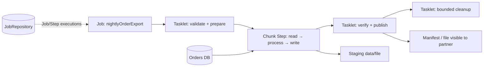
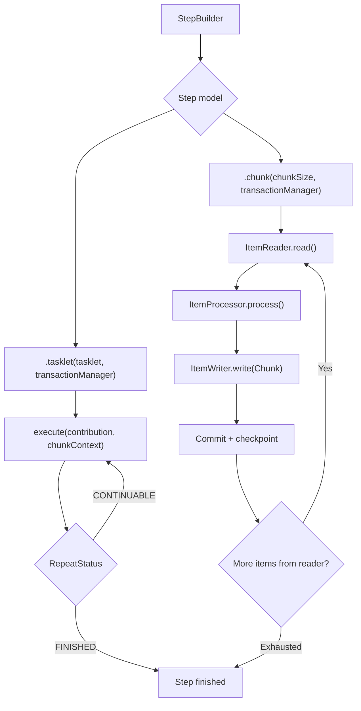
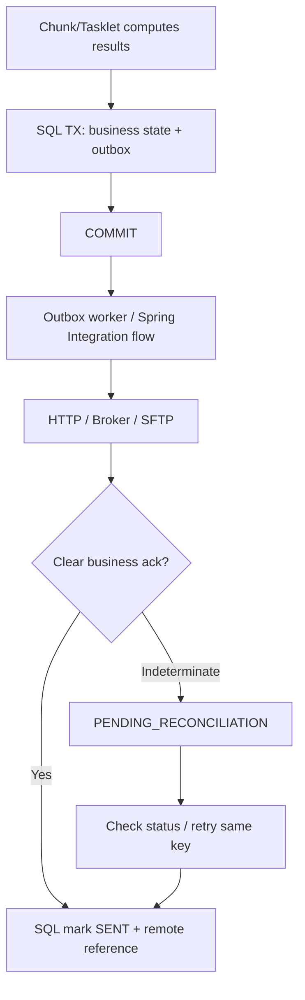
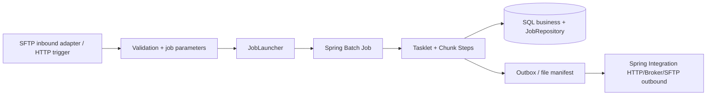

# Tasklet and Choosing a Step Processing Model

> **Chapter:** Spring Batch  
> **Scope:** The **SPRING_BOOT_INTEGRATION** module organizes integrations in Spring Boot across HTTP clients, databases, caches, message brokers, and Spring Integration adapters. This lesson guides choosing a **Tasklet Step** or **chunk-oriented Step** in Spring Batch based on the nature of the work; it explains transactions, restarts, checkpoints, errors, retries, idempotency, testing, and observability when a batch job interacts with SQL, files, HTTP, or brokers.

## 1. Scenario: One Job with Multiple Kinds of Work

A sales system must export order data every night:

1. Validate the export date and prepare a staging directory.
2. Read hundreds of thousands of order rows from PostgreSQL.
3. Normalize data and write a projection table or export file.
4. Verify row counts, checksums, and publish a manifest.
5. Clean up old staging rows that have been successfully exported.

All five tasks belong to one **Job**, yet there is no reason to force them into the same Step model:



**Tasklet** suits a bounded operation with a clear endpoint, such as checking preconditions, purging a batch of rows, renaming a file, or calling a stored procedure. **Chunk-oriented processing** suits multi-item streams requiring **reader → processor → writer** with batch commits and checkpoints.

**Both are Spring Batch Steps**, not separate frameworks. One Job can combine both, running sequentially, branching, or partitioning when genuinely needed.

### Learning Objectives

After this lesson, learners will be able to:

- Distinguish `Job`, `Step`, `Tasklet`, `ItemReader`, `ItemProcessor`, `ItemWriter`, and `JobRepository`.
- Write a Tasklet Step whose rollbacks and restarts are designed around real data.
- Understand `RepeatStatus.FINISHED`, `RepeatStatus.CONTINUABLE`, and the bounds of Tasklet loops.
- Select chunk size, transaction manager, and restart strategy for high-volume record processing.
- Distinguish **Job metadata**, **ExecutionContext checkpoints**, and **business state**.
- Recognize when SQL transactions fail to protect files, HTTP, or brokers.
- Test crashes, retries, duplicates, restarts, and multi-Step flows.

## 2. Spring Batch Architecture to Know

| Concept | Role | Example |
| --- | --- | --- |
| **Job** | Defines a batch process | `nightlyOrderExport` |
| **JobInstance** | One logical processing run, identified by **Job name + identifying JobParameters** | Export for date `2026-11-20` |
| **JobExecution** | One execution attempt of a JobInstance; has status, start/end time, and error info | First run FAILED, restart run COMPLETED |
| **Step** | An independent stage within a Job | `prepareStep`, `projectStep`, `publishStep` |
| **StepExecution** | Details of one Step execution attempt, read/write/skip counts, and status | `projectStep` read 2,000 items, wrote 1,990 |
| **Tasklet** | A callback executing the work of a Step | Delete at most 200 staging rows per invocation |
| **ItemReader** | Reads item by item, returning null at end of data | JDBC cursor/paging, CSV reader |
| **ItemProcessor** | Transforms/validates/filters each item | Normalize fields, drop ineligible records |
| **ItemWriter** | Writes a chunk of items | JDBC batch writer, file writer |
| **JobRepository** | Persists Job/Step execution metadata and execution context | Spring Batch metadata tables in SQL |
| **ExecutionContext** | Key-value map for Job or Step state/checkpoints | `lastProcessedId`, filename, offset |
| **JobLauncher / JobOperator** | Starts and controls Jobs via provided APIs | Start/restart/stop within supported scopes |

**Do not confuse JobRepository with the business database.** JobRepository knows whether a Step is `FAILED` or `COMPLETED` and which checkpoint exists; it does not automatically know whether a partner HTTP endpoint recorded a payment, an SFTP file uploaded completely, or a Kafka message was processed by consumers.

### 2.1. Two Step Types in the Same Job



This diagram omits skip/retry/rollback, exceptions, stop signals, and fault-tolerance policies. The difference between **Tasklet and chunk transaction boundaries** is what you must distinguish before choosing.

## 3. Decision Matrix: Use Tasklet or Chunk?

| Workload Characteristic | Tasklet Usually Fits | Chunk Usually Fits |
| --- | --- | --- |
| Pre-flight precondition checks | **Yes** | No item pipeline needed |
| Creating directories, moving staging file to published | **Yes**, but needs idempotency/atomic publish | Only if transforming record-by-record content |
| Invoking a bounded stored procedure | **Yes** | Unnecessary if DB handles it in one shot |
| Purging old records in batches | **Yes**, bounded loop via `CONTINUABLE` | Possible if item-level policy needed |
| Reading 10M records, transforming, writing target | Do not cram into one huge callback | **Yes** |
| Reading CSV/JSONL line-by-line to validate | Do not hand-roll loops/offsets when Batch has readers | **Yes** |
| Retrying/skipping select malformed items | Requires heavy custom boilerplate | **Chunk** with clear fault-tolerance |
| Issuing a side-effecting API POST | Possible via Tasklet with business idempotency | Chunk for many commands; **still needs idempotency** |
| Exporting a large file with checkpoints | Avoid writing whole file in one transaction/callback | Chunk writer with proper state/checkpoints |
| Waiting hours for an external job | Status-polling Tasklet possible, but never hold transactions open | Prefer orchestration/events/partitions over fake chunks |

**Rule of thumb:** If the task is naturally described as "**perform one operation** and finish," start with a Tasklet. If described as "**read N items, process, and write in batches**," start with chunk. If described as "wait hours for a partner," first ask whether Spring Batch should hold a worker at all or whether a durable stateful workflow should poll.

## 4. The Tasklet Contract: `execute` and `RepeatStatus`

A Tasklet implements `org.springframework.batch.core.step.tasklet.Tasklet`:

```java
@FunctionalInterface
public interface Tasklet {
    RepeatStatus execute(
            StepContribution contribution,
            ChunkContext chunkContext) throws Exception;
}
```

This is an **illustrative API signature**; do not redefine the interface in your application. The two parameters serve distinct roles:

- `StepContribution` tracks this execution's contributions to `StepExecution`, including read/write/filter/skip counts where applicable.
- `ChunkContext` exposes `StepContext`, `StepExecution`, job parameters, and execution attributes.

Return values:

| Result | Meaning | When to Use |
| --- | --- | --- |
| `RepeatStatus.FINISHED` | Tasklet invocation done; Step may finish | Work is complete or no data remains |
| `RepeatStatus.CONTINUABLE` | Tells Step to invoke Tasklet again | Processed a small batch, more work remains |
| Exception | Step fails or enters configured retry/rollback policy | DB, validation, file, or remote failures |

**Never return `CONTINUABLE` unconditionally.** A Tasklet without a termination condition can hog threads, repeat side-effecting operations, keep the Job running indefinitely, and overload backends.

### 4.1. Transactions in `TaskletStep`

For a `TaskletStep` built via `StepBuilder.tasklet(tasklet, transactionManager)`, the framework normally wraps **each Tasklet invocation in a transaction** using the passed transaction manager while managing step metadata per Spring Batch rules.

```text
Tasklet invocation #1:
    BEGIN JDBC TRANSACTION
    process up to 200 rows
    COMMIT
    return CONTINUABLE

Tasklet invocation #2:
    BEGIN JDBC TRANSACTION
    process up to 200 rows
    COMMIT
    return CONTINUABLE

Tasklet invocation #3:
    BEGIN JDBC TRANSACTION
    no matching rows left
    COMMIT
    return FINISHED
```

This boundary holds when manipulated resources **participate in the configured transaction manager**. It **does not** make HTTP, SFTP, Redis, or brokers automatically roll back alongside JDBC. If the Tasklet invokes an `@Async` service or spawns another thread, the thread-bound transaction context does not automatically propagate either.

### 4.2. A Tasklet Is Not a "Method Called Only Once"

A Tasklet may:

1. Run once and return `FINISHED`.
2. Be invoked repeatedly while returning `CONTINUABLE`.
3. Re-execute after a rollback/restart per JobInstance/Step policy.
4. Be invoked again by a new job run with different JobParameters.

Design side effects to tolerate **re-invocation**, never assuming the callback runs once in the application's lifetime.

## 5. Spring Boot and Spring Batch Setup

Examples use **Spring Boot 3.x + Spring Batch 5.x + Java 17+**, a JDBC metadata repository, and PostgreSQL. For Spring Batch 6/Boot 4 or other versions, verify APIs/DDL/builder signatures against the exact BOM in use.

### 5.1. Maven Dependencies

```xml
<dependencies>
    <dependency>
        <groupId>org.springframework.boot</groupId>
        <artifactId>spring-boot-starter-batch</artifactId>
    </dependency>
    <dependency>
        <groupId>org.springframework.boot</groupId>
        <artifactId>spring-boot-starter-jdbc</artifactId>
    </dependency>
    <dependency>
        <groupId>org.postgresql</groupId>
        <artifactId>postgresql</artifactId>
        <scope>runtime</scope>
    </dependency>
    <dependency>
        <groupId>org.springframework.boot</groupId>
        <artifactId>spring-boot-starter-test</artifactId>
        <scope>test</scope>
    </dependency>
    <dependency>
        <groupId>org.springframework.batch</groupId>
        <artifactId>spring-batch-test</artifactId>
        <scope>test</scope>
    </dependency>
</dependencies>
```

`spring-boot-starter-batch` brings in Spring Batch and Boot auto-configuration; `spring-batch-test` provides Job/Step testing utilities. The PostgreSQL driver serves both SQL metadata and business data in these examples.

### 5.2. Environment Configuration

```yaml
spring:
  datasource:
    url: ${BATCH_DB_URL:jdbc:postgresql://localhost:5432/batch_dev}
    username: ${BATCH_DB_USER:batch_dev}
    password: ${BATCH_DB_PASSWORD}
    hikari:
      maximum-pool-size: 8
      connection-timeout: 3s

  batch:
    job:
      enabled: false
    jdbc:
      initialize-schema: never
```

**`spring.batch.job.enabled=false`:** prevents automatically running every Job bean in the application context at startup; jobs are explicitly triggered by a launcher or scheduler. Otherwise, Spring Boot's startup runner and job selection rules can cause surprises in multi-Job services.

**`spring.batch.jdbc.initialize-schema=never`:** expects metadata schemas to be **pre-migrated**; fits environments with Flyway/Liquibase and release pipelines. Locally or in tests, `initialize-schema=always` can be used when databases are isolated and scripts/versions are controlled—**never enable it carelessly in production**.

Never commit real secrets in YAML. If the business DB differs from the metadata DB, explicitly configure DataSources and transaction managers for **JobRepository** and Steps rather than assuming one `spring.datasource.*` fits all sources.

### 5.3. JobRepository Does Not Appear from an Arbitrary Application Table

Spring Batch requires metadata tables for JobInstance, JobExecution, StepExecution, and ExecutionContext. Table names/DDL and indexes must come from **scripts matching the exact Spring Batch version and database dialect**. Never hand-create a `jobs(id, status)` table and call it a JobRepository.

A **business ledger** table like `export_runs(batch_date, manifest_hash, status)` may still be needed separately to explain what partners actually received; JobRepository does not replace that business contract.

## 6. Practical Tasklet Example: Purging Staging Data in Batches

Suppose an `import_staging` table holds exported records; we want to delete `EXPORTED` records older than a fixed cutoff date without opening one massive transaction over millions of rows.

### 6.1. Input Schema and Safety Preconditions

```sql
CREATE TABLE import_staging (
    id BIGSERIAL PRIMARY KEY,
    tenant_id VARCHAR(80) NOT NULL,
    status VARCHAR(24) NOT NULL,
    exported_at TIMESTAMPTZ,
    payload_json JSONB NOT NULL
);

CREATE INDEX idx_import_staging_cleanup
    ON import_staging (status, exported_at, id);
```

**Assumptions:** only delete `status='EXPORTED'`, this table is not the sole source of truth, and exports are already confirmed by business rules. In production, verify retention, legal holds, backup restoreability, and delete privileges.

### 6.2. Implementing the Tasklet with a Per-Batch Row Cap

```java
package com.example.integration.batch;

import java.sql.Timestamp;
import java.time.LocalDate;
import java.time.ZoneOffset;
import org.springframework.batch.core.StepContribution;
import org.springframework.batch.core.scope.context.ChunkContext;
import org.springframework.batch.core.step.tasklet.Tasklet;
import org.springframework.batch.repeat.RepeatStatus;
import org.springframework.jdbc.core.JdbcTemplate;
import org.springframework.stereotype.Component;

@Component
public class PurgeExportedStagingTasklet implements Tasklet {
    private static final int BATCH_SIZE = 200;
    private final JdbcTemplate jdbc;

    public PurgeExportedStagingTasklet(JdbcTemplate jdbc) {
        this.jdbc = jdbc;
    }

    @Override
    public RepeatStatus execute(
            StepContribution contribution,
            ChunkContext chunkContext) {

        Object raw = chunkContext.getStepContext()
                .getJobParameters()
                .get("cutoffDate");

        if (!(raw instanceof String cutoffText)) {
            throw new IllegalArgumentException(
                    "Required job parameter: cutoffDate");
        }

        LocalDate cutoffDate = LocalDate.parse(cutoffText);
        Timestamp cutoff = Timestamp.from(
                cutoffDate.atStartOfDay(ZoneOffset.UTC).toInstant());

        int deleted = jdbc.update("""
                WITH candidates AS (
                    SELECT id
                      FROM import_staging
                     WHERE status = 'EXPORTED'
                       AND exported_at < ?
                     ORDER BY exported_at, id
                     LIMIT 200
                )
                DELETE FROM import_staging s
                 USING candidates c
                 WHERE s.id = c.id
                """, cutoff);

        return deleted > 0
                ? RepeatStatus.CONTINUABLE
                : RepeatStatus.FINISHED;
    }
}
```

**Mechanism:** each invocation deletes up to 200 rows; if at least one row was deleted, it returns `CONTINUABLE`. The next iteration opens a new transaction and continues. When zero eligible rows remain, it returns `FINISHED`.

**Why pass `cutoffDate` in JobParameters instead of calling `Instant.now()`?** A Job restarted the next day must process **the exact same target dataset per contract**, rather than silently shifting the cutoff. Cutting off in UTC also prevents local timezone mismatches across distributed workers.

**Limitations:** the SQL uses PostgreSQL-specific CTE/`LIMIT` syntax; do not copy verbatim to every database dialect without adjustment. `BATCH_SIZE` is an illustrative constant (the SQL currently embeds `200`); in real code, centralize the limit rather than duplicating the number. Always measure index usage, locks, and I/O against production-like data.

### 6.3. Choosing the Right Loop Termination Condition

In the snippet above:

```text
deleted = 200 -> CONTINUABLE
deleted = 73  -> CONTINUABLE (runs one more check to confirm empty)
deleted = 0   -> FINISHED
```

You could write `deleted == BATCH_SIZE ? CONTINUABLE : FINISHED` to save one extra query on the final partial batch, **but only if the target set does not mutate concurrently and the query cannot skip eligible rows**. With concurrent workers and transactions, concluding "data is exhausted" requires verifying isolation and lock policies.

**Avoiding infinite loops:** if another writer continuously inserts older eligible rows into the same set, the Tasklet might never observe 0. Solve this by freezing the set via batch ID/snapshot or setting a deadline and deferring newly arrived records to the next job, rather than simply raising transaction timeouts.

## 7. Wiring a Tasklet into a Step and Job

### 7.1. Spring Batch 5 Builder API

```java
package com.example.integration.batch;

import org.springframework.batch.core.Job;
import org.springframework.batch.core.Step;
import org.springframework.batch.core.job.builder.JobBuilder;
import org.springframework.batch.core.repository.JobRepository;
import org.springframework.batch.core.step.builder.StepBuilder;
import org.springframework.context.annotation.Bean;
import org.springframework.context.annotation.Configuration;
import org.springframework.transaction.PlatformTransactionManager;

@Configuration(proxyBeanMethods = false)
public class PurgeBatchConfiguration {

    @Bean
    Step purgeExportedStagingStep(
            JobRepository jobRepository,
            PlatformTransactionManager transactionManager,
            PurgeExportedStagingTasklet tasklet) {
        return new StepBuilder(
                "purgeExportedStagingStep", jobRepository)
                .tasklet(tasklet, transactionManager)
                .build();
    }

    @Bean
    Job purgeExportedStagingJob(
            JobRepository jobRepository,
            Step purgeExportedStagingStep) {
        return new JobBuilder(
                "purgeExportedStagingJob", jobRepository)
                .start(purgeExportedStagingStep)
                .build();
    }
}
```

**Note:** Spring Batch 5 requires passing `JobRepository` to `JobBuilder`/`StepBuilder` and passing the transaction manager to `tasklet(...)`. Do not blindly copy constructors or `StepBuilderFactory`/`JobBuilderFactory` from Spring Batch 4 examples without checking compatibility.

In a single-DataSource example, `JdbcTemplate` and `PlatformTransactionManager` are expected to manage **the same PostgreSQL database**. With multiple transaction managers, qualify the Step and JDBC source via `@Qualifier`; otherwise ambiguity may arise or **the transaction will not wrap the actual DELETE**.

### 7.2. Launching with Business-Meaningful JobParameters

```java
JobParameters params = new JobParametersBuilder()
        .addString("cutoffDate", "2026-11-20")
        .toJobParameters();

JobExecution execution = jobLauncher.run(
        purgeExportedStagingJob, params);
```

This is a **snippet inside a launcher/service** with `JobLauncher` and `purgeExportedStagingJob` injected; Spring Batch imports are required. `jobLauncher.run(...)` may execute synchronously or asynchronously depending on JobLauncher/TaskExecutor configuration, so returning does not guarantee the Job finished.

**Important:** the same **Job name + identifying parameters** equals the same JobInstance. If an instance already `COMPLETED`, repeating the exact same parameters is normally rejected per JobRepository semantics; if `FAILED`, re-running the same identifying parameters enables a **restart**. Generating a random `runId` every time to "fix already-complete errors" spawns a **new JobInstance**, not a restart, and may re-delete data or replay side effects.

### 7.3. Cutoff Date Is a Business Parameter

If a purge run for `2026-11-20` fails midway, restarting should target that exact date. A run for `2026-11-21` is a separate instance. This identity discipline supports auditing, rollbacks, volume reconciliation, and prevents scope drift when an operator clicks "re-run."

Never accept arbitrary SQL expressions, table names, or paths from JobParameters and concatenate them into SQL. Parameters require **allowlists, type validation, operator authorization, and bounds**.

## 8. How Does a Repeating Tasklet Differ from a `for` Loop Inside One `execute`?

This difference strongly affects crash recovery:

| Approach | Typical Transaction Boundary | Consequence |
| --- | --- | --- |
| One `execute()` looping `while` to delete 1M rows | One long transaction if TaskletStep wraps the callback | Long-held locks, massive rollbacks, timeouts |
| One `execute()` deleting 200 rows then `CONTINUABLE` | Many small invocations/transactions | Smaller rollback scope, easy load throttling and restart |
| Chunk Step `chunk(200, transactionManager)` | One transaction per 200 written items per policy | Built-in reader/writer state, checkpoints, and item/chunk fault tolerance |

Although a `CONTINUABLE` Tasklet can work in "batches," **it does not automatically become a chunk-oriented step**. You still manage data fetching, resumption logic, stop conditions, error classification, and item-level metrics yourself.

### 8.1. When Is a Batch-Repeating Tasklet Enough?

When the logic is an **idempotent SQL operation**—such as purging expired records—where each call deletes a bounded slice and re-running the query after a rollback/restart still produces the right outcome.

When the work involves record parsing, transformation, filtering, skipping select bad items, and batch writes, chunk processing with Spring Batch readers/writers fits better because it offers **purpose-built checkpoint/restart contracts**.

## 9. Chunk-Oriented Step: Reader → Processor → Writer

A Chunk Step needs no hand-written business loop Tasklet. The framework provides step orchestration:

```text
BEGIN TRANSACTION
  read item #1
  process item #1
  ...
  read item #200
  process item #200
  writer.write(Chunk<ExportRow> size=200)
  update checkpoint/metadata per framework
COMMIT

BEGIN TRANSACTION
  read next chunk
  ...
COMMIT
```

**A chunk's rollback capability** depends on the transaction manager and resources actually enlisted. If the writer issues HTTP POSTs or writes remote files, SQL/JobRepository rollbacks **do not automatically undo remote side effects**.

### 9.1. `ItemReader` Returning `null` Means End of Data

For standard `ItemReader`s, when `read()` returns `null`, Spring Batch concludes **there are no more items to read**. Never use `null` to represent an invalid record inside a reader; place validation/filtering in the processor or reader error policy as designed.

An `ItemProcessor<I, O>` can return `null` to **filter out an item** per Spring Batch semantics; that differs from `reader.read() == null` signaling end of input.

### 9.2. Choosing Chunk Size

| Chunk Size | Benefits | Risks |
| --- | --- | --- |
| Small (10–50) | Short transactions, less rework after rollback | Higher commit/metadata I/O overhead |
| Medium (100–1,000) | Balances throughput and rollback cost for many workloads | Benchmark with actual database/file/broker |
| Very large (10,000+) | Fewer commits on paper | Heap pressure, locks, transaction logs, retry cost, writer batch limits |

There is no single right chunk size for every application. Choose based on **item size, reader/processor cost, writer limits, DB lock/transaction timeouts, heap, and recovery SLA**. Monitor p95 transaction duration and rework volume after failures.

## 10. Chunk Example: Building a Report Projection from a Stable Source

Suppose `export_source` is **immutable for the duration of a JobInstance**. We read each row, build a projection, and write into `export_projection` with a unique key.

### 10.1. Illustrative Schema

```sql
CREATE TABLE export_source (
    id BIGINT PRIMARY KEY,
    batch_date DATE NOT NULL,
    amount_minor BIGINT NOT NULL,
    currency VARCHAR(3) NOT NULL
);

CREATE TABLE export_projection (
    source_id BIGINT PRIMARY KEY,
    amount_minor BIGINT NOT NULL,
    currency VARCHAR(3) NOT NULL
);

CREATE INDEX idx_export_source_batch
    ON export_source (batch_date, id);
```

**Critical assumption:** source rows are not inserted, deleted, or reordered for the active batch date. If the input set mutates before restart, count/cursor checkpoints can drift, skipping or duplicating items. In that case, use snapshots/batchIds, keyset paging over a stable key, or a frozen staging table.

### 10.2. DTOs

```java
package com.example.integration.batch;

public record SourceOrder(
        long id,
        long amountMinor,
        String currency) {}
```

```java
package com.example.integration.batch;

public record ProjectionOrder(
        long sourceId,
        long amountMinor,
        String currency) {}
```

### 10.3. Reader Receiving a `JobParameter` at Runtime

```java
package com.example.integration.batch;

import java.sql.Date;
import javax.sql.DataSource;

import org.springframework.batch.core.configuration.annotation.StepScope;
import org.springframework.batch.item.database.JdbcCursorItemReader;
import org.springframework.batch.item.database.builder.JdbcCursorItemReaderBuilder;
import org.springframework.beans.factory.annotation.Value;
import org.springframework.context.annotation.Bean;
import org.springframework.context.annotation.Configuration;

@Configuration(proxyBeanMethods = false)
public class ProjectionReaderConfiguration {

    @Bean
    @StepScope
    JdbcCursorItemReader<SourceOrder> sourceOrderReader(
            DataSource dataSource,
            @Value("#{jobParameters['batchDate']}") String batchDate) {
        return new JdbcCursorItemReaderBuilder<SourceOrder>()
                .name("sourceOrderReader")
                .dataSource(dataSource)
                .sql("""
                    SELECT id, amount_minor, currency
                      FROM export_source
                     WHERE batch_date = ?
                     ORDER BY id
                    """)
                .preparedStatementSetter(ps ->
                        ps.setDate(1, Date.valueOf(batchDate)))
                .rowMapper((rs, rowNum) -> new SourceOrder(
                        rs.getLong("id"),
                        rs.getLong("amount_minor"),
                        rs.getString("currency")))
                .build();
    }
}
```

`@StepScope` instantiates the reader when the Step runs so `jobParameters['batchDate']` is already populated. Do not evaluate Job parameters at application startup if they only exist at **Step execution runtime**.

**Warning:** `JdbcCursorItemReader` uses a JDBC cursor and has constraints around transactions, connections, and restart state; queries require a stable ordering. For huge datasets, consider `JdbcPagingItemReader` with proper sort keys/indexes, though never assume paging solves everything if source rows mutate.

### 10.4. Processor and Writer

```java
package com.example.integration.batch;

import java.util.List;
import org.springframework.batch.item.ItemProcessor;
import org.springframework.batch.item.ItemWriter;
import org.springframework.context.annotation.Bean;
import org.springframework.context.annotation.Configuration;
import org.springframework.jdbc.core.JdbcTemplate;

@Configuration(proxyBeanMethods = false)
class ProjectionProcessingConfiguration {

    @Bean
    ItemProcessor<SourceOrder, ProjectionOrder> projectionProcessor() {
        return source -> {
            if (source.amountMinor() < 0) {
                throw new IllegalArgumentException(
                        "Negative amount for source " + source.id());
            }
            return new ProjectionOrder(
                    source.id(), source.amountMinor(), source.currency());
        };
    }

    @Bean
    ItemWriter<ProjectionOrder> projectionWriter(JdbcTemplate jdbc) {
        return chunk -> {
            List<Object[]> rows = chunk.getItems().stream()
                    .map(item -> new Object[] {
                        item.sourceId(),
                        item.amountMinor(),
                        item.currency()
                    })
                    .toList();

            if (!rows.isEmpty()) {
                jdbc.batchUpdate("""
                    INSERT INTO export_projection
                        (source_id, amount_minor, currency)
                    VALUES (?, ?, ?)
                    ON CONFLICT (source_id) DO NOTHING
                    """, rows);
            }
        };
    }
}
```

`ON CONFLICT DO NOTHING` prevents inserting duplicate rows for the same `source_id` if a chunk replays, yet **it does not detect the same key arriving with a different payload**. For financial data or mutable sources, store a fingerprint/version, check conflicts, and explicitly decide update vs. reject rather than silently swallowing mismatched content.

### 10.5. Creating the Chunk Step

```java
package com.example.integration.batch;

import org.springframework.batch.core.Step;
import org.springframework.batch.core.repository.JobRepository;
import org.springframework.batch.core.step.builder.StepBuilder;
import org.springframework.batch.item.ItemProcessor;
import org.springframework.batch.item.ItemWriter;
import org.springframework.batch.item.database.JdbcCursorItemReader;
import org.springframework.context.annotation.Bean;
import org.springframework.context.annotation.Configuration;
import org.springframework.transaction.PlatformTransactionManager;

@Configuration(proxyBeanMethods = false)
class ProjectionStepConfiguration {

    @Bean
    Step projectOrderStep(
            JobRepository jobRepository,
            PlatformTransactionManager transactionManager,
            JdbcCursorItemReader<SourceOrder> sourceOrderReader,
            ItemProcessor<SourceOrder, ProjectionOrder> projectionProcessor,
            ItemWriter<ProjectionOrder> projectionWriter) {
        return new StepBuilder("projectOrderStep", jobRepository)
                .<SourceOrder, ProjectionOrder>chunk(
                        200, transactionManager)
                .reader(sourceOrderReader)
                .processor(projectionProcessor)
                .writer(projectionWriter)
                .build();
    }
}
```

When using the same datasource/transaction manager, writer SQL and metadata/checkpoints can join transactions compatible with JobRepository. However, if the writer hits a different DB or external API, **never infer both commit/roll back together** merely from `.chunk(200, transactionManager)`.

The classes above illustrate the model; a runnable project requires placing packages under Spring component scan, configuring Spring Batch schemas, business tables, and a Job containing the Step (shown next).

## 11. Combining Tasklet Steps and Chunk Steps in One Job

A typical export Job comprises prepare, project, and finalize steps:

```java
@Bean
Job nightlyOrderExport(
        JobRepository jobRepository,
        @Qualifier("prepareExportStep") Step prepareExportStep,
        @Qualifier("projectOrderStep") Step projectOrderStep,
        @Qualifier("publishExportStep") Step publishExportStep) {

    return new JobBuilder("nightlyOrderExport", jobRepository)
            .start(prepareExportStep)
            .next(projectOrderStep)
            .next(publishExportStep)
            .build();
}
```

In this snippet, `prepareExportStep` and `publishExportStep` are Tasklet Steps that **must be declared separately**, e.g., via `new StepBuilder(...).tasklet(..., transactionManager).build()`. If one step fails, the Job normally stops rather than continuing to subsequent steps as if it succeeded.

### 11.1. What Should a Prepare Tasklet Do?

- Validate JobParameters: processing date, tenant, schema version.
- Check dependencies and access permissions.
- Create a staging directory or staging record tied to **JobInstance identity**.
- If creating a snapshot table, record snapshot state **durably** so restarts use the same dataset.
- Never delete data created by another JobInstance.

### 11.2. What Should a Finalize Tasklet Do?

- Verify item counts, checksums, schema, and confirm files were closed cleanly.
- Publish a manifest or rename from `.tmp` to the official name.
- Write a **business completion record** keyed by a stable operation ID.
- Never treat `StepExitStatus.COMPLETED` as proof that the partner downloaded/ingested the file.

**File publish design:** when files sit on a local filesystem, `Files.move(..., ATOMIC_MOVE)` only holds expected semantics on filesystems that support it. SFTP/object storage do not join JDBC transactions; use staging + publish markers/manifests and idempotent retries.

### 11.3. Flow Branching When No Data Exists

If prepare detects no input, use a flow transition/`JobExecutionDecider` to end the Job early; do not force a chunk reader to run only to return `null` and have a finalize Tasklet emit an empty file if the contract forbids it.

Branching conditions should rely on **tested `ExitStatus`/decider contracts**, not arbitrary strings stuffed into `BatchStatus`.

## 12. JobInstance, JobExecution, and Restarts

This is where many integration systems go wrong when wiring schedulers:

```text
Job name = nightlyOrderExport
identifying JobParameter batchDate = 2026-11-20

JobInstance #A
  JobExecution #1 -> FAILED at projectOrderStep
  JobExecution #2 -> restart same parameters -> COMPLETED

Job name = nightlyOrderExport
identifying JobParameter batchDate = 2026-11-21

JobInstance #B (different batch date)
  JobExecution #3 -> COMPLETED
```

Under default restart rules, Steps already `COMPLETED` in a JobInstance are normally **skipped**, and the failed Step re-runs per execution context/restart contracts. Options like `allowStartIfComplete(true)` make completed Steps run again; decide based on business semantics rather than enabling it "for convenience."

### 12.1. Restart vs. Re-Run

| Action | Identity | Risk |
| --- | --- | --- |
| **Restart FAILED job** | Same Job name + identifying parameters | Relies on checkpoint/step state; must be tested |
| **Run new date** | Different business key/date | New JobInstance, fresh dataset |
| **Reprocess an already COMPLETED date** | Requires a dedicated version/reprocess ID and contract | May overwrite/re-export/double-charge |
| **Use random `runId` after every failure** | Accidentally creates a new JobInstance | Ignores restart state; may replay side effects |

JobParameters should define the **business identity of a processing run**. You may attach non-identifying parameters for logging/tuning, provided you understand whether changing them affects output and your Spring Batch version's JobRepository policies.

## 13. `ExecutionContext` and Checkpoints: Persisting Progress Properly

An `ExecutionContext` is persisted alongside Job/Step metadata and can hold read positions or resume keys. Conceptual example:

```java
StepExecution stepExecution =
        chunkContext.getStepContext().getStepExecution();

ExecutionContext context =
        stepExecution.getExecutionContext();

long lastProcessedId =
        context.getLong("lastProcessedId", 0L);

// After processing new IDs successfully within the appropriate commit boundary:
context.putLong("lastProcessedId", newLastProcessedId);
```

**Illustrative snippet:** `chunkContext`, `newLastProcessedId`, and imports belong inside a Tasklet; this code alone is not a complete reader/step. Update `lastProcessedId` only after corresponding side effects are secured within transaction/checkpoint boundaries. If a remote HTTP call sits outside the transaction, updating `ExecutionContext` does not make the two systems commit together.

### 13.1. Context Is Not a Bulk Business Data Store

| Should Store | Should NOT Store |
| --- | --- |
| Offsets, last keys, staging filenames, small schema versions | Millions of items or an entire CSV |
| Validated counts, partition IDs | Access tokens, passwords, connection objects |
| Fixed start/cutoff dates | Large arrays of mutable DTOs, streams, or beans |
| Resume metadata for crash recovery | The sole business ledger for payments/invoices |

Entries must be **serializable/deserializable in JobRepository's format**. Changing classes, structures, or serializers between versions can make Jobs unrestartable. Never assume any Java object put in the map will safely persist and restore.

### 13.2. Reader State and Source Data Must Both Stay Stable

Chunk readers implement `ItemStream.open/update/close` per contract when restartable. If a reader checkpoints **number of items read** while rows are inserted, deleted, or reordered in SQL before restart, skipping by count can miss records.

Solutions:

- Lock in a snapshot/batch ID and immutable source set per JobInstance.
- Use keyset paging over a stable business key with snapshot predicates where needed.
- Pin version/time cutoffs in validated JobParameters.
- Ensure writers enforce unique business keys so re-reads never create duplicates.
- Test restarts after committing several chunks, not only clean runs from start to finish.

## 14. Transactions, Rollbacks, Retries, and Skips

### 14.1. Tasklet Step

In a Tasklet, exceptions fail the invocation and normally roll back the transaction if configured accordingly. However, the framework **cannot tell which item in a 200-row loop you wrote should be skipped or retried**. If you need sophisticated item-level error policies, chunk processing is much cleaner.

### 14.2. Chunk Step

Spring Batch offers Step-level fault tolerance for selected exception types:

```java
new StepBuilder("projectOrderStep", jobRepository)
        .<SourceOrder, ProjectionOrder>chunk(200, transactionManager)
        .reader(reader)
        .processor(processor)
        .writer(writer)
        .faultTolerant()
        .retry(org.springframework.dao.DeadlockLoserDataAccessException.class)
        .retryLimit(3)
        .skip(org.springframework.batch.item.validator.ValidationException.class)
        .skipLimit(20)
        .build();
```

This is an **illustrative fault-tolerance API sample**: enable it only after classifying real reader/processor/writer exceptions and testing rollback/retry/skip counters. Never assume deadlocks can be retried indefinitely; never skip financial data errors just to turn a Job `COMPLETED`.

| Error | Commonly Considered Policy | What to Avoid |
| --- | --- | --- |
| Record missing optional field | Supply valid default or reject/skip with audit | Swallowing errors with no count of lost items |
| Record missing required business ID | Fail or quarantine per contract | Minting random IDs on retry |
| SQL deadlock | Bounded transaction retry with backoff where supported | Infinite retries overloading the DB |
| Unique conflict from replay | Check fingerprint/business idempotency | Treating every conflict as an identical duplicate |
| HTTP 400/422 | Do not retry blindly; fix request or quarantine | Masking as a cache miss |
| HTTP timeout after POST | **Unknown** outcome; use operation ID and status lookup | Sending a new POST with a new key |
| Broker unavailable | Outbox, bounded retries, monitor pending age | Holding SQL transactions open for minutes waiting on broker |
| Partial SFTP file upload | Staging + checksum + manifest, idempotent retry | Publishing the file as if complete |

### 14.3. Retry Does Not Mean Exactly-Once

When a writer calls a partner HTTP API and the chunk's SQL transaction subsequently rolls back, Spring Batch can re-execute the same chunk. If the partner committed before the response was lost, retrying can create duplicates.

**The solution lives at the business boundary:** fixed idempotency keys, business unique constraints, outbox/inbox, and reconciliation. Batch metadata and retry policies cannot make remote side effects atomic.

## 15. SQL, HTTP, Brokers, and Files Have Different Transaction Boundaries

| Operation | Protected by Step Transaction? | Additional Design Needed |
| --- | --- | --- |
| JDBC update on Step's DataSource/manager | Yes, per DB isolation/constraints and usage | Commit size, lock timeout, unique keys |
| JDBC update on another DataSource | **Not automatically** | Separate manager/coordination; avoid assuming atomicity |
| R2DBC reactive pipeline | Not automatically a JDBC transaction | Appropriate reactive transaction manager/context |
| HTTP POST/PUT to partner | **No** | Idempotency, timeouts, status lookup, reconciliation |
| Kafka/Rabbit/JMS publish | **Not automatically shared with SQL** | Outbox, broker ack semantics |
| Redis cache put/evict | Does not roll back with JDBC | Post-commit invalidation and TTL/versioning |
| Local file/SFTP/object storage | **No** | Staging, manifests, checksums, recoverable publish |

### 15.1. Anti-Pattern: Remote Calls Inside Long Transactions

```java
@Transactional
public void exportAndNotify(String batchId) {
    // 1. Update many SQL rows
    // 2. HTTP POST to partner, wait 30 seconds
    // 3. Write SFTP file
    // 4. Commit SQL
}
```

The SQL transaction can hold locks and connections throughout the HTTP/SFTP wait. If the SQL commit fails at the end, remote side effects may still persist. Adding `@Transactional` only obscures the real boundaries.

### 15.2. A More Resilient Pattern



Spring Batch can serve as the **orchestrator for generating and dispatching data**, while an outbox protects the intent to send across process crashes. If a remote dispatch callback executes twice, the receiver still needs idempotency or status lookup.

## 16. File-Handling Tasklets: Publishing Safely Beyond "Write and Done"

A Tasklet often fits **publishing** a file after a chunk writer finishes staging. Yet file publishing has several race conditions:

```text
chunk writer: writes orders_batch-018.csv.tmp
  → close stream, record row count + checksum
publish Tasklet:
  → verify hash and manifest
  → move staging file to public name
  → record business status PUBLISHED
partner:
  → only ingests files with manifest/ready marker
```

### 16.1. Illustrative Code for Filesystems Supporting Atomic Move

```java
Path tmp = workDir.resolve("orders_" + batchId + ".csv.tmp");
Path published = workDir.resolve("orders_" + batchId + ".csv");

if (Files.exists(published)) {
    // Verify checksum/manifest before treating as valid replay.
    verifyAlreadyPublished(published, expectedChecksum);
} else {
    verifyChecksum(tmp, expectedChecksum);
    Files.move(tmp, published, StandardCopyOption.ATOMIC_MOVE);
}
```

This is a **Tasklet snippet**, not a complete method: `workDir`, `batchId`, `expectedChecksum`, and both helpers must be implemented, and filename parameters must be validated against path traversal. `ATOMIC_MOVE` may not be supported on all filesystems/network shares; never silently fall back to non-atomic move without adjusting the completion protocol. For object storage/SFTP, use proper staging/manifest/commit markers.

**After publishing the file but before Batch records Step `COMPLETED`**, a restart may re-enter the Step. Thus the publish Tasklet must be **idempotent**: if the public file already exists, compare its checksum/business batch ID instead of overwriting or emitting another export.

### 16.2. Cleanup Tasklet After Publish

Cleanup should delete only staging files belonging to **JobInstances confirmed published**, guided by manifests/ledgers and retention rules. Never wipe an entire `/tmp/exports` directory with a broad wildcard while multiple Jobs run concurrently.

## 17. Alternatives Beyond Tasklet and Chunk

| Model | When to Consider | Limits to Control |
| --- | --- | --- |
| **Flow / JobExecutionDecider** | Branch orchestration, skip stages when empty | `ExitStatus` and restart transitions |
| **Partitioned Step** | Split data by tenant/id range/partition to run in parallel | Partition overlap, unique keys, metadata, resource contention |
| **Multi-threaded Step** | Increase throughput when reader/processor/writer allow | Thread safety of reader, writer, `ExecutionContext` |
| **Remote chunking** | Manager reads, workers process chunks over broker | Delivery/ack/duplicates/chunk retries and network |
| **Remote partitioning** | Dispatch Step partitions to independent workers | Partition assignment and restart consistency |
| **Spring Integration Flow** | HTTP/broker/file adapters and routing/enrichment | Does not replace Batch's `JobRepository`/checkpoints |
| **Scheduler/Kubernetes CronJob** | Periodically start batch processes | JobParameters, concurrency policy, and restart/duplicate control |

Do not start with partitioning if a single-threaded chunk step already meets SLAs. Scaling out multiplies connection pools, SQL locks, and file writers rapidly, which can degrade rather than improve throughput.

### 17.1. Partitioning a Job by Tenant

If data across 20 tenants is independent, you can partition by tenant, giving each partition a **clear data identity** with no cross-writes. Never share one global `ExecutionContext` offset across partitions. If tenant sizes vary widely, splitting evenly by tenant count does not balance load evenly.

## 18. Connecting Batch with Spring Integration

Spring Batch handles **jobs/steps/restarts**, while Spring Integration handles **message channels/gateways/adapter flows**. They complement each other:



**A common mistake:** an HTTP inbound gateway receives a request and calls `JobLauncher` synchronously, waiting 45 minutes for the job to finish. This holds the HTTP connection, triggers upstream timeouts, and causes retries to spawn multiple JobInstances if parameters are unstable.

For long-running jobs:

1. Authenticate and authorize the caller.
2. Generate a stable **business operation ID**.
3. Persistently record the request and batch identity.
4. Launch the Job per concurrency policy; return `202 Accepted` and a status-lookup URI when contract permits.
5. Map `JobExecution` status to business status rather than exposing raw Batch metadata directly.
6. Cap retries and ensure the same operation ID never duplicates side effects.

Never treat a Kafka consumer ACK as if the Job completed if the consumer merely **enqueued** a non-durable Job. Align ack semantics with the delivery guarantee.

## 19. Operational Failures and Triage

| Symptom | Possible Cause | Action |
| --- | --- | --- |
| `JobInstanceAlreadyCompleteException` | Re-running with same identifying parameters as completed instance | Distinguish reprocess vs. restart; never add random runIds to bypass |
| `JobExecutionAlreadyRunningException` | Same JobInstance is currently running | Check scheduler concurrency/duplicate triggers |
| `JobRestartException` | Job/Step configured non-restartable or inconsistent state | Check restartable policy and metadata |
| Tasklet never terminates | Always returns `CONTINUABLE` or source keeps growing | Add termination condition, time budget, snapshot |
| Tasklet re-run after crash produces duplicate file | Publish not idempotent | Stable name + checksum/manifest/ledger |
| Chunk restart skips records | Source reordered, checkpoint was item count only | Snapshot/stable paging key, restart tests |
| Chunk writer writes duplicates | Remote lacks idempotency or writer lacks unique key | Business ID + unique constraint/outbox |
| Prolonged SQL locks | Tasklet deletes too many rows per call / chunk too large | Split transactions, measure locks and indexes |
| `@StepScope` SpEL lacks JobParameter | Bean instantiated too early, outside step context | Check scope/proxy and real launch tests |
| Batch metadata schema error | DDL wrong version/dialect | Fix migrations/JobRepository setup |
| Job COMPLETED yet business incomplete | Job only wrote outbox/202; downstream pending | Track business status and reconciliation separately |
| CI runs jobs during context creation | Spring Boot auto-runner active | Set `spring.batch.job.enabled=false` in tests |

**Never fix errors by manually deleting JobRepository metadata.** Doing so breaks restarts, audits, and risks re-executing operations that already produced side effects.

## 20. Job/Step Observability

### 20.1. Three Layers of Status

| Layer | Example Metrics | Meaning |
| --- | --- | --- |
| **Job metadata** | `JobExecution` status, duration, restart count | Orchestration and run history |
| **Step/chunk** | Read/write/filter/skip counts, rollback count, commit count | Data-processing health |
| **Business integration** | Outbox pending, files published, partner acks, idempotency conflicts | Actual fulfillment of business obligations |

In Spring Boot, Actuator/Micrometer and Batch listeners provide instrumentation. Do not assume all business metrics or per-Tasklet-invocation metrics exist automatically; add targeted metrics in services, step listeners, or drivers.

### 20.2. Metrics Worth Tracking

- Job duration P50/P95/P99, failures, retries, active executions.
- Step commits/rollbacks/retries/skips and item throughput.
- Tasklet invocation count, rows cleaned, and progress per business batch.
- Reader latency, processor errors, writer batch latency.
- JDBC connection pool, lock wait, transaction logs, CPU/heap/disk.
- Broker publish lag, oldest outbox age, file upload checksum failures.
- Count of business operations in `UNKNOWN`/`NEEDS_RECONCILIATION`.

**Never use high-cardinality `jobInstanceId`, `orderId`, `tenantId`, or individual filenames as metric labels.** Stick to bounded job/step names and outcome/error classes; keep correlation/business IDs in access-controlled traces/logs rather than continuous metric tags.

### 20.3. Do Not Log Raw JobParameters

JobParameters sometimes hold file paths, tenant IDs, or sensitive attributes. Never place tokens/passwords into JobParameters or ExecutionContext just to pass them conveniently into a Tasklet. Use secret management and scoped identities. Redact logs and restrict access to Batch metadata tables and Actuator endpoints.

## 21. Testing Along Failure Boundaries

### 21.1. Never Test Only Direct Calls to `Tasklet.execute`

Unit tests calling `execute(...)` with a mocked `ChunkContext` only verify callback SQL/logic—**they do not prove**:

- `StepBuilder` wired the right transaction manager.
- Real JobParameters bind properly at launch.
- Commits/rollbacks occur on each `CONTINUABLE` iteration.
- `JobRepository` records `StepExecution` and restart state.
- Already `COMPLETED` Steps are skipped on restart.
- File publish/HTTP retries prevent duplicates.

Integration tests must **execute Jobs/Steps through real Spring Batch infrastructure**.

### 21.2. `@SpringBatchTest` Example

```java
package com.example.integration.batch;

import static org.assertj.core.api.Assertions.assertThat;

import org.junit.jupiter.api.Test;
import org.springframework.batch.core.BatchStatus;
import org.springframework.batch.core.JobExecution;
import org.springframework.batch.core.JobParametersBuilder;
import org.springframework.batch.test.JobLauncherTestUtils;
import org.springframework.batch.test.context.SpringBatchTest;
import org.springframework.beans.factory.annotation.Autowired;
import org.springframework.boot.test.context.SpringBootTest;

@SpringBatchTest
@SpringBootTest(properties = "spring.batch.job.enabled=false")
class PurgeExportedStagingJobIT {

    @Autowired JobLauncherTestUtils launcher;

    @Test
    void removesOnlyEligibleRecords() throws Exception {
        // Test fixture populates EXPORTED and PENDING records
        // with dates on both sides of cutoff in test PostgreSQL.

        JobExecution execution = launcher.launchJob(
                new JobParametersBuilder()
                        .addString("cutoffDate", "2026-11-20")
                        .toJobParameters());

        assertThat(execution.getStatus())
                .isEqualTo(BatchStatus.COMPLETED);

        // Assert actual DB state: only EXPORTED before cutoff
        // are deleted; PENDING and newer records remain.
    }
}
```

This is a **test skeleton** requiring a Spring Boot context with an eligible Job, SQL fixtures, metadata schema, PostgreSQL Testcontainers, and cleanup. With multiple Job beans, **select the Job under test** on `JobLauncherTestUtils` instead of relying on ambiguous auto-selection. A test asserting only `BatchStatus.COMPLETED` without inspecting rows can miss faulty SQL.

### 21.3. Tasklet Test Matrix

| Test Case | Expectation |
| --- | --- |
| No eligible rows | `FINISHED`, nothing erroneously deleted |
| 450 eligible rows, batch size 200 | All deleted across multiple invocations, bounded transactions |
| SQL exception before commit | Invocation rolls back, restart loses no valid rows |
| Process crash after first batch commit | Restart with same JobParameters processes remaining rows only |
| Missing/invalid `cutoffDate` JobParameter | Fails clearly; never falls back to current date |
| Old `PENDING` rows exist | Untouched per predicate |
| Concurrent job runs with same business key | Scheduler/JobRepository blocks or coordinates; no out-of-scope deletes |
| Batch metadata DB unavailable | Job never reports success as if metadata committed |
| Environment timezone changes | UTC cutoff remains deterministic |
| Repeated permanent error on retry | Stops per policy, no infinite loop |

### 21.4. Chunk Test Matrix

| Test Case | Expectation |
| --- | --- |
| 450 source rows, chunk size 200 | Commits per chunk, accurate read/write counts |
| Processor rejects an item | Fails or skips per policy, with audit |
| Writer throws exception mid-chunk | Rolls back chunk if resource joins transaction |
| Restart after 2 committed chunks | No skipped source rows / no duplicate business projections |
| Source table reordered before restart | Test catches snapshot/checkpoint bug |
| Two rows share business key with differing content | Conflict detected; never silently ignored with `DO NOTHING` |
| Outbound HTTP timeout after side effect | Never sends a new command with a new key |
| Two DataSources present | Correct StepTransactionManager, reader/writer datasource, and JobRepository |
| Parallel partitions | Disjoint keys, race-free results, no cross-tenant leakage |
| Rolling upgrade | `ExecutionContext` and `JobRepository` schema compatibility |

### 21.5. Realistic Restart Testing

A strong test should:

1. Launch the Job with **fixed identifying JobParameters**.
2. Inject a failure **after at least one chunk/Tasklet invocation commits**, before Job completion.
3. Verify the first JobExecution is `FAILED` and the backend holds the committed partial data.
4. Restart **the exact same JobInstance** with metadata/data intact.
5. Verify StepExecution/checkpoints restore cleanly and business results appear exactly once.
6. Where external files/HTTP/brokers are involved, simulate **side effect succeeded yet ack lost**, verifying idempotency/reconciliation.

Run tests against **real PostgreSQL via Testcontainers** when production uses PostgreSQL; H2/mock JDBC cannot faithfully reproduce locks, conflicts, isolation, and migration behavior.

## 22. Step-Model Selection Exercise

### Prompt

Design Job `dailyPartnerSettlement`:

- Processes roughly 800,000 confirmed transactions daily.
- Reads SQL to produce CSV files split according to contract parts.
- Quarantines select malformed rows, while never skipping invalid currencies.
- Uploads manifests to SFTP; the partner system may only acknowledge hours later.
- If the job crashes, never re-export the same filename with altered content.
- Expired staging rows must be purged after partner confirmation.

### Proposed Design

| Stage | Step | Boundaries and Policy |
| --- | --- | --- |
| Validate `batchDate`, snapshot ID, and permissions | **Tasklet** | Fail fast, stable identity |
| Create snapshot/staging marker | **Tasklet** | SQL transaction, idempotent per batch ID |
| Read 800,000 rows and write projection/temp CSV | **Chunk** | Restartable reader/writer, benchmarked chunk size, checksum |
| Verify counts, checksum, schema | **Tasklet** | Do not publish if mismatched |
| Publish file + manifest | **Tasklet** | Idempotent publish, checksum, staging/ready marker |
| Wait for partner confirmation | **Do not hold a Step transaction for hours** | Durable status/polling or event callback |
| Clean up acked staging rows | **Batch-repeating Tasklet** | Fixed retention and cutoff; never delete unacked batches |

### Advanced Exercises

1. Add two tenants and prove job parameters/keys stay isolated with no data mixing.
2. Simulate a crash after the file gets its public name but before the Step records `COMPLETED`.
3. Evaluate chunk sizes 100/500/1,000 for throughput, heap, and lock duration.
4. Pick a reader for a mutating source and design a snapshot avoiding skips on restart.
5. Define a **manifest ID/fingerprint** so the partner can return cached responses for duplicate requests.
6. Add an outbox for "file available" notifications instead of relying on an open HTTP callback.
7. Design an alert when job metadata is `COMPLETED` yet the partner has not ingested the file.

## 23. Misconceptions to Avoid

1. **"A Tasklet runs only once."** False: `CONTINUABLE` or restarts can invoke it repeatedly.
2. **"Chunk is just a normal Java `for` loop."** False: it enforces reader/writer contracts, commits, checkpoints, and retry/skip.
3. **"A Tasklet with a huge `while` loop equals a chunk step."** False: transaction and restart semantics differ completely.
4. **"JobRepository stores every business outcome."** False: it stores orchestration metadata, not remote side-effect tracking.
5. **"Job status COMPLETED means the partner received the file."** False: business acknowledgment requires its own mechanism.
6. **"Using a new `runId` restarts a failed Job."** False: it usually creates a new JobInstance.
7. **"`@StepScope` is useless boilerplate."** False: it binds job/step parameters at actual execution time.
8. **"`JdbcCursorItemReader` restarts accurately even if SQL data mutates."** False: it requires snapshots and stable ordering.
9. **"SQL rollback revokes HTTP POSTs and SFTP uploads."** False: remote systems do not share the transaction.
10. **"Skipping every exception makes jobs more resilient."** False: it can turn data errors into silent data loss.
11. **"If it crashes after writing the public file, just restart and overwrite."** False: verify checksums/versions/manifests to avoid corrupting published outputs.
12. **"Larger chunk sizes are always faster."** False: RAM/lock/transaction log/rollback costs climb.
13. **"Deleting 200 rows in a Tasklet proves remaining rows are still eligible."** False: predicates, concurrency, and source updates still matter.
14. **"Any Step transaction manager covers every DataSource."** False: a transaction manager only manages resources bound to it.
15. **"Upgrading Spring Batch versions preserves restartability for old ExecutionContexts."** False: schema/serializer compatibility must be tested.

## 24. Production Job Implementation Checklist

1. **Classify the work:** one-shot/repeatable Tasklet or item stream using chunks?
2. **Lock down business identity:** Job name + identifying parameters by date/batch/tenant.
3. **Prepare metadata:** version-matched JobRepository DDL, explicit datasource/transaction manager.
4. **Secure checkpoints:** source snapshots, small execution contexts, resume keys, mutation policies.
5. **Enforce transactions:** each Tasklet invocation/chunk joins the right SQL resource.
6. **Bound load:** chunk size, Tasklet page size, concurrency, and connection pool limits.
7. **Classify errors:** permanent/transient/unknown outcomes, retry/skip policies, and quarantine.
8. **Guard side effects:** idempotency keys, unique constraints, outbox/inbox, and manifests.
9. **Decouple long-running orchestration:** never hold HTTP requests/SQL transactions waiting hours for partners.
10. **Enforce security:** job trigger permissions, tenant scoping, credentials/secrets, and output file protections.
11. **Monitor:** Job/Step counts, rollbacks/skips, backend backlogs, and business completion.
12. **Test restarts:** crash before/after commit, duplicate file publishes, duplicate records, and schema upgrades.

### Self-Check Questions

1. How do a Tasklet Step and a chunk-oriented Step differ in unit of work and transaction boundaries?
2. What does `RepeatStatus.CONTINUABLE` mean and why can it cause an infinite loop?
3. When purging staging data with a Tasklet, why put the cutoff in JobParameters?
4. Why can a Tasklet processing 10M rows in one callback perform worse than a batch-repeating Tasklet?
5. When should `ItemReader → ItemProcessor → ItemWriter` be preferred?
6. What information defines a JobInstance? How does JobExecution differ from it?
7. How does restarting with the same `batchDate` differ from re-running with a new `runId`?
8. Why can a Reader checkpoint fail if rows are inserted/deleted in the SQL source before restart?
9. Should `ExecutionContext` store the full payloads of 800,000 records?
10. Why does a chunk rollback not undo an HTTP POST already processed by a partner?
11. What prevents a published file from being overwritten with different content on restart?
12. When a Step is already `COMPLETED`, does restarting the Job re-run that Step by default?
13. When is `@StepScope` useful for `batchDate` and file paths?
14. In a flow combining a prepare Tasklet, a file-generating chunk Step, and a finalize Tasklet, which steps need independent idempotency?
15. Why is a Job COMPLETED metric insufficient proof that settlement obligations are done?

## 25. References

- [Spring Batch — Reference](https://docs.spring.io/spring-batch/reference/): Job, Step, ItemReader/Processor/Writer models, and batch patterns.
- [Spring Batch — TaskletStep](https://docs.spring.io/spring-batch/reference/step/tasklet.html): `Tasklet` contract, `RepeatStatus`, and tasklet transactions.
- [Spring Batch — Chunk-Oriented Processing](https://docs.spring.io/spring-batch/reference/step/chunk-oriented-processing.html): commit intervals, chunks, and ItemWriter.
- [Spring Batch — Job Configuring and Running](https://docs.spring.io/spring-batch/reference/job.html): JobInstance, parameters, executions, and restarts.
- [Spring Batch — Testing](https://docs.spring.io/spring-batch/reference/testing.html): `@SpringBatchTest` and test utilities.
- [Spring Boot — Batch](https://docs.spring.io/spring-boot/reference/io/spring-batch.html): auto-configuration, metadata schemas, job startup behavior.
- [Spring Framework — Transaction Management](https://docs.spring.io/spring-framework/reference/data-access/transaction.html): transaction managers and local transaction limits.

**Key takeaway:** **Tasklets** suit single operations or batches of operations with clear stop conditions; **chunk-oriented Steps** suit multi-item pipelines via reader, processor, and writer with chunk-level commits and checkpoints. Both run inside **Jobs/Steps** coordinated by **JobRepository**, yet Batch metadata never turns HTTP, brokers, Redis, or files into a single SQL transaction. Running reliable Spring Boot integration pipelines requires **business-meaningful JobParameters, source-aligned checkpoints, accurate transaction managers, selective retry/skip, idempotency for external side effects, and realistic crash/restart testing**.
