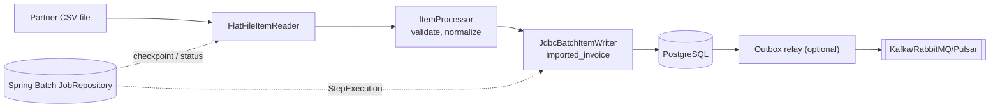
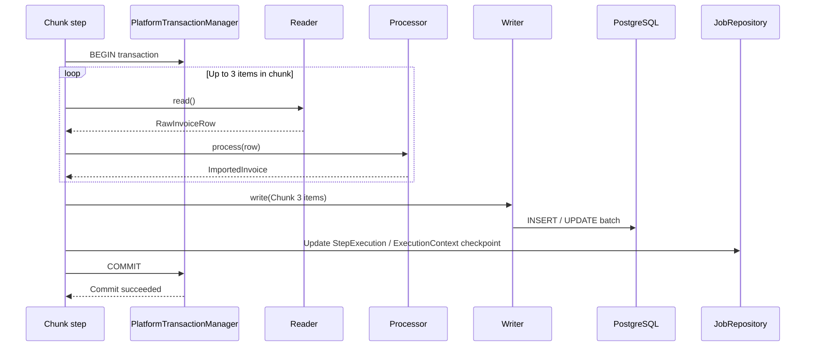
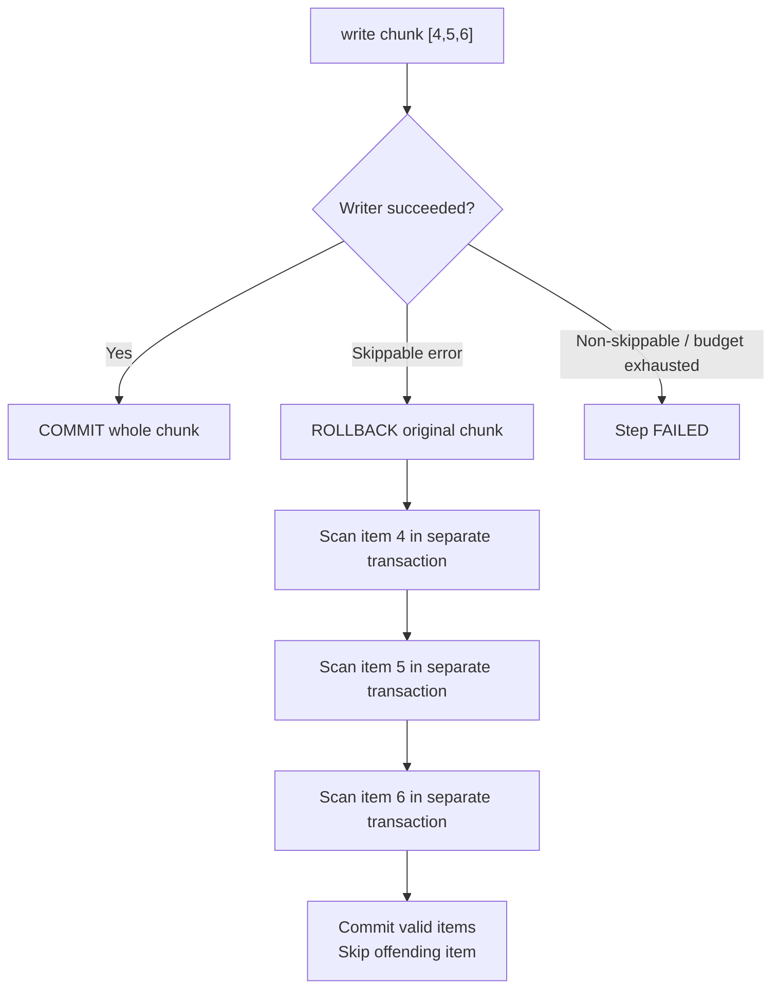
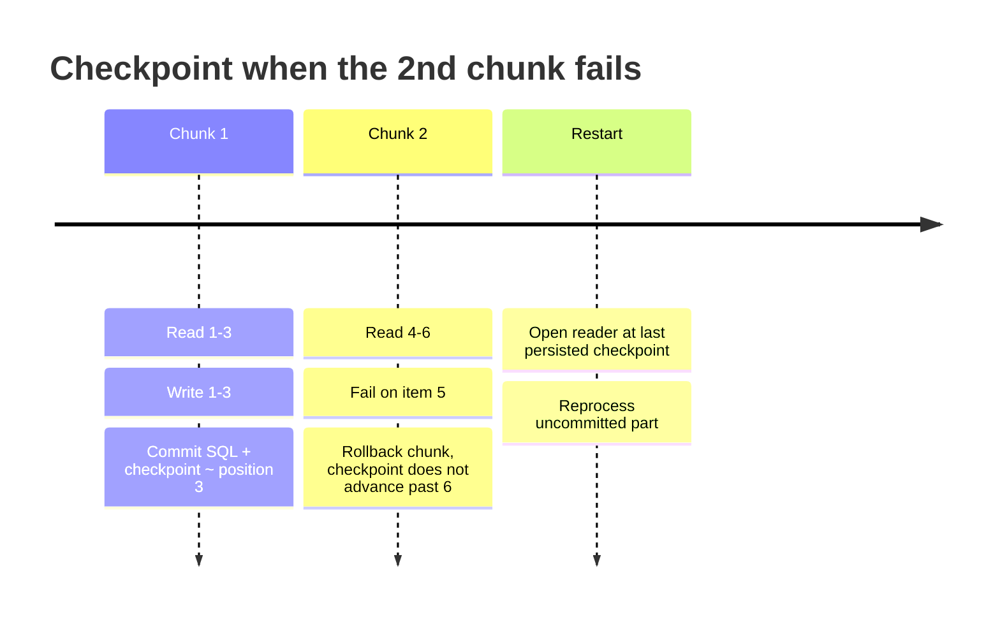
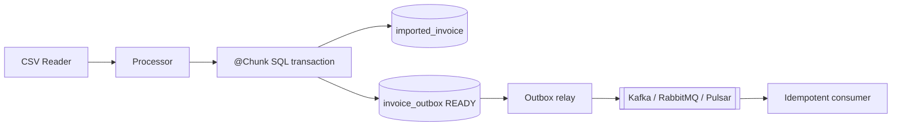

# Per-Chunk Transactions and the Impact When a Processing Step Fails

A Spring Batch job imports 100,000 partner invoices into PostgreSQL, writing 500 rows at a time. At row 1,201, the partner sends an invalid monetary value; or PostgreSQL hits a deadlock after `ItemWriter` has already sent several INSERT statements. **Which rows are durably persisted in the database? Where will Spring Batch resume reading on a re-run? Can a bad row be skipped while keeping the valid ones?**

That is the heart of **chunk-oriented processing**: a `Step` groups records into *chunks*, executes `read → process → write` within a **transaction boundary**, and commits periodically. When an operation fails, the distinction between *rolling back the current chunk*, *retrying an item*, *skipping an item*, and *restarting the entire Job* determines the correctness of the integration flow.

This lesson belongs to the **Spring Batch** chapter in the **SPRING_BOOT_INTEGRATION** module, where Spring Boot coordinates system integration via HTTP clients, databases, caches, message brokers, and Spring Integration adapters. Therefore, beyond `StepBuilder` theory, this lesson explains SQL transaction boundaries, file/HTTP data contracts, deduplication on restart, emitting broker messages via an outbox, failure testing, and real-world observability.

> **Version scope:** Primary examples use Java 17+, Spring Boot **3.5.x**, Spring Batch **5.2.x**, Spring Framework 6.2, and PostgreSQL 16. In Spring Batch 5.x, step configuration uses `new StepBuilder(name, jobRepository).<I,O>chunk(size, transactionManager)`. Spring Batch 6.x/Boot 4.x change APIs and configurations; never copy imports or builder signatures across major versions without checking official docs. Numbers like chunk size=3, retryLimit=3, and skipLimit=5 are for lab demonstration only, not production defaults.

## 1. Learning Objectives

After this lesson, you will be able to:

1. Distinguish `Job`, `JobInstance`, `JobExecution`, `Step`, `StepExecution`, `ItemReader`, `ItemProcessor`, `ItemWriter`, and `ExecutionContext`.
2. Draw the exact **transaction boundary of a chunk**: begin, read, process, write, checkpoint, commit/rollback.
3. Explain why **already-committed chunks do not roll back when a later chunk fails**, whereas the failing chunk normally replays.
4. Distinguish errors in readers, processors, writers, listeners, and commits; understand how each affects rollbacks differently.
5. Configure `faultTolerant()` with `retry`, `skip`, `retryLimit`, `skipLimit`, and `noRollback` without swallowing business errors.
6. Explain why a skippable write error can make the framework **roll back the entire chunk and reprocess item by item**.
7. Persist checkpoints in `JobRepository`/`ExecutionContext` and restart the right `JobInstance`.
8. Recognize the gap between SQL rollbacks and HTTP, email, Redis, or broker side effects **outside that transaction**.
9. Use SQL unique constraints, idempotent writers, and outboxes to stay safe across replays and restarts.
10. Test transaction failure windows against real PostgreSQL, inspect counters, and build a recovery runbook.

## 2. Hands-On Context: Importing Partner Invoices

Every night, a partner places a CSV file `partner-invoices-2026-11-21.csv` in a verified landing zone. The job reads the file, validates data, and writes to PostgreSQL:



A compact sample input:

```csv
eventId,invoiceId,tenantId,amountMinor,currency
3c626f74-ceaa-40f5-8f4b-4808b7c1a001,08e1c663-f2ae-4132-a016-0731547c0001,tenant-a,125500,VND
3c626f74-ceaa-40f5-8f4b-4808b7c1a002,08e1c663-f2ae-4132-a016-0731547c0002,tenant-a,99000,VND
3c626f74-ceaa-40f5-8f4b-4808b7c1a003,08e1c663-f2ae-4132-a016-0731547c0003,tenant-a,75000,VND
3c626f74-ceaa-40f5-8f4b-4808b7c1a004,08e1c663-f2ae-4132-a016-0731547c0004,tenant-a,85000,VND
3c626f74-ceaa-40f5-8f4b-4808b7c1a005,08e1c663-f2ae-4132-a016-0731547c0005,tenant-a,15000,VND
3c626f74-ceaa-40f5-8f4b-4808b7c1a006,08e1c663-f2ae-4132-a016-0731547c0006,tenant-a,69000,VND
```

Data contract:

| Field | Meaning | Rule |
| --- | --- | --- |
| `eventId` | Immutable identifier of the inbound record | Valid UUID, unchanged on retry |
| `invoiceId` | Business invoice identifier | Valid UUID; no duplicate invoices within the same tenant |
| `tenantId` | Owning tenant | Authenticated from file source, never blindly trusted from CSV string alone |
| `amountMinor` | Monetary amount in minor units | `long >= 0`; never use `double` |
| `currency` | Currency code | Lab accepts `VND` only |
| `input` job parameter | Source file | Immutable path per JobInstance |
| `businessDate` job parameter | Business date | Identifies the exact ingestion batch period |

In this lab, we use **chunk size 3** so committed and rolled-back chunks are easy to observe. A real file may have millions of rows, requiring chunk sizes tuned for memory, database latency, and SLAs.

## 3. Spring Batch Concepts You Must Distinguish

| Concept | Role |
| --- | --- |
| `Job` | A batch process composed of steps |
| `JobInstance` | Logical identity of a job with **identifying JobParameters** |
| `JobExecution` | A single **attempt** to run a JobInstance |
| `Step` | A stage such as CSV import, reconciliation, or report export |
| `StepExecution` | One Step execution attempt, holding counts and status |
| `ItemReader<I>` | Fetches one item per call, returning `null` to signal EOF |
| `ItemProcessor<I,O>` | Transforms/validates; `null` means **filter**, not skip |
| `ItemWriter<O>` | Receives a `Chunk<? extends O>` to write |
| `JobRepository` | Metadata/counters/ExecutionContext supporting restarts |
| `ExecutionContext` | Persisted step or job checkpoint/state |
| `PlatformTransactionManager` | Starts/commits/rolls back step transactions |
| `JobLauncher`/`JobOperator` | Launches, controls, or restarts jobs |

**Important:** `JobRepository` is not where business invoices live. It stores **execution state**, while the `imported_invoice` table holds business state.

### 3.1. One JobInstance Can Have Multiple JobExecutions

```text
Job: partnerInvoiceImport
Identifying params: input=file:/data/2026-11-21.csv,
                    businessDate=2026-11-21

JobInstance #42
  JobExecution #100: FAILED at chunk 2
  JobExecution #101: COMPLETED after restart

JobInstance #43 (different input/date)
  JobExecution #102: COMPLETED
```

Generating a fresh `run.id` creates a **new JobInstance**, not a restart of JobInstance #42. Doing so can cause the file to be imported from scratch and requires idempotency to prevent duplicates.

## 4. Cycle of a Chunk and Its Transaction Boundary

Conceptual configuration:

```java
new StepBuilder("importInvoiceStep", jobRepository)
        .<RawInvoiceRow, ImportedInvoice>chunk(3, transactionManager)
        .reader(invoiceReader)
        .processor(invoiceProcessor)
        .writer(invoiceWriter)
        .build();
```

With properly wired components, a typical cycle is:



This sequence is **conceptual**, not a guarantee that SQL statements execute in that exact order across every repository/transaction topology. When metadata and business tables share **the same DataSource and transaction manager**, metadata checkpoints and business writes can join one transaction; when data sources are split, guaranteeing synchronization is harder.

### 4.1. Do Not Misread `chunk(3)` as Three SQL Transactions

Normally **three input items are grouped into one chunk transaction**, and the writer may execute `JdbcBatchItemWriter` or multiple statements within that same transaction. When the chunk commits, its SQL changes become durable.

```text
transaction #1:
  read 1,2,3 → process → write [1,2,3] → COMMIT

transaction #2:
  read 4,5,6 → process → write [4,5,6] → COMMIT

transaction #3:
  read 7,8,9 → process → write [7,8,9] → COMMIT
```

Details such as read filtering, skips, retries, completion detection, or smaller trailing chunks can cause actual transaction/`commitCount` values to differ from the simple sketch.

### 4.2. Which Resources Does a Chunk Transaction Cover?

With a `DataSourceTransactionManager` or `JdbcTransactionManager` attached to PostgreSQL:

- SQL writes using **the same DataSource/transaction context** can roll back.
- SQL readers using the same transaction context adhere to that transaction's isolation.
- Standalone Redis `SET`, HTTP POST, email, file output, and broker `send` **do not automatically roll back** with the SQL transaction.
- A different transaction manager or connection may not share the transaction.
- `@Async` thread hops normally do not propagate thread-bound SQL transactions.
- Spring Cache evictions are not automatically atomic with SQL, even when transaction-aware.

**A chunk is atomic only within the scope guaranteed by its enlisted resources and transaction manager.**

## 5. When the Second Chunk Fails, Does the First Chunk Survive?

Suppose the input has 9 invoices, `chunk(3)`, and the writer writes to PostgreSQL in each transaction:

| Chunk | Items | Action | Outcome |
| --- | --- | --- | --- |
| 1 | 1–3 | SQL write succeeds | **COMMIT** |
| 2 | 4–6 | Item 5 throws error, no retry/skip | **ROLLBACK** |
| 3 | 7–9 | Never processed | No SQL writes |

After the step fails:

```text
Database imported_invoice:
  1, 2, 3                 # committed

ABSENT:
  4, 5, 6, 7, 8, 9        # chunk 2 rolled back, chunk 3 never ran

JobExecution:
  FAILED

StepExecution:
  FAILED, rollbackCount may increment

ExecutionContext:
  last safe reader checkpoint at commit #1
```

Once the root cause is fixed and **the same JobInstance restarts**, a restartable reader restores from its checkpoint and continues with the uncommitted portion. It has no responsibility to roll back invoices already committed in chunk 1.

### 5.1. Failure After Writer Already INSERTed Item 4

```text
BEGIN chunk #2
  INSERT item 4    -- uncommitted
  INSERT item 5    -- fail
ROLLBACK
```

Within the same PostgreSQL transaction, the INSERT for item 4 also rolls back. Seeing a log line `INSERT item4 succeeded` **is not** proof item 4 committed. After rollback, a SQL `SELECT` from another connection will not see item 4.

### 5.2. Failure After Chunk 2 Already Committed

If chunk 2 commits cleanly and a listener or external source then fails moving into chunk 3, chunk 2's SQL **is not rolled back retroactively**. A step marked `FAILED` **does not** mean all data written by the job was undone.

## 6. Rollback, Failure, and Restart Are Distinct Events

| Term | Scope | Purpose |
| --- | --- | --- |
| `ROLLBACK` | Current transaction | Undo uncommitted SQL writes |
| `retry` | Item/chunk failure path per policy | Retry transient failures while budget remains |
| `skip` | One bad item per policy | Bypass permitted bad item and continue |
| `FAILED` | `StepExecution`/`JobExecution` status | Record an unsuccessful run |
| `STOPPED` | Coordinated stop of a run | Restartable depending on conditions |
| `COMPLETED` | Step/job finished per flow | Does not guarantee every input row was written if skips/filters occurred |
| `restart` | Incomplete JobInstance | Create new JobExecution, restore checkpoint |
| `rerun` | New JobInstance | Process a new logical input set unless business rules define otherwise |

A step with `BatchStatus.COMPLETED` and `processSkipCount=5` still has **5 unwritten items**. `COMPLETED` means the step terminated according to **configured policy**, not that 100% of input rows were ingested.

## 7. Spring Boot 3.5 / Spring Batch 5.2 Dependencies

Gradle Groovy DSL example for the lab:

```groovy
plugins {
    id 'java'
    id 'org.springframework.boot' version '3.5.7'
    id 'io.spring.dependency-management' version '1.1.7'
}

java {
    toolchain {
        languageVersion = JavaLanguageVersion.of(17)
    }
}

repositories {
    mavenCentral()
}

dependencies {
    implementation 'org.springframework.boot:spring-boot-starter-batch'
    implementation 'org.springframework.boot:spring-boot-starter-jdbc'
    implementation 'org.springframework.boot:spring-boot-starter-actuator'

    runtimeOnly 'org.postgresql:postgresql'

    testImplementation 'org.springframework.boot:spring-boot-starter-test'
    testImplementation 'org.springframework.batch:spring-batch-test'
    testImplementation 'org.springframework.boot:spring-boot-testcontainers'
    testImplementation 'org.testcontainers:junit-jupiter'
    testImplementation 'org.testcontainers:postgresql'
}

tasks.named('test') {
    useJUnitPlatform()
}
```

- `spring-boot-starter-batch` brings Spring Batch 5.x managed by the Spring Boot BOM; do not override the Spring Batch version without good reason.
- `spring-boot-starter-jdbc` supports the target SQL writer and datasource.
- `spring-batch-test` provides `@SpringBatchTest`, `JobLauncherTestUtils`, and `StepScopeTestUtils` depending on version.
- Testcontainers PostgreSQL proves real commit/rollback behavior; H2 differs from PostgreSQL in SQL syntax, isolation, and transaction errors.
- Gradle/plugin versions here are **Boot 3.5 samples**, not necessarily the latest release at reading time.

## 8. JobRepository and Metadata Schema

Spring Batch uses metadata tables with standard names:

```text
BATCH_JOB_INSTANCE
BATCH_JOB_EXECUTION
BATCH_JOB_EXECUTION_PARAMS
BATCH_STEP_EXECUTION
BATCH_JOB_EXECUTION_CONTEXT
BATCH_STEP_EXECUTION_CONTEXT
BATCH_JOB_SEQ / BATCH_JOB_EXECUTION_SEQ / BATCH_STEP_EXECUTION_SEQ
```

Exact sequence/table names depend on database platform and version. **Never manually UPDATE metadata tables** just to force a job from FAILED to COMPLETED; doing so risks losing checkpoints or creating duplicate executions.

### 8.1. Datasource and Job Auto-Start Configuration

```yaml
spring:
  datasource:
    url: ${BATCH_JDBC_URL:jdbc:postgresql://localhost:5432/batchlab}
    username: ${BATCH_DB_USERNAME:batchlab}
    password: ${BATCH_DB_PASSWORD:devonly}
    hikari:
      maximum-pool-size: 10

  batch:
    job:
      enabled: false
    jdbc:
      initialize-schema: always

logging:
  level:
    org.springframework.batch: INFO
```

**Meaning:**

- `spring.batch.job.enabled=false` disables automatic `Job` launch on application startup; ideal for a lab launching via `JobLauncher` with explicit parameters.
- `spring.batch.jdbc.initialize-schema=always` lets Boot create metadata tables in **lab environments**. Production must manage versioned migrations, DDL privileges, and lifecycles explicitly; never enable automatic schema creation carelessly.
- `BATCH_DB_PASSWORD:devonly` is for local use only. Production uses a secret manager, TLS, and least privilege.
- If you configure `@EnableBatchProcessing` manually or declare custom Batch infrastructure, some Boot auto-configuration may back off; verify actual active beans.
- **Never** use an in-memory `ResourcelessJobRepository` when durable restarts across process crashes are required.

### 8.2. Business Tables Differ from Metadata Tables

Create target SQL tables via team-owned migrations, for example:

```sql
CREATE TABLE imported_invoice (
    event_id UUID PRIMARY KEY,
    invoice_id UUID NOT NULL,
    tenant_id VARCHAR(64) NOT NULL,
    amount_minor BIGINT NOT NULL CHECK (amount_minor >= 0),
    currency CHAR(3) NOT NULL,
    imported_at TIMESTAMPTZ NOT NULL DEFAULT now(),
    UNIQUE (tenant_id, invoice_id)
);
```

This schema illustrates idempotency via `event_id` and invoice uniqueness. To detect the same event ID arriving with a different payload, production needs **payload hashes/canonical fields** compared before treating duplicates as benign.

`BATCH_*` metadata can share the PostgreSQL datasource with `imported_invoice` in the lab; when splitting datasources or transaction managers, re-verify checkpoint synchronization.

## 9. Java Data Models

### 9.1. `RawInvoiceRow`

```java
package com.example.integration.batch;

public record RawInvoiceRow(
        String eventId,
        String invoiceId,
        String tenantId,
        String amountMinor,
        String currency
) {}
```

Keep `amountMinor` as a `String` in the reader so **number formatting errors land in `ItemProcessor`** for clean classification. A CSV row with misaligned columns can still fail directly in `ItemReader`.

### 9.2. `ImportedInvoice`

```java
package com.example.integration.batch;

import java.util.UUID;

public record ImportedInvoice(
        UUID eventId,
        UUID invoiceId,
        String tenantId,
        long amountMinor,
        String currency
) {}
```

Place each `public record` in its own source file per Java rules.

### 9.3. Business Exceptions Should Not Be Retried

```java
package com.example.integration.batch;

public class InvalidInvoiceException extends RuntimeException {

    public InvalidInvoiceException(String message) {
        super(message);
    }

    public InvalidInvoiceException(
            String message, Throwable cause) {
        super(message, cause);
    }
}
```

Use a typed exception rather than catching and skipping all `RuntimeException`s, because a `NullPointerException` caused by a code bug **does not mean customer data is bad**.

## 10. `ItemReader`: `FlatFileItemReader` with Checkpointing

```java
package com.example.integration.batch;

import org.springframework.batch.core.configuration.annotation.StepScope;
import org.springframework.batch.item.file.FlatFileItemReader;
import org.springframework.batch.item.file.builder.FlatFileItemReaderBuilder;
import org.springframework.beans.factory.annotation.Value;
import org.springframework.context.annotation.Bean;
import org.springframework.context.annotation.Configuration;
import org.springframework.core.io.ResourceLoader;

@Configuration(proxyBeanMethods = false)
public class InvoiceReaderConfiguration {

    @Bean
    @StepScope
    FlatFileItemReader<RawInvoiceRow> invoiceReader(
            @Value("#{jobParameters['input']}") String input,
            ResourceLoader resourceLoader) {

        return new FlatFileItemReaderBuilder<RawInvoiceRow>()
                .name("invoiceFileReader")
                .resource(resourceLoader.getResource(input))
                .linesToSkip(1)
                .delimited()
                .names("eventId", "invoiceId",
                       "tenantId", "amountMinor", "currency")
                .fieldSetMapper(fields ->
                        new RawInvoiceRow(
                                fields.readString("eventId"),
                                fields.readString("invoiceId"),
                                fields.readString("tenantId"),
                                fields.readString("amountMinor"),
                                fields.readString("currency")))
                .build();
    }
}
```

**Why `@StepScope`?** `input` is only known when a JobExecution/StepExecution launches. The scoped proxy lets Spring inject the runtime parameter into the reader instead of freezing it at application context startup.

**For restartability:**

- Give the reader a stable name `name("invoiceFileReader")` and let it be managed as an `ItemStream`.
- Keep `FlatFileItemReader`'s default `saveState` enabled.
- Ensure step `ExecutionContext` persists cleanly at commit points.
- Keep the source file **immutable** within a JobInstance; never edit, delete, or append to it after failure before restarting.
- Restrict resource locations via a directory allowlist; never feed unauthenticated HTTP client paths directly into `ResourceLoader`.
- Verify encoding, CSV quoting/escaping, and header format against the partner contract; this example uses a simple layout.

### 10.1. When Does `ItemReader` Return `null`?

`ItemReader.read()` returns `null` when **input is exhausted**. This differs from:

- `ItemProcessor.process(...)` returning `null`: filters out a read item.
- Reader throwing an exception: read failure, subject to retry/skip policy.
- Reader returning an item with null fields: invalid data to validate in processor or reader.

When skipping malformed CSV lines, configure a specific exception type rather than converting read errors into EOF.

## 11. `ItemProcessor`: Side-Effect-Free Validation

```java
package com.example.integration.batch;

import java.util.UUID;
import org.springframework.batch.item.ItemProcessor;
import org.springframework.context.annotation.Bean;
import org.springframework.context.annotation.Configuration;

@Configuration(proxyBeanMethods = false)
public class InvoiceProcessorConfiguration {

    @Bean
    ItemProcessor<RawInvoiceRow, ImportedInvoice>
            invoiceProcessor() {

        return raw -> {
            try {
                UUID eventId = UUID.fromString(raw.eventId());
                UUID invoiceId = UUID.fromString(raw.invoiceId());
                long amount = Long.parseLong(raw.amountMinor());

                if (raw.tenantId() == null
                        || raw.tenantId().isBlank()) {
                    throw new IllegalArgumentException("blank tenantId");
                }
                if (amount < 0) {
                    throw new IllegalArgumentException("negative amount");
                }
                if (!"VND".equals(raw.currency())) {
                    throw new IllegalArgumentException(
                            "unsupported currency");
                }

                return new ImportedInvoice(
                        eventId, invoiceId,
                        raw.tenantId(), amount, raw.currency());

            } catch (IllegalArgumentException ex) {
                throw new InvalidInvoiceException(
                        "Invalid invoice row: eventId="
                        + raw.eventId(), ex);
            }
        };
    }
}
```

The processor intentionally avoids writing to SQL, Redis, or calling HTTP. **Why:** when a chunk rolls back or the framework retries/scans, the processor may run multiple times for the same item. If it sends emails or HTTP POSTs each time, a SQL rollback will not cancel those side effects.

### 11.1. Filter vs. Skip

If a processor returns `null`:

```java
if ("IGNORED".equals(raw.currency())) {
    return null; // Intentional filter.
}
```

Spring Batch increments `filterCount`, not `processSkipCount`. Use filtering for valid data that is **out of scope**; use skippable exceptions when a row violates the data contract and requires auditing.

## 12. `ItemWriter`: Writing Multiple Items in One Chunk Transaction

`JdbcBatchItemWriter` is provided by Spring Batch and uses a DataSource/JDBC for batched SQL:

```java
package com.example.integration.batch;

import javax.sql.DataSource;
import org.springframework.batch.item.database.JdbcBatchItemWriter;
import org.springframework.batch.item.database.builder.JdbcBatchItemWriterBuilder;
import org.springframework.context.annotation.Bean;
import org.springframework.context.annotation.Configuration;
import org.springframework.jdbc.core.namedparam.MapSqlParameterSource;

@Configuration(proxyBeanMethods = false)
public class InvoiceWriterConfiguration {

    @Bean
    JdbcBatchItemWriter<ImportedInvoice>
            invoiceWriter(DataSource dataSource) {

        return new JdbcBatchItemWriterBuilder<ImportedInvoice>()
                .dataSource(dataSource)
                .sql("""
                    INSERT INTO imported_invoice (
                        event_id, invoice_id, tenant_id,
                        amount_minor, currency
                    )
                    VALUES (
                        :eventId, :invoiceId, :tenantId,
                        :amountMinor, :currency
                    )
                    ON CONFLICT (event_id) DO NOTHING
                    """)
                .itemSqlParameterSourceProvider(item ->
                        new MapSqlParameterSource()
                                .addValue("eventId", item.eventId())
                                .addValue("invoiceId", item.invoiceId())
                                .addValue("tenantId", item.tenantId())
                                .addValue("amountMinor", item.amountMinor())
                                .addValue("currency", item.currency()))
                .assertUpdates(false)
                .build();
    }
}
```

`assertUpdates(false)` allows `INSERT ... ON CONFLICT DO NOTHING` to return an update count of 0 when the same `eventId` already exists. This is **simple lab deduplication**, insufficient on its own to prove a replay's fields match the stored row. In production:

- Store a payload hash/contract version and compare on duplicate `eventId`.
- If the same `eventId` arrives with a different amount or tenant, raise a **data conflict** instead of silently ignoring it.
- If the same `invoiceId` arrives with a different `eventId`, the unique business key blocks creating a second invoice.
- Never unconditionally skip every `DataIntegrityViolationException`, as doing so can mask financial data errors.
- Define writer semantics explicitly by business rules: insert-only, versioned update, merge, or quarantine.

### 12.1. The Writer Must Not Commit Transactions Manually

**Never** call `connection.commit()` inside an `ItemWriter`. Spring Batch already opens the chunk transaction via `PlatformTransactionManager`; manual commits break atomicity and restart semantics.

A writer receives `Chunk<? extends ImportedInvoice>`; JDBC batching may send multiple statements before throwing an exception. Statements on that same connection/transaction still roll back if the error triggers a transaction rollback.

## 13. Wiring Step and Job: Baseline Configuration Without Retry/Skip

```java
package com.example.integration.batch;

import org.springframework.batch.core.Job;
import org.springframework.batch.core.Step;
import org.springframework.batch.core.job.builder.JobBuilder;
import org.springframework.batch.core.repository.JobRepository;
import org.springframework.batch.core.step.builder.StepBuilder;
import org.springframework.batch.item.ItemProcessor;
import org.springframework.batch.item.database.JdbcBatchItemWriter;
import org.springframework.batch.item.file.FlatFileItemReader;
import org.springframework.context.annotation.Bean;
import org.springframework.context.annotation.Configuration;
import org.springframework.transaction.PlatformTransactionManager;

@Configuration(proxyBeanMethods = false)
public class InvoiceJobConfiguration {

    @Bean
    Step importInvoiceStep(
            JobRepository jobRepository,
            PlatformTransactionManager transactionManager,
            FlatFileItemReader<RawInvoiceRow> invoiceReader,
            ItemProcessor<RawInvoiceRow, ImportedInvoice> invoiceProcessor,
            JdbcBatchItemWriter<ImportedInvoice> invoiceWriter) {

        return new StepBuilder("importInvoiceStep", jobRepository)
                .<RawInvoiceRow, ImportedInvoice>chunk(
                        3, transactionManager)
                .reader(invoiceReader)
                .processor(invoiceProcessor)
                .writer(invoiceWriter)
                .build();
    }

    @Bean
    Job partnerInvoiceImport(
            JobRepository jobRepository,
            Step importInvoiceStep) {

        return new JobBuilder(
                "partnerInvoiceImport", jobRepository)
                .start(importInvoiceStep)
                .build();
    }
}
```

This is a **fail-fast baseline** without skip/retry enabled. When a read/process/write exception escapes the step:

1. The uncommitted chunk rolls back.
2. `StepExecution` is marked FAILED with failure metadata persisted.
3. The Job flow marks the job FAILED per configuration.
4. Previously committed chunks are **not undone**.
5. Restarting with the same identifying JobParameters resumes from the checkpoint if reader/writer state supports it.

**Note:** If you manually add `@EnableBatchProcessing` in a Boot app already using Batch auto-configuration, verify bean creation and transaction managers. Do not add it merely thinking `@Bean Step` wasn't found.

## 14. Errors in `ItemReader`: Not Necessarily Rolling Back the Chunk

For example, if a CSV line has the wrong number of columns, `FlatFileItemReader` can throw `FlatFileParseException` before returning a `RawInvoiceRow`.

In a **fault-tolerant Step** where that exception is skippable, Spring Batch 5.2 documentation explains that **skippable reader errors normally do not roll back the transaction**. The bad line is skipped and the reader advances to the next line within the same chunk processing.

```text
read row 4 -> OK
read row 5 -> FlatFileParseException (skippable)
read row 6 -> OK
...
writer persists valid items
commit per policy
```

However, keep in mind:

- Input contracts vary: a file reader can advance past a bad line, whereas a custom reader might throw the same exception at the same cursor forever.
- If the read error is **not skippable** or `skipLimit` is exhausted, the step becomes FAILED.
- If the reader reads from a JMS/transactional queue, a rollback can **redeliver the message** back to the source; do not blindly apply file-reader assumptions.
- `readSkipCount` increments when a read error is skipped, unlike `filterCount`.
- A line with mismatched columns prevents the reader from constructing a `RawInvoiceRow`, so you lack a typed item object for quarantine; preserve line number/raw line/error metadata when investigation is needed.

## 15. Errors in `ItemProcessor`: Data Validation vs. Code Bugs

If `amountMinor="NaN"`, the processor throws `InvalidInvoiceException`. Without a skip policy, the step fails and the current chunk rolls back.

With a skip policy:

```java
.faultTolerant()
.skip(InvalidInvoiceException.class)
.skipLimit(5)
```

Invalid rows are skipped while remaining rows proceed and commit. Spring Batch records `processSkipCount` and calls `SkipListener.onSkipInProcess` per lifecycle.

**Never skip every `RuntimeException`:** `NullPointerException` from a code bug, `OutOfMemoryError`, or broken serialization should fail the step and alert rather than silently producing an incomplete output batch.

### 15.1. Processors Can Re-Run After Rollback

Even after `process(row)` succeeds once, if the writer later fails in the same chunk, Spring Batch may reprocess that row during retry/scanning. Therefore, keep processors:

- Pure functions or free of side effects.
- Deterministic given the input and contract version.
- Free of direct HTTP POSTs, emails, or broker publishes.
- Free of minting fresh `eventId`s on every attempt.
- Free of clocks or randomness for business identity.
- Free of mutating objects reused unsafely by writers.

## 16. Errors in `ItemWriter`: Rollback and Isolating the Bad Record

The writer receives **the entire chunk**. If it throws an exception after JDBC has already inserted several rows, the framework cannot automatically know which row failed.

Suppose:

```text
Chunk #2: [4, 5, 6]

write [4,5,6]
  INSERT 4 succeeds (uncommitted)
  INSERT 5 fails
  INSERT 6 not run

ROLLBACK chunk #2
=> 4,5,6 are all uncommitted
```

If the exception **is not skippable**: the step becomes FAILED once any retry policy expires; restarting must reprocess the uncommitted chunk.

If the exception is configured **skippable in the write phase**, Spring Batch 5.2 performs **chunk scanning**: rolling back the original batch write, then retrying items from the failed chunk individually to isolate the offending item. This is a crucial difference from process skips—the writer does not immediately pinpoint the bad item.



Each scanned item may be reprocessed and written in a **separate transaction**, because resources like a JPA persistence context are already marked rollback-only after a flush failure.

### 16.1. Never Broadly Skip `DataIntegrityViolationException`

In PostgreSQL:

- Violating `CHECK (amount_minor >= 0)` may indicate bad input data.
- Violating `UNIQUE (tenant_id, invoice_id)` may indicate a duplicate or business conflict.
- Violating `NOT NULL` may indicate a contract migration mismatch.
- Foreign-key failure may indicate out-of-order ingestion.
- SQL permission denied or schema mismatch indicates an outage or broken migration.

All can surface as DataAccess exceptions, yet **none should be blindly auto-skipped identically**. Classify by SQLState/domain cause or validate before the writer, and test Spring exception translation against real PostgreSQL.

## 17. Configuring `faultTolerant()`: Retry, Skip, and Error Caps

In Spring Batch 5.2, you can replace the `Step` configuration in Section 13 with a **fault-tolerant** version while keeping the same reader/processor/writer:

```java
@Bean
Step faultTolerantInvoiceStep(
        JobRepository jobRepository,
        PlatformTransactionManager transactionManager,
        FlatFileItemReader<RawInvoiceRow> invoiceReader,
        ItemProcessor<RawInvoiceRow, ImportedInvoice> invoiceProcessor,
        JdbcBatchItemWriter<ImportedInvoice> invoiceWriter) {

    return new StepBuilder("importInvoiceStep", jobRepository)
            .<RawInvoiceRow, ImportedInvoice>chunk(
                    3, transactionManager)
            .reader(invoiceReader)
            .processor(invoiceProcessor)
            .writer(invoiceWriter)
            .faultTolerant()
            .skip(InvalidInvoiceException.class)
            .skip(FlatFileParseException.class)
            .skipLimit(5)
            .retry(CannotAcquireLockException.class)
            .retryLimit(3)
            .build();
}
```

**Do not declare both** `importInvoiceStep` from Section 13 and `faultTolerantInvoiceStep` here in the same application context expecting the job to guess which one to pick. These are **two alternative configurations**; choose one step bean and name it clearly. Add imports `org.springframework.batch.item.file.FlatFileParseException` and `org.springframework.dao.CannotAcquireLockException` for this example; the remaining imports match Section 13.

| Setting | Meaning |
| --- | --- |
| `faultTolerant()` | Enables the retry/skip builder |
| `skip(InvalidInvoiceException.class)` | Permits skipping defined validation failures |
| `skip(FlatFileParseException.class)` | Permits skipping unparseable file lines |
| `skipLimit(5)` | Total skips across read/process/write cannot exceed budget 5 |
| `retry(CannotAcquireLockException.class)` | Retries a recoverable SQL contention error |
| `retryLimit(3)` | Retry cap per Spring Batch 5.2 semantics; test actual attempt counts |

**Crucial:** `skipLimit(5)` applies across the **entire StepExecution**, not "5 per chunk" or "5 per phase." When skippable errors exceed the budget, the step becomes FAILED. `readSkipCount`, `processSkipCount`, and `writeSkipCount` are tracked separately for monitoring, yet share the combined cap.

### 17.1. Retry Means Try Again, Not Automatically Skip

Retries target non-deterministic errors:

- SQL deadlocks/lock timeouts.
- Brief network hiccups with safe retry contracts.
- Idempotent operations hitting transient faults.
- Calls likely to succeed on retry with backoff.

Skips target data **permissibly droppable by business rules**: a malformed CSV line in a statistical report with an error quota, never a money transfer that cannot be lost.

If an error is non-retryable, non-skippable, or exhausts its budget, the step becomes FAILED. What happens when retries exhaust on an exception also marked skippable must be deliberately decided per error type and budget; **never** assume exhausted retries automatically route to a DLT or succeed.

### 17.2. Do Not Confuse `retryLimit` with Backoff

`retryLimit(3)` caps attempts per the builder contract. It **does not automatically add a 1-second sleep, exponential backoff, or overall deadline** across all retry types. When pauses between attempts are needed, configure a `BackOffPolicy` supported by your Spring Batch/Spring Retry version and test actual call counts and elapsed times.

Illustrative example when `FixedBackOffPolicy` is available:

```java
FixedBackOffPolicy backoff = new FixedBackOffPolicy();
backoff.setBackOffPeriod(1000L); // milliseconds

// Inside the fault-tolerant Step builder:
.backOffPolicy(backoff)
```

`FixedBackOffPolicy` resides in `org.springframework.retry.backoff`. Do not treat Spring Batch's retry policy as Kafka/Pulsar/RabbitMQ's retry policy; brokers have their own ack/offset/redelivery models.

## 18. Why Is Writer Skip Harder Than Processor Skip?

If the processor catches invalid item 5, it throws `InvalidInvoiceException` and the framework skips item 5 before the writer ever sees the chunk. But the writer receives a **collection** of 3 items; if the JDBC batch fails, the exception may neither pinpoint the bad item nor leave the DB transaction usable.

Spring Batch 5.2 handles a **skippable write exception** as follows:

1. The writer attempts the entire chunk, e.g., `[4,5,6]`.
2. An exception occurs and the chunk transaction rolls back.
3. The framework enters **scan/recovery mode**, trying each item in its own transaction.
4. Valid items commit; the offending item is skipped.
5. `writeSkipCount` increments accurately for skipped items.
6. The skip listener is invoked per lifecycle for auditing.

```text
original transaction: write([4,5,6]) → ERROR → ROLLBACK
scan transaction:     write([4])     → COMMIT
scan transaction:     write([5])     → ERROR → skip
scan transaction:     write([6])     → COMMIT
```

**This is Spring Batch recovery mechanics, not a SQL savepoint inside the original chunk.** When a writer mutates objects (such as JPA entities assigned IDs before flush failure), reusing processed objects can trigger secondary failures. Spring Batch 5.2 reprocesses items by default during chunk scanning for safety.

### 18.1. Processor Re-Execution and `processorNonTransactional`

The builder offers `processorNonTransactional()` in supported versions to cache processor output during certain fault-tolerant scans. **Do not enable it by default**:

- If a writer/JPA mutated the output object, subsequent writes may see stale state.
- If the processor depends on transactional snapshots/versions, cached output may be stale.
- If the processor calls an external API and you want to avoid repeat calls, the cleaner fix is **removing I/O from the processor**, not caching results across rollbacks.

`processorNonTransactional()` only fits when processor results are immutable and safe to rewrite after rollback, backed by tests proving it.

### 18.2. Mistake: Logging `onWriteError` and Treating It as a Skip

`ItemWriteListener.onWriteError(...)` can fire whenever a write attempt fails, **even if a subsequent retry succeeds**. To confirm an item was genuinely skipped, use `SkipListener.onSkipInWrite(...)` and inspect step counters.

## 19. `noRollback`: An Exception Option Requiring Extreme Care

Some exceptions signal validation failures without **corrupting transaction/resource state**. Spring Batch supports:

```java
.faultTolerant()
.noRollback(InvalidInvoiceException.class)
```

However, misusing `noRollback` easily causes bugs:

- Once a JDBC driver reports a constraint violation, a PostgreSQL transaction enters an **aborted** state until rollback; you cannot arbitrarily "keep committing" on that transaction.
- If a writer already inserted partial items before throwing a logic error, skipping rollback can commit an unwanted **partial chunk**.
- Another `@Transactional` service may have already marked the transaction rollback-only.
- Retries and skips interact across phases, requiring careful understanding of policy precedence.

**Rule:** Never add `noRollback(DataAccessException.class)` or `noRollback(Exception.class)` to "lower `rollbackCount`." Use it only for exceptions proven not to leave resources/transactions inconsistent, verified by PostgreSQL integration tests.

### 19.1. Never Use `@Transactional(REQUIRES_NEW)` to "Fix" Writer Errors

Anti-pattern:

```java
@Transactional(propagation = Propagation.REQUIRES_NEW)
public void writeOneInvoice(ImportedInvoice invoice) {
    jdbc.update(...);
}
```

If `ItemWriter` calls that method through a Spring proxy per item, each call opens a separate transaction that **commits before the parent chunk commits**. When a later item fails, rolling back the chunk does not undo committed `REQUIRES_NEW` transactions. Restart and deduplication guarantees break down.

In this lab, **never annotate writer methods with `REQUIRES_NEW`**. Chunk transactions belong strictly to the Step and one explicit `PlatformTransactionManager`.

## 20. JobRepository Checkpoints and `ExecutionContext`

`ExecutionContext` is a key/value store persisted by the framework for restarts. `FlatFileItemReader` normally stores its read position under internal keys prefixed with its `name`. With `chunk(3)`, checkpoints update after each safe commit.



**Never equate the checkpoint to a rigid row formula** in every setup. Readers deal with headers, comments, multiline CSVs, filtering, skips, buffered items, and internal state. A checkpoint is **reader/writer state maintained by `ItemStream`**, not `writeCount * chunkSize`.

### 20.1. When Are Metadata and Business Writes Synchronized?

Spring Batch updates `StepExecution`/`ExecutionContext` at commit points. When `JobRepository` and the target writer share the same `DataSource`/transaction manager properly, metadata and business writes can participate in **the same local transaction**.

When using two separate datasources:

```text
DataSource A: target imported_invoice
DataSource B: BATCH_* metadata

A commits successfully
B checkpoint update fails
=> restart may replay rows already committed in A
```

Spring Batch 5.2 docs explicitly warn about distinct Step and JobRepository transaction managers; restarts can produce duplicates. You need **SQL idempotency + reconciliation** or an appropriate transaction-coordination strategy rather than relying solely on checkpoints.

### 20.2. Do Not Store Arbitrary Objects in `ExecutionContext`

Persist only small, serializable, version-stable state:

```text
invoiceFileReader.read.count
lastProcessedLineId (if managed by custom reader)
fileChecksum (for immutable-source verification)
partitionId
```

Avoid storing whole files, JPA entities, or HTTP clients in `ExecutionContext`. Serialization formats/versions can change across deployments. Custom state saved via `ItemStream.update(...)` should use namespaced keys to avoid collisions.

### 20.3. Job `ExecutionContext` vs. Step `ExecutionContext`

`StepExecution.getExecutionContext()` checkpoints per Step; `JobExecution.getExecutionContext()` has a different lifecycle and must not be treated as "the exact same map." On restart, Step readers normally restore state from the persisted **StepExecution context**.

Never manually edit `BATCH_STEP_EXECUTION_CONTEXT` to shift offsets or "skip a bad line" without a tested checkpoint/version migration procedure.

## 21. Restarting a Job: Use the Exact Same Identifying JobParameters

When a job fails, Spring Batch creates a new `JobExecution` under **the same JobInstance** if re-launched with the exact same identifying parameters, subject to restart conditions. Example:

```java
JobParameters params = new JobParametersBuilder()
        .addString(
                "input",
                "file:/data/partner-invoices-2026-11-21.csv")
        .addString("businessDate", "2026-11-21")
        .toJobParameters();

JobExecution execution =
        jobLauncher.run(partnerInvoiceImport, params);
```

Imports:

```java
import org.springframework.batch.core.JobExecution;
import org.springframework.batch.core.JobParameters;
import org.springframework.batch.core.JobParametersBuilder;
```

`jobLauncher` and `partnerInvoiceImport` are beans injected from the Spring context. With Boot's `spring.batch.job.enabled=false`, the app can expose a dedicated CLI/admin service to invoke them; never pass unauthenticated HTTP `input` paths straight into `ResourceLoader`.

### 21.1. Outcomes Across Runs

| Attempt | JobInstance | JobExecution | Outcome |
| --- | --- | --- | --- |
| 1 | Nov 21 import, file X | #501 | FAILED in chunk 2 |
| 2 (restart) | **Same JobInstance** | #502 | Resumes from checkpoint, COMPLETED |
| 3 (new `run.id` param) | **New JobInstance** | #503 | Reprocesses from start; idempotency must protect data |

**Never use `RunIdIncrementer` in restart tests** when the goal is resuming the existing JobInstance; incrementers change identifying parameters to generate a fresh parameter set.

### 21.2. Do Not Treat a `COMPLETED` JobInstance Like `FAILED`

With the same identifying parameters, a completed JobInstance is normally blocked from standard re-execution; Spring Batch can throw `JobInstanceAlreadyCompleteException`. If the business requires re-importing a completed file, define an explicit **reprocessing mode or new JobInstance** with data-migration and deduplication contracts rather than changing metadata from `COMPLETED` to `FAILED`.

### 21.3. Restart Status and Next Step

In multi-step jobs, Spring Batch normally skips steps that `COMPLETED` previously and re-runs incomplete steps. Use `allowStartIfComplete(true)` only when a completed step must deliberately re-run by design; it can duplicate side effects if not idempotent.

`startLimit` can also cap how many times a Step may run. Marking a job **restartable** does not make every Step safely restartable if a reader fails to save state or a step hits a strict start limit.

## 22. Reader Buffering and Transactional Queues

With `FlatFileItemReader`, the reader is normally **forward-only**, and Spring Batch buffers items during errors/rollbacks so retries need not rewind the file on every attempt.

With a **transactional queue** such as JMS, rolling back a transaction returns consumed messages **back to the queue**. Framework-side buffering in that case would misbehave.

Spring Batch 5.2 supports:

```java
new StepBuilder("consumeJmsStep", jobRepository)
        .<IncomingMessage, ProcessedMessage>chunk(
                10, transactionManager)
        .reader(jmsItemReader)
        .processor(processor)
        .writer(writer)
        .readerIsTransactionalQueue()
        .build();
```

**This is an alternative configuration exclusively for readers bound to transactional queues**, not for `FlatFileItemReader` reading CSVs. `IncomingMessage`, `ProcessedMessage`, and `jmsItemReader` belong to a dedicated JMS adapter.

More importantly:

- Setting `readerIsTransactionalQueue()` does not merge Kafka/Pulsar offset commits into a SQL transaction.
- JMS session transactions, XA, and the database must be properly coordinated if cross-resource atomicity is required.
- Broker redeliveries can still happen after crashes; keep eventIds/inboxes.
- Never ack JMS/Kafka/Rabbit messages before durable SQL/handoff per contract.
- When using a Spring Integration adapter instead of a direct reader, inspect `errorChannel`, acknowledgment, and adapter transaction boundaries.

## 23. Choosing Chunk Size for Reliability and Throughput

### 23.1. Commit Interval Trade-Offs

| Chunk Size | Advantage | Trade-Off |
| --- | --- | --- |
| 1 | Tiny rollback scope, isolates failing items easily | Heavy commit overhead; lower throughput |
| 10 | Easy to debug; good for integration labs | High commit count on large files |
| 100 | Balanced for many simple SQL jobs | A rollback may reprocess 100 items |
| 500–1,000 | Cuts transaction overhead when DB handles it | Higher memory, lock/tx duration, rework, and scan cost |
| Very large | Few commits | Long-running transactions, lock contention, WAL/undo pressure, slow restarts |

There is no single optimal chunk size for all workflows. Measure:

- Per-item read/process/write time.
- SQL batch latency and commit duration.
- Heap used by buffered items.
- Lock contention/deadlock rates.
- Maximum acceptable rework after a crash.
- Retry/skip scan cost on writer errors.
- Connection pool and database capacity.
- Ingestion SLAs and operational maintenance windows.

### 23.2. Chunk Size Counts Read Items, Not SQL Rows

If a processor filters 15 items out of 100 read items, the writer only receives 85 output items. Read/process skips change counts further. Never assume `commitCount * chunkSize` equals written rows without factoring in `filterCount` and skip counts.

### 23.3. Transaction Attributes

You can configure isolation, propagation, and timeout on a Step:

```java
DefaultTransactionAttribute attributes =
        new DefaultTransactionAttribute();
attributes.setPropagationBehavior(
        Propagation.REQUIRED.value());
attributes.setIsolationLevel(
        Isolation.READ_COMMITTED.value());
attributes.setTimeout(30);

// Inside the Step builder before build():
.transactionAttribute(attributes)
```

Imports:

```java
import org.springframework.transaction.TransactionDefinition;
import org.springframework.transaction.interceptor.DefaultTransactionAttribute;
import org.springframework.transaction.annotation.Propagation;
import org.springframework.transaction.annotation.Isolation;
```

These options are illustrative; `transaction timeout=30s` must cover chunk DB calls, not the overall Job deadline. Add driver/network timeouts and performance tests. Choosing `READ_COMMITTED` must align with PostgreSQL semantics and business consistency; never lower isolation solely to dodge deadlocks without checking correctness.

## 24. SQL Writer Idempotency: Checkpoints Are Not Enough Against Duplicates

Even a sound local SQL transaction has failure windows:

1. Target DB commits while a separate-datasource `JobRepository` fails to persist its checkpoint.
2. Process crashes between commit and status listener/reporting.
3. Scheduler accidentally launches a new JobInstance for the same file.
4. A batch partition replays after a worker restarts.
5. An external orchestrator re-submits an already-ingested file after missing a response.
6. A broker source redelivers an event with the same `eventId`.

Therefore, writers need **business idempotency**:

```sql
CREATE UNIQUE INDEX ux_imported_invoice_event
    ON imported_invoice (event_id);

CREATE UNIQUE INDEX ux_imported_invoice_business
    ON imported_invoice (tenant_id, invoice_id);
```

In Section 8's lab schema, these two constraints already exist via `PRIMARY KEY` and `UNIQUE`, so do not create duplicate indexes. The SQL above illustrates the goal of unique constraints, **not a migration to run verbatim again**.

### 24.1. Duplicates with the Same `eventId` Have Two Cases

| Case | Handling |
| --- | --- |
| Same `eventId` + same business payload | Idempotent no-op/verify; do not apply effect twice |
| Same `eventId` + **different** payload | Contract violation; fail/quarantine, never silently ignore |
| Same `invoiceId` + different `eventId` | Potential conflict or valid update depending on business versioning |
| New `eventId` for same file via re-import | Duplicate risk; enforce canonical source/row keys |

`ON CONFLICT DO NOTHING` in the lab only guarantees **not inserting duplicate keys**—it does not verify identical payloads. For strict control, add `payload_hash`, `sourceFileId`, `sourceRowId` and compare inside **the same SQL transaction**.

### 24.2. Never Infer Business Effects from `readCount`

`readCount` can include items later filtered, skipped, rolled back, or retried depending on lifecycle/counters. Even `writeCount` reporting N is a framework counter, not a substitute for SQL reconciliation by invoice/event ID. Downstream events must depend on **committed business rows** or same-transaction outbox entries.

## 25. HTTP/API Calls in Processors or Writers Are a Rollback Trap

Wrong:

```java
public ImportedInvoice process(RawInvoiceRow row) {
    partnerHttpClient.createInvoice(row); // External side effect
    return toInvoice(row);
}
```

If the SQL writer fails:

```text
T0: Processor calls POST /invoice -> partner creates invoice
T1: SQL writer fails on a later item
T2: Spring Batch ROLLBACKs SQL chunk
T3: Chunk retries → processor calls POST /invoice again
T4: Partner may create two invoices
```

A SQL transaction never cancels an HTTP request already processed by a partner. Likewise, `KafkaTemplate.send`, RabbitMQ `convertAndSend`, Redis `SET`, or emails sent in a processor **never roll back alongside PostgreSQL**.

### 25.1. What If You Must Call HTTP to Enrich Data?

If an API is a **read-only GET**, calling it from a processor with timeouts/bulkheads/caching and a retry budget may be considered. Even then:

- Responses can change between retries/rollbacks.
- Some GETs actually trigger side effects (counters/quotas).
- Rate limits and connection pools can exhaust under large chunk sizes.
- Timeouts do not prove the API failed to process.
- Enrichment data may require a **snapshot/version** to keep jobs deterministic.
- Never hold a SQL transaction open waiting 30 seconds for HTTP if you can stage first.

A better approach is **fetching/staging inputs outside the transaction** or in a separate staging step, then running validation/writes inside local SQL chunks.

### 25.2. When Must You Use an Outbox?

If every committed invoice must emit `InvoiceImported` to Kafka/RabbitMQ/Pulsar, write an **outbox row in the same transaction** as `imported_invoice` instead of publishing to the broker inside the writer.



### 25.3. Outbox SQL

```sql
CREATE TABLE invoice_outbox (
    event_id UUID PRIMARY KEY,
    invoice_id UUID NOT NULL,
    event_type VARCHAR(80) NOT NULL,
    payload_json JSONB NOT NULL,
    status VARCHAR(24) NOT NULL DEFAULT 'READY',
    attempt_count INTEGER NOT NULL DEFAULT 0,
    created_at TIMESTAMPTZ NOT NULL DEFAULT now(),
    published_at TIMESTAMPTZ
);
```

A `CompositeItemWriter` can call two delegates sharing the local SQL transaction: one writing `imported_invoice`, one writing the outbox. However, if the invoice writer no-ops on a duplicate while the outbox writer still inserts, you emit an event for no new business change. **Unify insert-and-outbox semantics** (e.g., a single SQL statement/CTE or transactional service checking whether a row was actually inserted) rather than naively composing delegates as if that guaranteed business atomicity.

After commit, the relay publishes to the broker, awaits confirmation, and marks published; it can still publish twice if it crashes after broker ACK before updating outbox status. Downstream consumers must deduplicate `eventId`.

## 26. Transactions Across Different Resources Do Not Automatically Join

Some jobs simultaneously touch:

- PostgreSQL `imported_invoice`.
- Redis cache/projections.
- Kafka event topics.
- File exports/FTP.
- REST APIs.
- Spring Batch `JobRepository` on a separate database.

**No local `PlatformTransactionManager` automatically rolls back all of these resources.**

| Resource | Rolls Back with SQL Chunk? | Design Strategy |
| --- | --- | --- |
| Same PostgreSQL DataSource/tx context | Normally yes | Local transaction |
| Second PostgreSQL / different manager | Not automatically | Idempotency, reconciliation, or explicit distributed transactions |
| Redis cache | Not automatically | Post-commit eviction, outbox/invalidation, TTLs |
| HTTP POST | No | Stable idempotency keys + status lookup |
| Kafka/RabbitMQ/Pulsar send | Not by default | SQL outbox + at-least-once consumer |
| External file writes | No | Temp files + atomic rename where supported, durable checkpoints |
| Email/SMS | No | Notification outbox, idempotent delivery policy |

A JTA/XA transaction manager can coordinate **XA-capable resources** when properly deployed; that adds complexity and does not cover arbitrary REST/Redis/broker APIs. For most modern systems, outbox/inbox and idempotent steps are easier to operate.

## 27. `SkipListener` and Auditing Skipped Records

When a job permits skips, you must know **which rows were dropped**, because `StepExecution.status=COMPLETED` does not mean every record imported.

Spring Batch provides `SkipListener<I,O>`:

```java
package com.example.integration.batch;

import org.springframework.batch.core.SkipListener;
import org.springframework.stereotype.Component;

@Component
public class InvoiceSkipListener
        implements SkipListener<RawInvoiceRow, ImportedInvoice> {

    @Override
    public void onSkipInRead(Throwable error) {
        // Reader failed to build an item; log location/source
        // via context, without logging raw PII/secrets.
    }

    @Override
    public void onSkipInProcess(
            RawInvoiceRow item, Throwable error) {
        // Audit only when the item is genuinely skipped.
    }

    @Override
    public void onSkipInWrite(
            ImportedInvoice item, Throwable error) {
        // Writer failed after chunk rollback/scanning.
    }
}
```

Attach the listener to the fault-tolerant step:

```java
.faultTolerant()
.skip(InvalidInvoiceException.class)
.skipLimit(5)
.listener(invoiceSkipListener)
```

`invoiceSkipListener` is an injected bean; this snippet is not a standalone compilable builder block.

### 27.1. Transactional Auditing Is the Safer Choice

Per Spring Batch 5.2 docs, skip callbacks are timed to confirm actual skips, unlike error callbacks that fire on attempts later recovered by retry. When writing audits via JDBC **in the same transaction** at framework-guaranteed lifecycle points, skip records commit alongside valid data.

However:

- File/log/email writes inside a listener are never rolled back by SQL.
- Exceptions thrown by listeners can fail the step; never treat listeners as "error-proof zones."
- Raw CSV data may contain PII; quarantine stores need retention and authorization rules.
- Audit eventIds/row identities must remain stable across restarts.
- During writer scanning, one input can undergo multiple callback attempts; rely on `SkipListener` rather than raw `onWriteError` counts to avoid inflated metrics.

### 27.2. Quarantine Table Audit

```sql
CREATE TABLE invoice_import_error (
    import_id VARCHAR(120) NOT NULL,
    source_line BIGINT NOT NULL,
    error_category VARCHAR(60) NOT NULL,
    error_hash CHAR(64) NOT NULL,
    first_seen_at TIMESTAMPTZ NOT NULL DEFAULT now(),
    PRIMARY KEY (import_id, source_line, error_category)
);
```

This table is a domain suggestion only; if the reader lacks a line index on parse failures, extract it from `FlatFileParseException` or a reader wrapper. Define a unique key so restarts/duplicate skip callbacks do not create duplicate audit rows. Detailed error payloads can reside in separately encrypted, least-privilege storage rather than dumping raw payloads into logs.

## 28. How Do Different Error Types Affect Transactions?

| Location | Example | Default / Fault-Tolerant Behavior | Business Effect |
| --- | --- | --- | --- |
| Reader | CSV wrong field count | Without skip: fail; configured skippable read errors normally do not roll back | No output produced for that item |
| Processor | Negative amount | Skip configured: drop item, other items can commit | Processor must have no side effects |
| Writer | JDBC constraint violation | Normally rolls back chunk; skippable write error may trigger item scan | Uncommitted SQL rolls back |
| Writer | SQL deadlock | Retryable per policy | May roll back and retry same data |
| Skip listener | Audit SQL throws | Can fail the step; not treated as a regular item error | Needs transaction/audit policy |
| Chunk commit | DB network drop / unknown commit | Transaction outcome uncertain | Needs idempotency/SQL reconciliation |
| JobRepository checkpoint | Metadata DB unavailable | Job may fail/restart at wrong spot | Needs consistent transactions/idempotency |
| Broker publish in processor | Kafka acks, then SQL rolls back | Spring Batch does not undo broker send | Causes phantom/duplicate events |
| HTTP POST in writer | Remote side effect succeeds, then SQL fails | SQL rolls back, remote stays committed | Needs `operationId`/status lookup |
| `@Async` fire-and-forget | Worker leaves chunk thread | Does not share transaction | Tasks can drop or lose coordination on crash |
| Outbox INSERT in same SQL | DB transaction rolls back | Outbox rolls back alongside invoice rows | No phantom events on SQL rollback |

**Bottom line:** Exceptions handled by retry/skip only make sense within the **transaction/resource scope** controlled by the framework. All external side effects require their own consistency design.

## 29. `JobRepository` Counters and Their Accurate Meaning

`StepExecution` tracks key counters:

| Counter | Description |
| --- | --- |
| `readCount` | Items successfully read per contract |
| `writeCount` | Output items successfully handled by writer per step accounting |
| `filterCount` | Items filtered by processor returning `null` |
| `readSkipCount` | Items skipped in reader |
| `processSkipCount` | Items skipped in processor |
| `writeSkipCount` | Items skipped in writer |
| `commitCount` | Committed transactions recorded by framework |
| `rollbackCount` | Rolled-back transactions |
| `status` | `STARTED`/`COMPLETED`/`FAILED`/... |
| `exitStatus` | Exit code for job flow/reporting |

Never mechanically add counters to infer database row counts when duplicates, `ON CONFLICT DO NOTHING`, filtered items, write scanning, multi-item outputs, or external writers exist. Tests must reconcile SQL directly by `eventId`/business key.

### 29.1. Reading `StepExecution` Example

```java
StepExecution step = jobExecution.getStepExecutions()
        .stream()
        .filter(s -> s.getStepName().equals("importInvoiceStep"))
        .findFirst()
        .orElseThrow();

System.out.println("status=" + step.getStatus());
System.out.println("read=" + step.getReadCount());
System.out.println("write=" + step.getWriteCount());
System.out.println("readSkip=" + step.getReadSkipCount());
System.out.println("processSkip=" + step.getProcessSkipCount());
System.out.println("writeSkip=" + step.getWriteSkipCount());
System.out.println("commits=" + step.getCommitCount());
System.out.println("rollbacks=" + step.getRollbackCount());
```

Counts provide technical evidence of a batch attempt; combine them with business audits, DLT/quarantine counts, and transaction metrics before concluding a job imported cleanly.

## 30. Concurrency: Multi-Threaded Steps and Partitioning Change Assumptions

A single-threaded chunk step is easy to reason about because the reader advances sequentially and commits chunk by chunk. When scaling:

- Multi-threaded steps run multiple chunks concurrently.
- Partitioned steps create multiple `StepExecution`s/`ExecutionContext`s.
- Remote chunking dispatches processing/writing over messages/brokers.
- Item ordering is no longer strictly 1 to N.
- Readers/writers require thread safety or partition-isolated instances.
- Step checkpoints and retries apply per partition.
- Business uniqueness must be enforced by DB/brokers.

**Never add these features to a first lab without restart testing.** `FlatFileItemReader` is not safe for arbitrary concurrent reads. Even with `SynchronizedItemStreamReader` or range-partitioned files, restart guarantees shift when multiple threads share state.

### 30.1. Preventing Duplicates Across Parallel Chunks

Two partitions might receive the same `eventId` due to overlapping sources. A SQL unique constraint blocks double inserts, yet both workers may collide/race; with `ON CONFLICT DO NOTHING`, inspect payload hashes/business conflicts before emitting downstream events. Summing `writeCount` across two `StepExecution`s does not automatically equal newly inserted rows.

### 30.2. Processing Order and `aggregateVersion`

When importing multiple status updates for the same `invoiceId`, partitioning can reorder items. Enforce `aggregateVersion` and SQL compare-and-set when business rules demand monotonic state transitions, rather than trusting file order to hold across retries/skips.

## 31. Unit Testing: Standalone Validators and Processors

Unit testing should begin with **business validation**, needing no Spring context for pure processors:

```java
import static org.junit.jupiter.api.Assertions.*;

import org.junit.jupiter.api.Test;
import org.springframework.batch.item.ItemProcessor;

class InvoiceProcessorTest {

    @Test
    void negativeAmountIsRejected() throws Exception {
        ItemProcessor<RawInvoiceRow, ImportedInvoice> processor =
                new InvoiceProcessorConfiguration()
                        .invoiceProcessor();

        RawInvoiceRow invalid = new RawInvoiceRow(
                "3c626f74-ceaa-40f5-8f4b-4808b7c1a001",
                "08e1c663-f2ae-4132-a016-0731547c0001",
                "tenant-a", "-10", "VND");

        assertThrows(
                InvalidInvoiceException.class,
                () -> processor.process(invalid));
    }

    @Test
    void validRowIsNormalized() throws Exception {
        ItemProcessor<RawInvoiceRow, ImportedInvoice> processor =
                new InvoiceProcessorConfiguration()
                        .invoiceProcessor();

        RawInvoiceRow raw = new RawInvoiceRow(
                "3c626f74-ceaa-40f5-8f4b-4808b7c1a002",
                "08e1c663-f2ae-4132-a016-0731547c0002",
                "tenant-a", "12000", "VND");

        ImportedInvoice result = processor.process(raw);

        assertNotNull(result);
        assertEquals(12000L, result.amountMinor());
    }
}
```

This is a **processor unit test**, instantiating the configuration class directly to test the pure function without AOP, transactions, or `@StepScope`. For `@StepScope` readers and Step builders, use a real Spring Batch test context.

### 31.1. Remaining Processor Test Cases

- Invalid UUIDs.
- Null/blank/over-length `tenantId`.
- Non-numeric `amountMinor` or `long` overflow.
- Unsupported currencies.
- File encoding and line endings.
- Numeric amounts with leading zeros or negative zero if business contracts distinguish them.
- Duplicate `eventId` with differing payloads.
- Oversized fields causing parser/memory pressure.

Never wrap every exception—including code bugs—into `InvalidInvoiceException`. Production code should tightly scope input validation exceptions so operational alerts distinguish contract breaches from programming defects.

## 32. Integration Testing: Real PostgreSQL Transactions with Testcontainers

### 32.1. Starting PostgreSQL for `JobRepository` and Business Tables

Using Section 7 dependencies, a test skeleton:

```java
package com.example.integration.batch;

import java.nio.file.Files;
import java.nio.file.Path;
import java.util.UUID;

import org.junit.jupiter.api.BeforeEach;
import org.junit.jupiter.api.Test;
import org.junit.jupiter.api.io.TempDir;
import org.springframework.batch.core.BatchStatus;
import org.springframework.batch.core.Job;
import org.springframework.batch.core.JobExecution;
import org.springframework.batch.core.JobParameters;
import org.springframework.batch.core.JobParametersBuilder;
import org.springframework.batch.test.JobLauncherTestUtils;
import org.springframework.batch.test.context.SpringBatchTest;
import org.springframework.beans.factory.annotation.Autowired;
import org.springframework.boot.test.context.SpringBootTest;
import org.springframework.boot.testcontainers.service.connection.ServiceConnection;
import org.springframework.jdbc.core.JdbcTemplate;
import org.testcontainers.containers.PostgreSQLContainer;
import org.testcontainers.junit.jupiter.Container;
import org.testcontainers.junit.jupiter.Testcontainers;

import static org.assertj.core.api.Assertions.assertThat;

@SpringBootTest(properties = {
        "spring.batch.job.enabled=false",
        "spring.batch.jdbc.initialize-schema=always"
})
@SpringBatchTest
@Testcontainers
class InvoiceChunkTransactionIT {

    @Container
    @ServiceConnection
    static PostgreSQLContainer<?> postgres =
            new PostgreSQLContainer<>("postgres:16-alpine");

    @TempDir
    Path tempDir;

    @Autowired
    Job partnerInvoiceImport;

    @Autowired
    JobLauncherTestUtils jobs;

    @Autowired
    JdbcTemplate jdbc;

    @BeforeEach
    void selectJob() {
        jobs.setJob(partnerInvoiceImport);
    }

    @Test
    void sixValidRowsAreCommitted() throws Exception {
        Path csv = tempDir.resolve("invoices.csv");

        StringBuilder contents = new StringBuilder(
                "eventId,invoiceId,tenantId,amountMinor,currency\n");

        for (int i = 0; i < 6; i++) {
            contents.append(UUID.randomUUID()).append(',')
                    .append(UUID.randomUUID()).append(',')
                    .append("tenant-a,")
                    .append(1000 + i).append(",VND\n");
        }

        Files.writeString(csv, contents.toString());

        JobParameters params = new JobParametersBuilder()
                .addString("input", csv.toUri().toString())
                .addString("businessDate", "2026-11-21")
                .toJobParameters();

        JobExecution execution = jobs.launchJob(params);

        assertThat(execution.getStatus())
                .isEqualTo(BatchStatus.COMPLETED);

        Long rows = jdbc.queryForObject(
                "SELECT COUNT(*) FROM imported_invoice",
                Long.class);

        assertThat(rows).isEqualTo(6L);
    }
}
```

**Conditions for a meaningful test:**

1. The Spring context includes the `Job`, `Step`, and reader/processor/writer beans from prior sections.
2. `BATCH_*` metadata was created in test PostgreSQL via Boot config or controlled migrations.
3. The `imported_invoice` table was created via migrations/test fixtures (Spring Batch never creates business tables).
4. No other test concurrently modifies the SQL data or reuses the same identifying JobParameters.
5. The `@TempDir` file remains alive throughout job/restart; its URI resolves properly via `ResourceLoader`.
6. `JobLauncherTestUtils` runs synchronously in standard setup; with custom async launchers, tests must await JobExecution completion with a deadline.

Asserting only `BatchStatus.COMPLETED` without querying SQL rows fails to prove the writer committed.

### 32.2. Testing Second-Chunk Rollback

A decisive test:

- Create a file with **9 valid rows** and unique `eventId`s.
- Use `chunk(3)`.
- Configure **test-only fault injection** so the processor throws `IllegalStateException("synthetic-failure")` on row 5.
- Exclude this fault from skip/retry policies so the job becomes FAILED.
- Await JobExecution completion.
- Query SQL: must have **exactly 3 rows** from chunk 1; zero rows from 4–9.
- Inspect `StepExecution.rollbackCount` and checkpoint.
- Disable fault injection **without changing the input file or identifying JobParameters**.
- Restart the exact same JobInstance.
- Query SQL: **exactly 9 distinct `eventId`s** exist and the new JobExecution is COMPLETED.

```text
First run:
  chunk [1,2,3] → COMMIT
  chunk [4,5,6] → synthetic-failure → ROLLBACK
  job FAILED
  SQL count=3

Restart:
  resume from last committed checkpoint
  chunk [4,5,6] → COMMIT
  chunk [7,8,9] → COMMIT
  job COMPLETED
  SQL count=9, no duplicates
```

To keep production processors free of `failOnRow5` flags, use a test profile/decorator `ItemProcessor` injected by tests, controlled via an `AtomicBoolean`/test gate active only on run 1. Ensure **the injected fault is not marked skippable**, otherwise the job may finish COMPLETED with 8 rows and fail to test rollback.

**Never use `Thread.sleep`** to "wait for commit." Use a synchronous launcher or bounded status polling.

### 32.3. Testing Writer Throwing After One SQL INSERT

Use a test-only `ItemWriter` delegate executing `jdbc.update(...)` for item 4, then throwing on item 5. Because the writer shares the chunk transaction, **item 4 must roll back**. Never call `connection.commit` in the test writer. Assert together:

- SQL row count after the failed job.
- `StepExecution.rollbackCount`.
- Event IDs of committed chunks.
- Batch checkpoint.
- Restart outcome.

This test catches `@Transactional(REQUIRES_NEW)` bugs or custom writers using a connection outside the transaction manager.

### 32.4. Testing Writer Skip/Scan

Create a test-only writer where **item 5 throws a skippable exception** while items 4 and 6 succeed. Enable `.skip(InvalidDestinationRowException.class).skipLimit(1)` in the test Step.

Business expectations:

```text
write [4,5,6] → error, rollback
scan item 4 → success/commit
scan item 5 → error/skip
scan item 6 → success/commit
other chunks → success

SQL has 8 rows (every item except 5)
writeSkipCount = 1
Job/Step status = COMPLETED if no other errors
```

Never assert processor/writer invocation counts equal exactly 9: retries and scanning invoke them more times than unique item count. Assert **committed business effects** and accurate skip counters.

### 32.5. Testing Processing Skip vs. Filter

With `amountMinor=-10` and `skip(InvalidInvoiceException.class)`, `processSkipCount` increments. When the processor returns `null` for a valid out-of-scope row, `filterCount` increments. Both leave no output row, yet their **business semantics and audit trails differ completely**.

## 33. Testing Failure Windows in Integration Systems

| Scenario | Outcome to Prove |
| --- | --- |
| File reader EOF | Final chunk commits, job COMPLETED |
| Malformed CSV row, skippable | Accurate `readSkipCount`, stays within `skipLimit` |
| Negative amount, skippable | Accurate `processSkipCount`, only allowed item dropped |
| Recoverable SQL deadlock | Retries within budget, final data accurate |
| Persistent SQL deadlock | Job FAILED or recovers per policy; never retries infinitely |
| Writer inserts item 4 then fails item 5 | Item 4 rolls back with the chunk |
| Skippable writer failure | Framework isolates item, only bad item skipped |
| Processor triggers HTTP side effect then writer rolls back | Test catches duplicate/phantom; refactor to outbox |
| `JobRepository` and target SQL on separate datasources | Checkpoint drift can replay; writer stays idempotent |
| Crash after SQL commit, before metadata progress | No double business effect on restart |
| Restart with same identifying params | Resumes checkpoint; does not reprocess all rows as new instance |
| New JobInstance on same input | Unique constraints protect; rerun audited |
| Edit file after failed run | Checksum/source change detected; never silently restarts |
| Same `eventId`, different payload | Contract conflict/quarantined, never ignored |
| SQL chunk rolls back after Redis/broker call | Never assume external side effects roll back automatically |
| Skip listener fails writing audit | Step failure/recovery clearly handled |
| DB unavailable during commit | Reconcile real SQL state when outcome unknown |
| High concurrency/partitioning | No duplicate aggregates, safe per-partition restarts |

### 33.1. Simulating Lock Timeouts with PostgreSQL Testcontainers

To simulate real transient SQL contention, open two database transactions on separate connections, lock a row/key, and set a bounded lock timeout. One transaction holds the lock while the batch transaction attempts to update the row and times out. Once released, retry succeeds.

Run with test timeouts, `CountDownLatch`, and reliable teardown. Never inject long lock-holding faults on production or shared staging. If only testing retry classification, a test double throwing `CannotAcquireLockException` is lighter, though it does not replace having at least one real PostgreSQL test.

### 33.2. The Unknown Commit Problem

If the connection drops right as PostgreSQL executes COMMIT, the client cannot tell whether the transaction committed. This is not the moment to blindly "retry the whole job" without checking state. Stable `eventId`s, unique constraints, and business-key reconciliation allow safe handling when commit outcomes are uncertain.

## 34. Observability and Batch Operations

A job may process 99% of rows and fail in the final chunk. A dashboard showing only "job failed" cannot tell you **how many rows committed, how many skipped, and how many await replay**.

| Metric/Signal | Meaning |
| --- | --- |
| Job status by name/parameters | `COMPLETED`/`FAILED`/`STARTED`/`STOPPED` |
| Step duration | Processing time per phase |
| `readCount` / `writeCount` | Items read and written per step accounting |
| `readSkipCount`/`processSkipCount`/`writeSkipCount` | Source quality and processing failures |
| `filterCount` | Valid data excluded from output per policy |
| `commitCount`/`rollbackCount` | Transaction health / chunk rework |
| Retry attempts by exception category | SQL deadlocks, network glitches, contract errors |
| Chunk execution latency | Guides chunk size tuning |
| Rows imported per file/tenant | Reconciliation against partner manifest |
| SQL lock wait/deadlock rate | Query/transaction pressure |
| `JobRepository` errors | Checkpoint/restart reliability |
| Outbox oldest pending age | Committed invoices not yet published to broker |
| Quarantine error count/age | Failed rows awaiting human intervention |
| Reprocessing/duplicate event count | Whether replays are causing repeated attempts |
| Source file checksum/version | Detects input tampering after checkpoint |

### 34.1. Reading Telemetry from `StepExecution`

```java
StepExecution execution = ...; // Obtained from listener/job explorer.

log.info(
    "step={} status={} read={} write={} "
    + "readSkip={} processSkip={} writeSkip={} "
    + "commit={} rollback={}",
    execution.getStepName(),
    execution.getStatus(),
    execution.getReadCount(),
    execution.getWriteCount(),
    execution.getReadSkipCount(),
    execution.getProcessSkipCount(),
    execution.getWriteSkipCount(),
    execution.getCommitCount(),
    execution.getRollbackCount());
```

`log` is the component's SLF4J Logger. You can emit via `StepExecutionListener.afterStep(...)`/JobExecutionListener and Micrometer as supported by your Spring Batch/Boot version. However, **failures before checkpointing can leave metadata counters behind actual attempts**, so logs/traces and SQL audits remain essential for investigation.

### 34.2. Structured Logs

```text
service=invoice-importer
jobName=partnerInvoiceImport
jobInstanceId=42
jobExecutionId=501
stepName=importInvoiceStep
chunkSize=3
sourceId=partner-feed-2026-11-21
eventId=3c626f74-ceaa-40f5-8f4b-4808b7c1a005
operation=write
result=ROLLED_BACK
errorCategory=DB_DEADLOCK
retryAttempt=2
correlationId=trace-92a0
```

Never log raw PII or billing addresses. Never use `eventId` or `jobExecutionId` as high-cardinality metric labels; keep them in access-controlled logs/traces with appropriate retention. Capture `retryAttempt` from the proper retry context/hook rather than inferring it from `rollbackCount`.

### 34.3. Diagnosing a `FAILED` `JobExecution`

1. Locate the JobInstance and **identifying parameters** (`input`, `businessDate`, source ID).
2. Inspect the first `FAILED` StepExecution, its `exitStatus`, and root exception cause.
3. Check `rollbackCount`, skip counts, `commitCount`, and last checkpoint.
4. Verify committed business rows in SQL by `eventId`/source file.
5. Classify the failure: bad input, transient SQL, missing migration/schema, network, or business conflict.
6. Check whether the reader's input file was altered or moved.
7. Check whether HTTP/broker/Redis side effects happened prior to rollback.
8. Reconcile outbox/inbox, DLT/quarantine, and downstream state.
9. Fix data, fix code/migrations, adjust capacity, or cancel per runbook.
10. Restart **the exact JobInstance** once conditions are verified; monitor actual outputs, not just job status.

## 35. Security and Bad Data in Batches

- **File path allowlist:** Never let HTTP clients specify arbitrary `file:/...` or `http://...` resources without strict authorization.
- **Integrity:** Record file checksums, expected item counts, source IDs, and ingestion timestamps; never alter a JobInstance's file without a controlled migration plan.
- **Tenant isolation:** Validate tenant from the authenticated partner/source rather than trusting CSV `tenantId` alone.
- **SQL privileges:** Grant job accounts least-privilege access on business and metadata tables; separate DDL/migration credentials.
- **Secrets:** Manage JDBC passwords, broker credentials, and external API keys via a secret manager.
- **Quarantine:** Failed records may contain PII; enforce viewer ACLs, encryption, retention, and auditing.
- **No broad skip:** Never skip authentication errors or schema mismatches and mark the job COMPLETED.
- **Limits:** Cap file sizes, column/line counts, data bombs, and memory pressure.
- **Concurrency:** Prevent two jobs from importing the same manifest without unique constraints/ownership.
- **Observability:** Keep raw payment details, access tokens, and entire CSV lines out of exception logs.
- **Backpressure:** When PostgreSQL/partners slow down, tune chunk sizes, rate limits, and retry policies instead of spawning unbounded threads.

## 36. Common Anti-Patterns

1. **Assuming a `FAILED` `JobExecution` rolled back all prior chunks.**
2. **Assuming a writer logging `INSERT succeeded` means the row committed.**
3. **Calling `connection.commit()` manually inside `ItemWriter`**, breaking Step transactions.
4. **Using `@Transactional(REQUIRES_NEW)` per item**, causing partial commits to survive chunk rollbacks.
5. **Equating chunk size to SQL rows inserted**, ignoring filtering, skipping, and dedup.
6. **Multiplying `commitCount * chunkSize` to report real imported invoice counts.**
7. **Skipping generic `Exception`**, hiding programming bugs and SQL schema failures.
8. **Retrying CSV format errors**, leaving data broken while triggering retry storms.
9. **Using `noRollback(DataAccessException.class)`**, trying to commit an aborted transaction.
10. **Ignoring write scanning**, assuming writer skips just drop one list element.
11. **Minting a random `eventId` in the processor per retry**, defeating idempotency.
12. **Firing HTTP POSTs from processor/writer before SQL commit**, creating un-rollbackable side effects.
13. **Using `@Async` fire-and-forget inside chunks**, dropping tasks without durable records.
14. **Putting `JobRepository` on a separate datasource without idempotent replay design.**
15. **Holding checkpoint state only in JVM variables**, losing it on process crash.
16. **Using `RunIdIncrementer` for restarts**, accidentally spawning a new JobInstance.
17. **Editing the input file after failure and restarting with same parameters**, breaking reader offsets.
18. **Using `readCount` as evidence of committed business rows**, ignoring transaction outcomes.
19. **Counting `onWriteError` as a skip**, even when a retry later succeeds.
20. **Marking a job `COMPLETED` when skip count breached business tolerance.**
21. **Having no audit/quarantine for skipped financial records.**
22. **Deleting `BATCH_*` metadata to "clear errors,"** destroying history and restart state.
23. **Leaving multiple transaction managers/datasources ambiguous without explicit qualifiers.**
24. **Putting a Kafka/JMS reader into a step assuming SQL and broker transactions are atomic together.**
25. **Writing Redis/caches in a processor assuming SQL rollback undoes cache writes.**
26. **Using H2 unit tests as proof of PostgreSQL production SQL transaction behavior.**
27. **Failing to test unknown commit outcomes and duplicate restarts**, leading to double effects.
28. **Increasing chunk size blindly to cut commit overhead**, causing heavy locks, memory spikes, and costly retries.
29. **Parallelizing `FlatFileItemReader` without designing thread-safety and checkpoints.**
30. **Monitoring only `JobStatus`**, ignoring `rollbackCount`, `skipCount`, quarantine, and outbox lag.

## 37. Pre-Deployment Checklist for Chunk-Based Steps

- [ ] Defined `JobInstance` identity and immutable identifying `JobParameters`.
- [ ] Input files carry source ID/checksum/manifest and are immutable across restarts.
- [ ] Durable `JobRepository` and version-matched metadata schema in place.
- [ ] Step uses the exact `PlatformTransactionManager`/`DataSource` matching the business writer.
- [ ] SQL transaction boundaries verified against real PostgreSQL.
- [ ] Chunk size chosen by throughput, lock time, and acceptable rework.
- [ ] Reader implements `ItemStream`/saveState properly with a stable name.
- [ ] Processor is deterministic and free of external side effects.
- [ ] Writer has no manual commits or unintended `REQUIRES_NEW`.
- [ ] Unique constraints/`eventId`s and payload conflict checks enforced.
- [ ] Exact exceptions classified into retry, skip, and fail-fast.
- [ ] `retryLimit`/`skipLimit` and backoff tested for attempt counts and elapsed times.
- [ ] Financial records are never skipped unless permitted by contract.
- [ ] Skippable writer exceptions tested for chunk scanning.
- [ ] `noRollback` used only where transactions are proven to stay valid.
- [ ] Audit/quarantine implemented for read/process/write skipped items.
- [ ] Skip listener never breaks transactions or leaks PII.
- [ ] Checkpoint/restart tested with failure in chunk 2.
- [ ] Restarts preserve identifying parameters without incrementing `run.id`.
- [ ] Fault test covers crash after SQL commit before checkpoint when metadata uses a separate resource.
- [ ] Outbox protects required broker/HTTP side effects alongside idempotent consumers.
- [ ] Source messages are never acked prior to durable SQL/handoff.
- [ ] Metrics cover read/write/skip/filter/rollback/commit and SQL reconciliation.
- [ ] Runbook exists for `FAILED`/`STOPPED`/stale `STARTED`.
- [ ] Change management covers reader schema, source file format, and `JobParameters` evolution.
- [ ] Capacity plan accounts for SQL pools, retry storms, and parallel steps.
- [ ] Jobs never auto-launch at startup without required parameters.

## 38. Self-Check Questions

1. How does chunk-oriented processing differ from wrapping an entire Job in one transaction?
2. With `chunk(3)`, when item 5 fails in chunk 2, do rows 1–3 survive?
3. If the writer INSERTs item 4 and then item 5 throws in the same transaction, does item 4 commit?
4. How do `JobInstance` and `JobExecution` differ?
5. Where does `ExecutionContext` allow restarts to resume?
6. Why does `writeCount` not necessarily equal newly INSERTed rows when using `ON CONFLICT DO NOTHING`?
7. Does `ItemProcessor.process()` returning `null` mean filter or skip?
8. How do `readSkipCount`, `processSkipCount`, and `writeSkipCount` differ?
9. Why does `skipLimit` apply to total skips rather than per chunk?
10. When a writer throws a skippable exception, why must the framework roll back and scan item by item?
11. What are the benefits and risks of `processorNonTransactional()`?
12. When is `noRollback` safe? Why is it dangerous with PostgreSQL constraint violations?
13. Can `retryLimit(3)` replace overall timeouts, backoffs, and deadlines?
14. Should SQL deadlocks be retried or skipped? How should malformed UUIDs be handled?
15. How does an `ItemReader` consuming a transactional JMS queue differ from a file reader?
16. Does `readerIsTransactionalQueue()` automatically create an atomic SQL+Kafka transaction?
17. When target SQL and `JobRepository` reside in two different databases, what risk does checkpoint mismatch pose?
18. Why is minting a new `run.id` not a restart of a failed `JobInstance`?
19. When can a job report `BatchStatus.COMPLETED` while still missing output rows?
20. Why should processors avoid sending HTTP POST requests?
21. How does `@Transactional(REQUIRES_NEW)` inside a writer violate chunk transaction assumptions?
22. If a partner HTTP call times out after creation, does SQL rollback undo that side effect?
23. Which gap between SQL commit and broker publish does an outbox protect?
24. If a relay publishes to Kafka and crashes before marking PUBLISHED, what is required of consumers?
25. Why must the same `eventId` with a different payload be treated as a conflict?
26. Can you restart a job if the CSV file's contents changed while keeping the same file path?
27. Do `onWriteError` and `onSkipInWrite` mean the same thing?
28. Why can a high `rollbackCount` metric indicate lock contention or writer scanning?
29. Under partitioning, where does each worker's checkpoint live?
30. What tests prove committed chunks are not rolled back by a later failing chunk?
31. When Spring Batch reports FAILED right after a SQL COMMIT with an unknown outcome, what must be reconciled?
32. Should you manually edit `BATCH_STEP_EXECUTION_CONTEXT` in production to skip a record?
33. When would you choose `chunk size=1` versus `500`?
34. How do you determine an acceptable `skipCount` under a partner contract?
35. If metadata for a dead run remains `STARTED` after a process crash, who owns recovery?

### Hands-On Exercises

**Exercise A — Chunk rollback:** Create a 9-invoice file, chunk size 3, and make the processor throw a non-skippable exception on row 5. Verify SQL holds only rows 1–3 and JobExecution is FAILED.

**Exercise B — Restart checkpoint:** Keep Exercise A's exact file and JobParameters, remove fault injection, and restart. Verify all 9 invoices exist once each and the new JobExecution is COMPLETED.

**Exercise C — Process skip:** Give row 5 a negative amount and enable `skip(InvalidInvoiceException.class).skipLimit(1)`. Verify SQL has 8 rows, `processSkipCount=1`, `filterCount` did not rise, and audit recorded row 5.

**Exercise D — Write skip:** Make a custom writer fail on one item, configure a skippable write exception, and test chunk scanning. Verify SQL writes all valid rows, the offending row is skipped, and `rollbackCount` increments.

**Exercise E — SQL deadlock:** Inject a SQL deadlock/lock acquisition failure for two attempts, testing retry and backoff policies. Verify retries produce zero duplicate business effects.

**Exercise F — Two datasources:** Move `JobRepository` to a second database and simulate target commit succeeding while metadata update fails. Prove writer idempotency protects replay and document the transaction-coordination boundary.

**Exercise G — Broker outbox:** Within the same chunk transaction, write invoices and outbox events. Relay publishes to the broker with stable `eventId`s; inject a crash after broker ACK before marking published; consumer inbox proves a single business effect.

**Exercise H — Transactional queue:** Use a JMS reader with proper transactions/rollbacks, compare against file reader buffering, and avoid misapplying `readerIsTransactionalQueue()`.

**Exercise I — Observability:** Build a dashboard showing commit/rollback counts, read/process/write skips, source checksums, SQL row counts, quarantine age, and outbox backlog.

**Lab completion criteria:** Chunk rollbacks respect SQL boundaries, checkpoints never leap past uncommitted data, restarts preserve `JobInstance` without duplicates, skips are audited, retries are bounded, and all non-SQL side effects are protected via idempotency/outbox.

## 39. Official References

1. [Spring Batch 5.2 — Chunk-oriented Processing](https://docs.spring.io/spring-batch/reference/5.2/step/chunk-oriented-processing.html)
2. [Spring Batch 5.2 — Configuring a Step](https://docs.spring.io/spring-batch/reference/5.2/step/chunk-oriented-processing/configuring.html)
3. [Spring Batch 5.2 — Commit Interval](https://docs.spring.io/spring-batch/reference/5.2/step/chunk-oriented-processing/commit-interval.html)
4. [Spring Batch 5.2 — Configuring Retry Logic](https://docs.spring.io/spring-batch/reference/5.2/step/chunk-oriented-processing/retry-logic.html)
5. [Spring Batch 5.2 — Configuring Skip Logic](https://docs.spring.io/spring-batch/reference/5.2/step/chunk-oriented-processing/configuring-skip.html)
6. [Spring Batch 5.2 — Controlling Rollback](https://docs.spring.io/spring-batch/reference/5.2/step/chunk-oriented-processing/controlling-rollback.html)
7. [Spring Batch 5.2 — Transaction Attributes](https://docs.spring.io/spring-batch/reference/5.2/step/chunk-oriented-processing/transaction-attributes.html)
8. [Spring Batch 5.2 — Restarting a Step](https://docs.spring.io/spring-batch/reference/5.2/step/chunk-oriented-processing/restart.html)
9. [Spring Batch 5.2 — Job and Step Domain Language](https://docs.spring.io/spring-batch/reference/5.2/domain.html)
10. [Spring Batch 5.2 — Intercepting Step Execution and Skip Listeners](https://docs.spring.io/spring-batch/reference/5.2/step/chunk-oriented-processing/intercepting-execution.html)
11. [Spring Batch 5.2 — Testing](https://docs.spring.io/spring-batch/reference/5.2/testing.html)
12. [Spring Boot 3.5 — Spring Batch Support](https://docs.spring.io/spring-boot/3.5/reference/io/spring-batch.html)
13. [Spring Boot 3.5 — Testcontainers](https://docs.spring.io/spring-boot/3.5/reference/testing/testcontainers.html)
14. [Spring Framework — Transaction Management](https://docs.spring.io/spring-framework/reference/data-access/transaction.html)
15. [Spring Integration — Error Handling](https://docs.spring.io/spring-integration/reference/error-handling.html)

## 40. Key Takeaways and Conclusion

- **Chunk commit is the transaction boundary**, not the entire Job: chunk 1 stays committed if chunk 2 rolls back.
- **Retry, skip, and restart are three distinct mechanisms.** Retry re-attempts transient failures; skip bypasses permitted bad items; restart resumes failed `JobInstance` progress.
- **Reader, processor, and writer have different failure semantics**; batch writer failures can roll back the chunk and scan item by item when skippable.
- **`ExecutionContext`/`JobRepository` enable checkpointing**, yet metadata in another resource or mutating inputs still create bad-replay hazards.
- **Processors should be deterministic and free of external side effects**; HTTP/brokers/Redis do not automatically roll back with PostgreSQL.
- **Misusing `noRollback` and `REQUIRES_NEW` breaks chunk atomicity.**
- **SQL idempotency and business `eventId`s** remain mandatory safeguards even when checkpoints exist.
- **Outboxes** tie business rows and broker-publish intents into one SQL transaction; downstream consumers still require inbox/dedup.
- **`JobExecution.COMPLETED` does not mean 100% of items were written** when filtering or skipping occurred; reconcile counts and audits.
- **Testcontainers, fault injection, counters, and runbooks** are what prove a system rolls back, recovers, restarts, and handles bad data safely.

**Conclusion:** Spring Batch guarantees atomicity only within **each chunk transaction and the resources enlisted in that transaction**. When a processing step fails, committed chunks are not undone, the active chunk may roll back, and subsequent execution depends on retry/skip policies and checkpoint state. In Spring Boot systems integrating SQL, HTTP, caches, and message brokers, combine clear transaction boundaries with business idempotency, durable outboxes, restart testing, and observability; never treat a `FAILED` Job as proof "nothing happened," nor treat a `COMPLETED` Job as proof "no records were dropped."
