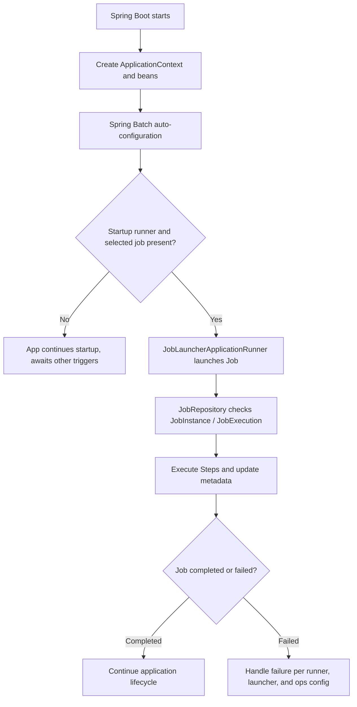

# Launching Jobs on Application Startup and Disabling Auto-Run

## 1. Context: One Job, Multiple Launch Triggers

A Spring Boot application can use Spring Batch to ingest files, sync data over HTTP, update databases, purge records, or export scheduled reports. Once a `Job` is declared as a bean in the application, whether the job runs automatically at startup must be a deliberate architectural decision.

For example, the integration service `order-sync` defines a job `importOrdersJob` that reads partner orders and writes them to PostgreSQL. Two operational modes exist:

- **Run immediately on startup:** fits dedicated batch programs where each process launch represents one controlled processing run.
- **Run only when explicitly requested:** fits always-on API services, scheduled workloads, jobs orchestrated by external platforms, or multi-replica deployments.

Spring Boot includes an auto-configured job-launching mechanism when conditions match. Without understanding this mechanism, adding replicas or restarting a crashed service can inadvertently trigger batch jobs at unintended times.

This lesson's goal in `SPRING_BOOT_INTEGRATION` is determining **when Spring Boot launches jobs, how to disable that behavior, how to pick alternative triggers, and how to keep jobs safe alongside HTTP, databases, brokers, and adapters**. Keep the decision *whether to auto-run at startup* separate from other concerns like job restartability, idempotency, and checkpoint storage.

## 2. Components to Distinguish

| Component | Responsibility | Auto-Triggers Job at Startup? |
| --- | --- | --- |
| `Job` | Defines a batch workflow of one or more `Step`s | The `Job` bean itself does not self-execute |
| `Step` | Defines one processing stage: tasklet, chunk, partitioning… | Runs only when the job is launched |
| `JobRepository` | Persists metadata for job instances, executions, step executions, and execution contexts | Not a scheduler |
| `JobLauncher` | API to start a `JobExecution` with `JobParameters` | Runs jobs only when `run` is invoked |
| `JobLauncherApplicationRunner` | Spring Boot mechanism that can auto-launch jobs on startup | Yes, when Batch auto-configuration and properties permit |
| `@Scheduled`, internal API, CLI, external scheduler | Generates **triggers** on schedule or demand | Independent of startup runner; must be designed separately |

**Key distinction:** Registering a `Job` bean means the application **knows the job definition**; whether and when it runs depends on the trigger mechanism. Disabling the startup runner does not remove `Job`, remove `Step`, or forbid calling `JobLauncher.run(...)` elsewhere.

In Spring Boot 3.x with Spring Batch 5.x, when the framework auto-configures Spring Batch and valid `Job` beans exist, Spring Boot can launch a job as part of application startup. With multiple `Job`s, specify which one is selected. The configuration details below target Spring Boot 3.x integration; always verify APIs and property names for your exact Spring Boot/Spring Batch versions, especially across major upgrades.

## 3. Timeline When Auto-Run Is Enabled



The runner participates during application startup, typically via `ApplicationRunner`. Never assume a job already ran inside a constructor, `@PostConstruct`, or right when Spring instantiates the `Job` bean.

A synchronous job can prolong process startup time. Whether the job actually blocks startup until completion or submits asynchronously depends on `JobLauncher` configuration. To manage scheduled batch workflows cleanly, track job status and completion timing independently of process startup.

In particular, "auto-run at startup" **does not mean** "succeeds every startup." `JobRepository` can reject re-running an already-completed `JobInstance` if the job and identifying parameters stay identical. Thus, designing `JobParameters` is essential whenever auto-run is enabled.

## 4. Minimal Example: Declaring a Job and Letting Spring Boot Auto-Launch It

Suppose a job calls an order-sync service once per launch. In Spring Boot 3.x, define a `Job` and `Step` via Spring Batch's builder API.

### 4.1. Dependencies

Maven example using Spring Boot dependency management:

```xml
<dependency>
    <groupId>org.springframework.boot</groupId>
    <artifactId>spring-boot-starter-batch</artifactId>
</dependency>

<dependency>
    <groupId>org.postgresql</groupId>
    <artifactId>postgresql</artifactId>
    <scope>runtime</scope>
</dependency>
```

This example assumes PostgreSQL stores Batch metadata. If the job calls HTTP, reads files, sends messages, or uses JPA, add corresponding dependencies per project architecture. **Do not add `@EnableBatchProcessing`** merely to enable Batch features when relying on Spring Boot Batch auto-configuration: manual configuration causes Boot Batch auto-configuration to back off and alters auto-run and metadata schema initialization.

### 4.2. Defining the `Job`

```java
import org.springframework.batch.core.Job;
import org.springframework.batch.core.Step;
import org.springframework.batch.core.job.builder.JobBuilder;
import org.springframework.batch.core.repository.JobRepository;
import org.springframework.batch.core.step.builder.StepBuilder;
import org.springframework.batch.core.step.tasklet.Tasklet;
import org.springframework.batch.repeat.RepeatStatus;
import org.springframework.context.annotation.Bean;
import org.springframework.context.annotation.Configuration;
import org.springframework.transaction.PlatformTransactionManager;

@Configuration
public class OrderImportBatchConfiguration {

    @Bean
    Tasklet importOrdersTasklet(OrderImportService importService) {
        return (contribution, chunkContext) -> {
            importService.importPendingOrders();
            return RepeatStatus.FINISHED;
        };
    }

    @Bean
    Step importOrdersStep(
            JobRepository jobRepository,
            PlatformTransactionManager transactionManager,
            Tasklet importOrdersTasklet) {

        return new StepBuilder("importOrdersStep", jobRepository)
                .tasklet(importOrdersTasklet, transactionManager)
                .build();
    }

    @Bean
    Job importOrdersJob(JobRepository jobRepository, Step importOrdersStep) {
        return new JobBuilder("importOrdersJob", jobRepository)
                .start(importOrdersStep)
                .build();
    }
}
```

`OrderImportService` is a project-defined business service; the example illustrates `Job` registration only. The `JobBuilder` and `StepBuilder` APIs taking `JobRepository` and transaction managers reflect Spring Batch 5.x. For chunk processing, replace the tasklet with a reader, processor, and writer.

Having a `Job` bean named `importOrdersJob` does not mean it runs only once in the system's lifetime. Whether a new execution starts depends on the job instance, parameters, and execution history persisted in the repository.

### 4.3. Enabling Auto-Run via Configuration

```yaml
spring:
  datasource:
    url: ${DB_URL}
    username: ${DB_USERNAME}
    password: ${DB_PASSWORD}

  batch:
    job:
      enabled: true
    jdbc:
      initialize-schema: never
```

Here `spring.batch.job.enabled=true` explicitly permits the startup runner. When Boot auto-configuration applies and a single target job is resolved, each application startup attempts to launch it.

`spring.batch.jdbc.initialize-schema=never` applies when Batch metadata tables **are already created and managed by Flyway/Liquibase**. When learning with an embedded database, Spring Boot can auto-initialize schemas under appropriate config; in production, ensure metadata tables already exist at the right version before launching jobs. Never casually enable `initialize-schema: always` against live databases.

**Note on credentials:** in real deployments, supply environment variables via secret management; sample configs never embed real credentials.

## 5. Disabling Startup Auto-Run with One Property

For API services or scheduled jobs, configure:

```yaml
spring:
  batch:
    job:
      enabled: false
```

Equivalent command-line argument:

```bash
java -jar integration-service.jar --spring.batch.job.enabled=false
```

Or via Spring Boot relaxed environment-variable binding:

```bash
SPRING_BATCH_JOB_ENABLED=false java -jar integration-service.jar
```

Effect of this property:

- Spring Boot does not automatically launch `Job`s through the default startup runner.
- `Job`, `Step`, `JobRepository`, and `JobLauncher` beans are still created if configuration and dependencies are met.
- A scheduler, internal HTTP endpoint, custom command-line runner, or another service **can still call `JobLauncher.run(...)`**.
- The property **does not** stop an already-running job and does not disable broker consumers, Spring Integration flows, `@Scheduled`, or other custom triggers.

That last point causes frequent confusion: if your code defines a custom `ApplicationRunner` that calls `jobLauncher.run(...)` directly, setting `spring.batch.job.enabled=false` **does not turn off** your custom runner. Gate custom triggers with their own conditional properties or profiles.

## 6. Selecting a Job When the Application Has Multiple `Job`s

One service may define `importOrdersJob`, `exportInvoicesJob`, and `reconcilePaymentsJob` simultaneously. When auto-running at startup, explicitly pick which job is allowed to run.

In Spring Boot 3.x:

```yaml
spring:
  batch:
    job:
      enabled: true
      name: importOrdersJob
```

`spring.batch.job.name` specifies the job name for the startup runner. Leaving no job selected when multiple jobs exist in the context can cause configuration errors or unexpected behavior depending on version and setup. Never rely on bean initialization order to determine the "first job."

In integration apps with multiple jobs serving alongside an API, the standard operational pattern is **disabling auto-run entirely** and launching the right job upon a controlled trigger. If each deployment runs only one job, configure that specific job and its run's identifying parameters explicitly.

```text
batch-runner.jar
  + profile=import-orders
  + spring.batch.job.enabled=true
  + spring.batch.job.name=importOrdersJob

integration-api.jar
  + spring.batch.job.enabled=false
  + JobLauncher runs only on internal triggers
```

Both deployments can share one codebase and `Job` beans while differing in launch configuration and infrastructure permissions. Avoid launching the same job on startup across multiple replicas without accounting for `JobRepository` constraints and single-execution-per-period rules.

## 7. When to Enable vs. When to Disable?

| Context | Recommendation | Rationale |
| --- | --- | --- |
| Dedicated batch CLI running one job then exiting | Consider **enabling** | Process startup is the orchestrator-controlled trigger |
| Kubernetes CronJob spawning a process per schedule | Can **enable** with clear job/parameters | Each process maps to one run period; still handle retries and concurrency |
| Always-on Spring Boot REST API serving requests | Usually **disable** | Restarts, rolling deploys, or scaling replicas are not business signals to run batches |
| App serving both APIs and broker event flows | Usually **disable** | Batches run via orchestration or controlled event triggers |
| Multi-hour jobs or jobs needing runbook/manual approval | Usually **disable** | Jobs need dedicated triggers, monitoring, and execution controls |
| Local demo or quick test of one short job | Can **enable** | Reduces trigger boilerplate for fast observation |
| Multiple independent jobs on distinct schedules | Usually **disable** | Schedules belong in a dedicated scheduler, each job with its own parameters and permissions |

There is no universal "always enable" or "always disable" rule. Answer: *Who is the authoritative trigger source? How is one run identified? On redeploy, should the job run automatically?*

## 8. JobParameters, JobInstance, and Consequences of Repeated Startups

Spring Batch distinguishes these concepts:

- **`Job`:** execution flow definition, e.g., `importOrdersJob`.
- **`JobParameters`:** arguments passed to a run; either identifying or non-identifying.
- **`JobInstance`:** logical identity of a processing run, determined by the `Job` name and **identifying JobParameters**.
- **`JobExecution`:** one attempt to run a `JobInstance`; a failed instance can gain another execution on valid restart.
- **`StepExecution`:** result of one step execution inside a specific job execution.

Examples:

| Job | Identifying Parameters | Consequence |
| --- | --- | --- |
| `importOrdersJob` | `businessDate=2026-11-20` | One `JobInstance` for Nov 20 |
| `importOrdersJob` | `businessDate=2026-11-21` | A different `JobInstance` for Nov 21 |
| `importOrdersJob` | `businessDate=2026-11-20`, re-run | Targets **the same instance**; framework checks completed vs. failed state |
| `importOrdersJob` | `businessDate=2026-11-20` + `run.id=2` (identifying) | **New instance**, even for the same business period; risks re-processing data |

### 8.1. Why Did Startup Not Create a New Execution?

If `importOrdersJob` runs with the same identifying parameters and the instance is already `COMPLETED`, the next launch may receive `JobInstanceAlreadyCompleteException`. That is batch history protection, not Spring Boot "disabling auto-run."

If the previous instance is `FAILED` or `STOPPED` and the job is restartable, it can restart with the same parameters after fixing the failure cause. When an instance is active, `JobExecutionAlreadyRunningException` guards against concurrent duplicate launches where supported. A persistent metadata repository is required for these guards to work across app restarts.

**Never generate a random `run.id` on every startup just to avoid already-completed errors.** Doing so turns every restart into a fresh job instance, risking duplicate data ingestion, duplicate HTTP calls, or duplicate broker messages.

### 8.2. Choosing Parameters by Business Period

Example reconciliation job for business date `2026-11-21`:

```java
JobParameters parameters = new JobParametersBuilder()
        .addString("businessDate", "2026-11-21", true)
        .addString("trigger", "scheduler", false)
        .toJobParameters();
```

`businessDate` is identifying because each day is one logical processing unit. `trigger` is non-identifying to record the trigger source without creating separate instances per trigger source. When a period has already completed, operational policy decides whether to keep it, audit it, or allow a conditional rerun via an explicit new processing-version design.

Across HTTP and database integrations, identifying `JobInstance` alone does not prevent duplicate side effects. Steps/chunks must still enforce **idempotency keys**, checkpoints, unique constraints, or source reconciliation.

## 9. Launching On Demand When Auto-Run Is Disabled

Spring Batch provides `JobLauncher` to start jobs with parameters. An internal service can be called by a scheduler, an authorized REST controller, or a command handler.

```java
import org.springframework.batch.core.Job;
import org.springframework.batch.core.JobExecution;
import org.springframework.batch.core.JobExecutionException;
import org.springframework.batch.core.JobParameters;
import org.springframework.batch.core.JobParametersBuilder;
import org.springframework.batch.core.launch.JobLauncher;
import org.springframework.stereotype.Service;

@Service
public class OrderImportTrigger {
    private final JobLauncher jobLauncher;
    private final Job importOrdersJob;

    public OrderImportTrigger(JobLauncher jobLauncher, Job importOrdersJob) {
        this.jobLauncher = jobLauncher;
        this.importOrdersJob = importOrdersJob;
    }

    public JobExecution launchForDate(String businessDate)
            throws JobExecutionException {

        JobParameters parameters = new JobParametersBuilder()
                .addString("businessDate", businessDate, true)
                .toJobParameters();

        return jobLauncher.run(importOrdersJob, parameters);
    }
}
```

Application configuration:

```yaml
spring:
  batch:
    job:
      enabled: false
```

Calling `launchForDate("2026-11-21")` still runs the job because the service invokes `JobLauncher` directly. In production, add:

1. **Authorization:** trigger only from schedulers/internal services or authenticated endpoints; never expose arbitrary launch APIs publicly.
2. **Parameter validation:** check date formats, data bounds, readiness preconditions, and contract versions.
3. **Concurrency policy:** decide whether two different periods may run simultaneously; the repository prevents certain duplicate-instance races but does not automatically lock shared business tables.
4. **Async/sync result handling:** `JobLauncher.run` returns a `JobExecution`, yet depending on launcher config, execution may be finished or still running. Track status in the repository rather than assuming returning means business success.
5. **Load limits:** avoid launching too many concurrent jobs and overwhelming DB, HTTP, or broker connections.

If using `@Scheduled` as a trigger, account for **multiple replicas**: every instance fires on the same schedule. Use a centralized scheduler, a properly semantics-checked distributed lock, or designate a single batch-scheduler replica. Never rely on `@Scheduled` alone to guarantee cluster-wide single triggering.

## 10. Config-Based Auto-Run vs. Custom Runner?

### 10.1. Spring Boot's Default Startup Runner

```yaml
spring:
  batch:
    job:
      enabled: true
      name: importOrdersJob
```

Pros: minimal code, ideal for single-purpose job apps. Cons: startup is tied to launch conditions, parameter injection and process exit-code handling require extra work, especially across multiple deployments.

### 10.2. Custom Application Runner

Some projects write a `CommandLineRunner` or `ApplicationRunner` calling `JobLauncher.run` manually. This allows custom parameter parsing or specialized launch flows, yet **never leave Boot's default startup runner enabled at the same time** if both would launch the same job.

Example explicit runner scoped to a dedicated batch profile:

```java
import org.springframework.batch.core.JobExecution;
import org.springframework.boot.ApplicationArguments;
import org.springframework.boot.ApplicationRunner;
import org.springframework.context.annotation.Profile;
import org.springframework.stereotype.Component;

@Component
@Profile("batch-cli")
public class ImportOrdersCliRunner implements ApplicationRunner {
    private final OrderImportTrigger trigger;

    public ImportOrdersCliRunner(OrderImportTrigger trigger) {
        this.trigger = trigger;
    }

    @Override
    public void run(ApplicationArguments args) throws Exception {
        String businessDate = parseBusinessDate(args);
        JobExecution execution = trigger.launchForDate(businessDate);
        // Depending on JobLauncher, execution may be async: do not assume COMPLETED.
        monitorAndReport(execution);
    }

    private String parseBusinessDate(ApplicationArguments args) {
        if (!args.containsOption("businessDate")) {
            throw new IllegalArgumentException("Missing --businessDate");
        }
        var values = args.getOptionValues("businessDate");
        if (values == null || values.size() != 1 || values.get(0) == null) {
            throw new IllegalArgumentException("Exactly one --businessDate is required");
        }
        return values.get(0);
    }

    private void monitorAndReport(JobExecution execution) {
        // Custom implementation: await/observe status, map exit code, report errors.
    }
}
```

This example only shows the mechanism; real apps must replace `monitorAndReport` with genuine status monitoring and exit-code mapping, validate `businessDate`, and handle exceptions properly. Set `spring.batch.job.enabled=false` so the custom runner is the sole trigger under the `batch-cli` profile.

**Situational warning:** Placing a shared `CommandLineRunner` in a library module imported by both an API service and a batch app can unintentionally launch jobs inside the API service. Isolate runner beans explicitly using profiles or conditional properties.

## 11. Launching a Job Does Not Mean Completing Successfully

Suppose a job processes 10,000 rows and at row 8,000 a partner API returns HTTP 503. Spring Batch records `FAILED` and step checkpoints, allowing resumption from an appropriate spot if readers/writers, repository, and execution contexts support it.

Outcomes to distinguish:

| Status | Operational Meaning | Appropriate Response |
| --- | --- | --- |
| `STARTING` / `STARTED` | Job is preparing or currently processing | Monitor progress; do not report success yet |
| `COMPLETED` | Job execution finished successfully per flow | Reconcile business counts/metrics, record period completion |
| `FAILED` | Part of the job failed | Inspect exceptions/step, fix root cause, restart carefully |
| `STOPPED` | Job stopped via Batch mechanism | Check restart policy and checkpoints |
| `UNKNOWN` | Framework cannot determine state reliably | Investigate repository/logs before retrying to avoid duplicate side effects |

Spring Batch tracks both `BatchStatus` and `ExitStatus`. `BatchStatus` reflects execution lifecycle, while `ExitStatus` conveys logical step/flow outcome. Spring Boot's OS process exit code is separate; a `FAILED` job does not automatically return a non-zero exit code to an external scheduler unless the app maps execution results properly.

For CLI batches, structure the process lifecycle as:

```text
Trigger one JobInstance with clear identifying parameters
    ↓
Await JobExecution completion (or poll repository if launcher is async)
    ↓
Read BatchStatus + ExitStatus + actual record counts
    ↓
Emit metrics/audit and return the matching exit code to the orchestrator
```

Avoid rescheduling solely because the service is still running, or relying only on an HTTP trigger request returning `200 OK`.

## 12. Metadata Repository and Schema Migrations

To coordinate startup/restart across deployments, `JobRepository` requires durable metadata. With a JDBC-based repository, Spring Batch uses metadata tables such as:

- `BATCH_JOB_INSTANCE`: job instance identities.
- `BATCH_JOB_EXECUTION` and `BATCH_JOB_EXECUTION_PARAMS`: executions and parameters.
- `BATCH_STEP_EXECUTION`: per-step statuses.
- `BATCH_JOB_EXECUTION_CONTEXT` and `BATCH_STEP_EXECUTION_CONTEXT`: execution contexts/checkpoints.

Actual table names may carry configured prefixes; table counts and layouts depend on the Spring Batch version. Storing metadata detects completed job instances, concurrent duplicates, failed executions, and restartability.

In production integration systems, use **one chosen schema migration tool** (Flyway *or* Liquibase) to manage both metadata and business tables. Example:

```yaml
spring:
  batch:
    jdbc:
      initialize-schema: never

  flyway:
    enabled: true

  liquibase:
    enabled: false

  sql:
    init:
      mode: never

  jpa:
    hibernate:
      ddl-auto: validate
```

The `jpa` block applies only if the application actually uses JPA; omit it otherwise. Migrations must create all metadata tables/sequences/indexes matching your Spring Batch version and database engine. Never reuse metadata scripts from a different version without verifying compatibility.

If you use `@EnableBatchProcessing` or extend `DefaultBatchConfiguration` for manual Batch config, part of Spring Boot's default auto-configuration backs off. Verify where `JobRepository`, the datasource, and launch mechanisms come from; `spring.batch.job.enabled` is not guaranteed to behave identically as under Boot auto-configuration.

## 13. Risks When Launching Jobs During Application Startup

### 13.1. Rolling Deploys or Automatic Restarts

Kubernetes Deployments can restart containers due to liveness probes, OOMs, or rolling updates. If auto-run is enabled, every restart attempts to launch the job. If `JobParameters` auto-generates new IDs, restarts repeat business processing.

Solution: disable startup auto-run in long-running services, use a persistent `JobRepository`, and determine business periods in the scheduler/orchestration layer.

### 13.2. Multiple Replicas Starting Together

A cluster with three instances all running with auto-run enabled may attempt to launch the job concurrently. `JobRepository` prevents certain duplicate launches of **the same instance**, yet does not stop two instances using **different identifying parameters** from processing the same business data. Require one authoritative trigger source, authorization rules, and data-level locks/constraints.

### 13.3. Startup Depending on Databases or External Systems

Batches may require PostgreSQL, object storage, HTTP APIs, SFTP, or brokers. If auto-running at startup while a partner is down, startup times or process health suffer. Decide whether a batch failure should make an API service unavailable. For request-serving apps, decoupling triggers and job workers isolates responsibilities.

### 13.4. Batch Retries Can Duplicate Side Effects

A chunk job that calls an external API and fails before committing its DB checkpoint may re-call the API on restart. Likewise, DB writes and Kafka publishes do not share a single transaction automatically. Use idempotency keys, transactional outboxes, transaction boundaries, and reconciliation; Batch metadata does not make external systems exactly-once.

## 14. Testing Auto-Run Configuration and Manual Triggers

A reliable test suite separates **job logic tests** from **bootstrap startup-launch tests**.

| Scenario | Expected Outcome |
| --- | --- |
| Single `Job`, `spring.batch.job.enabled=true`, repository ready | Startup attempts to launch the configured job |
| `spring.batch.job.enabled=false`, no other triggers | Startup creates no new `JobExecution` |
| Auto-run disabled, `JobLauncher.run` called manually | Job still runs with supplied parameters |
| Multiple `Job`s, `spring.batch.job.name` set | Only the specified job runs via startup runner |
| Restart with same identifying parameters after `COMPLETED` | Does not create a new processing execution for completed instance |
| Restart `FAILED` job when restartable | Framework creates next execution; step resumes from valid checkpoint |
| Two instances trigger the same period concurrently | No duplicate side effects or data conflicts; respects concurrency policy |
| API/DB disconnect mid-chunk | Clear failure state; retry/restart produces no duplicate data |
| `@Scheduled` active while auto-run disabled | Scheduler still triggers if configured; tests catch unintended triggers |
| Profile/env-var overrides in CI/CD | Startup runner never accidentally enabled in API environments |

Use `@SpringBootTest(properties = "spring.batch.job.enabled=false")` to boot the test context without auto-running every batch, then use Spring Batch test utilities to launch with controlled parameters. For metadata transaction/restart tests, use Testcontainers with the production database engine instead of mocking `JobRepository`.

Also verify startup ordering: the datasource and metadata tables must be ready **before the runner tries to launch**. If jobs access separate databases or HTTP adapters, test those connectors and timeout policies too.

## 15. Observability and Job Operations

Key metrics and logs:

- `jobName`, identifying business period, `jobInstanceId`, `jobExecutionId`, and trigger source.
- Application startup duration and job start/end timestamps; distinguish slow startup from slow batch processing.
- `BatchStatus`, `ExitStatus`, total read/write/skip/retry counts per step.
- Latency and errors on HTTP, database, object storage, or broker dependencies.
- Launch rejections due to already completed, already running, invalid parameters, or non-restartable state.
- Jobs stuck in `STARTED` too long, stalled checkpoints, or missing output data despite reported job completion.

Protect metric cardinality: `jobExecutionId` and `businessDate` belong in logs/traces or audit stores rather than unbounded metric labels.

Practical incident checklist:

1. Verify effective deployment properties (`spring.batch.job.enabled`, profiles, environment variables).
2. Check whether `JobLauncherApplicationRunner` was auto-configured and which `Job` it selected.
3. Inspect `JobRepository` to distinguish unlaunched, completed, active, and failed states.
4. Cross-check identifying `JobParameters` against the business period.
5. Audit all other trigger sources: `@Scheduled`, custom runners, cronjobs, APIs, pipelines.
6. Decide restart/rerun/repair based on actual data state and idempotency; never edit/delete metadata to force re-runs.

## 16. End-to-End Scenario: Invoice Sync Service with an Accounting System

Suppose a Spring Boot app serves an invoice-lookup REST API and runs a `syncInvoicesJob` batch syncing to accounting at 01:00 daily.

**Risky design:** enable `spring.batch.job.enabled=true` in the API Deployment running three replicas for traffic. On every rolling deploy, all three instances attempt to launch the batch. If each launch attaches a fresh `run.id`, sync periods re-run and send duplicate invoices.

**Controlled design:**

1. API Deployment sets `spring.batch.job.enabled=false` to serve requests only, never auto-launching batches at startup.
2. One scheduler fires a trigger carrying `businessDate` identifying the sync period, enforcing per-period concurrency limits.
3. The batch worker uses a durable `JobRepository` with one `JobInstance` per period; retries reuse the exact same identifying parameters.
4. Reader and writer enforce proper checkpoints/transactions. Calls to the accounting API carry idempotency keys per invoice ID and operation; responses and sync state are persisted for reconciliation.
5. Monitor `JobExecution` to completion, report results to the scheduler, alert on delays or failures, and retry via runbook.
6. Business and Batch metadata schemas are managed via formal migrations rather than auto-creating tables on startup.

If replacing the API Deployment with a **dedicated Kubernetes CronJob** where each process runs one period and exits, auto-run can be enabled. Pass `businessDate` explicitly to each process, monitor job completion, and map exit status to the OS exit code so CronJob knows whether it succeeded or failed.

## 17. Checklist for Choosing Spring Batch Launch Behavior

- [ ] Classify whether the service is a long-running API/consumer or a dedicated batch CLI/CronJob.
- [ ] Pick **one primary trigger source**: default startup runner, custom runner, scheduler, internal API, or orchestrator.
- [ ] Set `spring.batch.job.enabled` consistently with that choice; avoid two runners launching together.
- [ ] With multiple jobs, select the target job appropriately for your Spring Boot version and deployment config.
- [ ] Maintain a durable `JobRepository` with version-matched metadata schemas.
- [ ] Design identifying `JobParameters` around business units; avoid random run IDs on restarts.
- [ ] Define policies for `COMPLETED`, `FAILED`, `STOPPED`, and concurrency.
- [ ] Enforce idempotency/checkpoints/reconciliation when jobs call HTTP, write DBs, or publish to brokers.
- [ ] Test startup with enabled/disabled, manual triggers, multiple replicas, and restarts.
- [ ] Monitor execution IDs, statuses, step progress, business outcomes, and scheduler exit codes.

**Key takeaway:** `spring.batch.job.enabled=false` only disables **automatic job launching when Spring Boot starts** when Boot Batch auto-configuration manages the runner. Jobs can still be launched intentionally via `JobLauncher`. Whether to enable or disable auto-run should follow operational architecture and data constraints—not merely the presence of a `Job` bean.
