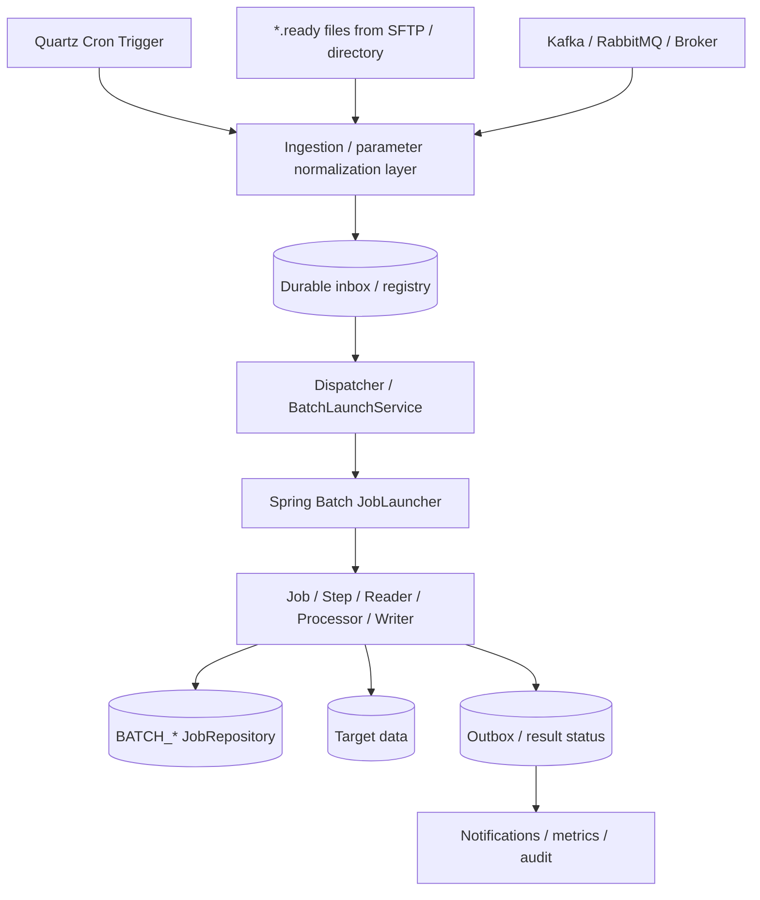
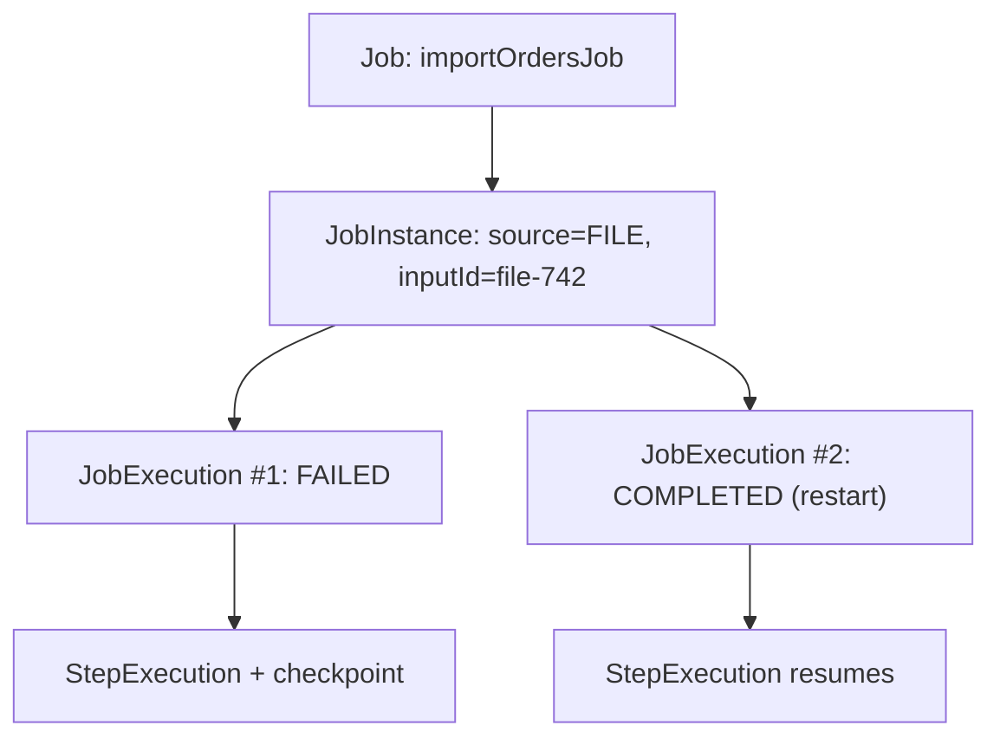
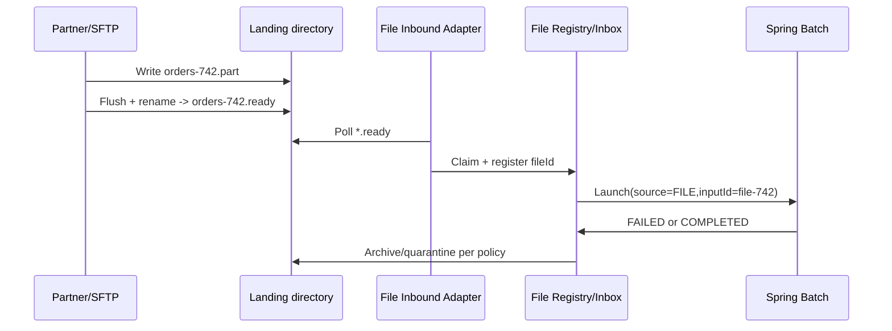
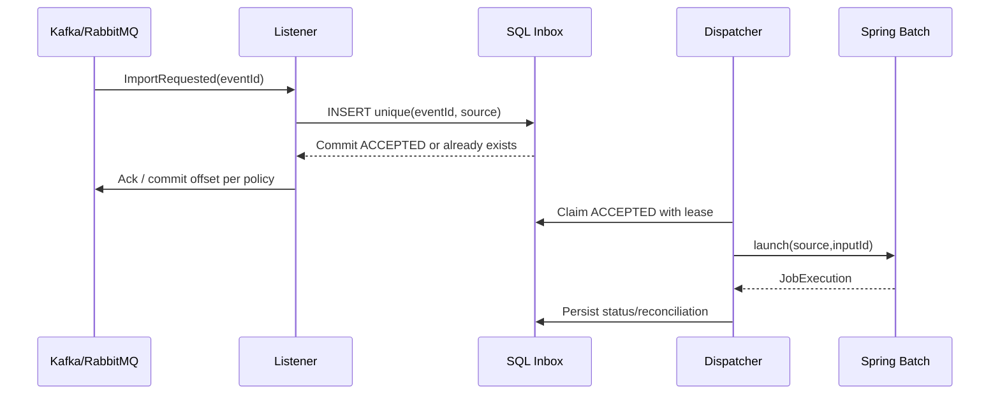
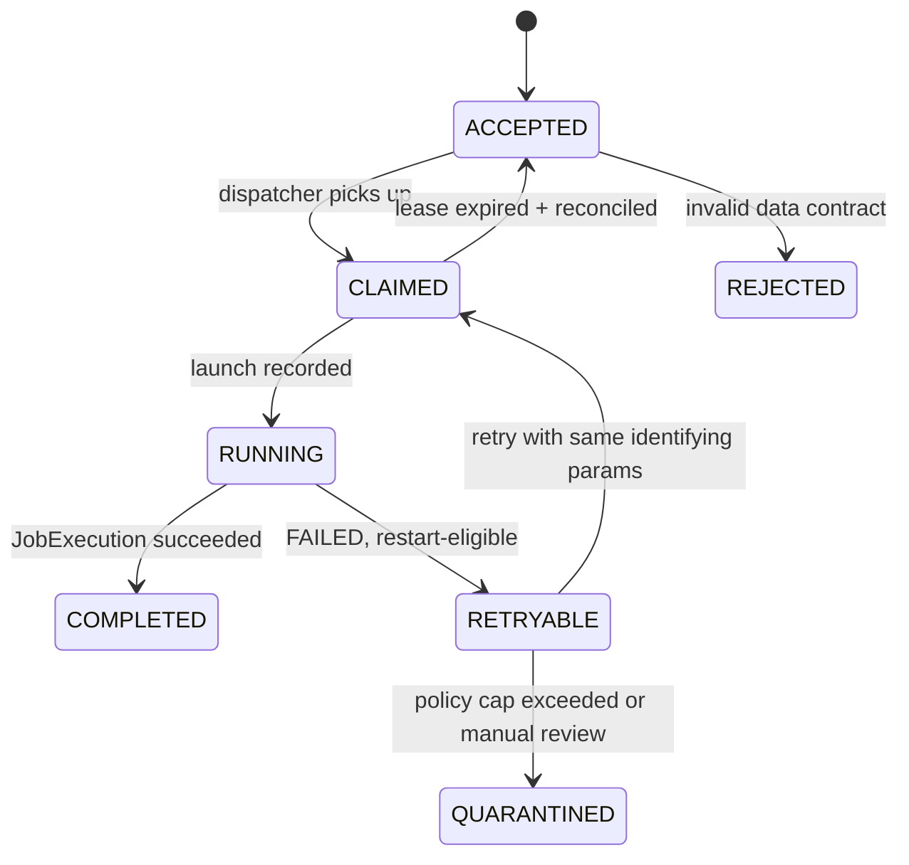

# Integrating Batch with Quartz Schedules, Files, or Messages

A Spring Boot integration system often needs to process bulk data from multiple triggers: a nightly reconciliation schedule, a partner CSV file arriving in a shared directory, or an `ImportRequested` message on Kafka/RabbitMQ. These three triggers differ in arrival timing, redelivery behavior, load control, and durability. Yet they should converge on **the same Spring Batch execution mechanism** so they share data-reading rules, transactions, checkpoints, retries, and progress tracking.

This lesson belongs to the **Spring Batch** chapter of the **SPRING_BOOT_INTEGRATION** module. The module's goal is organizing system integration in Spring Boot via HTTP clients, databases, caches, message brokers, and Spring Integration adapters; accordingly, this lesson places Spring Batch within the real-world pipeline **trigger → job handoff → Batch Job → outcome update**, covering configuration, data contracts, errors, deduplication, testing, and observability.

After this lesson, you will be able to:

- Decide when to use Quartz, file inbound adapters, Kafka/RabbitMQ, or an intermediate job-handoff inbox.
- Configure Spring Boot, Spring Batch, Quartz, and Spring Integration so multiple triggers call one `JobLauncher` under an explicit parameter contract.
- Design `JobParameters`, `JobInstance`, `JobExecution`, and checkpoints to restart the right data, block duplicates, and avoid conflating Quartz triggers with Batch runs.
- Handle partially written files, broker redeliveries, cron misfires, overlapping runs, crash-window errors, resource caps, and post-commit statuses.
- Write integration tests for trigger flows, failures, duplicate deliveries, restarts, and recovery; observe everything via metadata, metrics, and correlation-ID logs.

> **Version context:** examples use Spring Batch 5.x APIs alongside Spring Boot 3.x configuration conventions, Spring Integration Java DSL, and Quartz 2.x. The patterns apply across newer compatible versions, though class names, auto-configuration, Java baselines, status columns, and acknowledgment modes may differ. Business repository/adapter interfaces are explicitly marked as illustrative; do not treat snippets as complete production apps.

## 1. Separating Three Concerns: Trigger, Execution, and Completion

### 1.1. Overview Diagram



This diagram illustrates an architecture with a **durable inbox/registry**, suited for systems that cannot drop work when a process dies. For simpler, lower-criticality tasks, Quartz or a file poller can call `JobLauncher` directly; even then, you need policies for launch failures, parameter collisions, or crashes between steps.

Three components hold independent responsibilities:

| Component | Question to Answer | Example |
|---|---|---|
| **Trigger** | When does the system detect work exists? | Cron at 02:00, `.ready` file appears, broker delivers `ImportRequested` |
| **Launch/dispatch** | Which exact workload runs, are duplicates accepted, and is load within limits? | Determine `inputId` and `source`; persist inbox; enforce concurrency cap |
| **Spring Batch** | How is data read, transformed, written, checkpointed, rolled back, retried, and reported? | `Job` of chunked `Step`s persisting metadata to `JobRepository` |

**Receiving a trigger ≠ Batch completed successfully.** A Quartz fire may only have invoked `JobLauncher`, a broker ack may only confirm the request landed in the inbox, whereas Spring Batch `COMPLETED` reflects the execution outcome of the corresponding `JobExecution`. If you also must confirm business data reached an external partner, define explicit confirmation rules at the outbound adapter/target.

### 1.2. When to Use Each Trigger Source?

| Source | Best Fit | Mandatory Issues to Handle |
|---|---|---|
| **Quartz** | Scheduled execution, complex calendars, durable trigger storage, or clustered scheduling | Cron/timezone, misfires, job concurrency, failover, period-based `JobParameters` |
| **File** | Partners drop CSV/XML/JSON onto folders, SFTP, or object storage | File write completion, atomic claims, renames/versioning, file restarts, duplicate files |
| **Message** | Upstream systems request imports via events/commands near real time | At-least-once delivery, acks, redeliveries, inbox/idempotency, offsets/visibility timeouts, backpressure |
| **Inbox/dispatcher** | Multiple sources, durable persistence before execution, clustering, or load capping | Inbox transactions, claim states, leases, recovery of accepted requests |

You normally do not need three separate `Job`s just because you have three triggers. The parameter contract and processing logic can stay unified while input adapters validate sources and construct matching parameters.

## 2. Mastering Spring Batch Metadata and Identity

### 2.1. `Job`, `JobInstance`, `JobExecution`, and `StepExecution`

Spring Batch distinguishes:

- `Job`: process definition such as `importOrdersJob`.
- `JobParameters`: input arguments, each marked **identifying** or **non-identifying**.
- `JobInstance`: one **logical** processing run, defined by **Job name + identifying parameter set**.
- `JobExecution`: each actual attempt to run a `JobInstance`, recording status, timestamps, and errors; restarting a failed JobInstance creates another `JobExecution`.
- `StepExecution`: execution record of each Step inside a `JobExecution`, containing read/write/skip counts and status.
- `ExecutionContext`: state map persisted at Job or Step scope to support restarts (e.g., line checkpoint); never replaces business databases or durable data stores.



If the first run `COMPLETED`, calling `JobLauncher.run` again with **the exact same identifying parameters** normally throws `JobInstanceAlreadyCompleteException` (unless the Job is specially configured). If the prior run `FAILED` and the Job is restartable, re-running with the same identifying parameters creates a new execution under the existing `JobInstance`.

### 2.2. Designing a Consistent Parameter Contract Across All Three Sources

Suppose a shared contract uses:

| Parameter | Meaning | Identifying? |
|---|---|---|
| `source` | `QUARTZ`, `FILE`, `KAFKA`, or `RABBIT` | Yes |
| `inputId` | Immutable ID of the logical ingestion: reconciliation date, file ID, request ID | Yes |
| `requestedAt` | Timestamp when the request arrived/started, for diagnostics | No |
| `traceId` | Observability reference for logs/traces | No, if stored as a JobParameter |
| `inputPath` | Internal path of the claimed file | Consider carefully; changing across restarts can point to wrong input |
| `schemaVersion` | Data contract version | Business-dependent; does changing versions warrant a new JobInstance? |

For example, `inputId=2026-11-21` for a daily batch; duplicate cron fires on the same day do not create a new job. For files, `inputId` can be a partner-supplied file ID combined with content version, or a file-registry inbox ID; never rely on filename alone if partners overwrite contents under the same name. For messages, use an event ID/business request ID **stable across redeliveries**.

**Never set `System.currentTimeMillis()` as an identifying parameter by default.** When every trigger mints a fresh timestamp, the system treats every retry or redelivery as a distinct `JobInstance`, breaking duplicate protection and meaningful restarts. Mint a new run ID only when the business genuinely intends an independent batch, and explicitly model its relationship to immutable inputs.

### 2.3. Common Launch Results and Exceptions

| Result / Exception | Practical Meaning | Response |
|---|---|---|
| `JobExecution` has status `COMPLETED` | Batch execution completed per Job/Step definition | Record result, store report; emit post-processing events if needed |
| `JobExecutionAlreadyRunningException` | Same `JobInstance` is actively running | Do not start a duplicate parallel run; track active execution |
| `JobInstanceAlreadyCompleteException` | `JobInstance` already completed | Normally treat as duplicate/no-op; never mint identifying timestamps to bypass |
| `JobRestartException` | Cannot restart per Job state or configuration | Investigate metadata and restart conditions |
| `JobParametersInvalidException` | Parameters failed validator | Return input contract error; never retry infinitely |
| `FAILED`, `STOPPED`, `UNKNOWN` | Batch did not finish cleanly | Distinguish restartable vs. needs reconciliation vs. needs data repair |

With a **synchronous** `JobLauncher`, `run()` returns after execution completes; with an **asynchronous** `JobLauncher`, `run()` can return a `JobExecution` still in `STARTING`/`STARTED`. Never mark work `COMPLETED`, archive files, or ack business completion merely because `run()` returned without throwing.

## 3. Baseline Configuration for Spring Boot + Spring Batch

### 3.1. Dependencies

Example with Gradle Kotlin DSL:

```kotlin
dependencies {
    implementation("org.springframework.boot:spring-boot-starter-batch")
    implementation("org.springframework.boot:spring-boot-starter-quartz")
    implementation("org.springframework.boot:spring-boot-starter-integration")
    implementation("org.springframework.boot:spring-boot-starter-actuator")
    implementation("org.springframework.boot:spring-boot-starter-jdbc")

    runtimeOnly("org.postgresql:postgresql")

    testImplementation("org.springframework.boot:spring-boot-starter-test")
    testImplementation("org.springframework.batch:spring-batch-test")

    // Add only when actually using the corresponding message source:
    // implementation("org.springframework.kafka:spring-kafka")
    // implementation("org.springframework.boot:spring-boot-starter-amqp")
}
```

Choose broker dependencies matching actual sources; using Kafka does not require RabbitMQ and vice versa. With the Spring Boot BOM, let Boot manage compatible versions rather than mixing mismatched Batch/Integration/Quartz releases.

### 3.2. `application.yml`

```yaml
spring:
  datasource:
    url: jdbc:postgresql://db.internal.example:5432/integration
    username: ${DB_USERNAME}
    password: ${DB_PASSWORD}

  batch:
    job:
      enabled: false
    jdbc:
      initialize-schema: never

  quartz:
    job-store-type: jdbc
    jdbc:
      initialize-schema: never
    properties:
      org.quartz.scheduler.instanceName: integration-imports
      org.quartz.scheduler.instanceId: AUTO
      org.quartz.jobStore.isClustered: true

management:
  endpoints:
    web:
      exposure:
        include: health,info,metrics
```

Explanation:

- `spring.batch.job.enabled=false` prevents auto-launching Batch Jobs at Spring Boot startup so Quartz/file/message triggers control launch timing. This is vital when a `Job` exists in the context yet must only run on trigger.
- `initialize-schema=never` suits environments managing schemas via migrations. **Create/upgrade both Spring Batch and Quartz tables for exact versions before running**; in fresh experiments, appropriate bootstrap settings may be used.
- `spring.quartz.job-store-type=jdbc` lets Quartz persist schedules/triggers in the DB. For true clustering, nodes must point to **the same scheduler store**, configure clustering accurately, synchronize clocks, and maintain consistent Quartz schemas.
- Spring Batch metadata (typically `BATCH_*` tables) and Quartz scheduler metadata (typically `QRTZ_*` tables) are **two separate metadata systems**. Neither replaces the other.
- Enabling a JDBC Quartz job store does not guarantee whole-system exactly-once execution. Quartz schedules and fires triggers; Spring Batch tracks job execution state; SQL/HTTP/broker side effects have their own transactions and retries.

If the entire system runs as a single instance, `isClustered=true` is unnecessary. Never turn on clustering arbitrarily without confirming all scheduler groups share valid config; Quartz settings must match the DB and deployment topology.

### 3.3. One Shared Job for All Trigger Adapters

The minimal definition below illustrates all triggers routing into **the same Batch Job**. `InputImportService` is a business interface; concrete implementations can read files in chunks, query DB rows, or fetch registered objects.

```java
import org.springframework.batch.core.Job;
import org.springframework.batch.core.Step;
import org.springframework.batch.core.configuration.annotation.StepScope;
import org.springframework.batch.core.job.builder.JobBuilder;
import org.springframework.batch.core.repository.JobRepository;
import org.springframework.batch.core.step.builder.StepBuilder;
import org.springframework.batch.core.step.tasklet.Tasklet;
import org.springframework.batch.repeat.RepeatStatus;
import org.springframework.beans.factory.annotation.Value;
import org.springframework.context.annotation.Bean;
import org.springframework.context.annotation.Configuration;
import org.springframework.transaction.PlatformTransactionManager;

@Configuration
public class ImportBatchConfiguration {

    public interface InputImportService {
        void importById(String inputId);
    }

    @Bean("importJob")
    public Job importJob(JobRepository repository, Step importStep) {
        return new JobBuilder("importJob", repository)
                .start(importStep)
                .build();
    }

    @Bean
    public Step importStep(
            JobRepository repository,
            PlatformTransactionManager transactionManager,
            Tasklet importTasklet) {
        return new StepBuilder("importStep", repository)
                .tasklet(importTasklet, transactionManager)
                .build();
    }

    @Bean
    @StepScope
    public Tasklet importTasklet(
            @Value("#{jobParameters['inputId']}") String inputId,
            InputImportService importService) {
        return (contribution, chunkContext) -> {
            importService.importById(inputId);
            return RepeatStatus.FINISHED;
        };
    }
}
```

Key takeaways:

- `JobRepository` stores Batch metadata and run status, usually backed by the SQL database configured for Batch.
- `JobBuilder` / `StepBuilder` taking `JobRepository` and `PlatformTransactionManager` reflect Spring Batch 5 conventions.
- `@StepScope` binds `inputId` **when the Step executes**; avoid reading `JobParameters` during singleton bean initialization.
- The `Tasklet` example keeps launch architecture clear—**it is not advice to process a million records inside one transaction**. For large imports, use a chunk-oriented Step with `ItemReader`, `ItemProcessor`, `ItemWriter`, checkpoints, and proper commit boundaries.
- `inputId` must point to a registered, immutable input; never feed unvalidated sender-supplied paths directly into file reads.

### 3.4. A Centralized Launch Service

```java
import org.springframework.batch.core.Job;
import org.springframework.batch.core.JobExecution;
import org.springframework.batch.core.JobParameters;
import org.springframework.batch.core.JobParametersBuilder;
import org.springframework.batch.core.launch.JobLauncher;
import org.springframework.beans.factory.annotation.Qualifier;
import org.springframework.stereotype.Service;

@Service
public class BatchLaunchService {

    private final JobLauncher launcher;
    private final Job importJob;

    public BatchLaunchService(
            JobLauncher launcher,
            @Qualifier("importJob") Job importJob) {
        this.launcher = launcher;
        this.importJob = importJob;
    }

    public JobExecution launch(
            String source, String inputId, long requestedAtMillis)
            throws Exception {
        JobParameters parameters = new JobParametersBuilder()
                .addString("source", source, true)
                .addString("inputId", inputId, true)
                .addLong("requestedAt", requestedAtMillis, false)
                .toJobParameters();

        return launcher.run(importJob, parameters);
    }
}
```

This is the **convergence point** for Quartz, files, and messages. In production, add validators for `source`/`inputId`, authorization checks, concurrency limits, observability context, inbox state updates, and explicit Batch exception classification. The sample method declares `throws Exception` for brevity; the adapter layer should catch meaningful cases and decide retries/acks.

Passing `requestedAt` as **non-identifying** preserves the `JobInstance` across redeliveries and restarts. Spring Batch also records start timestamps on each `JobExecution`; `requestedAt` here represents the trigger/request timestamp.

## 4. Source 1 — Quartz Triggering Batch on a Schedule

### 4.1. A Quartz Job Is Not a Spring Batch Job

Both frameworks define a `Job` concept, yet they are completely different types:

| Quartz | Spring Batch |
|---|---|
| `org.quartz.Job` or `QuartzJobBean` | `org.springframework.batch.core.Job` |
| `JobDetail`, `Trigger`, `Scheduler` | `JobRepository`, `JobInstance`, `JobExecution`, `Step` |
| Computes fire times, stores schedules, misfire policies | Processes data, manages Step transactions, checkpoints, restarts |
| Quartz `JobExecutionContext` | Batch `JobExecution`/`ExecutionContext` |

A Quartz Job **acts solely as an adapter** invoking `BatchLaunchService`; never place bulk data import logic inside Quartz's `executeInternal()`.

### 4.2. Configuring `JobDetail` and `CronTrigger`

```java
import java.util.TimeZone;

import org.quartz.CronScheduleBuilder;
import org.quartz.JobBuilder;
import org.quartz.JobDetail;
import org.quartz.Trigger;
import org.quartz.TriggerBuilder;
import org.springframework.beans.factory.annotation.Qualifier;
import org.springframework.context.annotation.Bean;
import org.springframework.context.annotation.Configuration;

@Configuration
public class QuartzImportSchedule {

    @Bean("importQuartzDetail")
    public JobDetail importQuartzDetail() {
        return JobBuilder.newJob(LaunchImportQuartzJob.class)
                .withIdentity("dailyImport", "integration")
                .storeDurably()
                .build();
    }

    @Bean
    public Trigger importQuartzTrigger(
            @Qualifier("importQuartzDetail") JobDetail detail) {
        return TriggerBuilder.newTrigger()
                .forJob(detail)
                .withIdentity("dailyImportAt02", "integration")
                .withSchedule(
                        CronScheduleBuilder
                                .cronSchedule("0 0 2 * * ?")
                                .inTimeZone(
                                        TimeZone.getTimeZone("Asia/Ho_Chi_Minh"))
                                .withMisfireHandlingInstructionDoNothing())
                .build();
    }
}
```

Cron `0 0 2 * * ?` uses Quartz syntax (seconds, minutes, hours, day-of-month, month, day-of-week), not 5-field UNIX cron. `inTimeZone()` anchors the schedule to the business timezone rather than implicitly relying on JVM/container timezones. `withMisfireHandlingInstructionDoNothing()` illustrates **skipping missed fires** and waiting for the next scheduled fire; if missed periods must be caught up, pick another strategy and design catch-up period identities explicitly.

Exposing `JobDetail` and `Trigger` beans registers them with Spring Boot Quartz auto-configuration. When using a persistent store, define an explicit update strategy for job/trigger definitions across releases—especially when changing cron expressions or timezones—rather than assuming a new bean automatically overwrites DB-stored schedules.

### 4.3. Quartz Adapter Invoking Batch

```java
import java.time.LocalDate;
import java.time.ZoneId;

import org.quartz.DisallowConcurrentExecution;
import org.quartz.JobExecutionContext;
import org.quartz.JobExecutionException;
import org.springframework.beans.factory.annotation.Autowired;
import org.springframework.scheduling.quartz.QuartzJobBean;

@DisallowConcurrentExecution
public class LaunchImportQuartzJob extends QuartzJobBean {

    private static final ZoneId BUSINESS_ZONE =
            ZoneId.of("Asia/Ho_Chi_Minh");

    @Autowired
    private BatchLaunchService batchLaunchService;

    @Override
    protected void executeInternal(JobExecutionContext context)
            throws JobExecutionException {
        // Identify period by scheduled fire time rather than actual
        // execution time in case the scheduler ran late.
        LocalDate businessDate = LocalDate.ofInstant(
                context.getScheduledFireTime().toInstant(),
                BUSINESS_ZONE);

        try {
            batchLaunchService.launch(
                    "QUARTZ",
                    businessDate.toString(),
                    System.currentTimeMillis());
        } catch (org.springframework.batch.core.repository
                .JobInstanceAlreadyCompleteException duplicate) {
            // This logical run already completed; log at appropriate level.
        } catch (org.springframework.batch.core.repository
                .JobExecutionAlreadyRunningException running) {
            // Same JobInstance is already running; do not start another.
        } catch (Exception failure) {
            throw new JobExecutionException(
                    "Cannot launch batch for " + businessDate,
                    failure);
        }
    }
}
```

**Sample code note:** Whether `BatchLaunchService` injects into Quartz-created instances depends on the configured `JobFactory`. In Spring Boot projects, verify autowiring into Quartz Jobs via an integration test; if you customize `SchedulerFactoryBean`/`JobFactory`, ensure Quartz Jobs obtain beans from Spring. This example focuses on mapping schedules → identifying `JobParameters`, not replacing Spring Boot Quartz lifecycle management.

`@DisallowConcurrentExecution` prevents two fires of **the exact same Quartz `JobDetail` (`JobKey`)** from running concurrently inside Quartz. It **does not lock all Spring Batch `JobInstance`s**, does not block manual launches from REST/files/brokers, and does not substitute for global database/CPU limits. Thus, identical identifying parameters still require protection from `JobRepository` and business idempotency.

Calling `launch()` also **does not confirm Batch `COMPLETED`**. If `JobLauncher` is synchronous, you can inspect the returned status and raise a Quartz failure when `FAILED`; if asynchronous, track `JobExecution` via repository/listeners or a separate dispatcher. Handling launch failures differs from handling Step failures post-launch.

### 4.4. Misfires, Downtime, and Clustering

Suppose a job is scheduled for 02:00, yet the app is down from 01:50 to 03:10:

- **DoNothing**: skips the missed fire and waits for the next schedule. Fits skippable periods, though skipped runs should still be logged if business requires visibility.
- **FireAndProceed** (or appropriate misfire policy): triggers immediately once the scheduler recovers. Avoid mixing up processing dates when `scheduledFireTime` and wall-clock time differ.
- **Active backfill**: queries a business schedule/inbox table for uncompleted periods and creates requests using each period's `inputId`. Rate-limit backfills to avoid launching dozens of periods simultaneously.

A Quartz JDBC cluster coordinates trigger firing across schedulers sharing a store when properly configured; **it does not guarantee exactly-once Batch side effects** if a node dies between receiving the trigger and completing business logic. Add reconciliation for periods fired without a `JobExecution` or executions halted abnormally. Also monitor clock drift and database resources shared by Quartz and Batch.

## 5. Source 2 — Triggering Batch on File Arrival

### 5.1. Run Only When the File Is Ready

Practical flow:



**Critical precondition:** `*.ready` appears **only after** the producer finishes writing. Standard practice is writing `*.part` and atomically renaming to `*.ready` on **the same filesystem**. On SFTP or object storage, atomic rename/visibility semantics differ; without guarantees, require manifests, done markers, checksums, or explicit sender confirmation.

Merely polling a directory for any `*.csv` risks reading partially written files. Checking whether file size stabilized across polls is only a heuristic—never a substitute for a "producer signals completion" protocol.

### 5.2. Spring Integration File Inbound Adapter

```java
import java.io.File;
import java.time.Duration;

import org.springframework.context.annotation.Bean;
import org.springframework.context.annotation.Configuration;
import org.springframework.integration.dsl.IntegrationFlow;
import org.springframework.integration.dsl.Pollers;
import org.springframework.integration.file.dsl.Files;

@Configuration
public class FileArrivalConfiguration {

    public interface FileArrivalService {
        void accept(File file);
    }

    @Bean
    public IntegrationFlow importFileArrivalFlow(
            FileArrivalService arrivals) {
        return IntegrationFlow
                .from(
                    Files.inboundAdapter(new File("/data/inbox"))
                            .patternFilter("*.ready"),
                    endpoint -> endpoint.poller(
                            Pollers.fixedDelay(Duration.ofSeconds(5))))
                .handle(File.class, (file, headers) -> {
                    arrivals.accept(file);
                    return null; // end of ingestion flow
                })
                .get();
    }
}
```

This is an **inbound adapter signaling file arrival**, not a reader processing the entire file contents. `FileArrivalService.accept()` must perform identification, claiming, input registration, load throttling, and Batch handoff per policy.

Never rely on `patternFilter("*.ready")` or the file poller's default "accept once" filter as **durable idempotency across restarts**. Filters may keep state in memory or metadata stores depending on setup; production needs persistent registration and crash recovery.

### 5.3. Claiming Files and Durable Input Registration

A controllable pattern:

1. Detect a `.ready` file; verify its canonical path stays within the allowed directory.
2. Move the file into `processing/` under a unique target name using an atomic rename/move where the filesystem supports it. Never overwrite an actively processing file.
3. Insert a `file_inbox` record with `file_id`, claimed path, checksum/size, status `ACCEPTED`, and a unique constraint preventing duplicate registration.
4. The dispatcher picks eligible records, maps `inputId=file_id`, and calls `BatchLaunchService.launch("FILE", fileId, ...)`.
5. Once Batch reaches `COMPLETED`, mark `DONE` and archive per policy; on `FAILED`, keep the file immutable to allow restarting the same `JobInstance`, or move to quarantine after recording the failure reason.
6. Run a reconciliation job detecting records stuck `CLAIMED` too long, orphaned files in `processing/` with no DB record, records with `UNKNOWN`/`FAILED` JobExecutions, or archived files whose metadata fell out of sync.

Example claim operation **valid only on filesystems supporting atomic moves within the same store**:

```java
import java.io.IOException;
import java.nio.file.Path;
import java.nio.file.StandardCopyOption;

public final class FileClaim {

    public static Path claim(Path readyFile, Path processingDir)
            throws IOException {
        Path claimed = processingDir.resolve(
                readyFile.getFileName().toString());

        return java.nio.file.Files.move(
                readyFile,
                claimed,
                StandardCopyOption.ATOMIC_MOVE);
    }
}
```

This illustrates **a single step**: production must handle filename collisions, untrusted paths, permissions, `AtomicMoveNotSupportedException`, process crashes, and cross-filesystem moves. Never silently fall back to copy-then-delete while still claiming atomicity. Filesystem moves and DB inserts also **do not share a transaction**; reconciliation closes the crash window between them.

### 5.4. Consuming the File in a Step with Late Binding

When the Step reads CSV, resolve the file path from the registered `file_id` rather than taking raw paths from message payloads. Once validated and pinned, create the reader under `@StepScope`:

```java
@Bean
@StepScope
public FlatFileItemReader<OrderRow> ordersReader(
        @Value("#{jobParameters['inputId']}") String inputId,
        FileRegistry files) {

    Path file = files.resolveClaimedPath(inputId);

    return new FlatFileItemReaderBuilder<OrderRow>()
            .name("ordersReader")
            .resource(new FileSystemResource(file))
            .delimited()
            .names("orderId", "amount", "currency")
            .fieldSetMapper(fieldSet -> new OrderRow(
                    fieldSet.readString("orderId"),
                    fieldSet.readBigDecimal("amount"),
                    fieldSet.readString("currency")))
            .build();
}
```

Here, `OrderRow` is an application type (such as a record), and `FileRegistry` is an interface resolving `inputId` to a controlled file path. Key imports are `FlatFileItemReader`, `FlatFileItemReaderBuilder`, `FileSystemResource`, `Path`, `@StepScope`, and `@Value`; add header/error-line skipping, encoding, multiline CSV, validation, and chunk writers per real contract.

For safe restarts, the file must **retain identical contents and record order** throughout the failure/recovery cycle. If inputs can change, create snapshots/versions and assign new identity keys whenever contents represent a distinct batch. `ExecutionContext` persists read positions when the reader is named and configured to save state; exact restartability also depends on reader/writer implementations, commit intervals, and destination idempotency.

### 5.5. Why Never Archive Immediately After `JobLauncher.run()`?

If the launcher runs asynchronously, `run()` only indicates the job was accepted/started. Moving or deleting the file immediately causes the Step to lose its resource. Even with a synchronous launcher, verify `BatchStatus.COMPLETED` and commit durable status updates before archiving. Every file-move/DB-update step must be recoverable if a crash strikes mid-way.

For large files, process in chunks (e.g., committing every 100–1,000 items **based on empirical benchmarks**) instead of holding one long transaction. File-format failures and individual business record errors are distinct: per contract, either fail the whole batch or perform bounded skips with reconcilable error logs.

## 6. Source 3 — Kafka/RabbitMQ Messages Triggering Batch

### 6.1. Distinguishing Request Messages from Bulk Payloads

A message should be a **command or data-ready notification**, not a payload stuffed with millions of records:

```json
{
  "eventId": "import-request-5a82",
  "source": "partner-erp",
  "schemaVersion": 2,
  "inputId": "dataset-2026-11-21-v2",
  "objectKey": "partner-erp/orders/2026-11-21-v2.csv",
  "requestedAt": "2026-11-21T01:30:00Z"
}
```

`eventId` is the deduplication key at event ingestion; `inputId` identifies the logical data batch. These two IDs may match or differ per domain: multiple distinct events may point to the same dataset, so explicitly decide whether repeated launches are allowed. `schemaVersion` lets consumers parse contracts cleanly and handle version compatibility.

Never let producers supply arbitrary filesystem paths to concatenate and open. When payloads specify an object key, the adapter must validate authorization, namespace, version, checksum, and size before accepting the job.

### 6.2. Why Use a Transactional Inbox?

Brokers typically guarantee **at-least-once delivery**: a message processed before ack/offset commit completes may be redelivered. Moreover, running a long Batch inside a listener thread can cause Kafka consumer poll timeouts/rebalances or leave RabbitMQ messages unacked for too long.

Reliable handoff pattern:



Principle: **ack after durably recording the request**, without necessarily waiting for the Batch itself to finish. The listener returns fast while the Batch maintains its own lifecycle. If the process dies before acking after committing the inbox row, the broker redelivers; the unique constraint makes the second receipt a safe no-op. If it dies after acking before launching, the dispatcher still picks up the `ACCEPTED` record.

Important nuance: the SQL inbox insert transaction and the broker offset-commit/ack transaction are normally **distinct**. Never assume atomic cross-resource transactions between SQL and the broker. Correctness comes from commit ordering, redelivery, unique constraints, and reconciliation.

### 6.3. Example Kafka Listener Ingesting Requests

Assume the consumer is configured with a deserializer/converter for `ImportRequested` and uses manual acknowledgment:

```java
import org.apache.kafka.clients.consumer.ConsumerRecord;
import org.springframework.kafka.annotation.KafkaListener;
import org.springframework.kafka.support.Acknowledgment;
import org.springframework.stereotype.Component;

@Component
public class ImportRequestedKafkaListener {

    private final ImportInboxService inbox;

    public ImportRequestedKafkaListener(ImportInboxService inbox) {
        this.inbox = inbox;
    }

    @KafkaListener(
            topics = "batch-import-requests",
            groupId = "batch-import-dispatch")
    public void onMessage(
            ConsumerRecord<String, ImportRequested> record,
            Acknowledgment ack) {

        ImportRequested request = record.value();

        // accept() commits the inbox transaction before returning.
        // Valid duplicate eventIds count as already accepted; transient errors
        // or invalid payloads follow error/DLT policies.
        inbox.accept(request);

        ack.acknowledge();
    }
}
```

Illustrative application types:

```java
public record ImportRequested(
        String eventId,
        String source,
        int schemaVersion,
        String inputId,
        String objectKey) { }

public interface ImportInboxService {
    void accept(ImportRequested request);
}
```

In production, `ImportInboxService.accept()` must validate the payload, insert with a unique constraint, and **commit the transaction before returning** (e.g., through a `@Transactional` Spring proxy). If `accept()` throws a transient error, never ack; let the container error handler and retry/DLT policy take over. If a duplicate event arrives with identical content, return cleanly to ack; **duplicate `eventId` with differing content** must signal a data conflict rather than silently ignoring it.

This snippet assumes the listener container uses `AckMode.MANUAL` or `MANUAL_IMMEDIATE`, not auto-ack. When changing consumer configurations, verify actual `ack.acknowledge()` semantics and error handling. If using Spring Kafka transaction managers, adapt accordingly.

### 6.4. What About RabbitMQ?

RabbitMQ listeners have their own ack/nack, prefetch, requeue, and dead-letter semantics, yet the handoff design mirrors Kafka:

1. Receive message, validate contract and event ID.
2. Persist inbox row in a DB transaction; treat valid duplicates as no-ops via unique key.
3. Once the inbox commit succeeds, ack the message under manual ack mode.
4. On transient errors, use bounded nack/requeue/backoff; route permanently malformed payloads to dead-letter queues per policy.
5. The dispatcher processes `ACCEPTED` rows independently; a Batch failure does not automatically mean the inbound trigger message must bounce back to the broker forever.

Spring AMQP implementations must configure listener containers, ack modes, concurrency/prefetch, and channel delivery tags specifically—never copy Spring Kafka's `Acknowledgment` API onto RabbitMQ.

### 6.5. Never Confuse Trigger Idempotency with Writer Idempotency

Inbox unique `eventId` deduplicates **at the ingestion gate**. `JobRepository` deduplicates **JobInstances**. Yet a Step making an HTTP call to an ERP before committing metadata can crash between those two steps. Upon restart, the writer may repeat the HTTP call. Therefore, every side effect needs its own idempotency contract (idempotency keys, upserts/unique keys, compare-and-set, transactional outboxes, or reconciliation), especially across HTTP/broker boundaries outside JDBC transactions.

Spring Batch does not make external writes exactly-once merely by having checkpoints. Business-level **effectively-once** comes from proper key design, deduplication, and reconciliation.

## 7. Designing an Inbox and Dispatcher Across All Three Sources

### 7.1. Durable Work Registry

Example table (PostgreSQL):

```sql
CREATE TABLE import_inbox (
    id              BIGSERIAL PRIMARY KEY,
    source          VARCHAR(32) NOT NULL,
    request_key     VARCHAR(180) NOT NULL,
    input_id        VARCHAR(180) NOT NULL,
    schema_version  INTEGER NOT NULL,
    status          VARCHAR(24) NOT NULL,
    attempts        INTEGER NOT NULL DEFAULT 0,
    lease_owner     VARCHAR(100),
    lease_until     TIMESTAMPTZ,
    created_at      TIMESTAMPTZ NOT NULL DEFAULT now(),
    updated_at      TIMESTAMPTZ NOT NULL DEFAULT now(),
    UNIQUE (source, request_key)
);
```

`request_key` can be a broker `eventId`, a registered file ID, or a Quartz period; `input_id` identifies the `JobInstance`. Business contracts decide whether to also enforce uniqueness on `(source, input_id)` so two different requests cannot target the same dataset simultaneously. This table is a **business registry**, distinct from Spring Batch's `BATCH_*` metadata tables.

Suggested state machine:



A state diagram only works with explicit crash-recovery rules. For instance, if a worker set `RUNNING` without creating a `JobExecution`, or metadata shows `COMPLETED` while the inbox missed the update, reconciliation must read authoritative state and repair the registry **idempotently**.

### 7.2. Claiming Work Across Multiple Replicas

In PostgreSQL, multiple dispatchers can claim batches safely without grabbing the same rows:

```sql
WITH picked AS (
    SELECT id
    FROM import_inbox
    WHERE status = 'ACCEPTED'
    ORDER BY created_at, id
    FOR UPDATE SKIP LOCKED
    LIMIT 10
)
UPDATE import_inbox i
SET status = 'CLAIMED',
    lease_owner = :worker_id,
    lease_until = now() + INTERVAL '2 minutes',
    attempts = attempts + 1,
    updated_at = now()
FROM picked
WHERE i.id = picked.id
RETURNING i.id, i.source, i.input_id, i.attempts;
```

This statement targets PostgreSQL; bind `:worker_id` via proper JDBC parameterization rather than SQL string concatenation. Keep the claim transaction **short and fast**, then invoke `JobLauncher` outside the claim transaction so locks are not held during batch runs. Build lease renewal/reclaim logic, and never blindly re-launch while a Batch `JobInstance` is still actively running on another replica.

**Never assume an expired lease means the Batch died.** Jobs can legitimately run longer than the lease; dispatchers must inspect `JobExplorer`/`JobRepository` plus heartbeats or reliable Batch state before deciding whether to re-launch or merely observe. If a `JobExecution` remains `STARTED` after a node lost connectivity, verify the process actually stopped and follow operational recovery rather than arbitrarily altering `BATCH_*` rows.

### 7.3. Launching Batch and Updating Outcomes

Two models exist:

**Synchronous:** the dispatcher calls `JobLauncher.run`, awaits Batch completion, inspects `JobExecution`, and updates the inbox. Simple to reason about, yet ties up dispatcher threads for the entire job; concurrency caps and graceful shutdown limits must be clear.

**Asynchronous:** the dispatcher launches, stores `jobExecutionId`, and transitions to `RUNNING`. Later, a `JobExecutionListener`, post-commit event, or reconciliation worker polling `JobExplorer` updates `COMPLETED`/`FAILED`. Handle failures where updating the inbox fails after Batch completed, avoiding minting a new `JobInstance` simply because the status update lagged.

Illustrative listener:

```java
import org.springframework.batch.core.JobExecution;
import org.springframework.batch.core.JobExecutionListener;
import org.springframework.stereotype.Component;

@Component
public class ImportJobCompletionListener implements JobExecutionListener {

    private final ImportCompletionService completion;

    public ImportJobCompletionListener(ImportCompletionService completion) {
        this.completion = completion;
    }

    @Override
    public void afterJob(JobExecution execution) {
        completion.recordResult(
                execution.getJobParameters().getString("source"),
                execution.getJobParameters().getString("inputId"),
                execution.getId(),
                execution.getStatus().name());
    }
}
```

`ImportCompletionService` is an application interface; status updates should be idempotent with retries/reconciliation. Register the listener on the Job definition (e.g., `new JobBuilder(...).listener(listener).start(step).build()`) for it to fire. An exception inside the callback must not lose Batch completion history; log and recover from `JobRepository`. Also verify commit ordering between the repository and business DB when emitting completion events.

## 8. Restart, Retry, and Deduplication at Each Layer

### 8.1. There Is No Single "Retry" Button for the Whole System

| Layer | Example Error | Appropriate Mechanism | What to Avoid |
|---|---|---|---|
| Quartz | Node down at fire time | Misfire/backfill | Using current timestamp as identifying key, re-running wrong periods |
| File inbound | Partner sends duplicate file | Inbox/file registry + version/checksum | Treating an in-memory filter as permanent dedup |
| Kafka/RabbitMQ | Redelivery on failed ack | Unique `eventId` + ack after commit | Running Batch inline before ack for too long and looping infinitely |
| Batch `JobInstance` | Job `FAILED` | Restart **same identifying params** | Minting a new run ID to reprocess all data from scratch |
| Batch `Step` | Transient error in writer | Bounded retry, backoff, rollback/skip per business rules | Retrying permanent data validation errors |
| HTTP/broker side effect | Send succeeded, response lost | Idempotency key/outbox/reconciliation | Assuming repeating the call is always safe |

**Restart and re-run from scratch are two different operations.** Restarts leverage metadata and checkpoints from the existing `JobInstance`. Intentionally reprocessing a completed input requires a new business request (e.g., an identifying `reprocessVersion`), analyzing prior side effects, and reconciliation—never deleting Batch metadata or altering timestamps carelessly.

### 8.2. Typical Crash Sequences

**Case A — broker → inbox:** DB insert committed before ack. Broker redelivers; unique key makes the second receipt a valid no-op, then ack succeeds.

**Case B — file → processing:** file moved before DB inbox inserted. Reconciler detects the orphan in `processing/`, checks its checksum, and registers/transitions it properly. Never delete files merely because no DB row exists yet.

**Case C — Quartz → launcher:** trigger fired, then JVM died before `JobRepository` created `JobExecution`. For mandatory periods, backfill scans missing business dates and submits requests with the same identifying keys.

**Case D — Step writing external HTTP:** external API succeeded, then process crashed before checkpoint. Restart re-invokes; partner idempotency keys and target reconciliation prevent duplicates.

**Case E — Batch completes → inbox update:** `JobExecution` reached `COMPLETED`, then registry update failed. Reconciler reads `JobExplorer`/`JobExecution` and idempotently syncs the registry rather than launching a new `JobInstance`.

### 8.3. Chunk Transactions and Side Effects

For SQL writers enlisted under the same transaction manager, chunk commits ensure rows in a chunk commit or roll back along the transaction boundary. However, if a writer also calls HTTP, sends to Kafka, or writes object storage, those side effects do not automatically roll back with JDBC. Choose:

- **Transactional outbox** when messages must emit after SQL commits.
- **Idempotency keys** on external APIs subject to retries/timeouts.
- **Staging tables** and a separate publish step when large inputs require full validation before release.
- **Bounded skip/retry policies** separating transient glitches from contract-violating records.
- **Compensation/reconciliation** when updates span systems incapable of atomic transactions.

Spring Batch provides restart and transaction boundaries; end-to-end consistency depends on how adapters and data contracts are built.

## 9. Throttling Load and Preventing Overlaps

### 9.1. Three Sources Can Flood One Job Simultaneously

Suppose an instance hits a 02:00 cron, 30 `.ready` files arrive, and 200 import messages land at once. If every signal calls `JobLauncher` immediately running heavy SQL chunks, databases, CPU, heap, network, and connection pools can collapse.

Load-protection measures:

- Decouple **trigger ingestion rate** from **concurrent Batch Job execution count**.
- Use a durable inbox or bounded queue to hold waiting requests; monitor backlog age and arrival rates.
- Enforce global concurrency caps plus per-source/per-partner quotas so one source cannot starve others.
- For heavy jobs, benchmark partitioning/chunk tuning instead of running many `JobInstance`s concurrently.
- Sum SQL connections across all instances, dispatchers, Quartz, Batch workers, and peer services.
- Never keep Kafka/RabbitMQ listeners holding unacked messages for hours while jobs run once a durable inbox exists.

### 9.2. `@DisallowConcurrentExecution` Does Not Lock Batch Workloads

That annotation applies only to a single Quartz `JobDetail`. `JobInstance`s from files or brokers can still run concurrently under different keys. To enforce "at most one active import per tenant," build **dispatcher-level concurrency controls** or leased business locks rather than trusting a Quartz annotation.

`JobRepository` prevents duplicate active executions of the exact same `JobInstance`; it does not stop two distinct `JobInstance`s from modifying the same tables concurrently. Identify conflict keys (tenant, partition, settlement period) and enforce explicit queueing, skipping, or serialization policies.

### 9.3. Timeouts and Recovery Capacity

A batch cycle can last hours. Quartz threads calling `JobLauncher` synchronously can stay blocked for hours, starving other scheduled triggers. With async launchers, persist IDs and track completion cleanly; never assume returning means finished.

Set explicit timeouts on HTTP/SFTP/object storage, JDBC queries, broker publishes, and transactions. Overlong timeouts jam workers; overly short timeouts spark retry loops. All retries need jitter/backoff and shared budgets, and must never spawn unbounded `JobInstance`s for identical data.

## 10. End-to-End Observability from Trigger to Outcome

### 10.1. Fields to Attach to Logs and Traces

A practical field set:

| Field | Origin | Purpose |
|---|---|---|
| `source` | Quartz/FILE/KAFKA/RABBIT | Identify adapter |
| `requestKey`/`eventId` | Trigger/inbox | Correlate and spot redeliveries |
| `inputId` | Registry | Look up immutable input |
| `jobName` | Spring Batch | Classify pipeline |
| `jobInstanceId` | `JobRepository` | Link logical batch run |
| `jobExecutionId` | `JobExecution` | Link single execution attempt |
| `stepName`/`stepExecutionId` | `StepExecution` | Pinpoint failing step |
| `businessDate` | Domain | Business period represented by batch |
| `traceId`/`correlationId` | Traces/headers | Follow integration flow without confusing with `JobInstance` identity |

Never attach high-cardinality IDs like `eventId` or `jobExecutionId` as labels across every metric; keep them in logs/traces. Metrics should stick to bounded labels like `jobName`, `source`, `status`, and `stepName`.

### 10.2. Operational Signals Needed

- **Trigger acceptance:** requests accepted, duplicates, contract rejections, claimed files, missed cron periods.
- **Inbox:** backlog depth, oldest `ACCEPTED` record age, expired claim leases, records needing reconciliation.
- **Batch:** launch counts, `STARTED/COMPLETED/FAILED/STOPPED`, job/step durations, read/write/skip/retry counts.
- **Sources/targets:** DB latency, connection pool usage, HTTP statuses/timeouts, broker publish/acks, files pending/processing/quarantined.
- **Result handoff:** Batch completed while inbox lagged, pending downstream events, retries/DLTs, and SLO breaches.

In Spring Boot, Actuator/Micrometer and Spring Batch observability expose timers/counters depending on configuration/version. Verify actual emitted metrics—never assume enabling Actuator creates a complete dashboard automatically. Use `JobExplorer`/`JobOperator` and metadata APIs via secured admin tooling to inspect history and restart; never mutate `BATCH_*` tables directly to fix states.

### 10.3. Actionable Alerts

| Alert | Check First |
|---|---|
| Quartz period missed without inbox/`JobExecution` | Trigger state, misfires, cluster store, scheduler threads, backfill policy |
| File `.ready` sitting unlaunched | File poller, claim collisions, permissions, registry, dispatcher |
| Broker lag rising without Batch launches | Listener errors, consumer rebalances, DB inbox, ack/retries, dispatcher capacity |
| Spike in `JobInstanceAlreadyCompleteException` | Duplicate trigger audit, stable IDs, expected redelivery check |
| Repeated `FAILED` jobs | Step/skip/retry logs, input data, external side effects, checkpoints |
| Inbox `RUNNING` too long | `JobExplorer`, live processes, leases/heartbeats, DB locks, worker health |
| Job `COMPLETED` yet downstream missing data | Outbox publish, adapter ACKs, idempotency keys, target state |

Always distinguish "request not received," "accepted, not yet launched," "running," "Batch completed," and "external destination confirmed." Each state drives a different recovery step.

## 11. Testing the Entire Integration Path

### 11.1. Essential Test Cases

| Scenario | How to Simulate | Expected Outcome |
|---|---|---|
| Same Quartz period fires twice | Invoke adapter with identical business date | One logical `JobInstance`; no double processing after `COMPLETED` |
| Scheduler down at due time | Stop test scheduler, restart later | Misfire/backfill matches configured policy |
| File still being written | Only `.part` exists without `.ready` | No Batch Job launches |
| File finished writing | Rename to `.ready` after flush | Claimed once, input registered, job launched |
| Same file re-discovered | Restart poller, rescan folder | No unintended new batch; state reconciled |
| Broker redelivery | Send same `eventId` twice | Inbox holds one valid request; duplicate acked per policy |
| Broker crashes after inbox commit before ack | Simulate commit then throw before ack | Redelivery deduplicated without losing work |
| Batch `FAILED` mid-file | Fail at item N after committed chunks | Restart with same parameters from checkpoint; zero duplicate side effects |
| Node dies after Batch completes before inbox update | Block registry update | Reconciler syncs `COMPLETED` from Batch metadata |
| Simultaneous load from all sources | Quartz + files + messages hit dispatcher | Concurrency cap respected; no dropped backlog |
| Downstream adapter timeout | Stub HTTP/broker to time out after receiving | Retry/idempotency blocks double side effects |

### 11.2. Test Layering

**Unit tests:** verify trigger → `source`/`inputId` mapping, `JobParameters` normalization, validators, unique keys, and exception classification without real Quartz or databases for pure logic.

**Integration tests with a real DB:** use PostgreSQL Testcontainers or isolated CI instances to verify Batch metadata, inbox unique keys, claim transactions, restarts/rollbacks, Quartz JDBC store, and racing dispatchers. H2 differs from PostgreSQL in locking/`SKIP LOCKED` SQL and transaction semantics.

**Quartz component tests:** verify timezone-aware crons, misfires, and `@DisallowConcurrentExecution` on `JobKey`; confirm `JobFactory` injects Spring beans into Quartz Jobs; test clustered schedulers only in real multi-node setups.

**File component tests:** create temp dirs, write `.part`, rename to `.ready`; trigger pollers; inject crashes across move/DB-insert/archive boundaries; verify reconciliation. Never run CI against live partner directories.

**Kafka/RabbitMQ component tests:** run real test brokers with manual ack/prefetch, trigger redeliveries and consumer restarts. Verify duplicate events never spawn duplicate business Batch executions and inbox commits never lose work.

### 11.3. Test Restarts Instead of Only Happy Paths

A meaningful test must demonstrate:

1. The Job processes several chunks and fails cleanly.
2. `JobRepository` retains the `JobInstance` and checkpoint.
3. Re-launching uses **the exact same identifying `JobParameters`**.
4. The new `JobExecution` resumes cleanly from reader/writer checkpoints without repeating committed side effects improperly.
5. Status reaches `COMPLETED`; re-triggering the completed instance with identical identifying parameters behaves as a duplicate/no-op per policy.

Use `@SpringBatchTest` and version-appropriate Spring Batch test helpers alongside real metadata DBs and realistic stubs. For external side effects, asserting target DB row counts alone is not enough: count HTTP/broker invocations and assert idempotency keys.

## 12. Three Real-World Design Scenarios

### Scenario A — Scheduled Reconciliation at 02:00

**Problem:** daily summarize prior day's payment statuses, generate reports, and send to accounting.

**Proposal:** Quartz `CronTrigger` anchored to the business timezone computes `businessDate` for the target settlement window and writes an inbox row keyed by period; dispatcher runs Batch with identifying parameters `source=QUARTZ` and `inputId=businessDate`. Step 1 queries a period snapshot; subsequent Steps aggregate, write staging, export versioned files, and emit events via outbox.

**Key clarification:** if the business defines "previous day" in local calendar time, never assume `scheduledFireTime` directly equals the settlement date; subtract per business rules and support catch-up for historical dates. Re-running a `COMPLETED` period to correct figures requires a versioned reprocess workflow reconciling prior outputs.

### Scenario B — Ingesting Large Partner CSVs via SFTP

**Problem:** partner drops 3 GB CSVs and may re-send the same filename if the first attempt fails.

**Proposal:** SFTP adapter lands files into staging, confirms transfer completion, renames to `.ready`; file inbound flow claims and registers `fileId` with checksum/partner/version. A chunk reader streams the immutable file, validates schema, and writes via staging table + idempotent upsert. On failure, retain the file in processing for restarts; archive only after Batch `COMPLETED` and registry sync.

**Key clarification:** never pass 3 GB inside a message or load it into heap. When a file keeps the same name with changed contents, checksum/version must distinguish whether it is a **new input** or a contract violation.

### Scenario C — Import Request Messages During Peak Traffic

**Problem:** partner emits 500 `ImportRequested` events in one minute and the broker may redeliver.

**Proposal:** Kafka/RabbitMQ listeners strictly validate, insert inbox with unique event ID, and ack after commit; dispatchers pull batches per quota so 500 concurrent Batch Jobs do not swamp SQL pools and APIs. Jobs share the same Step/reader/writer with input-ID idempotency; outcomes emit via outbox or durable completion tracking.

**Key clarification:** ack signifies **accepted durable responsibility**, not finished ingestion. Progress APIs/UIs should read the registry and Batch `JobExecution`s to report accurate status to senders.

## 13. Implementation and Operations Checklist

### Before Deployment

- [ ] Identified all trigger sources (Quartz, file adapters, brokers, APIs) with explicit input contracts and timeouts.
- [ ] `spring.batch.job.enabled=false` when batches launch strictly via triggers; startup policy is unambiguous.
- [ ] Spring Batch `BATCH_*` and Quartz `QRTZ_*` schemas migrated cleanly for exact versions with proper grants and backups.
- [ ] `JobParameters` identify `JobInstance`s with stable keys; non-identifying parameters do not break restarts.
- [ ] Quartz timezones, crons, misfires, clustering, and backfills tested.
- [ ] Files appear only after complete writes; claims, checksums/versions, archiving, and reconciliation designed.
- [ ] Broker listeners ack only after inbox commit; dead-letter and retry limits enforced.
- [ ] Dispatchers enforce concurrency caps, leases, worker-crash recovery, and idempotent state transitions.
- [ ] Readers/processors/writers enforce checkpoints, transactions, and bounded retry/skip policies.
- [ ] External side effects backed by idempotency/outbox or reconciliation; no unfounded claims of exactly-once.
- [ ] Metrics, logs, and alerts cover triggers, inbox, `JobInstance`, `JobExecution`, `StepExecution`, and downstream.
- [ ] Tested duplicates, restarts, misfires, partial files, broker redeliveries, crash windows, and overload.

### During an Incident

1. **Locate the original request** by `source + requestKey/inputId`; confirm whether it reached the inbox.
2. **Locate the Batch `JobInstance`/`JobExecution`** from identifying parameters; never mint timestamp parameters merely to bypass state.
3. **Isolate the failing stage:** trigger, claim, launch, Step, SQL/HTTP/broker adapter, result callback, or file store.
4. **Check idempotency** and side effects already committed before retrying or restarting.
5. **Recover deliberately:** reuse identifying parameters for restarts, or run an approved versioned reprocess for already-completed inputs.
6. **Verify real-world outcomes:** DB rows, files, broker events, target state, Batch/inbox metadata, and metrics return to expected invariants.

## 14. Architectural Summary and References

Spring Batch should serve as the **restartable, observable data-processing engine**, while Quartz, file pollers, and message listeners serve as **mechanisms detecting scheduled or ready work**. The hardest decisions typically sit around **input identity**, **transaction boundaries**, and **crash windows spanning triggers, inboxes, Batch, and targets**. A Batch Job passing in ideal conditions does not guarantee the system won't drop work or duplicate side effects under real failures.

Official references to verify against your exact dependency versions:

- [Spring Batch — Job, JobInstance, JobExecution, and JobParameters](https://docs.spring.io/spring-batch/reference/job.html).
- [Spring Batch — Chunk-oriented Processing](https://docs.spring.io/spring-batch/reference/step/chunk-oriented-processing.html).
- [Spring Batch — Configuring and Running a Job](https://docs.spring.io/spring-batch/reference/job/running.html).
- [Spring Boot — Quartz Scheduler](https://docs.spring.io/spring-boot/reference/io/quartz.html).
- [Spring Integration — File Support](https://docs.spring.io/spring-integration/reference/file.html).
- [Spring Kafka — Receiving Messages](https://docs.spring.io/spring-kafka/reference/kafka/receiving-messages.html).
- [Quartz Scheduler — CronTrigger Tutorial](https://www.quartz-scheduler.org/documentation/quartz-2.3.0/tutorials/crontrigger.html).

During implementation, pick documentation matching your exact dependency versions and validate critical mechanics via integration tests with databases, brokers, and filesystems resembling production as closely as possible.
