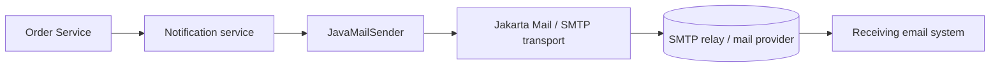
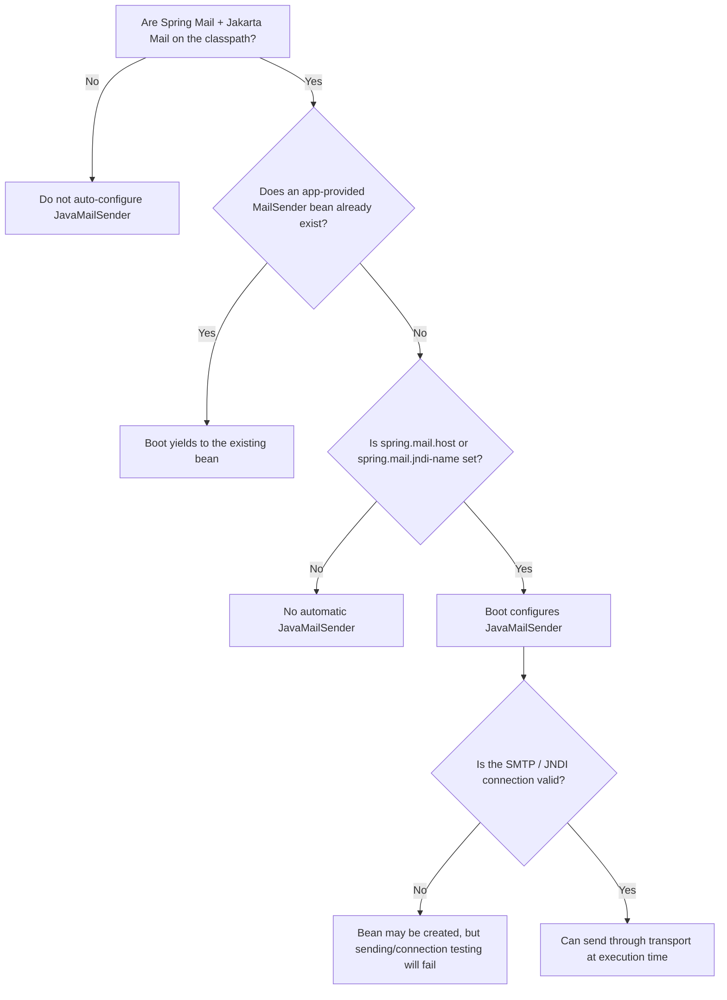
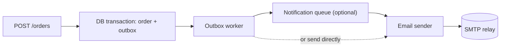

# spring-boot-starter-mail and Conditions for Creating JavaMailSender

## 1. Email as an External Integration Flow in Spring Boot

In the **SPRING_BOOT_INTEGRATION** module, a Spring Boot application connects to many systems via HTTP clients, databases, caches, message brokers, and integration adapters. Email is a distinct outbound channel: the application builds a notification, hands it off to an SMTP server or mail delivery service, and then tracks the send result and responses from the mail infrastructure.

A common example: after an order is placed successfully, the Order Service sends a confirmation email. If SMTP sending is performed directly inside the HTTP request, latency or an SMTP server outage can prolong or fail the request even though the order has already been persisted successfully. Therefore, beyond calling an email-sending API, you must understand configuration, connection lifecycle, failures, retries, transaction boundaries, and testing.



`spring-boot-starter-mail` enables a Spring Boot application to **send mail via Jakarta Mail** using Spring abstractions. It does not install an SMTP server itself and does not provide a receiving mailbox. `JavaMailSender` is primarily for **outbound email**; reading a mailbox over IMAP/POP3 is a separate flow that can use Jakarta Mail or the corresponding Spring Integration adapter when appropriate.

**Lesson objectives:**

1. Know what the mail starter provides and distinguish Spring Mail from Jakarta Mail and an SMTP relay.
2. Explain accurately **when Spring Boot automatically creates a `JavaMailSender` bean**, and when it does not.
3. Configure SMTP, TLS, authentication, timeouts, and secret retrieval.
4. Send plain text and HTML/MIME, while controlling the data contract and content.
5. Handle mail-sending failures, transactions, duplicate sends, testing, and observability in a real integration flow.

The examples below use **Spring Boot 3.x / Spring Framework 6** and the `jakarta.mail.*` namespace. For a different Spring Boot major version, verify the configuration metadata and auto-configuration conditions of the exact version in use.

## 2. How Do the Starter, Mail Library, and SMTP Server Differ?

| Component | Role | Does it send mail to the Internet by itself? |
| --- | --- | --- |
| `spring-boot-starter-mail` | Dependency bundle of Spring Mail and a BOM-compatible Jakarta Mail implementation | No; only puts libraries on the classpath |
| `org.springframework.mail.javamail.JavaMailSender` | Spring interface for creating MIME messages and sending mail | Not standalone; requires an implementation and mail transport |
| `JavaMailSenderImpl` | Implementation that sends mail through a Jakarta Mail `Session` | Requires a valid host/server and configuration |
| Jakarta Mail | API/implementation for building messages and communicating over mail protocols | Can talk to an SMTP server when configured to connect properly |
| SMTP relay/provider | Receives, inspects, and forwards email according to policy | Is the infrastructure that actually performs subsequent delivery |
| Receiving system | Mail transfer agent and the recipient's mailbox | May still filter as spam, reject, or delay delivery |

**Do not confuse "sent successfully" with "arrived in the inbox."** `JavaMailSender.send(...)` completing does not prove the recipient read the message or that the email was definitely delivered at the end. An SMTP relay can accept a message and later encounter a bounce, delay, spam filtering, or rejection in a downstream step. If the application needs delivery status confirmation, it must integrate webhooks, a bounce mailbox, or an event API supported by the email provider.

## 3. Adding the Starter Properly

A Maven project whose versions are already managed by the Spring Boot parent/BOM only needs:

```xml
<dependency>
    <groupId>org.springframework.boot</groupId>
    <artifactId>spring-boot-starter-mail</artifactId>
</dependency>
```

When using Gradle:

```groovy
dependencies {
    implementation 'org.springframework.boot:spring-boot-starter-mail'
}
```

The starter provides the classes required to use `MailSender`, `JavaMailSender`, and the Jakarta Mail implementation. In Spring Boot 3.x, the mail API moved to the `jakarta.mail.*` package; code or dependencies using `javax.mail.*` from Spring Boot 2.x must be checked during upgrades. Do not arbitrarily declare multiple mixed versions of Jakarta Mail/JavaMail providers, as this can cause runtime or classpath errors.

**Simply adding the starter is not enough for a `JavaMailSender` bean to always appear.** Automatic bean creation requires the configuration conditions in the next section.

## 4. Conditions for Spring Boot to Auto-Create `JavaMailSender`

In Spring Boot 3.x, `MailSenderAutoConfiguration` checks for the presence of required classes and configuration telling it where the mail session will connect. The typical branches are an **SMTP host** or a **JNDI Mail Session**; auto-configuration also backs off if the application already provides its own `MailSender`.

From a user's perspective, you can check in this order:



Note that certain invalid JNDI resource cases cause **bean initialization itself to fail**; the diagram is a mental model and does not guarantee that every connection error only occurs when calling `send`.

### 4.1. Condition Check Table

| Classpath and Configuration | Auto-configured `JavaMailSender`? | Explanation |
| --- | --- | --- |
| Spring Mail/Jakarta Mail libraries missing | No | Required classes for mail auto-configuration are absent |
| Starter added, but neither `spring.mail.host` nor `spring.mail.jndi-name` is set | No | Boot has no address or mail session to configure |
| Starter + `spring.mail.host` + no custom `MailSender` bean defined | Yes, typically | The host configuration branch creates `JavaMailSenderImpl` |
| Starter + `spring.mail.jndi-name` + no custom `MailSender` bean defined | Yes, if JNDI is available | Uses the Mail Session looked up via JNDI |
| Only `spring.mail.username` and `spring.mail.password` | Not sufficient | Credentials do not replace host/JNDI |
| Custom `MailSender` bean already declared | No default bean created | Auto-configuration backs off to avoid overlap |
| `spring.mail.test-connection=true` but host/JNDI missing | No | The connection-test property does not trigger bean creation |

`MailSender` is the superinterface; `JavaMailSender` extends it with MIME-sending capabilities. This is an important detail: if the application defines a custom bean that only implements `MailSender` and **does not implement `JavaMailSender`**, auto-configuration may still back off while code injecting `JavaMailSender` finds no matching bean.

Similarly, having a `JavaMailSender` bean **does not mean** authentication to the SMTP server has already succeeded. Under normal startup, some network/login errors only surface when the client is used; if startup connection testing is enabled, startup behavior will differ.

### 4.2. When Should You Define the Bean Yourself?

In most applications using a single SMTP relay, **prefer configuring `spring.mail.*`** and injecting the bean created by Spring Boot. Declare `JavaMailSender` manually only when you genuinely need multiple providers, multiple accounts, per-tenant routing, or custom policies that default properties cannot express.

If there are multiple sender beans, distinguish them by name and use `@Qualifier` at injection points; do not rely on ambiguous default selection. An application-defined bean must take responsibility for host/JNDI, credentials, timeouts, TLS, resource lifecycle, and corresponding testability. Do not scatter `new JavaMailSenderImpl()` across individual controllers.

## 5. Common SMTP Configuration via `application.yml`

The following example uses **SMTP submission over port 587 with STARTTLS**. Only use this with a provider that genuinely supports and requires this connection method:

```yaml
spring:
  mail:
    host: ${SMTP_HOST}
    port: ${SMTP_PORT:587}
    username: ${SMTP_USERNAME}
    password: ${SMTP_PASSWORD}
    protocol: smtp
    default-encoding: UTF-8
    properties:
      "[mail.smtp.auth]": true
      "[mail.smtp.starttls.enable]": true
      "[mail.smtp.starttls.required]": true
      "[mail.smtp.connectiontimeout]": 5000
      "[mail.smtp.timeout]": 5000
      "[mail.smtp.writetimeout]": 5000

app:
  mail:
    from: ${APP_MAIL_FROM:no-reply@example.org}
```

Key fields:

- `spring.mail.host`: SMTP relay address, e.g., a hostname provided by your organization or mail provider.
- `spring.mail.port`: SMTP port; 587 is commonly used for submission with STARTTLS, though you should use your provider's actual value.
- `username`, `password`: authentication credentials if required by the relay; pull from a secret manager/environment variables and never commit real passwords.
- `protocol`: `smtp` in this example; do not turn MailSender into an IMAP client by changing the protocol arbitrarily.
- `default-encoding`: default character encoding when creating message content.
- `spring.mail.properties`: Jakarta Mail properties passed down to the transport. Use bracketed keys in YAML to preserve property names containing dots when Spring binds the map.
- `app.mail.from`: an **application-defined** property, not something Spring Boot automatically applies as From. The mail-sending service must use this value when constructing messages.

The three timeout values above are in **milliseconds** per Jakarta Mail SMTP properties:

| Property | Operation Bounded |
| --- | --- |
| `mail.smtp.connectiontimeout` | Time to wait when opening the socket connection |
| `mail.smtp.timeout` | Time to wait when reading data from the socket |
| `mail.smtp.writetimeout` | Time to wait when writing data over the socket |

If timeouts are not configured, depending on the version/transport, some operations may wait far too long or lack a useful bound for request SLAs. The 5-second values are only **starting examples** and must be tuned according to network conditions, the provider, and the overall timeout policy of the calling flow.

### 5.1. STARTTLS and Implicit TLS Are Not the Same

- **STARTTLS**: starts with a plain SMTP connection and then upgrades to TLS; commonly seen on port 587. `mail.smtp.starttls.enable=true` instructs the client to attempt the upgrade, while `starttls.required=true` requires the upgrade to succeed before sending.
- **Implicit TLS/SMTPS**: the connection is TLS-encrypted from the very beginning; typically uses port 465 with `mail.smtp.ssl.enable=true` when supported by the provider. Do not copy both TLS modes into the same configuration without checking provider documentation.
- **Trust store**: validate TLS certificates according to security policy; never disable certificate checking or trust every host to "fix connection errors" in production.

Even with TLS enabled, the application still needs to enforce sending permissions, provider-allowed sender addresses, and rules protecting sensitive content.

### 5.2. Using a JNDI Mail Session Instead of Host

Some application server environments manage a Jakarta Mail `Session` via JNDI. Spring Boot can use the configuration:

```yaml
spring:
  mail:
    jndi-name: java:comp/env/mail/Session
```

The application **must run in an environment that provides the corresponding JNDI resource** and a compatible Jakarta Mail provider. `spring.mail.jndi-name` does not register a Mail Session or create an SMTP server by itself. When using a JNDI Session, configuration from the JNDI resource may take precedence over regular mail session properties; keep one place responsible for configuring host, authentication, and TLS to avoid conflicting sources.

In typical standalone containers/Boot applications, the `spring.mail.host` branch is easier to operate if infrastructure does not provide a JNDI resource.

## 6. Sending Plain-Text Email with `JavaMailSender`

`JavaMailSender` provides a basic text mail-sending API via `SimpleMailMessage`; Spring creates and manages the implementation from configuration when the conditions in Section 4 are met.

```java
import org.springframework.beans.factory.annotation.Value;
import org.springframework.mail.SimpleMailMessage;
import org.springframework.mail.javamail.JavaMailSender;
import org.springframework.stereotype.Service;

@Service
public class OrderMailService {

    private final JavaMailSender mailSender;
    private final String from;

    public OrderMailService(
            JavaMailSender mailSender,
            @Value("${app.mail.from}") String from) {
        this.mailSender = mailSender;
        this.from = from;
    }

    public void sendOrderConfirmation(String to, String orderId) {
        SimpleMailMessage message = new SimpleMailMessage();
        message.setFrom(from);
        message.setTo(to);
        message.setSubject("Order confirmation " + orderId);
        message.setText(
            "Order " + orderId + " has been recorded. "
                + "We will notify you when the status changes."
        );
        mailSender.send(message);
    }
}
```

This code assumes the recipient address has been validated according to business rules and `orderId` has a trustworthy format. Do not pass unvalidated data into subjects, headers, or email addresses; do not send sensitive content without considering the security policy of the email channel.

**`SimpleMailMessage` is only for simple plain-text content**, without HTML formatting, inline images, or attachments. If you need HTML/MIME, use Jakarta Mail `MimeMessage`.

This is a blocking call that invokes SMTP transport. If executed directly inside a REST controller, HTTP processing time may suffer SMTP server latency; design clear timeouts and placement of email-sending responsibility.

## 7. Sending HTML/MIME and Attachments

`JavaMailSender.createMimeMessage()` together with `MimeMessageHelper` supports UTF-8 content, HTML, file attachments, and multipart content.

Example of sending HTML that the system has rendered into safe content:

```java
import java.nio.charset.StandardCharsets;

import org.springframework.mail.javamail.JavaMailSender;
import org.springframework.mail.javamail.MimeMessageHelper;
import org.springframework.stereotype.Service;

@Service
public class HtmlMailService {

    private final JavaMailSender mailSender;

    public HtmlMailService(JavaMailSender mailSender) {
        this.mailSender = mailSender;
    }

    public void sendHtml(String to, String subject, String safeHtml) {
        mailSender.send(mimeMessage -> {
            MimeMessageHelper helper = new MimeMessageHelper(
                mimeMessage, StandardCharsets.UTF_8.name()
            );
            helper.setFrom("no-reply@example.org");
            helper.setTo(to);
            helper.setSubject(subject);
            helper.setText(safeHtml, true);
        });
    }
}
```

Calling `send(MimeMessagePreparator)` lets you build the MIME message inside a callback and then lets Spring perform the send and translate exceptions appropriately. In production, read the From address from application configuration or a centralized sender policy rather than hardcoding it as in this minimal example.

`helper.setText(html, true)` marks the content as HTML; **it does not automatically escape input data**. When inserting customer names, addresses, or user data into templates, HTML-escape appropriately for the context and only allow trusted content. For transactional emails, consider providing both plain-text and HTML parts if clients/accessibility require it.

If an attachment is needed, initialize `MimeMessageHelper` in multipart mode:

```java
MimeMessageHelper helper =
    new MimeMessageHelper(mimeMessage, true, "UTF-8");
helper.setFrom("no-reply@example.org");
helper.setTo(to);
helper.setSubject("Invoice");
helper.setText("<p>Invoice attached.</p>", true);
helper.addAttachment("invoice.pdf", invoiceResource);
```

`invoiceResource` is an appropriate Spring `InputStreamSource`. When sending multiple files, control size, format, antivirus/malware scanning if needed, and resource generation time. Do not log attachments containing sensitive information. When using an attachment whose stream can only be opened once, choose a resource capable of providing a fresh stream on demand by the mail implementation.

## 8. Troubleshooting When `JavaMailSender` Cannot Be Injected

Common symptom:

```text
No qualifying bean of type
'org.springframework.mail.javamail.JavaMailSender' available
```

This is a **wiring/auto-configuration failure**; it is not necessarily related to the network or SMTP password. Follow this sequence:

1. Check whether the mail starter is on the **runtime classpath** of the running module.
2. Check which profile is actually active and whether that config file contains `spring.mail.host` or `spring.mail.jndi-name`.
3. Check for YAML indentation errors, undefined environment variables, or wrong namespaces (e.g., writing `mail.host` instead of `spring.mail.host`).
4. Check whether the project has a custom `MailSender` bean causing auto-configuration to back off.
5. Check that Jakarta Mail packages match Spring Boot 3.x, avoiding conflicting `javax.mail` dependencies.
6. Inspect `ConditionEvaluationReport` via startup logs when Spring Boot debug mode is enabled, or via the Actuator `conditions` endpoint in an authorized environment.

Example table distinguishing failure types:

| Symptom | Possible Cause | What to Check |
| --- | --- | --- |
| `NoSuchBeanDefinitionException` for `JavaMailSender` | Missing starter/host/JNDI, blocked by custom bean, incompatible classpath | Auto-configuration conditions and property sources |
| Cannot look up JNDI mail session | Missing resource or wrong name | Application server JNDI bindings |
| `MailAuthenticationException` | Wrong username/password or provider disallows auth method | Credentials, auth policy, account permissions |
| `MailSendException` with connection refused/timeout | Wrong host/port, firewall, temporary SMTP relay outage | DNS, network, timeouts, provider status |
| TLS handshake/STARTTLS failed | Mismatched port/TLS mode or certificate | Transport properties, certificate chain, clock/trust store |
| Sender address rejected | From email not authorized by provider | Domain/verified sender and relay policy |
| Sender runs but recipient does not see mail | Bounce, spam, delay, provider delivery issue | Provider event/bounce logs |

### 8.1. What Is `spring.mail.test-connection` Used For?

You can enable a startup connection check:

```yaml
spring:
  mail:
    test-connection: true
```

In supported environments, Spring Boot attempts to verify the mail server on startup. This is helpful for catching errors early, but it can also cause the application to **fail to start when SMTP is temporarily unavailable**. For services where mail is a secondary feature, weigh availability goals before enabling it in production.

Do not mistake this for a test that recipients will receive mail: a successful SMTP connection does not verify deliverability, DNS SPF/DKIM/DMARC, suppression lists, or the recipient's mailbox.

## 9. Transactions, Retries, and Duplicate Emails

Suppose you handle order placement:

```text
1. Write the order to PostgreSQL.
2. Send confirmation email via SMTP.
3. Return HTTP 200.
```

If the DB commits but sending mail fails, the order still exists and the user never receives the email. If mail is sent before the DB commits, the email might announce an order that is later rolled back. Database `@Transactional` **does not cover SMTP transactions**. Calling `mailSender.send(...)` inside the same `@Transactional` method does not create a distributed transaction.

A suitable organization for an integration system:



Write business data and the outbox record in the same DB transaction. A worker reads the outbox, sends the mail, and marks the status after the provider accepts it. If the worker crashes between sending and updating status, the email may be sent again on retry. Therefore, this strategy generally guarantees **controlled retry attempts**, not automatic exactly-once delivery.

To reduce duplicates:

- Use `notificationId` or `(orderId, templateVersion, eventType)` as the business key for a notification; track states `PENDING`, `SENDING`, `SENT`, `FAILED` in the database.
- Allow only one worker to claim a job at a time; handle cases where a worker crashes and its lease expires.
- If the provider supports an idempotency key or transactional send API, use it according to the provider's contract; standard SMTP does not provide a universal idempotency mechanism across all relays.
- Apply bounded retries with exponential backoff for transient errors; classify invalid addresses, blocked accounts, or broken templates for separate handling.
- Preserve the content/template version used during retries so the same notification is not unintentionally sent in different versions.

**Limitation:** `Message-ID` in the email standard is a header for identification/tracing and does not guarantee mail servers will block duplicate emails sharing the same Message-ID. For stricter semantics, design a state machine and reconcile with the provider.

### 9.1. Asynchronous Sending Does Not Equal Durable Delivery

Annotating an email-sending method with `@Async` returns HTTP responses faster, but tasks sitting in application memory can be lost on process crash or redeploy. If a notification carries business importance and must be retried, use a durable queue, outbox, or job store rather than relying solely on an in-memory executor.

Set rate limits and concurrency aligned with your SMTP provider's quota to avoid throttling errors, and apply backpressure when queued send jobs grow. Avoid immediate mass retries when the provider is experiencing an outage.

## 10. Testing at the Right Layer: Bean, SMTP, and Workflow

Different test categories answer different questions:

| Test Type | What It Verifies | What It Does Not Verify |
| --- | --- | --- |
| Unit test mocking `JavaMailSender` | Service builds correct recipient, subject, body; error branches | Real SMTP transport and provider |
| Application context test | Auto-configuration creates bean when host and starter are present | Actual mail sending, TLS/auth |
| Integration test with fake SMTP | SMTP interaction, text/MIME message, headers, attachments | Production provider deliverability policies |
| Staging test with authorized SMTP/provider | Authentication, TLS, network, quotas, relay policies | Still does not guarantee inbox placement for every recipient |
| Workflow test | Outbox/retry/idempotency, send failures, worker restarts | Scenarios not simulated in the test environment |

### 10.1. Testing Auto-Configuration Bean Creation

Example wiring test with `spring-boot-starter-test` in a project that already includes the mail starter:

```java
import static org.assertj.core.api.Assertions.assertThat;

import org.junit.jupiter.api.Test;
import org.springframework.beans.factory.annotation.Autowired;
import org.springframework.boot.test.context.SpringBootTest;
import org.springframework.mail.javamail.JavaMailSender;

@SpringBootTest(properties = {
    "spring.mail.host=127.0.0.1",
    "spring.mail.port=1025"
})
class MailWiringTest {

    @Autowired
    JavaMailSender mailSender;

    @Test
    void createsJavaMailSenderWhenHostIsConfigured() {
        assertThat(mailSender).isNotNull();
    }
}
```

This test **does not send mail**, so it does not require an SMTP server actually running on port 1025 as long as the application does not enable `spring.mail.test-connection=true` or have another bean actively connecting during startup. If the project has a custom `MailSender`, evaluate the outcome against the actual design.

### 10.2. Testing Outbound Mail with an SMTP Test Server

You can use GreenMail, Mailpit/MailHog, or an equivalent SMTP test server in test/CI environments; point `spring.mail.host` and `spring.mail.port` to that test endpoint. When sending mail, assert:

1. Correct recipient, sender, subject, and UTF-8 content.
2. HTML body is properly escaped/sanitized and MIME structure is valid.
3. Attachments have the expected filename, MIME type, and content.
4. When the server refuses connection or authentication fails, the application records retry/failure state properly.
5. Two emails are not sent when a consumer receives the same business event twice, according to the application's deduplication policy.
6. Isolate test data and never send test emails to real customer addresses.

If you need stricter verification of Spring Boot mail auto-configuration behavior, use dedicated test contexts with combinations such as: no host, with host, JNDI, and custom `MailSender`. Each case must run on the classpath and profile matching the configuration under test.

## 11. Observability, Security, and Operations

Email is an integration flow longer than a single `send` call. Track:

- **Application:** send request count, send latency p50/p95/p99, authentication/connection/timeout errors, retry count, outbox backlog, age of pending jobs.
- **SMTP/provider:** messages accepted, rejected, throttled, bounced, deferred, complained, suppressed, and delivery status when provided.
- **Business:** confirmed orders without a created notification, time from order placement to provider acceptance, duplicate notifications, and SLA-breaching notifications.

Do not log SMTP passwords, access tokens, full bodies containing personal information, links with security codes, or attachments. Use correlation IDs, notification IDs, log-permitted order IDs, and categorized error codes for tracing. Recipient addresses can also be personal data; consider hashing/masking them when logging or placing them in metric labels.

For security and deliverability, coordinate with the mail operations team to manage sending domains, SPF, DKIM, DMARC, suppression lists, bounce handling, retention policies, and SMTP provider quotas. These fall outside the scope of `JavaMailSender`; adding the dependency cannot solve them automatically.

## 12. Configuration Selection Scenarios

### Scenario A: A Small Application Sending Transactional Mail

A Web MVC application has a single SMTP relay. Add `spring-boot-starter-mail`, configure `spring.mail.host` along with port, credentials, TLS, and timeouts; inject `JavaMailSender` into a service. Use `SimpleMailMessage` for plain text and `MimeMessageHelper` for HTML/attachments. If email is only a secondary utility, decouple send failures from order persistence according to clear business rules.

### Scenario B: Deployment on an Application Server Providing a JNDI Session

Infrastructure already manages mail host and credentials via a JNDI Mail Session. Use `spring.mail.jndi-name` and verify resource lookup in the actual deployment environment. Only use this branch when JNDI is genuinely provided and managed. Do not assume a standalone executable Spring Boot JAR has a JNDI resource available.

### Scenario C: Multiple SMTP Providers or Multi-Tenant

The application needs to select a provider by tenant, region, or notification type. Configure multiple explicitly named `JavaMailSender` beans; select via a controlled routing service, avoiding credentials in payloads or logs. Test failover and each provider's From-address policy; never let one tenant arbitrarily send using another tenant's identity.

### Scenario D: Notifications Must Be Sent Despite System Failures

The Order Service needs outbox events or a durable message queue; a Notification Worker sends email via `JavaMailSender`, stores state, retries with limits, and supports manual intervention for prolonged failures. Apply idempotency by business notification ID and monitor backlog so notifications are not silently lost.

### Implementation Checklist

1. Ensure the mail starter and Jakarta Mail dependencies are compatible with your Spring Boot version.
2. Confirm `spring.mail.host` or `spring.mail.jndi-name` is loaded from the right profile; verify no custom `MailSender` bean causes unintended conflicts.
3. Choose the right SMTP port, TLS mode, certificate validation, credentials, and From address.
4. Configure finite timeouts, quotas/rate limits, and a retry policy aligned with your SLA.
5. Define the email contract: recipient, template version, encoding, data permitted in the body, attachments, and reply address.
6. Distinguish provider acceptance from final delivery; design bounce and complaint tracking if needed.
7. For critical notifications, use a durable queue/outbox, duplicate protection, and a path for handling prolonged failures.
8. Test `JavaMailSender` wiring, an SMTP test server, and failure/retry workflows; observe end-to-end from the application to the provider.

**Key takeaway:** `spring-boot-starter-mail` brings email-sending capability onto the classpath; Spring Boot only auto-creates `JavaMailSender` when auto-configuration conditions are met, typically having **`spring.mail.host` or `spring.mail.jndi-name`** and no custom `MailSender` bean. Turning that into reliable email delivery still requires secure transport design, timeouts, content contracts, transaction handling, deduplication, and integration-flow observability.
