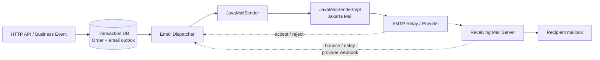
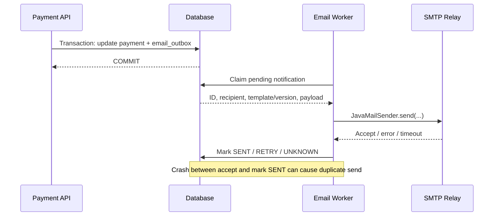
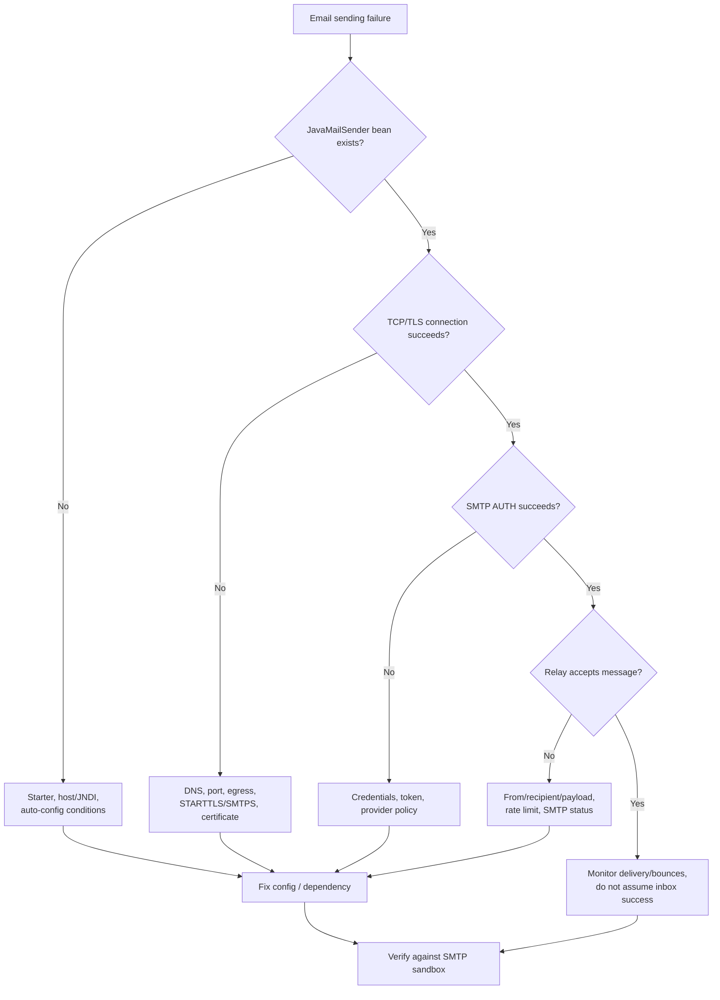

# Configuring spring.mail.* and Jakarta Mail

## 1. Where Does Email Fit in a Spring Boot Integration Flow?

In the **SPRING_BOOT_INTEGRATION** module, a Spring Boot service regularly exchanges data through HTTP clients, databases, caches, message brokers, and Spring Integration adapters. **Email** is another integration channel: the system builds a notification, sends its content to an SMTP server, and then tracks send outcomes and any errors that arise.

For example, when payment completes, the service records the order status in PostgreSQL, inserts an invoice-send request record, and then a worker sends the confirmation email to the customer. Here, email is an **external system side effect**, similar to publishing a message or calling a partner API: response latency varies, calls can fail or time out, and a send with an indeterminate outcome may be retried.

Two groups of concepts form the core of this lesson:

- **`spring.mail.*`**: properties for Spring Boot to auto-configure mail-sending infrastructure, including host, port, username, password, encoding, protocol, Jakarta Mail properties, and connection testing.
- **Jakarta Mail**: the Java API representing emails, MIME messages, addresses, sessions, transport, and mail protocols; on top of it, Spring Framework builds abstractions such as `JavaMailSender` and `MimeMessageHelper`.

Goal: know how to add the right dependency, configure SMTP securely, send text/HTML/attachment emails, recognize the boundary between "accepted by SMTP server" and "received by recipient," design timeouts/retries/idempotency, test without sending real mail, and observe mail flows in production.

## 2. SMTP Architecture: Applications Do Not Send Straight into Mailboxes

A common email delivery path:



Along this flow, distinguish **multiple outcome levels**:

| Milestone | Evidence Obtained | What Must Not Be Concluded Yet |
| --- | --- | --- |
| Application builds a `MimeMessage` | Message structure created in memory | No network request made or email sent yet |
| `JavaMailSender.send(...)` returns normally | SMTP transport finished the send operation per library/provider mechanics | Does not prove inbox arrival or recipient reading |
| SMTP relay returns acceptance response | Relay took responsibility for processing per protocol | Relay may still delay, bounce, or block via policy |
| Provider reports delivered | Delivery signal to the receiving mail server per provider's definition | Does not prove it avoided spam or was opened |
| User confirms an action | Business acknowledgement exists | True only if the product actually collects and verifies that action |

**SMTP does not provide an ACID transaction shared with your database** and does not guarantee exactly-once effects. A `send()` that times out after the SMTP relay already accepted the message can cause the application to send the same notification again. Storing an outbox, assigning notification IDs, and managing send state are application responsibilities.

### Distinct Roles

- **Spring Boot**: auto-configures beans and binds properties.
- **Spring Framework Mail**: defines `MailSender`, `JavaMailSender`, `SimpleMailMessage`, `MimeMessageHelper`, and the exception hierarchy.
- **Jakarta Mail**: works with `jakarta.mail.Session`, `jakarta.mail.internet.MimeMessage`, addresses, and transport.
- **SMTP server/provider**: authenticates, accepts messages, queues delivery, and provides SMTP replies or webhooks.
- **Business service/outbox worker**: decides whom to notify, what to send, when to send, when to retry, and persists audit/status.

## 3. Adding spring-boot-starter-mail

### Maven

For applications whose dependencies are managed by a Spring Boot parent or BOM:

```xml
<dependency>
    <groupId>org.springframework.boot</groupId>
    <artifactId>spring-boot-starter-mail</artifactId>
</dependency>
```

### Gradle

```groovy
dependencies {
    implementation 'org.springframework.boot:spring-boot-starter-mail'
}
```

The starter typically pulls in **Spring Context Support** and a Jakarta Mail implementation aligned with Spring Boot's dependency management. Do not pin Jakarta Mail/Spring Framework versions different from the BOM without a specific reason: mixing legacy `javax.mail` with modern `jakarta.mail` easily causes class incompatibility errors.

To inspect effective dependencies:

```bash
# Maven
./mvnw dependency:tree

# Gradle
./gradlew dependencies --configuration runtimeClasspath

# Gradle: locate the actual mail dependency
./gradlew dependencyInsight --dependency jakarta.mail --configuration runtimeClasspath
```

In multi-module projects, the dependency must be on the **runtime classpath of the deployed application**. Adding the starter only to a unit-test module or library module does not ensure the running app has `JavaMailSender`.

> **The starter does not install an SMTP server.** You need an external SMTP relay/provider or a separately running SMTP test server. `spring.mail.host` is where the application connects; it does not start an SMTP server on that host.

## 4. Which Beans Does Spring Boot Auto-Create?

When `spring-boot-starter-mail` is present, required classes are on the classpath, and configuration conditions are satisfied, Spring Boot can create a `JavaMailSenderImpl` bean injectable via the `JavaMailSender` interface.

Key conditions include:

1. Jakarta Mail and Spring Mail support classes are present on the classpath.
2. Mail session target details are provided, most commonly `spring.mail.host` or an appropriate JNDI session configuration.
3. No application-provided `MailSender` bean causes the default auto-configuration to back off.
4. Auto-configuration is not excluded or disabled by a specific configuration context.

Thus, **adding the starter without configuring an SMTP host does not necessarily create `JavaMailSender`**. Conversely, having a `JavaMailSender` bean in the application context does not guarantee SMTP authentication or connectivity succeeds: network failures may appear on the first `send` call.

Injecting the dependency:

```java
import org.springframework.mail.javamail.JavaMailSender;
import org.springframework.stereotype.Service;

@Service
public class EmailGateway {
    private final JavaMailSender sender;

    public EmailGateway(JavaMailSender sender) {
        this.sender = sender;
    }
}
```

If startup fails with `No qualifying bean of type JavaMailSender`, inspect runtime dependencies, `spring.mail.host`, JNDI, custom beans, active profiles, and the Conditions Evaluation Report. Never define an unconfigured `JavaMailSenderImpl` bean without a host just to silence dependency injection errors.

### How Does Spring Mail Differ from Jakarta Mail?

| Class / Interface | Common Package | Role |
| --- | --- | --- |
| `JavaMailSender` | `org.springframework.mail.javamail` | Abstraction for sending simple and MIME mail |
| `JavaMailSenderImpl` | `org.springframework.mail.javamail` | Implementation backed by Jakarta Mail transport/session |
| `MimeMessageHelper` | `org.springframework.mail.javamail` | Convenient builder for MIME messages, HTML, inline assets, and attachments |
| `SimpleMailMessage` | `org.springframework.mail` | Simple plain-text email without MIME attachments |
| `MimeMessage` | `jakarta.mail.internet` | Jakarta Mail MIME message object |
| `Session` | `jakarta.mail` | Provider/property configuration for mail operations |
| `MailException` | `org.springframework.mail` | Base Spring Mail exception for sending errors |

In Spring Boot 3+ on the Jakarta EE ecosystem, import MIME classes from **`jakarta.mail.*`**. Legacy examples using `javax.mail.internet.MimeMessage` cannot be copied verbatim into modern applications if libraries expect `jakarta.mail.internet.MimeMessage`.

## 5. Property Groups Under spring.mail.*

Spring Boot binds properties prefixed with `spring.mail` into `MailProperties` and uses them to configure the mail sender/session when auto-configuration applies.

| Property | Purpose | Things to Watch |
| --- | --- | --- |
| `spring.mail.host` | SMTP relay host | Address must be reachable from the app host/container |
| `spring.mail.port` | SMTP port | Often 587 STARTTLS or 465 implicit TLS; follow provider |
| `spring.mail.username` | SMTP account | Some providers use email addresses as usernames, others use tokens |
| `spring.mail.password` | Authentication secret | Read from secret manager/env; never commit to git |
| `spring.mail.protocol` | Jakarta Mail transport protocol | Usually `smtp` |
| `spring.mail.default-encoding` | Default encoding for email/MIME | Recommend `UTF-8` for Vietnamese content |
| `spring.mail.properties` | Jakarta Mail provider properties | E.g., `mail.smtp.auth`, STARTTLS, timeouts |
| `spring.mail.test-connection` | Whether to test SMTP connection at startup | Can fail app startup if SMTP is temporarily down |
| `spring.mail.jndi-name` | Look up `jakarta.mail.Session` from JNDI | For externally managed Sessions; may override regular Session properties |

**Note:** `spring.mail.properties.*` is a map of Jakarta Mail properties passed straight into the Session, not a new set of flags interpreted independently by Spring Boot. Keys like `mail.smtp.starttls.enable` belong to the mail provider. Choose the right keys for your protocol and provider version.

### Values Differ Across Environments

Local configuration typically points to a fake SMTP server; staging may point to a provider's SMTP sandbox; production uses a real relay with TLS, authentication, verified sender domains, and rate limits. Externalize every environment-specific value, especially host, port, credentials, sender address, and timeouts.

For example, `integration.mail.from` is an **application-defined property**, not part of `spring.mail.*`:

```yaml
integration:
  mail:
    from: ${MAIL_FROM:no-reply@example.test}
```

This value must be a sender address permitted by the provider; having valid SMTP credentials does not grant permission to spoof arbitrary From addresses.

## 6. Configuring SMTP with STARTTLS on Port 587

Example `application.yml` for a provider requiring SMTP AUTH and STARTTLS:

```yaml
spring:
  mail:
    host: ${SMTP_HOST}
    port: ${SMTP_PORT:587}
    username: ${SMTP_USERNAME}
    password: ${SMTP_PASSWORD}
    protocol: smtp
    default-encoding: UTF-8
    test-connection: false
    properties:
      "[mail.smtp.auth]": "true"
      "[mail.smtp.starttls.enable]": "true"
      "[mail.smtp.starttls.required]": "true"
      "[mail.smtp.ssl.checkserveridentity]": "true"
      "[mail.smtp.connectiontimeout]": "5000"
      "[mail.smtp.timeout]": "10000"
      "[mail.smtp.writetimeout]": "10000"

integration:
  mail:
    from: ${MAIL_FROM}
```

In the YAML above, keys like `"[mail.smtp.auth]"` use **bracket notation** so dots are preserved inside the `spring.mail.properties` map key. The resulting entries pass into the Jakarta Mail Session as `mail.smtp.auth` and so forth.

### Meaning of Key Jakarta Mail Properties

| Property | Meaning | Behavior to Know |
| --- | --- | --- |
| `mail.smtp.auth=true` | Requires SMTP AUTH | Requires an auth mechanism supported by the provider |
| `mail.smtp.starttls.enable=true` | Enables upgrading SMTP connection to TLS via STARTTLS | Alone, this flag does not force the server to support STARTTLS |
| `mail.smtp.starttls.required=true` | Requires STARTTLS availability before proceeding | Appropriate when policy forbids plaintext sending |
| `mail.smtp.ssl.checkserveridentity=true` | Verifies TLS hostname/identity per provider mechanism | Requires a valid certificate chain and trust store |
| `mail.smtp.connectiontimeout=5000` | Connection establishment timeout (milliseconds) | Prevents connections from hanging indefinitely |
| `mail.smtp.timeout=10000` | Socket read timeout (milliseconds) | Distinct from the overall business workflow timeout |
| `mail.smtp.writetimeout=10000` | Socket write timeout (milliseconds) | Useful when server/network stops accepting data |
| `mail.debug` | Enables Jakarta Mail debug output | Never keep enabled routinely in production due to data exposure risks |

Do not blindly keep `5000/10000` simply because the example uses them: choose values based on workflow SLOs, real load, network conditions, provider limits, and worker time budgets. A single send goes through multiple SMTP phases; total duration can exceed any individual timeout.

On port 587, the client usually initiates an SMTP session and then issues **STARTTLS** to upgrade to TLS. If the provider lacks TLS or handshake/certificate checks fail, `starttls.required=true` forces the operation to fail instead of silently falling back to plaintext.

### Environment Variables

In Spring Boot, relaxed binding allows using variables like `SPRING_MAIL_HOST` and `SPRING_MAIL_PORT` directly. The sample config uses `${SMTP_HOST}` to decouple infrastructure variable names from Spring property names. Whichever approach you pick, document property-source precedence clearly when multiple sources exist.

**Never attach a fallback default to a real password.** If `SMTP_PASSWORD` is missing, the application should fail or stay unready per operational policy instead of falling back to a demo credential.

## 7. How Do STARTTLS and SMTPS (Implicit TLS) Differ?

Two connection modes that are frequently misconfigured together:

| Mode | Common Port | How TLS Begins | Core Settings |
| --- | --- | --- | --- |
| SMTP submission + STARTTLS | 587 | Plain SMTP first, then upgraded to TLS via STARTTLS | `mail.smtp.starttls.enable`, usually with `required=true` |
| SMTP over implicit TLS / SMTPS | 465 | TLS handshake immediately upon opening the socket | `mail.smtp.ssl.enable=true` with matching SMTP provider |
| Internal SMTP relay | 25 or custom port | Depends on relay policy | May require STARTTLS or trusted network; check exact policy |

Example implicit TLS on port 465:

```yaml
spring:
  mail:
    host: ${SMTP_HOST}
    port: 465
    username: ${SMTP_USERNAME}
    password: ${SMTP_PASSWORD}
    properties:
      "[mail.smtp.auth]": "true"
      "[mail.smtp.ssl.enable]": "true"
      "[mail.smtp.ssl.checkserveridentity]": "true"
      "[mail.smtp.connectiontimeout]": "5000"
      "[mail.smtp.timeout]": "10000"
      "[mail.smtp.writetimeout]": "10000"
```

This is an **alternative configuration** to the STARTTLS example, not properties to merge simultaneously. If a client insists on implicit TLS against an endpoint expecting STARTTLS, the handshake fails; if a client speaks plaintext SMTP to an implicit-TLS endpoint, communication fails as well.

Never "fix" certificate errors by trusting all servers or disabling hostname verification. Inspect the FQDN, certificate chain, trusted CA, expiration dates, and proxies/load balancers. In environments with enterprise SMTP gateways, coordinate with operations to confirm actual TLS and auth policies.

### Authenticating with Passwords or Tokens

Many providers support SMTP AUTH with app-specific credentials; others require OAuth2/XOAUTH2 or specially formatted API keys. `spring.mail.username/password` does not implement full OAuth token issuance and refresh lifecycles on its own. For complex auth flows, configure a Jakarta Mail authenticator/provider or use the provider's official API as designed.

## 8. Sending Plain-Text Email with JavaMailSender

For plain-text content without attachments, `SimpleMailMessage` is straightforward:

```java
import org.springframework.beans.factory.annotation.Value;
import org.springframework.mail.SimpleMailMessage;
import org.springframework.mail.javamail.JavaMailSender;
import org.springframework.stereotype.Service;

@Service
public class NotificationMailService {

    private final JavaMailSender sender;
    private final String from;

    public NotificationMailService(
            JavaMailSender sender,
            @Value("${integration.mail.from}") String from) {
        this.sender = sender;
        this.from = from;
    }

    public void sendOrderNotice(
            String recipient,
            String orderId) {

        SimpleMailMessage message = new SimpleMailMessage();
        message.setFrom(from);
        message.setTo(recipient);
        message.setSubject("Order confirmation " + orderId);
        message.setText(
            "Order " + orderId
                + " has been recorded. Thank you."
        );

        sender.send(message);
    }
}
```

The example assumes `recipient` and `orderId` were validated before calling the service; in production, add domain data validation, recipient checks, and protection against header/content injection.

**Behaviors to understand:**

- `JavaMailSender.send(SimpleMailMessage)` is **synchronous**, may wait on SMTP network I/O, and throws `MailException`.
- `SimpleMailMessage` fits simple text. It is not a MIME container for HTML + inline images + attachments.
- A sender can target multiple recipients via `setTo(String...)`, yet you must never lump unrelated customers into `To`, which exposes recipient addresses.
- `from` is the message's From header. The envelope sender/bounce address is a separate concept governed by provider/SMTP rules.
- Returning normally means the SMTP exchange finished per the provider, **not** that the recipient read the message.

Determine whether each email is **transactional** (receipts, password resets, transaction notices) or **marketing** so appropriate consent, unsubscribe, rate-limit, and security policies apply.

## 9. Sending MIME Emails: HTML, Attachments, and UTF-8

When you need PDF invoices, HTML bodies, or text/HTML alternatives, use `MimeMessage` and `MimeMessageHelper`. They build on Jakarta Mail classes.

Example sending a PDF invoice from already-generated and verified bytes:

```java
import java.nio.charset.StandardCharsets;

import jakarta.mail.MessagingException;
import jakarta.mail.internet.MimeMessage;

import org.springframework.beans.factory.annotation.Value;
import org.springframework.core.io.ByteArrayResource;
import org.springframework.mail.javamail.JavaMailSender;
import org.springframework.mail.javamail.MimeMessageHelper;
import org.springframework.stereotype.Service;

@Service
public class InvoiceMailService {

    private final JavaMailSender sender;
    private final String from;

    public InvoiceMailService(
            JavaMailSender sender,
            @Value("${integration.mail.from}") String from) {
        this.sender = sender;
        this.from = from;
    }

    public void sendInvoice(
            String recipient,
            String invoiceNumber,
            byte[] pdfBytes) throws MessagingException {

        MimeMessage mimeMessage = sender.createMimeMessage();

        MimeMessageHelper helper = new MimeMessageHelper(
            mimeMessage,
            true,
            StandardCharsets.UTF_8.name()
        );

        helper.setFrom(from);
        helper.setTo(recipient);
        helper.setSubject("Invoice " + invoiceNumber);

        // Static content for illustration; any dynamic data inserted
        // into production HTML must be escaped/sanitized.
        helper.setText(
            "<p>Your invoice has been issued.</p>"
                + "<p>Please see the attached file.</p>",
            true
        );

        helper.addAttachment(
            "invoice.pdf",
            new ByteArrayResource(pdfBytes),
            "application/pdf"
        );

        sender.send(mimeMessage);
    }
}
```

`MimeMessageHelper(mimeMessage, true, charset)` enables multipart mode for attachments. Responsibilities are divided as follows:

- `sender.createMimeMessage()` creates a MIME message backed by the Session configured on `JavaMailSender`.
- `MimeMessageHelper` populates headers, recipients, body, and MIME parts.
- `ByteArrayResource` supplies attachment bytes from memory.
- `sender.send(mimeMessage)` performs the actual SMTP communication.

When generating large PDFs, consider memory pressure, maximum provider message sizes, SMTP upload time, and sensitive-data retention windows. Consider sending a protected, expiring download link instead of attaching documents containing sensitive personal data.

### HTML and Plain-Text Fallback

Many email clients do not render HTML, or users prefer text-only mode. `MimeMessageHelper` can construct a **multipart/alternative** message:

```java
MimeMessage mime = sender.createMimeMessage();
MimeMessageHelper helper =
    new MimeMessageHelper(mime, true, "UTF-8");

helper.setFrom("no-reply@example.test");
helper.setTo("buyer@example.test");
helper.setSubject("Order status");

helper.setText(
    "Your order has been confirmed.",
    "<p><strong>Your order</strong> has been confirmed.</p>"
);

sender.send(mime);
```

`setText(plainText, htmlText)` provides both versions. For dynamic HTML, **escape or sanitize input data**, never interpolating unvalidated user names, item names, or partner-supplied strings directly into HTML.

Do not assume email clients execute JavaScript or support full browser CSS/HTML. Design email templates for actual email clients and include a readable plain-text part.

## 10. Jakarta Mail Session, MimeMessage, and Transport

The Jakarta Mail API centers on objects such as:

| Jakarta Mail Component | Purpose |
| --- | --- |
| `jakarta.mail.Session` | Holds provider properties, authenticator, and mail runtime environment |
| `jakarta.mail.Message` | Email message abstraction |
| `jakarta.mail.internet.MimeMessage` | MIME-compliant email with headers, multiparts, and attachments |
| `jakarta.mail.internet.InternetAddress` | Represents and parses email syntax at the API level |
| `jakarta.mail.Transport` | Sends messages through a transport provider |
| `jakarta.mail.MessagingException` | Jakarta Mail exception thrown during preparation/transport |
| `jakarta.mail.internet.MimeMultipart` | Container holding multiple MIME body parts |

Raw Jakarta Mail code can construct `Session`, `MimeMessage`, and `Transport` manually. In Spring Boot applications, **prefer `JavaMailSender`** because it integrates `spring.mail.*` properties, simplifies mocking in tests, and translates errors into Spring Mail's exception hierarchy.

### Do Not Construct Sessions Manually When Using Auto-Configuration

**Conceptual** example (do not copy into an app that already uses `JavaMailSender`):

```java
import java.util.Properties;
import jakarta.mail.Session;

Properties properties = new Properties();
properties.put("mail.smtp.host", "smtp.example.test");
properties.put("mail.smtp.port", "587");

Session session = Session.getInstance(properties);
```

This snippet only creates a `Session` without full authentication/TLS/timeouts and sends nothing. Creating a new `Session` per business request invites configuration drift, inconsistent logging, and bypasses Spring Boot's managed abstractions.

When you genuinely need to integrate with an application-server-managed `Session`, configure `spring.mail.jndi-name` as shown next.

## 11. JNDI Mail Sessions and Configuration Ownership

An enterprise deployment environment may supply a `jakarta.mail.Session` via JNDI. In that case, configure:

```properties
spring.mail.jndi-name=java:comp/env/mail/Session
```

This path is an example; the actual resource must be declared by the application server/container. Spring Boot may give JNDI Session configuration precedence over standard Session properties like host/port supplied externally.

Verify:

1. Does the JNDI resource exist and match the Jakarta Mail `Session` type of the running version?
2. Where does the application server manage SMTP host/port, authentication, TLS, and timeouts?
3. What must the application still supply, such as `From` headers, templates, and MIME codecs?
4. How are secrets managed and authorized?
5. Do local/test environments have an alternative mechanism or dedicated profile?

If JNDI lookup fails, do not work around it by adding a custom `JavaMailSender` with hardcoded credentials. Fix the resource binding or choose the `spring.mail.host` configuration model explicitly.

## 12. Timeouts and Failure Modes to Design Up Front

Omitting timeouts can leave a worker stalled for a long time during SMTP server or network failures. Jakarta Mail expects timeout properties in **milliseconds**; do not confuse them with Spring Boot `Duration` properties elsewhere.

Equivalent example in `application.properties`:

```properties
spring.mail.properties[mail.smtp.connectiontimeout]=5000
spring.mail.properties[mail.smtp.timeout]=10000
spring.mail.properties[mail.smtp.writetimeout]=10000
```

These three limits govern separate phases. For an email with large attachments, total send duration depends on network speed, payload size, handshake/TLS/auth overhead, SMTP responses, and provider limits. Also manage **job deadlines** and cancellation/retry handling at the worker layer.

### Classifying Errors via Spring Mail

| Signal / Exception | Common Cause | Handling Approach |
| --- | --- | --- |
| `MailAuthenticationException` | Wrong credentials, unsupported AUTH mechanism, expired token | Fix secret/provider config; do not hot-retry |
| `MailSendException` | Transport, network, SMTP server error, or partial send | Inspect nested Jakarta Mail cause, SMTP response, and per-recipient status |
| `MailParseException` | Problem parsing/formatting the message | Check addresses, headers, MIME |
| `MailPreparationException` | Error preparing the MIME message | Fix template, attachment, encoding, or input |
| `MessagingException` | Jakarta Mail error while building/reading MIME | Inspect root cause and operation step |
| SMTP 4xx | Usually transient, e.g., overload or greylisting | Bounded retry with backoff and jitter per provider |
| SMTP 5xx | Usually permanent, e.g., invalid mailbox or policy reject | Do not retry infinitely; classify and quarantine/investigate |

**The outer exception class alone is insufficient to decide retries.** For example, `MailSendException` can wrap very different causes; inspect nested exceptions, SMTP/provider status codes, and recipient status. Multi-recipient sends can suffer **partial failure**: never mark an entire batch successful without knowing which addresses were accepted.

### "Uncertain Whether Sent" Failures

If transport times out after the SMTP relay received the payload, the application cannot tell whether the relay accepted the message. Retrying can create a duplicate email. Therefore:

- Assign a stable notification ID (e.g., `(businessEventId, notificationType, recipient)`) and a status table.
- On timeout, record `UNKNOWN` or await verification per policy instead of erasing the trail.
- If the provider supports an API idempotency key or event/message-ID lookup, consider using it.
- Accept that traditional SMTP does not natively provide end-to-end exactly-once effects.

## 13. Startup Connection Testing: spring.mail.test-connection

When configured:

```yaml
spring:
  mail:
    test-connection: true
```

Spring Boot may attempt a mail-server connection check when initializing the application context and fail startup if unreachable. This fits applications where sending email is **mandatory** for serving traffic right at startup.

Keep in mind:

- If email is only a background feature and HTTP APIs can still serve other business flows, a brief SMTP outage should not necessarily crash every pod at startup.
- Passing startup checks **does not guarantee** SMTP will be available at send time.
- Some authentication, quota, or policy errors only trigger when actually sending to a recipient.
- Enabling connection tests across every replica can create a burst of check connections during deployments.

Base this choice on **dependency criticality** and system readiness policies. Never rely on `test-connection=true` as your only check; email workers still need metrics and alerts on backlog, timeouts, and live failures.

## 14. Why Does @Transactional Not Cover SMTP?

Suppose a controller or service does this:

```java
@Transactional
public void confirmPayment(String paymentId) {
    paymentRepository.markConfirmed(paymentId);
    notificationMailService.sendOrderNotice(
        "buyer@example.test",
        paymentId
    );
}
```

This code leaves gaps:

- If SMTP accepts the email and the SQL transaction later rolls back, the customer receives a notice for an uncompleted transaction.
- If the database commits and the app crashes before sending, the customer never receives the notice.
- If the email sends successfully yet the app misses the response, business retries can send duplicates.
- Slow SMTP calls prolong holding the transaction and database connection unnecessarily.

Standard `@Transactional` only coordinates resource managers registered with the Spring transaction manager (such as the database). **SMTP does not automatically join local database transactions.** Using `@TransactionalEventListener(phase = AFTER_COMMIT)` avoids sending before commit, yet an in-process listener is not durable if the process crashes right after commit before the callback runs.

### Transactional Outbox for Email

A more reliable design:



Illustrative PostgreSQL outbox table:

```sql
CREATE TABLE email_outbox (
    id                BIGINT GENERATED BY DEFAULT AS IDENTITY PRIMARY KEY,
    business_event_id VARCHAR(128) NOT NULL,
    notification_type VARCHAR(80) NOT NULL,
    recipient         VARCHAR(320) NOT NULL,
    template_version  VARCHAR(40) NOT NULL,
    payload_json      JSONB NOT NULL,
    status            VARCHAR(20) NOT NULL DEFAULT 'PENDING',
    attempt_count     INT NOT NULL DEFAULT 0,
    next_attempt_at   TIMESTAMPTZ NOT NULL DEFAULT CURRENT_TIMESTAMP,
    last_error_code   VARCHAR(80),
    created_at        TIMESTAMPTZ NOT NULL DEFAULT CURRENT_TIMESTAMP,
    UNIQUE (business_event_id, notification_type, recipient)
);

CREATE INDEX ix_email_outbox_dispatch
    ON email_outbox (status, next_attempt_at);
```

This schema is illustrative; production also needs an `IN_PROGRESS` status, lease expiration, `provider_message_id`, sent timestamps, retention, PII encryption, multi-locale support, and cases where resending the same notification type is intentional.

Basic workflow:

1. The business service writes the business update and email-send request in the **same database transaction**.
2. Workers claim a batch of ready notifications using proper locking/leasing or `FOR UPDATE SKIP LOCKED` so multiple instances never pick the same record concurrently.
3. The worker renders the versioned template, validates the recipient address, builds the MIME message, and calls SMTP with timeouts.
4. The worker persists the result: `SENT`, `RETRY`, `FAILED`, or `UNKNOWN` as appropriate, updating attempt count and `nextAttemptAt`.
5. Another pass or worker retries due records with backoff, jitter, and a max-attempt ceiling.
6. Monitor backlog, age of unsent notices, provider errors, and bounce/delivery events via webhooks when available.

**Avoid holding an outbox lock transaction open across slow SMTP I/O.** Claim with a lease, commit, send outside long transactions, and then update status in a separate transaction that checks ownership/lease version before writing. Design for workers crashing or leases expiring before results arrive.

## 15. Synchronous, @Async, Brokers, and Spring Integration Mail

`JavaMailSender.send` is blocking. Calling it directly inside an HTTP request couples latency to SMTP and degrades application throughput whenever the provider slows down.

Operational options:

| Sending Approach | When Appropriate | Limitations |
| --- | --- | --- |
| Send directly in HTTP request | Demos, internal tools, mail outside SLO | Request thread waits on SMTP; easy timeouts |
| `@Async` or dedicated executor | Work that need not survive process crashes | In-memory tasks lost on shutdown; exceptions must be tracked |
| RabbitMQ/Kafka queue before mail worker | Decouples load, retries, consumer scaling | Requires at-least-once protection and idempotency |
| DB transactional outbox + mail worker | Ties send intent atomically to business transaction | Adds status table, claiming/retry/cleanup |
| Spring Integration Mail outbound adapter | Integrates email into `IntegrationFlow`, channels/error handling | Requires `spring-integration-mail` module and flow setup |

If using Spring Integration Mail, add the corresponding `spring-integration-mail` dependency matching your BOM and version. **`spring-boot-starter-mail` does not automatically create a Spring Integration outbound flow** nor auto-configure inbound IMAP/POP3 adapters.

A complete flow could be: HTTP → validate → transaction writes outbox → message broker → email worker → `JavaMailSender`. Even with Spring Integration DSL, you still manage SMTP credentials, MIME converters, retries, transaction boundaries, and DLQ/poison messages per contract.

### Reactive Applications

In WebFlux APIs, never call `JavaMailSender.send` directly on an event-loop thread. Offload blocking work onto a bounded worker pool—or better, persist send requests to an outbox/broker and return the HTTP response early. Calling bare `subscribe()` on a mail-sending `Mono` without proper error/cancellation ownership risks silently dropping errors.

## 16. Email Templates, Recipient Addresses, and Safe Headers

A production email is usually rendered from a template such as `payment-confirmed-v3` with variables like `paymentId`, `amount`, `locale`, and `customerDisplayName`. Distinguish:

- **Business payload**: validated data passed into the notification.
- **Template version**: template code and version, enabling exact content reproduction during investigations.
- **Envelope recipient**: recipient in SMTP `RCPT TO`.
- **To/Cc/Bcc headers**: visible/hidden recipient info inside the MIME message.
- **From/Reply-To headers**: displayed sender and reply address; must be authorized by the provider/domain.
- **Message-ID**: standard email message identifier, not a substitute for the business notification ID.

### Address Validation Is Not Just Regex

Validate emails at the input boundary: syntax, length limits, domain/allowlist policies (if applicable), consent, and recipient authorization for that content. `InternetAddress` helps validate syntax, yet cannot confirm the mailbox exists or belongs to that user.

Never put unrelated recipients together in `To` or `Cc`. For bulk notifications, generate individual messages or use a provider batch API that protects privacy; use `Bcc` only where appropriate while evaluating anti-spam rules.

### HTML Content

- Data from HTTP, DB, or partners must be HTML-escaped for the output context before rendering.
- Never let user input arbitrarily override `From`, `Reply-To`, or MIME headers.
- Prefer template engines with auto-escaping enabled by default, and audit any intentional raw HTML rendering.
- Security action links like password resets must use short-lived, single-use tokens when appropriate, served over HTTPS on a product domain.
- Never write sensitive tokens or full personal data into logs and traces.

### Internationalized Emails

Use `UTF-8` and test accented Vietnamese subjects/bodies, accented sender display names, and special characters. When supporting multiple languages, store `locale` alongside the notification record so future retries render the exact template version and language chosen at event creation.

## 17. Domain Reputation, SPF/DKIM/DMARC, and Bounces

Successfully connecting to SMTP is only a small piece of deliverability. For external emails, you need:

| Component | Purpose |
| --- | --- |
| **SPF** | Publishes which servers are authorized to send for a domain |
| **DKIM** | Cryptographically signs messages so receivers can verify domain authenticity |
| **DMARC** | Defines policies and reporting for handling messages failing authentication and alignment |
| **Bounce handling** | Receives permanent/temporary delivery-failure events |
| **Suppression list** | Prevents repeatedly sending to hard-bounced or policy-blocked addresses |
| **Rate limiting** | Stays within provider quotas and avoids anti-spam throttling |
| **Complaint / unsubscribe processing** | Honors recipient preferences and legal rules for the email category |

Components like SPF/DKIM/DMARC are normally configured by domain/mail operations or your provider. `spring.mail.*` does not create DNS records, DKIM signing infrastructure, or bounce webhook pipelines. When your provider exposes bounce/delivered/complaint APIs, integrate those events into notification status and observability.

Never equate `SMTP 250 OK` with "in the inbox." The SMTP relay can accept a message and later encounter bounces, spam filtering, or delays. Depending on business requirements, define clear outcome states: `QUEUED`, `ACCEPTED_BY_PROVIDER`, `DELIVERED`, `BOUNCED`, or `OPENED` if compliant tracking is used.

## 18. Multiple SMTP Accounts and Custom JavaMailSender Beans

An application may send mail through two providers: transactional mail and operational alerts. In that case, a single default `JavaMailSender` bean cannot express both configurations.

**Illustrative** example of a second sender, assuming values are already bound/validated:

```java
import java.util.Properties;

import org.springframework.mail.javamail.JavaMailSender;
import org.springframework.mail.javamail.JavaMailSenderImpl;
import org.springframework.context.annotation.Bean;
import org.springframework.context.annotation.Configuration;

@Configuration(proxyBeanMethods = false)
public class OperationsMailConfiguration {

    @Bean("operationsMailSender")
    JavaMailSender operationsMailSender(
            OperationsSmtpProperties properties) {

        JavaMailSenderImpl sender = new JavaMailSenderImpl();
        sender.setHost(properties.host());
        sender.setPort(properties.port());
        sender.setUsername(properties.username());
        sender.setPassword(properties.password());
        sender.setDefaultEncoding("UTF-8");

        Properties mailProperties = new Properties();
        mailProperties.put("mail.smtp.auth", "true");
        mailProperties.put("mail.smtp.starttls.enable", "true");
        mailProperties.put("mail.smtp.starttls.required", "true");
        mailProperties.put("mail.smtp.connectiontimeout", "5000");
        mailProperties.put("mail.smtp.timeout", "10000");
        mailProperties.put("mail.smtp.writetimeout", "10000");
        sender.setJavaMailProperties(mailProperties);

        return sender;
    }
}
```

`OperationsSmtpProperties` here is a project-defined configuration class exposing `host()`, `port()`, `username()`, and `password()`; the example omits defining that class and assumes the bean exists.

**Back-off warning:** when you provide your own `MailSender`/`JavaMailSender`, Spring Boot may stop creating the default sender. To run two senders, explicitly designate which bean is primary/default and which uses `@Qualifier`, and ensure both bind complete host/port/TLS/timeout settings. A custom bean does not automatically inherit all `spring.mail.*` settings from the default sender.

If you only need minor customization on a single sender, prefer standard properties or supported customizers over rebuilding everything from scratch. When multiple SMTP providers are required, define separate application property groups such as `integration.mail.operations.*` and `integration.mail.transactional.*` with clear credential boundaries.

## 19. Testing: Do Not Send Real Mail from CI

### Unit Testing Content and Addresses

For `SimpleMailMessage`, mock `JavaMailSender` and use `ArgumentCaptor` to inspect headers and body:

```java
import static org.assertj.core.api.Assertions.assertThat;
import static org.mockito.Mockito.verify;

import org.junit.jupiter.api.Test;
import org.mockito.ArgumentCaptor;
import org.mockito.Mockito;
import org.springframework.mail.SimpleMailMessage;
import org.springframework.mail.javamail.JavaMailSender;

class NotificationMailServiceTest {

    @Test
    void buildsVietnameseOrderNotice() {
        JavaMailSender sender = Mockito.mock(JavaMailSender.class);
        NotificationMailService service =
            new NotificationMailService(
                sender,
                "no-reply@example.test"
            );

        service.sendOrderNotice(
            "buyer@example.test",
            "ORD-501"
        );

        ArgumentCaptor<SimpleMailMessage> captor =
            ArgumentCaptor.forClass(SimpleMailMessage.class);
        verify(sender).send(captor.capture());

        SimpleMailMessage actual = captor.getValue();
        assertThat(actual.getFrom())
            .isEqualTo("no-reply@example.test");
        assertThat(actual.getTo())
            .containsExactly("buyer@example.test");
        assertThat(actual.getSubject())
            .contains("ORD-501");
        assertThat(actual.getText())
            .contains("Order ORD-501");
    }
}
```

This test makes no network calls. It verifies **application-level message formatting**, not SMTP auth, STARTTLS, or MIME attachments.

### Integration Testing with a Fake SMTP Server

Use an isolated SMTP test server such as GreenMail, SubEthaSMTP/Wiser, MailHog, Mailpit, or a project-approved provider sandbox. For CI testing:

1. Start a fake SMTP server dedicated to tests on a dynamically allocated port.
2. Point `spring.mail.host/port` to the test server and **never use production credentials**.
3. Invoke the service to send real mail through `JavaMailSender`.
4. Assert the received message count, recipients, From, subject, text/HTML, Vietnamese encoding, and attachment content types.
5. Test negative paths: server down, authentication errors, timeouts, and partial failures if the fake server supports simulating them.
6. Clear the test mail server's inbox after each test or isolate sessions so tests do not interfere.

Minimal `application-test.yml` example assuming a test SMTP server on port 1025 with no AUTH/TLS:

```yaml
spring:
  mail:
    host: 127.0.0.1
    port: 1025
    username:
    password:
    test-connection: false
    properties:
      "[mail.smtp.auth]": "false"
      "[mail.smtp.starttls.enable]": "false"
      "[mail.smtp.connectiontimeout]": "1000"
      "[mail.smtp.timeout]": "2000"
      "[mail.smtp.writetimeout]": "2000"
```

This is an **isolated test** configuration; never copy disabling TLS/AUTH onto public SMTP endpoints. In CI, declare the test server as a container/service dependency and wait for readiness before running integration tests.

### Testing the Email Outbox

Even more valuable than plain send tests is fault-injection around timing boundaries:

| Fault | Behavior to Verify |
| --- | --- |
| Database commits, worker has not run yet | `PENDING` remains in outbox and sends on the next cycle |
| SMTP fails before accepting the message | Retries with backoff without losing the notification record |
| SMTP accepts message, worker dies before `SENT` | System detects indeterminate state and applies duplicate prevention or controlled duplicate acceptance |
| Two replicas scan outbox concurrently | Claim/lease prevents simultaneous sending while ownership is valid |
| Invalid recipient | Failure recorded properly without infinite retries |
| Provider rate limit | Worker throttles/sets `nextAttemptAt` instead of creating a request storm |
| Template version changes | Older notifications render with their stored template version or defined migration strategy |

You do not need a real Internet SMTP server for these tests. Use mocks for pure business logic and fake SMTP servers for transport integration.

## 20. Troubleshooting spring.mail.* and Jakarta Mail

Common symptom table:

| Symptom | Possible Cause | Priority Checks |
| --- | --- | --- |
| `No qualifying bean of type JavaMailSender` | Missing starter, missing host/JNDI, custom bean/excluded auto-config | Runtime dependency tree, Conditions Evaluation Report |
| `Connection refused` | Wrong host/port, SMTP not running, blocked network/egress | DNS, TCP port reachability from pod/container, firewall |
| `Could not connect to SMTP host` | DNS, timeout, wrong implicit TLS/STARTTLS | Host/port, TLS mode, root-cause logs |
| `AuthenticationFailedException` | Wrong credentials, locked account, provider expects another auth method | SMTP AUTH mechanism, secret, provider policy |
| `STARTTLS is required but host does not support STARTTLS` | Endpoint lacks STARTTLS or proxy modifies session | Connect to right port 587/relay, inspect EHLO capabilities |
| TLS handshake / certificate error | Certificate hostname mismatch, untrusted CA, expired, protocol mismatch | Hostname verification, trust chain, TLS version |
| `Sender address rejected` | Domain/From not authorized by provider | Domain verification, From, envelope sender, policy |
| `Recipient address rejected` | Invalid address or provider policy | Recipient validation and SMTP response code |
| `MessagingException` creating MIME | Broken attachment resource, charset, or header error | Message content, helper setup, null/invalid input |
| Timeout uploading attachment | Slow network, message too large | File size, SMTP write timeout, provider limits |
| Sent twice | Retry after timeout, worker crash, duplicate event | Notification ID, outbox state, lease, retry policy |
| Send succeeded but customer received nothing | Bounce, spam filtering, block policy, relay delay | Provider delivery/bounce events, SPF/DKIM/DMARC |
| WebFlux app slows down sending mail | Blocking SMTP on event loop | Move to worker/executor or outbox |

### Diagnostic Flow



Inspect sequentially: **bean → network → TLS → auth → SMTP response → delivery status**. Never change host, port, TLS, credentials, and templates all at once, or it becomes hard to tell which change resolved the problem.

Enable Jakarta Mail debug logging only in protected environments; protocol logs can expose addresses, message structure, metadata, or sensitive payloads. Redact credentials and payloads before storage, and restrict both debug duration and log access.

## 21. Upgrading Spring Boot: javax.mail to jakarta.mail

When migrating from Spring Boot 2.x / Spring Framework 5.x to Spring Boot 3.x / Spring Framework 6.x, many Java EE APIs moved from `javax.*` to **`jakarta.*`**.

Legacy imports:

```java
// Legacy JavaMail/Jakarta Mail syntax:
import javax.mail.MessagingException;
import javax.mail.internet.MimeMessage;
```

Modern Jakarta stack:

```java
import jakarta.mail.MessagingException;
import jakarta.mail.internet.MimeMessage;
```

Upgrade checks:

1. `spring-boot-starter-mail` and the mail provider implementation align with the BOM.
2. No internal libraries/adapters remain compiled against `javax.mail` while mixing with `jakarta.mail` objects.
3. `MimeMessageHelper` calls, converters, and custom `JavaMailSender` beans remain compatible.
4. `spring.mail.*` keys and vendor `mail.smtp.*` properties bind properly; property maps are not broken by dots.
5. TLS, OAuth/authentication mechanisms, codecs, and MIME tests still pass.
6. Provider-specific APIs or Spring Integration Mail modules are upgraded to compatible versions.
7. Context-startup and SMTP sandbox send tests pass in CI before deployment.

Never patch namespace errors by placing both legacy `javax.mail` and modern Jakarta Mail on the runtime classpath just to "supply the classes" without resolving conflicts. Similarly named classes have **incompatible types** and cannot convert implicitly across API signatures.

## 22. Security, Privacy, and Production Observability

Key signals to monitor:

| Group | Metrics / Logs Needed |
| --- | --- |
| Sending | Notifications created, attempt counts, accepted/error/timeout |
| Latency | SMTP connect time, auth time, total send time, outbox dwell time |
| Backlog | `PENDING`/`RETRY`/`UNKNOWN` counts, age of oldest notification |
| Provider | Rate limits, accepted, deferred, bounced, complained, suppression events |
| Templates | Notification type, template version, locale, render/attachment errors |
| Reliability | Duplicate rate by business notification ID, lease timeouts, retries exhausted |
| Security | Authentication/TLS failures, secret rotation events, From/sender domain policy violations |

Logging rules:

- Log `notificationId`, `businessEventId`, `templateKey`, error codes, and durations.
- Avoid logging full email addresses, password-reset tokens, attachments, MIME bodies, or credentials unless explicitly required and protected.
- When recipient addresses are needed for audits, store them under separate retention/encryption rules or log internal IDs/hashes.
- Never treat `send()` success count as your sole metric; include backlog and provider delivery/bounce tracking when supported.
- Alert on unusual mail-queue delays, sustained SMTP 5xx, spiking 4xx rates, authentication failures, or abnormal duplicates.

### Separating Transactional and Marketing Mail

Transactional/account-security emails and marketing emails differ in priority, consent, unsubscribe rules, rate limiting, and templates. Never let a large marketing campaign starve critical emails like account verification or password resets; isolate queues, provider accounts, worker pools, or quotas by category.

## 23. Pre-Deployment Checklist

- [ ] Correct `spring-boot-starter-mail` on runtime classpath; Jakarta Mail and Spring Boot versions match.
- [ ] `spring.mail.host` or valid JNDI Session configured; application injects `JavaMailSender`.
- [ ] Host/port/transport mode accurate; STARTTLS 587 vs implicit TLS 465 per provider.
- [ ] Mandatory TLS and certificate/hostname verification match policy; no trust-all configuration.
- [ ] Credentials come from secrets with rotation; From domain authorized.
- [ ] Sensible connect/read/write timeouts; SMTP quotas, rate limits, and backoff configured.
- [ ] MIME content, UTF-8, HTML escaping, attachment limits, and data classification tested.
- [ ] Notification IDs, outbox status, retries, and attempt limits in place; no assumption of exactly-once SMTP.
- [ ] Mail sending does not hold DB transactions open or block WebFlux event loops.
- [ ] Fake SMTP/integration tests and failure scenarios in place; CI never mails real users.
- [ ] Accept, bounce, suppression, backlog, latency, and security/TLS errors monitored.
- [ ] With multiple senders/providers, qualifiers and bean ownership are explicit; auto-config does not back off unintentionally.
- [ ] On upgrades, `javax.mail` → `jakarta.mail` and updated Spring Mail APIs verified.

## 24. Self-Assessment Scenario

A Spring Boot application receives a payment webhook, updates `payment_status` in PostgreSQL, and sends a notification email. After deployment, operations discovers:

- Some startups fail with `No qualifying bean of type JavaMailSender`.
- In production, the SMTP server only supports implicit TLS on port 465, yet the app configures STARTTLS on port 587.
- Vietnamese characters appear garbled in email subjects.
- During SMTP timeouts, customers occasionally receive two identical emails.
- `send()` succeeds frequently, yet many customers report never receiving the email.

Remediation steps:

1. **Bean creation:** check the starter, runtime classpath, `spring.mail.host`/JNDI, custom senders, and Conditions Evaluation Report.
2. **Connection/TLS:** point to the port 465 endpoint with `mail.smtp.ssl.enable=true`, verify certificate/hostname, and drop STARTTLS flags if unsupported by the provider.
3. **Encoding:** set `spring.mail.default-encoding=UTF-8` and `MimeMessageHelper(..., "UTF-8")` when building MIME; test Vietnamese recipients, subjects, and bodies.
4. **Duplicates:** adopt an outbox + stable notification ID, manage `PENDING/RETRY/UNKNOWN/SENT`, avoid infinite retries, and account for timeouts after relay acceptance.
5. **Delivery:** separate **SMTP accept** from **delivered/bounced**; integrate provider webhooks/dashboards, and verify SPF/DKIM/DMARC, sender reputation, and suppression lists.
6. **Testing:** test via an SMTP sandbox with MIME attachments, simulate auth/TLS failures, timeouts, post-accept worker restarts, and track metrics/audits by notification ID.

**Key takeaway:** `spring.mail.*` enables Spring Boot to configure email sending via `JavaMailSender` and Jakarta Mail. Yet in a **Spring Boot Integration** system, merely sending mail is only part of the picture: content contracts, transactions, deduplication, timeouts/retries, security, testing, and observability are what build a reliable notification pipeline.

## References

- [Spring Boot Reference – Sending Email](https://docs.spring.io/spring-boot/reference/io/email.html): mail starter, `spring.mail.*`, JNDI, and timeouts.
- [Spring Framework Reference – Email](https://docs.spring.io/spring-framework/reference/integration/email.html): `MailSender`, `JavaMailSender`, `MimeMessageHelper`.
- [Jakarta Mail Specification](https://jakarta.ee/specifications/mail/): `Session`, MIME, transport, and Jakarta Mail API types.

Verify the exact Spring Boot, Spring Framework, and Jakarta Mail versions your project uses before copying specific property examples, imports, or provider APIs.
