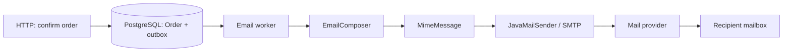
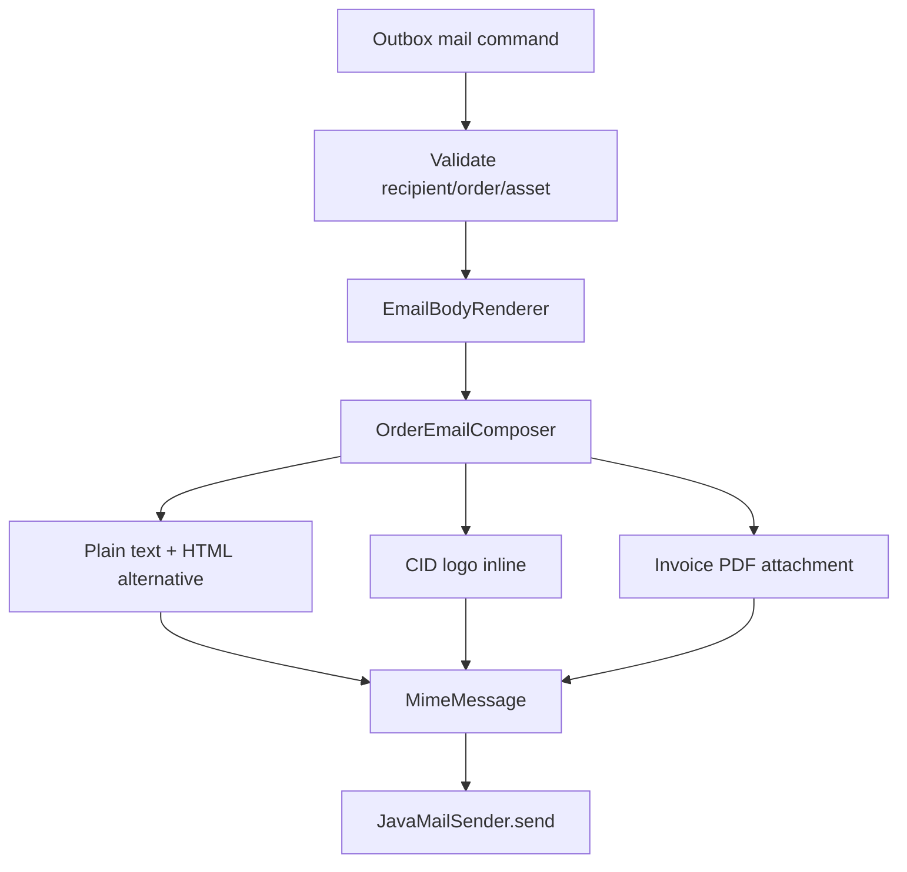
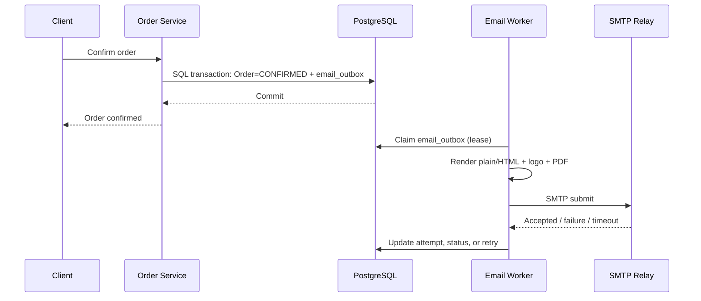

# Plain Text, HTML Content, Inline Resources, and Attachments

## 1. Objectives and Integration Context

In a Spring Boot system, emails are typically generated from business events: an order is confirmed, an account needs verification, a transaction requires reconciliation, or a scheduled job completes. An email may contain only **plain text**; or it may include **HTML**, **images embedded directly in the body**, and **attachments** such as PDF invoices. Each format carries its own encoding rules and limitations. An SMTP server accepting an email neither guarantees the message reached the recipient's mailbox nor ensures sensitive data was properly protected.

This lesson belongs to the **Email** chapter of the **SPRING_BOOT_INTEGRATION** module. The module structures Spring Boot integrations across HTTP clients, databases, caches, message brokers, and Spring Integration adapters, emphasizing **configuration, data contracts, transactions, failures, deduplication, testing, and observability**. Accordingly, this lesson progresses from MIME email structure to **post-commit** sending flows, attachment controls, retries, and testing with simulated SMTP.

After this lesson, you can:

- Distinguish `text/plain`, `text/html`, and `multipart/*` emails in the MIME protocol.
- Use `SimpleMailMessage` for plain-text emails; use `JavaMailSender`, `MimeMessage`, and `MimeMessageHelper` when HTML, inline resources, or attachments are required.
- Send both **plain-text and HTML** versions together via `multipart/alternative` so email clients choose the appropriate display format.
- Embed images via **Content-ID (CID)**, distinguishing inline resources from actual file attachments.
- Use `ByteArrayResource` or `FileSystemResource` safely, selecting MIME types, filenames, size limits, and content validation.
- Configure SMTP AUTH, STARTTLS, timeouts, error handling, outbox/idempotency, and test email structure **without sending real mail over the Internet**.

> **Version scope:** Examples target Java 17+, Spring Boot 3.2+, Spring Framework 6.1+, and **Jakarta Mail** (`jakarta.mail.*`). With Spring Boot 3+, never mix `javax.mail.*` imports from Spring Boot 2.x guides. Specific library/class details may vary across versions; code samples omit common imports for brevity.

### 1.1. End-to-End Problem: Order Confirmation Email

**Order Service** persists a confirmed order in PostgreSQL. After the database transaction commits, a worker sends an email to the customer:

1. **Subject:** Order confirmation `O-1001`.
2. **Plain text:** readable in email clients that do not render HTML.
3. **HTML:** displays order ID, greeting, and support details using an email template.
4. **Company logo:** displayed inside the HTML body as an **inline** resource via `cid:brandLogo`.
5. **Invoice:** attached PDF named `invoice-O-1001.pdf`.



The **Order + outbox** write commits inside the database; the worker sends over SMTP **after commit**. If sending fails, the email job can be retried per policy. If SMTP already received the message yet the worker crashes before persisting status, a retry may send a **duplicate email**; never promise "exactly-once delivery" merely because you used transactions or SMTP.

## 2. MIME: Plain Text, HTML, Inline Resources, and Attachments

SMTP transports emails at the mail-transfer protocol layer. To carry multiple content types in one email, applications use **MIME (Multipurpose Internet Mail Extensions)** and headers such as `Content-Type`, `Content-Transfer-Encoding`, `Content-Disposition`, and `Content-ID`.

### 2.1. Common MIME Parts

| Content | MIME Type / Trait | Meaning |
|---|---|---|
| Plain text | `text/plain; charset=UTF-8` | Readable text requiring no HTML |
| HTML | `text/html; charset=UTF-8` | Email client renders formatting and links |
| Multiple versions of one message | `multipart/alternative` | Alternative formats, typically plain text and HTML |
| Resources tied to HTML | `multipart/related` | HTML paired with images or resources referenced via CID |
| File attachments | `multipart/mixed` | Main content combined with one or more attachments |
| Images/logos | `image/png`, `image/jpeg`, ... | Can be inline or attachment depending on disposition/reference |
| Invoice | `application/pdf` | Typically carries `Content-Disposition: attachment` and filename |

An email can use **nested MIME multiparts**. Not every email client constructs the exact same display tree; the goal is a standards-based structure verified across real target clients.

### 2.2. Visualizing the Exercise's MIME Tree

```text
MimeMessage
└─ multipart/mixed
   ├─ multipart/related
   │  ├─ multipart/alternative
   │  │  ├─ text/plain; charset=UTF-8
   │  │  └─ text/html; charset=UTF-8
   │  │      
   │  └─ image/png
   │     Content-ID: <brandLogo>
   │     Content-Disposition: inline
   └─ application/pdf
      Content-Disposition: attachment
      filename="invoice-O-1001.pdf"
```

This diagram shows the **conceptual structure** when using mixed and related MIME modes. In practice, `MimeMessageHelper` and Jakarta Mail may emit slightly different multipart nesting depending on `multipartMode`; avoid brittle tests coupled to an exact tree depth unless truly necessary. Assert the **presence and proper role** of text, HTML, inline parts, and attachments.

### 2.3. Why Send Both Plain Text and HTML?

Some email clients, spam filters, and accessibility policies prefer plain text. HTML may also be disabled, images blocked, and CSS unsupported. Sending both versions lets the client choose:

- **Plain text:** complete wording, explicit URLs, never relying on colors or images to convey key information.
- **HTML:** structured layout, email-safe CSS, alt text for images, and links pointing to clear domains.

Both versions should convey **the exact same business information**; never leave critical details solely inside an image or PDF. `multipart/alternative` does not send two separate emails—it packages representations of a single message.

### 2.4. How Do Inline Resources Differ from Attachments?

An **inline resource** is referenced by the HTML body via `cid:<contentId>` and usually carries `Content-Disposition: inline`, such as a logo. An **attachment** carries a filename and `Content-Disposition: attachment` so the email client surfaces it as a downloadable file. Both are MIME parts containing encoded bytes; the key difference is their **display role**.

Adding an inline image does not guarantee every client displays it: some clients block remote images, some mishandle or strip CID rendering, and some still list inline images under attachments. Always include `alt` text and plain-text copy, and never put critical security details only inside an image.

## 3. Dependencies and SMTP Configuration in Spring Boot

### 3.1. Starter and Optional Template Library

With Maven and the Spring Boot parent/BOM:

```xml
<dependencies>
    <dependency>
        <groupId>org.springframework.boot</groupId>
        <artifactId>spring-boot-starter-mail</artifactId>
    </dependency>
    <!-- Only needed if rendering HTML with Thymeleaf. -->
    <dependency>
        <groupId>org.springframework.boot</groupId>
        <artifactId>spring-boot-starter-thymeleaf</artifactId>
    </dependency>
    <dependency>
        <groupId>org.springframework.boot</groupId>
        <artifactId>spring-boot-starter-test</artifactId>
        <scope>test</scope>
    </dependency>
</dependencies>
```

`spring-boot-starter-mail` integrates **`JavaMailSender`** with Jakarta Mail. When dependencies and configuration conditions match (notably SMTP host/JavaMail session info), Spring Boot auto-configures the sender. `spring-boot-starter-thymeleaf` is only needed when using Thymeleaf as the HTML template engine; MIME emails do not require Thymeleaf.

### 3.2. Local and Production SMTP

Local example using an **SMTP test server** listening on port `1025` that sends nothing externally:

```yaml
# application-mail-local.yml
spring:
  mail:
    host: localhost
    port: 1025
    protocol: smtp
    default-encoding: UTF-8
    properties:
      mail.smtp.connectiontimeout: 3000
      mail.smtp.timeout: 5000
      mail.smtp.writetimeout: 5000
```

When deploying to production with SMTP submission supporting STARTTLS on port `587`:

```yaml
# application-mail-prod.yml
spring:
  mail:
    host: ${SMTP_HOST}
    port: ${SMTP_PORT:587}
    username: ${SMTP_USERNAME}
    password: ${SMTP_PASSWORD}
    protocol: smtp
    default-encoding: UTF-8
    properties:
      mail.smtp.auth: true
      mail.smtp.starttls.enable: true
      mail.smtp.starttls.required: true
      mail.smtp.ssl.checkserveridentity: true
      mail.smtp.connectiontimeout: 3000
      mail.smtp.timeout: 5000
      mail.smtp.writetimeout: 5000
```

| Setting | Meaning |
|---|---|
| `spring.mail.host/port` | Permitted SMTP relay/server |
| `username/password` | SMTP credentials injected via secret manager/environment |
| `mail.smtp.auth` | Enables SMTP AUTH when required by the relay |
| `starttls.enable` | Allows upgrading a plain SMTP connection to TLS via STARTTLS |
| `starttls.required` | Requires STARTTLS to succeed so credentials are never sent without TLS |
| `ssl.checkserveridentity` | Enforces host/certificate identity verification per Jakarta Mail support |
| `connectiontimeout` | Network connection timeout |
| `timeout` | SMTP read timeout |
| `writetimeout` | SMTP write timeout |
| `default-encoding` | Default charset for email content in Spring Boot |

**Important:** port `465` normally uses **implicit TLS**, not the STARTTLS mode used on `587`. If your provider requires direct SMTP over SSL, configure `mail.smtp.ssl.enable=true` and proper trust/certificates per provider docs; never blindly copy flags from the `587` example to `465`.

Timeouts prevent `send()` from hanging forever, yet **do not** automatically bound total batch duration across multiple recipients/attachments or provider queuing time. When triggering emails from HTTP endpoints, never hold the HTTP request or SQL transaction waiting on SMTP; use a background worker/outbox.

### 3.3. Verifying Effective Configuration and Security

`JavaMailSenderImpl` is typically the `JavaMailSender` implementation provided by Spring Boot. If the app declares a custom sender, Boot may back off creating the default sender; inspect which properties actually take effect. `spring.mail.test-connection` can verify connectivity at startup where supported, though it can prevent the app from booting during brief SMTP outages; decide based on SLAs and environment.

Never enable Jakarta Mail debug logging in production if logs might capture recipient addresses, email metadata, internal paths, or auth details. Use an SMTP account with least-privilege permissions, verify sender domains, and configure SPF, DKIM, and DMARC in your mail system/provider per organizational policy. **TLS protects the transmission channel; SPF/DKIM/DMARC authenticate domain identity; they do not replace each other.**

## 4. Plain-Text Email with SimpleMailMessage

### 4.1. Example Sending text/plain Content

`SimpleMailMessage` fits emails consisting solely of subject and plain-text body without HTML or complex MIME parts:

```java
// PlainTextNotificationSender.java — imports abbreviated
@Service
public class PlainTextNotificationSender {
    private final JavaMailSender mailSender;

    public PlainTextNotificationSender(JavaMailSender mailSender) {
        this.mailSender = mailSender;
    }

    public void sendStatus(String recipient, String orderId) {
        SimpleMailMessage mail = new SimpleMailMessage();
        mail.setFrom("orders@example.org");
        mail.setTo(recipient);
        mail.setSubject("Order update " + orderId);
        mail.setText(
                "Order " + orderId + " has been confirmed.\n"
                + "You can track its status in your account.\n"
                + "If you did not place this order, please contact support.");

        mailSender.send(mail);
    }
}
```

Spring's `JavaMailSender` provides the `send(SimpleMailMessage)` overload for this case. `SimpleMailMessage` is **not** a tool for building `multipart/related` or attachments; switch to `MimeMessage` for HTML, inline images, or files.

`orders@example.org` is strictly illustrative; production must use a verified domain and configured sender identity from your provider. Never take arbitrary `From` addresses from user-supplied HTTP requests.

### 4.2. Plain Text Still Needs a Content Contract

Even for plain-text emails, observe these rules:

- Use UTF-8 charset for Vietnamese diacritics; never rely on the OS default charset.
- Subject, `From`, `To`, and `Reply-To` must be validated header data set via the API, never concatenated into raw MIME headers from user strings.
- Copy must accurately reflect business state; if an email confirms an order commit, never say "shipped" when the order was only created.
- Links in plain text should use official domains, short-lived tokens for action links, and omit unnecessary credentials or sensitive identifiers from URLs.
- `send()` is synchronous I/O. Never run it inside long database transactions or on a Netty event-loop thread.

## 5. Building MimeMessage with Plain Text and HTML

### 5.1. Why Use MimeMessageHelper?

`MimeMessage` is the Jakarta Mail object representing a complete email with headers, recipients, content, and MIME parts. Spring's `MimeMessageHelper` simplifies assembling messages when Unicode, HTML, multipart, inline assets, or attachments are needed.

```java
// Basic template with text + HTML, no images/files yet
MimeMessage message = mailSender.createMimeMessage();
MimeMessageHelper helper = new MimeMessageHelper(
        message, true, StandardCharsets.UTF_8.name());

helper.setFrom("orders@example.org");
helper.setTo("customer@example.net");
helper.setSubject("Order confirmation O-1001");

String plainText =
        "Hello! Order O-1001 has been confirmed.";
String htmlText = """
        <html><body>
          <h1>Order confirmation</h1>
          <p>Order O-1001 has been confirmed.</p>
        </body></html>
        """;

helper.setText(plainText, htmlText);
mailSender.send(message);
```

This uses `helper.setText(plainText, htmlText)` to create **two alternative versions** of the same message. Calling only `helper.setText(htmlText, true)` adds HTML without a separate plain-text fallback. Calling `helper.setText(plainText)` creates plain-text-only content.

**Call order matters:** set the body via `setText(...)` first, and only then call `addInline(...)` when adding inline resources. `MimeMessageHelper` specifies this ordering so MIME parts are not misplaced or lost in certain implementations.

### 5.2. Choosing the Right Multipart Mode

`MimeMessageHelper` offers several multipart modes, and the choice shapes the generated part hierarchy:

| Mode | When to Use | Notes |
|---|---|---|
| `MULTIPART_MODE_NO` | No multipart wrapper | Unsuitable for inline images/files |
| `MULTIPART_MODE_MIXED` | Mixed parts, usually attachments | Some email clients handle inline assets differently |
| `MULTIPART_MODE_RELATED` | HTML with related resources | May alter how regular attachments display |
| `MULTIPART_MODE_MIXED_RELATED` | Email with both HTML/inline and attachments | Typically best for order confirmations with logo and PDF |

`new MimeMessageHelper(message, true, "UTF-8")` uses the helper's default multipart mode; for clarity and testability when combining **both images and PDFs**, specify it explicitly:

```java
MimeMessageHelper helper = new MimeMessageHelper(
        message,
        MimeMessageHelper.MULTIPART_MODE_MIXED_RELATED,
        StandardCharsets.UTF_8.name()
);
```

Do not manually alter the low-level MIME structure after the helper has assembled parts unless strictly necessary: it is easy to accidentally put an attachment inside `multipart/alternative` or break HTML's reference to an inline resource. Test on Gmail, Outlook, Apple Mail, or your users' actual clients before considering the MIME layout final.

### 5.3. Use Strongly Typed Message Commands

```java
// OrderMailCommand.java
public record OrderMailCommand(
        String mailRequestId,
        String recipient,
        String orderId,
        String customerName,
        long totalCents
) {}
```

`mailRequestId` is the **logical ID of the email-send request**, not the SMTP Message-ID and not the inventory reservation operation ID. Use this ID for outbox rows, attempt tracking, and preventing multiple workers from picking the same job. `orderId` may appear in the subject/filename after validation; `customerName` appears in the body only through an escaped template.

For invoices, `totalCents` must be formatted using **the order's currency**. Real implementations avoid floating-point money math; pass currency/locale in the DTO per contract and use `BigDecimal`/`Currency` or minor-unit integers as required.

## 6. Safe HTML Templates Consistent with Plain Text

### 6.1. Never Concatenate User Input Directly into HTML

An easy but dangerous mistake:

```java
// Don't do this: customerName may contain arbitrary HTML.
String html = "<p>Hello " + customerName + "</p>";
```

If the name contains `<`, `>`, `&`, or markup, the HTML email can break layout or inject unintended content. Many email clients block JavaScript, yet you must never treat client behavior as server-side escaping. Use a template engine with **HTML escaping by default**, and validate inputs, links, and any permitted HTML fragments.

### 6.2. Thymeleaf HTML Template

Example template file **to be created by your project** at `src/main/resources/templates/mail/order-confirmed.html`:

```html
<!DOCTYPE html>
<html lang="en" xmlns:th="http://www.thymeleaf.org">
<head>
  <meta charset="UTF-8">
  <title>Order Confirmation</title>
</head>
<body style="font-family: Arial, sans-serif; color: #222;">
  <table role="presentation" width="100%" cellspacing="0" cellpadding="0">
    <tr>
      <td>
        
      </td>
    </tr>
    <tr>
      <td>
        <h1>Order confirmed</h1>
        <p>Hello <span th:text="${customerName}">Customer</span>!</p>
        <p>Order ID:
          <strong th:text="${orderId}">O-1001</strong>
        </p>
        <p>Total:
          <strong th:text="${formattedTotal}">$19.99</strong>
        </p>
        <p>Your PDF invoice is attached to this email.</p>
        <p>If you need assistance, please reply to this email or
          visit our official website.</p>
      </td>
    </tr>
  </table>
</body>
</html>
```

`th:text` escapes bound values for HTML context. Never swap it to `th:utext` for `customerName` or untrusted HTTP/database data, since `th:utext` inserts unescaped HTML. When structured HTML fragments are necessary, allow only trusted sources sanitized under a strict policy.

### 6.3. Rendering HTML and Plain Text from the Same Data Snapshot

```java
// EmailBodyRenderer.java — imports abbreviated
@Component
public class EmailBodyRenderer {
    private final SpringTemplateEngine templates;

    public EmailBodyRenderer(SpringTemplateEngine templates) {
        this.templates = templates;
    }

    public String renderHtml(
            OrderMailCommand command, String formattedTotal
    ) {
        Context context = new Context(
                Locale.forLanguageTag("vi-VN"));
        context.setVariable(
                "customerName", command.customerName());
        context.setVariable(
                "orderId", command.orderId());
        context.setVariable(
                "formattedTotal", formattedTotal);

        return templates.process("mail/order-confirmed", context);
    }

    public String renderPlain(
            OrderMailCommand command, String formattedTotal
    ) {
        return "Hello " + command.customerName() + "!\n"
                + "Order " + command.orderId()
                + " has been confirmed.\n"
                + "Total: " + formattedTotal + "\n"
                + "The PDF invoice is attached.\n"
                + "If you need help, please contact the store.";
    }
}
```

`SpringTemplateEngine` and `Context` come from Thymeleaf. The exact same `OrderMailCommand` and `formattedTotal` feed both HTML and plain text, preventing one part from saying "confirmed" while the other says "processing." Plain text must not drop mandatory details such as prices, payment terms, or security warnings.

### 6.4. Limitations of HTML Email

HTML email **is not a regular web page**. Many clients restrict CSS, web fonts, media queries, background images, and scripts; `<script>` is unusable and routinely stripped. Security proxies rewrite image/link URLs, and rendering varies across desktop/mobile and Outlook/Gmail.

To keep emails readable:

- Favor simple HTML, presentation tables where needed for email client compatibility, and controlled inline CSS.
- Use HTTPS links to official domains; never allow `javascript:`, `data:`, or unapproved protocols in user links.
- Ensure good contrast, legible fonts, and `alt` text on images.
- Keep all essential information in `text/plain` as well.
- Test rendering on the actual clients your organization supports, not just Chrome.

## 7. Inline Resources: Logos and Images via Content-ID

### 7.1. How Does CID Work?

An **inline** resource is a MIME part associated with the HTML body. The HTML references it via the `cid:` scheme:

```html

```

The image part inside the MIME message conceptually carries these headers:

```text
Content-Type: image/png
Content-ID: <brandLogo>
Content-Disposition: inline
Content-Transfer-Encoding: base64
```

`brandLogo` is a **content ID**, not a disk filename, filesystem path, HTTP URL, or database ID. Calling `MimeMessageHelper.addInline("brandLogo", ...)` creates a MIME part with the corresponding content ID. The HTML must reference `cid:brandLogo` (matching the ID). Multiple images in one message must have distinct IDs within that message.

### 7.2. Adding an Inline Image via ClassPathResource

Assuming the project contains `src/main/resources/mail/assets/logo.png` and template `mail/order-confirmed.html` references `cid:brandLogo`:

```java
MimeMessage message = mailSender.createMimeMessage();
MimeMessageHelper helper = new MimeMessageHelper(
        message,
        MimeMessageHelper.MULTIPART_MODE_MIXED_RELATED,
        "UTF-8"
);

helper.setFrom("orders@example.org");
helper.setTo("customer@example.net");
helper.setSubject("Order confirmation O-1001");
helper.setText(plainText, htmlText);

// Call setText(...) BEFORE addInline(...).
ClassPathResource logo =
        new ClassPathResource("mail/assets/logo.png");
helper.addInline("brandLogo", logo, "image/png");

mailSender.send(message);
```

`ClassPathResource` is in `org.springframework.core.io`. The resource must exist on the **runtime classpath** (packaged inside the JAR as well), not read via a relative working-directory path. If a resource is missing, tests should fail loudly instead of sending an HTML email referencing `cid:brandLogo` with no matching MIME part.

### 7.3. Adding Image Content from Bytes Instead of a File

When loading an approved logo from an asset store, wrap the bytes in `ByteArrayResource`:

```java
byte[] logoPng = logoAssetService.loadApprovedLogoPng();

helper.addInline(
        "brandLogo",
        new ByteArrayResource(logoPng),
        "image/png"
);
```

This example uses a hypothetical `logoAssetService`: the application defines the interface/implementation and guarantees the bytes are a valid PNG within size limits. `ByteArrayResource` holds bytes in memory and returns a **fresh `InputStream` on every read**; this is important because Jakarta Mail may read content multiple times when constructing/sending MIME.

**Avoid single-read `InputStreamResource`** if JavaMail invokes `getInputStream()` more than once; Spring's `MimeMessageHelper` recommends an `InputStreamSource` that can open a fresh stream per access. Use `ByteArrayResource` for in-memory bytes and `FileSystemResource` or repeatable resources for files on disk.

### 7.4. Inline Images vs Image URLs

| Approach | Pros | Cons |
|---|---|---|
| `cid:brandLogo` | Image travels inside MIME message; no hit to your web server | Increases email size; clients may block or show as attachment |
| HTTPS URL | Smaller emails; easier to update image server-side | Clients may block remote images, proxy/cache them, or trigger external requests |
| Inline Data URI / Base64 in HTML | Self-contained in markup | Inconsistent email client support; bloats HTML |

Small static logos suit inline embedding if they must appear offline. Large marketing graphics suit HTTPS URLs, though they may be blocked and carry privacy considerations. Never embed images created from untrusted input without verifying file type, size, contents, and usage rights.

## 8. Attachments: PDF, CSV, and MIME Limits

### 8.1. Attaching a PDF with ByteArrayResource

If the Invoice Service already produced valid `byte[] pdfBytes`, `MimeMessageHelper` attaches it like this:

```java
helper.addAttachment(
        "invoice-O-1001.pdf",
        new ByteArrayResource(pdfBytes),
        "application/pdf"
);
```

| Parameter | Meaning |
|---|---|
| `"invoice-O-1001.pdf"` | Filename displayed to the recipient; not a filesystem path |
| `ByteArrayResource(pdfBytes)` | Content bytes supporting repeatable stream reads |
| `"application/pdf"` | Declared MIME content type for the attachment |

MIME types and `.pdf` extensions are merely **metadata**; they do not prove the bytes are a benign PDF. If files come from users or external systems, verify magic bytes/content, access rights, malware scans, and retention policies. Never trust client-supplied filenames or `Content-Type` headers.

### 8.2. FileSystemResource and Path Risks

```java
FileSystemResource reportFile =
        new FileSystemResource(
                Path.of("/srv/app-generated/reports/invoice-O-1001.pdf"));

helper.addAttachment(
        "invoice-O-1001.pdf",
        reportFile,
        "application/pdf"
);
```

This snippet applies only when the application **itself generated** the file into an approved directory with proper cleanup. Never concatenate request parameters directly into paths like `"/srv/.../" + userInput` to prevent path traversal or leaking secret files. For recipient-visible filenames, normalize Unicode, strip control/CRLF characters and path separators, and cap length.

In containers or serverless runtimes with ephemeral filesystems, local paths may vanish before the job sends or when a worker runs on another node. A better pattern is **storing files in access-controlled object storage**, putting only a **reference** in the outbox, and having the worker fetch the file at send time with expiration and secure deletion.

### 8.3. Attachments Can Contain Private Data

A PDF invoice typically includes names, addresses, totals, and payment details. Before attaching:

1. Validate `orderId`, authorization, and that **the recipient belongs to that order**.
2. Build the document from committed records; never attach an invoice specified freely in a caller's request body.
3. Verify the file belongs to the exact order/tenant, never mixing two customers' data.
4. Enforce size, count, and file-type limits; scan for malware if sourced from untrusted inputs.
5. Never log attachment bytes to application logs or metrics.
6. Enforce clear retention policies for PDFs in both object storage and the SMTP/mail provider.

Email does not guarantee end-to-end encryption across all hops. For highly sensitive data or oversized files, send an **HTTPS link to an authenticated portal** instead of attaching the entire file. Links require proper authorization, short TTLs, and rate limiting/auditing; avoid long-lived tokens in URLs that persist in browser history or logs.

### 8.4. Actual Email Size Exceeds Raw File Size

Email attachments typically use `Content-Transfer-Encoding: base64`, expanding MIME size substantially above raw bytes (typically around a third larger, excluding line breaks, headers, and HTML/inline parts). Providers enforce **total message size limits**, not just per-attachment limits. Beyond total bytes, constrain:

- Attachment count and filename length.
- Permitted file types and decompressed size if archives are allowed.
- Total heap memory when using `ByteArrayResource`; concurrent PDF/logo buffers across workers can add up quickly.
- Generation/download time from object storage.
- Malware-scan overhead and SMTP transmission time.

Do not build a 30 MB email expecting a relay capped at 20 MB to fix it; if rejected by the provider, categorize the failure and fall back to a download link or smaller payload.

### 8.5. Multiple Attachments

```java
helper.addAttachment(
        "invoice-O-1001.pdf",
        new ByteArrayResource(invoicePdfBytes),
        "application/pdf"
);
helper.addAttachment(
        "order-items-O-1001.csv",
        new ByteArrayResource(csvBytes),
        "text/csv; charset=UTF-8"
);
```

CSVs carry **formula injection** risk when user-controlled fields begin with `=`, `+`, `-`, or `@` and recipients open them in spreadsheet tools; sanitize/escape cells per export policy before producing `csvBytes`. Setting the right MIME type does not mitigate formula injection. Also never attach dynamically built unsanitized HTML files that clients might execute in permissive viewers.

## 9. Assembling a Complete Email Using a Composer

### 9.1. Separating Compose from Send

A clean practice is having one component **compose MIME** and another **send**. The composer accepts validated inputs, renders bodies from the same snapshot, and adds inline resources and attachments. The sender handles SMTP connectivity, attempt tracking, and exceptions. This separation allows testing MIME without **needing SMTP**.



### 9.2. A Testable OrderEmailComposer

```java
// OrderEmailComposer.java — imports abbreviated
@Component
public class OrderEmailComposer {
    private final JavaMailSender mailSender;
    private final EmailBodyRenderer renderer;

    public OrderEmailComposer(
            JavaMailSender mailSender,
            EmailBodyRenderer renderer
    ) {
        this.mailSender = mailSender;
        this.renderer = renderer;
    }

    public MimeMessage compose(
            OrderMailCommand command,
            String formattedTotal,
            byte[] logoPng,
            byte[] invoicePdf
    ) throws MessagingException {
        validate(command, logoPng, invoicePdf);

        MimeMessage message = mailSender.createMimeMessage();
        MimeMessageHelper helper = new MimeMessageHelper(
                message,
                MimeMessageHelper.MULTIPART_MODE_MIXED_RELATED,
                StandardCharsets.UTF_8.name()
        );

        helper.setFrom("orders@example.org");
        helper.setTo(command.recipient());
        helper.setReplyTo("support@example.org");
        helper.setSubject(
                "Order confirmation " + command.orderId());

        String plain = renderer.renderPlain(
                command, formattedTotal);
        String html = renderer.renderHtml(
                command, formattedTotal);

        // 1) Text alternative before adding inline/attachment.
        helper.setText(plain, html);

        // 2) Resource referenced in HTML via cid:brandLogo.
        helper.addInline(
                "brandLogo",
                new ByteArrayResource(logoPng),
                "image/png");

        // 3) Invoice is an attachment, not an inline image.
        helper.addAttachment(
                "invoice-" + command.orderId() + ".pdf",
                new ByteArrayResource(invoicePdf),
                "application/pdf");

        return message;
    }

    private static void validate(
            OrderMailCommand command,
            byte[] logoPng,
            byte[] invoicePdf
    ) {
        if (command == null
                || command.orderId() == null
                || !command.orderId().matches("[A-Za-z0-9_-]{1,40}")
                || command.mailRequestId() == null
                || command.mailRequestId().isBlank()) {
            throw new IllegalArgumentException(
                    "Missing or invalid email/order identifier");
        }
        if (command.recipient() == null
                || command.recipient().isBlank()) {
            throw new IllegalArgumentException(
                    "Missing recipient email address");
        }
        if (logoPng == null || logoPng.length == 0
                || logoPng.length > 200_000
                || invoicePdf == null || invoicePdf.length == 0
                || invoicePdf.length > 8_000_000) {
            throw new IllegalArgumentException(
                    "Email resource is empty or exceeds size limit");
        }
        // Production: validate recipient with email address parser,
        // verify PNG/PDF signatures + malware policy,
        // and confirm recipient is authorized for this order's invoice.
    }
}
```

Here `formattedTotal` and `EmailBodyRenderer` are shared across plain and HTML parts so two different totals can never appear. The 200 KB cap on `logoPng` and 8 MB cap on `invoicePdf` are **illustrative thresholds**; check real total MIME size and provider caps. `validate` is intentionally minimal: recipient addresses need parser validation, invoices must match the order, and files require content and authorization checks.

**Never call SMTP inside the composer.** `compose` exists to return an inspectable, testable MIME object. Calling `mailSender.send(message)` before verifying templates, files, or recipient rights risks firing off an unrecallable wrong email.

### 9.3. Sender Invoking JavaMailSender with Clear Errors

```java
// OrderEmailSender.java
@Service
public class OrderEmailSender {
    private final JavaMailSender mailSender;
    private final OrderEmailComposer composer;

    public OrderEmailSender(
            JavaMailSender mailSender,
            OrderEmailComposer composer
    ) {
        this.mailSender = mailSender;
        this.composer = composer;
    }

    public void send(
            OrderMailCommand command,
            String formattedTotal,
            byte[] logoPng,
            byte[] invoicePdf
    ) {
        try {
            MimeMessage message = composer.compose(
                    command, formattedTotal, logoPng, invoicePdf);
            mailSender.send(message);
        } catch (MessagingException ex) {
            throw new IllegalStateException(
                    "Failed to compose valid MIME email", ex);
        }
    }
}
```

`JavaMailSender.send(MimeMessage)` throws `MailException` (unchecked) when SMTP connection or sending fails; this example lets it propagate so the outer worker classifies retries and saves status. `MessagingException` inside the composer indicates a failure building MIME. Separating these checked/unchecked exception origins distinguishes a **compose failure** from an **SMTP transport failure**, while the worker still inspects `MailException`'s cause to distinguish transient vs permanent errors.

### 9.4. Recipient and Header Validation

Place clear rules at the boundary before `compose`:

- Normalize and validate email addresses via `jakarta.mail.internet.InternetAddress`, domain/recipient rules, and internal policies; valid syntax **does not prove** the address exists or is authorized to receive the data.
- `From` must belong to a relay-authorized domain/account; never use a caller-supplied forged `From`.
- `Reply-To` designates a support channel; never confuse it with recipients or BCC groups.
- Constrain subjects, `orderId`, filenames, and customer names, stripping dangerous control characters from header fields.
- Never log recipient lists, PII-bearing subjects, or raw MIME by default.
- When emailing multiple people, consider **one MIME message per recipient** so addresses are never leaked via `To`/`Cc`. `Bcc` hides addresses from other recipients yet should not replace individual messages when personalizing content and checking permissions.

In particular, sending invoices is security-sensitive. Verify the recipient has access rights to that order **at the business layer** before placing bytes into MIME, rather than trusting any valid email address.

## 10. SMTP, Transactions, Retries, and Send State

### 10.1. SMTP Accepting a Message Does Not Mean Inbox Delivery

`JavaMailSender.send(...)` calls the SMTP server. If the relay responds with success, the application knows the server **accepted the send request** at the protocol level. That **does not prove**:

- The email reached the final mailbox.
- The email avoided spam/quarantine folders.
- The recipient opened, read, or clicked any link.
- The PDF or inline image rendered properly in every email client.
- The email will not bounce or be rejected later by the receiving system.

When using a provider with webhooks/APIs for delivered, deferred, bounced, or complained events, build a dedicated status layer. Never set `DELIVERED` simply because `send()` threw no exception; safer states are `ACCEPTED_BY_SMTP`, `SUBMITTED`, or `SENT_TO_PROVIDER` per your domain vocabulary.

### 10.2. Never Call SMTP Inside a Database Transaction

A common anti-pattern:

```java
// Do not treat as a shared transaction.
@Transactional
public void confirmOrderBad(String orderId) {
    orderRepository.markConfirmed(orderId);
    orderEmailSender.send(/* MIME + SMTP ... */);
}
```

If SMTP is slow, the SQL transaction holds connections and locks during sending. If the relay accepts the email and the SQL transaction later rolls back, the customer receives a confirmation for a nonexistent order. If SQL commits and the process crashes before emailing, no email is sent. **SQL `@Transactional` does not span SMTP transactions.**

### 10.3. Transactional Outbox for Email Requests

Recommended design:



An outbox row can include:

| Field | Meaning |
|---|---|
| `mail_request_id` | Unique key for the **logical email request** |
| `event_type` | `ORDER_CONFIRMED` or email category |
| `order_id` | Reference to committed order data |
| `recipient_ref` | Authorized recipient reference, avoiding unnecessary PII duplication |
| `template_version` | Selects the exact content/email template when the worker runs |
| `status` | `PENDING`, `IN_PROGRESS`, `ACCEPTED_BY_SMTP`, `FAILED`, or finer-grained states |
| `attempt_count` / `next_attempt_at` | Bounded retries and backoff |
| `lease_owner` / `lease_until` | Prevents concurrent claims under normal operation and enables crash recovery |
| `last_error_code` | Safe operational error code without passwords/raw MIME |

An SQL unique constraint such as `UNIQUE(mail_request_id)` prevents creating two outbox rows for the same business request. With multiple workers, claims can use short-transaction row locking/leasing. Never hold a transaction open while rendering PDFs or talking to SMTP.

**Important limitation:** after SMTP accepts a message, the worker can crash **before saving `ACCEPTED_BY_SMTP`**. Once the lease expires, another worker resends → the customer can receive a duplicate email. With standard SMTP relays, there is no atomic commit shared with PostgreSQL; a `mail_request_id` in the DB cannot guarantee exactly-once inbox delivery. Some providers offer API idempotency keys; inspect their actual semantics to reduce sender-side duplicates.

### 10.4. Classifying Errors to Decide Retries

| Situation | Classification | Recommended Handling |
|---|---|---|
| Cannot reach SMTP, transient DNS error | Potentially transient | Limited retries with exponential backoff + jitter; monitor |
| Relay returns SMTP `4xx` | Typically transient | Schedule retry per code/provider policy; avoid retry storms |
| Relay returns SMTP `5xx` | Typically permanent or misconfigured | Do not retry indefinitely; alert/quarantine by error code |
| SMTP AUTH fails, sender domain unauthorized | Config/security | Stop rapid automated retries; fix credentials/domain |
| Invalid TLS certificate/hostname | Security/config | Never disable TLS validation; investigate CA/certificate |
| Template fails to render | Content/deployment bug | Fix template/data; never retry SMTP before valid composition |
| PDF exceeds size/provider limit | Permanent for that payload | Switch to link, shrink size, never retry identical attachment |
| SMTP times out after DATA step | **Indeterminate** outcome | May already be accepted; assign `UNKNOWN` / reconcile with provider if available |
| Bounce after relay accepted | Downstream delivery failure | Process webhook/DSN, update status, avoid pointless resends |

SMTP reply codes have standard baseline meanings, though providers add extended codes and custom rules. The adapter should preserve **log-safe error codes** rather than catching `MailException` and retrying every failure identically.

### 10.5. An Email Is Not a Business Command

Email is a notification channel. Send success is **not** proof that Order Service committed properly or partners reserved inventory. Conversely, email failure is rarely a reason to roll back a committed order. Business state tracks its own lifecycle, while the email worker runs as an independent, observable process.

For multi-channel notifications (email, SMS, push), you can publish events to RabbitMQ/Kafka or a Spring Integration flow with routers/adapters, provided consumers enforce deduplication, retries, DLQs, and clear transaction boundaries. Avoid putting huge PDF/HTML byte arrays inside every broker message when a secure object-storage reference suffices.

## 11. Privacy, Safe HTML, and Safe Attachments

### 11.1. Threats to Control

| Threat | Consequence | Mitigation |
|---|---|---|
| HTML injection via customer/item names | Broken layout, spoofed links, unintended rendering | Escape with `th:text`; sanitize permitted fragments |
| Header injection via subject/address/filename | Corrupted MIME headers, altered recipients, or spoofing | Strip CR/LF/control chars; use Jakarta Mail APIs instead of raw headers |
| IDOR when selecting order/recipient | Customer A's invoice sent to Customer B | Authorization check verifying recipient–order ownership on committed data |
| Malicious/spoofed attachment | Malware, viewer exploits, social engineering | File-type allowlist, signature check, scanning, size caps |
| Unencrypted SMTP relay | Exposed credentials/content in transit | Mandatory STARTTLS/SMTPS, verify CA/hostname |
| Secrets in templates, logs, URLs | Leaked tokens/passwords/PII | Secrets management, log redaction, no long-lived tokens in URLs |
| Duplicate sends from retries | Spam, poor UX, complaints | Outbox dedup/leases, backoff, short-window resend throttling |
| Tracking pixels/remote assets | Images can reveal email-open behavior | Privacy policy and user consent where required |

Email **does not share the same security model** as internal JSON APIs. Messages can be stored and forwarded across many servers, users forward emails, and attachments persist indefinitely. When sending highly sensitive data, verify legal/organizational policies and favor **authenticated document portals**.

### 11.2. Links and User Authentication

Never ask users in an HTML email to enter passwords on unverified websites; use unmistakable official domains. For account confirmation, password reset, or invoice-view links:

1. Any token must have sufficient entropy, short expiration, single-purpose scope, and revocation support.
2. Never log raw tokens in logs, traces, or analytics URLs unnecessarily.
3. Never let the email worker construct hostnames from untrusted request input.
4. Plain-text and HTML versions must link to **the exact same valid destination**.
5. Sensitive actions at the target URL must still validate token, permissions, and state; possessing an email is not sufficient authentication in every case.

### 11.3. Multiple Recipients and Personal Data

`MimeMessageHelper.setTo(String...)`, `setCc`, and `setBcc` select recipients, yet do not fit personalized email templates. Whenever content contains customer-specific names, orders, or invoices, **each recipient must get a separate MIME message**. Never send one customer's PDF to multiple recipients hoping `Bcc` hides it. For group notices, lock down the authorized recipient list and visibility policy.

Store email/job state only to the extent required for audit and customer support. Avoid keeping full HTML/attachment bytes in the database forever without a retention mandate. When users request data deletion, account for file copies, providers, logs, and queues under applicable retention laws and policies.

## 12. Testing Email: MIME First, SMTP Second

A common testing mistake is mocking `JavaMailSender.send(...)` and claiming "HTML, logo, and PDF are all verified." Mocking only proves the sender was called—it **never verifies MIME structure**, charsets, CIDs, or email-client rendering. Conversely, an SMTP test server proves bytes reached the test relay, not a real inbox.

Split testing into layers:

| Level | Goal | What It Does Not Prove |
|---|---|---|
| Renderer unit test | HTML escaping, plain/HTML parity, currency/locale formatting | MIME tree and SMTP |
| MIME composition test | `Content-Type`, `text/plain`, `text/html`, CID, attachments, filenames, bytes | SMTP network and deliverability |
| SMTP integration test | Socket transfer, AUTH/TLS if configured, test relay receipt | Real inbox, production spam/bounce |
| Provider contract/integration | Sender domain, templates, rate limits, error codes, webhooks | Identical rendering across all mail clients |
| Visual/rendering test | Gmail/Outlook/mobile, dark mode, blocked images, accessibility | Outbox reliability and duplicate retries |
| Failure/chaos test | Post-DATA timeouts, SMTP 4xx/5xx, job crashes and resends | Exactly-once inbox delivery if unsupported by provider |

### 12.1. Testing the Composer Without an SMTP Server

`JavaMailSenderImpl.createMimeMessage()` builds a `MimeMessage` without network transport. Instantiate the composer with a stub renderer, call `compose(...)`, and inspect MIME parts via Jakarta Mail.

```java
// OrderEmailComposerTest.java — imports/static imports omitted
class OrderEmailComposerTest {

    @Test
    void buildsAlternativeHtmlInlineImageAndPdf()
            throws Exception {
        JavaMailSenderImpl sender = new JavaMailSenderImpl();
        EmailBodyRenderer renderer = mock(EmailBodyRenderer.class);
        OrderMailCommand command = new OrderMailCommand(
                "mail-1001",
                "customer@example.net",
                "O-1001",
                "Customer",
                199900
        );

        when(renderer.renderPlain(any(), anyString()))
                .thenReturn(
                        "Order O-1001 has been confirmed. "
                        + "The PDF invoice is attached.");
        when(renderer.renderHtml(any(), anyString()))
                .thenReturn("""
                        <html><body>
                          <p>Order O-1001 has been confirmed.</p>
                          
                        </body></html>
                        """);

        byte[] logo = { (byte) 0x89, 0x50, 0x4e, 0x47 };
        byte[] pdf = "%PDF-1.4\n".getBytes(
                StandardCharsets.US_ASCII);

        OrderEmailComposer composer =
                new OrderEmailComposer(sender, renderer);
        MimeMessage message = composer.compose(
                command, "$19.99", logo, pdf);
        message.saveChanges();

        assertEquals("Order confirmation O-1001",
                message.getSubject());
        assertEquals("customer@example.net",
                message.getRecipients(
                    Message.RecipientType.TO)[0].toString());

        List<Part> leaves = new ArrayList<>();
        collectLeaves(message, leaves);

        int plainCount = 0;
        int htmlCount = 0;
        int inlineCount = 0;
        int pdfCount = 0;

        for (Part part : leaves) {
            if (part.isMimeType("text/plain")) {
                plainCount++;
                assertTrue(part.getContent().toString()
                        .contains("O-1001"));
            }
            if (part.isMimeType("text/html")) {
                htmlCount++;
                assertTrue(part.getContent().toString()
                        .contains("cid:brandLogo"));
            }
            if (part.isMimeType("image/png")) {
                String[] ids = part.getHeader("Content-ID");
                if (ids != null && ids.length > 0
                        && ids[0].contains("brandLogo")) {
                    inlineCount++;
                }
            }
            if (part.isMimeType("application/pdf")
                    && Part.ATTACHMENT.equalsIgnoreCase(
                            part.getDisposition())) {
                pdfCount++;
                assertEquals("invoice-O-1001.pdf",
                        part.getFileName());
                assertArrayEquals(
                        pdf, part.getInputStream().readAllBytes());
            }
        }

        assertEquals(1, plainCount);
        assertEquals(1, htmlCount);
        assertEquals(1, inlineCount);
        assertEquals(1, pdfCount);
    }

    private static void collectLeaves(
            Part part, List<Part> leaves) throws Exception {
        if (part.isMimeType("multipart/*")) {
            Multipart multipart = (Multipart) part.getContent();
            for (int i = 0; i < multipart.getCount(); i++) {
                collectLeaves(multipart.getBodyPart(i), leaves);
            }
        } else {
            leaves.add(part);
        }
    }
}
```

`Part`, `Multipart`, `Message`, and `MimeMessage` come from `jakarta.mail`/`jakarta.mail.internet`; `JavaMailSenderImpl` comes from Spring Mail. `collectLeaves` walks nested multiparts regardless of depth so the test is not coupled to a single MIME tree shape. The test asserts:

- Both `text/plain` and `text/html` variants exist.
- HTML references `cid:brandLogo`, and MIME includes an image part with matching `Content-ID`.
- The PDF carries `Content-Disposition: attachment`, expected filename, and exact bytes.
- `Subject` and recipient headers are populated properly.

**Intentional limitation of this test:** logo/PDF byte arrays here are minimal fixtures just enough to test MIME composition, **not real PNG/PDF files openable in a viewer**. To test real rendering, supply valid controlled image and invoice fixtures and inspect them in real email clients. Never claim "malware scanned" because a unit test compares byte arrays.

### 12.2. Testing HTML Escaping and Alternative Content

Template tests should intentionally pass inputs containing markup:

```java
OrderMailCommand command = new OrderMailCommand(
        "mail-test-1",
        "customer@example.net",
        "O-1001",
        "<b>Customer & Co</b>",
        199900
);

String html = renderer.renderHtml(command, "$19.99");

assertTrue(html.contains("&lt;b&gt;"));
assertFalse(html.contains("<b>Customer & Co</b>"));
assertTrue(html.contains("cid:brandLogo"));
```

This is **a snippet from a renderer test with real Thymeleaf**, not a mocked renderer. Also test how plain text formats the name per policy: `<` and `>` inside `text/plain` do not create HTML, though newlines or control characters may need stripping if strings ever enter headers or external systems.

Add checks verifying `orderId`, status, total, and support copy appear in **both** parts. Snapshot/golden tests for rendered HTML can help, though avoid brittle whitespace assertions across template-engine upgrades.

### 12.3. Integration Testing with an SMTP Test Server

Options include **Mailpit/MailHog** or **GreenMail** running in the test environment. They accept email over SMTP and let tests inspect received messages via API or Jakarta Mail **without sending anything to the Internet**. GreenMail with Spring Boot 3 must support Jakarta Mail; avoid older versions compiled solely for `javax.mail`.

Example test pattern using Mailpit via Testcontainers (pin and vet image tags in CI per organization policy):

```java
// MailSmtpIT.java — illustrates starting a test mail server
@Testcontainers
class MailSmtpIT {
    @Container
    static GenericContainer<?> smtpServer =
            new GenericContainer<>(
                    DockerImageName.parse("axllent/mailpit:v1.21"))
                    .withExposedPorts(1025, 8025);

    @Test
    void submitsEmailToTestRelay() throws Exception {
        JavaMailSenderImpl sender = new JavaMailSenderImpl();
        sender.setHost(smtpServer.getHost());
        sender.setPort(smtpServer.getMappedPort(1025));
        sender.setDefaultEncoding("UTF-8");

        MimeMessage mime = sender.createMimeMessage();
        MimeMessageHelper helper = new MimeMessageHelper(
                mime, true, "UTF-8");
        helper.setFrom("orders@example.org");
        helper.setTo("customer@example.net");
        helper.setSubject("Email SMTP integration test");
        helper.setText("Testing via isolated SMTP relay.");

        sender.send(mime);

        // Next steps for a complete test:
        // Call Mailpit's API/mailbox on mapped port 8025,
        // poll for the message with a timeout,
        // assert recipient, subject, body, and MIME parts.
    }
}
```

This snippet verifies **SMTP submission to the test relay** without yet asserting message contents via Mailpit's API. To complete it, query the REST API of your Mailpit version or fetch from an SMTP inbox fixture, then assert the message **actually received by the relay**. Poll with a deadline rather than fixed `Thread.sleep`; avoid timing assumptions on async mail processing.

Add `org.testcontainers:junit-jupiter` to test dependencies, ensure a compatible Docker runtime, and use pinned/approved images. If containers cannot run, use embedded GreenMail on a random port and inspect received messages. Never test with production SMTP credentials or send to personal email addresses.

### 12.4. Testing TLS, AUTH, and SMTP Failures Cannot Rely Solely on Mocks

| Test | Setup | Expected |
|---|---|---|
| Local plain SMTP | Unauthenticated test relay | Succeeds when local profile is active |
| Mandatory STARTTLS | SMTP test server supporting TLS + trusted cert | Client sends successfully over TLS |
| Relay lacks STARTTLS | `starttls.required=true` | Connection/send rejected; no silent downgrade |
| Wrong CA or hostname | TLS test endpoint with untrusted cert/wrong host | Rejected; never disable `checkserveridentity` |
| Wrong credentials | SMTP AUTH test | Fails with error code; no infinite retries |
| SMTP `4xx` | Mock relay returns transient error | Outbox schedules retry per budget and backoff |
| SMTP `5xx` | Mock relay returns permanent error | Persists failed/permanent state per policy |
| Timeout after DATA | Relay stalls/drops at critical boundary | Indeterminate state, reconciled and duplicate-guarded |
| Oversized invoice | Size exceeds app/provider cap | Rejected at compose/send or switched to link; no OOM |

TLS tests must run **real socket handshakes** with proper certificate fixtures; Mockito or inspecting `MimeMessage` does not verify ciphers, hostnames, or CA certificates. Moreover, a test relay accepting an email does not prove production SPF/DKIM/DMARC records are configured.

### 12.5. Testing Outbox Flows and Deduplication

Business-flow tests should verify:

1. Order confirmation commits → exactly one **logical mail request** with a unique `mailRequestId` in the outbox.
2. SQL rollback → no email sent; workers never read an uncommitted outbox row.
3. Two workers claim concurrently → only one worker holds a valid lease at a time.
4. SMTP `4xx` → increments attempt count, sets `next_attempt_at`, and creates no second outbox row.
5. Permanent SMTP `5xx` → saves reason and alerts; no infinite retries.
6. Crash after SMTP acceptance before DB status update → duplicates are possible; logs/alerts fire and `UNKNOWN` state is handled per provider capabilities.
7. Customer changes email between placing the order and worker execution → contract defines whether the recipient comes from the **verified snapshot** or latest authorized address.
8. Invoice file modified/deleted in object storage → worker detects inconsistency, avoids sending the wrong file, and triggers recovery.

End-to-end tests with PostgreSQL Testcontainers, a fake SMTP relay, and test asset storage cover these boundaries far better than mocking `send()`. Not every test needs the full stack, yet every critical assumption should have a matching test.

## 13. Observability and Operating Email Workers

### 13.1. Metrics and Logs That Actually Help

| Group | Metric / Event | Question Answered |
|---|---|---|
| Outbox | `PENDING`, `IN_PROGRESS`, `FAILED` counts; oldest record age | Is email backing up or has the worker stalled? |
| Compose | Render latency, template errors, data errors, oversized attachments | Did failure happen **before** SMTP or during sending? |
| SMTP | Submit attempts/successes/failures, connect/auth/TLS timeouts, p95/p99 latency | Is the relay accepting messages, or are errors spiking? |
| Retry | Attempt counts, backoff, retries exhausted, `UNKNOWN` outcomes | Is there a retry storm or duplicate risk? |
| Deliverability | Accepted, bounced, complained, delivered (when provider supplies evidence) | Are messages reaching mailboxes or getting rejected? |
| Size | Total MIME size, attachment counts, size-limit rejections | Are files/inline images overloading transport? |
| Business | Delayed order confirmations, orders missing notifications | Are notifications meeting business SLAs? |

Spring Boot Actuator/Micrometer provides application metrics infrastructure, yet **SMTP, inbox delivery, and bounce metrics do not appear automatically** just from adding `spring-boot-starter-mail`. Instrument the composer/worker, SMTP adapter, and provider webhooks per operational needs.

### 13.2. Correlation IDs Do Not Replace Privacy

An email-sending flow should track:

- `mailRequestId` fixed across all attempts.
- `orderId`/business event ID for correlation in authorized systems.
- Attempt number, provider response ID (if any), submit timestamp, and classified error.
- Separate states for the outbox vs provider evidence.

Never use raw recipient addresses, PII-bearing subjects, high-cardinality order IDs, or `mailRequestId` as metric labels. Keep metric labels bounded—e.g., `mail_type=order_confirmed`, `channel=smtp`, `outcome=accepted/error`, and `error_class=authentication/timeout/permanent`. To trace a specific email, use access-controlled structured logs with correlation IDs, minimal PII, and enforced retention.

### 13.3. Operating Retries and Preventing Queue Backlogs

During an SMTP provider outage:

1. Workers back off quickly, using exponential backoff/jitter and rate limits matching provider quotas.
2. Outbox holds pending retries in the database or a durable queue; never let HTTP endpoints hammer SMTP directly.
3. Bound concurrent claimed jobs and SMTP connections per instance and cluster-wide.
4. For aging messages, check whether sending still **makes business sense**: a "5-minute OTP code" should not be sent hours later.
5. Alert when oldest pending age breaches SLA or SMTP `4xx/5xx` rates climb.
6. Upon recovery, ramp throughput gradually within quotas rather than replaying the entire backlog at once.

For emails with large assets, rendering **just before sending** works if snapshot data is controlled. If an order/invoice changes between outbox creation and worker execution, define clearly **which invoice revision** is authorized and lock its identifier/version in business data.

### 13.4. Issues Visible Only in Email Clients

- **Logo missing:** `cid` in HTML mismatches `Content-ID`, inline part added in wrong order, client blocks images, or wrong content type.
- **PDF appears corrupted/unknown:** wrong MIME type, broken filename encoding, invalid PDF bytes, or misconfigured helper disposition.
- **Garbled Vietnamese characters:** body/subject/filename not UTF-8 encoded, or source data already corrupted.
- **HTML renders as raw text:** called `setText(html)` instead of `setText(html, true)` or `setText(plain, html)`.
- **Empty plain-text part:** set only HTML without `multipart/alternative`, breaking accessibility fallback.
- **Broken CSS in Outlook:** HTML built like a full web page using unsupported styles/scripts.
- **Inline image also shows as attachment:** some clients render CID parts differently; test on target clients.
- **Emails go to spam:** domain authentication, content, reputation, and rate/bounce/complaint behavior need investigation; valid MIME alone does not guarantee inbox placement.

Do not swap SMTP providers to "fix" every rendering bug. Separate **transport acceptance**, **MIME composition**, **provider deliverability**, and **client rendering**.

## 14. Content Choices and Completion Checklist

### 14.1. Decision Table

| Need | Approach | Notes |
|---|---|---|
| Very simple status notice | `SimpleMailMessage` + `JavaMailSender` | `text/plain`; no inline images or files |
| Formatted HTML email | `MimeMessageHelper.setText(html, true)` | Add a plain alternative for accessibility |
| Both HTML and plain text | `setText(plain, html)` | Both parts must carry identical business info |
| Embed logo in body | `addInline("brandLogo", resource, "image/png")` | Call after `setText`; HTML uses `cid:brandLogo` |
| Attach PDF invoice | `addAttachment("invoice.pdf", resource, "application/pdf")` | Verify customer/order match, size, and content |
| HTML + inline logo + PDF together | `MULTIPART_MODE_MIXED_RELATED` | Test MIME parts and client rendering |
| Large or sensitive files | Authenticated HTTPS download link instead of attachment | Short-lived tokens, authorization, audit |
| Must send after database commit | Transactional outbox + worker | Avoid SMTP I/O inside SQL transactions |
| Avoid duplicates on retries | Logical `mailRequestId`, leases, provider dedup if supported | Never assume exactly-once SMTP |
| WebFlux app needs to send mail | Worker/blocking scheduler or supported async provider API | `JavaMailSender` is blocking; never call on event loop |

### 14.2. Production Readiness Checklist

- [ ] `spring-boot-starter-mail` and sender config match your Spring Boot / Jakarta Mail version.
- [ ] SMTP host/port/protocol, SMTP AUTH, STARTTLS/SMTPS, and certificate trust verified in a production-like environment.
- [ ] Connect/read/write timeouts and overall retry budget bounded; send errors never swallowed.
- [ ] `From`/`Reply-To`/domain SPF/DKIM/DMARC properly set; no secrets in code or logs.
- [ ] Plain-text alternative provided alongside HTML, UTF-8 charset used, dynamic inputs escaped in templates.
- [ ] HTML uses valid links, image `alt` text, and CSS compatible with target email clients.
- [ ] `cid:brandLogo` matches `addInline`; all inline resources have valid MIME types and bytes.
- [ ] Invoices/attachments belong to the right order/recipient/tenant; enforce type, count, size limits, and scanning where needed.
- [ ] `ByteArrayResource`/`FileSystemResource` have valid lifecycles and repeatable streams if Jakarta Mail reads multiple times.
- [ ] Never compose/send emails before order transactions commit; outbox, worker/lease, attempt tracking, and DLQ/alerts exist where needed.
- [ ] `ACCEPTED_BY_SMTP` distinguished from `DELIVERED`; bounces and provider webhooks handled if supported.
- [ ] Unit tests cover HTML escaping and MIME parts; integration tests cover SMTP test relays and TLS/timeout/provider faults.
- [ ] Backlog, latency, retries, size limits, bounces, and duplicate rates observed.

### 14.3. Common Errors and Remedies

| Symptom | Possible Cause | Remedy |
|---|---|---|
| `NoSuchBeanDefinitionException: JavaMailSender` | Missing starter, host/session config did not trigger auto-config, or misconfigured sender | Check dependencies, properties, custom beans, and condition report |
| `MessagingException` during compose | Invalid address/header, missing resource, broken MIME setup | Validate inputs, check template/resources and MIME structure |
| SMTP authentication failed | Bad credentials, auth mechanism, or provider policy | Verify secret rotation, account permissions, auth settings |
| STARTTLS failed | Relay lacks support, wrong CA/SAN, mismatched mode/port | Require TLS on matching mode; verify certificates and endpoint |
| `MailSendException` with timeout | Slow network/SMTP, read/write/connect timeout | Measure transport, apply budgeted retries, use outbox |
| Empty email or raw HTML tags shown | Wrong `setText` overload/mode | Use `setText(plain, html)` or `setText(html, true)` |
| CID image missing | Content-ID mismatch, `addInline` called before `setText`, or unsupported client | Inspect MIME parts, CID, and test in real clients |
| PDF cannot be opened | Corrupt bytes, truncated file, wrong MIME type | Compare checksum/size, verify PDF signature, test in viewer |
| Garbled Vietnamese characters | Wrong charset or header encoding | Set UTF-8 in helper/renderer; test Unicode |
| Customer gets two emails | Crash after SMTP accept before DB update, or blind retry | Outbox/lease, duplicate detection, provider idempotency if available |
| Email delayed hours after outage | Outbox backlog, relay quota, missing concurrency controls | Monitor oldest age, backoff/quotas, business expiration rules |
| Accepted email unseen by customer | Bounce, spam/quarantine, deferred provider delivery | Inspect webhooks/DSN/provider; never treat submit as delivered |

### 14.4. Practice Exercises

**Exercise A — Dual-part MIME:** build a plain+HTML email for one order and recursively walk `Multipart` in a test to verify exactly one `text/plain` and one `text/html` part, both containing `orderId`.

**Exercise B — Inline + attachment:** embed a logo with `cid:brandLogo` and attach a PDF. Assert the `image/png` part carries `Content-ID` and the `application/pdf` part has `attachment` disposition and expected filename. Send through Mailpit/GreenMail and view in target clients.

**Exercise C — Failure scenarios:** simulate SMTP `4xx`/`5xx` and a post-acceptance timeout. Design a worker recording `mailRequestId`/attempts and explain why a PostgreSQL unique constraint alone cannot guarantee exactly one email per recipient.

**Exercise D — Private files:** replace the PDF attachment with an authenticated, expiring, audited download link; compare UX, data protection, retention, and link-forwarding risks.

### Self-Check Questions

1. Why is `SimpleMailMessage` unsuitable for sending inline logos and PDF files?
2. How do MIME `multipart/alternative`, `multipart/related`, and `multipart/mixed` differ in meaning?
3. How does `setText(html, true)` differ from `setText(plain, html)`?
4. Why must `setText` be called before `addInline` when using `MimeMessageHelper`?
5. How does `cid:brandLogo` in HTML map to the MIME part's `Content-ID`?
6. How do inline images and attachments differ in `Content-Disposition` and client display?
7. Why is `ByteArrayResource` generally better suited than a single-read `InputStreamResource` for MIME attachments?
8. Is checking `.pdf` extension and `Content-Type: application/pdf` enough to ensure a safe invoice?
9. Why do HTML templates need escaping even when email clients normally block JavaScript?
10. How does port 587 STARTTLS differ from port 465 implicit TLS?
11. Does `JavaMailSender.send` completing without error prove the recipient read the email?
12. Why avoid sending SMTP inside the order-confirmation SQL transaction?
13. What do an outbox and unique `mailRequestId` guarantee, and what can they not guarantee if a worker crashes after SMTP acceptance?
14. At which boundary does a Jakarta Mail MIME composer test differ from an integration test sending to a fake SMTP relay?
15. If a PDF is mistakenly sent to the wrong tenant, which protective layer failed and what tests should be added?

**Key takeaway:** Spring Boot email operates at two levels: `SimpleMailMessage` for simple **`text/plain`**, and `JavaMailSender` + `MimeMessageHelper` for **`MIME multipart`** with plain text, HTML, **CID** inline resources, and attachments. Being able to send an email is not enough: applications must design **UTF-8 and HTML escaping, safe resource and recipient authorization, size limits, SMTP TLS/timeouts, outbox/idempotency, MIME/SMTP testing, and post-acceptance status tracking**. Reliable email results from strong content contracts, security, and integration architecture—not a bare `mailSender.send(...)` call.
