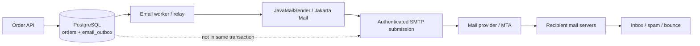
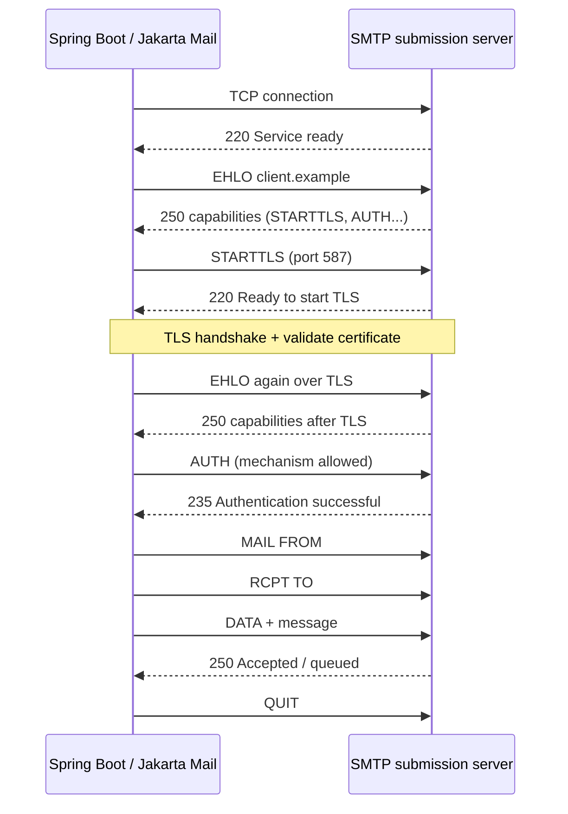
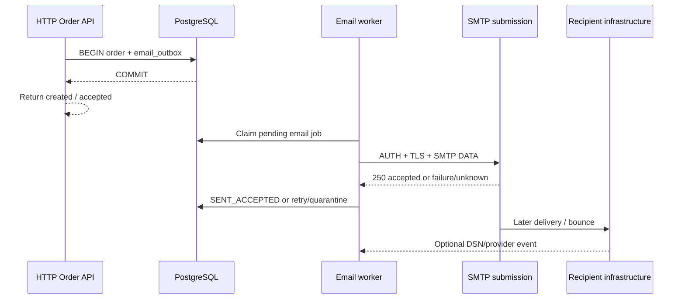
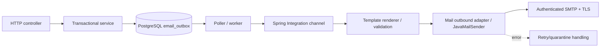
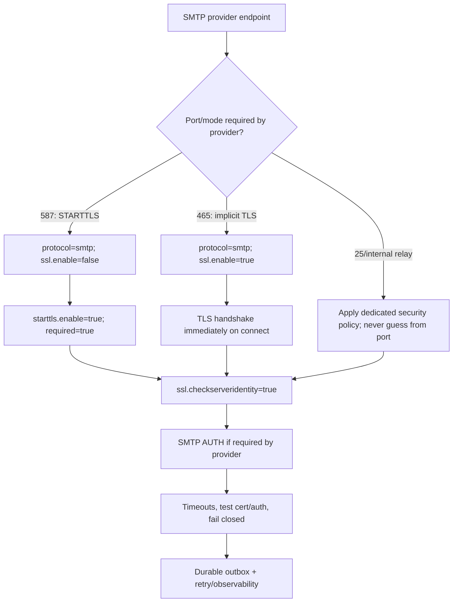

# SMTP Authentication, STARTTLS, and SSL

> **Chapter:** Email  
> **Module:** `SPRING_BOOT_INTEGRATION` — structuring Spring Boot system integrations via HTTP clients, databases, caches, message brokers, and Spring Integration adapters; emphasizing configuration management, data contracts, transactions, failures, deduplication, testing, and observability of real integration flows.
>
> **Technical scope:** Java 17+, Spring Boot 3+, Spring Framework Mail, and **Jakarta Mail** (`jakarta.mail.*` package). Examples illustrate configuring an SMTP server supporting application mail sending; providers may require app passwords, OAuth 2.0, IP allowlists, or proprietary authentication mechanisms. Check your JavaMail provider/Spring Boot versions and your operations team's SMTP policies. Never place real passwords in documentation or source code.

## 1. Problem: Sending Order Confirmation Emails with Unclear Security and Reliability

The Order Service exposes an HTTP API to create orders. After the PostgreSQL transaction commits, the system must send a confirmation email to the customer. An initial implementation often looks like this:

```text
POST /orders
  -> INSERT orders
  -> call mailSender.send(...)
  -> return HTTP 201
```

When deployed to a real environment, multiple issues emerge:

- The SMTP server only allows sending after authenticating with a username/password or OAuth token.
- Port `587` is configured, yet the application omits STARTTLS, risking credential exposure in transit.
- Switching to port `465` while still attempting plaintext connection before STARTTLS causes the TLS handshake to fail.
- The server presents a certificate whose hostname does not match, and the configuration disables certificate validation just to "make it work."
- Requests hang for a long time because SMTP connect/read timeouts are unconfigured.
- The database commits yet SMTP times out; the user retries the HTTP request and receives multiple emails.
- SMTP returns `250 OK` upon accepting the message, yet the email still might not reach the recipient's inbox.
- Email sending runs inside the same `@Transactional` Java method, yet **SMTP does not automatically join** the database transaction.

This lesson explains the exact roles of **SMTP AUTH**, **STARTTLS**, **implicit TLS/SMTPS**, secure configuration with `JavaMailSender`, and how to place email inside an HTTP–database–broker integration flow with error handling and controlled duplicates.

### Learning Objectives

After this lesson, you can:

1. Explain SMTP client submission, `EHLO`, `AUTH`, `STARTTLS`, and the TLS handshake.
2. Distinguish ports `25`, `587`, and `465` across common scenarios.
3. Configure Spring Boot to send mail using **mandatory STARTTLS** or **implicit TLS** without mixing both modes.
4. Understand `mail.smtp.auth`, `starttls.enable`, `starttls.required`, `ssl.enable`, `ssl.checkserveridentity`, and timeout properties.
5. Identify the exact boundary between server authentication, account authentication, and sender verification.
6. Build plain/MIME emails with `JavaMailSender`, safely handling encoding, HTML, recipients, and attachments.
7. Classify transient vs permanent SMTP errors and apply bounded retries with backoff.
8. Organize email sending through a durable outbox/job and understand why SMTP **does not guarantee exactly-once**.
9. Test TLS, authentication, failure modes, and observe send latency and outcomes.

## 2. What Does SMTP Do in an Integration System?

SMTP (*Simple Mail Transfer Protocol*) is the protocol for transferring email from a **mail user agent/application to a mail submission server**, and between **mail transfer agents**. In a Spring Boot application, the SMTP server is referred to as the **outbound mail server/relay/provider**.



A message can pass through several states:

1. The application **records send intent**.
2. The worker connects to and authenticates with the SMTP submission server.
3. The server **accepts** the message at the SMTP protocol level.
4. The provider attempts to forward the message toward the recipient's domain.
5. The message may land in the inbox or spam folder, be delayed, or bounce.

**SMTP `250` from a submission server does not mean the recipient read or definitely received the email.** Actual receipt depends on DNS, recipient policies, SPF/DKIM/DMARC, reputation, spam filtering, and bounce handling.

### 2.1. Do Not Confuse Address Types

| Concept | Role | Example |
|---|---|---|
| SMTP host | Server the application connects to for sending | `smtp.provider.example` |
| SMTP account | Identity authenticated by the server | `mailer@shop.example` |
| `From:` header | Sender displayed inside the email | `Orders <orders@shop.example>` |
| Envelope `MAIL FROM` | Envelope/return-path address during sending | `bounces@shop.example` |
| `RCPT TO` | Recipient in the SMTP envelope | `customer@example.net` |
| `To:`/`Cc:`/`Bcc:` headers | Address fields in the MIME message | Visible / hidden recipients |
| `Message-ID` | Email-level message identifier header | `<id@shop.example>` |

The SMTP account, `From` header, and envelope sender **do not have to be the exact same string**, though providers may require them to belong to verified domains/identities. Differences between them require a clear reason and deliverability policy.

## 3. SMTP Submission Architecture: EHLO, STARTTLS, AUTH, and DATA

A basic submission sequence:



This is the **STARTTLS model**; with implicit TLS on `465`, the TLS handshake happens **immediately when establishing the connection**, before any SMTP greeting/`EHLO`/`AUTH` exchange. Exact command order and details can vary by provider and auth mechanism.

Each step has its own responsibility:

- **EHLO**: client introduces itself and receives the list of extensions advertised by the server.
- **STARTTLS**: requests upgrading an existing plaintext SMTP connection to TLS.
- **TLS**: protects the transport channel and authenticates server identity when certificate verification is configured properly.
- **AUTH**: server verifies the client's login credentials; this is **account authentication**, not transport encryption.
- **MAIL FROM / RCPT TO**: envelope sender and recipient.
- **DATA**: transmits MIME content; only after a successful server reply do you know the server accepted the message at that boundary.

## 4. Ports 25, 587, and 465: Why Are They Not Interchangeable?

| Common Port | Typical Purpose | Starts with TLS? | Notes |
|---|---|---|---|
| `25` | SMTP relaying between MTAs; some internal relays | Usually plaintext then STARTTLS if supported | Not suitable by default for apps sending over the Internet |
| `587` | **Message submission** for clients/applications | Usually plaintext, upgraded via STARTTLS | Standard choice for SMTP AUTH + STARTTLS |
| `465` | **Submissions with implicit TLS** | **TLS immediately after TCP connect** | Does not use an initial plaintext STARTTLS sequence |

Port numbers are **common conventions**, not guarantees of server policy. An organization may run an internal relay on a non-standard port; follow your provider's documentation and verify against reality.

- `587 + STARTTLS`: client speaks SMTP, issues `STARTTLS`, and performs `AUTH` only after TLS succeeds.
- `465 + implicit TLS`: TLS handshake occurs first, then SMTP commands travel inside the TLS channel.
- `25`: primarily used between mail servers; many cloud networks block outbound TCP/25 to curb spam.

Never use port `465` with only `mail.smtp.starttls.enable=true`. Likewise, never assume port `587` encrypts automatically without properly requiring STARTTLS.

### 4.1. "SSL" in JavaMail Config Usually Means Implicit TLS

In Jakarta Mail properties, `mail.smtp.ssl.enable` carries the word "SSL" for historical API reasons, yet **its modern purpose is SMTP over a TLS channel from the start**. Do not infer that legacy TLS 1.0/SSLv3 must be enabled. Permitted TLS versions must follow your JDK, security policy, and provider.

## 5. SMTP Authentication: Who Is Allowed to Send?

SMTP AUTH is an extension allowing clients to present an identity to send email via a submission server or relay. Typical Spring Boot settings include:

```text
spring.mail.username
spring.mail.password
mail.smtp.auth=true
```

Servers may support several mechanisms:

| Mechanism | Idea | Notes |
|---|---|---|
| `PLAIN` | Credentials inside the AUTH command; not encrypted by itself | Use only over verified TLS |
| `LOGIN` | Mechanism common on some servers | Also requires TLS; no standalone security advantage |
| `XOAUTH2` | Bearer access token / OAuth2 for SMTP auth | Requires proper token issuance, refresh, and management |
| `CRAM-MD5` or legacy schemes | Challenge/response in some legacy systems | Providers/JDKs may lack support or discourage use |
| No AUTH | Relaying based on IP/mTLS/trust policy | Acceptable only when explicitly designed by security, never an open relay |

**Important:** `mail.smtp.auth=true` only enables authentication; **it does not guarantee credentials are encrypted in transit**. TLS and server identity verification are separate requirements.

### 5.1. AUTH PLAIN/LOGIN Over TLS Still Requires Protecting Passwords

Even when TLS protects data on the wire, credentials can still leak through:

- Config files or CI/CD build logs.
- `application.yml` committed to Git.
- Debug logs printing `AUTH` commands or mail headers.
- Tracing/exception messages containing connection URLs.
- Process memory dumps or unrotated secrets.
- Overly broad SMTP account permissions allowing arbitrary From-domain spoofing.

Use a secret manager, Kubernetes Secrets, or protected environment variables with least privilege, rotation, and access controls. Never put passwords or OAuth access tokens into message payloads or correlation headers.

## 6. STARTTLS: Upgrading an Existing Connection

STARTTLS starts with plaintext SMTP and **upgrades the channel** to TLS on the same socket. In JavaMail:

```properties
mail.smtp.starttls.enable=true
mail.smtp.starttls.required=true
mail.smtp.ssl.checkserveridentity=true
```

The first two properties are **not equivalent**:

- `starttls.enable=true`: allows/requests STARTTLS if the server advertises support.
- `starttls.required=true`: mandates STARTTLS; if the server lacks support or TLS negotiation fails, **do not send mail in plaintext** under this policy.

Set **both** when security policy mandates encryption for SMTP submission on port `587`. Depending on the provider version, `required=true` may imply TLS is needed; declaring both flags explicitly makes security reviews clearer.

### 6.1. STARTTLS Stripping and Downgrade

An attacker or interfering proxy on the initial plaintext exchange can strip the STARTTLS extension advertisement. If only `starttls.enable=true` is set without requiring it, the client can fall back to unencrypted communication in some setups.

**Never accept "STARTTLS if available, otherwise send anyway"** when transmitting credentials or sensitive data during submission. `starttls.required=true` closes this downgrade path by failing whenever TLS cannot be established.

This protects the **application-to-SMTP-server hop**; it does not guarantee every downstream MTA hop uses TLS or that email is end-to-end encrypted to the recipient.

### 6.2. Re-Reading Capabilities After STARTTLS

Per SMTP protocol behavior, the client usually sends `EHLO` again **after the TLS handshake** to fetch extensions over the encrypted channel, including AUTH mechanisms that servers withhold until TLS is active. Mail libraries handle these protocol mechanics; you do not issue raw SMTP commands yourself when using `JavaMailSender`.

## 7. Implicit TLS on 465: TLS First, SMTP Second

With implicit TLS, the server expects a **TLS ClientHello immediately**. Only after the TLS handshake completes does the client exchange SMTP greetings.

Core properties:

```properties
mail.smtp.ssl.enable=true
mail.smtp.ssl.checkserveridentity=true
mail.smtp.auth=true
```

Do not combine this with sending plaintext `STARTTLS` before the handshake. When a provider requires port `465`, standard configuration uses `protocol=smtp`, `port=465`, and `mail.smtp.ssl.enable=true`; you do not need to change `spring.mail.protocol` to an arbitrary value just because it is called "SMTPS."

### 7.1. Both STARTTLS and Implicit TLS Can Be Secure

Both mechanisms can protect the **SMTP submission channel** with properly configured TLS. Never conclude "465 is always safer than 587" based purely on port numbers. What actually determines security includes:

1. **Mandatory** TLS enforcement.
2. Certificate chain and hostname verification.
3. TLS protocols/ciphers compliant with JDK/security policies.
4. Proper credential/auth mechanisms.
5. A trusted, well-operated provider/host.
6. Zero unintended plaintext fallback.

## 8. TLS Certificates: Encryption Alone Is Insufficient Without Server Verification

TLS must verify **you are talking to the intended SMTP host**. Skipping certificate checks allows an intermediary to impersonate the server even though the connection technically "uses TLS."

Essential checks:

- The certificate is unexpired and chains to an accepted trust anchor.
- The hostname you connect to matches the certificate's SAN/valid identity.
- TLS versions and ciphers comply with security policy.
- No unauthorized TLS-intercepting proxy sits outside organizational policy.
- The client uses the managed JDK CA truststore or an approved custom truststore.

In Jakarta Mail, enable:

```properties
mail.smtp.ssl.checkserveridentity=true
```

This property applies to **SSL/TLS sockets**, including STARTTLS SMTP flows on compatible providers.

### 8.1. Unsafe "Fixes"

Never resolve `PKIX path building failed` or hostname errors by adding:

```properties
# Examples NOT recommended for production:
mail.smtp.ssl.trust=*
mail.smtp.ssl.checkserveridentity=false
```

`ssl.trust=*` in compatible providers trusts every server certificate, defeating CA verification. `checkserveridentity=false` skips hostname matching. Both expose connections to man-in-the-middle attacks.

The right fix: connect to an SMTP hostname/provider with a valid certificate, fix DNS/CA chains/truststores, and install internal CAs via approved security procedures. If a server uses an internal certificate, distribute the **specific approved CA** rather than disabling verification globally.

### 8.2. TLS Protocols and the JDK

You can restrict TLS protocols if required by policy, e.g., via `mail.smtp.ssl.protocols`. Never hardcode a protocol string unsupported by your JDK/provider; disabling TLS 1.0/1.1 and picking TLS 1.2/1.3 cipher suites must align with your current security baseline. When troubleshooting, inspect TLS handshake/cert details and JDK security settings instead of hastily downgrading.

## 9. Spring Boot: Email-Sending Dependencies

Spring Boot provides the mail starter integrating Spring Framework `JavaMailSender` with a compatible Jakarta Mail implementation:

```gradle
dependencies {
    implementation("org.springframework.boot:spring-boot-starter-mail")

    // Example when the app also uses a database/outbox:
    implementation("org.springframework.boot:spring-boot-starter-jdbc")
    runtimeOnly("org.postgresql:postgresql")

    testImplementation("org.springframework.boot:spring-boot-starter-test")
}
```

Spring Boot can auto-configure `JavaMailSenderImpl` when starter/classpath and `spring.mail.*` conditions match. Declare a custom `JavaMailSender` only when specialized behavior is required; a custom bean can cause auto-configuration to **back off**, meaning standard properties, TLS, and timeouts are no longer applied automatically.

### 9.1. Jakarta Mail vs javax.mail

In Spring Boot 3+, typical imports are:

```java
import jakarta.mail.MessagingException;
import jakarta.mail.internet.MimeMessage;
import org.springframework.mail.javamail.JavaMailSender;
import org.springframework.mail.javamail.MimeMessageHelper;
```

`javax.mail.*` examples belong to the prior JavaMail/Java EE generation and **cannot be mixed arbitrarily** with Spring Boot 3. During upgrades, align the BOM, mail provider, Jakarta namespaces, and real integration tests.

### 9.2. JavaMailSender Is Not an Email Queue

`JavaMailSender.send(...)` is an API for transmitting email from the application to the mail server and is blocking I/O by nature. It does not maintain a durable queue, provide deduplication or post-restart retries, or ingest bounces/complaints. Those responsibilities belong to application services, outboxes, workers, provider APIs, and operations.

## 10. Configuring Spring Boot with AUTH + STARTTLS on 587

Example `application.yml`:

```yaml
spring:
  mail:
    host: ${SMTP_HOST}
    port: 587
    protocol: smtp
    username: ${SMTP_USERNAME}
    password: ${SMTP_PASSWORD}
    default-encoding: UTF-8
    properties:
      "[mail.smtp.auth]": "true"
      "[mail.smtp.starttls.enable]": "true"
      "[mail.smtp.starttls.required]": "true"
      "[mail.smtp.ssl.enable]": "false"
      "[mail.smtp.ssl.checkserveridentity]": "true"
      "[mail.smtp.connectiontimeout]": "5000"
      "[mail.smtp.timeout]": "10000"
      "[mail.smtp.writetimeout]": "10000"

app:
  email:
    from-address: no-reply@shop.example
    from-name: Shop Orders
```

Here:

- `spring.mail.host/port`: submission server address.
- `spring.mail.username/password`: credentials issued specifically for the application.
- `mail.smtp.auth=true`: enables SMTP AUTH when required by the provider.
- `starttls.enable/required=true`: **mandates upgrading to TLS** before sending.
- `ssl.enable=false`: disables implicit TLS on initial socket connect.
- `ssl.checkserveridentity=true`: verifies the server's hostname.
- `connectiontimeout/timeout/writetimeout`: Jakarta Mail timeouts in **milliseconds**, not `Duration` properties with `5s` suffixes.
- `app.email.*`: **custom application properties**; they do not create beans or set `From` headers automatically unless your code reads them.

Bracket syntax `"[mail.smtp.auth]"` tells the Spring Boot binder to preserve dots in the map key. If your project formats properties differently, verify with an integration test that JavaMail actually receives the **exact `mail.smtp.*` keys**, avoiding configs that look valid in YAML yet silently have no effect.

### 10.1. Never Commit Literal Passwords to Git

`SMTP_PASSWORD` must be injected via a secret store, secret mount, or protected environment variable. Never embed fallback defaults like `${SMTP_PASSWORD:changeme}` in production, or a missing secret can leave the system running with weak credentials or confusing auth failures.

### 10.2. Per-Environment Configuration

| Environment | SMTP Target | Credentials / TLS |
|---|---|---|
| Local developer | Mail catcher or fake SMTP | Never use production credentials; test with policy-appropriate servers |
| CI integration test | Test-controlled SMTP server | Verify both auth/TLS and failure paths |
| Staging | Provider staging/sandbox | TLS, certificates, and secrets mirroring production |
| Production | Real submission provider | AUTH, mandatory TLS, hostname validation, timeouts, ACLs |

Never allow TLS-less local configuration to accidentally leak into production profiles. Enforce profiles, CI validation, health checks, and mandatory configuration tests in the target environment.

## 11. Configuring Implicit TLS on 465

If the SMTP provider requires implicit TLS:

```yaml
spring:
  mail:
    host: ${SMTP_HOST}
    port: 465
    protocol: smtp
    username: ${SMTP_USERNAME}
    password: ${SMTP_PASSWORD}
    default-encoding: UTF-8
    properties:
      "[mail.smtp.auth]": "true"
      "[mail.smtp.ssl.enable]": "true"
      "[mail.smtp.ssl.checkserveridentity]": "true"
      "[mail.smtp.starttls.enable]": "false"
      "[mail.smtp.connectiontimeout]": "5000"
      "[mail.smtp.timeout]": "10000"
      "[mail.smtp.writetimeout]": "10000"
```

**Do not copy both the 587 and 465 blocks into one profile with overlapping properties.** Pick **one mode** matching the provider:

| Property | Port 587 | Port 465 |
|---|---|---|
| `spring.mail.protocol` | `smtp` | `smtp` |
| `mail.smtp.auth` | `true` | `true` |
| `mail.smtp.starttls.enable` | `true` | `false` |
| `mail.smtp.starttls.required` | `true` | Not needed |
| `mail.smtp.ssl.enable` | `false` | `true` |
| `mail.smtp.ssl.checkserveridentity` | `true` | `true` |

If a server supports both, choose based on SLA, security, and provider guidance; never enable both modes on the same connection.

## 12. Configuration Precedence and Replacing the Default Bean

An integration system may use multiple SMTP accounts: transactional mail, marketing mail, tenant-specific accounts, or provider failover.

Scenarios:

- Only **one SMTP provider**: letting Boot auto-configure `JavaMailSender` from `spring.mail.*` is usually simplest.
- Multiple providers: define distinct `JavaMailSenderImpl` beans with `@Qualifier` or a per-tenant/service adapter map, each with isolated settings and credentials.
- Short-lived OAuth tokens: implement a token-refresh / custom authenticator strategy rather than treating static strings like passwords.
- Runtime provider switching: manage per-provider connection/auth/TLS properties alongside retry and circuit-breaker policies.

When declaring `JavaMailSender` manually, never assume Boot will automatically populate host, username, password, TLS, and timeouts onto your custom bean. Assert exact properties on every instance used across flows. Especially, **never share a mutable `JavaMailSenderImpl` and swap username/password before each send** across concurrent threads, or messages may leak across accounts/tenants.

### 12.1. Do Not Neglect Mail Template Configuration

`spring.mail.*` configures only **transport connectivity**. `From`, `Reply-To`, template names/versions, locales, allowed recipients, tenants, and branding belong to the application contract and should have dedicated `@ConfigurationProperties` and validation (especially for from-addresses).

## 13. Sending Plain-Text Emails with JavaMailSender

Use `SimpleMailMessage` for basic `text/plain` emails:

```java
import org.springframework.mail.SimpleMailMessage;
import org.springframework.mail.javamail.JavaMailSender;
import org.springframework.stereotype.Service;

@Service
public class PlainOrderEmailSender {

    private final JavaMailSender mailSender;

    public PlainOrderEmailSender(JavaMailSender mailSender) {
        this.mailSender = mailSender;
    }

    public void sendReceipt(String recipient, String orderNumber) {
        SimpleMailMessage message = new SimpleMailMessage();
        message.setFrom("no-reply@shop.example");
        message.setTo(recipient);
        message.setSubject("Order confirmation " + orderNumber);
        message.setText(
            "Order " + orderNumber + " has been recorded.");
        mailSender.send(message);
    }
}
```

`SimpleMailMessage` fits plain text and does not support MIME attachments or rich HTML. `send` is a **blocking call** until completion or an I/O/SMTP error occurs. Never call it directly on a Reactor/Netty event loop, and never assume it becomes "automatically async."

### 13.1. Input Data Still Needs Validation

- `recipient` must come from a verified record/identity and comply with delivery policy.
- `orderNumber` must be validated data, never allowing arbitrary CR/LF characters into subjects or headers.
- If an API accepts recipient lists, verify sender authorization, apply rate limits, and guard against abuse/open relaying.
- Never allow requests to pick arbitrary `From` domains or `Reply-To` addresses without an allowlist.

Jakarta Bean Validation's `@Email` only checks basic syntax—**it does not guarantee the address exists or can receive mail**; bounces and delivery status belong to another layer.

## 14. HTML, Unicode, and Attachments with MimeMessageHelper

Real-world emails often need HTML, UTF-8, MIME multiparts, and file attachments. Use `MimeMessage`:

```java
import jakarta.mail.MessagingException;
import jakarta.mail.internet.MimeMessage;

import org.springframework.mail.MailPreparationException;
import org.springframework.mail.javamail.JavaMailSender;
import org.springframework.mail.javamail.MimeMessageHelper;
import org.springframework.stereotype.Service;

@Service
public class OrderMimeEmailSender {

    private final JavaMailSender mailSender;
    private final EmailTemplateRenderer templates;

    public OrderMimeEmailSender(
            JavaMailSender mailSender, EmailTemplateRenderer templates) {
        this.mailSender = mailSender;
        this.templates = templates;
    }

    public void sendReceipt(ReceiptEmailJob job) {
        MimeMessage message = mailSender.createMimeMessage();

        try {
            MimeMessageHelper helper =
                new MimeMessageHelper(message, true, "UTF-8");

            helper.setFrom("no-reply@shop.example", "Shop Orders");
            helper.setTo(job.recipient());
            helper.setSubject("Order confirmation " + job.orderNumber());

            // Application-controlled template; HTML-escape input data.
            String plain = templates.renderPlain(job);
            String html = templates.renderHtmlEscaped(job);
            helper.setText(plain, html);

            // If attaching files, attach only validated resources.
            // helper.addAttachment("invoice.pdf", validatedResource);
        } catch (MessagingException | java.io.UnsupportedEncodingException ex) {
            throw new MailPreparationException(
                "Cannot prepare receipt email", ex);
        }

        mailSender.send(message);
    }
}
```

`ReceiptEmailJob` and `EmailTemplateRenderer` are application-defined types. `renderHtmlEscaped(...)` must escape order/partner data before inserting it into HTML; never concatenate raw input into HTML assuming MIME encoding provides XSS/sanitization.

**API note:** `MimeMessageHelper.setFrom(String, String)` can throw `UnsupportedEncodingException`, while other setters throw `MessagingException`. Catching both exceptions matches the overloads used here; if you switch overloads, verify compilation against your version.

### 14.1. Multipart and Content Types

- `text/plain` aids simple clients and accessibility.
- `text/html` provides formatting, yet poses risks of external links/images and phishing if templates are uncontrolled.
- `multipart/alternative` carries both plain text and HTML.
- `multipart/mixed` typically wraps attachments.
- UTF-8 handles Vietnamese characters cleanly; it does not replace MIME structure, escaping, or domain authentication.

Use a managed template engine and test rendering with Vietnamese diacritics, `&`, `<`, and long strings.

## 15. SMTP AUTH and OAuth 2.0: Passwords Are Not the Only Option

Many providers allow or require OAuth 2.0 instead of traditional username/password auth. For SMTP, the common mechanism is `XOAUTH2`. However:

- Some providers **disallow standard username/password SMTP AUTH**, even when web login exists.
- Some providers require a dedicated "application password" for SMTP.
- OAuth access tokens are short-lived and must be refreshed before expiry or upon server rejection.
- Never place a refresh token statically inside an SMTP password property.
- Scopes/permissions, tenants, account delegation, and sender identities must be authorized by the provider.
- Even when switching to OAuth, the auth mechanism changes while **TLS remains mandatory**.

`mail.smtp.auth.mechanisms=XOAUTH2` is a common Jakarta Mail property where supported, yet it is **not enough** to implement token refresh or authorization flows on its own. Build a custom credentials/authenticator adapter or use the provider's official SDK/API per documentation.

### 15.1. Do Not Fabricate Placeholder OAuth Code

Each provider has distinct token endpoints, scopes, and security controls. A generic guide cannot provide one OAuth implementation valid for every SMTP host. Keep your mail-sending layer behind `MailSender`/`JavaMailSender` or an adapter abstraction so authentication strategies can be swapped and tested independently.

## 16. Timeouts: Preventing Hung Requests and Exhausted Worker Threads

SMTP sending typically involves three wait phases:

| Jakarta Mail Property | Controls | Example Units |
|---|---|---|
| `mail.smtp.connectiontimeout` | Time waiting to establish TCP connect | milliseconds |
| `mail.smtp.timeout` | Socket read timeout waiting for replies | milliseconds |
| `mail.smtp.writetimeout` | Socket write timeout | milliseconds |

Example:

```properties
mail.smtp.connectiontimeout=5000
mail.smtp.timeout=10000
mail.smtp.writetimeout=10000
```

Never rely on "infinite" default timeouts or only an HTTP client timeout elsewhere. A single send executes multiple commands/recipients, so **total send time** can still exceed any individual socket timeout. Under strict SLAs, also bound worker execution budgets, batch sizes, executor capacity, and monitoring.

### 16.1. A Timeout Does Not Prove the Server Never Received the Message

Scenario:

```text
App sends DATA + terminator.
SMTP server receives and queues the message.
Server replies 250, but the response is lost on the network.
JavaMailSender observes a timeout / closed connection.
Worker retries and sends the same content again.
The recipient may see two emails.
```

Consequently, **SMTP usually supports at-least-once at the application layer**, not exactly-once delivery across network failures. Record an "outcome unknown" state and enforce reconciliation or resend caps for sensitive emails.

### 16.2. SMTP Is Blocking I/O

`JavaMailSender.send(...)` is synchronous and will block a WebFlux event loop if called directly. In reactive architectures, offloading mail sending to a **durable outbox worker** is usually preferable. If forced to bridge legacy APIs directly, bounded `Mono.fromCallable(...).subscribeOn(Schedulers.boundedElastic())` works, though it **only shifts blocking I/O to another thread pool** without making SMTP nonblocking or durable.

## 17. SMTP Responses: 2xx, 4xx, and 5xx Mean Different Things

SMTP status codes reflect the state of a specific protocol step:

| Class | General Meaning | Recommended Policy |
|---|---|---|
| `2xx` | Current command succeeded | Proceed; `250` after `DATA` = server accepted |
| `3xx` | Server expects more data from client | E.g., `354` before `DATA` payload |
| `4xx` | Transient/temporary failure | Retry with backoff and deadline |
| `5xx` | Permanent failure for current call/conditions | Classify and fix config/address before retrying |

Common diagnostic codes:

| Code / Situation | Typical Interpretation | Action |
|---|---|---|
| `220` | SMTP server ready / ready for TLS | Proceed with handshake |
| `235` | AUTH succeeded | Proceed with envelope |
| `250` | Command accepted; after DATA usually means queued | Record accepted; do not mark delivered |
| `354` | Server ready to receive DATA | Transmit MIME body |
| `421` | Service not available, closing | Bounded retry with backoff |
| `450/451/452` | Temporary mailbox/processing/resource failure | Bounded retry; watch provider quotas |
| `530` | Authentication required | Check AUTH/TLS/account policy |
| `535` | Authentication failed | Check credentials/token/scopes/account lock |
| `550` | Rejected mailbox/policy | Check recipient, sender domain, and policy |
| `552` | Quota/message size exceeded | Shrink attachments or handle per provider |

**Enhanced status codes** like `5.7.8` or `4.7.0` add finer context; exact mappings depend on the provider. Never read a `550` and immediately conclude the address does not exist: it can also indicate policy blocks, sender reputation, or domain authentication failures.

### 17.1. Multi-Recipient Sends Can Partially Succeed

When sending one message to multiple `RCPT TO` addresses, the server may accept some and reject others. Jakarta Mail exposes properties/exceptions governing partial send behavior (such as `mail.smtp.sendpartial` where supported). Using it requires **per-recipient** tracking and inspecting exceptions after partial failures.

For critical transactional emails, it is usually cleaner to create **one identified job per recipient** or explicit delivery unit. Never batch 1,000 recipients into one call and retry everyone because a few addresses were rejected.

## 18. Spring Mail Exceptions and How to Classify Them

Spring Framework Mail uses the hierarchy under `org.springframework.mail.MailException`. Common subclasses:

- `MailAuthenticationException`: account authentication failure.
- `MailSendException`: failure while sending after preparing one or more messages.
- `MailPreparationException`: failure building the MIME message.
- `MailParseException`: failure parsing the message.
- `MailException`: general Spring mail exception superclass.

Nested causes may include Jakarta Mail's `MessagingException` or provider-specific SMTP exceptions carrying reply codes. Never assume every `MailSendException` carries a single status code.

### 18.1. Classify by Policy Instead of Retrying Every MailException

```java
public enum EmailFailureCategory {
    TRANSIENT_SMTP,
    AUTHENTICATION,
    INVALID_RECIPIENT_OR_MESSAGE,
    CONFIGURATION_OR_TLS,
    UNKNOWN_OUTCOME
}
```

Handling patterns:

- `MailAuthenticationException`: **do not retry every second**; alert credential/token owners to avoid locking accounts.
- Certificate/hostname handshake errors: configuration/security incident; fail closed and fix truststore/host.
- Clear provider `4xx`: transient; apply backoff and retry budget.
- Clear recipient/policy `5xx`: permanent/quarantine that job; no endless retries.
- Lost connection after `DATA`: **unknown outcome**; evaluate resending and deduplication per provider/business workflow.
- `MailPreparationException`: usually a template/data bug; fix payload before retrying.

Classification must inspect **the exception chain, SMTP stage, and actual provider response**; never parse free-form error text as a stable contract.

## 19. From, Envelope Sender, Reply-To, and Sending Policy

An email has several identity layers:

1. SMTP AUTH account: who is authorized to log in.
2. `MAIL FROM`: envelope return-path receiving bounces/delivery feedback.
3. `From:`: sender displayed to the recipient.
4. `Reply-To:`: destination when the user clicks Reply.
5. `Message-ID:`: message reference ID in the MIME header.

You can set `From: orders@shop.example` while authenticating as `mailer-service@shop.example` if the provider authorizes that domain/sender. **Never** allow tenants or HTTP requests to specify arbitrary `From` domains—that enables phishing and spoofing.

`mail.smtp.from` can set the SMTP envelope sender in compatible Jakarta Mail providers; it **does not automatically alter** MIME `From:`. Manage sending identities, bounce domains, reply-to policies, and auditing per provider design.

### 19.1. Bcc and Privacy

- `To`: visible primary recipients.
- `Cc`: visible copied recipients.
- `Bcc`: recipients hidden from other recipients.

Use `MimeMessageHelper.setBcc(...)` or appropriate APIs to prevent leaking recipient lists, though **never assume Bcc solves all privacy needs**. Transactional and marketing emails often require individual per-recipient messages to manage unsubscribes, personalization, tracking, consent, and retries.

### 19.2. Header Injection

A subject or display name containing CR/LF from untrusted input risks header injection if code constructs raw MIME headers manually. Use `MimeMessageHelper`/`InternetAddress` APIs and validate length/format; never assemble raw SMTP/MIME text from HTTP request strings.

## 20. SPF, DKIM, DMARC, and TLS Solve Different Problems

| Technology | Primary Purpose | What It Does Not Replace |
|---|---|---|
| **SMTP AUTH** | Client proves permission to send through the submission server | Does not prove recipient received the mail |
| **TLS/STARTTLS** | Protects client → SMTP server channel | Does not guarantee end-to-end encryption |
| **SPF** | Domain publishes IPs/servers authorized to send for envelope identity | Does not encrypt messages |
| **DKIM** | Cryptographic signature verifying content/headers under domain signing key | Does not replace SMTP client authentication |
| **DMARC** | Policy/alignment for visible `From` domain based on SPF/DKIM | Does not guarantee inbox placement |
| **MTA-STS/DANE** | Strengthens TLS enforcement between mail servers where deployed | Does not replace AUTH on app submission |

An application with `mail.smtp.starttls.required=true` can still land in spam if SPF/DKIM/DMARC are misconfigured. Conversely, valid SPF/DKIM **does not permit sending SMTP passwords in plaintext**.

### 20.1. DNS and Deliverability Are Operational Responsibilities

Coordinate with your email provider or DNS administrators to:

- Verify `From` domains and sender identities.
- Configure SPF, DKIM, DMARC, and bounce/return-path per provider.
- Monitor complaints, bounces, suppression lists, rate limits, and reputation.
- Distinguish **accepted by provider** from **delivered**, **bounced**, and **opened**.
- Protect recipient addresses and comply with consent/opt-out rules for each email category.

## 21. Never Send SMTP Directly Inside an HTTP + Database Transaction

Anti-pattern:

```java
@Transactional
public Order createOrder(CreateOrderRequest request) {
    Order order = repository.insert(request);
    mailSender.send(buildReceipt(order)); // External I/O inside DB TX.
    return order;
}
```

Problems:

- Slow SMTP calls prolong JDBC connections, transactions, and row locks.
- SMTP may **accept the email** before the database rolls back, sending a receipt for a nonexistent order.
- The database may commit and the app crash before sending, losing the email.
- HTTP retries can produce duplicate emails if request idempotency is missing.
- Default `@Transactional` cannot roll back messages already accepted by an SMTP server.

Using a **transactional outbox** for email is an operationally sound approach:



**Outboxes preserve send intent after orders commit**, yet still do not eliminate duplicate emails when SMTP outcomes are lost. Define acceptable duplicate bounds and reconciliation procedures.

## 22. Designing the email_outbox Table and Business Key

PostgreSQL example:

```sql
CREATE TABLE email_outbox (
    id BIGINT GENERATED BY DEFAULT AS IDENTITY PRIMARY KEY,
    business_key VARCHAR(180) NOT NULL UNIQUE,
    recipient VARCHAR(320) NOT NULL,
    template_code VARCHAR(80) NOT NULL,
    template_version INTEGER NOT NULL,
    template_data_json TEXT NOT NULL,
    state VARCHAR(32) NOT NULL DEFAULT 'PENDING',
    attempts INTEGER NOT NULL DEFAULT 0,
    next_attempt_at TIMESTAMPTZ NOT NULL DEFAULT CURRENT_TIMESTAMP,
    locked_by VARCHAR(120),
    locked_until TIMESTAMPTZ,
    smtp_accepted_at TIMESTAMPTZ,
    last_error_category VARCHAR(80),
    created_at TIMESTAMPTZ NOT NULL DEFAULT CURRENT_TIMESTAMP,
    updated_at TIMESTAMPTZ NOT NULL DEFAULT CURRENT_TIMESTAMP
);

CREATE INDEX idx_email_outbox_pending
    ON email_outbox (state, next_attempt_at, id);
```

**`business_key` must remain stable across retries**, e.g.:

```text
receipt:order-1042:customer-392:v1
```

It represents *one business email-send intent*, not a random SMTP message ID. If the same order legitimately needs a fresh notice per policy (such as an amended invoice), issue an **explicit new business key/version**, never generating a new key on every HTTP retry.

### 22.1. Protecting Data Inside the Outbox

Email addresses and template variables can contain PII. Ensure:

- Store only necessary fields; avoid dumping full order/payment objects.
- Apply encryption at rest and least-privilege DB permissions where appropriate.
- Enforce retention and cleanup policies once jobs finish.
- Never log raw `template_data_json`.
- Version templates and recipient-change policies so replays reproduce accurate emails.
- If a recipient must be corrected due to a bad address, record an audit trail of the job edit.

## 23. Writing Order and Email Intent in the Same DB Transaction

An application service can create both order and outbox records atomically:

```java
import org.springframework.stereotype.Service;
import org.springframework.transaction.annotation.Transactional;

@Service
public class OrderApplicationService {

    private final OrderRepository orders;
    private final EmailOutboxRepository emailOutbox;

    public OrderApplicationService(
            OrderRepository orders,
            EmailOutboxRepository emailOutbox) {
        this.orders = orders;
        this.emailOutbox = emailOutbox;
    }

    @Transactional
    public OrderId createOrder(CreateOrderCommand command) {
        OrderId orderId = orders.insertOnce(command);

        String emailBusinessKey =
            "receipt:" + orderId.value() + ":" + command.customerId() + ":v1";

        emailOutbox.insertIfAbsent(
            emailBusinessKey,
            command.customerEmail(),
            "ORDER_RECEIPT",
            1,
            OrderEmailData.from(command, orderId)
        );

        return orderId;
    }
}
```

`OrderRepository`, `EmailOutboxRepository`, `OrderId`, `CreateOrderCommand`, and `OrderEmailData` are application types. Both repositories must share **the same datasource/transaction manager** and enforce DB unique constraints against duplicates.

If `orders.insertOnce` is only a method name without an underlying unique request key or invariant, HTTP retries can still create duplicate orders; the email outbox cannot fix **order-domain** duplication on its own.

### 23.1. Never Send Mail in @TransactionalEventListener BEFORE_COMMIT

If an event listener sends mail before DB commit, subsequent failures can roll back the DB after SMTP already accepted the email. `@TransactionalEventListener(phase = AFTER_COMMIT)` avoids pre-commit sends, yet **in-memory callbacks can still be lost if the process crashes right after commit**. A durable outbox resolves the "committed but not yet sent" gap.

## 24. Email Worker: Lease-Based Claiming Without Holding DB Locks While Sending

Multi-instance deployments must prevent two workers from claiming the same pending job. PostgreSQL supports `FOR UPDATE SKIP LOCKED` for **fast claiming**:

```sql
WITH picked AS (
    SELECT id
    FROM email_outbox
    WHERE
      (state = 'PENDING' AND next_attempt_at <= CURRENT_TIMESTAMP)
      OR
      (state = 'SENDING' AND locked_until < CURRENT_TIMESTAMP)
    ORDER BY created_at, id
    LIMIT :batchSize
    FOR UPDATE SKIP LOCKED
)
UPDATE email_outbox AS e
SET state = 'SENDING',
    locked_by = :workerId,
    locked_until = CURRENT_TIMESTAMP + INTERVAL '2 minutes',
    attempts = e.attempts + 1,
    updated_at = CURRENT_TIMESTAMP
FROM picked
WHERE e.id = picked.id
RETURNING e.id, e.business_key, e.recipient,
          e.template_code, e.template_version, e.template_data_json,
          e.attempts;
```

Workflow:

1. Inside a **short transaction**, claim up to N jobs, assign owner + lease, and commit.
2. Perform SMTP sending **outside** the DB transaction.
3. If the server confirms `250` after `DATA`, record `SENT_ACCEPTED` (not `DELIVERED`).
4. On retryable 4xx errors, reset to `PENDING` with an advanced `next_attempt_at` and failure category.
5. On permanent errors, move to `FAILED_PERMANENT`/quarantine per policy.
6. If the outcome is lost after `DATA`, mark `UNKNOWN_OUTCOME` or execute controlled retries with audit history for reconciliation.
7. When a worker crashes, expired leases become eligible for reclaim.

### 24.1. Expired Leases Create Duplicate Send Risk

Worker A claims a job for 2 minutes, then SMTP stalls for 3 minutes; worker B reclaims it upon expiry and sends too. Therefore:

- Keep SMTP/worker timeouts smaller than the lease budget, or use heartbeats to extend leases.
- Prevent stale owners from overwriting state after lease handoff by fencing on owner token in `UPDATE` statements.
- When outcomes are ambiguous, apply duplicate-sensitive policies and query provider APIs if available.
- Track reclaimed job counts and alert when they spike.

Leases prevent **concurrent execution under normal operation**; they cannot enforce exactly-once side effects on the mail server.

## 25. SMTP Retries: At-Least-Once and Indeterminate States

Classify actions by protocol stage:

| Failure Stage | Likelihood Email Was Received | Policy |
|---|---|---|
| TCP connect fails before SMTP | No DATA sent | Bounded retries once infrastructure recovers |
| TLS handshake/cert fails | No DATA sent; security/config error | Fail closed, alert, fix cert/host |
| AUTH `535` | Not authorized to send | No tight retries; fix credentials/token |
| `RCPT TO` rejected `5xx` | Recipient rejected at that step | Permanent/quarantine for recipient |
| `4xx` before `DATA` | Not accepted at that command | Bounded retries with backoff |
| Connection lost between DATA and response | **May** have been received by server | Mark unknown; weigh resend/reconciliation |
| `250` after `DATA` | Submission server accepted | Mark accepted; await delivery status if supported |

### 25.1. Does Message-ID Prevent Duplicate Emails?

You cannot rely on `Message-ID` to make providers or mailboxes drop duplicate messages. Some systems thread or deduplicate by header, yet SMTP offers no exactly-once contract on it. You can attach a controlled, stable business correlation header for audit/reconciliation, **never treating that header as a universally enforced idempotency key**.

If your provider offers an HTTP email API with idempotency keys or request-ID lookup, consider that adapter when stronger deduplication than plain SMTP is needed; always verify the provider's exact contract.

### 25.2. Never Retry Transactional Emails Infinitely

For order confirmations, controlled retries can improve delivery rates. For OTP codes, duplicate or delayed sends pose security and usability risks; retry and expiration policies must respect token validity windows.

**Business policies—not a generic SMTP exception handler—** must define duplicate tolerance per template.

## 26. Backoff, Rate Limiting, and SMTP Quotas

Providers may enforce quotas per account/domain/IP, daily recipient caps, or transactions per second. If 1,000 jobs retry simultaneously after an outage, your application can trigger a self-inflicted retry storm.

Principles:

- Exponential backoff + jitter and max attempts/deadlines.
- Bound concurrency per worker, provider, and tenant.
- Bulkhead SMTP work so it never starves DB or HTTP threads.
- Trip circuit breakers or pause queues during prolonged AUTH/TLS/config failures.
- Prioritize template classes so critical emails keep dedicated SLAs.
- Monitor throttling/`4xx` responses, provider quotas, and oldest pending age.
- Never scale worker pools endlessly while a provider is rate-limiting.

Illustrative retry schedule:

```text
Attempt 1: immediately
Attempt 2: after 30s ± jitter
Attempt 3: after 2m ± jitter
Attempt 4: after 10m ± jitter
Attempt 5: after 30m ± jitter
Then: quarantine / operator review
```

These intervals are **not SMTP standards**; tune them to SLAs, provider retry hints, and email categories. Never retry permanent or sender-configuration failures until underlying conditions change.

## 27. Spring Integration: SMTP Outbound Adapters Do Not Replace Durability

In Spring Integration, a flow can receive a message from a channel, transform it into a MIME message, and pass it to a **mail outbound adapter/handler**.



Distinguish:

- `DirectChannel`: dispatches synchronously in the JVM; callers see SMTP errors directly.
- Default `QueueChannel`: usually in-memory RAM; jobs are lost on crash.
- `PublishSubscribeChannel`: in-JVM fan-out, not a durable broker/subscription.
- Poller reading **`email_outbox` DB**: progress survives restarts if job state/leases are well designed.
- `errorChannel`: Spring Integration error destination, not automatically a durable DLQ.

Never have an HTTP endpoint return `202` right after pushing to an in-memory `QueueChannel` while promising the email will be sent. **Commit the outbox first**, using channels for orchestration or wake-up signals.

### 27.1. When Is Spring Integration Needed?

If your email flow involves rich EIP steps (per-tenant routing, filters, template transformers, schedulers, mail adapters, retry advice, error channels), `IntegrationFlow` expresses the topology cleanly. If you simply poll a DB table and call `JavaMailSender`, a plain service/adapter may be **simpler and easier to test**.

## 28. Brokers and Email: At Which Boundary Should Consumers ACK?

Another architecture has Order Service publish `OrderCreated` to Kafka/RabbitMQ/Pulsar, with Email Service consuming and sending. Yet "consumer received the event" does not mean "email sent":

```text
Broker delivers OrderCreated
  -> Email consumer validates event
  -> INSERT email_outbox with unique business key
  -> DB COMMIT
  -> Broker ACK/offset commit
  -> Email worker sends SMTP later
```

This is safer than having the consumer call SMTP and ACK directly whenever you want **durable per-job state**.

- Consumer crashes after inserting outbox before ACK: broker redelivers; the unique key prevents duplicate job creation.
- Worker crashes after SMTP acceptance before marking sent: duplicate send risk remains on retry.
- Broker ACK confirms the event was **durably accepted by Email Service**, not that the email reached a mailbox.
- SMTP failure/retry policies live in the email worker domain without forcing broker redeliveries or stalling partitions.

### 28.1. Do Not Use Redis Cache as the Sole Business Inbox

Setting `email:sent:eventId` in Redis before DB commit can lose emails when transactions roll back. Redis can optimize rate limiting or advisory locks, yet **database unique constraints + job state** should serve as the source of truth for send decisions and recovery whenever SLAs require durability.

## 29. SMTP Security and Sending Permissions in Multi-Tenant Environments

Essential safeguards:

1. Grant SMTP access only to the mail-sender service; never let arbitrary services send from any `From` domain.
2. Enforce TLS and verify hostnames/certificates; disallow plaintext fallback when sending credentials.
3. Use environment-specific credentials and rotate per policy.
4. Restrict `From`/`Reply-To`/recipients/templates via allowlists and tenant authorization.
5. Prevent open relays on public APIs: authenticate callers, rate-limit, guard against spam, and verify recipient ownership as needed.
6. Never log full bodies, passwords, access tokens, auth headers, or raw SMTP `AUTH` exchanges.
7. Validate and bound attachment sizes/types; never read arbitrary local files or URLs from user input.
8. For multi-tenant SMTP credentials, isolate sender adapters per tenant using safe DI rather than mutating a shared singleton.
9. Protect provider bounce/complaint webhooks with signature validation.
10. Implement unsubscribe/consent policies for marketing mail without blindly letting marketing opt-outs block critical transactional emails.

### 29.1. STARTTLS Does Not Protect Against All Content Risks

STARTTLS protects only the transport hop from your app to the SMTP server. Providers and downstream MTAs may handle contents in plaintext. If an email involves highly sensitive data, consider **not sending the raw data in email**; send an expiring authenticated portal link or use end-to-end encryption as required.

## 30. Unit Testing: Do Not Call Real SMTP in Unit Tests

Unit tests should verify policy and template layers without network calls:

- Correct `From`, recipient, and subject per template.
- HTML escaping of input values.
- Rejection of unauthorized recipients or `From` addresses.
- Stable outbox business key across retried requests.
- Permanent errors classified and never infinitely retried.
- Job state moves to accepted only when the adapter reports corresponding success.

You can abstract mail transport:

```java
public interface EmailTransport {
    void send(PreparedEmail email);
}

public record PreparedEmail(
    String recipient,
    String subject,
    String plainBody,
    String htmlBody
) {}
```

In unit tests, a fake `EmailTransport` captures sent `PreparedEmail` objects and throws controlled exceptions to test workers and state machines. **Avoid forcing unit tests to mock low-level Jakarta Mail commands** when you actually want to verify templates and retry policies rather than SMTP protocol internals.

### 30.1. Do Not "Test Real Email" by Asserting JavaMailSender.send Didn't Throw

If you only mock `JavaMailSender`, you do not verify:

- Credentials are accepted by the server.
- STARTTLS/implicit TLS negotiates properly.
- Certificate chains/hostnames validate.
- The server accepts the recipient.
- MIME encoding is parsed cleanly by servers/clients.
- Timeouts and network connection failures behave correctly.

Those belong in SMTP integration tests or a test server configured to simulate real handshakes and responses.

## 31. Integration Testing with a Fake SMTP Server

Use an SMTP test server such as GreenMail or a containerized SMTP catcher via Testcontainers with matching dependency versions to verify sending in isolation **without emailing the Internet**.

A test should:

1. Start the fake SMTP server and bind `spring.mail.host/port` dynamically.
2. Provision test AUTH credentials if the server supports it.
3. Enable STARTTLS or implicit TLS matching the test server.
4. Configure the appropriate test CA/truststore and enable hostname verification.
5. Invoke `JavaMailSender` through the real adapter.
6. Assert the server received the expected `To`/`From`/Subject/UTF-8/MIME body.
7. Have the server reject AUTH, drop STARTTLS, or return `4xx`/`5xx` errors.
8. Verify application retry classification, outbox state updates, and alerts.
9. Simulate slow responses or socket drops between `DATA` and final reply to verify unknown-outcome handling.
10. Ensure no test emails ever target real external addresses.

### 31.1. TLS Tests Must Actually Support TLS

Many mail catchers only speak plaintext or lack AUTH/STARTTLS support. Those tools are great for inspecting MIME content, yet **do not prove production TLS configuration works**. Test separately against an SMTP test server with certificates and matching protocol support.

### 31.2. Testing Certificate Failures

Test against a server presenting:

- A self-signed certificate absent from the truststore.
- A hostname mismatching `spring.mail.host`.
- A simulated expired certificate.
- Missing STARTTLS advertisement when `starttls.required=true`.

Expected result: **fail closed**, never falling back to plaintext or accepting arbitrary certificates.

## 32. Inspecting SMTP Endpoints and TLS Handshakes When Troubleshooting

With proper operational authorization and TLS tools, you can inspect SMTP/TLS in both modes. Example using OpenSSL in an authorized environment:

```bash
# STARTTLS: issue STARTTLS over SMTP, then handshake.
openssl s_client -starttls smtp \
  -connect smtp.provider.example:587 \
  -servername smtp.provider.example

# Implicit TLS: handshake immediately on connect.
openssl s_client \
  -connect smtp.provider.example:465 \
  -servername smtp.provider.example
```

These commands illustrate **inspecting the handshake and certificate chain**; they do not test SMTP AUTH or sending rights, and exact OpenSSL flags/versions vary. Verify certificate chain, hostname, and verification exit codes using tools supporting strict hostname checks; merely printing a certificate to stdout **does not mean validation succeeded**.

Never pass SMTP passwords directly on commands that shell history or logs might capture. Never test `AUTH PLAIN` over an unverified non-TLS connection.

### 32.1. Jakarta Mail Debug Can Expose Sensitive Data

Options like `spring.mail.properties["mail.debug"]` or `session.setDebug(true)` reveal SMTP commands in dev/test, yet can print headers, addresses, metadata, and sensitive details. Enable only in controlled environments for brief windows, mask secrets, and restrict log access. Never log full bodies or recipient lists in production merely to debug an auth error.

## 33. SMTP Connection Health, Fail-Fast, and Readiness

Spring Boot supports `spring.mail.test-connection` in supported setups; when enabled, the app attempts to connect to the mail server at startup.

```yaml
spring:
  mail:
    test-connection: true
```

This catches certain connectivity/auth errors at startup, yet:

- It does not prove every recipient will be accepted.
- It does not prove SPF/DKIM/DMARC or delivery works.
- It does not guarantee the server stays reachable after startup.
- It does not replace a policy-driven **end-to-end test send**.
- It couples startup availability to provider outages; choose fail-fast vs degraded mode based on system role.

When email runs asynchronously from an outbox, you can keep the API accepting orders during brief SMTP outages while reporting **email-processing health** separately via readiness/metrics. If sending email is the service's sole function, worker failure may need to affect readiness.

### 33.1. Health Checks Must Not Spam the SMTP Server

Never send real test emails every few seconds as a health check. Distinguish lightweight connectivity checks, provider availability, and scheduled rate-limited canary sends. Alerts on outbox backlog age and error rates usually reflect business impact far more accurately than connect-only probes.

## 34. Observability from HTTP to Mail Server and Mailbox

| Milestone | Metric / Event | Meaning |
|---|---|---|
| Order commit | `orders_created_total` | Order recorded |
| Email intent created | `email_outbox_enqueued_total` | Durable send job created |
| Outbox backlog | Pending count / oldest age | Mail waiting too long or provider down |
| Worker claim | Jobs claimed / leases expired | Are workers picking up jobs? |
| SMTP connect/auth/TLS | Latency and failure category | Network/cert/credential issues |
| SMTP send | Accepted / failure / unknown outcome | Did submission server accept? |
| Retry | Attempt count, delay, exhausted | Outage or retry storm |
| Bounce/complaint | Provider webhook/event | Recipient unreachable or opted out |
| Delivery | Delivered event if supported | Provider confirmed handoff per contract |
| Business outcome | Email SLA / notification acknowledged | Business target metric |

### 34.1. Minimal, Structured Logging

Example fields to include:

```text
emailJobId, businessKey, templateCode, templateVersion,
smtpProvider, environment, attempt, failureCategory,
smtpStage, result, elapsedMs, correlationId
```

Never place raw email addresses, email bodies, tokens, or high-cardinality message IDs into metric labels. In logs, mask/hash recipients and enforce retention/permissions; `correlationId` aids tracing without replacing `businessKey`.

### 34.2. SMTP Accepted Differs from Delivered

Dashboards must distinguish:

- `PENDING`: awaiting send.
- `SENDING`: worker attempting send.
- `SENT_ACCEPTED`: SMTP server accepted the message per command response.
- `UNKNOWN_OUTCOME`: uncertain whether the server received it.
- `BOUNCED`/`COMPLAINED`: provider reported post-send issue.
- `DELIVERED`: used only with valid evidence per provider contract.
- `FAILED_PERMANENT`: halted until manual intervention or data fix.

Never report "100% emails delivered" solely from `JavaMailSender.send(...)` returning normally.

## 35. Troubleshooting: Symptoms, Causes, and Remedies

| Symptom | Common Cause | Handling Approach |
|---|---|---|
| `Connection refused` | Wrong host/port, firewall, provider down | Check DNS, network ACLs, port |
| `Read timed out` | Slow or overloaded server, lost response | Check timeouts, capacity, indeterminate send state |
| `Could not convert socket to TLS` | STARTTLS handshake/protocol/certificate issue | Check port, TLS support, truststore |
| `STARTTLS is required but host does not support STARTTLS` | Port/server does not advertise STARTTLS | Use matching endpoint/policy; do not disable `required` |
| Port `465` protocol error | Client sending plaintext before TLS | Enable `mail.smtp.ssl.enable=true` |
| Port `587` protocol/TLS error | Client using implicit TLS on wrong port | Enable STARTTLS; disable implicit TLS |
| `PKIX path building failed` | Untrusted CA chain | Fix truststore/certificates; never use `trust=*` |
| `No subject alternative names matching...` | Hostname mismatch | Use correct SMTP host/certificate |
| `535 Authentication failed` | Wrong password/token/app password/scopes | Check credentials, OAuth, account lock |
| `530 Authentication required` | Missing AUTH or AUTH allowed only after TLS | Check AUTH and STARTTLS ordering |
| `550 Sender rejected` | Domain/sender unverified or policy blocked | Check From, envelope, SPF/DKIM/DMARC |
| `550 Recipient rejected` | Invalid address or mailbox policy | Quarantine that recipient; stop infinite retries |
| `421/451` during burst | Quotas/throttling/provider outage | Backoff/jitter, bound concurrency |
| Send OK but missing from inbox | Spam/bounce/delayed delivery | Check provider logs, DNS auth, recipient filters |
| One order produces two emails | HTTP/broker retry or lost worker ACK | Outbox business key, unknown-outcome policy |
| Pod restart loses emails | In-memory async send only | Persistent outbox/jobs and recovery |
| Outbox stuck `SENDING` | Dead worker/stale lease/SMTP timeout | Reclaim leases, alert on oldest age |
| DB rolled back yet user got email | SMTP sent inside DB transaction | Post-commit outbox |
| HTTP thread pool exhausted | Synchronous `JavaMailSender` in request | Background worker/durable queue |
| BCC leaked recipients | Broken manual To/Cc headers | Use `MimeMessageHelper` and MIME tests |
| Logs expose AUTH/recipients | Uncontrolled mail debug logging | Disable/mask, audit access permissions |

Never "fix" errors by disabling TLS verification, removing `starttls.required`, hardcoding passwords, or retrying infinitely. Those shortcuts trade visible failures for **data loss, credential leaks, or spam incidents**.

## 36. Choosing Configuration by Need

| Situation | Starting Point | Additional Checks |
|---|---|---|
| Provider requires submission port `587` | SMTP AUTH + STARTTLS `enable`+`required` | Certificate hostname, timeouts |
| Provider requires `465` | SMTP AUTH + implicit TLS `ssl.enable=true` | Do not send plaintext STARTTLS |
| Internal relay using IP allowlist | Configure relay per security policy | TLS/mTLS, ACLs, anti-open-relay |
| Provider moves to OAuth | `XOAUTH2`/authenticator adapter | Token refresh/scopes, TLS |
| Plain-text email | `SimpleMailMessage` | UTF-8, From/recipient policy |
| HTML/attachment email | `MimeMessageHelper` | HTML escaping, multipart, size limits |
| Send after DB commit | Transactional email outbox + worker | Business key, leases, retries, monitoring |
| Kafka/Rabbit events | Consumer persists `email_outbox` then ACKs | Dedup/unique key and broker semantics |
| Reactive WebFlux system | Dedicated outbox worker or `boundedElastic` bridge | Never block event loop |
| Duplicate-sensitive critical email | Provider idempotency API if available + outbox | SMTP unknown outcomes and reconciliation |
| Need delivery/bounce status | Authenticated provider webhooks/APIs | Never infer from SMTP `250` |
| Want Spring Integration | Mail outbound adapter in flow | Channels are not durable by default |

### 36.1. TLS Selection Flowchart



## 37. Pre-Production Checklist

1. **Host/port:** using the right SMTP submission endpoint and distinguishing `587 STARTTLS` from `465 implicit TLS`?
2. **Authentication:** account, mechanisms, app password/OAuth tokens, sending permissions, and rotation defined?
3. **Mandatory TLS:** on port 587, `starttls.enable=true` and `starttls.required=true`?
4. **Implicit TLS:** on port 465, `ssl.enable=true` and no plaintext SMTP sent prior to handshake?
5. **Certificates:** hostname, CA chain, and expiration checked; no `ssl.trust=*` or skipped validation?
6. **Credentials:** never hardcoded, committed, or logged; managed via secrets?
7. **Timeouts:** connect/read/write timeouts and overall worker deadline bounded?
8. **From/Reply-To:** sender identity, envelope sender, and SPF/DKIM/DMARC approved by provider?
9. **Recipients:** authorization, validation, BCC/privacy, rate limits, and open-relay protection in place?
10. **MIME:** UTF-8, plain+HTML, escaping, attachments, and size limits enforced?
11. **Transactional boundary:** email intent committed only after valid business state; no SMTP inside DB TX?
12. **Idempotency:** stable outbox business key; HTTP/broker retries create no duplicate jobs?
13. **Claim/lease:** concurrent workers never double-claim; lease expiry recovery and fencing enforced?
14. **Unknown outcome:** explicit workflow for post-DATA timeouts without claiming exactly-once?
15. **Retries:** `4xx` vs `5xx`/credential/TLS classified, backoff+jitter, and max attempts configured?
16. **DLQ/quarantine:** permanently failed jobs have owners, audits, and controlled replay?
17. **Provider responses:** `SENT_ACCEPTED` separated from `DELIVERED`; bounce/complaint handling active?
18. **Observability:** SMTP latency, error categories, oldest pending age, quotas/throttling, and delivery SLAs tracked?
19. **Testing:** fake SMTP, AUTH failures, STARTTLS required, cert mismatches, timeouts, duplicates, and restarts tested?
20. **Runbooks:** procedures ready for provider outages, credential expiry, TLS cert rotation, retry storms, and sender suspension?

## 38. Self-Check Knowledge Review

**Q1:** Does `mail.smtp.auth=true` mean the connection is encrypted?  
**A:** No. AUTH authenticates the client, whereas TLS encrypts and authenticates the channel. With STARTTLS, enable both `enable` and `required` alongside certificate verification.

**Q2:** What risk exists when using port `587` with `starttls.enable=true` and `required=false`?  
**A:** If STARTTLS is absent or stripped in a downgrade attack, the client may proceed unencrypted depending on provider/client behavior. Set `required=true` whenever encryption is mandatory.

**Q3:** Why does port `465` need `mail.smtp.ssl.enable=true`?  
**A:** Port 465 typically uses implicit TLS: the TLS handshake must occur immediately on socket connect before any SMTP commands.

**Q4:** What does `ssl.checkserveridentity=true` verify?  
**A:** It verifies the server's hostname against the certificate alongside CA chain validation, preventing server impersonation.

**Q5:** Should `mail.smtp.ssl.trust=*` be set when certificates fail?  
**A:** No. It can bypass CA trust checks; fix the host, chain, or truststore per security policy instead.

**Q6:** Does SMTP returning `250` after `DATA` mean the email is in the recipient's inbox?  
**A:** Not yet. The current SMTP server accepted the message; downstream delivery or bounces happen afterward.

**Q7:** Why avoid calling `mailSender.send` inside an order-creation `@Transactional` method?  
**A:** SMTP does not join DB transactions; a DB rollback after SMTP acceptance can notify the user about a nonexistent order.

**Q8:** Does an outbox guarantee each email is sent strictly once?  
**A:** Not absolutely. If the server receives `DATA` yet the response is lost, a worker may retry and send a duplicate; you need unknown-outcome and reconciliation policies.

**Q9:** Should `MailAuthenticationException` be retried infinitely?  
**A:** No. Inspect passwords, tokens, and scopes, trigger configuration alerts, and avoid locking the account.

**Q10:** Can a Redis key like `sent:orderId` replace a DB unique outbox?  
**A:** It should not be the source of truth. Redis TTLs, eviction, and separate transactions from the DB can cause lost or duplicate emails; use durable job states and unique business keys.

**Q11:** Is `JavaMailSender` nonblocking in Spring WebFlux?  
**A:** No. It is a synchronous blocking I/O API; send via dedicated workers or bounded offloading without pretending in-memory offloads are durable.

**Q12:** Do DKIM, SPF, and DMARC replace SMTP AUTH/STARTTLS?  
**A:** No. They address domain authorization/authentication and deliverability, not encrypting submission passwords or authenticating SMTP clients.

**Q13:** Why test STARTTLS against a server with real TLS?  
**A:** Plaintext mail catchers only verify MIME payloads; they cannot catch handshake errors, certificate validation bugs, or missing STARTTLS enforcement.

**Q14:** What happens if a worker sends an email and crashes before marking `SENT_ACCEPTED`?  
**A:** The job may be reclaimed and sent again; you need leases/recovery, audits, reconciliation, and an indeterminate-outcome policy.

**Q15:** Why must `From:` not be equated with `MAIL FROM`?  
**A:** `From:` is the display header, whereas `MAIL FROM` is the envelope return-path/bounce address; they can differ and are governed by distinct domain/provider policies.

### References for Version Cross-Checking

- [Spring Boot — Sending Email](https://docs.spring.io/spring-boot/reference/io/email.html).
- [Spring Framework — Email](https://docs.spring.io/spring-framework/reference/integration/email.html).
- [Eclipse Angus Mail — Jakarta Mail implementation](https://eclipse-ee4j.github.io/angus-mail/).
- [Jakarta Mail API — Jakarta EE](https://jakarta.ee/specifications/mail/).
- [RFC 3207 — SMTP Service Extension for Secure SMTP over TLS](https://www.rfc-editor.org/rfc/rfc3207).
- [RFC 8314 — Use of TLS for Email Submission and Access](https://www.rfc-editor.org/rfc/rfc8314).
- [RFC 4954 — SMTP Service Extension for Authentication](https://www.rfc-editor.org/rfc/rfc4954).
- [RFC 5321 — Simple Mail Transfer Protocol](https://www.rfc-editor.org/rfc/rfc5321).

This lesson does not pin a single provider; verify documentation and SMTP policies for your real deployment, aligning JDK TLS settings, Jakarta Mail providers, and Spring Boot versions. Confirm illustrative properties and SMTP error codes via integration tests whenever high reliability or security is required.

---

In the **Email** chapter of `SPRING_BOOT_INTEGRATION`, remember: **SMTP AUTH proves permission to send, STARTTLS upgrades an existing SMTP session to TLS, and implicit TLS establishes TLS from the very beginning**. Proper configuration must **mandate TLS and verify server identity**, protect credentials, bound timeouts, and classify SMTP errors. To embed email reliably into HTTP–database–cache–broker flows, persist send intent via a transactional outbox, manage retries and unknown outcomes under control, distinguish SMTP acceptance from actual delivery, and never promise exactly-once merely because `JavaMailSender.send` returned normally.
