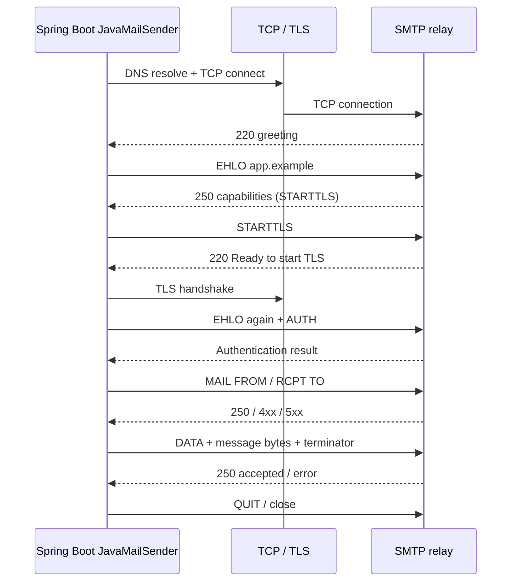
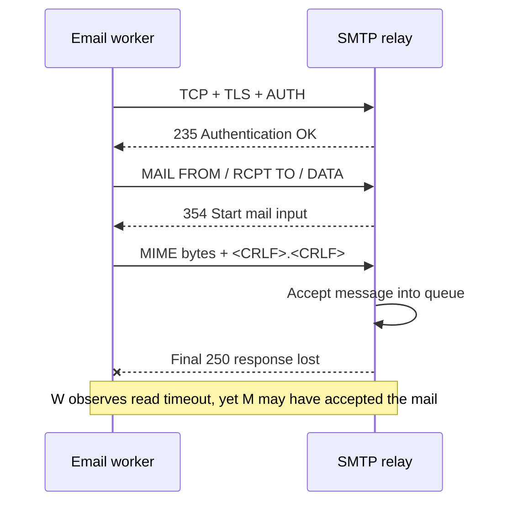
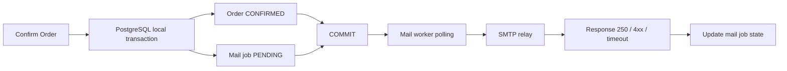

# Connection, Read, and Write Timeouts for SMTP Servers

## 1. Why Are SMTP Timeouts Part of Integration Design?

In a Spring Boot application, email is rarely the sole feature. The Order Service may write orders to PostgreSQL, publish events through RabbitMQ, and send confirmation emails. If the SMTP server slows down or stops responding, a seemingly simple mail-sending call can tie up a thread for many seconds—or wait indefinitely if timeouts are unconfigured.

**Three timeouts must be distinguished:**

1. **Connection timeout:** time spent waiting to establish a TCP connection to the SMTP server.
2. **Read timeout:** time spent waiting for data or SMTP replies from the server once connected.
3. **Write timeout:** time allowed for a client socket write before treating the write as stalled.

In Jakarta Mail (formerly JavaMail), the corresponding core SMTP properties are `mail.smtp.connectiontimeout`, `mail.smtp.timeout`, and `mail.smtp.writetimeout`. Spring Boot passes them via `spring.mail.properties[...]` to Jakarta Mail—not via a `@Transactional` annotation or an HTTP client timeout.

This lesson belongs to the **Email** chapter of the **SPRING_BOOT_INTEGRATION** module. The module structures Spring Boot integrations across HTTP clients, databases, caches, message brokers, and Spring Integration adapters, emphasizing configuration, data contracts, transactions, failures, deduplication, testing, and observability. Accordingly, we progress from socket settings to business failure windows such as **when the SMTP server already received the email yet the client timed out before seeing the reply**.

### 1.1. Learning Objectives

After this lesson, you can:

- Identify the SMTP stages that cause waits: DNS, TCP connect, TLS, SMTP greeting, `EHLO`, authentication, `MAIL FROM`, `RCPT TO`, `DATA`, final reply, and connection close.
- Configure all three timeouts in Spring Boot using Jakarta Mail's exact keys and **millisecond** units.
- Explain why those three timeouts do not form a **deadline for the entire email-sending operation**.
- Distinguish STARTTLS on port 587 from implicit TLS/SMTPS commonly on port 465, without mistaking TLS failures for read timeouts.
- Classify SMTP 4xx/5xx errors, network timeouts, authentication errors, and **`UNKNOWN`** state when the server may already have accepted the email.
- Design email sending outside database transactions via a durable email outbox/job, bounded retries, and deduplication.
- Write unit/integration tests for property binding, SMTP commands/responses, connect/read/write stalls, and duplicate prevention during retries.
- Add metrics, tracing, and safe logs; identify pool/thread saturation during SMTP outages.

> **Version scope:** Examples use Java 17+, Spring Boot 3.2+, Spring Framework 6.x, and Jakarta Mail via `spring-boot-starter-mail`. Jakarta Mail / Angus Mail is the underlying implementation in modern Spring Boot 3.x stacks; exact dependency versions are managed by Boot's BOM. Verify `mail.smtp.*` keys and actual provider behavior against your library version when upgrading. Java snippets omit imports and some domain classes/schemas; sample code illustrates boundaries and should be completed per project before running.

### 1.2. End-to-End Scenario

Suppose Order Service needs to send an email:

```text
Subject: Order confirmation O-1001
To: customer@example.test
Attachment: invoice-O-1001.pdf
```

The system uses an SMTP relay at `smtp.dev.example.test`, port `587`, requiring `STARTTLS` and authentication. When SMTP becomes unresponsive:

- The HTTP order-creation request **must not wait indefinitely**.
- The PostgreSQL transaction updating the Order **must not hold connections/locks** while SMTP sends the email.
- Retries **must not automatically assume the email was never sent** simply because the client timed out.
- You may need to reconcile with the mail provider or accept potential duplicates per real SLAs.

## 2. SMTP Is a Multi-Step Protocol, Not a Single Write

### 2.1. SMTP Submission Timeline

An SMTP submission session typically unfolds as follows:



Not every provider executes every command in this exact sequence: authentication mechanisms, pipelining, TLS policies, partial recipient acceptance, and server extensions can change it. Still, the diagram shows a single email send involves **many read/write roundtrips** on one connection, not a single HTTP request/response.

### 2.2. Time Breakdown

```text
T0 - DNS: resolve smtp.dev.example.test
T1 - TCP: connect to host:port
T2 - Greeting: wait for SMTP 220
T3 - EHLO / STARTTLS / TLS handshake
T4 - AUTH and receive confirmation
T5 - MAIL FROM and RCPT TO
T6 - DATA: write headers + body + attachments
T7 - Wait for final reply (usually 250)
T8 - QUIT / socket close
```

| Stage | Commonly Related Timeout | What to Understand |
|---|---|---|
| DNS | Resolver/OS/network policy | Not bounded by TCP connect timeout by default |
| TCP setup | `mail.smtp.connectiontimeout` | Bounds connect wait per socket provider |
| Greeting/EHLO/AUTH/SMTP command replies | `mail.smtp.timeout` | Waits reading from server; can occur multiple times |
| STARTTLS/TLS handshake | Network/TLS read/write behavior | May be affected by socket timeouts, yet has no single overall deadline |
| Writing DATA/attachments to socket | `mail.smtp.writetimeout` | Takes effect when socket writes stall |
| Receiving final 250/4xx/5xx | `mail.smtp.timeout` | Timing out here can leave the delivery result **`UNKNOWN`** |
| Close/QUIT | Transport/provider behavior | Needs cleanup control; does not share one overall deadline |

### 2.3. Ports 25, 587, and 465

- **25:** mainly for server-to-server mail relaying; many cloud/ISP networks block outbound port 25. Not intended by default for authenticated application submission.
- **587:** SMTP submission, typically with **STARTTLS**; starts as TCP/SMTP and upgrades to TLS after the `STARTTLS` command. Enforce TLS per policy.
- **465:** implicit TLS (often called SMTPS), where TLS starts immediately upon socket connection; configured differently from STARTTLS.

Port numbers do not define protocol security on their own: an SMTP server may run on a custom port. Always read the provider's contract and test against reality rather than switching to `465` while keeping `587`-style STARTTLS settings.

### 2.4. "Accepted" Differs from "Delivered"

`250 OK` after `DATA` typically proves only that the SMTP relay **accepted responsibility for processing/forwarding the message** under its policies. It does **not** prove the mail reached the recipient's inbox, avoided bounces, stayed out of spam, or was read.

If Order Service needs to know "the customer received the email," integrate delivery/bounce webhooks, status APIs, or reconciliation exposed by your mail provider. Never treat `JavaMailSender.send(...)` returning normally as final delivery proof.

## 3. Jakarta Mail's Three SMTP Timeouts

### 3.1. Standard Property Table

| Jakarta Mail Property | Unit | Controls | When Unconfigured |
|---|---|---|---|
| `mail.smtp.connectiontimeout` | milliseconds | Socket TCP connect timeout | Provider default may wait indefinitely |
| `mail.smtp.timeout` | milliseconds | Socket read timeout waiting for SMTP data | Provider default may wait indefinitely |
| `mail.smtp.writetimeout` | milliseconds | Socket write timeout sending data | Provider default may wait indefinitely |

Values are typically **integer milliseconds**, not `Duration` strings like `3s` inside raw Jakarta Mail properties. In Spring Boot app configuration, set explicit numeric values:

```properties
spring.mail.properties[mail.smtp.connectiontimeout]=3000
spring.mail.properties[mail.smtp.timeout]=5000
spring.mail.properties[mail.smtp.writetimeout]=5000
```

**Never** assume `0` means "time out immediately"; in many Java socket implementations, zero means **infinite**. Set positive values, validate them, and tune to real SLAs.

### 3.2. Connection Timeout: Waiting for TCP Connect

`mail.smtp.connectiontimeout` applies when the SMTP transport creates a socket and connects to `host:port`. For instance, `3000` instructs the provider not to wait longer than roughly 3 seconds on TCP connect.

However:

- DNS lookup may happen **before** connect and may not share the same timeout.
- Proxies/SOCKS/tunnels and multiple IP addresses can make total connect time differ from a single connect attempt.
- Succeeding on TCP connect while the server never sends its `220` greeting triggers a **read timeout**, not a connect timeout.
- The TLS handshake occurs during or after transport setup depending on STARTTLS/SMTPS and is not bound by one overall deadline.
- If the OS returns `Connection refused` immediately, failure takes much less than 3 seconds; that behavior is expected.

### 3.3. Read Timeout: Waiting for SMTP Replies

`mail.smtp.timeout` governs socket read operations. With `5000`, the client can fail if the server sends nothing within the read timeout window per implementation.

Common misconception: this is **not "the whole email must finish sending in 5 seconds."** If a session exchanges multiple commands/replies or the server dribbles data before timing out, total elapsed time can be many times the read timeout. Likewise, the server may receive the entire body and delay returning the final `250`; the client observes a read timeout yet **cannot conclude the relay never accepted the message**.

### 3.4. Write Timeout: When the Receiver Stops Reading

`mail.smtp.writetimeout` handles stalled socket writes: full TCP send buffers, an SMTP server that stops reading, or broken connections. This surfaces especially with **large attachments**, low network throughput, and high concurrent email volume.

Jakarta Mail's SMTP provider implements write timeouts by scheduling timeout watches that close the socket if a write exceeds the threshold; in some versions this allocates a **`ScheduledExecutorService`/thread per connection**, so enabling write timeouts across huge concurrent connection counts can raise thread/resource overhead. Check your provider version, monitor real concurrency, and never treat `writetimeout=1` ms as a safe strategy.

Write timeout is **not** an upload-rate quota, does not cap total file size, and does not guarantee the server accepted `DATA`. Finishing writing bytes does not mean the final `250` was received.

### 3.5. Total Duration Can Exceed All Three Timeouts

Example configuration:

```text
connectiontimeout = 3000 ms
timeout           = 5000 ms
writetimeout      = 5000 ms
```

A single send might spend 1 s in DNS, 2 s connecting, 1 s on greeting, 2 s on EHLO, 2 s on STARTTLS, 2 s on AUTH, 4 s writing DATA, and 4 s waiting for final 250. No general rule caps the total at `max(3000,5000)` or `3000+5000+5000`; each timeout applies to **individual blocking operations** across a multi-step session.

To enforce an **overall mail attempt deadline**, coordinate at the job/worker layer while accounting for concurrency limits and in-flight cancellation hazards. `Future.cancel(true)` or `CompletableFuture.orTimeout(...)` alone generally **cannot guarantee aborting a blocking socket write or TLS call**; transport-level timeouts remain essential.

### 3.6. Which Exceptions Can Appear?

Spring's `JavaMailSenderImpl` maps Jakarta Mail failures into the `MailException` hierarchy—such as `MailSendException`, `MailAuthenticationException`, or `MailPreparationException` depending on stage. Beneath them, cause/nextException chains may contain `MessagingException`, `MailConnectException`, `SocketTimeoutException`, or `SocketException`.

**Never classify purely by message substrings** such as `"Read timed out"`. Examine the protocol phase, SMTP reply code when present, exception chain, correlation ID, and ultimately **provider status** when outcomes are ambiguous. Timing out before connecting carries very different duplicate risk than timing out after `DATA`.

## 4. Configuring Spring Boot with the Right Properties and Protocol

### 4.1. Dependency and Auto-Configuration

With Maven and the Spring Boot parent/BOM:

```xml
<dependency>
    <groupId>org.springframework.boot</groupId>
    <artifactId>spring-boot-starter-mail</artifactId>
</dependency>
```

The starter brings the Spring Mail abstraction and a compatible Jakarta Mail implementation onto the classpath. When auto-configuration conditions match, Spring Boot builds `JavaMailSender` from `spring.mail.*`. If your app defines a custom `JavaMailSender` bean, auto-configuration may **back off**; verify your custom bean applies all three timeouts properly.

**You do not need `spring-boot-starter-web`** to send SMTP mail. HTTP controllers, scheduled jobs, RabbitMQ listeners, or Spring Integration flows can all invoke a dedicated application mail service; `JavaMailSender.send` remains synchronous wherever invoked.

### 4.2. Example application-local.yml for Port 587 SMTP Submission

```yaml
spring:
  mail:
    host: smtp.dev.example.test
    port: 587
    protocol: smtp
    username: local-mailer
    password: example-only-not-a-real-secret
    default-encoding: UTF-8
    properties:
      "[mail.smtp.auth]": true
      "[mail.smtp.starttls.enable]": true
      "[mail.smtp.starttls.required]": true
      "[mail.smtp.ssl.checkserveridentity]": true
      "[mail.smtp.connectiontimeout]": 3000
      "[mail.smtp.timeout]": 5000
      "[mail.smtp.writetimeout]": 5000
```

In Spring Boot YAML, **quoted bracket notation** on dotted keys inside `spring.mail.properties` preserves exact property names for Jakarta Mail. The provider expects the literal key string `mail.smtp.connectiontimeout`, not nested objects `mail → smtp → connectiontimeout`.

The example password is strictly for **structural illustration**, never for real services, and real credentials must never be committed to source control. Production should pull credentials from a secret manager/environment with rotation and separate credentials per application/tenant when needed.

### 4.3. Environment Variables and Profiles

A practical configuration using placeholders:

```yaml
spring:
  mail:
    host: ${SMTP_HOST:localhost}
    port: ${SMTP_PORT:1025}
    username: ${SMTP_USERNAME:}
    password: ${SMTP_PASSWORD:}
    properties:
      "[mail.smtp.connectiontimeout]": ${SMTP_CONNECT_TIMEOUT_MS:3000}
      "[mail.smtp.timeout]": ${SMTP_READ_TIMEOUT_MS:5000}
      "[mail.smtp.writetimeout]": ${SMTP_WRITE_TIMEOUT_MS:5000}
```

In a local profile with a plaintext Mailpit/GreenMail test server on loopback, you may disable `mail.smtp.auth` and `mail.smtp.starttls.enable` **only inside that controlled local/test profile**. Never carry plaintext/anonymous settings into staging or production. Placeholder defaults are handy locally, yet production should fail fast if a required SMTP host or secret is missing.

If an environment variable holds an invalid value (like `SMTP_READ_TIMEOUT_MS=abc`), Jakarta Mail may fail to interpret the timeout as intended. Validate at startup with configuration validation and tests rather than relying on unclear fallbacks.

### 4.4. Why Not Misuse Other Boot Timeouts?

| Property | Subsystem | Bounds SMTP Send? |
|---|---|---|
| `server.tomcat.connection-timeout` | Tomcat inbound HTTP | **No** |
| `spring.mvc.async.request-timeout` | Async MVC HTTP requests | **Not directly** |
| `spring.datasource.hikari.connection-timeout` | Waiting for a JDBC connection from pool | **No** |
| `spring.kafka.consumer.properties.*` | Kafka consumer | **No** |
| `spring.mail.properties[mail.smtp.connectiontimeout]` | SMTP TCP connect | **Yes**, connect phase |
| `spring.mail.properties[mail.smtp.timeout]` | SMTP socket read | **Yes**, read phase |
| `spring.mail.properties[mail.smtp.writetimeout]` | SMTP socket write | **Yes**, write phase |

An inbound HTTP request timing out at the gateway after 10 seconds does not stop `JavaMailSender`. If mail sends synchronously from a controller, the thread can remain blocked on SMTP long after the caller disconnected. Bound SMTP at the mail transport itself, and better yet **never send mail synchronously on the business response path**.

### 4.5. Reading Back Effective Properties in JavaMailSenderImpl

In a test:

```java
@SpringBootTest(properties = {
        "spring.mail.host=localhost",
        "spring.mail.port=1025",
        "spring.mail.properties[mail.smtp.connectiontimeout]=3000",
        "spring.mail.properties[mail.smtp.timeout]=5000",
        "spring.mail.properties[mail.smtp.writetimeout]=5000"
})
class MailPropertiesIT {
    @Autowired
    JavaMailSender mailSender;

    @Test
    void timeoutPropertiesReachJakartaMail() {
        JavaMailSenderImpl sender =
                assertInstanceOf(JavaMailSenderImpl.class, mailSender);

        Properties props = sender.getJavaMailProperties();
        assertEquals("3000", String.valueOf(
                props.get("mail.smtp.connectiontimeout")));
        assertEquals("5000", String.valueOf(
                props.get("mail.smtp.timeout")));
        assertEquals("5000", String.valueOf(
                props.get("mail.smtp.writetimeout")));
    }
}
```

This test verifies property binding and that the auto-configured bean receives the timeout keys; it **does not prove network timeouts enforce properly** since no socket opens. Also, if your project defines a custom `JavaMailSender` instead of `JavaMailSenderImpl`, adjust expectations rather than forcing a cast when an architecture intentionally uses another adapter.

Never dump full JavaMail `Properties` into logs, as they can contain usernames, OAuth/tokens, or sensitive endpoint settings.

### 4.6. Custom JavaMailSenderImpl: When Is It Needed?

If the app integrates multiple mail providers with distinct SLAs/credentials or requires special transport customization, define custom `JavaMailSenderImpl` beans:

```java
@Configuration(proxyBeanMethods = false)
class MailSenderConfiguration {

    @Bean("receiptMailSender")
    JavaMailSender receiptMailSender(
            ReceiptMailProperties config) {
        JavaMailSenderImpl sender = new JavaMailSenderImpl();
        sender.setHost(config.host());
        sender.setPort(config.port());
        sender.setProtocol("smtp");
        sender.setUsername(config.username());
        sender.setPassword(config.password());
        sender.setDefaultEncoding("UTF-8");

        Properties mail = sender.getJavaMailProperties();
        mail.put("mail.smtp.auth", "true");
        mail.put("mail.smtp.starttls.enable", "true");
        mail.put("mail.smtp.starttls.required", "true");
        mail.put("mail.smtp.ssl.checkserveridentity", "true");
        mail.put("mail.smtp.connectiontimeout", "3000");
        mail.put("mail.smtp.timeout", "5000");
        mail.put("mail.smtp.writetimeout", "5000");
        return sender;
    }
}
```

`ReceiptMailProperties` is a **separately defined** `@ConfigurationProperties` class/record binding trusted configuration. With two senders, declare `@Qualifier("receiptMailSender")` / `@Primary` explicitly. Leaving two `JavaMailSender` beans ambiguous risks sending messages through the wrong tenant or account.

In the common case of **one SMTP relay for the whole application**, prefer Boot auto-configuration to avoid duplicate wiring. Custom beans mean you own copying all TLS, auth, timeout, and observability policies.

### 4.7. Is Startup Connection Testing Appropriate?

Spring Boot provides `spring.mail.test-connection` to test SMTP connectivity on startup under supported auto-configuration:

```yaml
spring:
  mail:
    test-connection: false
```

Enabling it helps in staging or local setups when developers want to fail fast if the mail server is unreachable. Yet a brief SMTP outage during deployment can keep **the entire application from booting**, even when the core service could still accept orders and queue email jobs for retry. For systems sending asynchronously via an outbox, it is usually better to let the app start and monitor worker/dependency health via metrics and backpressure; decide based on operational requirements.

Test connection does not verify acceptance after `DATA`, content rendering, recipients, quotas, or inbox deliverability. It is strictly a startup connectivity/auth probe per library behavior.

## 5. STARTTLS and SMTPS: Timeouts Do Not Replace Security

### 5.1. STARTTLS on Port 587

```yaml
spring:
  mail:
    host: smtp.example.test
    port: 587
    protocol: smtp
    properties:
      "[mail.smtp.auth]": true
      "[mail.smtp.starttls.enable]": true
      "[mail.smtp.starttls.required]": true
      "[mail.smtp.ssl.checkserveridentity]": true
      "[mail.smtp.connectiontimeout]": 3000
      "[mail.smtp.timeout]": 5000
      "[mail.smtp.writetimeout]": 5000
```

`mail.smtp.starttls.enable=true` enables upgrading to TLS via STARTTLS if advertised by the server; add `mail.smtp.starttls.required=true` so the client **never silently continues in plaintext** when TLS is required. Validate hostnames/certificates via `mail.smtp.ssl.checkserveridentity=true` and a proper CA truststore.

If the provider does not advertise STARTTLS, fail per policy instead of sending credentials over an unprotected channel. Never work around SSL handshake failures by enabling trust-all mode.

### 5.2. Implicit TLS on Port 465

Using protocol `smtp` with SSL enabled right at connect:

```yaml
spring:
  mail:
    host: smtp.example.test
    port: 465
    protocol: smtp
    properties:
      "[mail.smtp.auth]": true
      "[mail.smtp.ssl.enable]": true
      "[mail.smtp.ssl.checkserveridentity]": true
      "[mail.smtp.connectiontimeout]": 3000
      "[mail.smtp.timeout]": 5000
      "[mail.smtp.writetimeout]": 5000
```

Some setups use protocol `smtps`. When `spring.mail.protocol=smtps`, Jakarta Mail expects provider properties under the `mail.smtps.*` namespace; never switch only `protocol` while leaving all keys as `mail.smtp.*` unverified. Above all, SSL and STARTTLS are **distinct modes**: port 465 implicit TLS normally does not issue `STARTTLS` after connecting.

### 5.3. TLS Handshake and Socket Deadlines

TLS handshakes perform socket reads/writes and can be governed by provider socket timeouts. Still, never assume `connectiontimeout=3000` caps DNS + TCP + TLS within exactly 3 seconds. Infrastructure involving proxies/SSL inspection, slow auth, or TLS behavior needs realistic testing to measure each stage.

**Never simply raise `mail.smtp.timeout` to mask TLS certificate errors.** Distinguish `SSLHandshakeException` (CA/hostname/protocol), `AuthenticationFailedException` (credentials/tokens), and `SocketTimeoutException` (server/network failed to respond in time).

### 5.4. Truststores, Hostname Validation, and Secrets

In production:

- Use a managed CA truststore, rotate regularly, and test certificate chains.
- Enable hostname verification; never set `mail.smtp.ssl.trust=*` or a trust-all socket factory as a temporary workaround.
- Protect SMTP usernames, passwords, and OAuth2 tokens; never commit them in YAML to Git.
- Restrict outbound egress from the service strictly to approved SMTP relays to prevent SSRF via user-supplied SMTP hosts.
- Send using authorized `From` addresses/domains compliant with SPF/DKIM/DMARC and relay contracts.
- Never log `AUTH` payloads, raw SMTP transcripts containing credentials, or personal content.

Timeouts and TLS are **orthogonal layers**: a fast connection skipping certificate checks is insecure, while a strongly encrypted connection waiting forever exhausts worker threads.

## 6. Sending Email with JavaMailSender and Separating Business Layers

### 6.1. SimpleMailMessage for Simple Plain-Text Emails

Spring provides `JavaMailSender` and `SimpleMailMessage`:

```java
@Component
public class SimpleNotificationSender {
    private final JavaMailSender mailSender;

    public SimpleNotificationSender(
            JavaMailSender mailSender) {
        this.mailSender = mailSender;
    }

    public void sendWelcome(
            String recipient, String displayName) {
        SimpleMailMessage mail = new SimpleMailMessage();
        mail.setFrom("noreply@example.test");
        mail.setTo(recipient);
        mail.setSubject("Welcome");
        mail.setText("Hello " + displayName + "!");

        mailSender.send(mail); // Blocking SMTP I/O
    }
}
```

This snippet illustrates API usage; production must validate email addresses and content from trusted sources, never letting callers pick arbitrary `From` addresses or unauthorized recipients. `send(...)` is **synchronous** and blocks the calling thread. Jakarta Mail timeouts live on `JavaMailSenderImpl`, not as per-call parameters on `send`.

Never call `sendWelcome` directly inside a user-persistence transaction if you want to avoid sending email when the database rolls back. Persist a durable mail job in the local transaction and send externally via a worker.

### 6.2. MIME Messages for HTML and Attachments

```java
@Component
public class ReceiptMimeSender {
    private final JavaMailSender mailSender;

    public ReceiptMimeSender(JavaMailSender mailSender) {
        this.mailSender = mailSender;
    }

    public void sendReceipt(
            String recipient, String orderId,
            byte[] pdfBytes) {
        try {
            MimeMessage message = mailSender.createMimeMessage();
            MimeMessageHelper helper =
                    new MimeMessageHelper(
                            message, true,
                            StandardCharsets.UTF_8.name());

            helper.setFrom("receipts@example.test");
            helper.setTo(recipient);
            helper.setSubject("Invoice " + orderId);
            helper.setText(
                    "<p>Your order has been processed.</p>", true);

            helper.addAttachment(
                    "invoice-" + orderId + ".pdf",
                    new ByteArrayResource(pdfBytes),
                    "application/pdf");

            mailSender.send(message);
        } catch (MessagingException ex) {
            throw new IllegalStateException(
                    "Failed to build MIME message", ex);
        }
    }
}
```

`MimeMessageHelper` configures encoding, HTML, and attachments; `ByteArrayResource` suits small files already in memory. For concurrent emails with 20–50 MB files, holding attachment buffers on the heap spikes memory while SMTP writes stall longer. Use repeatable content sources (file/object storage references or properly bounded resources), cap sizes, and store metadata/content hashes so retries reconstruct the **exact same document version**.

When `orderId` appears in filenames or headers, validate allowed characters to prevent CR/LF header injection or path characters; HTML content incorporating user input must be escaped/sanitized. This example does not attempt to show a full template engine, multi-recipient policy, or streaming attachment API.

### 6.3. Distinguishing Message Preparation Errors from Send Errors

| Stage | Error Example | Could SMTP Have Received the Email? |
|---|---|---|
| Validate recipient/content | Invalid email address, missing `orderId` | SMTP not yet called |
| Build MIME parts | Missing attachment, encoding error, converter failure | Usually SMTP not yet called |
| DNS/TCP connect | Unresolved host, connect refused/timeout | For this attempt, SMTP session not yet entered |
| SMTP greeting/STARTTLS/AUTH | TLS failure, wrong credentials, greeting timeout | `DATA` not completed in current session |
| `MAIL FROM`/`RCPT TO` | Envelope rejected by server | Full `DATA` not sent; only some recipients may pass |
| Writing `DATA` | Write timeout, connection reset | Partial write possible; unclear if server saw end-of-DATA |
| Waiting for final reply after `DATA` | Read timeout / connection dropped | **`UNKNOWN`**: server may already have accepted the email |
| After `250` reply | Worker crashes before updating DB state | SMTP confirmed acceptance; DB not yet updated |

Do not collapse every `MailException` into a single `RETRY_NOW`. Configuration errors (bad SMTP host, TLS trust, authentication) require system fixes; transient `4xx` errors warrant retries; post-DATA timeouts require an **indeterminate status**, tracking, and deliberate resend policies.

### 6.4. Connection Lifecycle and Managing Sender Instances

In normal usage, `JavaMailSenderImpl` opens and closes transport connections per `send` call, and may reuse transport across a batch depending on implementation. Never instantiate a new `JavaMailSenderImpl` per email, and never mutate `host`/`username`/`password` on a shared singleton across concurrent threads to handle multiple tenants.

With multiple providers:

- Define separate sender beans with immutable startup configuration.
- Route per tenant/notification type in an access-controlled application gateway.
- Bound concurrency because parallel SMTP connections strain both the relay and thread pools—especially when `writetimeout` allocates auxiliary resources.
- Never assume every SMTP provider or setup pools connections for mail sending; measure connection overhead before building custom transport pooling.

### 6.5. Do Not Confuse Sender Address with Auth Account

`spring.mail.username` is typically the SMTP authentication account, while `MimeMessageHelper.setFrom(...)` sets the visible email sender. Providers may require them to belong to the same account/domain or allow verified senders. Successful login **does not** prove `From`/`Reply-To`/recipients comply with relay quotas and policies. Test relay acceptance explicitly.

### 6.6. Multi-Recipient and Partial Sends

With multiple recipients, an SMTP server can accept some `RCPT TO` addresses and reject others. Jakarta Mail exposes exceptions and properties governing partial send behavior (such as `mail.smtp.sendpartial` where supported). Never enable partial sends merely to "stop the batch from failing" before deciding clear semantics.

Whenever each customer requires an independent notification, it is usually cleaner to create **one identifiable mail job per recipient/notification**. Retries and reconciliation then know exactly which recipients the relay accepted instead of resending the whole batch and duplicating emails to earlier recipients.

### 6.7. SMTP Message-ID Is Not an Enforced Idempotency Key

The email `Message-ID` header aids correlation, threading, and diagnostics, yet the SMTP standard **does not require relays to deduplicate emails by Message-ID**. Two SMTP transactions carrying the same `Message-ID` can still deliver two copies into a recipient's mailbox.

Give each mail job a stable internal `notificationId`, optionally attached via `X-Notification-Id` or a policy-compliant `Message-ID` for tracing, **never claiming that header grants exactly-once**. If a provider exposes an HTTP email API with idempotency keys and delivery-status lookup, that is a separate contract from raw SMTP.

## 7. Classifying SMTP Errors, Retries, and UNKNOWN Outcomes

### 7.1. 4xx and 5xx Do Not Dictate One Rigid Retry Rule

SMTP reply codes fall into classes:

- **4xx:** temporary failure, e.g., overloaded relay, temporary resource shortage, or mailbox temporarily unavailable.
- **5xx:** generally permanent failure for the current command/parameters, e.g., nonexistent recipient or policy rejection.

Specific codes, **enhanced status codes**, and provider contracts govern retry vs alerting. A `5xx` auth/policy failure may recover after updating credentials or config, yet should never be auto-retried hundreds of times as-is. A `4xx` lasting days also needs a max-age/dead-letter/manual review path rather than endless retries.

| Sample Situation | Common Meaning | Handling Approach |
|---|---|---|
| `421` | Service temporarily unavailable / closing channel | Retry with backoff if workload allows |
| `450` / `451` | Mailbox/action temporarily unavailable | Bounded retry per enhanced code |
| `452` | Temporary resource exhaustion | Reduce concurrency/throughput, retry later |
| `530` | Authentication/TLS required per server policy | Fix handshake/auth; no blind retries |
| `535` | Credentials rejected | Stop hot retries; alert and rotate secrets |
| `550` | Recipient/mailbox/policy rejected | Check address, permissions, domain, and enhanced code |
| `552` | Quota/message size exceeded per server | Shrink attachments; do not keep sending same payload |
| Timeout awaiting final `250` | No conclusive reply | Mark `UNKNOWN`; reconcile or retry intentionally |
| TLS certificate error | Wrong trust/hostname/TLS policy | Fix truststore/certificate; never disable validation |

SMTP codes above are common examples; providers may return specific enhanced codes and custom policy messages. Never hardcode naive rules like "all 4xx => 3 retries in 1 second, all 5xx => drop silently" without accounting for class and operation.

### 7.2. Read Timeout Before vs After DATA Carries Different Risk

Example:



If the client fails **before connecting**, it sent no message content in that attempt. If it fails **after writing end-of-DATA** where the server could have received it, the state may be either `ACCEPTED` or `NOT_ACCEPTED`. This is **`UNKNOWN`**—never default it to `FAILED_PERMANENT`, and never promise "retrying cannot create duplicates."

### 7.3. How Can Acceptance Status Be Reconciled?

Depending on your provider:

1. **Internal SMTP relays with queue logs** can be queried by correlation ID, `Message-ID`, and timestamp.
2. **Email provider APIs** expose message/delivery query endpoints and acceptance/bounce/delivery webhooks.
3. **Internal notification stores** record attempts/accepted states, yet know only what the client observed; they cannot deduce lost responses on their own.
4. When no lookup API exists, the business must choose a policy: retry and accept duplicate risk, or route `UNKNOWN` to an inspection/monitoring queue to avoid spamming.

Never promise raw SMTP offers a standardized operation-ID transaction lookup like a payment gateway. Custom headers help providers search logs, yet never compel relays to deduplicate.

### 7.4. Retry Budget and Exponential Backoff

Example policy:

```text
max_attempts            = 5
initial_backoff         = 30s
max_backoff             = 15m
max_notification_age    = 24h
retry_jitter            = enabled
max_parallel_smtp_sends = 10 (example)

on transient SMTP 4xx -> RETRY_SCHEDULED
on auth/TLS config     -> BLOCKED_CONFIG / ALERT
on permanent 5xx       -> FAILED_PERMANENT
on post-DATA timeout   -> UNKNOWN + reconcile/controlled retry
```

Numbers are **design examples**, not mandatory standards. Size them to SLAs, quotas, and real providers; marketing emails, transactional receipts, and security OTPs have very different lifetimes. Retrying an OTP after 24 hours is pointless; enforce expirations so stale codes are never sent.

### 7.5. Why Never Retry Infinitely Inside an SMTP Call?

```java
// Anti-pattern: ties up threads and risks duplicate emails.
while (true) {
    try {
        mailSender.send(message);
        return;
    } catch (MailException ex) {
        Thread.sleep(1000);
    }
}
```

This pins the worker indefinitely, ignores permanent/TLS/auth errors, has no max-attempt limit, loses state on crash, and can duplicate emails when the server received a message whose reply was lost. Retries should be **scheduled via durable job state** with max attempts, TTLs, and circuit breakers.

### 7.6. Timeouts Can Compound into Resource Exhaustion

With 200 concurrent emails where each send blocks a thread waiting on a 30-second SMTP read timeout:

```text
Peak active SMTP send tasks = 200
Blocking duration          = up to many SMTP phases
Potential blocked threads  = ~200 (depending on scheduling/concurrency)
```

Do not assume independent timeouts simply add up to 30 seconds. Yet large numbers of waiting tasks rapidly exhaust executors, heap, SMTP connection quotas, and database pools. Isolate a small, bounded SMTP worker pool backed by a durable queue/backpressure and backlog alerts rather than spawning unbounded async tasks per email.

## 8. Do Not Hold a Database Transaction While Waiting on SMTP

### 8.1. Anti-Pattern: Sending Email Inside @Transactional

```java
@Service
public class UnsafeOrderConfirmationService {
    private final OrderRepository orders;
    private final JavaMailSender mailSender;

    @Transactional
    public void confirm(String orderId) {
        OrderEntity order = orders.findById(orderId)
                .orElseThrow();
        order.confirm();

        SimpleMailMessage mail = new SimpleMailMessage();
        mail.setFrom("receipts@example.test");
        mail.setTo(order.customerEmail());
        mail.setSubject("Order " + orderId);
        mail.setText("Confirmed.");
        mailSender.send(mail); // Blocking SMTP I/O inside SQL TX.
    }
}
```

Several failure windows exist:

1. PostgreSQL updates the entity inside the transaction, then SMTP times out; the transaction may roll back depending on the exception even though the server may have received the email.
2. SMTP returns `250 accepted`, yet the PostgreSQL commit fails afterward; the customer receives mail for an unconfirmed order.
3. The database transaction holds connections, persistence context, and locks for multiple seconds while waiting on SMTP.
4. The HTTP caller retries confirmation on timeout; the app sends the same email again without a durable notification key.

`@Transactional(rollbackFor=Exception.class)` controls only the **local transaction manager**; it cannot roll back an SMTP relay. SMTP provides no XA participant enlisted by JPA during ordinary `send(...)` calls.

### 8.2. @TransactionalEventListener(AFTER_COMMIT) Is Better, Not Yet Durable

```java
public record OrderConfirmed(String orderId) {}

@Component
public class MailOnCommitListener {
    private final ReceiptMimeSender receipts;

    @TransactionalEventListener(
            phase = TransactionPhase.AFTER_COMMIT)
    public void sendAfterCommit(OrderConfirmed event) {
        // Illustrative callback; the app must load recipient,
        // invoice document, and handle errors per its contract.
    }
}
```

`AFTER_COMMIT` prevents sending **before the transaction commits successfully**, yet the callback is in-process work and is not durable across JVM crashes. If the process dies after database commit and before the callback runs, the email is lost. If the callback sends and crashes before updating status, retries can duplicate it.

Callbacks may also run on the transaction synchronization thread, delaying request completion or cleanup; adding `@Async` moves work to an executor (where tasks are still lost on crash) rather than creating a durable queue. For important notifications, persist an **email job/outbox in the business transaction** and let a worker send after commit.

### 8.3. What Does a Local Mail Outbox Protect?



Inside the Order transaction, record only the **intent to send** as a row. A separate mail worker handles SMTP outside that transaction. If the app crashes right after SQL commit, the `PENDING` row survives for the worker to pick up. If sending fails, the Order does not roll back; the notification maintains its own retry/failure status.

What cannot be promised: PostgreSQL and SMTP do not commit atomically together. If the worker sends, the relay accepts, and the worker crashes before saving `ACCEPTED`, a retry can send a duplicate. An email outbox provides **at-least-once send attempts with durability and pre-send deduplication**, not guaranteed exactly-once delivery to the recipient.

## 9. Designing a Mail Job with State, Deadlines, and Idempotency

### 9.1. Illustrative PostgreSQL Schema

```sql
CREATE TABLE mail_job (
    id                   UUID PRIMARY KEY,
    notification_key     VARCHAR(180) NOT NULL UNIQUE,
    recipient_address    VARCHAR(320) NOT NULL,
    template_code        VARCHAR(80) NOT NULL,
    template_version     INT NOT NULL,
    payload_json         JSONB NOT NULL,
    status               VARCHAR(24) NOT NULL DEFAULT 'PENDING',
    attempt_count        INT NOT NULL DEFAULT 0,
    next_attempt_at      TIMESTAMPTZ NOT NULL
                         DEFAULT CURRENT_TIMESTAMP,
    claimed_until        TIMESTAMPTZ,
    claim_token          UUID,
    last_error_category  VARCHAR(80),
    last_attempt_at      TIMESTAMPTZ,
    smtp_accepted_at     TIMESTAMPTZ,
    created_at           TIMESTAMPTZ NOT NULL
                         DEFAULT CURRENT_TIMESTAMP,
    CONSTRAINT chk_mail_job_status CHECK (
       status IN (
         'PENDING', 'CLAIMED', 'RETRY_SCHEDULED',
         'UNKNOWN', 'ACCEPTED', 'FAILED_PERMANENT'
       )
    )
);

CREATE INDEX idx_mail_job_ready
    ON mail_job(status, next_attempt_at, claimed_until);
```

This schema is a starting skeleton. Multi-tenant apps need `tenant_id`/matching unique keys, access controls, retention, and data minimization. `recipient_address` and `payload_json` may carry PII; encrypt and restrict DB/log access per policy.

For large PDF invoices, never store full base64 PDFs in `payload_json`: store an immutable object key and content hash along with permissions, template/locale, and data needed to reconstruct MIME on retries. Never let a retried job fetch a "current mutable version" of an invoice altered after the first attempt.

### 9.2. Notification Key Differs from SMTP Message-ID

Example:

```text
notification_key = "order-confirmed:TENANT-A:O-1001:v1"
job_id           = 28f... (UUID, fixed)
recipient        = customer@example.test
```

The unique constraint on `notification_key` keeps the application from creating two mail jobs for the **same logical notification** when HTTP commands or broker events redeliver. However, if a job already sent via SMTP and crashed before updating the DB, the unique job key does not block a **second SMTP attempt**. Define provider reconciliation or an `UNKNOWN` handling policy.

When one order notifies multiple recipients, define the notification key by **recipient + notification type + business event version** instead of bundling everyone into one job where partial sends are hard to track.

### 9.3. Saving the Job Inside the Order-Confirmation Transaction

```java
// OrderEmailOutboxService.java — imports abbreviated
@Service
public class OrderEmailOutboxService {
    private final JdbcTemplate jdbc;
    private final ObjectMapper mapper;

    public OrderEmailOutboxService(
            JdbcTemplate jdbc, ObjectMapper mapper) {
        this.jdbc = jdbc;
        this.mapper = mapper;
    }

    @Transactional
    public void confirm(
            String orderId, String recipient,
            String notificationKey, UUID jobId) {

        int changed = jdbc.update("""
            UPDATE order_record
               SET status = 'CONFIRMED'
             WHERE id = ? AND status = 'PENDING'
            """, orderId);

        if (changed == 0) {
            // Contract: reconcile if already confirmed;
            // never send a second email merely on retry.
            throw new IllegalStateException(
                    "Order is not in PENDING state");
        }

        String payload;
        try {
            payload = mapper.writeValueAsString(
                    Map.of("orderId", orderId));
        } catch (JsonProcessingException ex) {
            throw new IllegalStateException(
                    "Failed to build mail job payload", ex);
        }

        jdbc.update("""
            INSERT INTO mail_job(
                id, notification_key, recipient_address,
                template_code, template_version, payload_json
            )
            VALUES (?, ?, ?, 'ORDER_CONFIRMED', 1, ?::jsonb)
            ON CONFLICT (notification_key) DO NOTHING
            """, jobId, notificationKey, recipient,
                payload);
    }
}
```

This snippet illustrates **transaction boundaries**, not a complete production application service: validate `orderId`/recipient/notification key, select the proper template, and verify payload consistency on key conflicts per contract. JSON is serialized via Jackson `ObjectMapper` rather than concatenating unescaped strings. `ON CONFLICT DO NOTHING` could hide a conflict where an earlier job had a different recipient or template; production should compare canonical hashes/content and reject mismatches. For retried confirmation of an already-`CONFIRMED` order, read existing state and return an idempotent outcome instead of always throwing.

**Atomicity point:** when sharing the same `JdbcTemplate`/`DataSource`/`PlatformTransactionManager` and invoked through a Spring proxy, the `order_record` update and `mail_job` insert commit or roll back together. Across two distinct databases or transaction managers, never assume `@Transactional` protects both.

### 9.4. Worker Claiming Jobs in a Short Transaction

A PostgreSQL pattern for concurrent workers:

```sql
-- Run inside a short SQL transaction:
WITH ready AS (
    SELECT id
      FROM mail_job
     WHERE (
           status IN ('PENDING', 'RETRY_SCHEDULED')
           AND next_attempt_at <= CURRENT_TIMESTAMP
     ) OR (
           status = 'CLAIMED'
           AND claimed_until <= CURRENT_TIMESTAMP
     )
     ORDER BY created_at, id
     LIMIT :batch_size
     FOR UPDATE SKIP LOCKED
)
UPDATE mail_job AS job
   SET status = 'CLAIMED',
       claim_token = :claim_token,
       claimed_until = CURRENT_TIMESTAMP + INTERVAL '60 seconds',
       last_attempt_at = CURRENT_TIMESTAMP,
       attempt_count = attempt_count + 1
  FROM ready
 WHERE job.id = ready.id
RETURNING job.id, job.notification_key, job.recipient_address,
          job.template_code, job.template_version,
          job.payload_json, job.attempt_count;
```

After claiming, **commit the SQL transaction** before invoking SMTP. That avoids holding database row locks or connections during multi-second SMTP stalls. Upon finishing, open another brief transaction to update status, predicated on `claim_token` and `status='CLAIMED'` so a stale worker never overwrites a new owner's update.

The `60 seconds` lease is only an example: SMTP sends can span multiple phases, attachment uploads, or retries. Size leases or use heartbeats so active workers are not prematurely reclaimed, and recognize that once a lease expires, **both workers may execute duplicate SMTP attempts**; DB fencing cannot prevent an SMTP relay from accepting mail from an old worker.

### 9.5. State Transitions After SMTP Responses

```text
PENDING / RETRY_SCHEDULED
   |
   v
CLAIMED (worker owns job with token)
   |                 |                   |
   | final 250       | 4xx transient     | timeout after DATA
   v                 v                   v
ACCEPTED         RETRY_SCHEDULED       UNKNOWN
                                         |
                                  reconcile / manual

5xx permanent/config failure:
   -> FAILED_PERMANENT or BLOCKED/ALERT per policy
```

**Never delete an `UNKNOWN` job and insert a new one**; that destroys audit trails and correlation. Where a provider status API exists, querying by ID can promote `UNKNOWN` to `ACCEPTED` or trigger a safe retry. With plain SMTP and no reconciliation, establish clear business policy favoring either zero missed mail or avoiding duplicates.

### 9.6. Updating with a Fencing Token

```sql
-- Execute only after a reliable SMTP acceptance signal:
UPDATE mail_job
   SET status = 'ACCEPTED',
       smtp_accepted_at = CURRENT_TIMESTAMP,
       claim_token = NULL,
       claimed_until = NULL,
       last_error_category = NULL
 WHERE id = :job_id
   AND status = 'CLAIMED'
   AND claim_token = :claim_token;
```

Always check the updated row count. If it is `0`, the lease or owner changed; never silently treat the job as "definitely ACCEPTED" and ignore the conflict. On ambiguous SMTP timeouts, **never** run the `ACCEPTED` update merely because `mailSender.send` started; classify the outcome first.

### 9.7. Optimizing Latency by Waking Workers After Commit

You can use `@TransactionalEventListener(AFTER_COMMIT)` to emit a local "new job available" signal waking the worker to reduce latency. Still, keep **periodic polling/CDC/replay** over `mail_job`: if the process crashes before the local signal runs, the persisted job waits to be scanned.

When using RabbitMQ/Kafka for email jobs, the Order transaction writes the outbox event/job and a publisher emits the message; consumers process jobs idempotently. Brokers can also redeliver, requiring unique notification keys and guarded state transitions.

### 9.8. Why Never Store SMTP Credentials Inside Every Job?

Never persist raw SMTP passwords or tokens inside `mail_job` for retries. Store only an authorized **provider profile/tenant routing key**; the worker fetches live credentials from a secret manager when sending. That enables secret rotation and keeps credentials out of millions of rows. When a provider profile changes, retry policies must honor the original sender identity/`From`, never silently sending Tenant A's mail through Tenant B's account.

## 10. Testing Timeouts: Property Tests, SMTP Fixtures, and Real Sockets

### 10.1. Do Not Treat Mocking JavaMailSender as a Socket Timeout Test

```java
@Test
void mocksOnlyBusinessInteraction() {
    JavaMailSender sender = mock(JavaMailSender.class);
    SimpleNotificationSender notifications =
            new SimpleNotificationSender(sender);

    notifications.sendWelcome(
            "person@example.test", "An");

    verify(sender).send(any(SimpleMailMessage.class));
}
```

This test proves only that the application service calls `send`; it **never** opens a TCP socket, receives an SMTP greeting, writes MIME bytes, or verifies the three timeout properties. Two other test tiers are needed:

1. **Configuration binding tests**: assert `JavaMailSenderImpl#getJavaMailProperties()` holds the expected keys and values.
2. **SMTP integration/socket tests**: drive a test SMTP server/proxy to trigger connect/read/write stalls and assert exceptions, bounded latency, and worker state.

If a bug involves "emails still aren't arriving," test provider acceptance and delivery state as well—not just `verify(sender).send(...)`.

### 10.2. Testing Read Timeout with a Real ServerSocket

A deterministic way to trigger a read timeout is having the server **accept the TCP connection without sending the SMTP greeting**. The client connects and blocks awaiting `220`, triggering the read timeout.

```java
// SmtpGreetingTimeoutIT.java — imports/static imports abbreviated
@Test
void readTimeoutWhenSmtpGreetingNeverArrives()
        throws Exception {
    try (ServerSocket server = new ServerSocket(
            0, 1, InetAddress.getByName("127.0.0.1"))) {

        ExecutorService fakeServer =
                Executors.newSingleThreadExecutor();

        try {
            Future<?> accepted = fakeServer.submit(() -> {
                try (Socket peer = server.accept()) {
                    // Do not send an SMTP greeting.
                    Thread.sleep(1_000);
                } catch (InterruptedException interrupted) {
                    Thread.currentThread().interrupt();
                } catch (IOException io) {
                    throw new UncheckedIOException(io);
                }
            });

            JavaMailSenderImpl sender =
                    new JavaMailSenderImpl();
            sender.setHost("127.0.0.1");
            sender.setPort(server.getLocalPort());
            Properties config =
                    sender.getJavaMailProperties();
            config.setProperty(
                    "mail.smtp.connectiontimeout", "1000");
            config.setProperty(
                    "mail.smtp.timeout", "200");
            config.setProperty(
                    "mail.smtp.writetimeout", "500");

            assertThrows(MessagingException.class,
                    sender::testConnection);

            accepted.get(3, TimeUnit.SECONDS);
        } finally {
            fakeServer.shutdownNow();
        }
    }
}
```

`JavaMailSenderImpl.testConnection()` opens the SMTP transport and attempts a handshake; because the server intentionally withholds the greeting, Jakarta Mail throws `MessagingException` wrapping a `SocketTimeoutException`. Tests may walk the **cause chain** to distinguish read timeout from a generic SMTP error, avoiding locale-dependent message string checks.

This is a real socket test for **greeting read waits**, not a full SMTP transaction. Actual elapsed times face OS/CI scheduler jitter; keep test deadlines comfortably above the read timeout without asserting an exact 200 ms wall time. Ensure `ServerSocket` and executor cleanup runs even if assertions fail.

### 10.3. Why Is Connect Timeout Hard to Test Using an Unused Localhost Port?

Connecting to `127.0.0.1:65534` with no listener causes the OS to return `Connection refused` almost instantaneously. That **does not prove** `mail.smtp.connectiontimeout=3000` aborts a connection whose SYN packets are silently dropped.

To test connect timeouts deterministically, use:

- A network namespace/container fixture with firewall rules **dropping** packets to a test destination (never an external Internet address).
- A fault-injecting proxy blocking connects, or Toxiproxy with suitable network toxics.
- A CI-managed infrastructure integration test with bounded overall timeout.

Tests must separate **fail-fast refused** from **connect timeout**. Never hardcode a random public IP in required tests, as behavior varies with VPNs, DNS, and firewalls and reaches unintended external endpoints.

### 10.4. Testing Write Timeout Requires Filling the Buffer Under Control

A fake SMTP server returns `220`, answers `EHLO`, `MAIL FROM`, `RCPT TO`, and `354` for `DATA`, and then **stops reading from the socket**. When the client sends a large enough message through a throttled proxy, the TCP send buffer fills and the write timeout closes the socket.

Scenario outline:

```text
Client JavaMailSender
    -> SMTP test proxy (throttles downstream throughput)
    -> Fake SMTP server (stops reading DATA)

Given  mail.smtp.writetimeout = 500ms
And    client sends a medium-sized attachment within CI limits
When   TCP write stalls under control
Then   mail.send(...) exits with an I/O/SMTP error
And    worker thread does not block indefinitely
And    mail job transitions to retry/UNKNOWN matching the phase
```

**Avoid naive tests:** a 1 KiB email fits easily inside the OS socket buffer even if the server stops reading, so the client write finishes immediately and never triggers write timeout. Conversely, allocating multi-gigabyte test files to overflow buffers risks CI OOMs. Use a proxy/toxic to throttle bandwidth/buffers alongside a bounded payload, and assert behavioral outcomes and cause chains rather than raw timings. Depending on platform/provider, the exception cause may report socket closed or I/O error raised by the timeout handler.

### 10.5. Testing Timeouts Waiting for Final Reply After DATA

This is a critical business scenario:

```text
Server:
  220 ready
  250 EHLO capabilities
  250 MAIL FROM accepted
  250 RCPT TO accepted
  354 start DATA
  [reads entire body and end-of-DATA]
  [persists mail into fake provider store]
  [never sends 250 final acceptance]

Client:
  finishes writing DATA
  mail.smtp.timeout expires
  observes exception
  mail job -> UNKNOWN (does not conclude unsent)
```

Tests should assert **both sides**: the client hit a read timeout while the fake provider actually stored the message. If naive code immediately retries with a fresh SMTP session, the fake provider receives two copies—demonstrating why a `Message-ID` or database `notification_key` alone cannot stop relay duplicates.

### 10.6. Mailpit/GreenMail/Testcontainers: Verifying the SMTP Contract

A test SMTP server such as Mailpit, GreenMail, or a controlled SMTP fake accepts emails without delivering to the Internet. With Testcontainers, custom SMTP images are **not auto-wired into `JavaMailSender` by Boot**; supply dynamic host and mapped port via `@DynamicPropertySource`.

```java
// MailpitIntegrationTest.java — imports abbreviated
@SpringBootTest(
        webEnvironment = SpringBootTest.WebEnvironment.NONE,
        properties = {
                "spring.mail.properties[mail.smtp.auth]=false",
                "spring.mail.properties[mail.smtp.starttls.enable]=false",
                "spring.mail.properties[mail.smtp.connectiontimeout]=1000",
                "spring.mail.properties[mail.smtp.timeout]=2000",
                "spring.mail.properties[mail.smtp.writetimeout]=2000"
        }
)
@Testcontainers
class MailpitIntegrationTest {

    @Container
    static GenericContainer<?> smtp =
            new GenericContainer<>(
                DockerImageName.parse(
                    "axllent/mailpit:v1.22.3"))
                .withExposedPorts(1025, 8025);

    @DynamicPropertySource
    static void smtpConnection(
            DynamicPropertyRegistry registry) {
        registry.add("spring.mail.host", smtp::getHost);
        registry.add("spring.mail.port",
                () -> smtp.getMappedPort(1025));
    }

    @Autowired
    JavaMailSender sender;

    @Test
    void sendsToSmtpFixture() {
        SimpleMailMessage mail = new SimpleMailMessage();
        mail.setFrom("noreply@example.test");
        mail.setTo("person@example.test");
        mail.setSubject("SMTP integration fixture");
        mail.setText("Hello from integration test.");

        assertDoesNotThrow(() -> sender.send(mail));
        // An end-to-end test should query Mailpit's API/web UI
        // on mapped port 8025 and verify 1 message
        // matching recipient, subject, and correlation ID.
    }
}
```

The image/tag is an illustrative fixture: verify registry provenance and pin versions per CI policy before running. This test proves only that the test SMTP relay accepted one send; to verify content and recipients, query your Mailpit/GreenMail version's API, poll with a short deadline instead of fixed sleeps, and assert the expected message. **Never** use production SMTP credentials in tests.

### 10.7. Real TLS Testing

To verify STARTTLS/SMTPS:

1. Start a test server with a valid certificate and matching hostname.
2. Configure the client to trust the valid CA and enable `mail.smtp.ssl.checkserveridentity=true`.
3. Assert sending succeeds over TLS in the configured mode.
4. Use a mismatched hostname or untrusted CA → assert handshake failure.
5. With STARTTLS required, configure the fake server **not to advertise STARTTLS** → assert failure without sending plaintext AUTH.
6. With port 465 implicit TLS, verify TLS handshake starts immediately on TCP connect rather than plaintext greeting.

Never "test security" by setting `mail.smtp.ssl.trust=*` or disabling hostname validation; green tests built that way prove nothing about security.

### 10.8. Timeout and Business Test Matrix

| Scenario | Technical Expectation | Mail Job Expectation |
|---|---|---|
| SMTP host fails DNS resolution | Bounded/managed DNS/connect error | Retry per policy / config alert |
| TCP packets dropped | `connectiontimeout` triggers | Retry within deadline |
| TCP refused | Fails quickly without waiting full connect timeout | Retry/alert depending on outage |
| TCP connected, no greeting | `mail.smtp.timeout` ends the read | Retry since `DATA` never started |
| STARTTLS required, unsupported by server | Fails TLS policy, no plaintext sent | Blocked / config alert |
| SMTP auth rejected | Never rapid-retry identical credentials | Config/auth failure |
| Server stops reading DATA | `writetimeout` prevents infinite hang | `UNKNOWN` or retry per phase/provider |
| DATA sent, final 250 lost | Read timeout | `UNKNOWN` and reconciliation |
| SMTP 250, then worker crashes | Mail likely accepted, job un-updated | Recovery accounts for potential duplicate |
| Server returns 450/451 | Classified as temporary reply | `RETRY_SCHEDULED` with backoff |
| Server returns 550 invalid recipient | Permanent reply for that recipient | `FAILED_PERMANENT` / address audit |
| Burst of concurrent jobs | Worker concurrency/broker cap enforced | Backpressure, no OOM |
| Mailpit/GreenMail receives valid mail | SMTP contract verified | Job transitions to `ACCEPTED` when worker records state |

## 11. Concurrency Limits, Timeout Budgets, and Backpressure

### 11.1. Every SMTP Send Can Occupy a Worker Thread

`JavaMailSender.send` is blocking I/O. When a scheduled worker or RabbitMQ consumer invokes SMTP directly, that thread waits until sending completes or fails. If the SMTP relay slows down:

- The worker pool can saturate.
- Pending queues/mail jobs accumulate.
- Broker consumers may hold unacked messages too long, triggering redeliveries or rebalances.
- Inbound HTTP threads saturate if called synchronously from controllers.
- If connect/write timeouts spawn auxiliary threads/schedulers, actual thread usage scales with concurrent SMTP connections.

Therefore, even with all three timeouts configured, the application still requires **bounded concurrency**, rate limiting, and durable backlogs. Timeouts bound I/O duration—they are not an admission-control mechanism.

### 11.2. Time Budget Worksheet

Suppose a system allows up to 10 concurrent connections, each email configured with:

```text
connect timeout       3s
read timeout          5s
write timeout         5s
SMTP command roundtrips = multiple times
business attempt SLA  20s (example)
```

A 20-second total SLA **cannot be derived directly** from `3 + 5 + 5`. One email can involve multiple read operations, TLS negotiation, attachment processing, and network jitter. Therefore:

1. Measure p50/p95/p99 of an SMTP attempt against realistic networks/test servers.
2. Set socket timeouts tight enough to abort hung calls yet generous enough for valid attachments.
3. Define an **attempt deadline**/worker lease, without assuming task cancellation immediately halts a blocked socket.
4. Define a **notification deadline** spanning multiple attempts, distinct from single-attempt timeouts.
5. Once the overall deadline expires, move the job to a terminal or reconciliation state instead of retrying forever.

### 11.3. Example Bounded Worker Pool Configuration

```java
@Configuration(proxyBeanMethods = false)
class EmailWorkerExecutorConfiguration {

    @Bean("emailWorkerExecutor")
    ThreadPoolTaskExecutor emailWorkerExecutor() {
        ThreadPoolTaskExecutor executor =
                new ThreadPoolTaskExecutor();
        executor.setCorePoolSize(4);
        executor.setMaxPoolSize(10);
        executor.setQueueCapacity(50);
        executor.setThreadNamePrefix("smtp-worker-");
        executor.setRejectedExecutionHandler(
                new ThreadPoolExecutor.AbortPolicy());
        executor.initialize();
        return executor;
    }
}
```

This is a **bounded executor** for tasks dispatched after the mail job is already durably persisted. If the queue fills and `AbortPolicy` throws `RejectedExecutionException`, the mail job **must remain in the DB** for a scanner to retry—never mark `ACCEPTED` or delete the job just because submission was attempted.

For background work, `@Async("emailWorkerExecutor")` works on worker beans, yet never mistake `@Async` for durability. Across multiple replicas, cluster-wide concurrent connections equal **per-instance limit × replica count**; size it against your SMTP provider's quota.

### 11.4. Do Not Make Every HTTP Request Wait on SMTP

Instead of:

```text
POST /orders/confirm
  -> SQL update
  -> SMTP send (can block across multiple phases)
  -> HTTP 200
```

use:

```text
POST /orders/confirm
  -> SQL TX: Order + MailJob
  -> HTTP response (accepted/confirmed per business contract)

Background:
  -> claim MailJob
  -> SMTP send
  -> update job ACCEPTED/RETRY/UNKNOWN
  -> webhook/status dashboard if needed
```

The HTTP response states only that the Order transaction and **durable notification scheduling** succeeded—**never "email delivered"** before provider confirmation. If the product offers a user-triggered "resend" button, look up the existing notification key's status to avoid unintentionally spawning duplicate jobs.

### 11.5. Impact on RabbitMQ/Kafka and Spring Integration

The email worker can be:

- A `@Scheduled` poller reading database mail jobs.
- A RabbitMQ/Kafka listener receiving `SendMailRequested` from an outbox publisher.
- A Spring Integration flow receiving messages and calling a mail adapter.

In all three designs, **message-source transaction/ack and SMTP acceptance are independent boundaries**. If a consumer acks the broker after sending SMTP, a crash between SMTP acceptance and ack causes redelivery and duplicate mail; if it acks before sending SMTP, a crash drops the job. Better: convert the message into a durable mail job and ack once recorded/recognized in a local DB transaction; a dedicated SMTP worker owns retries and `UNKNOWN` policies.

In Spring Integration, mail outbound adapters may wrap `MailSender` with separate channels and pollers; never assume a custom `JavaMailSenderImpl` is automatically picked up by every adapter if an adapter injects a different sender. Verify bean wiring, error channels, concurrency, and transaction advice on the actual flow.

### 11.6. Sending a Batch of Multiple Emails

`JavaMailSender.send(SimpleMailMessage...)` or `send(MimeMessage...)` can reduce overhead by reusing transport across a batch depending on implementation, yet "one batch call" never turns multiple messages or recipients into an atomic transaction. If the third message fails after the first two were accepted, a single outer exception does not prove none of the batch went out.

For workflows requiring per-recipient auditing, maintain **job state per message/recipient** and classify partial failures. Never blindly retry an entire batch containing already succeeded emails simply because the Java batch call threw.

## 12. Observability and SMTP Operations

### 12.1. Useful Metrics

| Suggested Metric | Purpose | Things to Watch |
|---|---|---|
| `mail_job_pending_count` | Number of unsent jobs | Separate `PENDING`/`RETRY`/`UNKNOWN` states |
| `mail_job_oldest_pending_age_seconds` | Oldest pending email | Reflects SLA breach better than raw count |
| `smtp_attempt_total` | Total send attempts | Can exceed notification key count |
| `smtp_attempt_duration_seconds` | Actual latency of an SMTP attempt | Track p95/p99 per provider |
| `smtp_attempt_outcome_total` | Accepted, 4xx, 5xx, timeout, auth/TLS, unknown | Never lump errors without root cause |
| `smtp_read_timeout_total` | Sends/reads timing out | Separate greeting vs post-DATA when instrumented |
| `smtp_write_timeout_total` | Network/backpressure/large attachments | Watch provider health and thread cost |
| `smtp_connect_failure_total` | DNS/connect/TCP failures | Separate refused/timeout and TLS |
| `smtp_worker_active_tasks` | Actively executing worker threads | Alert near pool ceiling |
| `smtp_worker_queue_depth` | Waiting task queue depth | Correlate with DB mail job backlog |
| `mail_job_unknown_count` | Indeterminate outcomes | Requires reconciliation / manual review |
| `mail_job_retry_exhausted_total` | Emails hitting retry limit | Alert by notification type |
| `smtp_provider_delivery_bounce_total` | Provider bounce/delivery states if supported | Never treat `250` as delivery |

These metrics do not appear automatically simply because `spring-boot-starter-mail` is on the classpath. Instrument your mail worker/SMTP adapter, JDBC job store, and provider webhooks. Micrometer/Actuator collects metrics, while the application defines outcome semantics across business states.

### 12.2. Do Not Use Recipients or Message-IDs as Metric Tags

Bounded tags:

```text
provider_profile=transactional_smtp
template=order_receipt
outcome=accepted|transient|permanent|unknown
phase=connect|greeting|tls|auth|envelope|data|final_reply
```

Never use `recipient`, email address, `orderId`, `notificationKey`, `Message-ID`, per-tenant raw SMTP hosts, or attachment names as metric labels. Those explode cardinality and leak PII. When investigating a specific mail job, rely on access-controlled structured logs with internal correlation IDs and proper retention.

### 12.3. When to Enable Jakarta Mail Debug?

Jakarta Mail debug output (e.g., `mail.debug` on the provider `Session`) shows SMTP protocol exchanges in dev/test:

```properties
# Only for protected diagnostic environments
spring.mail.properties[mail.debug]=true
```

**Be extremely careful:** transcripts can include recipients, senders, MIME headers, provider responses, AUTH details, and sensitive metadata. Depending on configuration/library, authentication details can be logged if auth debugging is active. Never enable mail debug globally in production or ship raw transcripts to public log indices. Turn it off immediately after investigating.

Normally application-level logging is sufficient:

```text
event=mail_send_attempt
notification_type=order_receipt
provider=transactional_smtp
attempt=2
outcome=read_timeout
phase=final_reply
elapsed_ms=5200
correlation_id=<internal-redacted-id>
```

`phase` in this log is trustworthy only if the adapter actually instruments phases. Generic `JavaMailSenderImpl` exceptions may **not reveal** whether the server received end-of-DATA; whenever unknown, log `phase=unknown` and handle conservatively instead of guessing from error text.

### 12.4. Alerting by SLA and UNKNOWN State

An SMTP outage can manifest as:

- `mail_job_oldest_pending_age_seconds` climbing while error counts stay low because workers are hung.
- `smtp_worker_active_tasks` hitting ceiling and queues filling.
- `smtp_read_timeout_total` spiking when the relay withholds greetings or final replies.
- `mail_job_unknown_count` rising after post-DATA timeouts, raising duplicate risk on retries.
- `smtp_attempt_outcome{outcome=auth_failure}` spiking abruptly after secret rotation.
- `smtp_provider_delivery_bounce_total` rising even while `smtp_attempt_outcome{outcome=accepted}` stays high.

Every alert needs a concrete runbook: fixing DNS/TLS/auth, tuning quotas/backpressure, managing transient retries, reconciling `UNKNOWN`, handling permanent bounces, and notifying operations. Avoid a single generic "mail errors" alert that leaves on-call guessing.

### 12.5. SMTP Startup Availability Differs from Business Delivery

A startup health check can confirm SMTP connect/auth, yet:

1. It cannot verify large `DATA` writes under network congestion.
2. It cannot confirm remaining provider quota for a specific recipient/domain.
3. It cannot prove post-acceptance inbox delivery.
4. It cannot verify the mail worker is still progressing when JDBC jobs stall.

When email is an auxiliary capability, do not wire liveness probes to kill the entire Order Service whenever the relay stops responding. Expose separate readiness/business-progress signals, bound queue capacity, and degrade gracefully under control.

## 13. Troubleshooting: Is SMTP Slow, Timing Out, or Rejecting?

### 13.1. Eight-Step Runbook

**Step 1 — Pin down the scenario and timeline.** Identify one `notificationKey`, email type, MIME/attachment size, send timestamp, and observed outcome. Never leak recipients or bodies into tickets or public logs.

**Step 2 — Verify Boot property binding.** Does `JavaMailSenderImpl#getJavaMailProperties()` contain `mail.smtp.connectiontimeout`, `mail.smtp.timeout`, and `mail.smtp.writetimeout` in milliseconds? Is a custom `JavaMailSender` bean, JNDI Session, or property source overriding them?

**Step 3 — Check network topology.** Hostname/DNS, egress firewall, SMTP port 25/587/465, proxies/VPNs, container networking, and certificate trust. `localhost` inside a Docker container is not the host machine.

**Step 4 — Confirm TLS/auth mode.** STARTTLS required or implicit TLS? Does the server advertise STARTTLS? Are hostname/SAN/certificates valid? Are credentials/tokens unexpired and within quota?

**Step 5 — Identify the stalled phase.** Stalled connect, missing SMTP greeting, slow AUTH/RCPT replies, blocked DATA write, or waiting on final `250`? When unknown, record `UNKNOWN` rather than guessing.

**Step 6 — Inspect resources and concurrency.** Are worker threads, pool queues, SMTP connections, attachment sizes, memory, mail job backlogs, broker lag, or database locks rising?

**Step 7 — Verify retry and commit boundaries.** Did the mail job commit before sending? Are broker redeliveries or worker lease expirations occurring? If the server accepted while the job remained `CLAIMED`, could retries create duplicates?

**Step 8 — Reproduce on a test fixture.** Configure a fake SMTP server to stall greetings, stop reading DATA, or withhold final `250`; verify behavior and tune timeouts, concurrency, and idempotency. Never blindly raise timeouts to hide misconfiguration.

### 13.2. Symptom Reference Table

| Symptom | Possible Cause | Checks |
|---|---|---|
| Cannot connect to SMTP | DNS, firewall, wrong port, relay down | Host/port/network, refused vs timeout |
| Timeout immediately after TCP connect | Server did not send `220 greeting` | Fake server greeting stall, `mail.smtp.timeout` |
| Server requires STARTTLS, client lacks it | Mismatched TLS policy | `mail.smtp.starttls.required`, EHLO capabilities |
| TLS handshake fails | Wrong CA/hostname/SSL protocol | Certificate chain, hostname verification |
| TLS succeeds, AUTH fails `535` | Wrong credentials/token/account rights | Secret rotation, auth mechanism |
| Send keeps running despite connect timeout | Connected, waiting on read/write, DNS, or another phase | Check all three timeouts + overall budget |
| Write timeout does not reproduce with 1 KiB mail | Payload fits inside socket buffer | Controlled slow reader + sized payload |
| GreenMail passes yet prod SMTP times out | Local fixture lacks latency/TLS, prod has network/proxy/TLS differences | Production-like socket/network fault injection |
| `JavaMailSender.send` throws with attachment | DATA write/final reply, message size/relay quota | SMTP phase, provider logs, `UNKNOWN` job |
| Two emails sent after restart | Mail accepted, crash before DB marked `ACCEPTED` | Provider reconciliation / controlled retry |
| Batch fails after partial recipients | Partial RCPT acceptance/send behavior | Per-recipient job state, `SendFailedException` |
| Web request hangs during SMTP failure | Synchronous send in controller or SQL transaction | Durable mail job + bounded worker |
| Worker pool fills despite timeouts | Multiple SMTP phases, retries, slow attachments | Active tasks, queue depth, retry/backoff |
| SMTP accepted, customer sees no email | Provider delivery/bounce/spam policy | Delivery events, not just final `250` |
| `mail.smtp.timeout` has no effect | Wrong key/nesting, `smtps` protocol namespace, custom Session/sender | Inspect effective JavaMail properties and provider |
| Spring Integration mail outbound uses wrong settings | Adapter injects a different sender or custom session | Bean qualifiers, adapter factory config |
| Startup test connection blocks app boot | `spring.mail.test-connection=true` during SMTP outage | Decouple dependency readiness from liveness |

### 13.3. "I Set Read Timeout to 5 Seconds—Why Did Sending Take 18 Seconds?"

Suppose:

```text
connect = 2.5s
EHLO reply = 3s
STARTTLS handshake = 2s
AUTH reply = 3s
MAIL/RCPT replies = 3s
DATA write = 2s
final 250 reply = 2.5s
total ~= 18s
```

A 5-second read timeout bounds **each individual blocking read**, not the entire SMTP conversation. Define a send-attempt budget and alert on full-send latency rather than lowering `mail.smtp.timeout=1` and breaking healthy high-latency relays.

### 13.4. "The Email Sent, Yet the Worker Still Retried"

Possible sequence:

```text
SMTP accepted 250
  -> process crashes before UPDATE mail_job SET status='ACCEPTED'
  -> CLAIMED lease expires
  -> another worker claims
  -> sends via SMTP a second time
```

Or the client finished sending `DATA`, lost the final `250` reply, marked `UNKNOWN`, and retried per policy. Both reflect **asynchronous windows between SMTP and the database**. Unique constraints on mail jobs prevent duplicate job rows, yet **cannot eliminate duplicate SMTP transmission windows**. Use provider reconciliation when available, provider idempotency APIs if supported, or an explicit SLA trade-off between missed notices and duplicates.

### 13.5. "I Raised the Timeouts—Why Are Errors Still Happening?"

Raising timeouts only helps when a mail server is genuinely slow yet responds reliably within a higher bound. It cannot fix:

- Wrong or expired authentication credentials.
- Mismatched STARTTLS/implicit TLS config or bad CA trust.
- Relay rejections from quotas, spam/policy, or invalid recipients.
- Proxies/firewalls blocking SMTP at the network layer.
- Hundreds of concurrent SMTP sends saturating pools/workers.
- Oversized attachments, low bandwidth, or heap pressure.
- Retry logic creating request storms and duplicates.

Fix the true failing layer and verify behavior changes with fault-injection tests rather than merely counting `MailException` logs.

## 14. Choosing Configuration and Policies by Use Case

### 14.1. No Single Timeout Set Fits Every SMTP Provider

The `3000/5000/5000 ms` figures in this lesson are illustrative, not universal SLOs. A local relay in the same network has very different latency from a remote provider behind a corporate proxy/TLS inspection. A few-kilobyte text email differs from a 15 MB attachment. Setting read/write timeouts too aggressively creates unnecessary `UNKNOWN` jobs and retries.

Measure first:

1. Real DNS/connect/TLS/SMTP handshake durations in staging.
2. Per-stage SMTP response latency under peak load.
3. Maximum email sizes and upload bandwidth.
4. Message/connection/throughput quotas per account.
5. Ability to look up provider acceptance/delivery when client replies are lost.
6. Duplicate vs missed-notice tolerance per notification type.
7. Overall notification SLO and content expiration windows.

Only then lock in connect/read/write timeouts and worker concurrency. For time-sensitive OTPs, deadlines and expiration logic matter far more than retrying after the code has already expired.

### 14.2. Selection Matrix

| Case | Preferred Configuration / Design | Notes |
|---|---|---|
| Local dev test mail via localhost fixture | Short timeouts, `auth=false`/TLS off in local profile | Never sends to the Internet |
| Transactional receipt via port 587 relay | Mandatory STARTTLS, hostname validation, auth, three timeouts | Durable job + bounded worker |
| Provider using implicit TLS port 465 | `mail.smtp.ssl.enable=true` with matching protocol/keys | Test TLS handshake |
| Large attachments | Bandwidth-sized write timeout, attachment caps, low concurrency | Avoid full in-memory buffering when possible |
| SMTP server returning frequent 4xx | Scheduled retry/backoff, quotas/circuit breaker | No tight retry loops |
| Post-DATA read timeout | `UNKNOWN` + reconciliation/manual policy | Never assume "definitely unsent" |
| Notice must survive SQL commit crash | Mail job/outbox in local transaction | Duplicate send possible on crash |
| Best-effort / cache-like notification | `AFTER_COMMIT` or async accepting loss | Document guarantee level clearly |
| Multiple providers/tenants | Separate sender beans/profiles, scoped credentials/quotas | Never mutate a shared singleton per recipient |
| Proving timeouts work | Real socket SMTP server/proxy fault injection | Mockito is insufficient |
| Knowing mail reached the inbox | Delivery/bounce webhooks or provider API | `250` does not prove delivery |

### 14.3. Spring Boot / Jakarta Mail Upgrade Checklist

When upgrading Spring Boot, Angus/Jakarta Mail providers, the Java runtime, or the SMTP relay:

- Inspect the dependency tree/BOM to verify the active implementation; `jakarta.mail.*` differs from legacy `javax.mail.*`.
- Verify `mail.smtp.connectiontimeout`, `mail.smtp.timeout`, and `mail.smtp.writetimeout` are still honored by the chosen transport. If switching to `protocol=smtps`, check the `mail.smtps.*` namespace.
- Re-test mandatory STARTTLS / implicit TLS and hostname verification; never carry over legacy `mail.smtp.ssl.trust=*`.
- Run real socket connect/read/write timeout tests against fixtures matching the new provider version.
- Measure thread and resource overhead when write timeouts are enabled under realistic concurrency.
- Confirm exception mapping does not rely solely on a single subtype or error-message string from older versions.
- Test retries/`UNKNOWN` transitions and job states with network/SMTP fault injection.
- Never upgrade the mail provider and overhaul the entire retry policy in one change without regression tests to isolate failures.

A Spring Boot context loading cleanly proves only that beans initialized—not that servers respond properly, TLS is secure, or write timeouts fire as expected.

### 14.4. When Should You Move from SMTP to an Email Provider HTTP API?

SMTP is ubiquitous and easy to adopt, yet **lacks standardized transaction idempotency and status lookups** across relays. If your system demands:

- Per-logical-notification idempotency keys;
- Operation-ID lookup of provider acceptance status;
- Delivered/bounced/complained webhooks;
- Richer quota/throttling feedback;
- Stronger reconciliation to minimize duplicates after timeouts;

an email provider HTTP API may fit better if the provider genuinely backs those guarantees. When switching, redesign timeouts and retries for the **HTTP client** (`RestClient`/`WebClient`)—never expect `mail.smtp.timeout` to bound HTTP calls. Cross-system boundaries and durable outboxes remain essential.

### 14.5. Measure Before Optimizing Pooling or Connection Reuse

An SMTP transaction incurs connect/TLS/AUTH overhead, so batching or reusing transports can raise throughput. However:

- Know the provider's max emails-per-session and idle limits.
- Server-closed transports can fail on the next reuse.
- Credential/tenant isolation must ensure connections are never reused under the wrong account.
- Idle/pooled connections require lifecycle, heartbeat, and TLS/session policies.
- Custom `Transport` pooling can diverge from standard `JavaMailSenderImpl` batching semantics.

Start with **bounded workers + durable jobs + timeouts** before writing complex custom SMTP connection pooling.

## 15. Hands-On Exercises and Self-Check

### 15.1. Exercise A — Fixing a Hang-Prone SMTP Configuration

An application has:

```yaml
spring:
  mail:
    host: smtp.example.test
    port: 587
    properties:
      "[mail.smtp.auth]": true
      "[mail.smtp.starttls.enable]": true
```

Task: add connect/read/write timeouts, mandatory STARTTLS, hostname verification, secret sourcing, and an integration test inspecting all three values inside `JavaMailSenderImpl`. Explain why provider default timeouts can wait far too long and why a single timeout never bounds an entire SMTP send.

**Passing criteria:** all three properties reach Jakarta Mail as positive millisecond values; STARTTLS fails closed; no password committed to Git.

### 15.2. Exercise B — Distinguishing Connect and Read Timeouts

Using a fake server:

1. Case 1: no listener on a loopback port → fast `Connection refused`.
2. Case 2: TCP connection accepted, no `220` sent → `mail.smtp.timeout` fires.
3. Case 3: SYN packets dropped via a controlled test network → `mail.smtp.connectiontimeout` fires.

For each case, record the underlying exception/cause, elapsed time, and mail job state. Never hardcode a random Internet IP in tests.

### 15.3. Exercise C — Write Timeout with Attachments

Use an SMTP fixture that stops reading `DATA` behind a rate-throttling proxy. Send a medium MIME attachment sized safely for CI memory. Configure a finite `mail.smtp.writetimeout`, assert the thread does not block forever, and verify sender/worker cleanup.

Then increase `writetimeout` in a separate profile and document the rationale based on bandwidth and attachment size. Never "solve" it by disabling timeouts.

### 15.4. Exercise D — Lost Final 250 and Duplicate Risk

A fake SMTP relay reads full `DATA` and stores the email in its test store without returning `250`. The client hits a read timeout. The worker transitions `mail_job` to `UNKNOWN`; a mock reconciler discovers the email was already accepted and suppresses resending.

Contrast this with blind retry: the fake relay receives two copies sharing the same `Message-ID`. Prove why a database unique `notification_key` prevents duplicate jobs yet cannot prevent duplicate SMTP transactions.

### 15.5. Exercise E — Mail Outbox Inside an Order Transaction

Create `order_record` and `mail_job` tables. Inside a `@Transactional` JDBC service:

1. Transition the Order from `PENDING` to `CONFIRMED`.
2. Insert a `PENDING` mail job with a unique notification key.
3. Throw an unchecked exception after both SQL statements.
4. Verify both the Order update and mail job insert roll back.
5. Run the happy path and crash the process before SMTP sends; verify the job stays `PENDING` and the worker completes it afterward.

**Passing criteria:** database transactions cover local SQL only; SMTP I/O runs outside transactions; assertions query state on a fresh connection/transaction.

### 15.6. Exercise F — Backpressure and Broker Redelivery

Create 1,000 test mail jobs while limiting workers to 5 concurrent SMTP sends against a 2-second-slow fake relay. Verify:

- Active workers never exceed max concurrency.
- Remaining jobs persist durably in the database without loss even when the executor queue fills.
- Broker redelivery never inserts duplicate mail jobs for the same notification key.
- Once the relay recovers, the backlog drains at a bounded rate.
- `UNKNOWN` jobs are never auto-retried by an unsafe policy.

### 15.7. Self-Check Questions

1. Which stage does each of `mail.smtp.connectiontimeout`, `mail.smtp.timeout`, and `mail.smtp.writetimeout` control?
2. Do the three timeout values add up to an **overall send deadline**? Why or why not?
3. Are DNS resolution and the TLS handshake always bounded by connect timeout?
4. How does port 587 with STARTTLS differ from port 465 implicit TLS in when TLS begins?
5. Why is `mail.smtp.starttls.required=true` needed if production requires encryption?
6. When using `protocol=smtps` instead of `smtp`, which property namespace must you verify?
7. Why is a server accepting TCP without sending `220` a **read timeout** test?
8. Why might a fake SMTP server ignoring `DATA` fail to trigger a write timeout on a 1 KiB email?
9. What kind of resource overhead can `mail.smtp.writetimeout` add inside Jakarta Mail providers?
10. Why do Spring HTTP server timeouts or JDBC pool timeouts fail to bound SMTP?
11. Does `JavaMailSenderImpl.testConnection` prove inbox delivery?
12. What does SMTP `250` after `DATA` guarantee, and what does it not guarantee?
13. Which states can remain after a read timeout following end-of-DATA?
14. Why does SMTP `Message-ID` not guarantee idempotency?
15. Why classify SMTP `4xx`/`5xx` by provider/enhanced code instead of retrying everything?
16. Why can JPA `@Transactional` not roll back an email accepted by an SMTP relay?
17. Does `@TransactionalEventListener(AFTER_COMMIT)` survive a JVM crash?
18. Which duplicates does a unique `notification_key` prevent, and which window remains open?
19. Why must workers claim jobs in a short SQL transaction and **send SMTP outside the transaction**?
20. When SMTP sending succeeds yet updating `mail_job` to `ACCEPTED` fails, what state should be recorded?
21. What does mocking `JavaMailSender` prove, and what does it leave unproven?
22. Why must SMTP worker counts remain bounded even when all three timeouts are set?
23. How do you distinguish SMTP acceptance from provider delivered/bounced events?
24. When migrating to an email HTTP API, do the three `mail.smtp.*` timeouts still apply?

### 15.8. Pre-Operations Checklist

- [ ] `spring-boot-starter-mail` and Jakarta Mail implementation align with BOM/runtime.
- [ ] SMTP host/port/protocol match provider requirements, with network/egress verified.
- [ ] `mail.smtp.connectiontimeout`, `mail.smtp.timeout`, and `mail.smtp.writetimeout` all set to positive milliseconds.
- [ ] Test verifies JavaMail properties directly on the **effective sender bean**, not just YAML parsing.
- [ ] Socket read timeout test exists for a server accepting TCP without sending a greeting.
- [ ] Connect timeout test exists with a network fixture, distinct from `Connection refused`.
- [ ] Write timeout test uses real backpressure rather than an overly tiny attachment.
- [ ] STARTTLS/SMTPS, auth, CA trust, and hostname verification match port/protocol.
- [ ] Auth debugging and trust-all TLS disabled in production.
- [ ] Secrets, recipients, bodies, and attachments are access-controlled; raw sensitive data is never logged.
- [ ] No blocking SMTP inside HTTP controllers or Order transactions unless business rules allow it.
- [ ] Notification intent/mail jobs commit atomically with business state when email loss is unacceptable.
- [ ] Workers enforce bounded concurrency/queues, retry budgets, max age, backoff, and provider quotas.
- [ ] Permanent, transient, auth/TLS, and `UNKNOWN` SMTP failures are handled distinctly.
- [ ] Policies exist for post-DATA timeouts and post-acceptance crashes without claiming exactly-once.
- [ ] SMTP `Message-ID` is used for correlation rather than assumed to be a universal idempotency key.
- [ ] Multi-recipient sends define clear partial-success or per-recipient job policies.
- [ ] Metrics separate attempts, accepted, delivered/bounced, timeouts, and `UNKNOWN` backlog.
- [ ] Tests simulate network outages, lost final `250`, broker redelivery, and worker crashes.
- [ ] Runbooks exist for checking provider status, safe job replay/cancellation, and SLA backlog alerts.

**Key takeaway:** SMTP limits must be set across **all three socket phases**: `mail.smtp.connectiontimeout` for TCP connect, `mail.smtp.timeout` for socket reads, and `mail.smtp.writetimeout` for socket writes. Those three timeouts **do not form a total deadline** and cannot close every ambiguity window: when an SMTP relay already received `DATA` yet the final reply is lost, the email may be accepted even though the client times out. Combine proper STARTTLS/SMTPS configuration, bounded mail workers, durable outbox/jobs, bounded retries, `UNKNOWN` tracking, and real socket tests to integrate email safely, observably, and without holding database transactions open while waiting on SMTP.
