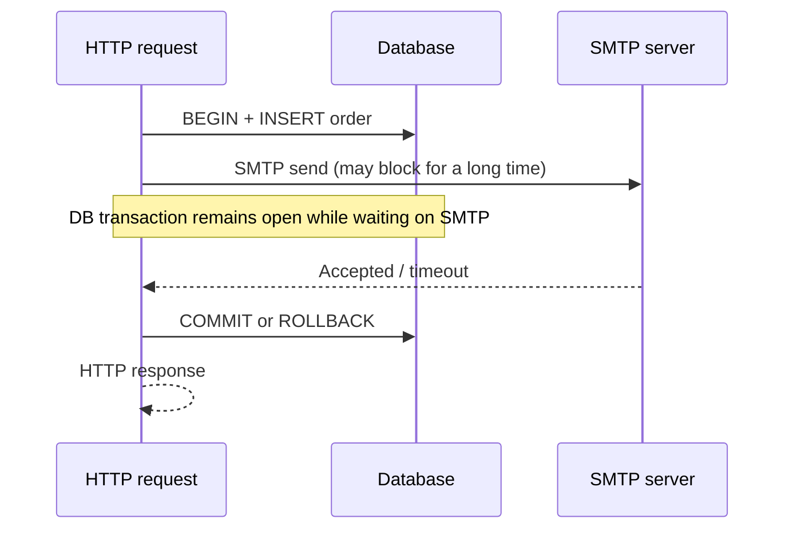
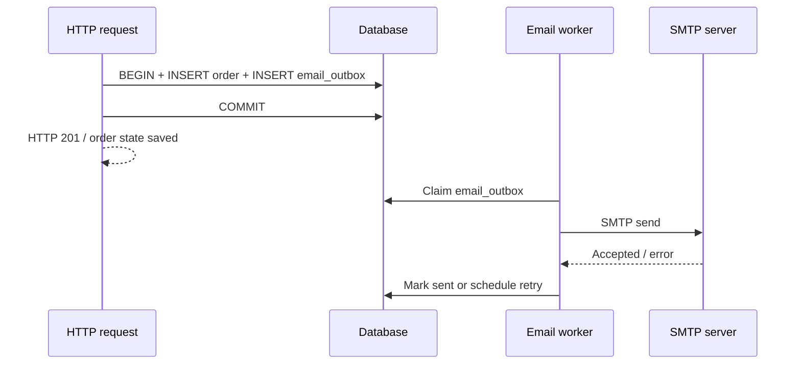
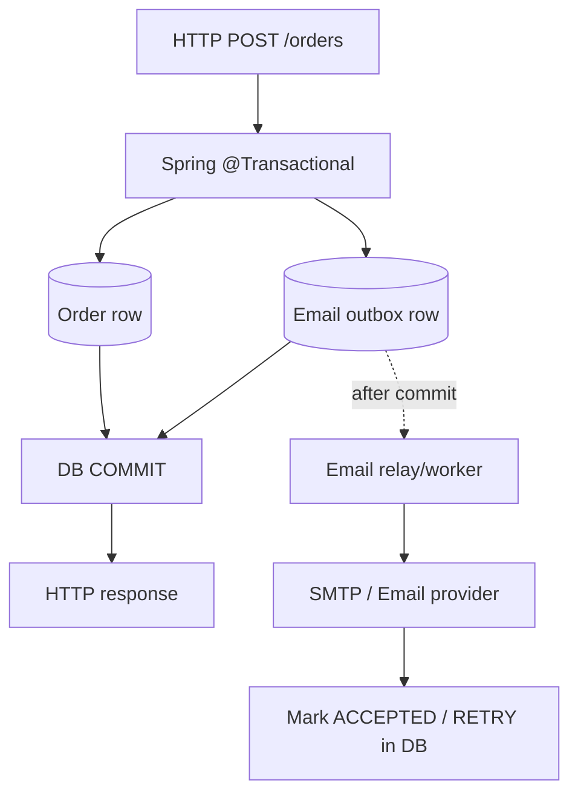
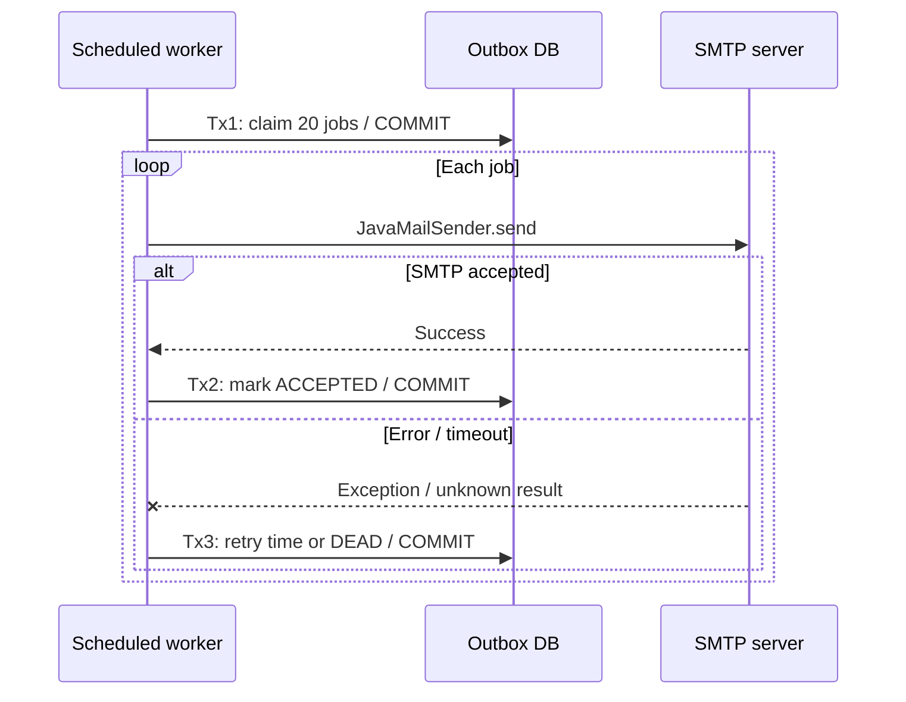
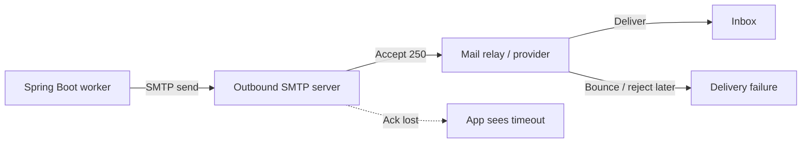
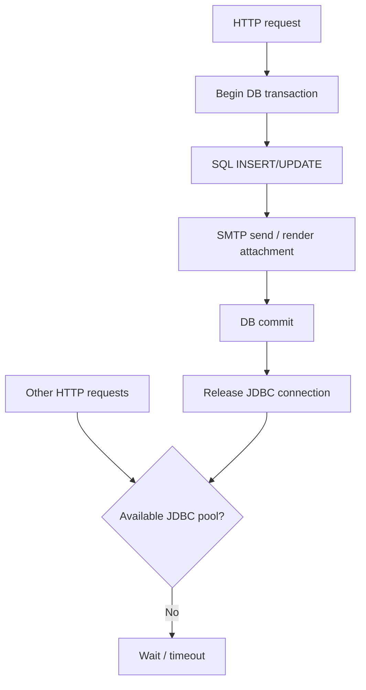
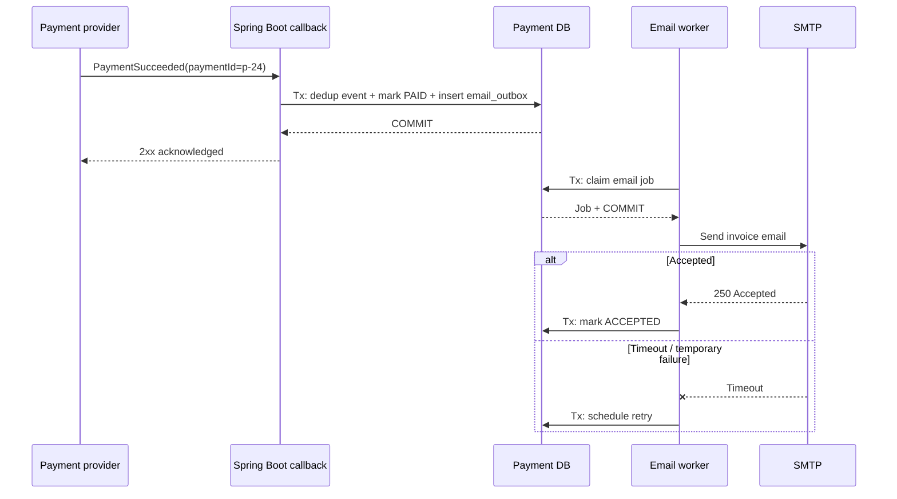

# Sending Mail Outside Business Transactions and Avoiding Holding Database Connections

In a Spring Boot application, an HTTP request may simultaneously create an order, update state in a database, and send a confirmation email to the buyer. If an SMTP call is placed inside a `@Transactional` method, waiting on the mail server can prolong the transaction, hold the JDBC connection, retain locks, and exhaust the connection pool. Conversely, if the email is sent **before the DB commits**, users may receive an "order created" notice while the transaction actually rolls back.

This lesson belongs to the **Email** chapter in the `SPRING_BOOT_INTEGRATION` module. The focus is defining the boundary between **durable business transactions** and **network-I/O email tasks**, choosing an approach based on required reliability, handling timeouts/duplicates, testing, and observing real integration flows. The concepts also apply to publishing events to a broker, calling partner HTTP APIs, or updating caches, though email has a distinct trait: SMTP accepting a message does not mean the message has reached the recipient's mailbox.

## 1. Why Is Sending Email Inside a Transaction Dangerous?

Suppose an application receives an order-creation request:

```java
@Service
public class OrderService {
    private final OrderRepository orders;
    private final JavaMailSender mailSender;

    public OrderService(OrderRepository orders, JavaMailSender mailSender) {
        this.orders = orders;
        this.mailSender = mailSender;
    }

    @Transactional
    public void placeOrder(CreateOrder command) {
        Order order = orders.save(new Order(command));

        SimpleMailMessage mail = new SimpleMailMessage();
        mail.setTo(order.getEmail());
        mail.setSubject("Order confirmation");
        mail.setText("Order " + order.getId() + " has been created");
        mailSender.send(mail); // SMTP I/O while the transaction is still open
    }
}
```

This is an **example to avoid** whenever email sending is not part of data operations requiring atomic commit. Key problems:

1. **Holding DB resources longer:** once the transaction has acquired a connection and executed SQL, waiting on SMTP can hold the connection/locks until the method returns and the transaction completes.
2. **Rollback cannot recall the email:** SMTP does not participate in JDBC transactions; if sending succeeds and a later DB step fails, the already sent email cannot be rolled back by `@Transactional`.
3. **Email errors break business operations:** if `mailSender.send(...)` throws a runtime exception through the transactional interceptor, the transaction may roll back even though creating the order is core business logic and sending mail is only a notification task.
4. **Indeterminate state:** the SMTP server may have accepted the email before the connection dropped; the application sees a timeout, retries, and sends a second copy.
5. **Poor resilience:** HTTP threads are held while SMTP is slow, increasing latency, client-side timeouts, queued requests, and client retry risk.

Some transaction managers may not acquire a connection until the first SQL statement; therefore you should not claim that **every** `@Transactional` method holds a connection from the very first line. However, in this example `orders.save(...)` executes before the SMTP call, so a connection and transaction are likely active. Connection pool behavior, JPA flushing, isolation levels, and execution order determine the exact point at which connections or locks are acquired.

### 1.1. Timeline of Two Implementation Approaches



A more suitable order of responsibilities:



The second diagram illustrates the **transactional outbox**: recording the email-send request in the same transaction as the business data, then letting a worker send it after commit. This solves both holding connections while SMTP is slow and losing send requests if the process crashes right after commit.

## 2. Defining the Right Transaction Boundaries

A clear separation:

| Task | Inside Order-Creation DB Transaction? | Reason |
| --- | --- | --- |
| Check invariants and save the order | **Yes** | Requires business data integrity |
| Record email job/outbox for the newly created order | **Yes**, if the notification request must be durable | Order and send intent commit together |
| Call `JavaMailSender.send(...)` | **No** | SMTP is external I/O and cannot roll back with JDBC |
| Render large templates, download images/attachments from storage | **No** if separable | Avoids prolonging transactions; controls memory and deadlines |
| Retry failed emails | **No** inside the order-creation transaction | Needs its own retry budget, backoff, and tracking |
| Update status after SMTP accepts the email | **New, short DB transaction** | Records the worker's outcome |
| Send email from committed information | After commit, via callback or worker | Avoids notifying about data that never persisted |

"Outside the transaction" has two distinct layers:

- **Outside the business transaction scope:** the SMTP operation is invoked after business data commits or inside a worker without an enclosing DB transaction.
- **Off the HTTP request thread:** a worker or executor sends the email so the HTTP request does not wait on network I/O. This helps latency, though it requires handling errors, queuing, and potential job loss.

Calling an `@Async` method from inside a transaction separates threads, yet **does not guarantee the data has committed**; the worker may run before the transaction commits and fail to see the order. Coordination must account for activation timing.

### 2.1. What `@Transactional` Does Not Do Automatically

- It does not "pre-commit" an SMTP call inside the same method.
- It does not roll back an email already accepted by a remote SMTP server.
- It does not guarantee a post-commit mail callback runs if the JVM exits right after DB commit.
- It does not propagate a transaction context across `@Async`, `ExecutorChannel`, or broker queues to another thread/process.
- It does not turn DB and SMTP into an atomic distributed transaction. Standard SMTP does not provide an `XAResource` to enlist in JTA/XA.

If email is purely secondary and losing occasional notifications during a process crash is acceptable, a post-commit callback may suffice. If emails must be scheduled reliably with recovery paths, use a **durable outbox** or a durable queue mechanism properly coupled to the business transaction.

## 3. Options and Guarantee Levels

| Option | Strengths | Key Limitations | Best Fit |
| --- | --- | --- | --- |
| Send SMTP directly **inside** `@Transactional` | Minimal code | Holds DB resources; rollback cannot recall mail; SMTP failures can affect DB | Generally avoid |
| Send directly **after** transactional method returns | No DB transaction held during SMTP I/O | HTTP still waits; crash before sending loses intent | Secondary tasks, simple needs |
| Synchronous `@TransactionalEventListener(AFTER_COMMIT)` | Runs only after successful commit | Listener can still block HTTP response thread; in-memory event can be lost | Lightweight best-effort notices |
| `@TransactionalEventListener(AFTER_COMMIT)` + `@Async` | Sends on executor after commit, lowers HTTP latency | Not durable across crashes; queue full/rejected; hard to retry after restart | Best-effort with resource bounds |
| Write outbox in transaction, worker sends SMTP | Durable send intent, replayable after crash, tracks status/retries | Requires outbox table, worker, lease/claim, monitoring; duplicates still possible | Critical business emails |
| DB outbox + relay to broker + email consumer | Load decoupling, consumer scaling, DLQ support | Adds broker, two retry boundaries, requires dedup and outcome tracking | High volume, multi-channel notifications |

**Choose based on business requirements:** an experimental promotional email may tolerate best effort; a payment receipt or mandatory document typically needs an outbox and reconciliation. Even for critical emails, never promise "exactly-once delivery to the inbox": SMTP and downstream hops do not share a distributed transaction with the DB.

## 4. Lightweight Option: Publish Event in Transaction, Process After Commit

Spring provides `@TransactionalEventListener` to react to an event at a chosen transaction phase. With `TransactionPhase.AFTER_COMMIT`, the listener fires once the transaction commits successfully; if it rolls back, the listener does not run. By default, if an event is published **outside** a transaction, the listener is not invoked unless `fallbackExecution=true` is explicitly set; avoid enabling that fallback without understanding the consequences.

Example DTO and order-creation service:

```java
public record OrderCreatedNotice(
        UUID orderId,
        String recipientEmail,
        String displayOrderNumber) {
}

@Service
public class OrderApplicationService {
    private final OrderRepository repository;
    private final ApplicationEventPublisher publisher;

    public OrderApplicationService(
            OrderRepository repository,
            ApplicationEventPublisher publisher) {
        this.repository = repository;
        this.publisher = publisher;
    }

    @Transactional
    public UUID createOrder(CreateOrderCommand command) {
        Order order = repository.save(Order.from(command));
        // Pass minimal data only; do not pass lazy JPA entities.
        publisher.publishEvent(new OrderCreatedNotice(
                order.getId(),
                order.getRecipientEmail(),
                order.getDisplayNumber()));
        return order.getId();
    }
}
```

This code assumes `OrderRepository`, `Order`, and `CreateOrderCommand` are application-defined types; IDs and required fields are available when publishing the event (with JPA, mind ID generation strategies and flush timing). `publishEvent` runs inside the transaction, whereas the **`AFTER_COMMIT` listener** only triggers after commit. The event is an in-process Java object and is not persisted by default.

### 4.1. Listener Sending Email on an Executor

```java
@Configuration(proxyBeanMethods = false)
@EnableAsync
public class EmailAsyncConfiguration {
    @Bean("emailTaskExecutor")
    public ThreadPoolTaskExecutor emailTaskExecutor() {
        ThreadPoolTaskExecutor executor = new ThreadPoolTaskExecutor();
        executor.setCorePoolSize(2);
        executor.setMaxPoolSize(4);
        executor.setQueueCapacity(100);
        executor.setThreadNamePrefix("email-");
        executor.setRejectedExecutionHandler(
                new ThreadPoolExecutor.AbortPolicy());
        executor.initialize();
        return executor;
    }
}

@Component
public class OrderEmailListener {
    private final JavaMailSender mailSender;

    public OrderEmailListener(JavaMailSender mailSender) {
        this.mailSender = mailSender;
    }

    @Async("emailTaskExecutor")
    @TransactionalEventListener(phase = TransactionPhase.AFTER_COMMIT)
    public void sendOrderConfirmation(OrderCreatedNotice notice) {
        SimpleMailMessage message = new SimpleMailMessage();
        message.setFrom("no-reply@example.org");
        message.setTo(notice.recipientEmail());
        message.setSubject("Order received " + notice.displayOrderNumber());
        message.setText(
                "Order " + notice.displayOrderNumber()
                + " has been recorded. Please check the status on the website.");
        mailSender.send(message);
    }
}
```

Key imports include `org.springframework.scheduling.annotation.EnableAsync`, `org.springframework.scheduling.annotation.Async`, `org.springframework.scheduling.concurrent.ThreadPoolTaskExecutor`, `java.util.concurrent.ThreadPoolExecutor`, `org.springframework.transaction.event.TransactionalEventListener`, `org.springframework.transaction.event.TransactionPhase`, `org.springframework.mail.javamail.JavaMailSender`, and `org.springframework.mail.SimpleMailMessage`. This example uses Spring Mail, so add `spring-boot-starter-mail` and configure SMTP accordingly.

Because the listener runs on another executor, it **lacks the request's transaction and persistence context**; data used for the email should be a prepared snapshot DTO rather than passing lazy entities and accessing relationships on another thread. Only include data permitted for email content to avoid leaking sensitive details.

In real applications, add exception handling and logging inside the listener so failures from a `void @Async` method are not lost. Also, the executor has a bounded queue: under overload, scheduling tasks may be rejected. With `AbortPolicy`, the caller may observe a post-commit failure while the transaction **can no longer be rolled back**. That is why event + executor should only be treated as best-effort when notifications are critical.

### 4.2. AFTER_COMMIT Is a Timing Boundary, Not a Durable Queue

Several failure windows still remain:

- DB commits, JVM crashes before the callback is dispatched: email is never scheduled.
- Callback submits successfully to the in-memory executor, JVM crashes before the worker sends: email is lost.
- SMTP accepts the email, worker times out and retries: duplicate may be sent.
- Listener fails without retry/quarantine: errors may remain buried in logs if not captured properly.

Even a **synchronous** `AFTER_COMMIT` listener does not make the task durable: if the process dies after commit and before sending, no record exists for a worker to recover. `@Async` decouples the thread, not persistence—it does not turn an executor into a durable broker.

Furthermore, Spring notes that at the `AFTER_COMMIT` phase, the transaction is finished, yet certain resources may still remain thread-bound until cleanup completes. If the listener needs to perform a **new DB write**, invoke a separate service with `@Transactional(propagation = REQUIRES_NEW)` rather than relying on the completed transaction. Do not perform synchronous SMTP sends directly inside a transaction synchronization callback if your goal is freeing the HTTP thread as early as possible.

## 5. Configure SMTP Timeouts Before Talking About Retries

`JavaMailSender` uses Jakarta Mail to talk to SMTP. Every network connection needs time bounds, especially when the application uses thread pools or job workers. Example development config:

```yaml
spring:
  mail:
    host: smtp.example.org
    port: 587
    username: ${SMTP_USER}
    password: ${SMTP_PASSWORD}
    properties:
      "[mail.smtp.auth]": true
      "[mail.smtp.starttls.enable]": true
      "[mail.smtp.starttls.required]": true
      "[mail.smtp.connectiontimeout]": 5000
      "[mail.smtp.timeout]": 10000
      "[mail.smtp.writetimeout]": 10000
```

JavaMail/Jakarta Mail SMTP timeout values are in **milliseconds**. Basic meanings:

| Property | Bounds | Why Needed |
| --- | --- | --- |
| `mail.smtp.connectiontimeout` | Waiting to establish TCP connection | Unreachable proxy/SMTP will not hold threads indefinitely |
| `mail.smtp.timeout` | Waiting to read data/SMTP responses | Unresponsive server will not hang requests forever |
| `mail.smtp.writetimeout` | Waiting to write to socket | Sending large payloads to slow servers is bounded |
| `mail.smtp.starttls.required` | Requires upgrading to TLS before auth/send | Prevents accidental transmission of secrets in plaintext |

This example illustrates a STARTTLS policy. When a provider requires direct SMTPS/TLS on port 465, TLS settings differ (`mail.smtp.ssl.enable` or the transport's equivalent). Verify hostnames and certificate chains rather than enabling trust-all. Retrieve secrets from a secure store rather than hardcoding or committing them to source control.

Do not set enormous timeouts hoping to "ensure emails go through": during an SMTP outage, every worker can become tied up. Combine timeouts, bounded thread pools, retry backoff, and backlog alerts to keep the system stable.

## 6. Transactional Outbox: Persist Send Intent with the Business Transaction

A **transactional outbox** uses a DB table to record *that an email needs to be sent* in the same transaction as the business state change. Once committed, a separate worker polls the outbox, sends via SMTP, and updates status. If the transaction rolls back, neither the order nor the email job exists.



In this diagram, the edge from the outbox to the worker represents **post-commit work dispatching**; the worker only sees committed rows and needs no in-memory event from the request. The worker can continue operating even if the API process restarts, as long as the outbox table and schedule remain intact.

### 6.1. Designing a Table with Status and Business Key

PostgreSQL example:

```sql
CREATE TABLE email_outbox (
    email_id UUID PRIMARY KEY,
    business_key VARCHAR(220) NOT NULL UNIQUE,
    recipient VARCHAR(320) NOT NULL,
    template_code VARCHAR(100) NOT NULL,
    template_data JSONB NOT NULL,
    status VARCHAR(30) NOT NULL DEFAULT 'PENDING',
    attempts INTEGER NOT NULL DEFAULT 0,
    next_attempt_at TIMESTAMPTZ NOT NULL DEFAULT NOW(),
    locked_by VARCHAR(120),
    locked_until TIMESTAMPTZ,
    accepted_at TIMESTAMPTZ,
    last_error VARCHAR(1000),
    created_at TIMESTAMPTZ NOT NULL DEFAULT NOW(),
    updated_at TIMESTAMPTZ NOT NULL DEFAULT NOW(),
    CONSTRAINT chk_email_outbox_status CHECK (
        status IN ('PENDING', 'SENDING', 'ACCEPTED', 'DEAD')
    )
);

CREATE INDEX ix_email_outbox_ready
    ON email_outbox (next_attempt_at, created_at)
    WHERE status IN ('PENDING', 'SENDING');
```

Meaning of key columns:

| Column | Role |
| --- | --- |
| `email_id` | Unique ID of the send request; used to reconcile logs and retries |
| `business_key` | Key preventing duplicate job creation when an HTTP command is retried; e.g., `order-created:tenant-7:order-42:recipient-a` |
| `template_code`, `template_data` | Defines the version/content to send; avoids storing only a JPA entity ID and reading mutating data later |
| `status` | `PENDING` awaiting send, `SENDING` claimed, `ACCEPTED` accepted by provider/SMTP, `DEAD` needing manual intervention |
| `locked_by`, `locked_until` | Assigns worker ownership and supports recovery if a worker crashes |
| `attempts`, `next_attempt_at` | Bounds retries and drives backoff |
| `accepted_at` | Timestamp when the app recorded SMTP acceptance; **not** when the recipient's mailbox received it |

`business_key` must reflect **one logical notification action**, not just an email address. The same recipient may need multiple distinct emails; one order can generate creation, payment, and refund emails. Use a DB unique constraint to stop concurrent requests from inserting duplicate jobs; a separate "check existence then insert" still suffers race conditions.

Avoid storing unnecessary personal data inside `template_data`. Keep only validated fields, enforce retention limits, encrypt where needed, and honor deletion rules per system requirements. Keep template names and versions stable; older email jobs must remain renderable after deploying a new release.

### 6.2. Service Writing Business Row and Outbox Row in One Transaction

```java
@Service
public class OrderCheckoutService {
    private final OrderRepository orders;
    private final EmailOutboxRepository emails;

    public OrderCheckoutService(
            OrderRepository orders,
            EmailOutboxRepository emails) {
        this.orders = orders;
        this.emails = emails;
    }

    @Transactional
    public OrderResult checkout(CheckoutCommand command) {
        // Repository enforces unique constraint on command.idempotencyKey().
        OrderCreation creation = orders.createIdempotently(command);
        Order order = creation.order();

        if (creation.newlyCreated()) {
            String key = "order-created:" + order.getTenantId()
                    + ":" + order.getId() + ":customer";

            emails.insertIfAbsent(
                    UUID.randomUUID(),
                    key,
                    order.getRecipientEmail(),
                    "ORDER_CREATED_V1",
                    new OrderEmailData(
                            order.getId(),
                            order.getDisplayNumber()));
        }
        return new OrderResult(order.getId(), order.getStatus());
    }
}
```

`OrderRepository`, `EmailOutboxRepository`, `OrderCreation`, `CheckoutCommand`, `OrderEmailData`, and `OrderResult` are application-defined classes/interfaces. `insertIfAbsent` represents an `INSERT ... ON CONFLICT DO NOTHING` or equivalent API using the same database and transaction manager as `orders.createIdempotently`. Never use two independent databases and assume a local `@Transactional` spans both.

For emails triggered by a **state transition** rather than entity creation, write the outbox row only when the transaction genuinely performs that transition. Calling `checkout` twice with the same idempotency key must return the existing result without inserting a second outbox row. When a unique constraint contends, handle the exception or re-query cleanly within the transaction state rather than letting a conflict trigger an unexpected HTTP error.

**What is guaranteed:** either the DB holds both the order and the mail request, or neither. **What is not yet guaranteed:** that SMTP accepts the email exactly once or delivers it to the inbox on time. Those belong to the worker and email provider.

## 7. Email Relay: Claim Job, Send SMTP Outside Transaction, Then Record Outcome

A simple polling worker can run via Spring Scheduling or a Spring Integration poller. With multiple replicas, claiming must prevent two workers from picking up the same job at once. Even so, leases do not completely eliminate duplicates: worker A can lose its lease on timeout while worker B resends just as A completes SMTP submission.

### 7.1. Claiming a Batch in a Short Transaction

In PostgreSQL, `FOR UPDATE SKIP LOCKED` allows multiple workers to claim unlocked rows concurrently. Example SQL run inside a transaction:

```sql
WITH candidates AS (
    SELECT email_id
      FROM email_outbox
     WHERE (
          status = 'PENDING'
          OR (status = 'SENDING' AND locked_until < NOW())
     )
       AND next_attempt_at <= NOW()
     ORDER BY next_attempt_at, created_at
     FOR UPDATE SKIP LOCKED
     LIMIT 20
)
UPDATE email_outbox AS e
   SET status = 'SENDING',
       locked_by = :worker_id,
       locked_until = NOW() + INTERVAL '45 seconds',
       attempts = attempts + 1,
       updated_at = NOW()
  FROM candidates AS c
 WHERE e.email_id = c.email_id
RETURNING e.*;
```

`:worker_id` is a bind parameter from JDBC/JPA, not raw SQL syntax run directly in `psql`. Claiming must execute in a short transaction that commits before SMTP sending begins. The 45-second lease is illustrative; size it against total connect/read/write timeouts, email size, worker count, and SLA. If sending could exceed the lease, renew the lease while checking ownership or size the lease appropriately.

The `locked_until < NOW()` clause reclaims jobs left by crashed workers. Never hold row locks throughout SMTP sending: keeping a transaction open while waiting on the provider recreates the exact "holding DB connections" problem this design eliminates.

### 7.2. Separating Transactions by Layer



The application can organize these responsibilities into beans:

```java
@Service
public class EmailJobStore {
    private final EmailJobRepository repository;

    public EmailJobStore(EmailJobRepository repository) {
        this.repository = repository;
    }

    @Transactional
    public List<EmailJob> claim(String workerId, int batchSize) {
        return repository.claimReady(workerId, batchSize);
    }

    @Transactional
    public boolean markAccepted(UUID emailId, String workerId) {
        return repository.markAcceptedIfOwned(emailId, workerId) == 1;
    }

    @Transactional
    public boolean markFailed(
            UUID emailId, String workerId, Instant retryAt,
            String errorCode, boolean permanent) {
        return repository.markFailureIfOwned(
                emailId, workerId, retryAt, errorCode, permanent) == 1;
    }
}
```

These repository methods are custom methods implemented by the project, not built-in Spring Data methods. `claimReady` must execute SQL atomically; `markAcceptedIfOwned`/`markFailureIfOwned` must predicate on `email_id`, `locked_by`, `status='SENDING'`, and any `claim_version`/token if used. An update count of `0` means the job is no longer owned by that worker or was already processed; log it for investigation rather than blindly mutating state.

The worker executes **with no transaction around SMTP**:

```java
@Component
@EnableScheduling
public class EmailOutboxWorker {
    private final EmailJobStore store;
    private final EmailTransport transport;
    private final String workerId = UUID.randomUUID().toString();

    public EmailOutboxWorker(EmailJobStore store, EmailTransport transport) {
        this.store = store;
        this.transport = transport;
    }

    @Scheduled(fixedDelay = 1000)
    public void poll() {
        List<EmailJob> jobs = store.claim(workerId, 20); // Tx already committed.
        for (EmailJob job : jobs) {
            try {
                transport.send(job); // SMTP I/O; no DB transaction.
                store.markAccepted(job.emailId(), workerId);
            } catch (MailException exception) {
                FailureDecision decision = classifyMailFailure(
                        exception, job.attempts());
                store.markFailed(
                        job.emailId(),
                        workerId,
                        decision.nextAttemptAt(),
                        decision.reasonCode(),
                        decision.permanent());
            }
        }
    }
}
```

`EmailTransport`, `EmailJob`, `FailureDecision`, and `classifyMailFailure` are domain types/functions to implement; this snippet demonstrates the transaction boundaries and bean collaboration. Prefer placing `@EnableScheduling` on an application `@Configuration` class rather than on each worker when multiple workers exist. When a process runs multiple schedulers/threads, enforce concurrency limits, batch sizes, and backpressure.

In production, do not restrict error handling to `MailException`: template rendering errors, attachment I/O failures, non-framework timeouts, and DB update failures must also be classified. If `markAccepted` fails after SMTP succeeds, the worker must **preserve an indeterminate/unconfirmed trail** for reconciliation or retry rather than assuming the mail was never sent. DB errors may cause the job to be reclaimed after lease expiration and sent again.

### 7.3. Completing a Claim Only If Owned

An SQL statement to mark accepted:

```sql
UPDATE email_outbox
   SET status = 'ACCEPTED',
       accepted_at = NOW(),
       locked_by = NULL,
       locked_until = NULL,
       last_error = NULL,
       updated_at = NOW()
 WHERE email_id = :email_id
   AND locked_by = :worker_id
   AND status = 'SENDING';
```

If the lease expired without another worker reclaiming it yet, this update may still succeed for the original owner; for stricter contention safety, add a monotonically increasing `claim_version` and check the exact version issued at claim time. When a worker consumes from a broker instead of polling the DB, apply equivalent semantics: commit/acknowledge the broker message only after durable state has been recorded per contract.

### 7.4. Backoff and Poison Jobs

For transient failures, set `status='PENDING'`, compute `next_attempt_at` using exponential backoff with jitter, and increment the attempt count. When errors are unrecoverable or exceed the retry budget, set `status='DEAD'` and trigger alerts. Never retry invalid SMTP credentials or permanently rejected recipients every second forever.

Every state needs an operational path:

| State | Meaning | Operational Action |
| --- | --- | --- |
| `PENDING` | Waiting or scheduled for retry | Monitor job age and queue depth |
| `SENDING` | Claimed by a worker with an active lease | Watch for expired leases and worker crashes |
| `ACCEPTED` | SMTP/provider API accepted the send request | Track bounces/delivery separately if supported by provider |
| `DEAD` | Automatic retries halted | Inspect error, fix config/data, replay under control |

Do not delete failed jobs immediately after retries exhaust; retain enough context to investigate, fix, and replay. Because mail payloads may contain personal data, design clear cleanup schedules, encryption, retention policies, and access controls. Even during cleanup, keep minimal audit records if business policy requires them.

## 8. SMTP Accepted Does Not Mean Delivered to Inbox

`JavaMailSender.send(...)` succeeding means the library completed the protocol handoff to the mail server without raising a corresponding error. An SMTP server returning `250` may have **accepted responsibility for relaying the message**, yet the email can still be delayed, rejected at a downstream hop, bounced, caught by spam filters, or blocked by the recipient.



Distinguish these milestones:

| Milestone | Accurate Interpretation |
| --- | --- |
| Outbox job created | The application **intends** to send an email |
| Worker attempted send | Network attempt made; outcome not yet known |
| SMTP/provider accepted | The sending infrastructure accepted the request per provider contract |
| Provider reports delivered | Provider received a delivery signal from the destination server/system within its visibility |
| Recipient read the email | Cannot be concluded from SMTP success or delivery events alone |

An SMTP server can accept `DATA` and emit `250`, only for the connection to drop before the application reads the reply. To the caller, this is an **unknown outcome**. If the worker retries, the recipient may get two emails; if it does not retry, the email might be lost if the server never received it. Guaranteed "exactly-once delivery" across a DB and SMTP is generally impossible with local transactions alone.

### 8.1. Message-ID and Idempotency

MIME emails include a `Message-ID` header useful for threading and reconciliation. However, reusing the same `Message-ID` across two send attempts **does not force every SMTP provider or recipient server to deduplicate**. Custom headers like `X-Notification-Id` are also mainly for correlation and debugging.

Practical design:

- Generate `email_id` once when inserting into the outbox and keep it unchanged across attempts.
- Record `email_id`, `business_key`, template code, and provider message ID if available.
- If the provider offers an **API idempotency key with explicit guarantees**, reuse the same key across retries; that is a provider-specific feature, not a standard SMTP guarantee.
- If email content triggers critical actions, make the **target website/API action idempotent**; the email carries only an informational notice and a safe link so clicking twice produces no duplicate side effects.
- Avoid emitting notices like "payment completed" before the business DB commits or before verified transaction evidence exists.

For one-time verification code (OTP) emails, do not generate a fresh code on each retry of the same job; changing the code on retry leaves the recipient with conflicting codes. Bind the code or reference to a persisted verification lifecycle with a clear expiration, and never store raw codes in logs or plain outbox fields.

## 9. SMTP Retries: Classify Errors Before Retrying

SMTP has transient failures, permanent failures, and indeterminate outcomes. Never apply a single blind retry policy to all `MailException` instances.

| Signal | Example | Handling Approach |
| --- | --- | --- |
| `4xx` SMTP reply | Server temporarily busy, greylisting, rate limit | Retry with backoff and time ceiling |
| `5xx` SMTP reply | Non-existent recipient, permanent policy or mailbox rejection | Usually stop automatic retries; fix address or policy |
| `MailAuthenticationException` | Wrong username, password, or auth mechanism | Alert on config; avoid tight retries |
| `MailParseException` | Malformed mail content or address | Data or rendering error; route to separate handling |
| Network timeout | Unknown whether the server received the message | Retrying risks duplicates; record ambiguous outcome |
| Server rejects for quota | Sending volume/rate exceeds quota | Throttle, back off, check quota, and alert |
| Provider reports bounce after acceptance | Mail entered the mail network but failed final delivery | Update delivery status separately; do not infinitely re-emit |

In Spring Mail, `MailSendException` can wrap multiple Jakarta Mail causes. To classify accurately, inspect nested causes and specific SMTP codes when the adapter/provider surfaces them; never rely solely on exception message text. Some `5xx` errors related to config or policy may recover after fixing configuration, yet **must not be retried rapidly with identical data**.

### 9.1. Example Retry Time Calculation

For the `attempt`-th failure, a simple policy:

```java
public static Instant nextRetry(
        Instant now, int attempt, ThreadLocalRandom random) {
    int cappedAttempt = Math.min(Math.max(attempt, 1), 7);
    long baseSeconds = Math.min(
            3600L,
            5L * (1L << (cappedAttempt - 1)));
    long jitterSeconds = random.nextLong(
            Math.max(1L, baseSeconds / 4L + 1L));
    return now.plusSeconds(baseSeconds + jitterSeconds);
}
```

This illustrates *exponential backoff with jitter* and a capped base delay, not a built-in Spring Mail retry algorithm. Imports are `java.time.Instant` and `java.util.concurrent.ThreadLocalRandom`. Also bound `attempts`, maximum job age, and concurrent sends according to your SLA; transition to `DEAD` or a manual intervention workflow once limits are exceeded.

Once a permanent SMTP response is returned by a provider, retrying the same recipient/config can harm your sending domain reputation. Also respect quotas, sending windows, and unsubscribe/consent rules for commercial emails.

### 9.2. Beware Multi-Layer Retries

A Spring Integration flow or broker consumer may automatically retry a message when a handler throws an exception, while the email worker also retries via the outbox. If both layers retry without a shared bound, total attempts multiply across policies.

For example, if a broker redelivers three times and the handler tries SMTP four times each delivery, one logical email can trigger up to twelve network attempts. Establish **a single owner of retry decisions**, persisting state by `email_id`, while outer boundaries simply hand work back to that owner. When a broker triggers the email worker, consumption must be idempotent against the outbox job and acknowledgements must follow a clear contract.

## 10. Avoid Holding Connections and Locks While Processing Email

Many systems suffer connection pool exhaustion even with plenty of CPU and DB capacity left. The culprit is threads borrowing a JDBC connection and then waiting on slow SMTP calls or heavy file generation inside the same transaction.

### 10.1. Tracing the Connection Path



If a connection pool has `N=10` connections and ten concurrent requests hold transactions while SMTP blocks for 15 seconds, subsequent requests needing the DB queue up or time out. This illustrates **pool exhaustion risk**; exact connection acquisition/release timing depends on the driver, transaction manager, JPA flush behavior, pool settings, and application code. The core rule is never performing unrelated network I/O while holding a transaction.

Adjustments to apply:

1. Shrink the transaction to just checking invariants, writing business data, and inserting the outbox row.
2. Extract the mail-sending service into another bean without an enclosing `@Transactional`.
3. Pass a snapshot of data needed for rendering rather than keeping a persistence context open to read lazy properties outside the transaction.
4. Do not download large attachments, make HTTP calls, or wait on template services inside a transaction. When data is needed to generate a file, read and persist a stable snapshot/reference as needed and run heavy generation post-commit.
5. Use bounded pools/threads and timeouts to protect the email worker; never enlarge the JDBC pool just to mask holding connections too long.

### 10.2. Do Not Hold a Transaction Across an Entire Batch

Pattern to avoid:

```java
@Transactional
public void sendAllPending() {
    List<EmailJob> jobs = repository.findPending();
    for (EmailJob job : jobs) {
        mailSender.send(render(job));
        repository.markAccepted(job.emailId());
    }
}
```

This can hold one connection and many row locks across the whole batch. With 200 emails in a batch, a single error or timeout prolongs the entire transaction; many emails may have been accepted by SMTP before the DB rolls back status updates, causing the system to resend them on retry.

Instead, **claim the batch in a short transaction**, **send via SMTP with no transaction**, and **update each job's outcome in a short transaction**. Some apps optimize with a batch update after sending a group, though an update failure widens the indeterminate-outcome window; weigh and test that trade-off carefully.

### 10.3. Connection Pool Settings and Transaction Timeouts

HikariCP is typically the default connection pool in JDBC-backed Spring Boot projects. Monitor `active`, `idle`, `pending`, and connection wait times. Increasing pool size is appropriate only after measuring workload and DB capacity; opening too many concurrent connections can overload the database.

Transaction timeouts should bound DB work expected to be brief. They are **not** a solution for SMTP timeouts: even when a transaction is marked for rollback, the Java thread may stay blocked on socket I/O, and emails already accepted remotely cannot be undone. Bound SMTP timeouts directly.

## 11. Emails with Templates, Attachments, and Sensitive Data

Sending HTML emails and attachments typically uses `MimeMessage` and `MimeMessageHelper` with `JavaMailSender`:

```java
@Component
public class SmtpEmailTransport implements EmailTransport {
    private final JavaMailSender sender;
    private final EmailTemplateRenderer renderer;

    public SmtpEmailTransport(
            JavaMailSender sender, EmailTemplateRenderer renderer) {
        this.sender = sender;
        this.renderer = renderer;
    }

    @Override
    public void send(EmailJob job) {
        sender.send(mime -> {
            MimeMessageHelper helper = new MimeMessageHelper(
                    mime, true, StandardCharsets.UTF_8.name());
            helper.setFrom("no-reply@example.org");
            helper.setTo(job.recipient());
            helper.setSubject(renderer.subject(job));
            helper.setText(renderer.renderHtml(job), true);

            // If an attachment is needed, load from immutable object storage
            // after checking access permissions and size limits.
            mime.setHeader("X-Notification-Id",
                    job.emailId().toString());
        });
    }
}
```

Imports: `org.springframework.mail.javamail.JavaMailSender`, `org.springframework.mail.javamail.MimeMessageHelper`, `java.nio.charset.StandardCharsets`. `EmailTemplateRenderer` and `EmailTransport` are project-defined abstractions. The example uses `MimeMessagePreparator` via a lambda supported by `JavaMailSender`; providers may add or rewrite certain headers per protocol rules. The `X-Notification-Id` header aids reconciliation and **does not automatically suppress duplicates**.

To keep DB resource usage short:

- Never pass a JPA entity still attached to a persistence context to an async worker.
- If an attachment is generated from DB data, consider generating the file in object storage first and storing an immutable reference/version in the job. Ensure the file is ready and properly authorized when the worker runs.
- Have the worker open streams/download files only when actually sending, enforcing size and download timeouts; never hold a DB transaction while streaming.
- Version templates so older jobs render consistently. If a template no longer exists, move the job to a fixable configuration-error state rather than retrying SMTP.
- Build `To`/`Cc`/`Bcc` headers and HTML content from validated data; encode/escape variables inserted into HTML to prevent unwanted content in emails.

If emails contain links with tokens or verification codes, create short-lived, tightly scoped tokens, verify them server-side, and never log tokens or store them unencrypted unnecessarily. Email is not a durable secret store: recipient mailboxes can be forwarded, compromised, or accessed from shared devices.

## 12. Full Scenario: Successful Payment and Invoice Email

Suppose a payment API receives a partner callback. It must set `payment_status=PAID`, queue an invoice email, return an HTTP response promptly, and have a worker send the email asynchronously.



Key invariants:

1. Callbacks carry a stable event ID/payment ID protected by a unique constraint so partner retries never cause multiple state transitions or duplicate email jobs.
2. Payment is verified and committed before the system intends to send a "payment received" notice.
3. The email outbox row is written in the same transaction as the payment update, preventing committed payments without scheduled emails.
4. The HTTP callback returns success after DB commit per provider contract without waiting for SMTP, reducing latency and avoiding provider retries caused by HTTP timeouts.
5. Workers can crash and recover while jobs stay in the DB. However, duplicates can occur if the provider accepted the email before the worker failed to persist the DB update.
6. If email sending fails persistently, payment state remains accurate; the email backlog/DLQ triggers its own alerts and operators can replay under control.

If legal regulations require issuing e-invoices through a dedicated system API, **invoice issuance** may itself be a legal business workflow requiring its own state and idempotency; the email attaching or linking to the invoice is only the notification channel. Never treat SMTP success as proof of valid invoice issuance.

## 13. Testing Failure Points and Verifying No DB Transaction Is Held

Good testing covers business transactions, workers, timeouts, and recovery mechanisms. Unit tests that merely mock `JavaMailSender` and verify `send()` was called once do not prove the outbox will never lose a job or hold DB connections when SMTP stalls.

| Scenario | Outcome to Prove |
| --- | --- |
| Service saves order then throws before commit | Neither order **nor** email job exists |
| Service commits successfully | Both order and outbox job exist; HTTP does not wait for SMTP send |
| `AFTER_COMMIT` callback when transaction rolls back | Listener does not run |
| Post-commit event when executor queue is full | Tracked/rejected per policy; aware that in-memory delivery is not guaranteed |
| Worker claims job then SMTP stalls | Claim DB transaction already committed; JDBC connection released before SMTP finishes |
| SMTP unreachable | Job stays in retryable state with backoff and attempt count |
| SMTP returns permanent error | Job moves to DEAD/quarantine; no tight retry loop |
| Worker dies after claim before send | Lease expires and another worker takes over |
| SMTP accepts but worker crashes before `markAccepted` | Job may resend; duplicate behavior is recognized and operationally handled |
| Two replicas claim concurrently | Not held by both simultaneously when claim succeeds; uniqueness/lease enforced |
| Business request retried with same idempotency key | Only one business transition and one logical email job |
| SMTP succeeds then later bounces | `ACCEPTED` is not conflated with `DELIVERED`; bounce handled separately |
| Broken template or attachment | Job records a clear failure without holding DB transactions or losing stack traces |
| 1,000 emails scheduled simultaneously | Bounded SMTP/worker pool, observable backlog growth, API and JDBC pool remain unblocked by SMTP |

### 13.1. Testing Transaction Rollback and Outbox

Integration example against a real database or Testcontainers:

```java
@Test
void rollbackDoesNotLeaveEmailJob() {
    CheckoutCommand command = newCheckoutCommand();
    arrangeBusinessRuleToFailAfterInsert();

    assertThatThrownBy(() -> checkoutService.checkout(command))
            .isInstanceOf(RuntimeException.class);

    assertThat(orders.existsByRequestId(command.idempotencyKey()))
            .isFalse();
    assertThat(emailJobs.existsForBusinessKey(
            expectedBusinessKey(command))).isFalse();
}
```

Helpers/repositories in this snippet are project-defined test fixtures. Crucially, test against the **exact transaction manager and datasource** used in production to verify outbox writes commit and roll back with the order. Tests wrapped in a test-framework transaction that auto-rolls back can mask commit-boundary bugs if fixtures are not set up carefully.

### 13.2. Testing to Confirm SMTP Runs Outside the Transaction

Use an SMTP test server like GreenMail or an equivalent library to delay/drop responses, simulate downtime, and record messages. To verify connection release, monitor pool active/pending counts or use interceptors/metrics confirming the claim transaction completed before the worker calls `send`.

Example test outline:

1. Start the database and SMTP test server.
2. Create an order, verify DB commit and outbox job presence.
3. Artificially delay the SMTP response by 5–10 seconds while executing an independent DB query concurrently.
4. Confirm the DB query acquires a connection normally even with a tightly bounded pool; the claim transaction does not stretch across the SMTP wait.
5. Let SMTP accept the email, stop the worker before status update, restart, and verify the outbox retries while accounting for possible duplicate emails.

Mocking JDBC connections or mail senders alone cannot prove these network/transaction interactions at failure boundaries. When testing real sending logic, always use test mailboxes or an SMTP test server, never real recipients.

## 14. Observing and Operating the Email System

An outbox preserves state durably, yet backlogs will still pile up unnoticed without monitoring:

| Metric | Meaning | Action on Anomaly |
| --- | --- | --- |
| `email_outbox_pending` | Number of jobs awaiting send | Check throughput and scheduler health |
| `oldest_pending_age` | Age of the oldest incomplete job | Alert on email SLA breach |
| `smtp_send_duration` | Provider call latency | Tune timeouts, connectivity, limits |
| `smtp_accepted_count` | Provider acceptances | Track throughput; do not interpret as delivered |
| `email_retry_count` | Retries by cause and template | Detect network, config, or quota issues |
| `email_dead_count` | Jobs needing manual intervention | Runbook reprocessing and data checks |
| `email_duplicate_suspected` | Jobs resent after indeterminate outcomes | Reconcile and evaluate duplicate impact |
| JDBC pool active/pending | Connections held or DB contention | Check for accidental SMTP inside transactions |
| Executor active/queue/rejected | Async sending pressure | Adjust concurrency and protect HTTP |

Logs should include `emailId`, `businessKey` (if free of PII), `templateCode`, `attempt`, `workerId`, status, duration, and classified error code. Never log SMTP passwords, bearer tokens, full email bodies, attachments, OTPs, or recipient addresses if privacy policies forbid it. If recipient lookup is needed, consider protected hashes or access-controlled audit queries.

### 14.1. Runbook When the Email Queue Backs Up

1. Check `oldest_pending_age` and counts of PENDING/SENDING/DEAD jobs to scope affected templates or providers.
2. Inspect worker logs, recent SMTP errors, and network/TLS/credential/quota status without printing secrets into support tools.
3. Check for `SENDING` jobs with expired leases, verify worker liveness, and see if multiple instances are contesting claims.
4. Separate permanent configuration errors, transient errors, and unknown outcomes; avoid mass-replaying jobs when the provider already accepted copies.
5. After fixing the root cause, return eligible jobs to PENDING with the same `email_id`/`business_key` and a fresh retry budget via an audited procedure.
6. Reconcile accepted jobs against provider bounce/delivery signals if available; never equate ACCEPTED with the recipient reading the email.

## 15. Design Checklist for Sending Email Outside Business Transactions

1. **Boundaries:** Does any business method perform SMTP, large file rendering, or HTTP I/O inside `@Transactional`? Can the transaction be narrowed to business writes and send intent?
2. **Reliability level:** Is email best-effort or must it survive crashes? Did you pick an `AFTER_COMMIT` event or an outbox based on real requirements?
3. **Timing:** Are "completed" notices emitted only after business state genuinely commits? Does rollback guarantee no outbox job is created?
4. **Durability:** Does the outbox share the same DB/transaction as the business row, with a unique business key guarding HTTP/event retries?
5. **Workers:** Are claim/mark transactions short, SMTP I/O outside transactions, lease/claim versions enforced, and retry/backoff and DEAD/quarantine clearly defined?
6. **Duplicates:** When SMTP accepts but the app times out, jobs can resend. Do you track by email ID and handle potential user-facing duplicates?
7. **Resources:** Have SMTP connect/read/write timeouts, bounded thread pools, batch sizes, and JDBC pool metrics been tested under load?
8. **Content:** Are templates/versions, attachments, PII, OTPs, recipient addresses, TLS, and secrets governed by safe policies and retention limits?
9. **States:** Do you distinguish PENDING, SENDING, ACCEPTED, DEAD from delivered/bounced/read, and integrate provider webhooks if needed?
10. **Testing:** Have you tested rollbacks, post-claim crashes, post-SMTP-accept crashes, concurrent workers, timeouts, and DB pool exhaustion?
11. **Operations:** Do you have alerts for overdue jobs, rising retries, dead jobs, SMTP auth failures, and runbooks for safe replay and reconciliation?

**Practical principle:** Spring Boot transactions should hold DB resources only for the brief duration needed to enforce business invariants and persist send requests. Execute SMTP post-commit on an executor when best-effort is acceptable, or use a **transactional outbox and worker** when crash recovery is required. Either way, handle timeouts, duplicate risk, data protection, and test across the exact boundary between the database and the external mail system.
