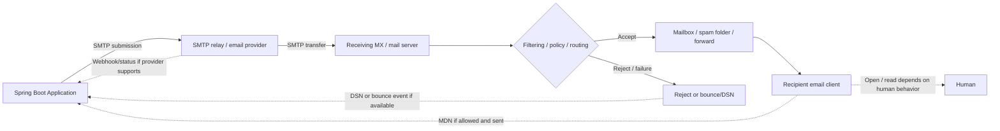
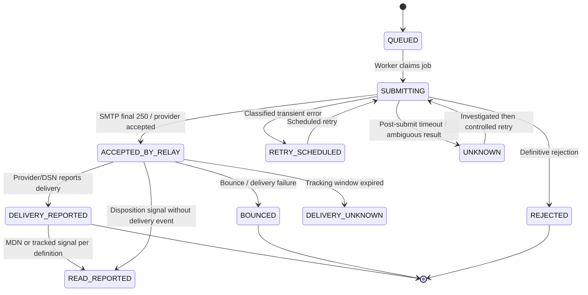
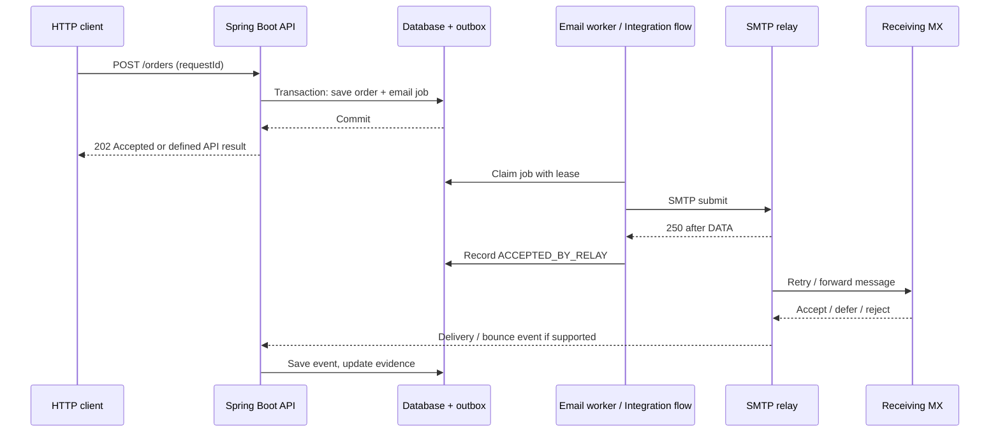

# Distinguishing SMTP Acceptance from Recipient Delivery or Read

## 1. Real-World Problem: What Does "Email Sent Successfully" Mean?

A **Spring Boot** service calls `JavaMailSender.send(...)` to send a transaction confirmation email. The method returns normally, and the system logs `sent successfully`. Later, a customer reports never seeing the message, or the system discovers the address does not exist. This is not necessarily a bug in `JavaMailSender`: an **SMTP server accepting responsibility for processing a message** is different from **the message reaching the destination system**, and even further from **a human opening, reading, or understanding the content**.

This lesson belongs to the **Email** chapter of the **SPRING_BOOT_INTEGRATION** module, where integration flows connect HTTP clients, databases, caches, message brokers, and Spring Integration adapters. In a real flow, accurately understanding the SMTP boundary directly affects API contracts, business state, retries, deduplication, transactions, testing, and observability.

After this lesson, you can:

- Explain the meaning of `250` after `RCPT TO` and after `DATA`, without equating relay acceptance with recipient delivery or reading.
- Distinguish **SMTP acceptance**, **delivery events**, **bounces/DSNs**, **MDNs/read receipts**, and open indicators such as tracking pixels.
- Design email state models with clear guarantees, including cases where the outcome cannot be determined after a timeout.
- Implement sending in Spring Boot, persist requests via an outbox, handle retries, and observe the email lifecycle without falsely reporting success.
- Test accurately across the boundary between **simulated SMTP server acceptance** and **evidence of delivery or reading on the receiving side**.

## 2. An Email's Journey Has Multiple Milestones

A message may pass through multiple mail transfer agents (MTAs), spam filters, and mailbox servers before a reader sees it:



| Milestone | What Is Actually Known | What **Cannot** Yet Be Concluded |
|---|---|---|
| Application writes email job to database | The send request has been persisted within the application's transaction. | SMTP received it, or the recipient has the email. |
| SMTP relay returns `250` ending the `DATA` phase | The connected relay accepted the message to process/forward under its policies. | Receiving MX received it, the email landed in the inbox, or the user read it. |
| Receiving MX responds with acceptance | The destination server or a system acting on its behalf accepted the SMTP transfer. | The email landed in the Inbox rather than spam, rendered properly, or was viewed by the reader. |
| Email service emits a `delivered` event | By the provider's definition, a delivery hop was confirmed, typically acceptance by the receiving mail server. | A human read it; or that all providers share the same definition of "delivered." |
| Opened/read notification exists | An MDN signal or interaction under a specific tracking mechanism was recorded. | Identity, reading the entire message, or comprehension of the content is definitively proven. |

The phrase "received" must specify **who received it**: the sending relay, the receiving mail server, the mailbox, or a human. Without specifying this, a `DELIVERED` label on a dashboard can mislead operations teams or customers about the actual guarantee level.

## 3. At Which Stage Does SMTP Accept a Message?

SMTP exchanges proceed through basic steps: greeting the server, identifying the envelope sender (`MAIL FROM`), the envelope recipient (`RCPT TO`), transferring the payload (`DATA`), and receiving the response that ends the data transfer phase.

An **illustrative** transcript omitting EHLO extensions, STARTTLS, and authentication:

```text
C: EHLO app.example
S: 250-mailrelay.example
S: 250 SIZE 10485760
C: MAIL FROM:<bounce@example.com>
S: 250 2.1.0 Sender OK
C: RCPT TO:<customer@example.net>
S: 250 2.1.5 Recipient OK
C: DATA
S: 354 End data with <CRLF>.<CRLF>
C: From: no-reply@example.com
C: To: customer@example.net
C: Subject: Your order update
C:
C: Your order is being processed.
C: .
S: 250 2.0.0 Queued as Q-1248
```

The two `250` responses in the transcript carry different meanings:

1. **`250` after `RCPT TO`:** the server agrees to handle the recipient address within the current SMTP transaction. It has **not** finished receiving the message body, nor proven that the mailbox exists or that the final mail server delivered the message. Some servers accept unverified addresses at this step to process later or to prevent address harvesting.
2. **`250` after the dot ending `DATA`:** the connected server has **accepted the message** for further processing. If it is an intermediate relay, the message can still be delayed, rejected at a downstream hop, expire during retries, or trigger a bounce.

`354` is only permission to **begin sending the data payload**, not an acceptance result. The final `250` response often includes the relay's queue ID, which helps trace logs on the provider/MTA side; that queue ID is not proof that the recipient read the message.

### SMTP Codes and How to Interpret Them

| Code Class | General Meaning | Handling Approach |
|---|---|---|
| `2xx` | The step/command was accepted or completed by the server; check **which command was issued**. | If `250` ends `DATA`: record accepted-by-relay. |
| `3xx` | Waiting for additional information or data, such as `354` after `DATA`. | Continue the protocol exchange; does not confirm the message was accepted yet. |
| `4xx` | Temporary failure at the current step, such as `421`, `450`, `451`, or `452` depending on context. | Evaluate bounded retries with backoff and priority; avoid immediate retries that cause overload. |
| `5xx` | Permanent failure for the request at the server at that time, such as `550` or `553`. | Do not retry blindly; verify the address, sending permissions, policy, and actual root cause. |

Enhanced status codes like `4.2.2` or `5.1.1` add detail on the nature of the error. However, implementations and response texts vary by server. Do not infer the root cause solely from free-form wording in a response, and do not assume every `4xx` error will eventually succeed upon retry.

**A single email with multiple recipients** is more complex: SMTP may accept some `RCPT TO` commands and reject others. The SDK may report a partial send failure; state must be tracked **per recipient/envelope** when the application needs per-person verification.

## 4. "Delivered Successfully" Also Has Multiple Definitions

After the relay accepts a message, it may transfer it directly to the receiving MX or pass through multiple relays. Outcomes can include:

- The receiving MX accepts the message and routes it to internal processing.
- The mailbox exists, but the message is filtered into spam/quarantine or forwarded/deleted by user rules.
- The receiving MX temporarily rejects it, so the relay queues the message and retries.
- An invalid address, domain, or policy causes a rejection or bounce.
- The provider does not emit callback events, or callbacks are lost/delayed, leaving the application without a final outcome signal.

A **delivery event** emitted by a provider usually means the receiving mail server accepted the handoff. Read your specific provider's event definitions: `processed`, `accepted`, `sent`, and `delivered` can represent different points in time. A webhook reporting `delivered` does not automatically prove the message sits in the Inbox folder; nor does it prove the recipient opened it.

If you need a guarantee that **the recipient actually acknowledged the information**, email alone is insufficient. For important agreements, require the user to sign into a portal, open the notice, and perform a confirmation action; that provides **authenticated in-system interaction evidence**, independent of SMTP.

## 5. Bounce, DSN, and MDN: Three Different Signals

### 5.1. Bounce and Delivery Status Notification (DSN)

When a message cannot be delivered, the mail system may generate a **bounce** or **DSN** (Delivery Status Notification) sent back to the envelope sender address or surfaced via the provider's event API. A DSN can report statuses such as **failed**, **delayed**, or in some situations **delivered/relayed/expanded**. Not every MTA supports DSN requests in the same way.

Points to remember:

- A bounce can arrive **after** the relay returned `250`, so `accepted-by-relay` and `bounced` do not contradict each other.
- A `5xx` during the SMTP conversation itself is a **synchronous rejection**; a bounce generated later is an **asynchronous feedback signal**. The two paths must be tracked separately.
- **Receiving no bounce is not proof the message reached its destination.** Bounces can be lost, blocked, suppressed, or uncollected by the application.
- A DSN is a signal that must be correlated to the right message/recipient. Some DSNs can be forged; verify their origin and do not blindly trust their contents to trigger sensitive automated actions.
- An email can follow forwarding rules or aliases, making the final outcome different from expectations. A `relayed` event does not equal `delivered` to the final mailbox.

### 5.2. Message Disposition Notification (MDN) and "Read Receipts"

An **MDN** describes a handling/display action reported back by a mail user agent, such as a `displayed` notification. A message may request a disposition notification, but:

- Users or email software **can decline, ignore, or block** the request.
- An application may report `displayed` even if the user barely glanced at it; conversely, a user can read the email without sending an MDN.
- An MDN does not prove the recipient understood, agreed with, or could act on the request.
- MDN signals may arrive via email and require careful verification and correlation like any other message.

Therefore, do not treat `read receipt received` as legal proof or definitive business confirmation without an appropriate verification workflow.

### 5.3. Image Open Tracking and Click Tracking

Some email services record an "open" when a client fetches a tracking image, or a "click" when a request hits a tracked URL:

| Signal | What Can Be Observed | Limitations |
|---|---|---|
| Tracking pixel loaded | An image fetch occurred, possibly from a mail client or proxy. | Prefetching, proxies, privacy protections, caching, bots, or image blocking prevent counts from representing human opens. |
| Click tracking | A request passed through the tracked link. | Link previews, security scanners, forwards, or automation can trigger clicks; a click does not mean the full email was read. |
| MDN/read receipt | The client/user generated a disposition notification. | Depends on recipient policy and behavior; not always sent and gives no guarantee of comprehension. |
| Confirmation inside an authenticated app | The account performing the confirmation action is recorded. | Requires identity, authentication, and audit policies; still does not inherently prove the operator's comprehension. |

Open tracking must comply with data protection policies and user privacy expectations; in many business domains you can drop this metric altogether and measure outcomes from authenticated actions instead.

## 6. How Much Does Spring Boot and `JavaMailSender` Guarantee?

In Spring Boot, the dependency commonly used for SMTP sending is:

```kotlin
dependencies {
    implementation("org.springframework.boot:spring-boot-starter-mail")
}
```

With Spring Boot 3.x, the mail starter uses Spring Framework Mail and **Jakarta Mail**. When conditions are met, Spring Boot configures `JavaMailSender` from `spring.mail.*` properties; if a Spring Integration SMTP adapter is used, it must be configured to use the appropriate sender/session.

Example SMTP submission configuration using STARTTLS on port 587:

```yaml
spring:
  mail:
    host: ${SMTP_HOST}
    port: ${SMTP_PORT:587}
    username: ${SMTP_USERNAME}
    password: ${SMTP_PASSWORD}
    properties:
      "[mail.smtp.auth]": "true"
      "[mail.smtp.starttls.enable]": "true"
      "[mail.smtp.starttls.required]": "true"
      "[mail.smtp.connectiontimeout]": "5000"
      "[mail.smtp.timeout]": "5000"
      "[mail.smtp.writetimeout]": "5000"
```

The JavaMail properties above are an example for an SMTP server supporting STARTTLS and authentication. Actual configuration must follow provider requirements (TLS, port, certificates, auth mechanism, quotas). Never hardcode passwords or log SMTP transcripts containing credentials.

Example sending a message to **a single** recipient:

```java
import org.springframework.mail.SimpleMailMessage;
import org.springframework.mail.javamail.JavaMailSender;
import org.springframework.stereotype.Service;

@Service
public class OrderEmailSubmitter {
    private final JavaMailSender mailSender;

    public OrderEmailSubmitter(JavaMailSender mailSender) {
        this.mailSender = mailSender;
    }

    /**
     * Returning means JavaMailSender reported no error for this submit attempt.
     * It does not mean the recipient received, opened, or read the email.
     */
    public void submit(OrderEmailCommand command) {
        SimpleMailMessage message = new SimpleMailMessage();
        message.setFrom("no-reply@example.com");
        message.setTo(command.recipient());
        message.setSubject("Order update");
        message.setText("Order " + command.orderId()
                + " is being processed.");

        mailSender.send(message);
        // Only record the outcome of the SMTP submit attempt; do not mark READ.
    }
}

record OrderEmailCommand(String orderId, String recipient) {
}
```

If `send(...)` returns without an exception in normal SMTP sending, the application may record that **the submit succeeded according to the current SMTP client/server exchange**. It **does not provide an end-to-end promise** of receipt or reading. If the SMTP relay is your provider, this outcome maps to a state such as `ACCEPTED_BY_RELAY`; do not immediately mark `DELIVERED` or `READ`.

When `send(...)` throws `MailException` or a lower-level exception, analyze the cause:

- Rejections during SMTP steps (such as address/permission) may indicate the server did not accept the corresponding recipient.
- Timeouts or connection resets, especially **after the client has finished sending `DATA` but before receiving the final response**, can leave the outcome **unknown**. The server may have queued the email while the application believes it failed.
- With multiple recipients or multiple messages in one call, partial failures can happen; do not assign an absolute success/failure state to the whole group without inspecting the details.

Do not turn every exception into `FAILED_PERMANENT` or an immediate retry; distinguish **definitive rejection** from **unknown outcome** and preserve attempt context.

## 7. State Machines Should Reflect Evidence, Not Hope

An email notification system needs at least two axes of information: **send-job state** and **delivery/disposition evidence**. Example simplified per-recipient state machine:



This is an **application-defined model**, not an enum from Spring or SMTP. Events can arrive out of order; for example, a delivery event arriving after a bounce, or an email open reported before the delivery event arrives. In larger systems, storing **a separate event/attempt table** and deriving the display state is safer than blindly overwriting a single status column.

| Illustrative Application State | What Can Be Stated | What Must Not Be Inferred |
|---|---|---|
| `QUEUED` | The send request has been saved for a worker to process. | That SMTP received it. |
| `SUBMITTING` | An attempt is in flight; its lease may expire or crash and require recovery. | That the attempt will definitely produce a known result. |
| `ACCEPTED_BY_RELAY` | The called relay/provider accepted the message via its protocol or API. | That it reached the inbox or was read. |
| `RETRY_SCHEDULED` | Waiting to retry after a classified error; time and attempt count are saved. | That no email reached the destination if the prior failure was ambiguous. |
| `UNKNOWN` | Whether the SMTP server accepted the message is undetermined. | That sending failed or that unlimited resending is safe. |
| `REJECTED` | Clear evidence exists that the submission attempt was rejected. | That all addresses or all other attempts also failed. |
| `DELIVERY_REPORTED` | Delivery evidence exists per the reporting source's definition. | That it entered the Inbox, was seen, or was read. |
| `BOUNCED` | A delivery failure signal exists for the related recipient/attempt. | That no other attempt or forward succeeded. |
| `READ_REPORTED` | An MDN signal or tracked behavior per the configured mechanism exists. | That the recipient definitively read or understood it. |
| `DELIVERY_UNKNOWN` | The tracking window elapsed without a decisive signal. | That delivery succeeded or failed. |

The application should store **timestamps, evidence sources, and per-attempt details** (such as `acceptedAt`, `bounceReceivedAt`, `providerEventId`, `smtpResponseCode` when available). For multi-recipient emails, create **per-recipient delivery records** so one rejected recipient does not corrupt another recipient's status.

### Name APIs and UI Labels Accurately

| Misleading Label | More Accurate Name or Description |
|---|---|
| “Email sent” immediately after creating an outbox job | “Send request accepted and queued.” |
| “Delivered” immediately after `JavaMailSender.send` | “Accepted by SMTP relay.” |
| “Customer received” when provider emits a delivered event | “Destination mail server accepted per provider report.” |
| “Customer read” from a tracking pixel | “Open signal detected by tracking system; may not reflect actual reading.” |
| “Failed” after a client read timeout | “Send outcome undetermined; reconciling/retrying per policy.” |

## 8. Combining Transactions, Outbox, and Mail Workers

A practical integration pattern has the HTTP API receive an order event, persist to the database, and **queue the email job in the same DB transaction**. After commit, a worker processes the job over SMTP; the provider may send webhooks/DSNs back to the application.



**Outbox benefit:** the send request is not lost if the API process dies after committing the order but before calling SMTP. It is a way to persist send intent durably; **it does not make email atomic with the database transaction**.

Important failure case:

1. Worker sends via SMTP; relay returns `250`.
2. Worker crashes **before** persisting `ACCEPTED_BY_RELAY` to the DB.
3. After the lease expires, another worker picks up the job and may send another copy.

Standard SMTP **has no standard submission idempotency key primitive**. `Message-ID` in MIME headers helps correlate messages and may assist certain filters/analytics, but **does not guarantee** that all relays and mailboxes deduplicate. If a provider offers a mail-sending API with a true idempotency key, verify its exact contract; reusing a `Message-ID` is not equivalent to that mechanism.

Combine these measures:

- Use a business-stable `notificationId` with a unique constraint so duplicate HTTP/broker events do not create duplicate email jobs.
- Outbox workers claim via appropriate lease/locking; store attempt IDs, attempt counts, next attempt timestamps, and observed outcomes.
- Classify errors clearly; for an **unknown outcome**, reconcile against provider/queue logs when possible before retrying sensitive actions.
- If resending is required, document "may produce duplicates" and keep email content safe under at-least-once delivery—such as status notices that trigger no financial side effects when read.
- Do not rely on in-memory caches or locks to deduplicate across multiple instances or restarts.
- Distinguish broker confirmation that a "send-email" event was published from SMTP acceptance, destination acceptance, and user reading.

## 9. Webhooks and DSNs: Receiving Asynchronous Events Safely

If the provider offers delivery/bounce/open webhooks, the application must treat webhooks as **untrusted external input**:

1. **Authenticate the source:** verify signatures, tokens, validity timestamps, or the provider's specified verification mechanism; never accept an unauthenticated HTTP request claiming "delivered."
2. **Normalize events:** map provider event types to internal states with explicit definitions. `processed` does not equal `delivered`; `open` does not equal `read`.
3. **Correlate accurately:** store mappings between `notificationId`, recipient, provider message ID, envelope recipient, and attempt. The `Message-ID` header may differ from the provider's internal ID.
4. **Prevent duplicate processing:** use a unique key on the provider event ID or an appropriately scoped composite key because webhooks can be redelivered.
5. **Handle out-of-order delivery:** store events with source timestamps; do not blindly overwrite status with late-arriving events. An old bounce must not silently erase a newer attempt's outcome.
6. **Respond over HTTP per contract:** acknowledge only after persisting the event safely or placing it in a durable queue. Heavy processing can be handed to a worker.
7. **Protect data:** limit retention of recipient addresses, headers, message bodies, and click/open data; encrypt and retain according to policy.

If a provider only supports SMTP and sends bounces to `Return-Path`, build an appropriate mail ingestion/parsing flow (such as an inbound mail adapter) and validate headers/DSN structure. Never treat a bounce email sent to an arbitrary address as an authenticated webhook; verify correlation and origin.

### Why "Unknown" Is Needed Even Without Webhooks

Not every SMTP relay provides delivery events; many emails travel through infrastructure where the application cannot observe every hop. After `250`, the accurate state may remain `ACCEPTED_BY_RELAY` indefinitely. Once a monitoring window expires without further events, transition to `DELIVERY_UNKNOWN` or keep the acceptance state with an "unconfirmed delivery" label. Never auto-promote to `DELIVERY_REPORTED` simply because an hour or a day has passed.

## 10. Error Classification and Retry Strategy

| Situation | Available Evidence | Sensible Handling |
|---|---|---|
| Cannot connect to SMTP before transmitting data | No successful transaction confirmed; inspect cause and transport logs. | Check network, DNS, TLS, auth; bounded retries if transient. |
| Server returns `450` / `451` at a required step | Temporary rejection per SMTP response. | Scheduled retry with exponential backoff/jitter and attempt limit. |
| Server returns `550` for recipient | Recipient rejected at that step. | Stop blind retries; inspect address and suppression policy; record reason by code. |
| Server returns `250` after `DATA` | Current relay accepted the message. | Record `ACCEPTED_BY_RELAY`; track asynchronous delivery/bounce if available. |
| Client disconnects after sending `DATA` but before final response | **Undetermined outcome**: relay may have accepted. | Reconcile queue/provider events when available; retry weighing duplicate risk. |
| Relay returned `250` then provider reports hard bounce | Evidence of initial acceptance and later delivery failure. | Record both events, update delivery outcome, apply suppression as appropriate. |
| Provider reports delivered | Receiving server or delivery milestone per provider contract confirmed. | Report within exact scope; do not auto-mark read. |
| No MDN/open event | No read signal exists. | Keep reading status unknown; do not conclude the recipient ignored the email. |
| Multiple recipients, some RCPTs rejected | Mixed outcome by recipient. | Separate status and retry decisions per recipient; avoid resending to already accepted recipients. |

**Core rule:** a client-side exception does **not** always prove the email never entered the SMTP relay's queue. Retries must consider the protocol step, error classification, attempt records, and reconciliation capability. For verification emails, OTPs, or sensitive transactions, also evaluate token expiration, security, and the impact of duplicate or delayed delivery.

## 11. Observability and Standardizing Timestamps

To answer "was the email sent?", the application needs timestamps keyed by **notificationId + recipient + attemptId**:

| Timestamp / Fact | Source | Used to Analyze |
|---|---|---|
| `queuedAt` | Outbox DB | Time from business action until ready to send. |
| `attemptStartedAt` | Worker | Queue wait time; attempt count. |
| `smtpAcceptedAt` / SMTP code if verifiable | SMTP submit / provider acceptance event | When the relay accepted it and any queue ID. |
| `deliveryReportedAt` | Provider event or DSN | Transfer latency per the reporting source's definition. |
| `bounceReportedAt` and reason code | Provider/DSN | Hard/soft bounce classification and suppression policy. |
| `dispositionReportedAt` and signal type | MDN/tracking per policy | Whether any interaction signal exists and how reliable it is. |
| `lastAttemptErrorKind` | Worker/transport | Timeout, authentication, transient SMTP, recipient reject, unknown. |

Metrics can be named to reflect business semantics:

```text
integration_email_jobs_total{channel="transactional",result="queued"}
integration_email_attempts_total{provider="primary",outcome="accepted"}
integration_email_attempts_total{provider="primary",outcome="unknown"}
integration_email_delivery_events_total{type="delivered"}
integration_email_delivery_events_total{type="bounced"}
integration_email_outbox_pending
integration_email_outbox_oldest_age_seconds
integration_email_submission_duration_seconds
integration_email_delivery_latency_seconds
```

These are **illustrative application-defined metric names**, not default Spring Boot meters. Denominators must remain consistent: acceptance rate per **attempt** differs from acceptance rate per **notification/recipient**; delivery rate should only be computed across the subset with delivery-event support, clearly noting missing data.

Tags should have bounded cardinality: `provider`, `channel`, `outcome`, `error_kind`. Never put `recipientEmail`, `messageId`, `notificationId`, or queue IDs into metric tags due to cardinality and personal data; place protected IDs in structured logs/tracing with proper retention and access controls.

### Example Reconcilable Log Entry

```json
{
  "event": "email.smtp.accepted",
  "notificationId": "notice-1842",
  "attemptId": "attempt-03",
  "provider": "primary-smtp",
  "recipientRef": "recipient-42",
  "smtpPhase": "after-data",
  "smtpReplyCode": 250,
  "state": "ACCEPTED_BY_RELAY",
  "durationMs": 185
}
```

In practice, `smtpReplyCode` or queue ID may not be exposed directly by `JavaMailSender` on success; the example above should only log values **actually captured** from transport or provider, never fabricating code `250` without evidence at that layer. When you only know `send(...)` returned without error, record `result=submit_returned_normally` linked to the corresponding guarantee level.

Connecting Spring Boot observation, `traceId`/`correlationId` logging, and Micrometer metrics with email business data traces flows from HTTP/broker ingress through outbox, SMTP, and webhooks. A distributed trace ending when the worker finishes sending does **not** mean the email lifecycle has ended on the recipient side.

## 12. Testing: Does Fake SMTP Acceptance Prove Delivery?

**No.** An SMTP test server such as GreenMail, MailHog/Mailpit, or a suitable stub can prove the application **sends the expected SMTP envelope and MIME content** to a test server. Storing messages in a test mailbox remains a test-environment condition; it does not prove external receiving MX servers will accept them or real users will read them.

| Test Scenario | Setup | Correct Assertion |
|---|---|---|
| **Accepted after DATA** | SMTP stub returns valid `250` after receiving payload. | Sender throws no error; application records `ACCEPTED_BY_RELAY` or equivalent submit state, **not** `DELIVERED`. |
| **Recipient rejected** | Stub returns `550` on `RCPT TO`. | Error is classified; that recipient is not marked accepted. |
| **Transient failure** | Stub returns `451` or temporary error response. | Retried with backoff/limits; no infinite loop or flow congestion. |
| **Lost final acknowledgement** | Stub receives full `DATA` then drops connection before final response. | Application marks outcome undetermined; retry policy accounts for duplicate risk. |
| **Delayed bounce** | Submit accepted, then inject bounce webhook/DSN. | Both acceptance and bounce are stored; delivery outcome updates the right recipient/attempt. |
| **Delivered event** | Valid webhook from mock provider with correlation ID. | Transitions to `DELIVERY_REPORTED` per provider definition, **not** automatically `READ_REPORTED`. |
| **Duplicate/out-of-order event** | Send same webhook twice; send bounce/delivered out of order. | Event idempotency and state merging neither duplicate effects nor lose history. |
| **No MDN/open** | Submitted and delivered with no disposition event. | Read status remains **unknown**. |
| **Multi-recipient partial success** | SMTP accepts one `RCPT TO` and rejects another. | State and retry decisions recorded per recipient; no duplicate sent to accepted recipient. |
| **Worker crash after acceptance** | Relay `250`, then kill worker before DB status update. | Lease recovers cleanly; system accounts for duplicate risk and applies safe retry policy. |

Testing layers should stay separated:

1. **Unit tests:** event/exception-to-state mapping, retry handling, idempotency, deadlines, and unknown outcomes.
2. **Integration tests:** use an SMTP test server to verify connectivity, auth/TLS if configured, MIME, timeouts, rejections, partial delivery, and response codes.
3. **Contract tests:** use webhook/DSN fixtures matching real provider formats, verifying signatures/metadata, deduplication, and schema compatibility.
4. **End-to-end smoke tests:** send to test mailboxes managed by operations, observing demonstrable real-world behavior. Do not use opening a test mailbox yourself as proof that "production users read it."

An integration test asserting only that `mailSender.send(...)` does not throw is a **submission-path test**, not a recipient delivery test. Acceptance testing and delivery testing are two distinct layers.

## 13. Diagnosing "Missing Email" Reports

Example: 1,000 orders created; the dashboard says "sent successfully" for all of them, yet 70 customers report not seeing the email.

1. **Check what the dashboard actually measures.** If 1,000 counts `JavaMailSender.send` returning normally, relabel it as accepted-by-relay/submit succeeded—never "delivered."
2. **Look up by notification ID and recipient.** Check outbox records, attempts, timestamps, provider message IDs, and captured SMTP responses.
3. **Cross-check provider logs/events.** Separate accepted, deferred, delivered, bounced, suppressed, rejected, blocked, or unknown per provider contract.
4. **Inspect sending infrastructure.** Host/port configuration, TLS, authentication, quotas, rate limits, domain SPF/DKIM/DMARC, sender reputation, and suppression lists. Configuring these correctly reduces failures and spoofing, though it still does not guarantee Inbox placement.
5. **Consider recipient-side folders and policies.** Spam/quarantine, forwarding rules, full mailbox, typos, aliases, or recipient organization policies.
6. **Track asynchronous outcomes.** Some bounces and delivery events arrive late; if none exist, report missing evidence rather than guessing.
7. **Remediate by root-cause category.** For hard bounces, fix addresses or suppress; for transient errors, apply bounded retries; for unknown outcomes, reconcile before resending.
8. **Verify user-facing guarantees.** If a notice must be seen before a deadline, pair email with an authenticated in-app notification or suitable fallback channel.

Do not conflate "not seen in inbox" with "SMTP did not send." They belong to different milestones and require different evidence.

## 14. Common Mistakes

| Mistake | Consequence | Remedy |
|---|---|---|
| Setting `DELIVERED` when `JavaMailSender.send` returns. | Inaccurate reporting; missed bounces and delayed deliveries. | Use `ACCEPTED_BY_RELAY` and promote state only with appropriate evidence. |
| Setting `READ` when the mail server returns `250`. | Baseless claims about human behavior. | Separate acceptance, delivery, and disposition; reading needs its own definition and source. |
| Treating `250 RCPT TO` as mailbox receipt. | Misunderstands protocol boundaries before body transmission. | Track the full SMTP transaction and final response after `DATA`. |
| Treating provider `delivered` as "landed in Inbox." | Disputes when messages go to spam or users miss them. | Report accurately as receiving-server acceptance per provider definition. |
| Assuming no bounce means delivery succeeded. | Inflated metrics when telemetry is missing. | Support an unknown state; document coverage and completeness of event data. |
| Retrying every timeout immediately. | Duplicate emails when the relay actually queued the message. | Handle unknown outcomes, log attempts, and reconcile before retrying when possible. |
| Sending email inside a DB transaction expecting SMTP rollback. | DB rolls back while the email has already gone out. | Outbox + worker + state; accept and design for non-atomic boundaries. |
| Relying on MIME `Message-ID` for exactly-once delivery. | Some relays/mailboxes still deliver duplicates. | Use business idempotency and genuine provider support; design for safe repeats. |
| Using pixel opens as proof a user read the email. | Skewed data from proxies, caching, prefetching, bots, and image blocking. | Treat as an approximate engagement signal; confirm business actions via authenticated flows. |
| Testing only against an SMTP test server. | Blind to real relaying, bounces, spam filtering, and end-user behavior. | Separate submission tests, provider contract tests, and operational smoke tests. |

## 15. Email Integration Design Checklist

- [ ] APIs, logs, and dashboards clearly separate `QUEUED`, `ACCEPTED_BY_RELAY`, delivery evidence, and read/disposition evidence.
- [ ] Team understands `250` after `RCPT TO` differs from `250` after `DATA`; final SMTP acceptance is never equated with Inbox or human reading.
- [ ] Concrete definitions are documented for your provider's `accepted`, `delivered`, `bounced`, and `open` events.
- [ ] `UNKNOWN` state exists for timeouts/lost final acknowledgements, with a retry policy weighing duplicate risk.
- [ ] `4xx`/`5xx` errors are handled by SMTP phase, recipient, and root cause; no infinite retries.
- [ ] Durable notification IDs and outbox/workers are used when send intent must not be lost, along with attempt records.
- [ ] Per-recipient status is tracked; provider message IDs, queue IDs, and `Message-ID` headers are correlated in their proper roles.
- [ ] Webhooks/DSNs are authenticated, deduplicated, handled out-of-order, and stored with enough evidence for investigation.
- [ ] Metrics cover queue age, submission latency, accepted, bounced, delivered reports, unknown, retries, and categorized errors.
- [ ] Tracking pixels, click tracking, and MDNs are not treated as absolute proof of reading/comprehension; critical workflows use separate confirmation.
- [ ] Tests cover SMTP acceptance, rejections, ambiguous timeouts, deferred/bounced events, duplicate webhooks, multi-recipient partial results, and worker crashes.
- [ ] TLS, authentication, sending permissions, SPF/DKIM/DMARC, and personal data protection are configured; passwords and full message bodies are never logged.

**Key takeaway:** `250` after `DATA` confirms **the connected SMTP server accepted responsibility for handling the message**; it does not prove the receiving mailbox received it, nor that the user opened or read it. In Spring Boot, email submission calls, provider delivery outcomes, and user interaction signals must be modeled, tested, and observed as **distinct milestones** in an asynchronous integration flow.
