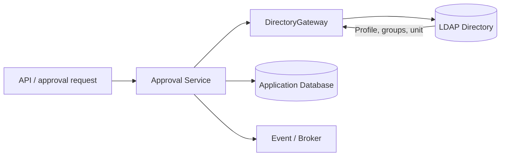
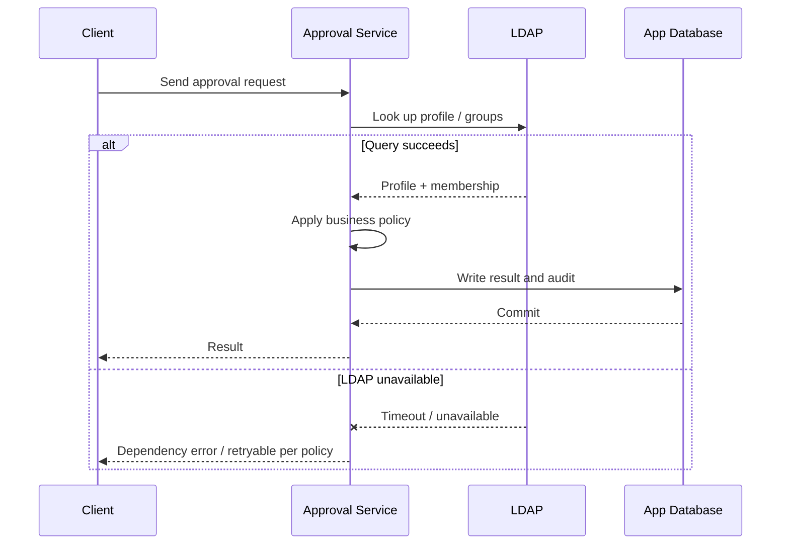

# The Role of LDAP in Querying Profiles, Groups, and Organizational Configuration

## 1. What Problem Does LDAP Solve in Spring Boot Integration?

An enterprise often has multiple systems that all need to know who an employee is, which department they belong to, which organizational unit they work in, and which groups they participate in. If each application stores its own separate list of employees and groups, information easily drifts out of sync when employees change departments, switch roles, or leave the company. **LDAP (Lightweight Directory Access Protocol)** allows applications to query a centralized directory service to look up this hierarchically structured information.

In the **SPRING_BOOT_INTEGRATION** module, LDAP is an integration channel alongside HTTP clients, databases, caches, message brokers, and Spring Integration adapters. The key is to define the **directory data contract, connection configuration, access permissions, error handling, consistency, testing, and operational observability**; using the directory as a controlled source of organizational information rather than treating it as a replacement for a relational database.

After this lesson, you can:

- Distinguish the LDAP directory tree, DN/RDN, entry, attributes, `objectClass`, base DN, and search filter.
- Design queries to find employee profiles, direct groups, and organizational units; understand why LDAP schemas differ across organizations.
- Use Spring LDAP in Spring Boot via `LdapTemplate`, map data to DTOs/domain models, and encapsulate it within an adapter.
- Handle security, timeouts, connection errors, caching, data synchronization, testing, and consistency when LDAP participates in business flows.

### Running Context

Suppose an **Approval Service** in Spring Boot receives purchase order approval requests. The service must display the requester's profile, determine which department they belong to, and check whether they belong to a group authorized to approve. Organizational information resides in an LDAP directory; purchase orders and approval events reside in a separate database/broker.



Directory lookup results are only **one input** into a business decision. Final approval authority still requires explicit policies in the application (maximum amount, order status, department scope, delegation policy, etc.).

## 2. Data Model: LDAP Is a Directory Tree

Unlike SQL tables with rows linked by foreign keys, LDAP data is organized into **entries in a hierarchical tree**. Each entry has a **Distinguished Name (DN)** indicating its relative position in the tree and a set of attributes constrained by a schema.

| Concept | Example | Role |
|---|---|---|
| DIT (Directory Information Tree) | Tree `dc=example,dc=org` | Namespace of entries |
| DN | `uid=an.nguyen,ou=people,dc=example,dc=org` | Position identifier of the entry in the tree |
| RDN | `uid=an.nguyen` | Name part distinguishing the entry from sibling entries |
| Attribute | `uid`, `cn`, `mail`, `manager`, `member` | Entry data; can be single-valued or multi-valued |
| `objectClass` | `inetOrgPerson`, `groupOfNames`, `organizationalUnit` | Defines entry type and attribute set according to schema |
| Base DN | `ou=people,dc=example,dc=org` | Root of the search scope |
| Search filter | `(&(objectClass=inetOrgPerson)(uid=an.nguyen))` | Condition for filtering entries |

Example entries in LDIF format to illustrate the model (not a mandatory structure for every LDAP server):

```ldif
dn: uid=an.nguyen,ou=people,dc=example,dc=org
objectClass: top
objectClass: person
objectClass: organizationalPerson
objectClass: inetOrgPerson
uid: an.nguyen
cn: Nguyen An
sn: Nguyen
displayName: Nguyen An
mail: an.nguyen@example.org
employeeNumber: E0042
manager: uid=lan.tran,ou=people,dc=example,dc=org

dn: cn=purchase-approvers,ou=groups,dc=example,dc=org
objectClass: top
objectClass: groupOfNames
cn: purchase-approvers
member: uid=an.nguyen,ou=people,dc=example,dc=org
member: uid=lan.tran,ou=people,dc=example,dc=org

dn: ou=finance,ou=departments,dc=example,dc=org
objectClass: top
objectClass: organizationalUnit
ou: finance
description: Finance department
```

In the example, `person` provides `sn`/`cn`, `inetOrgPerson` adds commonly used profile attributes; `groupOfNames` holds a list of DNs in `member`; `organizationalUnit` describes an organizational unit. Placing all employees under `ou=people` is only **one** way to organize a directory. Some directories structure employees under individual branches or use vendor-specific schemas.

### A DN Is an Entry's Address, Not Necessarily an Immutable Business Key

A DN can change when an entry is moved to another OU or renamed (rename/move). Therefore:

- For profiles, choose a suitable identity key such as employee ID or an immutable directory-managed ID, if the schema provides one. `uid` is only unique according to the directory's scope and policy; it is not automatically an organization-wide identifier.
- DNs remain important because many groups store **member DNs**. Do not infer a DN from `uid` if the actual entry might reside in a different OU or has been moved.
- LDAP has its own DN comparison, escaping, and normalization rules. Use LDAP/JNDI DN APIs instead of arbitrarily concatenating `"uid=" + userInput + ",..."`.
- Do not store a DN as a fixed ID string in business data without an update strategy when rename/move occurs.

## 3. Three Common Query Types

### 3.1. Looking Up Employee Profiles

From an employee code or account name, the Approval Service looks up `uid`, `displayName`, `mail`, `employeeNumber`, `manager`, and other readable attributes.

Example LDAP filter:

```text
Base DN: ou=people,dc=example,dc=org
Scope: subtree
Filter: (&(objectClass=inetOrgPerson)(uid=an.nguyen))
Attributes: uid,displayName,mail,employeeNumber,manager
```

In LDAP, **base** defines the branch to search; **scope** can be `base object` (only the entry at the base), `one level` (direct children), or `subtree` (all descendants). Narrowing the scope and attribute list reduces transferred data and search cost; high-frequency queries should be supported with appropriate indexes by the directory admin.

Results can be `0` entries (not found), `1` entry (valid), or multiple entries (identity conflict / search misconfiguration). Do not take the first element when multiple results exist without flagging the anomaly. Attributes such as `mail` or `manager` may be absent depending on the schema and the permissions of the bind account.

### 3.2. Looking Up Groups and Assigned Permissions

LDAP has several ways to represent groups:

| Model | Example | How Members Are Read |
|---|---|---|
| `groupOfNames` | `member: uid=an.nguyen,...` | Search for groups whose `member` equals the user's DN |
| `groupOfUniqueNames` | `uniqueMember: uid=an.nguyen,...` | Query the `uniqueMember` attribute |
| POSIX group | `posixGroup`, `memberUid: an.nguyen` | Usually based on account name/ID, not DN |
| Microsoft Active Directory | `group`, `member` and sometimes `memberOf` | Requires understanding AD schema, nested groups, and specific policies |

Example of finding **direct** `groupOfNames` groups whose member is a verified DN:

```text
Base DN: ou=groups,dc=example,dc=org
Filter: (&(objectClass=groupOfNames)(member=uid=an.nguyen,ou=people,dc=example,dc=org))
```

DN values in filters must be **escaped according to LDAP filter rules** when used in actual queries. Some systems provide a `memberOf` attribute on the profile, but `memberOf` is not a standard field present in every deployment and may represent only direct groups. Nested groups, dynamic membership, default groups, and group status must be explicitly defined in the data contract.

Do not equate "having group X in LDAP" with "being allowed to perform every operation X in the application." For instance, someone in `purchase-approvers` might only be allowed to approve orders below a threshold, belonging to the right organization, and not self-approving orders they created. LDAP acts as the **source of attributes/groups**, while application policy is responsible for making the decision.

### 3.3. Looking Up Organizational Units and Configuration

An `organizationalUnit` tree can describe departments, locations, operating regions, or part of an administrative structure. Attributes such as `ou`, `description`, `manager`, department codes, or group links can support:

- Displaying unit names/labels and reporting lines in internal interfaces.
- Routing requests to the responsible department or selecting a set of processing rules by organization.
- Determining data viewing scopes and approval groups by unit.
- Providing reference data synchronized to an application cache or read model.

However, **there is no unified LDAP schema** for every concept of "organizational configuration." Some organizations store departments in a `department` attribute, others in OUs or in a separate HR system. Frequently changing settings such as feature flags, rate limits, or application operational config are generally better suited to a dedicated configuration system; LDAP is primarily useful for identity, groups, and organizational metadata managed in the directory.

## 4. Integrating LDAP in Spring Boot

### 4.1. Choosing Dependencies and Connection Configuration

With Spring Boot 3.x, `spring-boot-starter-data-ldap` provides the Spring LDAP foundation, configures the context source, and supports `LdapTemplate` when auto-configuration conditions are met. Use `LdapTemplate` for straightforward directory query adapters; Spring Data LDAP repositories or lower-level APIs can be used when appropriate.

Maven example:

```xml
<dependency>
    <groupId>org.springframework.boot</groupId>
    <artifactId>spring-boot-starter-data-ldap</artifactId>
</dependency>
```

Example `application.yml` for a directory server using LDAPS:

```yaml
spring:
  ldap:
    urls: ${DIRECTORY_URL:ldaps://directory.example.org:636}
    base: dc=example,dc=org
    username: ${DIRECTORY_BIND_DN}
    password: ${DIRECTORY_BIND_PASSWORD}
```

- `spring.ldap.urls`: directory endpoint. **LDAPS** uses TLS from connection start; if using `ldap://` and StartTLS, StartTLS must be explicitly configured on the client/context source—do not assume `ldap://` is a secure connection.
- `spring.ldap.base`: common root DN, usually prepended automatically to relative bases in queries. If the application queries multiple trees without a common root, design separate scopes and contexts.
- `username`/`password`: DN and password of the **service account** used to bind, granted read-only permissions to only the required attributes. Manage passwords via a secret manager or secure environment variables.
- The LDAP server may enforce record limits, search time limits, or ACLs. The query account will not necessarily see every entry.

Never place passwords in git, logs, URLs, or real deployment examples. With LDAPS, trust the directory's proper CA/certificate and enable hostname verification; do not disable certificate checks to "fix" connection errors. Configure connection/read timeouts on the LDAP/JNDI context or transport in use, along with pooling and query limits, so downstream failures do not leave request threads waiting indefinitely. With the JNDI LDAP provider, environment properties `com.sun.jndi.ldap.connect.timeout` and `com.sun.jndi.ldap.read.timeout` may apply; how they are passed and their exact timeout semantics must be verified against the version/runtime.

### 4.2. Encapsulating Queries in a Gateway

Do not let controllers, services, and broker listeners construct LDAP filters, process `Attributes`, or read the directory directly. Create a `DirectoryGateway` as an application contract, hiding the LDAP schema behind the adapter:

```java
public record DirectoryPerson(
        String uid,
        String displayName,
        String email,
        String managerDn
) {}

public interface DirectoryGateway {
    Optional<DirectoryPerson> findPersonByUid(String uid);
    List<String> findDirectGroupNames(String actualUserDn);
}
```

`actualUserDn` here is the **full DN of an entry already looked up and verified from the directory**; do not fabricate an assumed DN by concatenating `uid` with a fixed OU. In real systems, you can design the lookup result to include both the profile and the entry's DN (using a context mapper), or provide an operation `findGroupsForUser(uid)` that performs both steps inside the adapter.

Implementation example using `LdapTemplate` and `LdapQueryBuilder` (imports omitted; uses classes from `org.springframework.ldap.core`, `org.springframework.ldap.query`, `javax.naming.directory`, `javax.naming`):

```java
@Service
public class SpringLdapDirectoryGateway implements DirectoryGateway {
    private final LdapTemplate ldap;

    public SpringLdapDirectoryGateway(LdapTemplate ldap) {
        this.ldap = ldap;
    }

    @Override
    public Optional<DirectoryPerson> findPersonByUid(String uid) {
        if (uid == null || uid.isBlank()) {
            throw new IllegalArgumentException("uid must have a value");
        }

        var query = LdapQueryBuilder.query()
                .base("ou=people")
                .where("objectClass").is("inetOrgPerson")
                .and("uid").is(uid);

        List<DirectoryPerson> people = ldap.search(
                query,
                (AttributesMapper<DirectoryPerson>) attrs -> new DirectoryPerson(
                        attribute(attrs, "uid"),
                        attribute(attrs, "displayName"),
                        attribute(attrs, "mail"),
                        attribute(attrs, "manager")
                )
        );

        if (people.size() > 1) {
            throw new IllegalStateException("uid is not unique within search scope");
        }
        return people.stream().findFirst();
    }

    @Override
    public List<String> findDirectGroupNames(String actualUserDn) {
        if (actualUserDn == null || actualUserDn.isBlank()) {
            throw new IllegalArgumentException("DN must have a value");
        }

        var query = LdapQueryBuilder.query()
                .base("ou=groups")
                .where("objectClass").is("groupOfNames")
                .and("member").is(actualUserDn);

        return ldap.search(query,
                (AttributesMapper<String>) attrs -> attribute(attrs, "cn"));
    }

    private static String attribute(Attributes attrs, String key)
            throws NamingException {
        Attribute field = attrs.get(key);
        return field == null ? null : String.valueOf(field.get());
    }
}
```

This code illustrates querying and mapping, not a complete production adapter. In practice, add `search scope`, result count limits, returning attribute lists, validation, timeouts, logging, and domain exceptions. In this example, `search` could return multiple people; checking the count detects misconfiguration rather than picking an arbitrary entry. Some LDAP servers use `sAMAccountName`/`userPrincipalName` or different group schemas, so filters must be adjusted to the real contract.

**Why use the query builder?** Values like `uid` and DN passed via `.is(...)` are processed by the LDAP filter construction API. Avoid building filters via raw string concatenation such as `"(uid=" + input + ")"`, because characters `*`, `(`, `)`, `\\`, and null have special meaning and can alter search conditions if not properly escaped. Note that **filter value escaping** differs from **DN/RDN escaping**.

### 4.3. Mapping DNs and Stable Identifiers

The `AttributesMapper` example reads attributes but does not automatically include the entry's DN in the DTO. When the actual DN is needed, a `ContextMapper` can read `DirContextAdapter` and context name info; pay attention to whether the returned name is a **relative DN or full DN** depending on how the API/context source provides it. Normalize DNs according to the configured schema and base DN, avoiding double-prepending the base. For complex interactions, have the adapter support an explicit internal DTO containing `directoryId`, `dn`, and `attributes`, and test rename/move so group relationships or reference data do not break.

For organizational configuration, a dedicated mapper `DirectoryOrganization` with unit code, name, parent level, and unit path is often needed. The unit code must be defined by governance contract (e.g., `departmentNumber` depending on schema), rather than automatically derived from `ou` where names may collide across branches.

## 5. How Does LDAP Differ from Application Authentication and Authorization?

LDAP can participate in **authentication** when a client binds with a user's identity, or serve as an **identity/group data source** for permission checks. The two uses have distinct boundaries:

| Need | LDAP Role | Application Responsibility |
|---|---|---|
| Displaying name, email, manager | Provides profile attributes | Check for missing data, hide sensitive data, and cache appropriately |
| Looking up groups | Provides membership per schema | Map groups to business permissions and handle group nesting |
| Login | Can verify bind credentials, depending on IAM model | Manage sessions/tokens, MFA/SSO, authentication policies |
| Approval decision | Provides identity, unit, groups | Check tenant, amount, creator/approver relationship, and business rules |

If the system already uses OIDC/SAML or a central IdP, do not add an LDAP password authentication flow just to read profiles or groups. When using Spring Security LDAP, separately configure the authentication provider, authorization rules, group resolution, and account lifecycle; `LdapTemplate` in the example is a **data lookup adapter**, not a login setup.

For multi-tenant applications, ensure the service account, search base, and group policies do not allow cross-tenant access. Never let API clients pass arbitrary `base DN`, LDAP URLs, or search attribute names without validation/restriction.

## 6. Performance, Reliability, and Directory Limitations

### 6.1. Optimizing Searches and Limiting Results

LDAP is typically optimized for read-heavy lookups, but that does not mean every query is cheap. Essential practices include:

- Use a sufficiently narrow base DN, an appropriate search scope, and filters based on attributes indexed per the directory admin's guidance.
- Fetch only needed attributes, especially for entries with photos, certificates, or large member lists.
- For searches returning many entries, apply page control/pagination if supported by the server; handle size limits, time limits, cookies, ordering, and potential data changes between pages.
- Do not traverse the entire directory tree per request to find a person or group. Do not run N+1 group queries per person when an appropriate index/read model can be designed.
- For nested groups, bound depth and detect cycles; special Active Directory query syntax is not portable across all LDAP servers.

Some directories have replication and eventual consistency: a group membership change on one node might not appear immediately on another. If permissions change urgently (e.g., revoking access), specify exact synchronization latency requirements and design cache checks/invalidation accordingly.

### 6.2. Caching Policy

Caching is useful for display names, departments, and infrequently changing metadata; however, a long-lived membership cache may permit the use of revoked permissions. When caching:

| Data | Caching Recommendation | Risk to Manage |
|---|---|---|
| Display name, department label | TTL can be longer if SLA permits | Displaying stale info after rename/unit transfer |
| Email/manager | TTL aligned with business sync requirements | Sending to the wrong person or routing approval incorrectly |
| Groups/roles used for authorization | Short TTL, with invalidation where feasible | Delayed permission revocation |
| User not found | Very short negative cache TTL or omit | Newly created accounts not yet recognized |

If using Spring Cache/Redis, include tenant, query type, stable identifier, and mapping rule version (when needed) in the cache key; avoid putting passwords or tokens in keys. Explicitly define behavior when LDAP fails: showing stale cached info may be acceptable, **but security-sensitive decisions should fail closed** per approved policy, never granting access simply because the directory is temporarily unreachable.

### 6.3. Error Classification and Response Strategy

| Case | Possible Meaning | Adapter / Application Handling |
|---|---|---|
| Profile not found in search scope | No matching entry, or ACL hides the data | Return a semantic absence result; log suspected ACL cases |
| `Invalid credentials` on service bind | Wrong/expired secret, locked account | Alert operations; do not retry infinitely with the same credentials |
| Connect/read timeout, server unavailable | Downstream/network failure | Bound time; bounded read retries with backoff if deadline remains |
| `Insufficient access rights` | Service account lacks permission | Configure proper permissions; do not treat as a normal empty profile |
| Size/time limit exceeded | Search too broad or server limits | Narrow filter, add pagination if supported, review indexes |
| Partial results / referral | Distributed directory or referral to follow | Define referral policy and detect incomplete results |
| Schema/attribute mismatch | Data contract changed | Raise integration error, measure, and update mapper per schema version |

Spring LDAP translates JNDI errors into Spring LDAP's exception hierarchy. Map them at `DirectoryGateway` into application error categories such as `DirectoryUnavailable`, `DirectoryPermissionDenied`, and `DirectoryDataContractViolation`, while distinguishing **no results** from **unable to query**. Never `catch(Exception)` and return `List.of()` when the directory disconnects: callers will mistake it for the user having no groups, leading to business errors or hard-to-explain security behavior.

Retries can be reasonable for **read queries** encountering transient network errors, but should be bounded in count, use backoff, and respect an overall deadline. For LDAP write operations (`add`, `modify`, `delete`, rename), a timeout may occur **after** the server has applied the change; re-read state and design idempotency/reconciliation before retrying. In broker flows with potential message redelivery, provisioning consumers must guard against applying the same operation multiple times.

## 7. Transactions, Synchronization, and Cross-System Consistency

Suppose the Approval Service writes an approval to PostgreSQL and then updates an LDAP entry or sends an event to the HR system. A `@Transactional` annotation on a Spring service managing a normal database transaction **does not make LDAP changes participate in the same ACID transaction**. An LDAP `modify` operation may be atomic for an entry on the server, but it does not guarantee atomicity with SQL, HTTP, or a broker.

Reference flow when only **reading** the directory:



When **writing or synchronizing** data between the directory and the application, consider:

1. Define the **system of record** for each attribute: HR for personnel profiles, IAM for groups/permissions, the application for order status. Avoid having two systems mutate the same attribute without arbitration rules.
2. Use change events, outbox, or scheduled jobs to build an internal read model when needing to reduce LDAP dependency; maintain a watermark/version/timestamp or reconciliation mechanism to detect missed updates.
3. Design **idempotent** upserts/synchronization keyed by an appropriate immutable identifier. When replaying events, check the current version or state before overwriting.
4. When one step succeeds in LDAP but another fails, record the incomplete state and have a retry/compensation/reconciliation process. Never assume SQL rollback will undo LDAP changes.
5. For business logic requiring real-time permissions, distinguish display-only info from decision-making info; cache policies and availability levels can differ.

Spring Integration can help orchestrate message sync/transformation flows with channels, transformers, routers, retries, and error handling, while the LDAP adapter handles reading/writing the directory per its dedicated contract. A broker helps with asynchronous processing but does not automatically guarantee exactly-once semantics across LDAP, database, and event publisher.

## 8. Testing the LDAP Adapter and Directory Contract

Tests should target two boundaries: the **business logic** of the Approval Service and the **actual LDAP calls** of the adapter.

| Test Layer | Focus | Suggestion |
|---|---|---|
| Business unit test | Behavior when user belongs to no groups, multiple groups, directory errors | Fake/mock `DirectoryGateway`; no LDAP server needed |
| Mapper/filter test | Missing attributes, multi-valued fields, special filter chars, duplicate UID | Test adapter against a test directory/fixture with controlled data |
| Integration test | Bind, schema, search scope, ACL, filter, nested groups, pagination | OpenLDAP/389 DS/AD test matching deployment, with LDIF fixtures and containers if feasible |
| Resilience test | Timeout, TLS errors, referrals, unavailable directory, stale cache | Simulate network/server faults and verify deadlines/fallback policies |
| Contract/acceptance test | Attribute mapping and real organizational group rules | Valid test dataset, periodically reviewed with the directory admin |

Several important scenarios:

- A valid `uid` returns exactly one person; a non-existent UID returns `Optional.empty()`; multiple entries sharing the same `uid` produce an explicit data error.
- Accented/Unicode names, missing emails, empty `manager`, and multi-valued attributes are handled per contract.
- Inputs containing `*`, `(`, `)`, backslashes, or special characters do not inadvertently broaden the filter.
- Direct groups vs. nested groups; `member` vs. `memberUid`; changing DN/moving OU does not cause the adapter to assign wrong permissions.
- Service account lacks permission to view an attribute; tests should demonstrate the difference between a non-existent entry and ACL hiding, within server capabilities.
- When the directory times out, the application does not accidentally return empty groups as a successful result; cache fallback obeys security policy.

Tests using embedded LDAP are convenient for checking queries and mappers, but they do not prove specific Active Directory behavior, TLS/ACL, replication, or production referrals. Add integration tests with the actual LDAP server family in use if those capabilities affect business logic.

## 9. Security, Privacy, and Observability

Directories often hold personal information and sensitive organizational data; the adapter must satisfy at minimum:

- **Least privilege:** the service bind account has read access only to needed branches/attributes; do not use an LDAP admin account for lookup tasks.
- **Connection protection:** properly configured LDAPS or StartTLS, trusted certificates, no passwords transmitted over plaintext connections.
- **Filter and DN protection:** use context-appropriate builders/escaping, block client-supplied arbitrary base DNs or attribute names.
- **Data minimization:** do not log passwords, bind DNs with secrets, tokens, sensitive member lists, or full entries on error.
- **Access policy:** LDAP groups do not replace permission checks in the domain service; enforce authorization by tenant, data scope, and business conditions.

Metrics to observe: query latency by **operation type**, counts of successful/not-found/error queries, timeouts, bind/ACL errors, cache hit/miss rates, returned entry counts, retries, and connection pool usage (if any). Use low-cardinality tags such as `operation=profile_lookup|group_lookup|org_lookup` and `result=success|not_found|error`; **do not put individual `uid`, email, DN, or group names into metric tags** due to cardinality explosion and data exposure risks.

Logs in the Approval Service can be correlated using a request ID/trace ID, though LDAP does not automatically propagate HTTP trace context. Measure timing inside the adapter, log errors with correlation IDs in the application, and combine with directory server logs when investigating. Use Spring Boot Actuator/Micrometer to export custom metrics if needed; do not assume all `LdapTemplate` operations automatically have detailed metrics without instrumentation.

## 10. Practical Scenarios and Design Decisions

**Scenario 1 — Displaying an employee profile.** The Approval Service needs name, email, and department when showing approval history. `DirectoryGateway` reads LDAP, caches infrequently changing info with a suitable TTL, and writes a stable `directoryId` into the read model. When LDAP temporarily fails, the stale copy can be displayed alongside sync status if product policy permits.

**Scenario 2 — Determining approver groups.** The service needs to know if the user is in `purchase-approvers`. The adapter retrieves the **actual DN** and then searches membership per schema, resolving nested groups when required by contract; the service additionally enforces amount limits, branch rules, and no self-approval. Membership cache is short-lived with an appropriate permission revocation mechanism.

**Scenario 3 — Organizational routing.** Units are described by OUs and custom attributes. The adapter maps them to a schema-independent `OrganizationUnit`; the domain uses an agreed unit code to select handlers. When the OU structure changes, a sync job updates the read model or mapping instead of coupling the domain to LDAP DNs.

**Scenario 4 — Syncing employees upon HR events.** Consumers may receive duplicate events; if an LDAP entry must be created/updated, the consumer checks the stable identifier and version, applies an idempotent operation, and saves error state for retry/reconciliation. Database transactions do not span LDAP; a process is needed when one side succeeds and the other fails.

### Self-Check Questions

1. How do DN and RDN differ? Why is a DN not always suitable as an immutable business key?
2. How do `base DN`, `search scope`, `filter`, and `attributes` affect query correctness and performance?
3. Why can't you write a single group query that works identically across OpenLDAP, POSIX groups, and Active Directory?
4. When LDAP returns zero entries, how do you distinguish "not found" from a network error or denied read permissions?
5. Why do `memberOf` and nested groups require explicit rules before being used for authorization?
6. Can JPA's `@Transactional` roll back an LDAP operation? If not, how would you design a synchronization workflow?
7. Which data categories can be cached longer and which require short lifetimes due to permission revocation risk?
8. In testing, how do you prove that a query's meaning cannot be altered by special characters in input?

**Conclusion:** LDAP is especially useful for querying **profiles, group memberships, and organizational metadata** from a shared directory. In Spring Boot, designing an adapter via Spring LDAP isolates schema and configuration; integration safety and reliability depend on proper DN/filter handling, least privilege, timeouts, error handling, caching policies, idempotent synchronization, testing against compatible servers, and clear observability.
