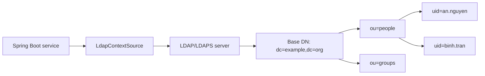
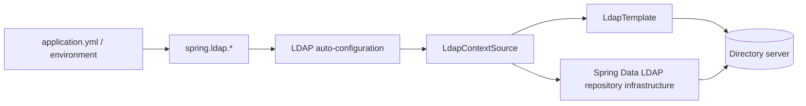
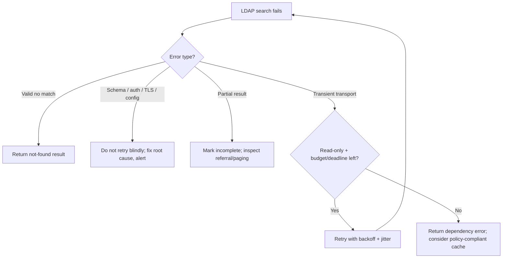
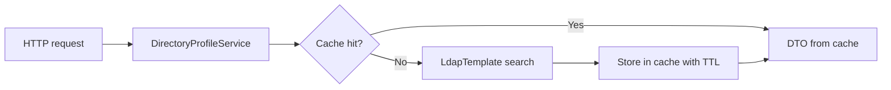

# spring-boot-starter-data-ldap and spring.ldap.* Configuration

> **Chapter:** LDAP and Directories  
> **Module:** SPRING_BOOT_INTEGRATION — integrating systems via HTTP clients, databases, caches, message brokers, and Spring Integration adapters; focusing on configuration, data contracts, transactions, errors, duplicate handling, testing, and observability.

## 1. When Does a Spring Boot Application Need LDAP?

An employee management system typically stores business data in PostgreSQL while retrieving account and organizational information from a **directory server**: OpenLDAP, Active Directory (AD), or a compatible LDAP service. Spring Boot may need to look up a company email, display name, department, or employee identity attribute while keeping business processing within the application itself.

**LDAP** (*Lightweight Directory Access Protocol*) is a protocol for reading and modifying hierarchically structured data in a directory service. LDAP differs from relational databases: data is organized as *entries*, each with a *distinguished name* (DN), a set of attributes, and *object classes* that define the schema.

Example directory tree (*Directory Information Tree* — DIT):

```text
dc=example,dc=org
├── ou=people
│   ├── uid=an.nguyen
│   └── uid=binh.tran
└── ou=groups
    └── cn=engineering
```

An employee record might look like:

```ldif
dn: uid=an.nguyen,ou=people,dc=example,dc=org
objectClass: inetOrgPerson
uid: an.nguyen
cn: An Nguyen
sn: Nguyen
mail: an.nguyen@example.org
```

This LDIF snippet only illustrates the attributes. A real entry must satisfy the schema and parent structure of the specific directory; auxiliary object classes such as `top`, `person`, and `organizationalPerson` may be required or inferred depending on the implementation.

### 1.1. Learning Objectives

After this lesson, you can:

1. Add `spring-boot-starter-data-ldap` matching the Boot version and explain the auto-configured beans.
2. Understand `spring.ldap.urls`, `spring.ldap.base`, `spring.ldap.username`, `spring.ldap.password`, and related options.
3. Distinguish **LDAP server URL**, **base DN**, **bind DN**, **entry DN**, **search base**, **search filter**, and **scope**.
4. Look up accounts via `LdapTemplate` or Spring Data LDAP repositories without introducing LDAP injection.
5. Configure LDAPS/TLS, timeouts, least privilege, error handling, and safe observability.
6. Test directory data contracts, disconnect behavior, and differences between OpenLDAP and Active Directory.

## 2. Core Concepts to Master Before Configuring

| Concept | Example | Meaning |
| --- | --- | --- |
| LDAP server URL | `ldaps://ldap.example.org:636` | Connection address to the directory; scheme/port indicate connection mode |
| Base DN | `dc=example,dc=org` | Root point the application treats as the lookup scope; Spring LDAP typically uses DNs relative to this root |
| Bind DN | `uid=svc-directory,ou=system,dc=example,dc=org` | Service account identity used to authenticate with the directory |
| Entry DN | `uid=an.nguyen,ou=people,dc=example,dc=org` | Unique position identifier of an entry in the tree |
| Relative DN | `uid=an.nguyen,ou=people` | DN relative to the configured base DN |
| Search base | `ou=people` | Sub-branch where the search is executed |
| Search filter | `(&(objectClass=inetOrgPerson)(uid=an.nguyen))` | Condition selecting entries within the search scope |
| Search scope | OBJECT, ONELEVEL, SUBTREE | Coverage level: root entry only, direct children, or entire subtree |
| Attribute | `uid`, `cn`, `mail`, `memberOf` | Data field; value types and multiplicity depend on schema |
| Object class | `inetOrgPerson` | Rule set defining valid and required attributes |



**Two DNs often confused:** `spring.ldap.base` is the context root for operations. `spring.ldap.username` is the *bind* account, not the person being looked up. An application can use a read-only service account to find employees, but that **is not end-user authentication**.

### 2.1. An LDAP Directory Is Not Automatically a Business Data Source

A directory usually stores identity/organizational information; PostgreSQL or a domain database may be the source of truth for orders, payments, and inventory. If the directory changes after the DB has written, no automatic ACID transaction spans both systems.

Before connecting, clearly determine:

- Which directory is the **source of truth** for each attribute?
- Is the application allowed to **read**, **write**, or only verify information?
- Is real-time data required, or can it be cached briefly?
- If LDAP disconnects, which use cases must reject and which may serve cached data?
- Are any fields sensitive data requiring restricted return values and logging?

## 3. Selecting Dependencies by Spring Boot Generation

For **Spring Boot 3.x / Java 17+**, the Spring Data LDAP starter:

```groovy
// build.gradle, with Spring Boot plugin / dependency management applied
dependencies {
    implementation 'org.springframework.boot:spring-boot-starter-data-ldap'
    testImplementation 'org.springframework.boot:spring-boot-starter-test'
}
```

Or Maven:

```xml
<dependency>
    <groupId>org.springframework.boot</groupId>
    <artifactId>spring-boot-starter-data-ldap</artifactId>
</dependency>
```

The starter pulls in the appropriate Spring LDAP and Spring Data LDAP components so the application can use `LdapTemplate`, entry mapping, and repositories as configured. **Let the Spring Boot BOM manage versions**; do not manually mix a newer Spring Data/Spring LDAP release into an older Boot version without verifying compatibility.

| Component | Role |
| --- | --- |
| `spring-boot-starter-data-ldap` | Library bundle and activation of common auto-configuration for Boot applications |
| `spring-ldap-core` | Core API for LDAP operations: `LdapTemplate`, `ContextSource`, query builder, context mapper |
| `spring-data-ldap` | Object-directory mapping, repository abstraction |
| `spring-boot-starter-security` / Spring Security LDAP (if used) | User authentication and authorization; **not** required just to query a directory |

**Distinction:** `spring-boot-starter-data-ldap` does not automatically turn an application into an LDAP login system. If authentication is required, Spring Security LDAP must be designed separately: user account binds, permission filtering, role mapping, and session policies.

The APIs illustrated below belong to the Spring Boot 3.x ecosystem; when upgrading to Boot 4 or changing major versions of Spring LDAP/Spring Data, check package names, auto-configuration behavior, and version-specific documentation.

## 4. Configuring spring.ldap.* in application.yml

### 4.1. Basic Connection with a Read-Only Account

```yaml
# application.yml — example for a deployment environment with LDAP/LDAPS
spring:
  ldap:
    urls: ${LDAP_URL:ldaps://directory.example.invalid:636}
    base: dc=example,dc=org
    username: ${LDAP_BIND_DN}
    password: ${LDAP_BIND_PASSWORD}
```

The example assumes the directory server provides a service account with the required read permissions. The domain `example.invalid` is an illustrative name, not a real endpoint. In a production application, supply all addresses and secrets via environment configuration or a secret manager. Never commit real passwords to Git or write secrets to logs.

Meaning of each property:

| Property | Function | Common Configuration Mistakes |
| --- | --- | --- |
| `spring.ldap.urls` | One or more directory server URLs | Wrong host, confusing `ldap://` and `ldaps://`, unreachable container DNS |
| `spring.ldap.base` | Base DN of the Spring LDAP context | Duplicating `dc=...` when constructing search bases or relative DNs |
| `spring.ldap.username` | Bind DN / login identity of the service account | Using a short `uid` when the directory requires a full DN or specific format |
| `spring.ldap.password` | Service account credential | Empty password, expired password, lacking search permissions, leaked via env/logs |
| `spring.ldap.base-environment.*` | Additional JNDI properties when creating context | Typo in key or assuming all providers support them identically |
| `spring.ldap.template.*` | Default error-handling options on `LdapTemplate` | Ignoring errors, causing silently incomplete search results |

If `spring.ldap.urls` is configured with multiple servers, **do not assume** the selection/failover mechanism always meets your SLA: directory replication, data consistency, TLS, bind permissions, and the JNDI provider all affect behavior. Real failover testing is required.

### 4.2. URLs, LDAP with TLS, and LDAPS

Two common cases:

```text
ldap://directory.example.org:389   # Plain LDAP (can upgrade via StartTLS if explicitly configured)
ldaps://directory.example.org:636  # LDAP over TLS from connection start
```

- Prefer **LDAPS or properly configured StartTLS** for binds/searches carrying sensitive data; plain LDAP over the network does not protect passwords or payloads.
- `ldaps://` only initiates TLS; the Java client **must verify the server's certificate chain and hostname**. Provide a suitable CA/truststore and do not disable certificate checks to "fix" errors.
- **StartTLS is not enabled automatically** just by using `ldap://`. If the architecture requires StartTLS, configure a StartTLS mechanism compatible with Spring LDAP/JNDI and test handshake, pooling, and referrals. Do not mistake default port 389 connections for encrypted connections.
- LDAP URLs are not HTTP APIs; `https://...` and HTTP proxies do not replace `ldap(s)://...`.

### 4.3. Configuring Connect and Read Timeouts

With Java's JNDI LDAP provider, two useful properties exist (values in milliseconds). Spring Boot supports passing them via `spring.ldap.base-environment`:

```yaml
spring:
  ldap:
    base-environment:
      "[com.sun.jndi.ldap.connect.timeout]": "3000"
      "[com.sun.jndi.ldap.read.timeout]": "5000"
```

Map keys are placed in square brackets to **preserve dots in property names** when Spring Boot binds the map. These are interpreted by the **JNDI provider**, not an end-to-end SLA. Network timeouts, TLS handshakes, referrals, paging, and application-level retries can interact; verify with integration tests against a real directory.

### 4.4. Configurations You Should Not "Tweak Just to Silence Errors"

- Do not set `spring.ldap.template.ignore-partial-result-exception=true` just because queries throw errors, unless you understand the cause and accept **incomplete results** per contract (some Active Directory referral setups exhibit behaviors that require verification).
- Do not raise timeouts indefinitely when the directory is slow; that can pile up waiting threads, connections, and requests.
- Do not elevate the bind service account to admin just to make queries succeed. Grant read permissions only to the required branch and attributes.
- Do not log `spring.ldap.password`, sensitive DNs, or secret attribute values; Actuator endpoints must be secured and mask secrets.
- Do not build DNs or LDAP filters by directly concatenating unescaped input.

## 5. What Does Boot Auto-Configuration Initialize?

When appropriate libraries and properties are present, Boot can configure commonly used objects:

| Bean / Abstraction | Responsibility | What to Check if Missing |
| --- | --- | --- |
| `LdapContextSource` / `ContextSource` | Creates JNDI contexts with URL, base DN, and bind credentials | `spring.ldap.*`, custom beans, auto-configuration conditions |
| `LdapTemplate` / `LdapOperations` | Executes search, lookup, bind/unbind/modify operations with Spring LDAP exception translation | Selected ContextSource, custom beans, Spring LDAP classpath |
| Spring Data LDAP repositories | Maps entries to objects via `@Entry`, `@Attribute`, `@Id` | Package scan, entity mapping, repository activation, and schema |
| Exception translation | Converts certain `NamingException`s into Spring LDAP runtime exceptions | Distinguishing `NameNotFoundException`, auth, network, and permission errors |

In applications using a single directory, **prefer configuring `spring.ldap.*` and injecting the auto-configured `LdapTemplate`**. Avoid creating ContextSource and template beans manually unless needed; when replacing default beans, the application becomes responsible for all properties (TLS, bind, base, timeouts, pooling).



**Having a bean does not mean the directory is healthy.** Depending on context creation, connections are often opened only when the application performs an actual lookup/search/bind. Verifying context startup does not replace running a query in a test environment.

### 5.1. If There Are Multiple Directory Servers

An application sometimes reads two independent directory domains, such as internal employees and external partners. That may require **two** distinct `ContextSource`s, `LdapTemplate`s, profile configurations, and bean names; use `@Qualifier` for explicit injection.

Manually declaring multiple beans can cause default auto-configuration to **back off** or create ambiguity. Do not expect that adding two URLs to `spring.ldap.urls` creates two independent logical domains: multiple URLs typically represent endpoints for the same directory context, not two separate namespaces.

## 6. Looking Up Users with LdapTemplate

This is the easiest starting point when an application only needs a few search and lookup operations. Suppose the application finds an employee by `uid` and wants to return a DTO containing only `uid`, `cn`, and `mail`.

### 6.1. Explicit Data Contract

```java
// DirectoryUser.java
public record DirectoryUser(
        String uid,
        String displayName,
        String email) {
}
```

This DTO intentionally omits `userPassword`, tokens, secret groups, or the full set of directory attributes. Never expose raw JNDI `Attributes` over a REST API to avoid information leaks and coupling to the LDAP schema.

### 6.2. Querying with LdapQueryBuilder Instead of Concatenating Filter Strings

```java
import java.util.List;
import java.util.Optional;
import java.util.regex.Pattern;
import javax.naming.NamingException;
import javax.naming.directory.Attribute;
import javax.naming.directory.Attributes;

import org.springframework.ldap.core.AttributesMapper;
import org.springframework.ldap.core.LdapTemplate;
import org.springframework.ldap.query.LdapQuery;
import org.springframework.ldap.query.LdapQueryBuilder;
import org.springframework.ldap.query.SearchScope;
import org.springframework.stereotype.Service;

@Service
public class DirectoryUserGateway {
    private static final Pattern UID_PATTERN =
            Pattern.compile("[A-Za-z0-9._-]{1,80}");

    private final LdapTemplate ldapTemplate;

    public DirectoryUserGateway(LdapTemplate ldapTemplate) {
        this.ldapTemplate = ldapTemplate;
    }

    public Optional<DirectoryUser> findByUid(String uid) {
        if (uid == null || !UID_PATTERN.matcher(uid).matches()) {
            throw new IllegalArgumentException("Invalid directory uid");
        }

        LdapQuery query = LdapQueryBuilder.query()
                .base("ou=people")
                .searchScope(SearchScope.SUBTREE)
                .attributes("uid", "cn", "mail")
                .countLimit(100)
                .timeLimit(3000)
                .where("objectClass").is("inetOrgPerson")
                .and("uid").is(uid);

        List<DirectoryUser> matches = ldapTemplate.search(
                query,
                (AttributesMapper<DirectoryUser>) attributes ->
                        new DirectoryUser(
                                requiredString(attributes, "uid"),
                                optionalString(attributes, "cn"),
                                optionalString(attributes, "mail")));

        if (matches.size() > 1) {
            throw new IllegalStateException(
                    "Directory contract violation: duplicate uid");
        }
        return matches.stream().findFirst();
    }

    private static String requiredString(
            Attributes attributes, String name)
            throws NamingException {
        String value = optionalString(attributes, name);
        if (value == null || value.isBlank()) {
            throw new IllegalStateException(
                    "Required LDAP attribute is missing: " + name);
        }
        return value;
    }

    private static String optionalString(
            Attributes attributes, String name)
            throws NamingException {
        Attribute attribute = attributes.get(name);
        return attribute == null || attribute.size() == 0
                ? null
                : String.valueOf(attribute.get());
    }
}
```

Explanation:

1. `LdapTemplate` and `LdapQueryBuilder` belong to Spring LDAP. The template obtains connections from the Boot-configured `ContextSource`.
2. `.base("ou=people")` is a base **relative to `spring.ldap.base=dc=example,dc=org`**. The effective search branch is `ou=people,dc=example,dc=org`. Mechanically putting the full DN here can easily duplicate the base DN.
3. `.where(...).is(uid)` uses the filter builder API with value escaping instead of manually concatenating input into `(&(objectClass=...)(uid=...))`. The pattern above is an **illustrative UID policy**, not an LDAP requirement; if your directory allows other UID formats, adjust validation per contract.
4. `.attributes(...)` requests only needed attributes, reducing read/transferred data and exposure risk.
5. `.countLimit(100)` and `.timeLimit(3000)` are client-requested search limits; the server may enforce its own limits. **Do not treat them as network timeouts** or a complete pagination mechanism.
6. Zero results yield `Optional.empty()`; multiple results for an expected unique UID indicate a **data contract violation** and must not arbitrarily pick the first row.

Although the example code sets a limit of 100 results, a production lookup by UID should be indexed and tightly bounded per directory schema. When results exceed the limit, some servers may return a size-limit error; **never** translate that into "user not found" because the list may actually be truncated.

### 6.3. Never Build LDAP Filters from Unescaped Strings

**Incorrect** example when receiving input from an HTTP request:

```java
// DO NOT DO THIS: uid comes from external data.
String unsafeFilter = "(uid=" + uid + ")";
```

Characters such as `*`, `(`, `)`, `\`, and NUL inside filter values have special meaning under LDAP filter syntax (RFC 4515). A value like `*)(|(objectClass=*))` can alter the search condition when concatenated without control.

Prefer `LdapQueryBuilder` or the library's LDAP filter escaping utility. **LDAP filter escaping differs from DN escaping**: never use a single escaping method for both formats.

### 6.4. When Looking Up by DN, Build the DN with a Dedicated API

Example of a relative DN within `dc=example,dc=org`:

```java
import javax.naming.Name;
import org.springframework.ldap.support.LdapNameBuilder;

Name personDn = LdapNameBuilder.newInstance()
        .add("ou", "people")
        .add("uid", uid)
        .build();

// personDn corresponds to uid=<escaped-uid>,ou=people
// Use with LdapTemplate.lookup(...) when the exact DN is known.
```

DNs must be built per RDN/DN rules (RFC 4514), **never** concatenating `"uid=" + uid + ",ou=people"` from arbitrary input. In the example, the `add` order places the leaf component after the parent to construct the proper DN. Be careful: a directory might use `cn` instead of `uid` as the RDN; do not infer DNs from `uid` without knowing entry creation rules.

## 7. Using Spring Data LDAP Repositories When Appropriate

If the domain needs many attribute-based identity operations and entry models have a stable structure, object-directory mapping (ODM) and repositories can be used. This reduces boilerplate compared to `LdapTemplate` but **does not eliminate** the need to understand DNs, schemas, and service account permissions.

### 7.1. Entity Mapping an Entry

```java
import javax.naming.Name;
import org.springframework.ldap.odm.annotations.Attribute;
import org.springframework.ldap.odm.annotations.Entry;
import org.springframework.ldap.odm.annotations.Id;

@Entry(
        base = "ou=people",
        objectClasses = {
                "top", "person",
                "organizationalPerson", "inetOrgPerson"
        })
public class DirectoryPerson {

    @Id
    private Name dn;

    @Attribute(name = "uid")
    private String uid;

    @Attribute(name = "cn")
    private String commonName;

    @Attribute(name = "mail")
    private String email;

    public DirectoryPerson() {
    }

    public Name getDn() {
        return dn;
    }

    public String getUid() {
        return uid;
    }

    public String getCommonName() {
        return commonName;
    }

    public String getEmail() {
        return email;
    }
}
```

`@Entry(base=...)` describes the branch and entry type; `@Id` represents the DN; `@Attribute` maps the attribute. Include a no-arg constructor so the framework can instantiate the object. For write operations, the entity needs DN generation rules and schema-required fields; this example focuses on **reading**, so setters/save are omitted to avoid oversimplification.

### 7.2. Repository

```java
import java.util.Optional;
import org.springframework.data.ldap.repository.LdapRepository;

public interface DirectoryPersonRepository
        extends LdapRepository<DirectoryPerson> {
    Optional<DirectoryPerson> findByUid(String uid);
}
```

In Spring Boot configurations supporting repository scanning, interfaces are discovered by package and auto-configuration conditions. If the application configures repositories manually or places packages outside scan scope, configure Spring Data LDAP repository scanning according to your version.

**Note the difference:** repository operations in LDAP rely on directory DNs, attributes, filters, and schemas—not SQL/JPA joins, flushing, transaction isolation, or foreign keys. Never design an LDAP repository as a clone of `JpaRepository`.

### 7.3. Choosing Template or Repository?

| Need | Preference | Reason |
| --- | --- | --- |
| Looking up a few attributes, custom filters, explicit search scope/limits | `LdapTemplate` | Control over queries, projections, mappers, and search behavior |
| Many operations on an entry type with a stable schema | Spring Data LDAP repository | ODM + derived queries are convenient for most CRUD |
| Vendor-specific directory schema or advanced LDAP queries | Template and specialized APIs | Avoid forcing models into an ill-fitting repository |
| Only need LDAP user authentication | Spring Security LDAP | Bind authentication is a security concern, not repository CRUD |

## 8. LDAP Authentication Differs from Directory Data Lookup

A service account binding to read an employee's `mail` **does not prove** that the sender of an HTTP request is that employee. If the application needs user login:

- Use **Spring Security LDAP** (or an IdP/OIDC at the appropriate identity layer), verifying credentials via bind/compare flows per the directory contract.
- Separate the **service bind account** from the **user bind**. Never attempt login by comparing password strings retrieved by the application from LDAP.
- Only map roles/groups after verifying the DN, member/memberOf, or groups per the actual schema. AD may differ from OpenLDAP in attributes, subtrees, nested groups, and referrals.
- Never return passwords/hashes, and never store plaintext HTTP credentials in logs, caches, or message brokers.
- Incorrect username/password errors are **authentication failures**, and must not be automatically retried like network timeouts.

When integrating with AD, account names may be `userPrincipalName` or `sAMAccountName` instead of `uid`; some groups use `memberOf` and have nested group rules. **Never copy OpenLDAP filters to AD without verifying the schema**, even though both support the LDAP protocol.

## 9. Connection Errors, Data Errors, and Recovery Strategies

LDAP sits outside the application's business transaction, so it can fail even when PostgreSQL, Redis, and the broker are healthy. Never "catch all exceptions and return an empty list": that confuses **service disconnection** with **no matching employee**.

| Signal | Initial Error Category | Recommended Action |
| --- | --- | --- |
| Search validly returns empty list | Business result: not found | Return `Optional.empty()`/404 per contract; do not retry needlessly |
| `NameNotFoundException` on DN lookup | DN/branch does not exist | Verify base and DN; map to "not found" only if semantically valid |
| `AuthenticationException` on service bind | Invalid/expired credential or directory policy | Check secret rotation, service account, TLS; do not retry in a loop |
| `CommunicationException`/disconnect | Possibly transient | Bounded retry for **read-only searches**, backoff + jitter, overall deadline |
| Incomplete results, referral/partial result | Possibly topology or config | Check referral policy, domain/forest, permissions, and completeness |
| Size/time limit exceeded | Search too broad, unsuitable index, or server limit | Narrow filter/scope, index, page via supported controls |
| Missing required attribute or objectClass mismatch | Data/schema contract error | Fix mapper/query, align schema with directory owner |
| ACL denies search/attribute | Permission error | Grant needed permissions or adjust request; do not grant unconditional admin |
| TLS hostname/certificate error | Configuration/trust chain needs fixing | Check hostname, CA, expiry; never disable TLS verification |

Specific exception names depend on Spring LDAP exception translation and the JNDI provider in use. When classifying errors, inspect the root cause, LDAP result code, and failure stage, but **never expose credentials or sensitive DNs to end users**.

### 9.1. Retry Only When the Operation Is Appropriate

A read-only search can usually be retried after a brief timeout if:

1. The error is likely transient (connection reset or directory temporarily unavailable).
2. The caller still has deadline budget and has not exceeded max attempts.
3. Backoff/jitter and concurrency limits are in place.
4. There is no strict consistency requirement that retrying against another replica could violate.

Conversely, **modify/add/delete entry** or password changes have side effects: if the connection drops after the server processed the request but before returning the response, the outcome may be unknown. Do not retry write operations blindly, especially when modifying DNs, passwords, group memberships, or account states. Inspect target state, use preconditions/compare-and-modify where supported, and apply reconciliation workflows.



### 9.2. Timeouts, Pooling, and Concurrency Limits

When the directory is slow, an HTTP controller blocks its thread while calling `LdapTemplate`. With 500 concurrent requests, you cannot simply increase thread counts and let each request open unlimited new LDAP connections. You need:

- Connect, read, and overall deadlines at the application service level.
- Concurrency limits/bulkheads on searches; apply a circuit breaker if directory overload persists.
- Backoff with jitter to prevent retry storms across instances.
- Bounded scope, attribute projection, count limit, and time limit; request proper indexes from the directory admin team.
- Observation of connection counts, latencies, and bind/search errors; for large directories use **LDAP paged results control** or appropriate batching instead of loading all entries at once.

Spring LDAP offers context pooling options, but enabling pooling is not a silver bullet: pooled contexts can hold dead connections or contexts with different privileges. **Be especially cautious when combining pooling with StartTLS or user-identity binds.** Verify provider support, connection validation, pool limits, and cleanup before adopting it.

### 9.3. No Shared Transaction Between LDAP and SQL

A department-transfer flow might write to PostgreSQL and then modify the `department` attribute in LDAP:

```text
1. UPDATE employees SET department = ...;
2. LDAP modifyAttributes(department=...);
```

If step 1 commits and step 2 fails, the two systems diverge. `@Transactional` on a JPA service **cannot automatically roll back an LDAP modify**. Designate an authoritative source of truth, a synchronization state model, and recovery mechanisms (events, outbox, idempotent sync worker, reconciliation) appropriate to system characteristics.

When the directory is the central source of truth, do not let business applications arbitrarily overwrite identity-governed attributes. Changes should flow through an IAM workflow or a dedicated controlled API rather than direct LDAP modify calls.

## 10. Caching Directory Data: Reducing Load While Preserving Semantics

In Spring Boot integration, Redis or in-memory caching can help if thousands of requests look up the same display names/emails:



However, not everything should be cached the same way:

| Attribute | Acceptable to Cache? | Warning |
| --- | --- | --- |
| Display name, email for UI display | Yes, short TTL per business requirements | Display may lag behind the directory |
| Title, department | Possible, depending on staleness tolerance | Org transfers can affect approval flows |
| Groups/roles used for **authorization** | Caution, very short TTL or strong invalidation | Permission changes must take effect within committed SLA |
| Account disabled, password, security credentials | Do not use a standard profile cache | Risk of letting locked accounts continue operating |
| "Not found" (*negative cache*) | Only with an explicit policy | Newly created users may appear non-existent until TTL expires |

If LDAP fails, serving stale cached data is a **business decision**. For directory display screens it may be acceptable; for sensitive access-control checks it may need to **fail closed**. Never turn an LDAP failure into "the user has all permissions" just to keep processing.

## 11. Testing Configuration and LDAP Contracts

### 11.1. Three Testing Levels

| Level | Method | Goal |
| --- | --- | --- |
| Unit | Mock `LdapOperations` or `DirectoryGateway` port | Verify mapping, UID validation, domain responses, cache/fallback |
| Integration | Compatible embedded LDAP or dedicated directory container | Verify DN, base, filter, bind, search scope, serialization/mapping |
| End-to-end | Staging directory with production-like ACL/TLS/referrals | Verify certificates, service account, load, group schema, rotation, and failover |

Unit tests cannot prove an LDAP filter executes properly against a real DIT. Tests that merely boot a Spring context containing `LdapTemplate` are also **insufficient**: you must bind and search against a test server populated with sample data.

### 11.2. Embedded LDAP Example for Boot 3.x

In the test scope of a Spring Boot 3.x project, UnboundID LDAP SDK can be used for an embedded directory:

```groovy
dependencies {
    testImplementation 'org.springframework.boot:spring-boot-starter-test'
    testImplementation 'com.unboundid:unboundid-ldapsdk'
}
```

A dedicated test profile, **without production secrets or URLs**, can define:

```yaml
# application-test.yml — for test environment only
spring:
  ldap:
    base: dc=example,dc=org
    embedded:
      base-dn: dc=example,dc=org
      ldif: classpath:test-directory.ldif
      port: 0
```

In this profile, do not keep `spring.ldap.urls`, `username`, or `password` pointing to production. If those properties are injected from shared configuration, override/remove them appropriately in the test context. `port: 0` lets the test server pick a dynamic port where the embedded mechanism supports it. Verify the exact Boot version and embedded LDAP activation conditions.

Minimal content of `src/test/resources/test-directory.ldif` in an illustrative project:

```ldif
dn: dc=example,dc=org
objectClass: top
objectClass: domain
dc: example

dn: ou=people,dc=example,dc=org
objectClass: top
objectClass: organizationalUnit
ou: people

dn: uid=an.nguyen,ou=people,dc=example,dc=org
objectClass: top
objectClass: person
objectClass: organizationalPerson
objectClass: inetOrgPerson
uid: an.nguyen
cn: An Nguyen
sn: Nguyen
mail: an.nguyen@example.org
```

This is an **example of test resource content**, without requiring an external LDIF file outside this lesson. Some LDAP servers have specific schema, attribute, or base DN requirements, so tests must run against the exact directory type you must stay compatible with.

### 11.3. Integration Test for Finding a User

Assuming the `test` profile configuration has started the embedded directory above:

```java
import org.junit.jupiter.api.Test;
import org.springframework.beans.factory.annotation.Autowired;
import org.springframework.boot.test.context.SpringBootTest;
import org.springframework.test.context.ActiveProfiles;

import static org.assertj.core.api.Assertions.assertThat;

@SpringBootTest
@ActiveProfiles("test")
class DirectoryUserGatewayIntegrationTest {

    @Autowired
    DirectoryUserGateway gateway;

    @Test
    void findsUserInRelativePeopleBase() {
        DirectoryUser result = gateway
                .findByUid("an.nguyen")
                .orElseThrow();

        assertThat(result.displayName()).isEqualTo("An Nguyen");
        assertThat(result.email()).isEqualTo("an.nguyen@example.org");
    }

    @Test
    void missingUidReturnsEmpty() {
        assertThat(gateway.findByUid("unknown.user")).isEmpty();
    }

    @Test
    void rejectsInvalidUidBeforeSearch() {
        org.assertj.core.api.Assertions.assertThatThrownBy(
                () -> gateway.findByUid("*)(objectClass=*)"))
                .isInstanceOf(IllegalArgumentException.class);
    }
}
```

These tests illustrate **test source to place in a sample project**, not executed build output. During CI or development, verify:

1. Proper service account bind and entry lookup when base/search scope are set correctly.
2. Missing UID → empty, whereas unreachable directory → error (not empty).
3. Inputs containing special characters do not alter the search filter; if the directory allows special characters in UIDs, rely on a properly escaping query builder rather than regex alone.
4. Entry missing `mail` but having `uid` → DTO handles per contract.
5. Wrong bind DN/secret, expired certificate, connect/read timeouts.
6. Directory returning partial results, size limit, referrals, or very large result sets.
7. Real Active Directory/LDAP implementations using attributes other than `uid`/`inetOrgPerson`.
8. Stale cache and revoked account/role scenarios (if directory data is used for authorization).

## 12. Observing and Diagnosing LDAP Integrations

A successful LDAP query may take only a few milliseconds when the filter is properly indexed; a broad query or connection to a distant domain controller can take much longer. Therefore measure **query latency**, **connection errors**, **result completeness**, and **impact on the calling service**.

### 12.1. Recommended Metrics and Logs

| Information | Purpose | Safe Recording Practice |
| --- | --- | --- |
| `directory.operation`: search/lookup/bind | Identify which operation type is slow/failing | Use fixed operation names, never raw user-supplied filters |
| `directory.result`: found/not-found/error/partial | Separate "no entry" from infrastructure errors | Low-cardinality labels |
| `directory.duration` (p50/p95/p99) | Detect rising search times, timeouts | Observe by normalized directory/operation name |
| Bind/auth failures | Spot secret rotation or ACL issues | Never log passwords, tokens, or credentials |
| Connection errors/timeouts | Distinguish DNS/TLS/server unavailable | Track retry counts and exhausted deadlines |
| Cache hits/misses/stale served | Understand LDAP call volume and stale responses | Never use UID/email as metric tags |
| Partial/search limit exceeded | Warn that data may be incomplete | Record error category, search scope, and normalized query template |
| Correlation ID | Link HTTP request → directory → DB/cache | Use a trace identifier containing no PII |

When using Actuator and observability infrastructure (Micrometer/OpenTelemetry), verify **which version and instrumentation are actually available**; do not assume all LDAP search latency/connection pool metrics appear automatically just from `spring-boot-starter-data-ldap`. Wrap the adapter with application-defined Timers/Observations to record duration, status, and error codes using a fixed taxonomy.

Never attach `uid`, email, full DNs, or raw filters to metric tags because the data can be sensitive and produces very high cardinality. For logs needed to diagnose individual cases, enforce access controls, retention periods, and proper masking.

### 12.2. Quick Diagnostic Table

| Symptom | Possibility | Check |
| --- | --- | --- |
| Missing `LdapTemplate` bean | Missing starter, custom bean, or auto-config did not match | Dependency tree, bean definitions, `--debug` |
| Connect timeout in containers | `localhost` points to the wrong container, DNS/port/firewall | `spring.ldap.urls` and network connectivity from the container itself |
| `AuthenticationException` on bind | Wrong bind DN/password, locked account, TLS policy | Secret injection, account state, directory logs |
| TLS handshake/certificate error | Untrusted CA, wrong SAN hostname, expired certificate | Truststore, hostname, chain; never disable verification |
| Query always empty despite entry existing in LDAP | Wrong base DN, duplicated search base, too-narrow scope, wrong filter attribute | Print test DIT structure, check `base` and filter template |
| Slow search / size limit | Subtree search too large or missing index | Search scope, projection, limits, indexes, paged results |
| Works on OpenLDAP but AD finds no uid | Different schema/attributes or referrals | `userPrincipalName`/`sAMAccountName`, domain/forest, group model |
| Service returns "no user" when directory fails | Exception swallowed and turned into an empty list | Separate not-found from unavailable |
| Permissions revoked but app still allows | Permission cache TTL too long | TTL, invalidation, fail-closed policy |
| Directory write succeeds while client times out | Write operation outcome unknown | Re-read state and use reconciliation, do not retry blindly |

In development, Boot can be run with:

```bash
java -jar app.jar --debug
```

The *Conditions Evaluation Report* helps explain which beans were auto-configured and which conditions did not match, but it **does not prove** LDAPS handshakes, bind permissions, or search queries work. Use integration tests or checks against a test directory containing sample data.

## 13. Production Checklist When Connecting a Directory

### 13.1. Connectivity and Security

- [ ] `spring.ldap.urls` uses hostnames reachable from the application runtime environment, not relying on `localhost` out of context.
- [ ] LDAPS/StartTLS matches security policy; certificate chain, SAN, and truststore are verified.
- [ ] Service account only has read access to needed branches/attributes, never a directory administrator account.
- [ ] Passwords/secrets come from a secret manager or secure environment variables; rotation process and expiry alerts are in place.
- [ ] Connect/read timeouts, concurrency limits, and retry budgets are verified under load.
- [ ] Referral policy, paging, server-side indexes, and search scope are verified with the directory admin team.

### 13.2. Data and System Contracts

- [ ] `spring.ldap.base` and relative DN/search bases are defined; no duplicate base DNs.
- [ ] User identifier standard (`uid`, UPN, sAMAccountName, etc.) and role/group mapping align with the real directory.
- [ ] Search filters use safe escaping APIs; DNs use DN builder APIs, never string concatenation of inputs.
- [ ] Only needed attributes are fetched, with validation and handling for missing/multi-valued fields.
- [ ] "Not found", "directory unavailable", and "invalid bind credentials" are not conflated.
- [ ] LDAP updates and SQL/Kafka commits are never assumed to form an atomic transaction.
- [ ] If caching is used, TTL, invalidation, non-cacheable data types, and fail-closed authorization policies are defined.
- [ ] Integration tests cover TLS/bind/search and error/referral/partial results on a production-compatible server.
- [ ] Structured metrics/logs/traces exist without leaking passwords, sensitive DNs, or PII.

## 14. Practice Scenario and Self-Check Questions

**Prompt:** A Spring Boot HR service reads the corporate directory from LDAP; the HTTP endpoint `GET /employees/{uid}/profile` returns `DirectoryUser(uid, displayName, email)`, cached for 5 minutes if business accepts it. PostgreSQL stores independent job profile data; a broker emits `EmployeeProfileRefreshed` when a sync workflow completes.

Follow these steps:

1. Add `spring-boot-starter-data-ldap` with the matching Spring Boot BOM version.
2. Configure `spring.ldap.urls/base/username/password` via environment and use LDAPS with a valid truststore.
3. Write `DirectoryUserGateway` using `LdapTemplate`, searching `ou=people`, escaping filters, and projecting only `uid/cn/mail`.
4. Return empty for non-existent UIDs but **return a dependency error** when LDAP is unreachable; do not turn TLS/auth errors into HTTP 404.
5. Add a Redis cache with TTL for names/emails, without caching passwords or sensitive permission decisions.
6. If updating PostgreSQL and then emitting an event, consider transactional outbox so events are not lost if the broker fails; reading LDAP does not form a shared transaction with the DB.
7. Create embedded LDAP tests with entries and test branches: existing user, non-existent user, invalid UID, connection error, wrong service bind, missing attributes.
8. Collect search latency and outcomes by operation/error category, without attaching UID/email to metric tags.

Self-check questions:

1. How does `spring.ldap.base` differ from `spring.ldap.username`? Why aren't they the same DN?
2. When the base DN is `dc=example,dc=org`, what does passing search base `ou=people` mean?
3. Why is `spring-boot-starter-data-ldap` insufficient to implement login with LDAP accounts?
4. How do `ldaps://` and `ldap://` differ? Is StartTLS enabled automatically when using port 389?
5. Why should you not concatenate input into `"(uid=" + uid + ")"`, and why does filter escaping differ from DN escaping?
6. When should you choose `LdapTemplate` vs. a Spring Data LDAP repository?
7. If a search returns empty vs. if a connection times out, should the API return the same "not found" response or different ones?
8. What happens if a service caches roles for 60 minutes while LDAP has just revoked an employee's permissions?
9. Why is there no shared transaction when a service updates PostgreSQL and then modifies LDAP?
10. Does starting the Spring context successfully prove that service bind and searches work?

**Takeaway:** `spring-boot-starter-data-ldap` lays the groundwork for directory access in Spring Boot; `spring.ldap.*` manages endpoints, base DN, bind identity, and JNDI options; `LdapTemplate`/repositories provide lookup APIs. A reliable LDAP integration must handle **proper DNs/filters, TLS and least privilege, schema contracts, timeouts, incomplete-result errors, caching, testing, and observability** — without mistaking directory reads for user authentication or cross-system transactions.

### References

- [Spring Boot — Working with LDAP](https://docs.spring.io/spring-boot/reference/data/nosql.html#data.nosql.ldap)
- [Spring LDAP — Reference Documentation](https://docs.spring.io/spring-ldap/reference/)
- [Spring LDAP — LDAP Query Builder](https://docs.spring.io/spring-ldap/reference/query-builder-advanced.html)
- [Spring Data LDAP — Reference Documentation](https://docs.spring.io/spring-data/ldap/reference/)
- [Spring Security — LDAP Authentication](https://docs.spring.io/spring-security/reference/servlet/authentication/passwords/ldap.html)
- [RFC 4515 — String Representation of Search Filters](https://www.rfc-editor.org/rfc/rfc4515)
- [RFC 4514 — String Representation of Distinguished Names](https://www.rfc-editor.org/rfc/rfc4514)
