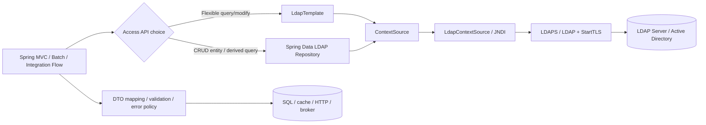
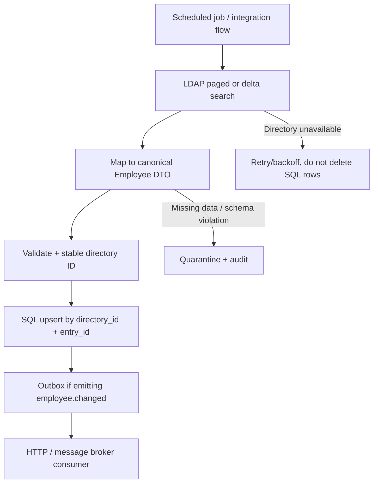

# LdapContextSource, LdapTemplate, and Spring Data LDAP Repositories

> **Chapter:** LDAP and Directories  
> **Scope:** Within the **SPRING_BOOT_INTEGRATION** module, Spring Boot connects with external systems via HTTP clients, SQL, caches, brokers, and Spring Integration adapters. LDAP is an identity/directory data source often needed for lookups, syncing to SQL, or feeding integration flows. This lesson focuses on **`LdapContextSource`, `LdapTemplate`, and Spring Data LDAP repositories**, along with decisions on configuration, data contracts, transactions, errors, deduplication, testing, and observability.

## 1. The Problem: User Data Lives in a Directory

An enterprise manages employee accounts in LDAP/Active Directory. A Spring Boot service must:

1. Connect to the directory using a read-only service account.
2. Find employees by `uid` or a normalized identifier.
3. Retrieve `displayName`, `mail`, status, and unit info; map them to an internal DTO.
4. Optionally synchronize data snapshots into a SQL database for other workflows.
5. Handle scenarios where the directory is slow, rejects binds, changes a DN, returns multiple results, or returns none.

To accomplish this, you must distinguish **directory protocol**, **connection management**, **query API**, and **repository mapping**. They are not the same component.

### What Is LDAP?

**LDAP** (*Lightweight Directory Access Protocol*) is a protocol for accessing hierarchically structured data organized by entries and attributes, commonly used for identities, groups, organizations, and policies. An entry has a **Distinguished Name (DN)**:

```text
dn: uid=linh.nguyen,ou=people,dc=example,dc=org
objectClass: inetOrgPerson
uid: linh.nguyen
cn: Linh Nguyen
sn: Nguyen
mail: linh.nguyen@example.org
```

In this example, `dc=example,dc=org` is the base DN, `ou=people` is an organizational unit, and `uid=linh.nguyen` is the entry's RDN (*Relative Distinguished Name*). **A DN is not necessarily an immutable ID**: it can change when an entry is moved to another OU or renamed. For long-term synchronization, prefer a directory-provided stable identifier attribute, such as `entryUUID` on some LDAP servers or `objectGUID` in Active Directory, after verifying the actual contract and data type.

### Application Layer Diagram



`LdapContextSource` is not a database repository; `LdapTemplate` does not turn LDAP into SQL; and a repository does not prove a user is authorized to log in.

## 2. How Do the Three Main Components Differ?

| Component | Type and Role | When to Use? | Notes |
| --- | --- | --- | --- |
| **`LdapContextSource`** | Spring LDAP's `ContextSource` implementation, managing how `DirContext` instances are created from URLs, base DN, and bind credentials | Configuring connections, TLS, bind, and JNDI environment | Supplies connections; does not define business queries |
| **`LdapTemplate`** | Template wrapping search, lookup, bind, modify, unbind operations via `ContextSource` | Need flexible queries/filters/attributes, custom mapping, fine-grained directory operations | **Imperative/blocking** API via JNDI |
| **Spring Data LDAP repository** | Repository abstraction + annotation-based entity mapping, e.g. `LdapRepository<PersonEntry>` | Common CRUD and queries on entries with stable structure | Not JPA; lacks full relational repository semantics |

**Quick selection rule:** start with `LdapTemplate` if you only need a few directory queries or have a complex directory schema; consider repositories when entries have clean mappings and the application performs many CRUD/query operations expressible by the model. Both typically share the same Spring Boot-configured `ContextSource`.

## 3. Dependencies and Auto-Configuration in Spring Boot

For a **Spring Boot 3.x / Java 17+** application, the Maven dependency for Spring Data LDAP:

```xml
<dependency>
    <groupId>org.springframework.boot</groupId>
    <artifactId>spring-boot-starter-data-ldap</artifactId>
</dependency>
```

This starter puts the required Spring Data LDAP/Spring LDAP components on the classpath under Spring Boot's version management; the project does not need to pin individual library versions when using Boot's BOM. If the application only needs `LdapTemplate`, you can consider the direct Spring LDAP dependency with appropriate auto-configuration instead of pulling in the full repository abstraction.

When matching dependencies and properties are present, Spring Boot can auto-configure `ContextSource`, `LdapTemplate`, and Spring Data LDAP/repository infrastructure per active conditions. If the application declares its own corresponding beans, auto-configuration may **back off**. Do not guess beans solely from the starter name; inspect the application context and the *Condition Evaluation Report* on your target version.

### Distinguishing Java Packages

- `org.springframework.ldap.core.support.LdapContextSource`: configures the source context.
- `org.springframework.ldap.core.LdapTemplate`: API for querying and updating the directory.
- `org.springframework.data.ldap.repository.LdapRepository`: Spring Data LDAP repository.
- `javax.naming.Name`, `javax.naming.directory.Attributes`: **JNDI from the JDK**; still under the `javax.naming.*` namespace in Spring Boot 3.x applications.

Do not confuse Java SE's `javax.naming.*` with Jakarta EE transitions like `javax.servlet.*` → `jakarta.servlet.*` or `javax.persistence.*` → `jakarta.persistence.*`.

## 4. Configuring `spring.ldap.*` and LdapContextSource

Production example using **LDAPS** to an external LDAP server:

```yaml
spring:
  ldap:
    urls: ${LDAP_URL:ldaps://ldap.example.org:636}
    base: dc=example,dc=org
    username: ${LDAP_BIND_DN:cn=service-reader,ou=services,dc=example,dc=org}
    password: ${LDAP_BIND_PASSWORD}
```

| Property | Function | Things to Watch |
| --- | --- | --- |
| `spring.ldap.urls` | One or more URLs to directory servers | Use `ldap://` or `ldaps://` per required security mechanism |
| `spring.ldap.base` | Common base DN, e.g., `dc=example,dc=org` | DNs in `LdapTemplate`/repositories are usually interpreted relative to this base |
| `spring.ldap.username` | DN of the account used for binding | Least-privileged service account; distinct from the employee identity being looked up |
| `spring.ldap.password` | Service account bind secret | Supplied via environment/secret; never put in logs |
| `spring.ldap.base-environment.*` | Additional JNDI environment properties | Property names and behavior depend on the LDAP provider |

In production, never use a directory administrator account for an application that only needs lookups. If read permission has not been granted for a sensitive attribute, never fix missing attributes by elevating the entire account to admin rights.

### 4.1. Base DN and Relative DNs

When configured with `spring.ldap.base=dc=example,dc=org`:

```text
Search base in code: ou=people
Full search base:    ou=people,dc=example,dc=org

Relative DN:         uid=linh.nguyen,ou=people
Full DN:             uid=linh.nguyen,ou=people,dc=example,dc=org
```

Never concatenate DNs from user data, because commas, equals signs, and backslashes have specific escaping rules. Use `Name`/`LdapNameBuilder` APIs when constructing DNs dynamically.

### 4.2. Connections, SSL, and Timeouts

**LDAPS** uses a TLS connection from the start, e.g., `ldaps://directory.example.org:636`. **StartTLS** upgrades an existing LDAP connection to TLS through a different protocol sequence, so simply setting an `ldap://` URL does not mean transport protection is active. Check client/driver behavior, hostname verification, certificate trust chain, TLS policy, and failover behavior.

When using the JDK's JNDI LDAP provider, provider-specific timeout keys can be passed via `spring.ldap.base-environment`, for example:

```yaml
spring:
  ldap:
    base-environment:
      "[com.sun.jndi.ldap.connect.timeout]": "3000"
      "[com.sun.jndi.ldap.read.timeout]": "5000"
```

Values are in **milliseconds** as interpreted by this JNDI LDAP provider; verify support in the runtime environment. `connect.timeout` bounds connection establishment, while `read.timeout` bounds waiting for a response. A business-request timeout may be shorter than the sum of many queries, so avoid letting one HTTP request make hundreds of unbounded sequential LDAP calls.

**Not every timeout proves an LDAP write operation did not occur.** If the application performs modify/bind/unbind, a dropped response can leave the outcome indeterminate. In those cases, use a stable identifier and re-verify state before retrying side-effecting operations.

## 5. LdapContextSource: Creating and Managing ContextSource

`LdapContextSource` implements `ContextSource` and uses JNDI beneath Spring LDAP. It configures parameters such as server URL, base DN, service bind DN, password, and environment options, then provides contexts for LDAP operations.

In Spring Boot you typically **do not need manual bean creation** if `spring.ldap.*` suffices; an `LdapTemplate` can be injected so Spring manages the context lifecycle per operation. When multiple independent directories or special settings are required, you can define a separate `LdapContextSource`:

```java
package com.example.integration.directory;

import org.springframework.context.annotation.Bean;
import org.springframework.context.annotation.Configuration;
import org.springframework.ldap.core.LdapTemplate;
import org.springframework.ldap.core.support.LdapContextSource;

@Configuration
class SecondaryDirectoryConfiguration {

    @Bean("secondaryDirectoryContextSource")
    LdapContextSource secondaryDirectoryContextSource() {
        LdapContextSource source = new LdapContextSource();
        source.setUrl("ldaps://secondary.example.org:636");
        source.setBase("dc=secondary,dc=example,dc=org");
        source.setUserDn("cn=reader,ou=services,dc=secondary,dc=example,dc=org");
        source.setPassword("REPLACE_WITH_SECRET_PROVIDER");
        return source;
    }

    @Bean("secondaryDirectoryTemplate")
    LdapTemplate secondaryDirectoryTemplate(
            @org.springframework.beans.factory.annotation.Qualifier(
                    "secondaryDirectoryContextSource")
            LdapContextSource source) {
        return new LdapTemplate(source);
    }
}
```

**Structure illustration only**: never use literal passwords in production. In real deployments, bind secondary configuration via `@ConfigurationProperties` or a secret manager, verify TLS, and distinguish beans with `@Qualifier`. A custom `ContextSource` configuration can change Boot auto-configuration conditions and Spring Data repository scanning; if multiple directories exist, explicitly wire which repository uses which template/factory rather than assuming repositories automatically select the right connection.

**Do not create multiple context sources just to increase concurrency.** Connection handling/pooling and query limits should be tuned to workload rather than turning every request into a new bean.

### 5.1. LdapContextSource and Authentication

The service bind DN in `spring.ldap.username` is used to query the directory with its granted permissions. It **does not prove an end user's login password is valid**. If user/password authentication is needed, use **Spring Security LDAP** or an identity/SSO provider aligned with your security design; verify via standard authentication bind flows, handling account locks, lockouts, group mapping, and MFA per organizational policy.

Never read `userPassword` and compare strings in Java. A directory may only support bind authentication, store hashed passwords, or deny reading passwords. Never treat "entry found" as proof that the user is authenticated or has business access permissions.

## 6. LdapTemplate: Finding Entries with Safe Filters

`LdapTemplate` provides `search()`, `lookup()`, `bind()`, `modifyAttributes()`, `unbind()`, and other LDAP operations. It manages contexts and translates certain JNDI errors into Spring LDAP exceptions, sparing application code from opening/closing contexts on every query.

### 6.1. Lookup by uid

```java
package com.example.integration.directory;

import java.util.List;
import java.util.Optional;
import javax.naming.NamingException;
import javax.naming.directory.Attribute;
import javax.naming.directory.Attributes;

import org.springframework.ldap.core.LdapTemplate;
import org.springframework.ldap.query.LdapQuery;
import org.springframework.ldap.query.LdapQueryBuilder;
import org.springframework.stereotype.Repository;

record DirectoryPerson(String uid, String commonName, String mail) {}

@Repository
public class DirectoryPersonLookup {
    private final LdapTemplate ldap;

    public DirectoryPersonLookup(LdapTemplate ldap) {
        this.ldap = ldap;
    }

    public Optional<DirectoryPerson> findByUid(String uid) {
        if (uid == null || uid.isBlank() || uid.length() > 120) {
            throw new IllegalArgumentException("Invalid uid");
        }

        LdapQuery query = LdapQueryBuilder.query()
                .base("ou=people")
                .where("objectClass").is("inetOrgPerson")
                .and("uid").is(uid);

        List<DirectoryPerson> matches = ldap.search(
                query,
                (Attributes attrs) -> new DirectoryPerson(
                        getString(attrs, "uid"),
                        getString(attrs, "cn"),
                        getString(attrs, "mail")
                )
        );

        if (matches.size() > 1) {
            throw new IllegalStateException(
                    "Directory uid is not unique inside search scope"
            );
        }
        return matches.stream().findFirst();
    }

    private static String getString(Attributes attrs, String name)
            throws NamingException {
        Attribute value = attrs.get(name);
        if (value == null || value.size() == 0) {
            return null;
        }
        Object raw = value.get();
        return raw instanceof String text ? text : null;
    }
}
```

In the example, base `ou=people` is a **relative DN** to `spring.ldap.base`. The filter has two conditions: `objectClass=inetOrgPerson` and `uid=<escaped-value>`. The query builder encodes values using appropriate filter escaping, safer than concatenating input directly into an LDAP filter string.

**Do not write:**

```java
// Anti-pattern: filter string built from input not properly escaped per LDAP filter rules.
String unsafeFilter = "(uid=" + userInput + ")";
ldapTemplate.search("ou=people", unsafeFilter,
        attrs -> attrs.get("cn").get().toString());
```

LDAP filters have control characters and wildcards such as `*`, `(`, `)`, and `\`. Unescaped input can alter the search condition. **LDAP filter injection differs from DN injection**; using `LdapQueryBuilder` for filters does not replace `LdapNameBuilder` when constructing DNs.

### 6.2. When to Use lookup Instead of search?

`search` fits when you know **attribute conditions** (uid, mail, objectClass) but not the DN. `lookup` fits when **an entry's DN is already known**:

```java
import javax.naming.Name;
import javax.naming.directory.Attributes;
import org.springframework.ldap.support.LdapNameBuilder;

Name dn = LdapNameBuilder.newInstance("ou=people")
        .add("uid", "linh.nguyen")
        .build();

DirectoryPerson person = ldapTemplate.lookup(
        dn,
        (Attributes attrs) -> new DirectoryPerson(
                attrs.get("uid").get().toString(),
                attrs.get("cn").get().toString(),
                attrs.get("mail").get().toString()
        )
);
```

This is an illustrative snippet inside a service holding `ldapTemplate`. In a real directory, attributes like `mail` may be missing, or the user may have moved OUs; use a null-safe mapper and look up by a stable identifier rather than relying entirely on a stale cached DN.

### 6.3. Search Scope, Size/Time Limits, and Pagination

LDAP searches support **OBJECT**, **ONELEVEL**, and **SUBTREE** scopes; some servers enforce entry/size and time limits. Never run an unfiltered search across all of `dc=example,dc=org` from a user request and load the entire result into a `List`.

When synchronizing tens of thousands of entries:

- Choose the narrowest search base that satisfies the business requirement.
- Fetch only required attributes, avoiding photos/certificates or large multi-valued attributes unless needed.
- Use **server-side paging** via server-supported LDAP controls; Spring LDAP provides paging support such as `PagedResultsDirContextProcessor`, which should be verified for your server/driver/version.
- Paged results may not represent a consistent snapshot if the directory changes during the scan; use appropriate sync checkpoints/versions and reconciliation.
- Active Directory has dedicated delta sync mechanisms like DirSync or USN in supported environments; do not assume every LDAP server offers those controls.

## 7. Spring Data LDAP Repositories: Mapping Entries to Java Objects

When the directory schema is stable and the application frequently queries/updates the same entry type, Spring Data LDAP can provide annotation-based mapping and repository interfaces.

### 7.1. Entity Mapping an LDAP Entry

```java
package com.example.integration.directory;

import javax.naming.Name;
import org.springframework.data.annotation.Id;
import org.springframework.ldap.odm.annotations.Attribute;
import org.springframework.ldap.odm.annotations.Entry;

@Entry(
    base = "ou=people",
    objectClasses = {
        "top", "person", "organizationalPerson", "inetOrgPerson"
    }
)
public class PersonEntry {
    @Id
    private Name dn;

    @Attribute(name = "uid")
    private String uid;

    @Attribute(name = "cn")
    private String commonName;

    @Attribute(name = "sn")
    private String surname;

    @Attribute(name = "mail")
    private String mail;

    public PersonEntry() {}

    public Name getDn() { return dn; }
    public void setDn(Name dn) { this.dn = dn; }

    public String getUid() { return uid; }
    public void setUid(String uid) { this.uid = uid; }

    public String getCommonName() { return commonName; }
    public void setCommonName(String commonName) {
        this.commonName = commonName;
    }

    public String getSurname() { return surname; }
    public void setSurname(String surname) {
        this.surname = surname;
    }

    public String getMail() { return mail; }
    public void setMail(String mail) { this.mail = mail; }
}
```

`@Entry` describes the entry type, base, and objectClasses; `@Attribute` maps a Java field to an LDAP attribute; `@Id` binds the DN. This **is not a JPA `@Entity`**: DNs and LDAP objectClass/attribute schemas are the storage foundation, with no relational ORM tables, joins, or cascades.

The examples here favor **reading the directory**; if using a repository to create new entries, valid DNs must be constructed and schema-required attributes (`cn`, `sn`, and exact objectClasses) must be supplied. Calling `save()` on an entity lacking a DN or required schema attributes can fail. When updating multi-valued attributes, group memberships, or renaming/moving entries, understand LDAP semantics before relying on repositories.

### 7.2. Declaring a Repository Interface

```java
package com.example.integration.directory;

import java.util.List;
import java.util.Optional;
import org.springframework.data.ldap.repository.LdapRepository;

public interface PersonLdapRepository
        extends LdapRepository<PersonEntry> {

    Optional<PersonEntry> findByUid(String uid);

    List<PersonEntry> findBySurname(String surname);
}
```

Spring Data LDAP can derive attribute queries from repository method names based on the mapping. For special cases such as complex filters, controls, paging, or vendor-specific parameters, choose `LdapTemplate` for finer control.

**Important:** query derivation and return types must be tested with the Spring Data LDAP release in use. For example, `findByUid` assumes `uid` is sufficiently unique within the configured search base; LDAP does not guarantee uniqueness simply because a field is named like an "ID".

### 7.3. Service Using a Repository

```java
package com.example.integration.directory;

import java.util.Optional;
import org.springframework.stereotype.Service;

@Service
public class EmployeeDirectoryService {
    private final PersonLdapRepository people;

    public EmployeeDirectoryService(PersonLdapRepository people) {
        this.people = people;
    }

    public Optional<EmployeeProfile> findByUid(String uid) {
        return people.findByUid(uid)
                .map(p -> new EmployeeProfile(
                        p.getUid(), p.getCommonName(), p.getMail()
                ));
    }
}

record EmployeeProfile(String uid, String name, String email) {}
```

Never return `PersonEntry` or raw attributes directly to a public API. A DTO limits exposed data, avoids leaking internal info or sensitive attributes, and decouples the domain from the LDAP schema.

## 8. When to Choose LdapTemplate vs. Repository?

| Scenario | `LdapTemplate` | Spring Data LDAP Repository |
| --- | --- | --- |
| A few read-only queries, dynamic filters | **Very well suited** | Extra abstraction may be unnecessary |
| CRUD on an entry with a stable schema | Usable, though more manual mapping | **Well suited** with annotations/entities |
| Paged search, LDAP controls, vendor-specific attrs | **More flexible** | May require custom implementation/template |
| Simple queries by uid/mail | Suitable | Suitable with query derivation |
| Multi-valued attributes or complex group membership | Easier to control specific changes | Carefully inspect mapping and `save()` behavior |
| Combining multiple directories/providers | Configure multiple templates with qualifiers | Must map repositories and source contexts clearly |
| Running on WebFlux/Reactor | **Blocking** | **Blocking** |

### 8.1. Blocking Behavior Is Often Misunderstood

Spring LDAP relies on JNDI, and `LdapTemplate`/Spring Data LDAP repositories primarily provide **synchronous APIs**. Returning `Mono<EmployeeProfile>` from a WebFlux controller does not automatically turn the internal LDAP query into reactive network I/O.

Example of keeping a blocking call off the Reactor event loop if LDAP must be called from a reactive service:

```java
import reactor.core.publisher.Mono;
import reactor.core.scheduler.Schedulers;

public Mono<EmployeeProfile> lookupReactiveBoundary(String uid) {
    return Mono.fromCallable(() ->
            employeeDirectoryService.findByUid(uid).orElse(null))
            .subscribeOn(Schedulers.boundedElastic());
}
```

This **isolates a blocking call onto a bounded scheduler**; it is not a reactive LDAP driver. If the result is `null`, `Mono.fromCallable` completes empty; if LDAP errors, the publisher emits an error. Under high request volume, enforce timeouts, concurrency limits, pooling/circuit breakers, and load control. Never write `Mono.just(employeeDirectoryService.findByUid(uid))` expecting the blocking call to be deferred until subscription.

## 9. Syncing LDAP to SQL: Contracts, State, and Duplicate Handling

A common integration pattern snapshots the employee list from the directory into a SQL table so business APIs do not query LDAP on every request:



### 9.1. Choosing the Synchronization Key

An entry may have `uid`, `mail`, or a DN, yet these values **can change** or be reused under directory policy. If the server provides an ID immutable across renames/moves, prefer that attribute along with `directoryId` to avoid collisions when multiple directories share similar IDs.

Example snapshot table:

```sql
CREATE TABLE directory_users (
    directory_id VARCHAR(80) NOT NULL,
    entry_id VARCHAR(200) NOT NULL,
    uid VARCHAR(160),
    display_name VARCHAR(300),
    email VARCHAR(320),
    source_updated_at TIMESTAMPTZ,
    synced_at TIMESTAMPTZ NOT NULL DEFAULT CURRENT_TIMESTAMP,
    PRIMARY KEY (directory_id, entry_id)
);
```

`entry_id` here is the normalized source ID, not a DN by default. When a provider uses binary `objectGUID`, establish a consistent encoding convention so it does not vary across reads. When no immutable ID exists, define an explicit strategy for rename/merge handling and duplicate detection.

### 9.2. Never Hold a SQL Transaction Open While Reading the Directory

**Design to avoid:**

```text
BEGIN SQL TRANSACTION
  SELECT ... FROM directory via LDAP (can be slow / time out)
  UPDATE thousands of SQL rows
  HTTP POST to partner
COMMIT SQL
```

**Better design:**

1. Search the directory outside SQL transactions, in bounded batches/pages and with finite deadlines.
2. Validate and normalize results; keep metadata sufficient to trace source ID and schema.
3. For each batch, open a **short SQL transaction** to upsert by unique key.
4. If publishing events to a broker, write to an **outbox** in the same SQL transaction; a separate publisher sends after commit.
5. If LDAP fails mid-run, retain old SQL records and mark the job status as failed; never equate "could not read" with "employee deleted."

There is no default ACID transaction spanning LDAP and SQL. If the application both modifies LDAP and writes to SQL, one side can succeed while the other fails. Design compensation/reconciliation, or designate a single source of truth for each data category.

### 9.3. Handling Deleted or OU-Moved Entries

If a sync job does not see an entry during a search, **that is insufficient to conclude** the entry was deleted: the search may have failed due to permissions, size limit, partial paging, unfollowed referrals, or the entry moving to another OU. Mark records deactivated only after confirming a full-scope sync completed or receiving a reliable delta/tombstone. `syncRunId`, `lastSeenAt`, and grace periods can help.

**A key alone does not replace a version contract:** when the same entry is synced repeatedly, use source update timestamps/versions or compare fingerprints of key fields; avoid emitting `employee.changed` endlessly when data has not changed.

## 10. LDAP Errors, Timeouts, and Retries

Not all LDAP errors should be handled the same way:

| Error Group | Example | Recommended Policy |
| --- | --- | --- |
| **No entry** | `uid` does not exist within search base | Return "not found" per contract, do not retry infinitely |
| **Multiple entries** | `uid` is not unique in subtree | Report contract error/investigate source; do not arbitrarily pick the first entry |
| **Bad service credentials** | Wrong bind account or expired secret | Raise security/ops alert, fix secret; do not hammer with retries |
| **Missing read permission** | Attribute denied, insufficient access | Check ACL and data contract; do not escalate permissions arbitrarily |
| **Directory unavailable/connection reset** | Node failover, transient timeout | Bounded retries, backoff/jitter, circuit breaker |
| **Malformed filter/DN** | Bad escaping, invalid DN syntax | Fix input/mapping/code, do not auto-retry |
| **Size/time limit exceeded** | Search too broad or missing paging | Narrow base/filter, limit results, use suitable paging |
| **Schema violation on modify** | Missing `sn`/`cn`, wrong objectClass | Fix payload/schema, do not treat as transient |
| **Partial results/referral** | Distributed directory or unfollowed referral | Define referral/failover policy and mark sync incomplete |

Spring LDAP normally translates JNDI errors into Spring LDAP runtime exceptions. Error-handling code should classify by known exception type and cause, **never relying on exception message strings** to decide retries. Infrastructure errors must be separated from empty search results; swallowing an exception and returning `Optional.empty()` makes the system treat a directory outage as "user does not exist."

### 10.1. Caching LDAP Data

Caching by `directoryId + entryId` or `directoryId + uid` can reduce load on the directory. However, employee info, group permissions, and account lock status have **different freshness sensitivities**. Do not apply a long TTL to authorization/lockout data just because general directory entries change infrequently.

Set size limits and TTLs, invalidate on events if a reliable source exists, and monitor stale reads. When LDAP is unavailable, choosing **fail open** vs. **fail closed** depends on the feature: display-name lookups might use an old snapshot, whereas sensitive authorization decisions generally must not rely on stale state without an explicit safe design.

## 11. Security: LDAP Filter Injection, Permissions, and Sensitive Data

### 11.1. Distinguishing Two Injection Types

- **Filter injection:** a condition string `(uid=...)` is altered when input contains special LDAP filter characters. Use `LdapQueryBuilder` or a valid filter escaping utility; never concatenate raw user input.
- **DN injection:** input used to construct a DN contains commas, equals signs, spaces, or special characters that alter RDN parsing. Use `LdapNameBuilder`/`LdapName`, never string concatenation.

Escaping **does not replace authentication/authorization**. Even if a query is syntactically safe, callers must not be allowed to pick the HR OU or request arbitrary attributes if the endpoint forbids it.

### 11.2. Required Layers of Defense

1. **Properly configured LDAPS or StartTLS**, verifying certificates and hostnames per policy.
2. **Least-privileged service bind account**; separate read-only accounts from modify-capable accounts if updates are genuinely required.
3. **Credential protection**: secret manager/environment variables, rotation, never log passwords or connection strings containing secrets.
4. **Search bounds**: narrow base DN, explicit filters, size/time limits, paging, and request limits.
5. **Data minimization**: read/expose in DTOs only strictly needed attributes, avoiding returning entire LDAP entries.
6. **Audit controls**: log operation type, directory ID, outcome, and correlation ID without logging passwords or unnecessary PII.
7. **Failover/referral rules**: do not chase referrals to untrusted servers or automatically send credentials to unauthorized hosts.

## 12. Observability and Operations

| Signal | Why Does It Matter? |
| --- | --- |
| **LDAP bind success/failure** | Detects expired passwords, locked service accounts, TLS errors |
| **Search latency P50/P95/P99** | Distinguishes slow directory from downstream SQL/HTTP |
| **Timeouts and connection errors** | Detects network issues, node failover, or pool saturation |
| **Query size/result count** | Detects overly broad searches, missing filters, or paging |
| **Result not found / duplicate match** | Tracks data quality and uniqueness issues |
| **Sync processed / changed / skipped** | Monitors job effectiveness and actual change volume |
| **Incomplete sync / paging errors** | Prevents deleting/disabling accounts due to incomplete sync runs |
| **SQL upsert conflicts / outbox backlog** | Detects contention and bottlenecks when syncing to other systems |
| **Directory cache hit/miss/stale** | Measures cache impact and risk of stale data |

You can combine Micrometer/Actuator with custom instrumentation around `LdapTemplate` or services; do not assume Spring Boot automatically emits detailed metrics for every LDAP operation. Metric tags should have low cardinality (`operation=search`, `directory=employees`, `outcome=timeout`). **Never put uid, DN, mail, or correlation ID into metric tags** due to cardinality and PII risks.

In business logs, include correlation IDs and suitably sanitized/redacted IDs per policy. When LDAP slows down en masse, backoff and concurrency limits matter more than spawning unbounded threads waiting on I/O.

## 13. Testing LdapTemplate and Repositories Against a Real Directory

Mapper-only unit tests are useful but do not prove directory schemas, DNs, search filters, and binds work properly. For integration tests, use an **OpenLDAP test instance**, a compatible embedded LDAP server, or appropriate Testcontainers. For production Active Directory, maintain an integration environment closely mirroring AD because schemas, paging controls, referrals, group memberships, and `objectGUID` differ.

### 13.1. LDIF Test Data

Example LDIF file when the **test server's base suffix is `dc=example,dc=org`**:

```ldif
dn: dc=example,dc=org
objectClass: top
objectClass: domain
dc: example

dn: ou=people,dc=example,dc=org
objectClass: top
objectClass: organizationalUnit
ou: people

dn: uid=linh.nguyen,ou=people,dc=example,dc=org
objectClass: top
objectClass: person
objectClass: organizationalPerson
objectClass: inetOrgPerson
uid: linh.nguyen
cn: Linh Nguyen
sn: Nguyen
mail: linh.nguyen@example.org
```

If the test server already created the base suffix, do not re-import `dc=example,dc=org` and cause a conflict. LDIF statements and schemas must follow the actual provider; a server may reject entry creation if parents or required objectClasses are missing.

### 13.2. Important Test Cases

| Test Case | Expected Verification |
| --- | --- |
| Bind with valid service credentials | Directory lookup succeeds via `spring.ldap.*` config |
| Wrong bind password or certificate | Explicit error, not treated as "user not found" |
| Valid `uid` search | `LdapTemplate` and repository map to the same expected data |
| Non-existent `uid` | Returns `Optional.empty()` or empty result per contract |
| Filter input with `*`, `(`, `)`, `\` | Does not inject conditions or broaden the query |
| DN with special characters | Built via builder and looks up the right entry |
| Missing `mail` attribute | Mapper respects nullability contract, no NPE |
| Search returns two entries with duplicate uid | Does not silently pick the first entry when uniqueness is required |
| Server size/time limit | Scans across pages or marks sync incomplete, does not delete SQL data |
| Sync run interrupted mid-way | Does not mark missing entries as deleted |
| Multiple workers syncing same directory | SQL unique key/upsert prevents duplicate rows |
| Retry when directory is down | Uses backoff, bounded attempts, and metrics/alerts |
| Endpoint security | Does not return passwords/sensitive groups, does not log unnecessary DN/PII |

### 13.3. Example Test Searching for an Entry

```java
package com.example.integration.directory;

import static org.assertj.core.api.Assertions.assertThat;
import org.junit.jupiter.api.Test;
import org.springframework.beans.factory.annotation.Autowired;
import org.springframework.boot.test.context.SpringBootTest;

@SpringBootTest
class DirectoryPersonLookupIT {
    @Autowired DirectoryPersonLookup lookup;

    @Test
    void searchesPersonByUid() {
        var person = lookup.findByUid("linh.nguyen");
        assertThat(person).isPresent();
        assertThat(person.orElseThrow().commonName())
                .isEqualTo("Linh Nguyen");
    }
}
```

This test **assumes the test LDAP server and LDIF are preloaded**, with `spring.ldap.*` pointing to that environment. With Testcontainers, supply dynamic URL/credentials; never use a production LDAP host as a test backend. Read-only tests should be paired with separate CRUD tests against a disposable writable directory, never mutating real employee data.

## 14. Common Misconceptions

1. **"LdapContextSource is the repository."** False: it is the JNDI context source, not an entity mapping tool.
2. **"LdapTemplate is reactive because the app uses WebFlux."** False: Spring LDAP typically uses blocking APIs; isolate threads or choose an appropriate architecture.
3. **"Spring Data LDAP repositories have full transactions/joins like JPA."** False: LDAP is not a relational database; do not assume JPA's ACID and ORM semantics.
4. **"Finding a DN means the user has logged in successfully."** False: identity search is separate from password authentication and authorization.
5. **"A DN is an immutable ID."** False: renaming/moving an entry can change its DN; use a stable ID for long-term sync.
6. **"Not finding an entry means the employee was deleted."** False: it could be due to search base, permissions, paging, or directory outage.
7. **"Simply calling `ldap://` ensures secure transport."** False: LDAPS/StartTLS and proper certificate validation are required.
8. **"Escaping an LDAP filter also escapes a DN."** False: filters and DNs follow different syntax rules.
9. **"Using an LDAP cache allows granting permissions indefinitely from stale state."** False: security-sensitive data requires explicit freshness and failure policies.
10. **"`@Transactional` on a service updating SQL will roll back LDAP operations."** False: there is no default shared transaction across LDAP/SQL/HTTP/brokers.

## 15. Checklist for Designing an LDAP Integration in Spring Boot

1. **Identify the source:** OpenLDAP, Active Directory, or another provider; know naming contexts, OUs, schema, and supported controls.
2. **Choose the API:** `LdapTemplate` for flexible search/filters; repository for entities/CRUD with stable mappings.
3. **Configure:** `spring.ldap.urls`, `base`, bind account, secrets, TLS, timeouts, and referral policy.
4. **Define the contract:** stable directory ID, uid/DN, nullable/multi-valued attributes, schema version, and DTO mapping.
5. **Security:** least privilege, filter and DN escaping, input limits, separating search from authentication/authorization.
6. **Load bounding:** narrow search base, paging, size/time limits, bounded blocking threads if called from WebFlux.
7. **Data synchronization:** SQL unique constraints/upserts, checkpoints/deltas, distinguishing incomplete sync from deletion.
8. **Transactions/reliability:** do not expect atomic transactions across LDAP and SQL; use outbox/reconciliation when emitting events.
9. **Errors:** distinguish not found, duplicate match, authentication, permission, timeout, and schema errors.
10. **Testing/observability:** LDAP test server, mapping/repository tests, timeouts, paging, idempotency, metrics, and data privacy.

### Self-Check Questions

1. What layers of responsibility do `LdapContextSource`, `LdapTemplate`, and `LdapRepository` occupy?
2. Why does `spring.ldap.base` affect how `ou=people` is interpreted in a query?
3. When should you use `LdapTemplate.search()` instead of `lookup()`?
4. Why can't you use string concatenation to build filters or DNs from user input?
5. If a person moves OUs and their DN changes, which ID should SQL synchronization rely on?
6. Why are `@Entry`/`@Attribute` not equivalent to a JPA entity?
7. Why does finding an LDAP entry not prove the user has been authenticated?
8. Does a search timing out mid-paging justify deleting employees who did not appear in the batch?
9. How do you integrate a blocking LDAP lookup into a WebFlux flow without blocking the event loop?
10. Why shouldn't you hold a SQL transaction open while scanning LDAP or calling downstream HTTP services?

**Takeaway:** `LdapContextSource` configures connections and binds, `LdapTemplate` provides flexible LDAP operations, and **Spring Data LDAP repositories** map entries and simplify common queries. In Spring Boot integration, directory data has its own schema and lifecycle: you need filter/DN escaping, TLS, least privilege, stable IDs, pagination, query timeouts, and blocking isolation. When syncing to SQL or emitting events, design explicit transactions, idempotency, retries, and reconciliation instead of assuming LDAP shares transactions with other systems.
