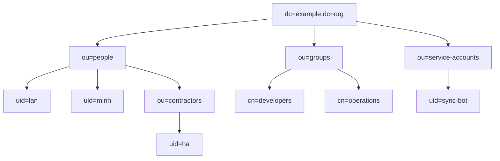
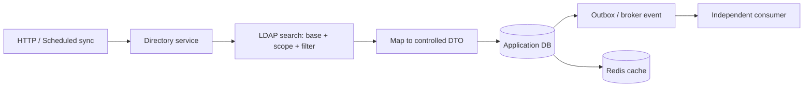

# Base DN, Distinguished Names, and Search Scope

In **SPRING_BOOT_INTEGRATION**, Spring Boot can fetch HR info, permission groups, or organizational configuration from an **LDAP directory** and combine it with HTTP clients, databases, caches, brokers, and Spring Integration adapters. When a connection succeeds yet fails to find users, the cause is sometimes neither the password nor connectivity: the application has **chosen the wrong Base DN, misunderstood Distinguished Names (DNs), or set the wrong search scope**.

This lesson belongs to the **LDAP and Directories** chapter and focuses on **Base DN, distinguished names, and search scope**. We will construct a directory tree, distinguish names/attributes/search regions, compute the exact entries traversed by each scope, and then connect this to Spring LDAP and Spring Boot. The examples establish explicit data contracts and security boundaries, avoiding scanning the whole directory when only one branch is needed; they also examine timeouts, referrals, pagination, preventing invalid queries, and testing in real integration flows.

> Examples target **Java 17+, Spring Boot 3.x, Spring LDAP 3.x**, and LDAPv3. DN/filter syntax follows the principles of LDAP/RFC 4512, RFC 4514, and RFC 4515. Behaviors such as aliases, referrals, schemas, read permissions, paging, and user/group layout depend on the LDAP server (OpenLDAP, Active Directory, etc.); do not treat the example data as a mandatory structure for every directory.

## 1. Learning Objectives

After this lesson, you can:

1. Read and build a **Directory Information Tree (DIT)**; distinguish entry, attribute, RDN, DN, and suffix.
2. Explain the meaning of **Base DN** on the server and in Spring Boot's `spring.ldap.base`, especially distinguishing **absolute DN** from **context-relative DN**.
3. Predict the set of entries covered by **OBJECT/BASE**, **ONELEVEL**, and **SUBTREE** search scopes.
4. Combine **search base + scope + LDAP filter** correctly; understand why changing one component changes the results even when the filter stays the same.
5. Use `LdapTemplate`, `LdapQueryBuilder`, `SearchControls`, and `LdapNameBuilder` to query safely, limit data, and prevent LDAP injection.
6. Design user/group queries for multiple organizations, multiple OUs, permission boundaries, referrals, and real-world directory layouts.
7. Test search scopes, special DNs, zero/multiple results, access permissions, timeouts, and performance before integrating LDAP data with DB/cache/brokers.

## 2. An LDAP Directory Is a Tree of Named Entries, Not Relational Tables

LDAP (*Lightweight Directory Access Protocol*) accesses hierarchically structured **directory entries**. Each entry has a **DN identifying its position in the tree** and a set of *attributes* governed by a schema. Attributes can have one or multiple values; single-valued attributes are not guaranteed for every object class.

Suppose a company organizes its directory as follows:

```text
dc=example,dc=org
├── ou=people
│   ├── uid=lan
│   ├── uid=minh
│   └── ou=contractors
│       └── uid=ha
├── ou=groups
│   ├── cn=developers
│   └── cn=operations
└── ou=service-accounts
    └── uid=sync-bot
```

**Each line in the tree is an entry named by its RDN**, not a filesystem directory path. For example:

| Entry | Full DN (*absolute DN*) |
| --- | --- |
| Example data root | `dc=example,dc=org` |
| Container holding people | `ou=people,dc=example,dc=org` |
| User Lan | `uid=lan,ou=people,dc=example,dc=org` |
| Contractor Ha | `uid=ha,ou=contractors,ou=people,dc=example,dc=org` |
| Developers group | `cn=developers,ou=groups,dc=example,dc=org` |
| Service account | `uid=sync-bot,ou=service-accounts,dc=example,dc=org` |

An entry may contain data such as:

```ldif
dn: uid=lan,ou=people,dc=example,dc=org
objectClass: inetOrgPerson
uid: lan
cn: Lan Nguyen
sn: Nguyen
mail: lan@example.org
```

This is an **illustrative LDIF**. In a real system, entries may require additional object classes/attributes enforced by the LDAP server, and DNs may use `cn` or another organizational format instead of `uid`.

### 2.1. Common Components

| Attribute in Name | Common Interpretation | Example |
| --- | --- | --- |
| `dc` | Domain Component, often used to form the suffix | `dc=example,dc=org` |
| `ou` | Organizational Unit, organizational branch | `ou=people`, `ou=groups` |
| `cn` | Common Name | `cn=developers` or `cn=Lan Nguyen` |
| `uid` | User Identifier in some schemas | `uid=lan` |
| `o` | Organization Name | `o=Example Corp` |
| `c` | Country Name, when used by the schema | `c=VN` |

**An attribute name alone does not determine an entry's role.** `cn` can be part of the DN for a user, a group, or another object. Inspect `objectClass`/schema and directory conventions. Do not assume all accounts always live under `ou=people`, every group uses `cn=...`, or every DN ends with `dc=...`.

## 3. Distinguishing RDN, DN, Entry, and Attribute

**RDN (Relative Distinguished Name)** is the distinguishing name part of an entry **relative to its parent**. **DN (Distinguished Name)** is the complete distinguishing path in the DIT, consisting of the entry's RDN followed by the chain of ancestor RDNs up to the appropriate suffix.

Taking entry Lan:

```text
uid=lan,ou=people,dc=example,dc=org
└─┬─┘ └───┬───┘ └───────┬──────┘
  RDN      parent OU      domain suffix
```

| Component | Example | How to Understand It |
| --- | --- | --- |
| Lan's RDN | `uid=lan` | Identifier distinguishing Lan from sibling entries under the same parent. |
| Parent DN | `ou=people,dc=example,dc=org` | Direct branch containing Lan. |
| Full DN | `uid=lan,ou=people,dc=example,dc=org` | Distinguished name of the entry in the directory. |
| `uid` attribute | `lan` | Attribute value; not inherently unique across the entire directory. |
| `cn` attribute | `Lan Nguyen` | Display name; not necessarily part of the DN. |
| Search Base DN | `ou=people,dc=example,dc=org` | Starting region for a search; not necessarily the DN of the target object. |

**An RDN does not have to contain only one attribute–value pair.** LDAP allows *multi-valued RDNs* such as `cn=Lan Nguyen+uid=lan` under supporting schemas and naming rules. Never split DNs by comma or plus using `String.split(...)` assuming segments are raw data, because delimiters can be escaped.

### 3.1. A DN Is Not an Immutable Business ID

A DN can change when an entry is **renamed** or **moved** to another OU:

```text
Before: uid=lan,ou=contractors,ou=people,dc=example,dc=org
After:  uid=lan,ou=employees,ou=people,dc=example,dc=org
```

If an application uses a DN as a primary foreign key in PostgreSQL or embeds a DN into Kafka events as a permanent ID, a move can break old references. Some directories provide more stable identifiers, such as `entryUUID` depending on schema/server, or `objectGUID` in Active Directory; check semantics and read permissions with your provider rather than treating a DN as a UUID.

Group memberships sometimes **store member DNs**, e.g., `member: uid=lan,ou=people,dc=example,dc=org`. Changing a DN can affect those references depending on the server/overlays; never assume every directory automatically updates all group references.

### 3.2. DNs and Values Containing Special Characters

Suppose a common name is **Doe, Jane**. The comma inside the RDN value must be properly represented:

```text
cn=Doe\, Jane,ou=people,dc=example,dc=org
```

RDNs also have escaping rules for plus signs, equals signs, backslashes, leading/trailing spaces, and other special characters. **Never concatenate strings**:

```java
// WRONG: input data can alter the DN structure.
String dn = "cn=" + displayName + ",ou=people,dc=example,dc=org";
```

Use the DN-aware APIs from JNDI/Spring LDAP to construct and handle names, as shown later.

## 4. Base DN Is a Search Anchor, Not a Filter

**Base DN (search base)** specifies the starting entry of an LDAP search. It is a **geometric anchor in the tree**, not a value predicate like SQL `WHERE`. The search base combines with **scope** to define which entries are eligible for consideration, after which the **filter** decides which entries match.



| Search Base | What Lies Within That Base's Subregion? | What Is Excluded Upfront? |
| --- | --- | --- |
| `dc=example,dc=org` | Can traverse all people/groups/service-accounts branches if scope permits | Other suffixes or naming contexts. |
| `ou=people,dc=example,dc=org` | Users Lan, Minh, contractors branch, and Ha if scope fits | Groups and service accounts outside the people branch. |
| `ou=contractors,ou=people,dc=example,dc=org` | Only the contractors branch and its children | Lan and Minh directly under people. |
| `uid=lan,ou=people,dc=example,dc=org` | Entry Lan and any children under it | Sibling entries like Minh. |

If the **Base DN does not exist or the bind account lacks visibility**, the server may return errors like `noSuchObject`/`insufficientAccessRights`, or different observable outcomes depending on access policy. Never treat an empty list as proof that a user does not exist when a wrong base or missing permissions may be the cause.

### 4.1. Server Base DN and Spring Boot's Base Are Not Necessarily Equal

In Spring Boot, `spring.ldap.base` is typically the **base path for the LDAP context** created by Spring. A query from `LdapTemplate` can then pass a **base relative to that context**.

For example:

```yaml
spring:
  ldap:
    urls: ldaps://ldap.example.org:636
    base: dc=example,dc=org
```

With context base `dc=example,dc=org`, calling:

```java
ldapTemplate.search("ou=people", filter, mapper);
```

sets the logical search base to **`ou=people,dc=example,dc=org`**. Conversely, if you pass the full DN `ou=people,dc=example,dc=org` into the template's **relative** base parameter, some setups will combine them into an invalid path (e.g., appending the suffix twice).

**Pick one consistent convention:** either configure the context base as the suffix and pass **relative** search bases, or leave the context base empty and pass full DNs. Adapters, test fixtures, and CLI commands outside Spring must be distinguished by this convention.

### 4.2. DIT Root, Naming Contexts, and Root DSE

An LDAP server can serve one or more **naming contexts**, such as `dc=example,dc=org` and `dc=partner,dc=net`. The **Root DSE** is a special entry advertising server metadata (typically read with an empty base DN and object scope), such as `namingContexts` when provided by the server.

An empty DN when querying Root DSE **does not** mean you can run an unbounded subtree search from the empty root across the entire directory. Permissions, referrals, naming contexts, and root search support vary by server. Production should use specific, minimal business search bases.

## 5. Three Search Scopes: OBJECT, ONELEVEL, and SUBTREE

LDAP Search has three fundamental scopes—do not interpret them solely by guesswork from their names:

- **BASE/OBJECT scope**: evaluates **only the entry whose DN equals the base**. In JNDI this uses `SearchControls.OBJECT_SCOPE`; many CLI tools call it `base`.
- **ONELEVEL scope**: evaluates **direct child entries** of the base, **excluding** the base itself and **without** descending into grandchildren/descendants. In JNDI this uses `SearchControls.ONELEVEL_SCOPE`; CLI tools usually call it `one`.
- **SUBTREE scope**: evaluates **the base and all descendants** underneath it (if permitted by server/permissions). In JNDI this uses `SearchControls.SUBTREE_SCOPE`; CLI tools usually call it `sub`.

### 5.1. Exact Illustration Matrix

Keeping base `ou=people,dc=example,dc=org`:

| Scope | Entries in Search Region **Before Filtering** | Includes `ou=people` Itself? |
| --- | --- | --- |
| OBJECT / BASE | `ou=people` | **Yes** |
| ONELEVEL | `uid=lan`, `uid=minh`, `ou=contractors` | **No** |
| SUBTREE | `ou=people`, `uid=lan`, `uid=minh`, `ou=contractors`, `uid=ha` | **Yes** |

If the filter is `(objectClass=inetOrgPerson)` and Lan, Minh, and Ha all carry that class:

| Scope on the Same Base `ou=people` | Entries Matching Filter | Why? |
| --- | --- | --- |
| OBJECT | 0 | The OU itself is not an `inetOrgPerson`. |
| ONELEVEL | Lan, Minh | Ha sits at the **grandchild** level under `ou=contractors`. |
| SUBTREE | Lan, Minh, Ha | The scope descends into the `ou=contractors` branch. |

If you change the base to `dc=example,dc=org` while keeping filter/scope, the result set changes again. That is why troubleshooting "cannot find valid user" requires checking **base + scope + filter** together rather than just tweaking the filter.

### 5.2. Illustration with LDAP SearchControls

```java
import javax.naming.directory.SearchControls;

SearchControls oneLevel = new SearchControls();
oneLevel.setSearchScope(SearchControls.ONELEVEL_SCOPE);

SearchControls subtree = new SearchControls();
subtree.setSearchScope(SearchControls.SUBTREE_SCOPE);

SearchControls oneObject = new SearchControls();
oneObject.setSearchScope(SearchControls.OBJECT_SCOPE);
```

These classes belong to **JNDI** in the JDK and are used by Spring LDAP when invoking the directory. Scope is a parameter of **a single query**, not a permanent property attached to an OU or entry.

### 5.3. Choosing Scope by Business Need

| Business Question | Recommended Base | Typically Suitable Scope |
| --- | --- | --- |
| "Inspect attributes of a user entry whose DN is known" | Full or relative DN of the user | OBJECT/BASE |
| "List direct OUs/departments under `ou=departments`" | `ou=departments` | ONELEVEL |
| "Find user across all personnel sub-groups, including contractors" | `ou=people` | SUBTREE |
| "Find direct groups under `ou=groups`" | `ou=groups` | ONELEVEL |
| "Match a person strictly in the employees OU" | `ou=employees,ou=people` | ONELEVEL if child OUs should be excluded |
| "Find service accounts" | `ou=service-accounts` | ONELEVEL/SUBTREE depending on actual layout |

Do not pick SUBTREE just to be "safe and find more": it can scan very broadly, increase latency, and return entries not authorized for the business flow. Conversely, choosing ONELEVEL purely because it is lighter when child OUs exist will produce **false negatives**.

## 6. Base, Scope, and Filter: Three Independent Components

An LDAP search can be described as:

```text
Search(
  base  = "ou=people,dc=example,dc=org",
  scope = SUBTREE,
  filter = "(&(objectClass=inetOrgPerson)(uid=lan))",
  attrs = ["uid", "cn", "mail"]
)
```

Meaning:

1. **Base**: start at entry `ou=people,dc=example,dc=org`.
2. **Scope**: select the base entry and all accessible children/descendants.
3. **Filter**: keep only entries having both `objectClass=inetOrgPerson` and `uid=lan`.
4. **Returning attributes**: request only the attributes actually needed from each match.

**A filter does not replace search scope.** Writing `(uid=ha)` will not make a ONELEVEL search descend into `ou=contractors`. And setting SUBTREE does not guarantee every entry appears: filters, ACLs, aliases/referrals, and server limits still apply.

### 6.1. LDAP Filter Syntax

LDAP filters use parenthesized prefix expressions, not SQL WHERE:

| Filter | Meaning |
| --- | --- |
| `(uid=lan)` | Equality match on `uid`. |
| `(&(objectClass=inetOrgPerson)(uid=lan))` | AND: must satisfy both. |
| `(|(uid=lan)(uid=minh))` | OR: either UID. |
| `(!(accountStatus=disabled))` | NOT: does not satisfy the equality match (semantics also depend on schema/presence). |
| `(mail=*)` | Presence: attribute `mail` is present. |
| `(cn=Lan*)` | Substring match, name starts with `Lan` per matching rule. |
| `(employeeNumber>=1000)` | Greater-or-equal matching per the attribute's schema/ordering rule. |

Note that `|` in an OR filter is the LDAP logical operator, not a shell pipe. Equality and ordering comparisons depend on **schema matching rules**; do not automatically assume every attribute is case-insensitive, every number is sorted numerically, or every server handles Unicode identically to Java.

### 6.2. Filter Injection Differs from DN Injection

Special characters requiring escaping in **filter values** follow RFC 4515 rules:

| Character in Data | Escaped Representation in LDAP Filter |
| --- | --- |
| `*` | `\2a` |
| `(` | `\28` |
| `)` | `\29` |
| `\` | `\5c` |
| NUL | `\00` |

Example user input:

```text
lan*)(|(uid=*)
```

Never concatenate directly:

```java
// DANGEROUS: user-supplied value can alter filter syntax.
String filter = "(&(objectClass=inetOrgPerson)(uid=" + uid + "))";
```

An attacker could deliberately close parentheses and inject OR logic to broaden results. Use **`EqualsFilter`** or **`LdapQueryBuilder`** to encode values for the filter context. **DN escaping and LDAP filter escaping are two separate problems**: never use `Rdn.escapeValue` for filter escaping, and never use `EqualsFilter` to build a DN.

### 6.3. Finding a User by Username Is Not User Authentication

A query `(uid=lan)` returning a matching entry **does not prove the caller knows the password** or holds that entry's rights. LDAP bind/authentication is a separate operation. In Spring Security LDAP, an authentication flow may **search for the user's DN and then bind with the supplied credentials**, depending on the provider. Never "authenticate" merely by finding a username or comparing a plaintext password attribute.

When querying the directory to sync HR info into a DB or cache, use a **service bind account** with **minimum read-only permissions**. Never use broad admin rights just to run `search`, and never emit credentials into logs or events.

## 7. Absolute DN, Relative DN, and Spring LDAP Context

Suppose Boot is configured with:

```yaml
spring:
  ldap:
    urls: ldaps://ldap.example.org:636
    base: dc=example,dc=org
    username: cn=directory-reader,ou=service-accounts,dc=example,dc=org
    password: ${LDAP_BIND_PASSWORD}
```

`username` here is the **DN used for binding**, while `base` is the application's **default LDAP context anchor**. They do not serve the same purpose. A service account can sit in a different branch or follow its own DN convention, as long as the directory permits it to bind.

| Value | Relative DN to `dc=example,dc=org`? | Where Used? |
| --- | --- | --- |
| `ou=people` | **Yes** | Search base passed to `LdapTemplate`. |
| `uid=lan,ou=people` | **Yes** | Entry DN for relative lookup/bind under the matching context. |
| `uid=lan,ou=people,dc=example,dc=org` | **No**, this is a full DN | Useful for controlled logging or admin clients without a context base. |
| `""` (empty string) | Points to the context base itself | Object-scope lookup on `dc=example,dc=org` when using that context. |

A practical convention: **all internal adapter search bases are relative to `spring.ldap.base`**. For example, define constants `PEOPLE_BASE = "ou=people"` and `GROUPS_BASE = "ou=groups"`; when an absolute DN is needed for another system, build it via DN APIs and prepend the suffix once.

### 7.1. Building DNs Safely with `LdapNameBuilder`

Spring LDAP provides an API to build DNs without string concatenation:

```java
import javax.naming.ldap.LdapName;
import org.springframework.ldap.support.LdapNameBuilder;

public final class DirectoryNames {
    private DirectoryNames() {}

    public static LdapName userRelativeDn(String uid) {
        return LdapNameBuilder.newInstance("ou=people")
                .add("uid", uid)
                .build();
    }

    public static LdapName userAbsoluteDn(String uid) {
        return LdapNameBuilder
                .newInstance("dc=example,dc=org")
                .add("ou", "people")
                .add("uid", uid)
                .build();
    }
}
```

Logical output:

```text
userRelativeDn("lan") -> uid=lan,ou=people
userAbsoluteDn("lan") -> uid=lan,ou=people,dc=example,dc=org
```

If `uid` contains commas, plus signs, or special characters, the builder applies DN syntax escaping instead of turning them into new RDNs. **You must still validate** UID values against business rules and the directory schema: escaping prevents syntax breakage, not unauthorized lookup/modification of arbitrary entries.

### 7.2. Do Not Split DNs with `String.split(",")`

DNs have escaping, multi-valued RDNs, and equivalent representations. For example:

```text
cn=Doe\, Jane,ou=people,dc=example,dc=org
```

Calling `split(",")` splits it incorrectly into `cn=Doe\` and ` Jane`. Use `javax.naming.ldap.LdapName`/`Rdn` or Spring LDAP helpers, and separate **string representation for display** from **parsed DNs** used for comparison/composition. Do not attempt to normalize DNs by calling `toLowerCase()` across the whole string; matching/normalization also depends on schema and value syntax.

## 8. Spring Boot and Spring LDAP: Controlled Context Configuration

With Spring Boot 3.x, the standard way to use LDAP from an integration service is adding the Spring Data LDAP starter, which includes the Spring LDAP infrastructure:

```xml
<dependency>
    <groupId>org.springframework.boot</groupId>
    <artifactId>spring-boot-starter-data-ldap</artifactId>
</dependency>
```

Gradle example:

```groovy
dependencies {
    implementation 'org.springframework.boot:spring-boot-starter-data-ldap'
}
```

Application properties:

```yaml
spring:
  ldap:
    urls: ${LDAP_URLS:ldaps://ldap.example.org:636}
    base: dc=example,dc=org
    username: ${LDAP_BIND_DN}
    password: ${LDAP_BIND_PASSWORD}
```

With appropriate classpath/conditions, Boot can auto-configure `ContextSource` (e.g., `LdapContextSource`), `LdapTemplate`, and Spring Data LDAP repositories support. **Boot does not know which OU holds users, does not authenticate users automatically, does not create directory schemas/indexes, and does not decide query scopes or service account permissions.**

| Component | Purpose | What the Application Must Define |
| --- | --- | --- |
| `spring.ldap.urls` | LDAP/LDAPS server(s) the client connects to | Host, port, TLS, failover, DNS, and per-environment endpoints. |
| `spring.ldap.base` | Base path of the Boot-managed LDAP context | Organizational suffix and **relative DN** conventions used in code. |
| `spring.ldap.username`/`password` | Credentials for service bind when required | Least-privileged read-only identity, secret management, rotation, never log passwords. |
| `ContextSource` | Creates directory contexts used by LDAP operations | Connection lifecycle, TLS/StartTLS, pooling, referral settings. |
| `LdapTemplate` | API for search/lookup/modify entries, handling JNDI resources | Base, filter, scope, returning attributes, limits, errors. |
| Spring Data LDAP repository | Entity-style entry abstraction when chosen by the app | Mapping, DN/rules, query scope, and unit/integration tests. |

### 8.1. When Not to Hardcode the LDAP Suffix

An application deployed across two organizations with different naming contexts:

```text
Tenant A: dc=example,dc=org
Tenant B: o=example-partner,c=vn
```

Hardcoding `dc=example,dc=org` in every method makes environment switching difficult and error-prone. Use configuration properties for the **LDAP context base** and functional **relative search bases** (`ou=people`, `ou=groups`). Multiple configured `ContextSource`s injected via qualifiers may be needed when accessing two independent directories; never share directory A's credentials with directory B.

However, **never** let HTTP clients submit an arbitrary absolute DN and use it as an unrestricted search base. Base/search scope configuration must come from server-side policy; callers only supply allowed inputs such as usernames or approved groups.

### 8.2. Spring LDAP Clients Are Blocking

`LdapTemplate` uses JNDI under standard configurations and operates **synchronously (blocking)**. If your application uses WebFlux, never call `LdapTemplate.search(...)` directly on the Reactor Netty event loop. Isolate the call:

```java
import reactor.core.publisher.Mono;
import reactor.core.scheduler.Schedulers;

public Mono<DirectoryPerson> findInReactiveFlow(
        DirectoryPersonLookup lookup, String uid) {
    return Mono.fromCallable(() -> lookup.findRequiredPerson(uid))
            .subscribeOn(Schedulers.boundedElastic());
}
```

This example requires the `DirectoryPersonLookup` class defined in the next section. `boundedElastic` offloads blocking work from the event loop but **does not make LDAP non-blocking**; you still need concurrency limits, connect/read timeouts, cancellation policies, and no infinite retries when the directory slows down. Under high concurrent LDAP queries, balance connection resources and LDAP server quotas.

## 9. `LdapTemplate.search`: Fixing Base/Scope and Escaping Search Data

This is the key example of the lesson: the application needs to find a user by `uid` across the **entire people branch**, potentially including contractors in a child OU, without scanning `ou=service-accounts` or `ou=groups`. We use:

- Boot context base: `dc=example,dc=org`.
- Relative business search base: `ou=people`.
- Scope: `SUBTREE`.
- Filter: `(&(objectClass=inetOrgPerson)(uid=<escaped-value>))`.
- Attribute projection: only `uid`, `cn`, `mail`.
- Limit of 2 results to **detect non-unique usernames** rather than randomly picking the first match.

### 9.1. Directory Result DTO

```java
public record DirectoryPerson(
        String uid,
        String displayName,
        String email
) {}
```

This DTO is **not** a JPA entity, HTTP request, or LDAP group object. Before exposing it to HTTP clients or Kafka, also determine a stable identifier, visibility permissions, and a suitable schema version. Never include `userPassword`, service bind DNs, or sensitive attributes in payloads.

### 9.2. Complete Code with `SearchControls`

```java
import java.util.List;
import javax.naming.NamingException;
import javax.naming.directory.Attribute;
import javax.naming.directory.Attributes;
import javax.naming.directory.SearchControls;
import org.springframework.ldap.core.AttributesMapper;
import org.springframework.ldap.core.LdapTemplate;
import org.springframework.ldap.filter.AndFilter;
import org.springframework.ldap.filter.EqualsFilter;
import org.springframework.stereotype.Component;

@Component
public class DirectoryPersonLookup {
    private static final String PEOPLE_BASE = "ou=people";
    private final LdapTemplate ldap;

    public DirectoryPersonLookup(LdapTemplate ldap) {
        this.ldap = ldap;
    }

    public DirectoryPerson findRequiredPerson(String uid) {
        if (uid == null || uid.isBlank() || uid.length() > 128) {
            throw new IllegalArgumentException("Invalid uid");
        }

        // Build filter as structured components: escape user input.
        AndFilter filter = new AndFilter();
        filter.and(new EqualsFilter("objectClass", "inetOrgPerson"));
        filter.and(new EqualsFilter("uid", uid));

        SearchControls controls = new SearchControls();
        controls.setSearchScope(SearchControls.SUBTREE_SCOPE);
        controls.setReturningAttributes(new String[] {
                "uid", "cn", "mail"
        });
        controls.setCountLimit(2L); // Detect non-unique uid in the subtree.
        controls.setTimeLimit(2000); // Search time limit in milliseconds.

        List<DirectoryPerson> found = ldap.search(
                PEOPLE_BASE,
                filter.encode(),
                controls,
                (AttributesMapper<DirectoryPerson>) attrs ->
                        new DirectoryPerson(
                                required(attrs, "uid"),
                                required(attrs, "cn"),
                                optional(attrs, "mail")));

        if (found.isEmpty()) {
            throw new DirectoryPersonNotFoundException(uid);
        }
        if (found.size() > 1) {
            throw new AmbiguousDirectoryPersonException(uid);
        }
        return found.get(0);
    }

    private static String required(Attributes attrs, String key)
            throws NamingException {
        Attribute attr = attrs.get(key);
        if (attr == null || attr.size() != 1) {
            throw new IllegalArgumentException(
                    "Missing or multi-valued attribute: " + key);
        }
        return String.valueOf(attr.get());
    }

    private static String optional(Attributes attrs, String key)
            throws NamingException {
        Attribute attr = attrs.get(key);
        return (attr == null || attr.size() == 0)
                ? null
                : String.valueOf(attr.get());
    }
}

class DirectoryPersonNotFoundException extends RuntimeException {
    DirectoryPersonNotFoundException(String uid) {
        super("Directory person not found");
    }
}

class AmbiguousDirectoryPersonException extends RuntimeException {
    AmbiguousDirectoryPersonException(String uid) {
        super("Directory uid is ambiguous");
    }
}
```

**Why doesn't this code concatenate filters with `+`?** `EqualsFilter` encodes values so characters like `*`, `(`, or `)` in input cannot turn into unintended LDAP logic.

**Why set scope explicitly?** If user Ha sits in `ou=contractors,ou=people`, a ONELEVEL query will **not** see Ha. SUBTREE fits because the contract permits searching across the entire people subtree.

**Why return only three attributes?** The directory may contain many attributes the application does not need or is not allowed to process. Projection reduces data volume, mapping cost, and exposure risk; the server still enforces ACLs per attribute.

**Why not automatically pick `found.get(0)`?** A `uid` can collide across OUs if the directory does not enforce global uniqueness. If the contract requires a unique identity, enforce uniqueness in the directory/schema or use a designated stable ID; a search returning two users must never silently pick one by return order.

**Limitations:** `SearchControls.setCountLimit(2)` and `setTimeLimit(2000)` are limit requests for the JNDI search, **not a full request SLA**. The LDAP server may apply stricter limits and return size/time-limit errors; permissions/referrals and network timeouts must still be handled. For critical queries, separate 0-entry results from server/ACL/time-limit errors instead of treating both as "not found."

### 9.3. Choosing ONELEVEL When Only Direct Children of an OU Are Wanted

Changing to:

```java
controls.setSearchScope(SearchControls.ONELEVEL_SCOPE);
```

with the same base `ou=people` and filter `inetOrgPerson` returns only users who are direct children of `ou=people`. Contractors under `ou=contractors` do not appear.

If policy requires **not querying contractors** to avoid data exposure, ONELEVEL is a helpful narrowing layer; however, security must still be enforced via **LDAP ACLs and service authorization**, never relying solely on code-selected scope.

### 9.4. The OBJECT Scope Case

When you already have the exact DN of an entry, OBJECT_SCOPE can inspect that entry **without descending into a subtree**:

```java
SearchControls oneEntry = new SearchControls();
oneEntry.setSearchScope(SearchControls.OBJECT_SCOPE);
oneEntry.setReturningAttributes(new String[] { "uid", "cn" });

// Context base is already dc=example,dc=org.
var result = ldap.search(
        "uid=lan,ou=people",
        "(objectClass=inetOrgPerson)",
        oneEntry,
        (AttributesMapper<String>) attrs ->
                String.valueOf(attrs.get("cn").get()));
```

In this example, the DN must match an existing entry; **OBJECT scope does not mean searching the whole subtree and filtering by UID**. If you simply want to read one entry directly by DN, `ldap.lookup(relativeDn, mapper)` is also a suitable API depending on Spring LDAP overloads/version.

## 10. `LdapQueryBuilder` Expresses Queries Without String Concatenation

Spring LDAP provides a DSL for base, scope, attributes, and filters, reducing mistakes when building multiple queries:

```java
import java.util.List;
import org.springframework.ldap.core.AttributesMapper;
import org.springframework.ldap.core.LdapTemplate;
import org.springframework.ldap.query.LdapQuery;
import org.springframework.ldap.query.LdapQueryBuilder;
import org.springframework.ldap.query.SearchScope;

public final class DirectoryQueryService {
    private final LdapTemplate ldap;

    public DirectoryQueryService(LdapTemplate ldap) {
        this.ldap = ldap;
    }

    public List<String> findDisplayNames(String uid) {
        LdapQuery query = LdapQueryBuilder.query()
                .base("ou=people")
                .searchScope(SearchScope.SUBTREE)
                .attributes("cn")
                .where("objectClass").is("inetOrgPerson")
                .and("uid").is(uid);

        return ldap.search(query,
                (AttributesMapper<String>) attrs ->
                        String.valueOf(attrs.get("cn").get()));
    }
}
```

`LdapQueryBuilder` encodes values via `.is(uid)`; it does not create authentication or restrict permissions on its own. If results must be unique, you **still** need to check the count and handle collisions per contract. Limits can be configured on the query builder API or `SearchControls` depending on your needs and library version.

**When to use `SearchControls`?** When fine-grained control over scope, projection, size/time limits, and JNDI options is required. **When to use the DSL?** When primarily expressing structured filters, base, scope, and returned attributes in Spring LDAP semantics. Both rely on the same **base + scope + filter** concept.

## 11. Group Lookups: User DN vs. Filter in the Groups Branch

A common mistake is **searching for a user under `ou=people` and then searching for groups with the same search base**. Groups may reside under `ou=groups`, not under people, so even a SUBTREE search on people will not find groups.

Suppose the directory uses objectClass `groupOfNames`:

```ldif
dn: cn=developers,ou=groups,dc=example,dc=org
objectClass: top
objectClass: groupOfNames
cn: developers
member: uid=lan,ou=people,dc=example,dc=org
member: uid=ha,ou=contractors,ou=people,dc=example,dc=org
```

In this schema, `member` stores **the user's DN**, not `uid` or display name. To check which groups a user directly belongs to:

1. Search for the user under base `ou=people` by `uid`; ensure exactly one valid entry is returned.
2. Obtain or construct the user's **current full DN** per directory contract.
3. Search groups under relative base `ou=groups`, filter `(&(objectClass=groupOfNames)(member=<user DN>))`, with scope matching the group OU layout.

Example function illustrating only the direct-group lookup layer after the user DN has been verified:

```java
import java.util.List;
import javax.naming.directory.SearchControls;
import org.springframework.ldap.core.AttributesMapper;
import org.springframework.ldap.core.LdapTemplate;
import org.springframework.ldap.filter.AndFilter;
import org.springframework.ldap.filter.EqualsFilter;

public final class GroupMembershipLookup {
    private final LdapTemplate ldap;

    public GroupMembershipLookup(LdapTemplate ldap) {
        this.ldap = ldap;
    }

    public List<String> directGroupsForUserDn(String fullUserDn) {
        if (fullUserDn == null || fullUserDn.isBlank()) {
            throw new IllegalArgumentException("Missing user DN");
        }

        var filter = new AndFilter();
        filter.and(new EqualsFilter("objectClass", "groupOfNames"));
        filter.and(new EqualsFilter("member", fullUserDn));

        var controls = new SearchControls();
        controls.setSearchScope(SearchControls.SUBTREE_SCOPE);
        controls.setReturningAttributes(new String[] { "cn" });
        controls.setCountLimit(100);
        controls.setTimeLimit(2000);

        return ldap.search(
                "ou=groups",
                filter.encode(),
                controls,
                (AttributesMapper<String>) attrs ->
                        String.valueOf(attrs.get("cn").get()));
    }
}
```

**Note:** `fullUserDn` must come from a trusted lookup step or verified source; before passing it as the `member` value, ensure it represents the **current entry DN**. `EqualsFilter` escapes for **filters**; it does not replace DN parsing/normalization and access checks. If groups nest within groups, querying `member=userDn` typically returns only **direct** memberships; it does not automatically compute transitive closure.

### 11.1. Active Directory and Other Schemas

Active Directory typically has `distinguishedName`, `objectGUID`, `member`, `memberOf`, and vendor-specific attributes/matching rules. Some apps read `memberOf` on the user instead of searching `member` on groups; however, **direct membership, nested membership, primary group, and effective permissions are not always identical sets**. Never write a filter assuming portability across all LDAP servers.

If nested groups/role mapping is required:

- Verify which schema/server and rules are supported.
- Explicitly define "direct group" vs. "transitive group".
- Guard against cycles, bound group count/depth, and enforce access control.
- When mapping LDAP groups to application roles, use a configured allowlist; never turn arbitrary groups into elevated privileges in Spring Security.
- Test moving a user to another OU, deleting/renaming groups, and membership update delays if the directory uses replication.

### 11.2. Do Not Substitute Username for User DN in Group Filters

The filter `(member=lan)` is not equivalent to `(member=uid=lan,ou=people,dc=example,dc=org)` for `groupOfNames`. Similarly, filtering `(cn=developers)` under base `ou=people` finds no group if groups only live under `ou=groups`. These are **data-model and base-selection errors**, not Jackson or HTTP pool bugs.

## 12. Aliases, Referrals, and Multiple Naming Contexts

SUBTREE scope answers *how many tree levels below the base to traverse*, while LDAP also has **alias** and **referral** mechanisms:

- **Alias**: an entry can point to another entry. LDAP searches have alias dereferencing options; behavior upon encountering an alias depends on controls and the server. An alias in a subtree does not mean every server automatically follows it.
- **Referral**: a server can point the client to another LDAP server/naming context when data belongs to a different management boundary. Referrals typically require a client policy such as follow/throw/ignore depending on the driver/JNDI/provider.
- **Multiple naming contexts**: a single LDAP endpoint can serve multiple suffixes; a base belonging to suffix A does not automatically cover suffix B.

For example, searching `uid=lan` under `ou=people,dc=example,dc=org` does not prove that the user does not exist in `dc=partner,dc=net`. Only expand the search base or automatically follow referrals if **the business contract and security policy allow it**.

### 12.1. Why Should Auto-Following Referrals Be Carefully Considered?

Suppose a service binds with an account that has permission to read the internal directory. If the server returns a referral to another host, a client that automatically follows it could open a connection to an address the application has not vetted, risking credential or query disclosure if misconfigured.

Define explicitly:

1. Which LDAP hosts/naming contexts are permitted.
2. Whether credentials may be sent when following a referral, and how privilege scope is bounded.
3. TLS hostname/certificate validation for every redirected host.
4. Hop counts / recursion limits / time budgets to prevent referral loops.
5. How failed referral errors are classified compared to "user not in this branch."

With the JNDI LDAP provider, referral handling is influenced by environment properties such as `java.naming.referral`, though exact semantics also depend on the provider/server. **Do not** treat referrals as a feature that lets SUBTREE search across every organization or forest automatically.

### 12.2. Aliases and Duplicate Results

If a search dereferences aliases, the same logical entry can appear through different name paths depending on the directory. When unique results are required, do not rely on the number of rows returned while ignoring a stable identifier. Directories can configure aliases, groups, and replication differently; queries and deduplication must be based on verified semantics.

## 13. Limiting Scope for Performance and Observability

An LDAP query has three factors that govern how much data must be evaluated: **search base**, **scope**, and **filter**. Every factor matters; `SUBTREE` on the directory root with a weak filter like `(objectClass=*)` can return tens of thousands of entries, leading to size-limit errors, time-limit errors, or overload.

| Control | Effect | What must not be misunderstood |
| --- | --- | --- |
| Choose a specific base OU | Avoids scanning unrelated branches | Cannot rescue a wrong filter or an OU lacking permissions. |
| Use ONELEVEL when appropriate | Reduces the number of levels traversed | Will not find entries inside child OUs. |
| Choose a selective filter | Fetches only the required entry type/UID | Still depends on schema/indexes and matching rules. |
| `setReturningAttributes` | Reduces the attribute payload returned | Does not limit entry count or make a wrong filter correct. |
| `setCountLimit` | Requests an entry limit on the client/search side | Not the only way to page; the server may enforce its own size limit. |
| `setTimeLimit` | Requests a time limit for the LDAP search | Not equivalent to the overall HTTP deadline or network connect/read timeouts. |
| Server-side paging | Fetches multiple pages when the server supports the control | Not every server supports/allows the same control; cookies must be consumed properly. |
| LDAP server index | Improves query efficiency on searched attributes | Index policy is operated by the LDAP server, not automatically created by Spring Boot. |
| Connection timeout/read timeout | Bounds certain network/JNDI phases | Does not alter permissions, scope, or entry counts. |

### 13.1. Counting Two Results to Detect Ambiguity

If business rules assert that a `uid` can belong to only one person within the search base, query with `countLimit=2` and then check:

```text
0 results -> not found in the selected search scope (does not prove the user is absent across all of LDAP)
1 result  -> one matching entry (permissions and status still need to be checked afterward)
2 results -> ambiguous username; do not pick the first entry
```

Do not use `countLimit=1` and then conclude "the UID is unique," because doing so **eliminates the ability to detect a second record**. If the directory enforces real uniqueness indexing, verify it on the server along with its uniqueness scope; do not infer uniqueness from attribute names.

### 13.2. Paging Differs from a Total Limit

For syncing tens of thousands of users, `countLimit=100` only retrieves at most 100 entries according to search semantics; it **does not** automatically provide the next page. Many LDAP servers support the **Simple Paged Results control** with a cookie, but the client must send the previous page's cookie on the next request and must understand vendor-specific session, memory, and referral limits.

Batch sync design should include:

- Controlled paging/cookie handling; do not load everything into a single `List`.
- Entries per page and an overall job deadline.
- Checkpointing/resuming on job failure, accounting for data changing between pages.
- Ordering/upsert/idempotency by a stable identifier, without relying on default server return order.
- Reconciliation when a user is renamed, moved, disabled, or deleted from the directory.

**Never use "user absent from the current page" to conclude an account was deleted**. Directory sync differs from point lookups: it requires a scan completeness contract, distinguishing partial searches due to size/time limits or network errors, and soft-deletion/reconciliation rather than bulk hard deletes.

### 13.3. LDAP Timeouts Have Multiple Layers

Suppose an HTTP service must respond within 2 seconds, yet the LDAP search has a 5-second time limit. When LDAP slows down, the API can breach its SLA even with an exact filter. Balance the **overall request time budget** alongside:

- TCP/TLS connect time (configurable per JNDI provider);
- LDAP response/read timeout and search time limit;
- Result count and mapping overhead;
- Retries/backoff (never retry a search infinitely);
- Cache hit/miss and fallback policy.

In the JDK's JNDI LDAP provider, properties such as `com.sun.jndi.ldap.connect.timeout` and `com.sun.jndi.ldap.read.timeout` are commonly used for connect/read timeouts in milliseconds. They are **provider-specific**, not universal LDAP protocol options; when configuring via Spring Boot `spring.ldap.base-environment`, verify exact map binding and TLS behavior on your project version.

## 14. Access Permissions and Sensitive Data: Scope Is Not Authorization

Narrowing a query from `dc=example,dc=org` to `ou=people` is good practice to reduce data scope; however, **it does not replace Access Control Lists (ACLs)** on the LDAP server.

Suppose a service only needs:

```text
Search base: ou=people,dc=example,dc=org
Scope: SUBTREE
Read attributes: uid, cn, mail, employeeStatus
No permission: userPassword, modify user/group, read private HR fields
```

The bind account should be granted **least privilege** per branch/attribute. Even if a bug in service code changes the base to `dc=example,dc=org`, server ACLs must still block exposure of service accounts or private organizational data.

### 14.1. Never Trust Client-Supplied DNs or Filters Directly

Never design an endpoint like:

```text
GET /directory/search?base=dc=example,dc=org&filter=(objectClass=*)
```

and pass those two parameters straight into `LdapTemplate` with broad credentials. That creates a dangerous **directory query proxy**: users can expand the search region or request sensitive attributes.

Instead, accept **allowlisted business parameters**, such as `GET /employees?uid=lan`, then have the service select a **fixed base**, **policy-defined scope**, builder-escaped filter, minimal projection, and enforce authorization before returning the DTO.

### 14.2. Distinguishing Information Hiding from Authentication

When LDAP is used for login, user-not-found, wrong password, locked account, and LDAP unavailable may need identical HTTP messages to prevent username enumeration, while internal logs/metrics safely differentiate the causes.

When LDAP is used for **directory lookup** in admin tooling, the API may return `404` if the user does not exist in the allowed branch; however, if the directory is unavailable or search permission is lost, **never** return 404 as though the user never existed. That distinction impacts DB account syncing and permission revocation decisions.

### 14.3. LDAPS, StartTLS, and Connection Lifecycle

LDAP can use:

- `ldaps://`: TLS from connection establishment;
- LDAP + **StartTLS**: upgrading an existing connection to TLS as supported by server/client.

Both models must be configured and verified individually for truststore, hostname verification, credentials, and connection pooling. Never send simple-bind passwords over an unprotected plaintext channel. Never disable certificate verification to "quickly fix connection errors."

During certificate rotation, server failover, or DNS changes, clients may retain stale connections; determine pooling/lifecycle and timeout behavior for your provider. Synchronous LDAP calls in Spring Boot hold threads while waiting on sockets, so bound concurrent searches to avoid exhausting threads/connections for HTTP requests or broker consumers.

## 15. Practical Verification with `ldapsearch`

When a Spring Boot service reports "user not found," the `ldapsearch` CLI tool on an admin/CI machine helps **isolate the issue**: does the server have the data, does the bind account have permissions, are base/scope/filter right? The commands below are illustrative; they apply only when an actual LDAP server, certificates, fixtures, and accounts are set up.

> Run these queries only against directories you are authorized to access. `-W` prompts interactively for a password so secrets do not enter command-line history. URLs and DNs shown are examples, not real user endpoints.

### 15.1. Checking the Base Entry Itself

```bash
ldapsearch -LLL -x \
  -H "ldaps://ldap.example.org:636" \
  -D "cn=directory-reader,ou=service-accounts,dc=example,dc=org" -W \
  -b "ou=people,dc=example,dc=org" \
  -s base "(objectClass=*)" dn ou objectClass
```

`-s base` checks only the `ou=people` entry itself. If the OU exists and is readable, the query returns its DN and requested attributes. If empty or failing, distinguish:

- Wrong Base DN / entry not yet created.
- Service account lacks read/search/visibility permissions.
- Connection/TLS/bind failed.
- Query/filter or attribute list incompatible with server/schema.

### 15.2. ONELEVEL vs. SUBTREE on the Same Base

These two queries differ **only in scope**, searching for user `uid=ha` inside `ou=contractors`:

```bash
# Does not descend into ou=contractors: per the example tree, Ha is not found.
ldapsearch -LLL -x \
  -H "ldaps://ldap.example.org:636" \
  -D "cn=directory-reader,ou=service-accounts,dc=example,dc=org" -W \
  -b "ou=people,dc=example,dc=org" \
  -s one "(&(objectClass=inetOrgPerson)(uid=ha))" uid cn

# Descends into all child OUs: finds Ha when directory permissions allow.
ldapsearch -LLL -x \
  -H "ldaps://ldap.example.org:636" \
  -D "cn=directory-reader,ou=service-accounts,dc=example,dc=org" -W \
  -b "ou=people,dc=example,dc=org" \
  -s sub "(&(objectClass=inetOrgPerson)(uid=ha))" uid cn
```

On the example tree, the ONELEVEL query returns 0 entries, while SUBTREE returns `uid=ha,ou=contractors,ou=people,dc=example,dc=org`. This difference comes from **search scope**, not `uid`, `objectClass`, or the network.

### 15.3. Comparing Wrong Base vs. Right Scope

If you run:

```bash
ldapsearch -LLL -x \
  -H "ldaps://ldap.example.org:636" \
  -D "cn=directory-reader,ou=service-accounts,dc=example,dc=org" -W \
  -b "ou=groups,dc=example,dc=org" \
  -s sub "(&(objectClass=inetOrgPerson)(uid=lan))" dn uid
```

widening scope from ONELEVEL to SUBTREE will **not** jump from the groups branch over to people. Because user Lan resides outside the groups subtree, the result remains empty. You must fix the **base**, not just scope or filter.

### 15.4. Intentional Root DSE Check Command

```bash
ldapsearch -LLL -x \
  -H "ldaps://ldap.example.org:636" \
  -s base -b "" "(objectClass=*)" namingContexts
```

This is an **OBJECT/BASE query on the Root DSE**, not a search for all users from the root. The LDAP server may publish `namingContexts` or return data per its permissions/config. Never allow an HTTP application to fall back to an empty base when "user not found" without explicit policy, as that can inadvertently widen queries.

### 15.5. Comparing CLI with Spring Boot

In `ldapsearch`, `-b` typically expects the **full search base**, such as `ou=people,dc=example,dc=org`. In Spring Boot with `spring.ldap.base=dc=example,dc=org`, the parameter `ldapTemplate.search("ou=people", ...)` is a **relative search base**.

When comparing the two environments, write down the **effective absolute base** instead of staring at two different strings and calling it a bug. Also compare bind username, SSL settings, filter, scope, requested attributes, and ACL permissions, as all affect the output.

## 16. Testing Base DN, DN Escaping, and Scope

A unit test checking only `EqualsFilter.encode()` prevents string concatenation bugs but **does not prove the server returns the right OU or allows reading**. Two layers are required:

1. **Unit tests** for DN/filter construction rules and search policy selection.
2. **Integration tests** against a test LDAP server loaded with a defined tree/LDIF, querying through Spring `LdapTemplate`.

### 16.1. Unit Tests for DN and Filter Parsing/Escaping

```java
import static org.junit.jupiter.api.Assertions.assertEquals;
import static org.junit.jupiter.api.Assertions.assertFalse;
import static org.junit.jupiter.api.Assertions.assertTrue;

import javax.naming.ldap.LdapName;
import org.junit.jupiter.api.Test;
import org.springframework.ldap.filter.EqualsFilter;

class DirectoryNameAndFilterTest {

    @Test
    void specialCharacterInUidStaysWithinOneRdn() {
        LdapName dn = DirectoryNames.userAbsoluteDn("Doe, Jane");

        assertEquals(4, dn.size());
        assertEquals("uid", dn.getRdn(dn.size() - 1).getType());
        assertEquals("Doe, Jane",
                dn.getRdn(dn.size() - 1).getValue());
    }

    @Test
    void filterEscapesUserInputInsteadOfChangingExpression() {
        String malicious = "lan*)(uid=*)";
        String encoded = new EqualsFilter("uid", malicious).encode();

        assertTrue(encoded.startsWith("(uid="));
        assertTrue(encoded.endsWith(")"));
        assertTrue(encoded.contains("\\2a")); // Escaped star.
        assertFalse(encoded.contains(")(uid=")); // Not a second filter.
    }
}
```

The first test verifies that the **DN value stays within one RDN** and parses back properly, without depending on byte-level backslash formatting. The second verifies input cannot inject a second LDAP filter. Both are helper tests; they do not test actual schemas/ACLs/search scopes.

### 16.2. Minimal LDAP Fixture for Integration Tests

Create a test LDAP server (using an OpenLDAP container or an in-memory LDAP supporting the features under test) with this DIT:

```text
dc=example,dc=org
├── ou=people
│   ├── uid=lan    [inetOrgPerson]
│   ├── uid=minh   [inetOrgPerson]
│   └── ou=contractors
│       └── uid=ha [inetOrgPerson]
└── ou=groups
    └── cn=developers [groupOfNames, member=Lan's DN]
```

The fixture must create all parent entries, object classes, and required attributes per the test LDAP server's schema. Tests should set context base `dc=example,dc=org` and execute these queries:

| Test | Relative Base in Spring | Scope | Filter | Expectation |
| --- | --- | --- | --- | --- |
| Find Lan in people | `ou=people` | ONELEVEL | `(uid=lan)` + type `inetOrgPerson` | 1 entry (Lan). |
| Find Ha in people | `ou=people` | ONELEVEL | `(uid=ha)` + type `inetOrgPerson` | 0 entries. |
| Find Ha via child OU | `ou=people` | SUBTREE | `(uid=ha)` + type `inetOrgPerson` | 1 entry (Ha). |
| Read only OU people | `ou=people` | OBJECT | `(objectClass=organizationalUnit)` | 1 entry (people). |
| OBJECT scope skips children | `ou=people` | OBJECT | `(uid=lan)` | 0 entries. |
| Groups not under people | `ou=people` | SUBTREE | `(cn=developers)` + group type | 0 entries. |
| Find developers | `ou=groups` | ONELEVEL | `(cn=developers)` | 1 group. |
| Wrong full-base convention | `ou=people,dc=example,dc=org` when context already has suffix | SUBTREE | `(uid=lan)` | Error or not found due to malformed effective DN; never treat as business result. |
| Filter injection | `ou=people` | SUBTREE | UID containing `*`, `(`, `)` | Does not broaden filter; returns no other users on malicious input. |
| Duplicate UID across two OUs | `ou=people` | SUBTREE | `(uid=lan)` | Detects ambiguity, does not pick first entry. |

Do not rely on entry return order unless the search uses a sorting control/contract. When asserting lists in tests, compare by sets of DNs/UIDs or sort test data deliberately.

### 16.3. Testing Access Permissions and Errors Separately from Empty Data

An in-memory LDAP server may not fully emulate ACLs, referrals, paging, StartTLS, or Active Directory matching rules. For vendor-dependent features, add integration tests in a representative test LDAP environment:

- Service account can search only under `ou=people`, cannot read secret attributes or modify users.
- Wrong bind credentials and invalid TLS certificates raise appropriate errors rather than returning "user not found".
- Non-existent search base, noSuchObject, or referrals are classified accurately.
- Server-enforced `sizeLimitExceeded`, `timeLimitExceeded`, or connect/read timeouts are handled cleanly by the application.
- User DNs with commas/Unicode/multi-valued RDNs are parsed, looked up, and queried accurately.
- User renamed/moved to another OU: lookup by old DN fails or is handled per policy; application identifier stays intact.
- No leaking of passwords/bind DNs, raw search payloads, or sensitive data into HTTP errors and logs.

The goal is verifying both **search results** and **reliable error behavior**. Mocking `LdapTemplate.search(...)` to return a list proves nothing about how base/scope behave against a real DIT.

## 17. LDAP in Integration Flows: Sync, Caching, and Duplicate Protection

In Spring Boot Integration systems, LDAP is typically a **source of identity or organizational structure**, not the primary transactional database for orders. A realistic flow:



### 17.1. "Single User Lookup" vs. "Full OU Sync"

| Case | Appropriate Query | Consequence of Wrong Choice |
| --- | --- | --- |
| HTTP needs display name for specific UID | Search base `ou=people`, scope covering valid area, UID filter | Overly broad base exposes out-of-scope users; weak filter creates ambiguity. |
| Nightly HR sync | Paging/limits and checkpoint in people subtree | ONELEVEL misses child OU users; unpaged SUBTREE hits size limit. |
| Group permission check | Search `ou=groups` by `member=DN` or matching group schema | Searching under people subtree will not find groups. |
| Inspecting entry with known DN | OBJECT scope or direct lookup | SUBTREE needlessly scans descendants. |
| Populating lookup cache | Store stable key + attribute subset + TTL | Caching DN forever goes stale after rename/move; TTL is not authorization. |

### 17.2. Using a Stable Identifier When Persisting to a Database

If a daily sync job upserts users keyed by **DN**, moving a user from `ou=contractors` to `ou=employees` can create a duplicate user row in the database even though it is the same person. Consider a directory/vendor-provided stable identifier, with policies for detecting DN changes and deactivating/locking accounts.

Specifically:

1. **LDAP entry presence** does not automatically prove the person is authorized to log in to the application.
2. **A DN change** is not necessarily a new user; compare stable identifiers and metadata.
3. **An incomplete query due to errors** must never be turned into "everyone was deleted from LDAP."
4. **A Redis cache miss** does not prove a user does not exist; only that no cached entry is present.
5. **Duplicate message broker deliveries** of HR sync events can cause consumers to reprocess; use event IDs and business unique keys/inbox patterns.

### 17.3. Transactions Between LDAP and PostgreSQL Do Not Exist Automatically

Suppose a service reads LDAP, writes to PostgreSQL, and publishes a Kafka event. A successful LDAP search **does not** open a distributed transaction across LDAP, DB, and Kafka. Separate them:

- LDAP search: read operation with explicit base/scope/filter, timeout, and permissions.
- DB transaction: upsert user by stable key; record sync state and outbox event if needed.
- Outbox publisher: sends broker events with retries.
- Consumer: deduplicates by event ID and protects side effects with unique constraints/inbox.

If the application both **writes LDAP** and **writes the database** (e.g., provisioning an account and saving metadata), that is a multi-system workflow. Design compensation/reconciliation if one step commits and the other fails; a `@Transactional` annotation on a JDBC service cannot roll back LDAP modifications performed by another client.

### 17.4. Caching Directory Lookups: Speeding Up Without Masking Authorization Errors

A Redis cache keyed by `userStableId` or `uid` reduces LDAP load, provided you enforce:

- TTL suited to user/group change frequency and permission revocation requirements.
- Keys containing tenant/directory scope if UIDs are not globally unique.
- Distinction between negative cache ("not found when directory returned a complete result") and LDAP timeout/referral/ACL errors; **never negative-cache infrastructure errors as non-existent users**.
- Invalidation after sync/rename/move using a feasible strategy.
- Never relying on stale group-membership caches to grant elevated privileges without a freshness policy.

For critical authentication/authorization systems, evaluate the trade-off between availability during LDAP outages and the risk of stale permission data. Never default to "if LDAP errors, grant admin role from cache" or fail open outside the security contract.

## 18. Diagnosing Common Base DN and Search Scope Errors

An LDAP integration may **bind successfully** yet return empty queries, or succeed via `ldapsearch` yet fail in Spring Boot. This table directs investigation:

| Symptom | Possible Cause | How to Verify |
| --- | --- | --- |
| Spring Boot misses Lan, CLI finds her | CLI uses full base; `LdapTemplate` received full DN when context already has suffix | Print effective base and compare `spring.ldap.base` with relative search argument. |
| Finds Minh but misses Ha | Search scope is ONELEVEL while Ha lives in child contractors OU | Check fixture tree; switch to SUBTREE **if policy allows**. |
| User missing even with SUBTREE | Search base mistakenly set to `ou=groups` while user is in `ou=people` | Fix base; SUBTREE does not jump to sibling branches. |
| Find-all returns way too many entries | Base too wide, SUBTREE scope, filter `(objectClass=*)` | Narrow base/attribute filter, projection, paging, and server indexes. |
| Same UID returns two people | Duplicate UID across two OUs, broken uniqueness contract | Check result count, define key/tenant/suffix; never pick first element. |
| Search throws `NameNotFound`/`noSuchObject` | Wrong DN, non-existent OU, or restricted visibility | Inspect Root DSE/naming contexts, bind permissions, effective base. |
| Empty query results yet user can still log in | Bind/auth uses a different search path, multiple user bases, or aliases/referrals | Compare auth lookup/base with business lookup; do not conflate the two flows. |
| Group membership empty | Searched `member` under people instead of groups, or schema uses another attribute | Check group objectClass, verify `member`/`memberOf` and nesting rules. |
| Input with comma breaks DN | Concatenated `"cn=" + name` or split DN by comma | Use `LdapNameBuilder`/`LdapName` to escape/parse DNs. |
| Filter returns all users on weird input | Concatenated unescaped string into filter | Use `EqualsFilter`/query builder; test LDAP injection. |
| Query hangs then times out | Overly wide subtree, missing index, referral loop, slow pool/network | Reduce scope, selective filter, limit results/time, check server logs. |
| Right LDAP password yet bind fails | TLS, account lock, wrong bind DN, directory policy | Check security logs/response codes; do not merely increase timeout. |
| User synced twice as new | Sync keys by DN after entry moved/renamed | Use stable identifier, idempotent upsert, and reconciliation. |
| App misses email though entry has mail | Service account lacks attribute read permission or projection omitted `mail` | Check `returningAttributes` and attribute-level ACLs. |
| Production differs from test | OpenLDAP, AD, or in-memory server differs in schema/ACL/referrals | Run vendor-representative tests with real query/base/scope/schema and referral data. |

### 18.1. Step-by-Step Isolation Workflow

1. **Check endpoint/TLS and bind account:** does binding succeed? An authentication error is not an empty search result.
2. **Identify naming context and full DN:** which suffix/OU holds the actual entry? Compare with `spring.ldap.base`.
3. **Compute effective search base:** is the argument passed to `LdapTemplate` relative or absolute? Was the suffix prepended twice?
4. **Check scope against the tree:** is the entry at the base itself, a direct child, or a grandchild? Choose OBJECT/ONELEVEL/SUBTREE appropriately.
5. **Check filter/schema:** does the entry have matching `objectClass`/`uid`/`member`? Are user-supplied values escaped?
6. **Check ACLs and returning attributes:** does the bind account have search/read permissions on the branch and attributes?
7. **Check limits and performance:** size limit, time limit, indexes, referrals, paging, network read timeout, and connection resources.
8. **Check post-LDAP application logic:** DTO mapping, cache key/TTL, DB transactions, outbox, retries, and separating "not found" from "LDAP unavailable."

This workflow avoids fixing the wrong layer. For instance, **growing the connection pool** will not make a ONELEVEL search see a grandchild entry; **changing the filter** will not find a user in another suffix if the base does not cover that suffix.

## 19. Observability for LDAP Searches

An LDAP query must be observed as a step in the integration flow, without inadvertently logging passwords, tokens, personal information, or filters containing sensitive data.

| Signal | Example | Meaning |
| --- | --- | --- |
| Logical search base | Policy-named `people` / `groups` | Indicates which business branch is accessed without logging personal DNs. |
| Search scope | `OBJECT`, `ONELEVEL`, `SUBTREE` | Spots overly broad scans or missed child OUs. |
| Operation type | `lookup_user`, `lookup_groups`, `sync_people` | Breaks down latency/throughput by function. |
| Latency p50/p95/p99 | Duration of LDAP search and total service call | Isolates slow directory from downstream DB/cache/broker. |
| Result count/ambiguity | 0, 1, multiple, size-limit | Detects missing users or broken uniqueness assumptions. |
| Error category | bind/auth, noSuchObject, insufficient access, referral, timeout | Isolates ACL/connection/config/scope issues. |
| Connection/retry state | Concurrent queries, retries, timeouts | Prevents LDAP outages from exhausting HTTP worker threads. |
| Directory sync progress | Total entries/pages, checkpoint, last complete sync | Prevents treating a failed scan as "all accounts deleted." |
| Cache hit/miss/staleness | Cache ratio and age of group info | Quantifies risk of using stale authorization data. |

**Never put `uid`, full DN, email, or business identifiers into metric tags** due to time-series cardinality explosion and data exposure risks. Use correlation IDs in controlled tracing/logs to connect LDAP lookups with HTTP requests, DB upserts, and Kafka events; log only safely classified data.

### 19.1. Distinguishing Three Observed Outcomes

```text
FOUND:         search completed and an allowed matching entry was returned.
NOT_FOUND:     search completed with right base/scope/filter and no entry matched.
LOOKUP_FAILED: search did not complete reliably due to auth/ACL/timeout/referral/network.
```

This distinction is critical for **negative caching** and **directory synchronization**: if a service maps all `LOOKUP_FAILED` outcomes to `NOT_FOUND`, an LDAP outage can cause the system to disable active accounts or delete user records from the database.

Good operational policy alerts when `LOOKUP_FAILED` rises by root cause; if `NOT_FOUND` spikes after changing a search base, investigate the config/rollout instead of assuming thousands of users were deleted from the directory.

## 20. Pre-Deployment Checklist for Base DN and LDAP Search

Before shipping a directory lookup feature in Spring Boot Integration, verify:

1. **Naming context:** which suffix does the LDAP server serve? Where does the app set `spring.ldap.base`, and does it match the environment's directory?
2. **DN/RDN:** are entries named by `uid`, `cn`, or another schema? Is it a relative DN or full DN; are commas/special characters handled via proper APIs?
3. **Search base:** does each use case search only the appropriate branch (`ou=people`, `ou=groups`, etc.) instead of scanning the entire suffix arbitrarily?
4. **Scope:** do OBJECT/BASE, ONELEVEL, and SUBTREE cover the exact entries needed while excluding unrelated OUs?
5. **Filter:** are `objectClass` and attributes chosen per schema, with inputs encoded via builder/filter APIs and never concatenated?
6. **Uniqueness:** is UID unique in the selected scope? If multiple matches occur, is ambiguity raised rather than picking randomly?
7. **Results:** are returning attributes, count/total limits, timeouts, and paging bounded for large syncs?
8. **LDAP server behavior:** have aliases, referrals, Root DSE/naming contexts, matching rules, and Active Directory/OpenLDAP differences been tested?
9. **Security:** least-privileged read-only bind account, TLS certificate validation, secret management, protection against query-proxy/filter injection, and caller authorization?
10. **Not conflating lookup with auth:** finding a user does not mean the caller is authenticated or holds corresponding roles?
11. **Directory sync:** stable ID independent of DN moves, checkpoint/paging/reconciliation, never deleting users on incomplete searches?
12. **Integration:** do Redis cache, DB transactions, Kafka outbox/inbox, and Spring Integration adapters handle errors/deduplication per each system's responsibility?
13. **Thread/time budget:** is blocking `LdapTemplate` invoked on appropriate threads; are connect/read/search limits and overall deadlines aligned?
14. **Testing:** unit tests for DN/filter escaping, integration tests on a tree fixture across all three scopes, ACL/referral/size-limit/AD vendor behaviors, and errors never treated as not found?
15. **Observability:** recording policy base names/scope/result/error/latency without exposing passwords/full user DNs in metric tags or HTTP errors?

**Takeaway:** **DN** identifies an entry's position in the LDAP tree, **RDN** is its name relative to its parent, and **Base DN** is the starting anchor for a search. **OBJECT** checks only the base itself, **ONELEVEL** checks direct children, and **SUBTREE** checks the base and all descendants permitted by the server. **Filters** further select matching entries *within that region*; they never expand the search base. In Spring Boot, once `spring.ldap.base` sets the suffix, bases passed to `LdapTemplate` must normally be **relative DNs**, and inputs must be escaped for the specific DN/filter context. Mastering **base + scope + filter** ensures accurate, efficient, and secure queries before feeding directory data into HTTP APIs, databases, caches, or broker flows.
