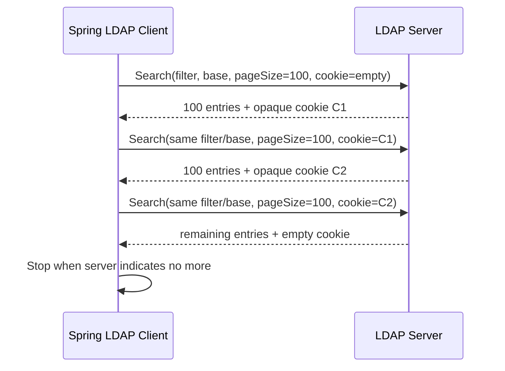
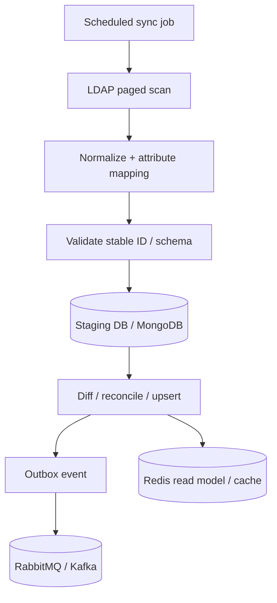
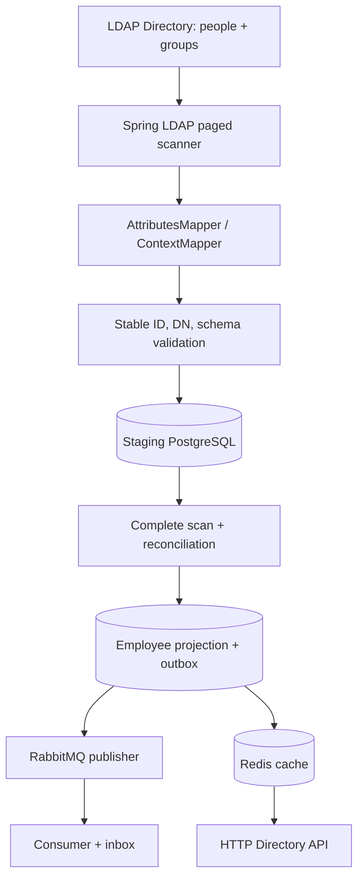

# Attribute Mapping, Search Filters, and Pagination

## 1. Why Are LDAP Mapping and Querying an Integration Contract?

In the **SPRING_BOOT_INTEGRATION** module, Spring Boot connects HTTP clients, databases, caches, brokers, and Spring Integration adapters. **LDAP** (Lightweight Directory Access Protocol) commonly appears when a service needs to read employee accounts, organizational units, permission groups, or contact information from Active Directory, OpenLDAP, or a corporate directory. A typical integration flow looks like:

```text
GET /api/directory/users?name=an&pageSize=50
          |
          v
DirectoryService
          |
          v
Spring LDAP / LdapTemplate
    - base DN
    - search scope
    - filter
    - returning attributes
    - size/time limit
          |
          v
LDAP server (AD / OpenLDAP)
          |
          v
AttributesMapper / ContextMapper
          |
          v
DirectoryUser DTO
          |
          +--> HTTP JSON response
          +--> Redis cache / local projection
          +--> broker event / sync job
```

Along this path, three distinct questions are easily conflated:

1. **Attribute mapping:** An LDAP entry has `uid`, `cn`, `mail`, `memberOf`; which Java DTO types are needed, which values should be extracted, and how are lists preserved?
2. **Search filters:** How should `objectClass`, `uid`, `cn`, OU, and attribute predicates be combined so the server finds the right people without introducing LDAP injection?
3. **Pagination:** How do you read 10,000 entries across bounded requests without loading everything into memory or mistaking an LDAP cookie for an HTTP pagination offset/token?

This lesson focuses on **"Attribute Mapping, Search Filters, and Pagination"** in the **LDAP and Directories** chapter. Examples use **Spring Boot 3.x, Spring LDAP 3.x, Java 17+**, with LDAPv3. Some pagination classes in newer Spring LDAP branches have different names; this lesson uses `PagedResultsDirContextProcessor` documented in Spring LDAP 3.3.x and advises checking the exact API for your project version.

**Overarching principle:** An LDAP directory is a data source with its own schema, access permissions, and query limits; `LdapTemplate.search` does not carry the meaning "user authenticated," nor does it provide durable offset pagination like SQL.

## 2. LDAP Entries, DNs, RDNs, Attributes, and Schemas

LDAP stores data in a **Directory Information Tree (DIT)**. Each entry has a **distinguished name (DN)** identifying its location in the tree, along with attributes governed by the server's schema.

```text
dc=example,dc=org
├── ou=people
│   ├── uid=alice
│   └── uid=bob
└── ou=groups
    ├── cn=developers
    └── cn=operators
```

An illustrative LDIF entry:

```ldif
dn: uid=alice,ou=people,dc=example,dc=org
objectClass: top
objectClass: person
objectClass: organizationalPerson
objectClass: inetOrgPerson
uid: alice
cn: Alice Nguyen
sn: Nguyen
givenName: Alice
mail: alice@example.org
mail: a.nguyen@example.org
departmentNumber: ENG-01
```

| Concept | Meaning | Example |
| --- | --- | --- |
| DN | Full name of the entry in the tree | `uid=alice,ou=people,dc=example,dc=org` |
| RDN | Relative name component of the entry | `uid=alice` |
| Base DN | Configured root for queries/binds | `dc=example,dc=org` |
| Search base | Node where searching begins | `ou=people` |
| Attribute | Schema field | `cn`, `uid`, `mail` |
| Multi-valued attribute | One attribute holding multiple values | Two `mail` addresses |
| Object class | Defines entry type and allowed/required attributes | `inetOrgPerson` |
| Attribute syntax | Type/comparison rules per schema | Directory String, DN, Octet String |

**Never confuse a DN with an absolutely immutable ID.** A DN can change when a user moves OUs or is renamed; stable identifiers must be chosen per directory contract, such as `entryUUID` in some OpenLDAP setups or binary `objectGUID` in Active Directory. These attributes **do not exist identically across all LDAP servers**.

### 2.1. Directory Schema Differs from JSON Schema

LDAP attributes can be single-valued or multi-valued, have matching rules for case-insensitive/equality/substring comparisons, and may be restricted by ACLs. An entry missing `mail` could mean read permission was denied, the field is unset, or it does not belong to the expected object class. Do not always interpret missing attributes as empty strings.

A `memberOf` field is typically a derived/vendor-specific attribute in Active Directory or certain directory configurations; **not every LDAP server provides it**. When modeling groups, verify whether the server stores `member`, `uniqueMember`, `memberUid`, or computed memberships.

## 3. Initializing Spring LDAP in Spring Boot

Maven dependency for the imperative model:

```xml
<dependency>
    <groupId>org.springframework.boot</groupId>
    <artifactId>spring-boot-starter-data-ldap</artifactId>
</dependency>
```

The Spring Boot starter supports configuring and integrating Spring LDAP/Spring Data LDAP on the classpath. It **does not run an LDAP server**, nor does it configure application authentication automatically. If LDAP user authentication is needed, design Spring Security bind/search flows separately instead of treating a directory search as proof of login.

Illustrative configuration:

```yaml
spring:
  ldap:
    urls:
      - ${LDAP_URL:ldaps://ldap.example.org:636}
    base: dc=example,dc=org
    username: ${LDAP_BIND_DN:cn=directory-reader,ou=service-accounts,dc=example,dc=org}
    password: ${LDAP_BIND_PASSWORD}
```

Property names `spring.ldap.urls`, `base`, `username`, `password` are the standard Spring Boot 3.x configuration group. Inspect environment variables, profile overrides, and any custom `ContextSource`/`LdapTemplate` beans.

**Production security requirements:** use LDAPS or properly configured StartTLS with **certificate verification**, never simple bind sending passwords over plaintext LDAP. The bind account must only have read access to needed OUs/attributes—never use an admin DN for user lookup features. Supply secrets via a secret manager, never in code, URL logs, or exceptions. Connections/searches must have appropriate timeouts and load limits.

### 3.1. Base DN and Search Base Are Two Different Scopes

With:

```yaml
spring:
  ldap:
    base: dc=example,dc=org
```

and a call to `search("ou=people", ...)`, the search base is interpreted relative to the configured base, targeting `ou=people,dc=example,dc=org` via `ContextSource`.

Adding the full suffix to every search base when the context already has a base can produce a duplicated DN. When configuring multiple LDAP directories/contexts, explicitly decide whether bases are relative or absolute and write tests for DN resolution.

### 3.2. LDAP Read Account and LDAP Authentication Are Two Different Responsibilities

- **Read/query:** the application uses a service bind account to read allowed attributes.
- **Authentication:** verifies user credentials via mechanisms supported by the directory/Spring Security alongside account lockout and MFA/SSO policies.
- **Authorization:** the application uses trusted claims/role mappings and enforces group membership per policy.

**Finding an entry with `(uid=alice)` does not prove the caller is Alice.** Never read or compare passwords from directory attributes to build custom login logic.

## 4. AttributesMapper: Mapping Returned Attributes

Spring LDAP `LdapTemplate` accepts an `AttributesMapper<T>` to transform each `javax.naming.directory.Attributes` into a DTO.

A DTO containing only what the internal API needs:

```java
package example.integration.directory;

import java.util.List;

public record DirectoryUser(
    String uid,
    String displayName,
    String primaryMail,
    List<String> mailAddresses
) {}
```

Mapper handling missing and multi-valued attributes:

```java
package example.integration.directory;

import java.util.ArrayList;
import java.util.List;
import javax.naming.NamingEnumeration;
import javax.naming.NamingException;
import javax.naming.directory.Attribute;
import javax.naming.directory.Attributes;

import org.springframework.ldap.core.AttributesMapper;

public class DirectoryUserAttributesMapper
        implements AttributesMapper<DirectoryUser> {

    @Override
    public DirectoryUser mapFromAttributes(Attributes attributes)
            throws NamingException {

        String uid = firstString(attributes, "uid");
        String cn = firstString(attributes, "cn");
        List<String> mails = stringValues(attributes, "mail");

        String primaryMail =
            mails.isEmpty() ? null : mails.get(0);

        return new DirectoryUser(
            uid, cn, primaryMail, mails
        );
    }

    private static String firstString(
            Attributes attributes, String name)
            throws NamingException {

        Attribute attribute = attributes.get(name);

        if (attribute == null || attribute.size() == 0) {
            return null;
        }

        Object value = attribute.get();

        return value instanceof String text ? text : null;
    }

    private static List<String> stringValues(
            Attributes attributes, String name)
            throws NamingException {

        Attribute attribute = attributes.get(name);

        if (attribute == null) {
            return List.of();
        }

        List<String> values = new ArrayList<>();
        NamingEnumeration<?> enumeration = attribute.getAll();

        try {
            while (enumeration.hasMore()) {
                Object value = enumeration.next();

                if (value instanceof String text) {
                    values.add(text);
                }
            }
        } finally {
            enumeration.close();
        }

        return List.copyOf(values);
    }
}
```

**Note on ordering:** LDAP multi-valued attributes generally **do not guarantee a stable business order**. In the example above, `primaryMail = mails.get(0)` is merely an illustrative read choice, **not an accurate policy for determining primary email**. If a primary email is needed, the directory contract must specify a dedicated attribute or rule; never rely on `NamingEnumeration` order.

### 4.1. Distinguishing Missing, Empty, and Access Denied

`attributes.get("mail") == null` may occur because the entry lacks the attribute, an ACL blocks reading it, or the query requested a projection omitting `mail`. The mapper itself cannot tell the reason.

| Situation | What the Mapper Sees | Behavior to Define |
| --- | --- | --- |
| Entry has no `mail` | Null attribute | May return optional or raise business validation error |
| Search did not request `mail` | Null attribute | Fix projection if needed |
| ACL hides `mail` | Null attribute or varies by server | Check service account permissions |
| `mail` has two values | Attribute with 2 values | Preserve List, do not pick arbitrarily |
| Binary value | `byte[]` or non-String type | Dedicated converter with size limits |
| Schema forbids attribute | Directory error on write | Do not add non-schema attributes |

**Never log the entire `Attributes` object** on mapping failure; it may contain sensitive data such as account status, emails, phone numbers, or internal identifiers.

## 5. ContextMapper and DirContextAdapter: When the DN Is Also Needed

`AttributesMapper` receives attributes without conveniently providing the entry's **DN**. When you need the DN for identification, caching, auditing, or group linking, use `ContextMapper<T>` with `DirContextOperations`/`DirContextAdapter`.

```java
package example.integration.directory;

import java.util.Arrays;
import java.util.List;

import org.springframework.ldap.core.ContextMapper;
import org.springframework.ldap.core.DirContextOperations;

public record DirectoryEntryView(
    String relativeDn,
    String uid,
    String commonName,
    List<String> mails
) {}

public class DirectoryEntryContextMapper
        implements ContextMapper<DirectoryEntryView> {

    @Override
    public DirectoryEntryView mapFromContext(Object object) {
        DirContextOperations context =
            (DirContextOperations) object;

        String[] mails =
            context.getStringAttributes("mail");

        return new DirectoryEntryView(
            context.getDn().toString(),
            context.getStringAttribute("uid"),
            context.getStringAttribute("cn"),
            mails == null
                ? List.of()
                : List.copyOf(Arrays.asList(mails))
        );
    }
}
```

**Important DN semantics:** `context.getDn()` in Spring LDAP is typically a DN **relative to the context source's base path**, not the absolute DN string with the full `dc=...` suffix. When a global identifier is needed, use appropriate APIs and compose the base exactly once; never concatenate raw strings and accidentally duplicate the suffix or skip escaping.

### 5.1. A DN Is Not Equivalent to an HTTP-Safe ID

DNs contain commas, equals signs, plus signs, spaces, and characters requiring escaping under **LDAP DN syntax (RFC 4514)**. For example, a `cn` with a comma may require escaping in the DN. Never place raw DNs directly into URL paths or split DNs with `String.split(",")`; use `javax.naming.ldap.LdapName`, `Rdn`, or `LdapNameBuilder`.

```java
import javax.naming.Name;
import org.springframework.ldap.support.LdapNameBuilder;

Name relativeDn = LdapNameBuilder.newInstance()
    .add("ou", "people")
    .add("uid", "alice")
    .build();
```

The builder handles DN semantics better than concatenating `"uid=" + value + ",ou=people"` when values contain special characters. However, this **does not escape LDAP search filters**; filters and DNs follow different rules.

## 6. Object-Directory Mapping (ODM) with @Entry and @Attribute

When the directory model is stable, Spring LDAP ODM can map entries into annotated classes instead of writing manual mappers for every query.

```java
package example.integration.directory;

import javax.naming.Name;

import org.springframework.ldap.odm.annotations.Attribute;
import org.springframework.ldap.odm.annotations.Entry;
import org.springframework.ldap.odm.annotations.Id;

@Entry(
    base = "ou=people",
    objectClasses = {
        "top",
        "person",
        "organizationalPerson",
        "inetOrgPerson"
    }
)
public class PersonEntry {

    @Id
    private Name dn;

    @Attribute(name = "uid")
    private String uid;

    @Attribute(name = "cn")
    private String commonName;

    @Attribute(name = "sn")
    private String surname;

    @Attribute(name = "mail")
    private String mail;

    protected PersonEntry() {}

    public Name getDn() { return dn; }
    public String getUid() { return uid; }
    public String getCommonName() { return commonName; }
    public String getSurname() { return surname; }
    public String getMail() { return mail; }
}
```

`@Entry` declares the object classes/base; `@Id` represents the entry DN with `Name`; `@Attribute` maps the attribute name to a property. If `mail` has multiple values, a single String may lose data or fail mapping; the model must reflect the **directory's actual schema** and use case.

| Option | Best Fit | Limitations |
| --- | --- | --- |
| `AttributesMapper` | Small projections, reading a few fields, custom queries | Does not automatically carry the DN |
| `ContextMapper` | Needs DN and adapter methods | Still involves mapping code |
| ODM `@Entry` | Stable directory schema, entity-like model | Can tightly couple the Java model to vendor/schema |
| Raw JNDI | Fine control over request controls/server specifics | High boilerplate and resource management |
| Sync to DB projection | Search/paging in high-load APIs | Eventual consistency, migrations, and reconciliation |

**Never treat ODM as a promise that LDAP has JPA-like transaction/ORM semantics.** Directory schemas, DNs, renames, multi-value modifications, and server-specific controls have distinct behaviors.

### 6.1. Never Expose a Directory Entry Directly as Public JSON

A directory entry may contain internal data or unexpected schema extensions. Map to an allowlisted **DirectoryUser DTO**. Just because a JSON serializer can serialize a Java class does not mean all its attributes should be public.

## 7. LDAP Search: Base, Scope, Filter, and Attributes

An LDAP search call has several independent parameters:

| Search Part | Function | Example |
| --- | --- | --- |
| Base DN | Which subtree to start from | `ou=people` |
| Scope | BASE, ONELEVEL, SUBTREE | `SearchScope.SUBTREE` |
| Filter | Conditions an entry must satisfy | `(&(objectClass=person)(uid=alice))` |
| Projection | Return only needed attributes | `uid`, `cn`, `mail` |
| Count limit | Caps entries in a search | 100 |
| Time limit | Server search time limit | 3,000 ms |
| Server controls | Adds paging/sorting when supported | RFC 2696 paged results |

Example finding users by UID with the Spring LDAP query builder:

```java
package example.integration.directory;

import java.util.List;

import org.springframework.ldap.core.LdapTemplate;
import org.springframework.ldap.query.LdapQuery;
import org.springframework.ldap.query.SearchScope;

import static org.springframework.ldap.query.LdapQueryBuilder.query;

public class DirectoryLookupService {

    private final LdapTemplate ldap;

    public DirectoryLookupService(LdapTemplate ldap) {
        this.ldap = ldap;
    }

    public List<DirectoryUser> findByUid(String uid) {
        if (uid == null || uid.isBlank()) {
            throw new IllegalArgumentException("uid is required");
        }

        LdapQuery search = query()
            .base("ou=people")
            .searchScope(SearchScope.SUBTREE)
            .attributes("uid", "cn", "mail")
            .countLimit(20)
            .timeLimit(3000)
            .where("objectClass").is("inetOrgPerson")
            .and("uid").is(uid);

        return ldap.search(
            search,
            new DirectoryUserAttributesMapper()
        );
    }
}
```

`SearchScope` belongs to the Spring LDAP query API, whereas `javax.naming.directory.SearchControls` has constants `OBJECT_SCOPE`, `ONELEVEL_SCOPE`, `SUBTREE_SCOPE`. Avoid mixing up the enums/constants in the same signature.

### 7.1. Scope Affects Correctness and Server Load

```text
ou=people,dc=example,dc=org
├── uid=alice
└── ou=contractors
    └── uid=bob
```

- **BASE:** checks only the entry at the search base if it matches the filter.
- **ONELEVEL:** searches **direct child** entries under the base, without descending deeper.
- **SUBTREE:** searches both the base and all accessible descendants.

Searching `ou=people` with ONELEVEL will omit `uid=bob` under `ou=contractors`. Using SUBTREE at the entire company root is expensive and risks pulling in OUs outside the intended data scope.

### 7.2. Returning Fewer Attributes Reduces Risk and Cost

`attributes("uid","cn","mail")` avoids fetching entire entries that can be huge, including group memberships, certificates, binary photos, and sensitive attributes. However, attribute filtering does not replace server-side ACLs.

A directory may enforce size/time limits regardless of client requests; setting a count limit higher than the server cap does not mean the server will allow it.

## 8. LDAP Filter Syntax per RFC 4515

LDAP filters use parenthesized prefix expressions, not SQL `WHERE` or full regex.

| Filter | Meaning |
| --- | --- |
| `(uid=alice)` | Equality on `uid` |
| `(mail=*)` | Presence of `mail` attribute |
| `(cn=Ali*)` | Substring prefix, depending on matching rule |
| `(&(objectClass=person)(uid=alice))` | AND |
| `(\|(uid=alice)(mail=alice@example.org))` | OR |
| `(!(accountStatus=disabled))` | NOT |
| `(employeeNumber>=1000)` | Greater-or-equal per attribute's matching rule |

**How a filter matches depends on schema/matching rules**. LDAP equality on `cn` may be case-insensitive, yet you must not assume every attribute behaves identically. Substring wildcard `*` is not SQL `%`. Filters do not automatically join group trees or resolve nested group memberships.

### 8.1. Special Characters Must Be Escaped in Filter Values

RFC 4515 defines key characters:

| Character in Data | Escaped Representation |
| --- | --- |
| `*` | `\2a` |
| `(` | `\28` |
| `)` | `\29` |
| Backslash `\` | `\5c` |
| NUL | `\00` |

Example user input:

```text
alice*)(|(uid=*))
```

If concatenated straight into:

```java
String unsafe = "(uid=" + userInput + ")";
```

the actual filter can change query structure or fail parsing. **Never concatenate raw user input into an LDAP filter.** Use query builders, filter objects, or Spring LDAP's parameterized filter format, while still bounding base/scope/size.

### 8.2. Filter Escaping Differs from DN Escaping

- RFC **4515**: encoding values in **search filters**.
- RFC **4514**: representation/escaping of **distinguished names**.
- URL percent-encoding: for HTTP URIs.

Applying one escaping scheme in the wrong context can produce invalid filters or bypass validation. Data from HTTP queries is neither a DN nor a filter yet; the service must pass it through the appropriate builder API.

## 9. Building Filters Safely with LdapQueryBuilder and Filter Objects

The **recommended** pattern for user input is the builder API:

```java
import org.springframework.ldap.query.LdapQuery;
import static org.springframework.ldap.query.LdapQueryBuilder.query;

LdapQuery search = query()
    .base("ou=people")
    .attributes("uid", "cn", "mail")
    .where("objectClass").is("inetOrgPerson")
    .and("uid").is(userInput);
```

`is(userInput)` is an equality condition; the builder API handles filter value encoding per Spring LDAP's contract. Ensure **attribute names are selected from code/an allowlist**, never letting users supply `attributeName` directly into `where(attributeName)`.

For complex expressions, use `Filter` objects:

```java
import org.springframework.ldap.filter.AndFilter;
import org.springframework.ldap.filter.EqualsFilter;
import org.springframework.ldap.filter.Filter;

Filter filter = new AndFilter()
    .and(new EqualsFilter("objectClass", "inetOrgPerson"))
    .and(new EqualsFilter("uid", userInput));

String encodedFilter = filter.encode();
```

In this code, `EqualsFilter` accepts raw data values and handles context-appropriate encoding. Never pre-encode `userInput` before passing it to an encoding API and accidentally double-escape it.

### 9.1. Parameterized Filters for Fixed Structures

```java
LdapQuery search = query()
    .base("ou=people")
    .filter(
        "(&(objectClass=inetOrgPerson)(uid={0}))",
        userInput
    );
```

The `filter(String format, Object... params)` overload encodes parameters (Spring LDAP applies filter encoding before substituting into the format). **Never pass concatenated untrusted input to `filter(String hardcodedFilter)`**, because the raw filter overload does not escape.

### 9.2. Prefix Searches and Wildcards Must Have Explicit Policies

A UI might need to search names starting with "Al". Use a fixed-template filter:

```java
LdapQuery search = query()
    .base("ou=people")
    .filter(
        "(&(objectClass=inetOrgPerson)(cn={0}*))",
        prefixFromUser
    );
```

Here `*` is a **backend-controlled wildcard**, while `{0}` is the user input portion to escape. A user entering `Al*` is treated as literal value `Al*` in the parameter, not expanded into an arbitrary pattern. Enforce minimum prefix length, bounded search base, and result limits. Substring/prefix searches can be very expensive if the attribute lacks an appropriate index or matching rule optimization.

Never let callers send arbitrary raw LDAP filters unless it is a strictly authorized administrative tool.

## 10. Combining Conditions and Avoiding Turning Searches into Authorization

Conditions using OR/AND/NOT can be safely combined via Spring LDAP builders/filter objects. A realistic query:

```text
(&(objectClass=inetOrgPerson)
  (departmentNumber=ENG-01)
  (mail=*))
```

Explanation:

- Only user entries of the matching object class.
- Belonging to the ENGINEERING department.
- Having at least one email address.

**Never infer from `departmentNumber=ENG-01` that the caller is allowed to read everyone in that department.** LDAP server ACLs and service authorization must still be enforced. Similarly, reading `memberOf` does not imply all nested groups, deny policies, or role mappings are satisfied.

### 10.1. Incorrect OR Combinations Can Make Searches Too Broad

Logically wrong:

```text
(|(objectClass=inetOrgPerson)(uid=alice))
```

This filter can return **every** `inetOrgPerson`, not just Alice. If the intent is "is a person AND uid equals Alice," you must use AND:

```text
(&(objectClass=inetOrgPerson)(uid=alice))
```

Thus, preventing LDAP injection is not just character escaping. A structurally flawed hardcoded expression can also expose an unintendedly broad result set.

### 10.2. Email Attributes Are Not Necessarily Unique

Searching `(mail=alice@example.org)` can return multiple entries if the server lacks a uniqueness rule or the directory contains dirty data. Use `search(...)` and handle the list; if business rules expect exactly one person, explicitly check `0`, `1`, `>1` rather than calling `list.get(0)` and assuming order/uniqueness.

## 11. Limiting Queries: SearchControls, Scope, Size, and Time

For queries requiring JNDI-level tuning, use `SearchControls`.

```java
import javax.naming.directory.SearchControls;

SearchControls controls = new SearchControls();
controls.setSearchScope(SearchControls.SUBTREE_SCOPE);
controls.setReturningAttributes(
    new String[] { "uid", "cn", "mail" }
);
controls.setCountLimit(250);
controls.setTimeLimit(3000);
```

Meaning:

- `setReturningAttributes`: projects only needed attributes.
- `setCountLimit(250)`: caps entries for the search operation per JNDI/LDAP server semantics—**not the RFC 2696 page size**.
- `setTimeLimit(3000)`: search time limit in milliseconds per the API—**not the total deadline for the HTTP request plus retries**.
- `setSearchScope`: BASE/ONELEVEL/SUBTREE scope.

These limits may also be constrained by server-side size/time caps, ACLs, referral policies, and network latency. **A search hitting a size limit does not mean full data was returned**. The application must distinguish "no results," "truncated due to limit," and "directory error."

### 11.1. Distinguishing Connection Timeouts from Search Time Limits

- Connect timeout: opening the LDAP/LDAPS connection.
- Read/socket timeout: waiting for I/O after connecting.
- Search time limit: operation execution limit per API/server.
- Business deadline: total duration of the HTTP request or sync job with downstream steps.

JNDI environment timeouts can be configured via Spring LDAP `ContextSource` or driver/client settings; **do not set only `timeLimit` expecting hung sockets to always abort on time**. In batch/sync jobs, timeouts also require cleanup and bounded retries.

## 12. LDAP Pagination: RFC 2696 Simple Paged Results

Many directory servers enforce a default max result count. For instance, a query returning tens of thousands of users could exceed the entry cap or exhaust application memory. **Simple Paged Results Control (RFC 2696)** lets clients request results page by page.

Interaction:



**The cookie is opaque state returned by the LDAP server**, not a page number or offset computed by the application. The client must send the exact cookie back within the matching query sequence. Never parse/modify cookie bytes, reuse a cookie with a different query, or mistake it for an idempotency token.

### 12.1. Important Limitations

| Common Misconception | Reality |
| --- | --- |
| `pageSize=100` guarantees always getting 100 entries | Server may return fewer due to data/limits |
| Page 3 equals `OFFSET 200` | LDAP cookies are not SQL offsets |
| Can jump to any arbitrary page with a cursor | RFC 2696 mainly iterates sequentially using cookies |
| Cookies can be stored across days | No such guarantee |
| Cookies work across any connection | Spring LDAP 3.x requires holding the same LDAP context/connection across the sequence of calls |
| Paged results automatically sort stably | No; sorting is a separate control/mechanism |
| Paged results are a transactional snapshot | Not by default; directory mutations can affect results |
| Having a cookie gives an exact total entry count | Server may return only an estimate or nothing |

### 12.2. Paged Search Differs from countLimit

Never replace pagination with:

```java
controls.setCountLimit(100);
```

and calling search 10 times. Without a cookie/state, repeated queries usually return **the same initial batch of entries** (or an unstable subset), not 10 consecutive pages. `setCountLimit` is a search/size cap; `PagedResultsDirContextProcessor` implements RFC 2696 server-side paging.

---

## 13. Paginating with PagedResultsDirContextProcessor and SingleContextSource

Spring LDAP 3.x provides `org.springframework.ldap.control.PagedResultsDirContextProcessor`, which performs pre/post-processing for the RFC 2696 search control. **Crucial detail:** a sequence of requests using a paged-results cookie must keep **the same LDAP connection/context** per Spring LDAP's design. Standard `LdapTemplate` acquires and closes a context per operation, so calling `ldapTemplate.search(...)` separately via a pool can invalidate the cookie.

Spring LDAP provides `SingleContextSource.doWithSingleContext(...)` to reuse the same context throughout the callback.

### 13.1. Example Iterating by Page Without Accumulating the Entire Directory in One Large List

```java
package example.integration.directory;

import java.util.List;
import java.util.function.Consumer;
import javax.naming.directory.SearchControls;

import org.springframework.ldap.control.PagedResultsDirContextProcessor;
import org.springframework.ldap.core.ContextSource;
import org.springframework.ldap.core.support.SingleContextSource;
import org.springframework.stereotype.Service;

@Service
public class DirectoryPagedScanner {

    private static final int PAGE_SIZE = 100;
    private static final int MAX_PAGES = 100;

    private final ContextSource contextSource;
    private final DirectoryUserAttributesMapper mapper =
        new DirectoryUserAttributesMapper();

    public DirectoryPagedScanner(ContextSource contextSource) {
        this.contextSource = contextSource;
    }

    public record ScanSummary(int pages, long entries) {}

    public ScanSummary scan(
            Consumer<List<DirectoryUser>> onPage) {

        if (onPage == null) {
            throw new IllegalArgumentException(
                "onPage callback is required"
            );
        }

        return SingleContextSource.doWithSingleContext(
            contextSource,
            operations -> {

                SearchControls controls = new SearchControls();
                controls.setSearchScope(
                    SearchControls.SUBTREE_SCOPE
                );
                controls.setReturningAttributes(
                    new String[] { "uid", "cn", "mail" }
                );
                controls.setTimeLimit(3000);

                PagedResultsDirContextProcessor processor =
                    new PagedResultsDirContextProcessor(PAGE_SIZE);

                int pages = 0;
                long entries = 0;

                do {
                    if (pages >= MAX_PAGES) {
                        throw new IllegalStateException(
                            "LDAP paging safety limit reached"
                        );
                    }

                    List<DirectoryUser> page = operations.search(
                        "ou=people",
                        "(&(objectClass=inetOrgPerson)(uid=*))",
                        controls,
                        mapper,
                        processor
                    );

                    onPage.accept(List.copyOf(page));

                    pages++;
                    entries += page.size();
                } while (processor.hasMore());

                return new ScanSummary(pages, entries);
            }
        );
    }
}
```

**Exact meaning of the example:**

- `PagedResultsDirContextProcessor` is **created per scan run**, never shared as a singleton across requests/threads.
- `SingleContextSource` holds the **same context** across `operations.search` calls and releases it after the callback.
- `processor.hasMore()` relies on the server response/cookie, not guessing via `page.size() == PAGE_SIZE`.
- `MAX_PAGES` is an application safety cap; exceeding it means the **scan is incomplete**, so never report success or delete unseen records.
- `onPage` receives one batch at a time to process, avoiding retaining all entries in memory.
- `SearchControls` specifies scope, projection, and time limit. Never set `countLimit` below the total entries to scan under the false assumption it acts as page size.
- If the LDAP server does not support the paged control, the request may fail; **never silently fall back to an unbounded full search**.

This is a technical example for Spring LDAP 3.x. Newer Spring LDAP lines may introduce classes like `PagedResultsControlExchangeDirContextProcessor`; use the class name matching your actual dependency rather than mixing APIs across major versions.

### 13.2. Avoid Holding the Connection Throughout Heavy Processing During a Scan

The `onPage` callback executes **inside** the lifecycle of an LDAP context. If each page calls 10 downstream APIs, sleeps for 5 minutes, or commits a massive DB transaction, the LDAP connection stays occupied and the cookie may expire or be dropped by the server. With concurrent scans, the connection pool gets exhausted.

Options:

1. Keep `onPage` short, handling projection/staging batch writes with clear timeouts.
2. Cap concurrent scans, page counts, and total duration.
3. Decouple scanning (reading directory) from heavy business processing via an internal queue with bounded capacity/backpressure.
4. If crash resumption across hours is required, **never use the cookie as a durable checkpoint**; store job state and keys/versions in a controlled store.

### 13.3. A Cookie Must Never Be Stored as a Business Key

A cookie received from the server contains opaque bytes tied to current search state and connection. Do not store it as `lastProcessedUserId`, expose it in client-editable URLs, log raw cookies, or reuse it with a different filter/search base.

If the directory changes mid-scan, a simple paged search **does not automatically provide snapshot isolation**. Use deduplication by stable identifier and reconciliation, especially on job replays.

## 14. Paged Search Differs from Sorting, Virtual Lists, and API Page Numbers

Many HTTP APIs allow:

```http
GET /users?page=8&size=50&sort=name
```

However, LDAP Simple Paged Results **do not provide offset/random access**. An API needing to jump straight to page 8 requires another mechanism:

- **Server-Side Sorting Control (RFC 2891):** the server sorts by supported attributes if enabled and permitted.
- **Virtual List View (VLV):** server/deployment-specific capability, not supported by every LDAP directory.
- **Application-materialized projection:** sync the directory to a database/search index and paginate with keyset/offset per HTTP contract.
- **Cursor within a scoped session:** viable in some architectures but requires strict connection affinity, lifecycle, resource limits, and security.

**Never expose an API taking `page=8` and loop through eight paged LDAP searches per user request** under heavy load, because cost scales linearly with page number and snapshots are unstable.

### 14.1. Why Returning Raw LDAP Cookies in HTTP nextToken Is Often Dangerous

- Clients may replay the token with a different filter/base.
- A subsequent HTTP request may hit another instance using a different LDAP connection.
- Base64-encoding a cookie **is not security encryption**.
- The server may expire the cookie or drop state.
- The token may inadvertently leak internal server-side control data.
- Cursors do not by themselves prevent account enumeration.

If building a cursor API is unavoidable, introduce a secure session management layer, bind tokens to caller/filter/scope/expiry, prevent callers from controlling server cookies, enforce rate/capacity limits, and handle expiration. For long-lived user listings/dashboards, a DB projection with cache TTL/invalidation and a data freshness indicator is usually easier to operate.

### 14.2. Sorting Does Not Automatically Provide Snapshot Isolation

Even if the server supports sorting by `cn`, multiple entries can share the same `cn`, or `cn` can change when a user is renamed. For stable pagination, use a **tie-breaker** on a stable ID and explicit semantics for mid-view mutations. Do not assume sort-by-name + RFC 2696 guarantees no duplicates or omissions.

## 15. Active Directory, OpenLDAP, and Key Differences

A common LDAP protocol does not make two server vendors share identical schemas, ACLs, and controls.

| Topic | Common in OpenLDAP | Common in Active Directory |
| --- | --- | --- |
| User identifier | `uid`/`entryUUID` per schema | `sAMAccountName`, `userPrincipalName`, `objectGUID` |
| Group membership | `member`/`uniqueMember`/`memberUid` per object class | `member` and often `memberOf` |
| Stable ID | `entryUUID` where configured | Binary `objectGUID` |
| Change tracking | Sync/operational attributes per config | DirSync/USN-related semantics per permissions |
| Paged results | Verify server control support | Widely used, still subject to server limits |
| Large multi-valued attributes | Depends on schema/server | Some attributes require range retrieval |
| Referrals/forests | Depends on directory topology | May involve domain/forest referrals |

**`memberOf` is not a portable authorization API.** Some systems use nested groups, dynamic groups, deny rules, or external group memberships. Define group-to-role mappings backed by tests against your real directory.

### 15.1. AD Range Retrieval Differs from RFC 2696 Paging

Active Directory may return large multi-valued attribute sets (such as `member`) using attribute names like `member;range=0-1499`, requiring the client to request subsequent ranges. This is **attribute value range retrieval**, distinct from paging across **entries** with Simple Paged Results.

For example, a single group with 10,000 members: even though a paged search with `pageSize=100` returns **one group entry**, the `member` values may still be split by range. Never check only for the literal `"member"` attribute and conclude a group is empty when the server returned `member;range=...`.

### 15.2. Binary Identifiers

AD's `objectGUID` is binary. Converting raw bytes with `new String(bytes, UTF_8)` corrupts the ID. Use a converter understanding vendor representation and test round-trips with your library/encoding. When exposing it via an HTTP API, standardize one canonical String representation and keep it invariant across Java driver upgrades.

### 15.3. Referrals and Partial Results

In distributed directories, searches may encounter referrals to other domains/partitions. JNDI/Spring LDAP configurations offer options to ignore/chase referrals; every choice impacts completeness and permissions.

Never catch `PartialResultException` and return the list as if complete. If the system only queries the local domain, **state the scope and partial status explicitly**. If forest-wide results are required, design explicit referral/trust/credential policies and load limits.

## 16. Do Not Treat LDAP Search as a Snapshot Source for Bulk Sync

Suppose a Spring Batch/Spring Integration poller syncs employees nightly:



### 16.1. Source of Durable IDs

Avoid using DN as the sole primary key if entries can move/rename. Select an identity attribute appropriate to the server and lifecycle preservation policies—for instance `entryUUID` or `objectGUID` when available and readable. If the directory guarantees `uid` only per organization, document uniqueness and rename policies explicitly.

### 16.2. Upserting by ID and Version

A job may rerun when:

- An LDAP page fails near the end.
- The JVM crashes after writing the DB but before saving a checkpoint.
- The broker receives an event while the publisher loses the confirm.
- A directory entry mutates mid-scan.

Use **idempotent upserts** into the projection table/collection keyed by stable ID; emit events only when actual changes are detected using an explicit version/fingerprint. Never generate arbitrary new event IDs on retry of the same logical update.

### 16.3. Never Delete Records Simply Because They Were Missed in a Failed Scan

If the LDAP server returns a size limit, partial referral, cookie error, or timeout on the last page, the returned entries are incomplete. Applying "delete anyone not seen" at that point could wipe out thousands of valid employees.

A safer strategy:

1. Record a scan ID with status `RUNNING`.
2. Write upserts into staging tagged with the scan ID.
3. Only after **all pages succeed and completeness is verified per contract**, mark `COMPLETED`.
4. Run reconciliation comparing the completed staging snapshot with current projections, guarded by anomaly thresholds on deletions.
5. Distinguish disabled/removed/moved in the directory per owner contract.

### 16.4. Incremental Sync Is a Separate Problem

RFC 2696 only paginates a **full search**; it is not change-data-capture.

- `modifyTimestamp>=...` can help in some schemas, yet is prone to timestamp ties, precision issues, renames/deletes, and clock skew.
- LDAP Sync/DirSync/change tracking are server-specific extensions requiring dedicated permissions and state.
- When entries are deleted, full listings detect them via reconciliation; timestamp-based incremental queries alone do not inherently emit tombstones.

Never turn a paged cookie into a long-term checkpoint for an incremental sync job. Build checkpoints around server-supported change-tracking protocols or business snapshots.

## 17. Caching and HTTP APIs: Protecting Directory Data

An HTTP HR lookup endpoint may query LDAP directly:

```http
GET /api/directory/users?uid=alice HTTP/1.1
Authorization: Bearer <redacted>
```

The response must use an allowlist, for example:

```json
{
  "uid": "alice",
  "displayName": "Alice Nguyen",
  "emails": [
    "alice@example.org"
  ]
}
```

Never include LDAP bind passwords, raw controls, account lock flags, private phone numbers, or full group memberships when callers are unauthorized. Authenticated callers must have explicit authorization to look up directory entries; apply rate limiting to mitigate **user enumeration**.

### 17.1. Cache Keys and Invalidation

If using a Redis cache:

```text
directory:user:v1:stable-id-123
```

can be more stable than caching by DN when users move OUs. However, TTLs and invalidation must reflect consistency requirements. If group membership drives authorization, **never use a stale profile cache to grant sensitive permissions**. Identity caches and authorization caches have distinct freshness/deadline policies.

### 17.2. Dynamic Search Bases Are a Dangerous Surface

Never allow HTTP inputs like:

```text
?base=dc=example,dc=org&filter=(objectClass=*)
```

to flow directly into `LdapTemplate.search`. Instead, let clients pick **well-defined actions**, such as `department=ENGINEERING`, and have the backend map them to an allowlisted base/scope/filter. LDAP query builders only escape **values**; they do not define query authorization policies.

## 18. Testing Filters, Mappers, and Pagination

A test that only mocks `LdapTemplate` to return `DirectoryUser` tests neither escaping nor LDAP server controls. Multiple test layers are needed:

### 18.1. Unit Testing AttributesMapper with BasicAttributes

```java
package example.integration.directory;

import static org.assertj.core.api.Assertions.assertThat;

import javax.naming.directory.BasicAttribute;
import javax.naming.directory.BasicAttributes;
import org.junit.jupiter.api.Test;

class DirectoryUserAttributesMapperTest {

    private final DirectoryUserAttributesMapper mapper =
        new DirectoryUserAttributesMapper();

    @Test
    void preservesMultipleMailValues() throws Exception {
        BasicAttributes attrs = new BasicAttributes(true);

        attrs.put("uid", "alice");
        attrs.put("cn", "Alice Nguyen");

        BasicAttribute mail = new BasicAttribute("mail");
        mail.add("alice@example.org");
        mail.add("a.nguyen@example.org");
        attrs.put(mail);

        DirectoryUser user =
            mapper.mapFromAttributes(attrs);

        assertThat(user.uid()).isEqualTo("alice");
        assertThat(user.displayName())
            .isEqualTo("Alice Nguyen");

        assertThat(user.mailAddresses())
            .containsExactlyInAnyOrder(
                "alice@example.org",
                "a.nguyen@example.org"
            );
    }

    @Test
    void handlesMissingMail() throws Exception {
        BasicAttributes attrs = new BasicAttributes(true);
        attrs.put("uid", "bob");
        attrs.put("cn", "Bob Nguyen");

        DirectoryUser user =
            mapper.mapFromAttributes(attrs);

        assertThat(user.primaryMail()).isNull();
        assertThat(user.mailAddresses()).isEmpty();
    }
}
```

The first test checks multi-valued attributes **without asserting order**.

### 18.2. Unit Testing Filter Encoding Against LDAP Injection

```java
package example.integration.directory;

import static org.assertj.core.api.Assertions.assertThat;

import org.junit.jupiter.api.Test;
import org.springframework.ldap.filter.EqualsFilter;

class DirectoryFilterTest {

    @Test
    void encodesSpecialCharactersAsData() {
        String malicious = "alice*)(|(uid=*))";

        String filter =
            new EqualsFilter("uid", malicious).encode();

        assertThat(filter).startsWith("(uid=");
        assertThat(filter).contains("\\2a");
        assertThat(filter).contains("\\28");
        assertThat(filter).contains("\\29");

        // Do not treat the input string as a new OR filter.
        assertThat(filter).doesNotContain("(|(uid=*))");
    }
}
```

This tests encoding output at the filter object level. Beyond syntax tests, verify server-side queries **do not broaden scope or bypass authorization**. Also test backslashes and NUL characters.

### 18.3. Embedded LDAP with UnboundID for Integration Tests

Spring Boot supports the UnboundID embedded LDAP server in test setups. Add the test dependency:

```xml
<dependency>
    <groupId>com.unboundid</groupId>
    <artifactId>unboundid-ldapsdk</artifactId>
    <scope>test</scope>
</dependency>
```

Test profile configuration:

```yaml
spring:
  ldap:
    base: dc=example,dc=org
    embedded:
      base-dn: dc=example,dc=org
      ldif: classpath:test-directory.ldif
```

Example `src/test/resources/test-directory.ldif`, ensuring alignment with the root entry already initialized by the embedded server (do not duplicate the base DN):

```ldif
dn: ou=people,dc=example,dc=org
objectClass: top
objectClass: organizationalUnit
ou: people

dn: uid=alice,ou=people,dc=example,dc=org
objectClass: top
objectClass: person
objectClass: organizationalPerson
objectClass: inetOrgPerson
uid: alice
cn: Alice Nguyen
sn: Nguyen
mail: alice@example.org

dn: uid=bob,ou=people,dc=example,dc=org
objectClass: top
objectClass: person
objectClass: organizationalPerson
objectClass: inetOrgPerson
uid: bob
cn: Bob Nguyen
sn: Nguyen
mail: bob@example.org
```

Note: the LDAP LDIF parser requires blank lines between entries, valid schemas, and root/OU existence per the test server. For Active Directory, **UnboundID tests do not prove AD-specific attributes/referrals/range retrieval work**; test against AD staging or representative fixtures.

Integration test example:

```java
package example.integration.directory;

import static org.assertj.core.api.Assertions.assertThat;

import java.util.List;

import org.junit.jupiter.api.Test;
import org.springframework.beans.factory.annotation.Autowired;
import org.springframework.boot.test.context.SpringBootTest;

@SpringBootTest(properties = {
    "spring.ldap.base=dc=example,dc=org",
    "spring.ldap.embedded.base-dn=dc=example,dc=org",
    "spring.ldap.embedded.ldif=classpath:test-directory.ldif"
})
class DirectoryLookupIntegrationTest {

    @Autowired
    DirectoryLookupService service;

    @Test
    void findsUserWithoutReturningEveryAttribute() {
        List<DirectoryUser> users =
            service.findByUid("alice");

        assertThat(users).hasSize(1);
        assertThat(users.get(0).uid()).isEqualTo("alice");
        assertThat(users.get(0).primaryMail())
            .isEqualTo("alice@example.org");
    }
}
```

This test assumes `DirectoryLookupService` is a Spring bean (registered via `@Service` or `@Bean`), the Spring Boot test context picks up embedded LDAP settings, and the LDIF loads. If the app uses a custom `ContextSource` or specialized environment profiles, verify actual injection wiring.

### 18.4. Testing Pagination Must Run Against a Control-Supporting Server

Test on a real/embedded LDAP server supporting RFC 2696:

1. Seed more entries than the page size.
2. Invoke `DirectoryPagedScanner.scan(...)` with a small size (e.g., 2).
3. Verify multiple pages are received and each stable ID appears consistently under static data conditions.
4. Verify the loop terminates when the cookie ends.
5. Shut down the listener/connection mid-pages to ensure failure **never reports scan completed**.
6. Exercise invalid filters/scopes and server size/time limits.
7. Simulate directory changes mid-scan and verify reconciliation behavior.
8. Measure memory, connection occupancy, and total scan duration.
9. Verify clients cannot misuse changing page sizes/cookies across queries.

Do not mock `hasMore()` and conclude production AD pagination definitely works; run at least one test with the real control and matching connection setup.

## 19. Observing and Troubleshooting LDAP Search Errors

LDAP often sits on the critical path of login/lookup/sync. When the directory slows down, HTTP threads, executor workers, and job pipelines can get held up.

| Metric / Telemetry | Meaning | Notes |
| --- | --- | --- |
| `directory.search.duration` | LDAP search duration | Distinguish by scope/filter family |
| `directory.search.results` | Entries in a search/page | Do not treat as actual org headcount |
| `directory.search.errors` | Errors by category | Do not tag raw filter/uid |
| `directory.paging.pages` | Pages in a full scan | May grow as directory expands |
| `directory.paging.failures` | Cookie/connection/control failures | Never report full scan succeeded |
| `directory.sync.oldest_pending_age` | Age of incomplete sync job | Correlate with DB job state |
| `directory.cache.hit_rate` | Cache serving lookups | Balance against staleness |
| `directory.referral.partial` | Incomplete data due to referrals/limits | Alert on correctness risk |

**Never attach `uid`, DN, `mail`, or raw search filters to metric labels** due to cardinality and privacy. Log sanitized correlation IDs, operation names, allowlisted search bases, and exception categories. Never log LDAP bind passwords or full directory entries.

### 19.1. Common Error Table

| Symptom | Likely Cause | How to Verify |
| --- | --- | --- |
| Cannot find existing user | Wrong base DN/scope | Check OU and effective DN |
| Results unexpectedly truncated | Server size cap, missing paging | Check controls and LDAP server logs |
| Paged results fail on page 2 | Lost context/connection cookie | Use `SingleContextSource` |
| `sizeLimitExceeded` | Broad/unpaged query | Narrow filter/scope, enable proper control |
| Timeout on substring search | Unindexed attribute, overly broad base | Directory query/index analysis |
| Returns all users on special input | LDAP filter injection | Test `EqualsFilter`, builder escaping |
| Mapper picks unexpected email | Multi-valued attribute has no order | Define primary-email contract |
| Only relative DN available when absolute needed | Confused `getDn()` with full DN | Check configured context base |
| Group shows 0 members though AD has data | AD range retrieval | Inspect `member;range=...` |
| User missing from expected group | Nested groups/referrals/ACL | Check vendor policy |
| Empty result list on some domains | Unfollowed referral or missing permissions | Separate empty from partial failure |
| Cookie present yet pages repeat | Reused cookie/wrong query or DIT mutated | Inspect controls, stable ID/dedupe |
| Slow HTTP directory search endpoint | Blocked connections/calls, oversized payload | Timeouts + profiling |
| Sync wrongly deletes thousands of users | Partial scan marked complete | Two-phase reconciliation and completeness gate |

### 19.2. Never Swallow Exceptions to Return "Not Found"

Wrong:

```java
try {
    return directoryLookupService.findByUid(uid);
} catch (Exception ex) {
    return List.of();
}
```

This snippet turns TLS/ACL/timeout/referral/cookie errors into **"user does not exist,"** which can trigger incorrect permission decisions or data deletions. Separate `not found` from `directory temporarily unavailable` and `partial scan`; map to appropriate HTTP error groups and apply bounded retries where appropriate.

## 20. Security, Timeouts, Load, and Access Permissions

### 20.1. LDAP Injection Goes Beyond Filters

- **Filter injection:** concatenating unescaped values into `(uid=...)`.
- **DN injection:** concatenating raw `cn`/`uid` into a DN without `LdapNameBuilder`.
- **Search-scope abuse:** letting callers choose `dc=...` and filter the whole directory.
- **Resource exhaustion:** overly short wildcard prefixes, huge page sizes, too many concurrent scans.
- **Enumeration/privacy:** exposing account search APIs without authorization/rate limits.

Defend via allowlisted attributes, OU scopes, page size/time limits, filter builders, server ACLs, authentication/authorization, and auditing.

### 20.2. Defense-in-Depth Table

| Layer | Controls |
| --- | --- |
| HTTP ingress | Authentication, authorization, input validation, rate limits |
| Search builder | Attributes/filters/base drawn from allowlists |
| LDAP client | TLS cert validation, least-privileged bind account, timeouts |
| LDAP server | Schema, ACLs, indexed attributes, size/time caps |
| Pagination loop | Max page size, total pages, total deadline, same context |
| Mapping | Minimal projection, multi-value handling, binary conversion |
| Cache/projection | TTL, stale policy, deduplication, reconciliation |
| Metrics/logs | Never log credentials, PII, raw filters/cookies |

**Never enable unbounded referral chasing** just to "read every user" without trust and timeout policies. Never disable TLS certificate verification to make a legacy LDAP server connect in production; configure CA/truststore and endpoints properly.

### 20.3. Idempotency and Retries in Directory Sync Flows

Retrying after a timeout may re-scan pages or reprocess the same entry. A job updating a DB projection should use a stable directory ID, version/fingerprint, and atomic upsert. When emitting `DirectoryUserChanged` events, include a deduplicable event ID and use an outbox so events are not lost between DB updates and broker publishing.

## 21. Comprehensive Scenario: Syncing a Directory to an HR Application

An organization has an LDAP directory of 50,000 employees, and a Spring Boot app needs to:

- Look up people by UID/name/email for an internal HTTP API.
- Sync the employee list into PostgreSQL nightly.
- Use a Redis cache for profile reads.
- Publish `EmployeeDirectoryChanged` via RabbitMQ so subscribed services receive updates.
- Ensure a failed scan never accidentally deletes employees.



### 21.1. Execution Script

1. Scheduler initializes `DirectorySyncRun` with `runId` and status `RUNNING`.
2. Scanner iterates `ou=people` with `pageSize=100`; each page holds the same LDAP context.
3. Mapper extracts `uid`, `cn`, `mail`, and vendor-specific stable ID; never depends on multi-value order.
4. Writes to staging under unique key `runId + stableId` with business validation.
5. If any page errors, mark `FAILED/PARTIAL`; **do not delete absent records**.
6. Only after a complete scan runs reconciliation between staging and the current projection.
7. Updates DB and outbox in the same transaction; publishes events with stable IDs/contracts.
8. Consumers update caches/read models idempotently, with retry/DLQ on failure.
9. Dashboards monitor pages, scan duration, lag, partial errors, and business completion.

### 21.2. Scenarios Requiring Verification

| Failure Window | Consequence | Mitigation |
| --- | --- | --- |
| LDAP connection drops after page 5 | Incomplete scan | Fail run, retry per policy, never delete records |
| DN changes due to OU move | Identity shifts if keyed by DN | Stable directory ID + rename handling |
| Employee has two mail values | Mapper picks wrong primary | Explicit contract, keep List or dedicated field |
| Server returns only 1,000 entries | Truncated data | RFC 2696 + completeness/limits |
| AD large group range | Missing members | Separate range retrieval, not treated as entry paging |
| Directory entry changes during scan | Duplicates/missing | Idempotent upsert and reconciliation |
| Outbox commits while broker is down | Downstream misses event | Outbox retries |
| Broker redelivery | Duplicate cache/event processing | Inbox/deduplication |
| HTTP client requests page 1000 | Re-scanning is very expensive | Materialized projection + API pagination |

### 21.3. Pre-Merge Checklist

- [ ] Identified LDAP server/vendor, schema, base DN, and OU scopes?
- [ ] `uid`/`cn`/`mail` mapping handles nulls and multi-valued attributes properly?
- [ ] Uses `ContextMapper` rather than just `AttributesMapper` when DN is needed?
- [ ] Stable ID defined independently of DN across renames/moves?
- [ ] `@Entry`/`@Attribute` used only when schema/ODM fits?
- [ ] Filter inputs use builders/`EqualsFilter`/parameterized format, never string concatenation?
- [ ] Attribute names, base DN, sort, and query scope allowlisted?
- [ ] Explicitly tested `*`, `(`, `)`, backslash, and NUL?
- [ ] `SearchControls` defines projection and explicit time/size limits?
- [ ] RFC 2696 paging uses cookies and the same LDAP context, never pretending offsets?
- [ ] Page size, max pages, and total duration are bounded?
- [ ] Cookies are never used as durable checkpoints or sent raw to HTTP callers?
- [ ] AD `member;range=...`/nested groups/referrals tested if required?
- [ ] LDAP ACLs, TLS, bind accounts, secret handling, and rate limits appropriate?
- [ ] Embedded LDAP/integration tests verify mapping and pagination?
- [ ] Batch sync avoids deleting records on partial scans and performs reconciliation?
- [ ] Logs/metrics exclude passwords, PII, raw filters/cookies?
- [ ] Redis/outbox/broker have freshness, retry/idempotency, and observability?

## 22. Technical Documentation for Version-Specific Cross-Reference

This document is self-contained for design principles; when applying them to a real project, cross-check APIs against your dependency versions:

- [Spring Boot — LDAP and embedded LDAP](https://docs.spring.io/spring-boot/reference/data/nosql.html#data.nosql.ldap)
- [Spring LDAP — Advanced LDAP Queries](https://docs.spring.io/spring-ldap/reference/query-builder-advanced.html)
- [Spring LDAP 3.3 — PagedResultsDirContextProcessor Javadoc](https://docs.spring.io/spring-ldap/docs/3.3.x/api/org/springframework/ldap/control/PagedResultsDirContextProcessor.html)
- [Spring LDAP — Processing the DirContext and paged results](https://docs.spring.io/spring-ldap/reference/processing-the-dircontext.html)
- [Spring LDAP — Object-Directory Mapping](https://docs.spring.io/spring-ldap/reference/odm.html)
- [RFC 4515 — LDAP Search Filters](https://www.rfc-editor.org/rfc/rfc4515)
- [RFC 2696 — LDAP Simple Paged Results](https://www.rfc-editor.org/rfc/rfc2696)
- [RFC 4514 — LDAP Distinguished Names](https://www.rfc-editor.org/rfc/rfc4514)

**Conclusion:** To search directories accurately and safely in Spring Boot Integration, treat **attribute mapping**, **LDAP filter definition**, and **pagination** as three parts of a single contract. `AttributesMapper` suits small projections; `ContextMapper` helps when DNs are needed; ODM `@Entry` fits stable schema models. Queries must restrict base/scope/attributes and escape input via Spring LDAP builders, never concatenating filter strings. For large datasets, RFC 2696 paged results use opaque cookies and **the same LDAP connection** across the sequence; it does not replace sorting, random-access pagination, incremental sync, or transactional snapshots. Combine resource bounds, security, stable IDs, real-server testing, batch reconciliation, idempotency, and observability to connect LDAP with HTTP, databases, Redis, and brokers without losing or leaking data.
