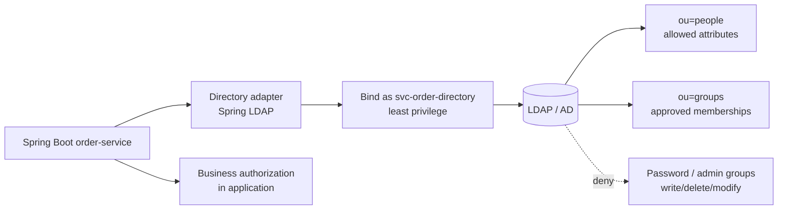
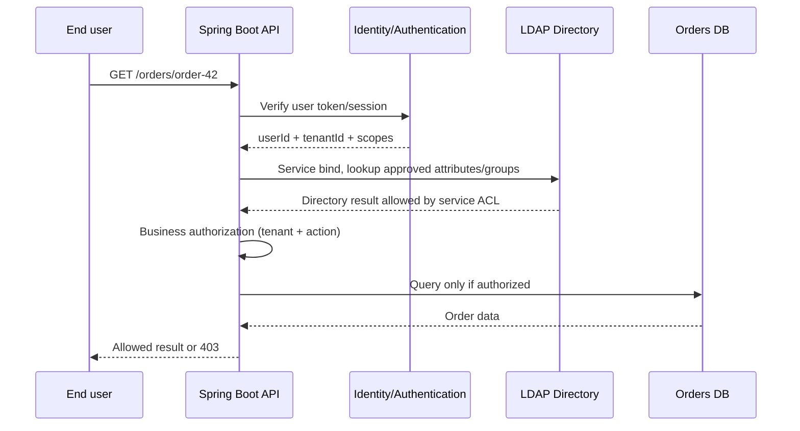
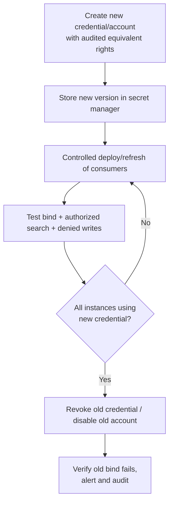
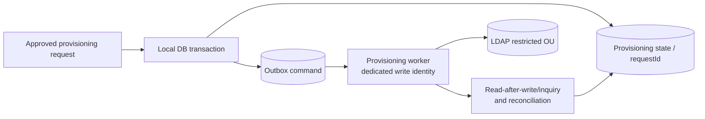

# Service Access Accounts and Permission Boundaries

## 1. Scenario: An Application Needs to Read a Directory Without Being an Administrator

A Spring Boot system needs to connect to LDAP or Active Directory (AD) to look up employee information, check account status, and map groups to application roles. A quick but dangerous shortcut is configuring `spring.ldap.username` with a directory administrator account, granting read/write rights across the entire tree, and using it for every call.

If the application's credentials leak, an attacker can not only query the directory but also modify groups, reset passwords, or alter permissions if the bind account is over-privileged. Even a routine code bug could accidentally write bad data into a directory shared by thousands of people.

The solution is separating **service identity** from **end-user identity**, provisioning a dedicated bind account, restricting **DN subtrees**, **attributes**, and **LDAP operations**, and verifying actual permissions with negative tests.



This lesson belongs to the **LDAP and Directories** chapter of the `SPRING_BOOT_INTEGRATION` module. The module focuses on integrating systems in Spring Boot via HTTP clients, databases, caches, message brokers, and Spring Integration adapters—specifically configuration, data contracts, transactions, error handling, deduplication, testing, and observing real flows. Here, LDAP is an **external system with its own security boundary**, not an internal application database.

**After this lesson, you can:**

1. Explain how a service/bind account differs from end-user logins and LDAP admin accounts.
2. Choose service identities, bind methods, and permissions following **least privilege**, **least scope**, and **separation of duties**.
3. Design restrictions by DN tree, object class, attribute, and operation; distinguish OpenLDAP ACLs from AD access control.
4. Configure Spring Boot `spring.ldap.*` and use `LdapTemplate` for read-only lookups.
5. Build safe LDAP filters and DNs to prevent LDAP injection and avoid full-tree searches.
6. Protect bind credentials with a secret manager, LDAPS/StartTLS, and rotation processes.
7. Distinguish service bind, user bind authentication, and business role authorization.
8. Handle timeouts, unavailable directories, referrals, connection reuse, caching, and eventual consistency.
9. Test both **allowed permissions** and **denied permissions** against a real directory, not only by mocking the LDAP client.
10. Set up monitoring, alerting, tracing, and runbooks when an account is locked or credentials expire.

> **Version scope:** Examples use Java 17+, Spring Boot 3.x, Spring LDAP 3.x, Spring Security 6.x (where authentication applies), and LDAPv3. The LDAP server may be OpenLDAP, 389 Directory Server, or Microsoft Active Directory; attribute names, ACLs, bind mechanisms, and paging/referrals **are not strictly equivalent** across products. On Boot 4.x/Spring 7.x, check the BOM, APIs, and supported configuration in your deployment version.

## 2. LDAP Fundamentals Required Before Granting Permissions

LDAP (Lightweight Directory Access Protocol) accesses a **tree of entries**. Each entry has a **Distinguished Name (DN)** and a set of attributes. A DN is not a filesystem path, not a URL, and not an OS login name.

Example structure:

```text
dc=example,dc=org
├── ou=people
│   ├── uid=alice
│   └── uid=bob
├── ou=groups
│   ├── cn=order-viewers
│   └── cn=order-operators
├── ou=services
│   └── uid=svc-order-directory
└── ou=privileged
    └── cn=directory-admins
```

Full DNs:

```text
uid=alice,ou=people,dc=example,dc=org
cn=order-viewers,ou=groups,dc=example,dc=org
uid=svc-order-directory,ou=services,dc=example,dc=org
```

Key terminology:

| Concept | Meaning | Security Relevance |
| --- | --- | --- |
| **DN** | Unique address of an entry in the directory tree. | Identifies the principal and accessible regions. |
| **RDN** | One component of a DN, e.g. `uid=alice`. | Must be escaped when built from untrusted data. |
| **Base DN** | Starting root for searches, e.g. `dc=example,dc=org`. | Broad bases can scan sensitive data beyond need. |
| **Search base** | Relative subtree, e.g. `ou=people`. | Should be narrowed by use case. |
| **Search scope** | OBJECT, ONELEVEL, or SUBTREE. | Broad SUBTREE can reach multiple organizational units. |
| **Object class** | Schema classifying entry/attributes. | Used in filters to reduce ambiguity; does not replace ACLs. |
| **Bind** | Authenticates an LDAP connection with an identity. | Effective rights follow the bound principal and directory ACLs. |
| **ACL/ACI/AD DACL** | Directory server rules evaluating permissions. | Must be enforced server-side, not only in client code. |
| **Search filter** | Condition selecting entries, e.g. `(uid=alice)`. | User input must be escaped; filters are not an authorization boundary. |
| **Attribute projection** | Fetching only needed attributes. | Reduces sensitive data in memory/logs but does not replace server ACLs. |

### 2.1. LDIF Describing Sample Data

```ldif
dn: uid=alice,ou=people,dc=example,dc=org
objectClass: inetOrgPerson
uid: alice
cn: Alice Example
sn: Example
mail: alice@example.org

dn: cn=order-viewers,ou=groups,dc=example,dc=org
objectClass: groupOfNames
cn: order-viewers
member: uid=alice,ou=people,dc=example,dc=org
```

This is an **illustrative fixture for an OpenLDAP-style schema**. Do not import it verbatim into a running production directory; AD user entries/groups and attributes may use `user`, `sAMAccountName`, `userPrincipalName`, or `memberOf` with different semantics.

**A key boundary:** an LDAP search filter selects records by query syntax, whereas the **server's ACL** decides whether the bound principal may read/write those records. An over-privileged account does not become less privileged simply because the application usually sends narrow filters.

## 3. What Is a Service Account? Three Identities Not to Confuse

In this lesson, a **service account** is a technical identity used by the application to **bind/search** the LDAP directory. It is neither the user requesting a web page nor an administrator.

| Role | Illustrative Principal | Required Permissions |
| --- | --- | --- |
| **Directory administrator** | `cn=admin,dc=example,dc=org` or AD privileged admin | Administers schemas/ACLs/identities via separate workflows; **never** used for application reads. |
| **Application bind service account** | `uid=svc-order-directory,ou=services,...` | Minimum search/read for business needs. No password reset or admin rights. |
| **End-user account** | `uid=alice,ou=people,...` | Identity of the logging-in person; their directory rights stay separate from the service bind. |
| **Provisioning service account** | `uid=svc-identity-provisioner,...` | Only approved write operations, restricted subtree/attributes, separate from the read account. |
| **Break-glass account** | Emergency identity managed by admins | Credentials must never go into routine Spring Boot service secrets. |

### 3.1. Service Bind Is Not User Authentication

Lookup flow:

```text
Application -> bind as svc-order-directory
            -> search uid=alice, attrs uid/cn/mail
            -> return minimal profile to application
```

An LDAP user login flow may look like:

```text
Application -> service bind to find user DN (if policy allows)
            -> attempt separate bind with user-supplied credentials
            -> authentication succeeds/fails
            -> read allowed groups/roles and enforce app authorization
```

A successful **service bind** only proves the service credentials are valid. It **does not** prove user Alice entered the right password. And seeing `memberOf=order-operators` **does not automatically determine** whether Alice can issue refunds or view another tenant in the business application.

### 3.2. Why Not Share One Admin Account Across All Services?

- One leaked secret compromises the entire directory, not just one application.
- Audit trails cannot distinguish `order-service`, `warehouse-service`, and `billing-service`.
- Credential rotation risks disrupting multiple applications simultaneously.
- Accidental write access can delete groups, lock users, or reset passwords.
- Hard to revoke one consumer without breaking others.
- Privileged accounts often have different protection/MFA/interaction policies than service-to-service auth.

**Recommended rule:** each application or trust boundary gets its own dedicated service identity with minimal capabilities. If the same application performs both lookup and provisioning, separate the two identities and credential sets.

### 3.3. Never Use Anonymous Bind or Public Permissions to Skip Credentials

Some directories permit anonymous bind/search depending on configuration. Never enable anonymous reads on employee subtrees merely to avoid managing service passwords. If an application genuinely needs public directory data, apply formal data classification and policies; employee records, security groups, and internal emails should not be public by default.

## 4. Designing Least Privilege Across Four Dimensions

A permission design must specify:

1. **Identity**: which account is used to bind.
2. **Scope**: which DN subtrees are visible.
3. **Attributes**: which fields may be read or modified.
4. **Operations**: search/read/compare/add/modify/delete/rename/bind granted strictly as needed.

Permission matrix for `order-service` only looking up order creator name/email:

| Resource | Search | Read Attrs | Add | Modify | Delete | Rename |
| --- | --- | --- | --- | --- | --- | --- |
| `ou=people,dc=example,dc=org` | Only lookup scope | `uid`, `cn`, `mail`, one approved stable identifier | Deny | Deny | Deny | Deny |
| `ou=groups,dc=example,dc=org` | Only authorization groups | `cn` and required membership attribute | Deny | Deny | Deny | Deny |
| `ou=services,...` | Minimum right to bind itself | Cannot read other services' credentials | Deny | Deny | Deny | Deny |
| `ou=privileged,...` | Deny | Deny | Deny | Deny | Deny | Deny |
| Passwords, recovery fields, security metadata | Deny (except intrinsic self-auth) | Deny | Deny | Deny | Deny | Deny |

**Important:** **search** permission and **read** permission may be distinct privileges in a directory implementation; attributes used in filters may require compare/search rights for queries to succeed. Designs must be tested on the real server rather than relying solely on permission labels.

### 4.1. Avoid "Read All Users" When the Service Needs Only One Group

If `order-service` only looks up active staff in `ou=staff` and group `order-viewers`, do not grant read rights across all of `dc=example,dc=org`. Even if code searches `ou=staff`, ACLs must restrict it server-side. In AD, authorization via groups may be configured per security principal/group and OU objects; in OpenLDAP, ACL rules can match DN/subtree/attributes. The two models **do not map 1:1**.

### 4.2. Attribute-Level Least Privilege

A user entry can hold:

```text
uid, cn, sn, mail
telephoneNumber
manager, departmentNumber
employeeNumber
homeDirectory
memberOf
userPassword / unicodePwd / account controls
custom HR fields
```

Just because the app needs display names does not mean it needs employee numbers, personal phone numbers, password hashes, AD security descriptors, or HR metadata. Server ACLs must forbid unauthorized attributes; client projection serves as defense-in-depth.

For sensitive fields, even "readable" requires a defined processing purpose, retention policy, and audit trail. Never log full LDAP `Attributes` for debugging.

### 4.3. Write Privilege Must Always Be Separate from Read Privilege

An account used solely for lookups needs no `add`, `modify`, `delete`, or `moddn/rename`. If provisioning must create accounts:

- Use a separate service identity and an authorized business endpoint.
- Restrict target creation to a specific OU, blocking modifications to admin groups.
- Restrict writable attributes and creatable object classes.
- Require approvals, maker-checker controls, and audit trails for sensitive actions.
- Never allow HTTP requests to supply arbitrary DN/attribute modifications.
- Test denials on admin groups, password resets, other OUs, and delete operations.

### 4.4. ACLs Must Be Evaluated Server-Side

Java code like:

```java
if (requestedAttribute.equals("mail")) {
    return ldapTemplate.lookup(dn);
}
```

does not protect the directory if the account can modify any entry and its credentials are compromised. Application guards are useful but **do not replace server-enforced restrictions**. During security testing, bind directly with the **real service credentials** from an isolated test environment and verify denied operations—do not test only the application's HTTP APIs.

## 5. What Do OU Structure and Search Base Mean?

Suppose Spring Boot configures:

```yaml
spring:
  ldap:
    base: dc=example,dc=org
```

The service then queries relative base `ou=people`, meaning it searches within:

```text
ou=people,dc=example,dc=org
```

**Risk indicators:**

- `searchBase=""` with subtree scope scanning the entire enterprise.
- Using `(objectClass=*)` to scan all records when only `uid=...` is needed.
- Letting callers pass arbitrary `baseDn`, `filter`, or `attributesToReturn`.
- Exposing detailed error distinctions like "user exists but forbidden" in messages, enabling enumeration.
- Cross-tenant directories: one bind account able to read outside a tenant's OU due to overly broad ACLs.

**Policy:** keep search bases in trusted config or code; use fixed query structures and escape values. In multi-tenant setups, authenticate the tenant from a valid principal/token and map it to a server-controlled allowlist of base DNs; **never** pass raw tenant-supplied base DNs directly.

## 6. Spring Boot: Dependencies and Connecting via a Service Account

Suppose you need an LDAP read client to look up user profiles. If using Spring Data LDAP repositories, `spring-boot-starter-data-ldap` is convenient; if you only need `LdapTemplate`, `spring-ldap-core` with appropriate Spring Boot configuration can be used.

```xml
<!-- Spring Boot parent/BOM manages Spring LDAP version -->
<dependency>
    <groupId>org.springframework.boot</groupId>
    <artifactId>spring-boot-starter-data-ldap</artifactId>
</dependency>
<dependency>
    <groupId>org.springframework.boot</groupId>
    <artifactId>spring-boot-starter-validation</artifactId>
</dependency>
<dependency>
    <groupId>org.springframework.boot</groupId>
    <artifactId>spring-boot-starter-test</artifactId>
    <scope>test</scope>
</dependency>
```

In Spring Boot 3.x, `spring.ldap.*` is the Boot-supported property group for creating an LDAP `ContextSource`/template when auto-configuration conditions match. If declaring `LdapContextSource` or `LdapTemplate` manually, understand auto-configuration may **back off**; avoid having two default sources without clarity on which gets injected.

### 6.1. Configuration Using LDAPS

```yaml
# application.yml - environment placeholders, NOT real credentials
spring:
  ldap:
    urls: ${LDAP_URL:ldaps://ldap.example.org:636}
    base: dc=example,dc=org
    username: ${LDAP_BIND_DN}
    password: ${LDAP_BIND_PASSWORD}

app:
  directory:
    people-base: ou=people
    allowed-groups-base: ou=groups
    lookup-timeout: 2s
```

Example deployment values:

```text
LDAP_URL=ldaps://ldap.example.org:636
LDAP_BIND_DN=uid=svc-order-directory,ou=services,dc=example,dc=org
LDAP_BIND_PASSWORD=<injected by secret manager, not printed>
```

In this example, `LDAP_BIND_DN` is created and granted permissions by directory operations. The password must be injected by an environment secrets mechanism (secret manager/properly controlled Kubernetes Secret, workload identity broker/sidecar, vault injector)—**never** stored in the repository, Docker image, public ConfigMap, or test snapshots.

**Never take a user DN from a request as `spring.ldap.username`.** The service account is the client connection's identity; user authentication must use a separate bind flow, never mutating the shared credentials of a singleton `LdapTemplate` across requests.

### 6.2. LDAPS, StartTLS, and TLS Verification

Two common mechanisms:

| Method | Typical Endpoint | Security Semantics |
| --- | --- | --- |
| **LDAPS** | `ldaps://ldap.example.org:636` | TLS from connection start. |
| **StartTLS** | `ldap://ldap.example.org:389` then StartTLS | Upgrades an LDAPv3 connection to TLS before sending the bind password. |

**Never send simple-bind passwords over plaintext LDAP.** When using StartTLS, the program must **enforce TLS upgrade and verification before binding**, and must never silently fall back to plaintext on handshake failure.

The JNDI LDAP provider normally relies on JVM trust configuration or a properly configured socket factory/context; Spring Boot's SSL bundles for HTTP clients **are not automatically** used by JNDI LDAP. With a private CA, operators typically configure the JVM truststore or a proper TLS context:

```text
-Djavax.net.ssl.trustStore=/etc/app/trust/ldap-truststore.p12
-Djavax.net.ssl.trustStoreType=PKCS12
-Djavax.net.ssl.trustStorePassword=<injected securely>
```

These are illustrative JVM startup flags; do not hardcode truststore secrets in checked-in scripts or startup logs. If the app already uses a corporate truststore, add only approved CAs and do not disable hostname verification. The URL hostname must match certificate SAN/policy.

**Severe anti-patterns:**

```text
Trust-all SSLContext / insecure socket factory
Disable hostname verification
Use ldap://389 + simple bind without StartTLS
Fall back from TLS to plaintext when handshake fails
```

Never accept these workarounds to "keep production running temporarily." They expose service passwords and directory data to interception or tampering.

### 6.3. Service Account Passwords and Account State

Directory servers may enforce expiry/lockout on bind accounts. Empty passwords, unexpanded placeholders, or wrong DNs cause bind failures. For LDAP simple binds, carefully evaluate empty-password behavior: some servers allow anonymous/unauthenticated binds, so the app must **fail fast** before creating a connection if required credentials are missing.

In Spring Boot 3.x, certain setups let the application start before executing any LDAP request. Never treat `ApplicationStartedEvent` as proof that service credentials remain valid; LDAP health/readiness checks should perform bounded capability checks within error budgets without causing a bind storm.

## 7. Example Read-Only Service with `LdapTemplate`

Suppose the account may only read `uid`, `cn`, `mail` under `ou=people`. Design a small adapter so business services never handle raw directory DNs or filters.

### 7.1. Minimal DTO

```java
// DirectoryPerson.java
package com.example.integration.directory;

public record DirectoryPerson(
    String uid,
    String displayName,
    String email
) {}
```

The DTO omits passwords, full tree memberships, and arbitrary attributes. If `mail` can be absent per directory schema, the app contract should return null/Optional or reject the record; never fabricate dummy emails and send notifications to the wrong place.

### 7.2. Adapter with Fixed Queries

```java
// DirectoryPersonLookup.java
package com.example.integration.directory;

import java.util.List;
import javax.naming.NamingException;
import javax.naming.directory.Attribute;
import javax.naming.directory.Attributes;
import javax.naming.directory.SearchControls;
import org.springframework.ldap.core.AttributesMapper;
import org.springframework.ldap.core.LdapTemplate;
import org.springframework.ldap.query.LdapQuery;
import org.springframework.ldap.query.LdapQueryBuilder;
import org.springframework.stereotype.Repository;

@Repository
public class DirectoryPersonLookup {
    private final LdapTemplate ldap;

    public DirectoryPersonLookup(LdapTemplate ldap) {
        this.ldap = ldap;
    }

    public DirectoryPerson findByUid(String uid) {
        String normalized = normalizeUid(uid);

        LdapQuery query = LdapQueryBuilder.query()
            .base("ou=people")
            .searchScope(SearchControls.SUBTREE_SCOPE)
            .attributes("uid", "cn", "mail")
            .countLimit(2)
            .timeLimit(2_000)
            .where("objectClass").is("inetOrgPerson")
            .and("uid").is(normalized);

        List<DirectoryPerson> matches = ldap.search(
            query,
            (AttributesMapper<DirectoryPerson>) attrs ->
                new DirectoryPerson(
                    required(attrs, "uid"),
                    required(attrs, "cn"),
                    optional(attrs, "mail")
                )
        );

        if (matches.isEmpty()) {
            throw new DirectoryPersonNotFoundException(normalized);
        }
        if (matches.size() != 1) {
            throw new DirectoryAmbiguousPersonException(normalized);
        }
        return matches.get(0);
    }

    private static String normalizeUid(String input) {
        if (input == null
            || !input.matches("[a-zA-Z0-9._-]{1,80}")) {
            throw new IllegalArgumentException("Invalid uid format");
        }
        return input;
    }

    private static String required(
        Attributes attrs, String name
    ) throws NamingException {
        Attribute value = attrs.get(name);
        if (value == null || value.size() == 0
            || value.get() == null) {
            throw new InvalidDirectoryRecordException(
                "Missing required attribute: " + name
            );
        }
        return value.get().toString();
    }

    private static String optional(
        Attributes attrs, String name
    ) throws NamingException {
        Attribute value = attrs.get(name);
        return (value == null || value.size() == 0)
            ? null : String.valueOf(value.get());
    }
}
```

The exceptions below are application types, **not built-in classes** in Spring LDAP:

```java
// DirectoryPersonNotFoundException.java
package com.example.integration.directory;

public class DirectoryPersonNotFoundException
    extends RuntimeException {
    public DirectoryPersonNotFoundException(String uid) {
        super("Directory person not found for uid");
    }
}
```

```java
// DirectoryAmbiguousPersonException.java
package com.example.integration.directory;

public class DirectoryAmbiguousPersonException
    extends RuntimeException {
    public DirectoryAmbiguousPersonException(String uid) {
        super("Ambiguous directory uid");
    }
}
```

```java
// InvalidDirectoryRecordException.java
package com.example.integration.directory;

public class InvalidDirectoryRecordException
    extends RuntimeException {
    public InvalidDirectoryRecordException(String message) {
        super(message);
    }
}
```

**What is right about this design:**

1. `base("ou=people")` restricts the search base inside Spring-configured `dc=example,dc=org`.
2. `attributes("uid","cn","mail")` fetches only fields required by the business contract.
3. `objectClass=inetOrgPerson` and `uid=...` filter out unrelated entries.
4. `LdapQueryBuilder` constructs filters from **data values**, rather than unescaped string concatenation.
5. `countLimit(2)` detects non-uniqueness if server/schema/ACL allow; a design requiring unique UIDs should still enforce uniqueness via directory policy.
6. `timeLimit(2000)` is the LDAP search time limit in query controls, **not necessarily the total network/connect/read timeout**.
7. `LdapTemplate` is injected by Spring instead of opening fresh connections/binding with admin credentials in every method.

**Never treat Java projection/validation as a replacement for server ACLs.** If the account can still read `userPassword` or `ou=privileged` from another LDAP client, least privilege has not been achieved.

### 7.3. Areas Needing Schema Adjustments

In Active Directory, common account identifier attributes are `sAMAccountName` or `userPrincipalName`, with object class `user`; `uid` may be blank or non-unique. In OpenLDAP, `inetOrgPerson`, `uid`, and `groupOfNames` are common, though actual schemas are governed by the directory team.

Before developing, confirm:

- Which user identifier is stable and unique?
- Could Base DN and OUs shift due to reorganization?
- Can emails/usernames change or be recycled?
- Is an immutable ID (AD `objectGUID`, provider-specific entry UUID) needed to join with business data?
- When entries are renamed/moved, how do DN changes affect caches and identity mappings?
- Are group memberships direct or nested; can the service read the exact group attributes?

Never use email as the primary business identity just because it is easy to display; emails can change.

### 7.4. Minimal Returns and Privacy

The adapter may return `DirectoryPerson` to an application service. However, an external API may not be permitted to expose `mail` to every caller. **LDAP read permission** confirms the application can read at the infrastructure layer; **application authorization** still governs which user/token sees which profile. If callers can query arbitrary `uid` values, apply rate limits and business access checks to curb user enumeration.

## 8. Preventing LDAP Injection: Filters and DNs Are Two Different Contexts

LDAP filters and Distinguished Names have **two distinct escaping rulesets**. A `uid` going into a search filter must not be concatenated like a raw SQL string; an RDN going into a DN must not be concatenated raw either.

### 8.1. Filter Injection from String Concatenation

Do not write:

```java
// WRONG: user-controlled input flows directly into the LDAP filter.
String filter = "(uid=" + userInput + ")";
ldapTemplate.search("ou=people", filter, mapper);
```

Input with special filter characters can alter filter semantics or break query syntax. Never rely on homegrown blacklists; use `LdapQueryBuilder` with values or standard library filter escaping utilities:

```java
LdapQuery query = LdapQueryBuilder.query()
    .base("ou=people")
    .where("uid").is(userInput);

List<DirectoryPerson> people =
    ldapTemplate.search(query, mapper);
```

This snippet illustrates the API; `mapper` must be a service-defined `AttributesMapper<DirectoryPerson>`. UID format validation should still remain if the business contract allows only alphanumeric/hyphen/dot/underscore characters. **Escaping ensures syntactic safety; validation enforces the contract; ACLs enforce access.**

### 8.2. DN Injection from RDN Concatenation

Do not write:

```java
// WRONG: uid may contain commas, equals signs, or DN special characters.
String dn = "uid=" + userInput
    + ",ou=people,dc=example,dc=org";
```

Use a builder that handles RDN escaping:

```java
import javax.naming.ldap.LdapName;
import org.springframework.ldap.support.LdapNameBuilder;

LdapName userDn = LdapNameBuilder
    .newInstance("dc=example,dc=org")
    .add("ou", "people")
    .add("uid", userInput)
    .build();
```

**Note:** Spring LDAP operations may expect DNs relative to `ContextSource.base`; if `spring.ldap.base=dc=example,dc=org` is configured, passing a **full DN** to an operation expecting a **relative DN** can double-append the base. Verify each API's contract, build DNs for the proper scope, and integration-test against a real directory.

### 8.3. Never Turn Filters into Authorization

A query like:

```text
(&(objectClass=person)(uid=alice)(memberOf=cn=order-viewers,...))
```

does not automatically guarantee the user is authorized in the application. In AD, nested groups, primary groups, token size, trust boundaries, and disabled accounts carry special semantics; in OpenLDAP, `groupOfNames`/`member` fields differ from `memberOf`. Authorization needs an explicit default-deny policy, accepting only allowlisted groups and checking account state/tenant context.

### 8.4. Bounding Queries and Results

Beyond escaping:

- Never accept arbitrary filters from HTTP requests.
- Bound search base, scope, attributes, and size/time limits.
- Configure real read/connect timeouts on the JNDI provider.
- For large lists, use LDAP paged results within server capabilities and total entry caps.
- Avoid issuing one search per item when safe batch lookups are feasible.
- Avoid subtree scans to check groups on every HTTP request when safe caching/delegation applies.

**Client-side limits do not replace ACLs**, though they mitigate DoS risks, memory pressure, and directory load.

## 9. OpenLDAP ACLs and Active Directory Delegated Access

There is no single ACL snippet you can safely copy-paste into every LDAP implementation. **Permissions must be deployed by directory administrators** through configuration management, change reviews, and testing without locking out admin accounts.

### 9.1. Policy Request Model for the Directory Team

Example formal request:

```text
Service principal:
  uid=svc-order-directory,ou=services,dc=example,dc=org

Allowed:
  search/read ONLY:
    base = ou=people,dc=example,dc=org
    filter fields = uid, objectClass
    returned fields = uid, cn, mail
  optional group lookup:
    base = ou=groups,dc=example,dc=org
    only approved order-viewers/order-operators groups
    read = cn, member

Denied:
  write / add / delete / rename / password reset
  read userPassword / password hashes / recovery attributes
  read privileged OU and unrelated HR/payroll attributes
  modify group membership, especially privileged groups

Operational controls:
  TLS required, credential rotation, audit logs, rate limits,
  dedicated credential per application/environment.
```

This is a **policy request**, not executable ACL syntax. The directory team must evaluate server version, schema, ACL precedence, and delegation mechanisms, then apply permissions and prove them with positive/negative tests.

### 9.2. OpenLDAP: `olcAccess`/slapd ACLs

OpenLDAP typically evaluates ordered rules over `dn.subtree`, `attrs`, and principals `by dn.exact`; privilege levels include concepts like `auth`, `search`, `read`, and `write`. One conceptual outline (intentionally written as **non-deployable pseudocode**) is:

```text
ALLOW principal = svc-order-directory
  SEARCH user entries under ou=people on uid/objectClass
  READ attributes uid/cn/mail of allowed entries

ALLOW principal = svc-order-directory
  SEARCH approved groups under ou=groups
  READ required group membership attributes

DENY principal = svc-order-directory
  all directory writes, privileged subtree, password attributes
```

In real OpenLDAP deployments, rule ordering determines the outcome; a flawed `olcAccess` or missing `auth` permission for binding can **lock out applications or administrators**. Never overwrite existing ACLs with a textbook snippet. Verify `auth` rights for simple binds, entry search rights, and attribute read rights for all expected queries. A misplaced `by * none` at the end of a rule can also break other identities.

### 9.3. Active Directory: OUs, ACLs, and Security Groups

AD uses security principals and DACLs/ACEs on directory objects; read rights for specific attributes or an OU can be delegated. Policies should:

- Use a **dedicated security principal** for the application or a group holding service principals with identical capabilities.
- Grant read access only to required OUs/properties; review inheritance and default Authenticated Users permissions.
- Avoid Domain Admins/Account Operators/Directory Admins; never add the account to privileged groups to resolve read errors.
- Separate read and write permissions; never grant `GenericAll`, `WriteDacl`, `WriteOwner`, password resets, or member management.
- When querying groups, evaluate nested memberships, cross-domain groups, Global Catalog partial attribute sets, and trusts.
- Test directly using the **service principal** and check inherited permissions rather than inspecting only one root OU ACL.

**Important:** In AD, many objects inherit permissions from parents, and certain attributes have special controls. Granting "just one read permission" does not guarantee the account does not inherit broader rights from group memberships. Always check **effective access**.

### 9.4. OpenLDAP and AD Are Not Equivalent in Schema/ACL

| Topic | Typical OpenLDAP | Microsoft Active Directory |
| --- | --- | --- |
| Username field | `uid` | `sAMAccountName` / `userPrincipalName` |
| Person object class | `inetOrgPerson` | `user` (with distinct schema) |
| Group attributes | `member`, `uniqueMember`, schema-dependent | `member`/`memberOf`, nested membership |
| Permissions | slapd ACL/`olcAccess` rules | Security descriptors, ACE/DACL, OU delegation |
| Account state | Provider/schema-specific | `userAccountControl` and policy fields |
| Global Catalog | No default equivalent semantics | LDAP GC port 3268/3269, partial attribute set |
| Managed accounts | Depends on external identity tooling | Supports gMSA in compatible environments |

Never port raw LDAP filters from OpenLDAP to AD expecting identical results, attributes, or permissions. If using AD Global Catalog, verify target attributes are actually replicated in the partial attribute set; do not treat GC as a drop-in replacement for LDAP 389/636.

### 9.5. gMSA Does Not Automatically Solve Simple Bind from Java

AD group Managed Service Accounts (gMSAs) can assist secret management in integrated Windows environments. However, a Spring Boot app running in a Linux container using JNDI **simple bind DN/password** does not automatically get passwordless gMSA support merely because the account type is gMSA. You need a genuinely compatible authentication strategy (such as Kerberos/GSSAPI or workload-specific integration), tested on the target host/container/runtime. Never treat gMSA as a blanket promise of "no credential rotation needed" for every Java LDAP client.

## 10. Distinguishing Directory Permissions from Application Permissions

A directory service account may be allowed to read a user's membership in `order-operators`. That does not mean the user is authorized to:

- view orders belonging to another tenant,
- edit payment details,
- issue refunds,
- read payroll data,
- modify Spring Integration flow configurations.

**Directory authorization** applies to the *principal binding to LDAP*, whereas **application authorization** applies to *API callers and business actions*. Even a client with a read-only bind account must enforce permission checks at controller/service boundaries.

### 10.1. Breakdown Example



If directory lookup fails or lacks groups:

- **Never** assume "no authorization needed because LDAP is unavailable."
- **Never** grant elevated default privileges to preserve availability.
- Return 503/degraded for group-dependent operations, or use an approved authorization snapshot with proper TTL and version/revocation semantics.

### 10.2. Group Mapping Requires an Allowlist

A policy:

```text
LDAP group DN:
  cn=order-viewers,ou=groups,dc=example,dc=org
    -> application role: ORDER_READ

LDAP group DN:
  cn=order-operators,ou=groups,dc=example,dc=org
    -> application role: ORDER_UPDATE

Any other group:
    -> no application privilege by default
```

Map by **trusted DN/immutable group ID** and exact directory source, never just by `cn` which could collide across OUs or strings sent from HTTP requests. When groups are renamed, update mappings under change control. Nested groups must not be interpreted loosely via substring matching on group names.

### 10.3. LDAP Group Lookup Is Not Authentication

Reading Alice's LDAP entry and seeing matching groups **does not prove the request came from Alice**. End-user authentication must come from a trusted mechanism (proper LDAP bind per contract, verified OIDC/SAML/OAuth2 token/session, etc.) mapped safely to a directory identity. Never accept a self-asserted `uid=alice` parameter and apply Alice's groups to an unverified caller.

### 10.4. Caching Access Permissions and Revocation

An application may cache groups for performance. Yet when a user's permissions are revoked in LDAP, the cache can retain stale roles:

```text
T0: LDAP group membership = ORDER_UPDATE
T1: application caches role for 30 minutes
T2: directory admin removes user from group
T3: user invokes refund before cache expiry
```

The design must enforce:

1. Short TTLs matching permission sensitivity; never default to 24 hours.
2. Invalidation/revocation events if supported by the directory/identity platform.
3. Explicit authorization source of truth or token TTL/session lifetime policies.
4. Cache keys containing tenant/source/immutable user identity and policy version.
5. Never cache high-privilege permissions for long durations simply because LDAP latency is high.
6. When LDAP fails, never escalate permissions; choose fail closed or a formally signed-off degraded policy.

**Distinguish low-sensitivity data** (display names) from **high-sensitivity permissions** (admin/finance groups). Their TTL and revocation requirements differ.

## 11. Simple Bind via Service Account vs. User Authentication

A service account typically uses a **read-only bind** to search user/group entries. If the application also authenticates end-user usernames/passwords via LDAP, that is a **separate flow** requiring stricter controls.

### 11.1. Never Implement Homemade Password Comparisons

Never read `userPassword` or password hashes and compare them in a Java service. A directory read account **should not have read access to password attributes**. Many LDAP schemas/servers forbid reading passwords even hashed; manual comparison also breaks easily across password encodings, hashing policies, and server controls.

**Proper principle:** when LDAP credential authentication is needed, use a trusted bind/identity provider flow over verified TLS and never store passwords in the application.

### 11.2. Spring Security LDAP Authentication — Outline

If a product genuinely needs user authentication via LDAP (instead of an OIDC/SAML IdP), Spring Security LDAP provides user search/bind setup. Conceptual example for Spring Security 6.x:

```java
// LDAP-specific authentication setup (illustrative snippet).
import org.springframework.ldap.core.support.LdapContextSource;
import org.springframework.security.config.ldap.LdapBindAuthenticationManagerFactory;

LdapBindAuthenticationManagerFactory factory =
    new LdapBindAuthenticationManagerFactory(
        ldapContextSource
    );
factory.setUserSearchBase("ou=people");
factory.setUserSearchFilter("(uid={0})");
var authenticationManager =
    factory.createAuthenticationManager();
```

This snippet is **not a complete compilable class**; it illustrates the API/configuration direction. `ldapContextSource` is a dedicated bean configured with proper service bind/search policies. In a real application, configure `SecurityFilterChain`, authentication providers, exception handling, TLS transport, and session protections. Use Spring Security's standard filter/value substitution; never concatenate raw usernames into LDAP filters.

**Avoid mixing:** user credentials are used by Spring Security during user binds; never overwrite `spring.ldap.password` on the global service connection with them. Authentication results must bind to the user principal, not `svc-order-directory`'s DN.

### 11.3. Should the App Manage User Passwords?

If the organization already has an OIDC/SAML identity provider, applications should usually authenticate via the IdP and use LDAP only for authorized data/memberships rather than touching user passwords directly. The choice depends on IAM architecture, security policy, and available systems; never assume LDAP bind is the best fit by default.

### 11.4. Wrong Passwords and Account Enumeration

Never return detailed errors like "user exists but password wrong," "DN not found," or "account disabled" to public clients unless policy allows; these leak account existence. Log sanitized internal causes correlated with directory server audits, return a uniform public message (e.g., authentication failed), and enforce rate limits/lockout policies.

## 12. Restricting Permissions Across Environments and Multiple Directories

In practice there are multiple environments:

```text
dev     -> directory sandbox -> svc-order-directory-dev
staging -> directory staging -> svc-order-directory-stg
prod    -> directory prod    -> svc-order-directory-prod
```

**Never** let dev/staging applications bind to production LDAP using production service credentials for convenience. Compromising a non-prod environment would open access to the live directory.

### 12.1. One Account per Trust Boundary

If the same backend serves multiple business domains/tenants:

| Model | Strengths | Risks to Control |
| --- | --- | --- |
| One company-wide account | Easy initial operations. | Large blast radius, hard auditing, overly broad rights. |
| One account per microservice/environment | Capability-scoped rights, per-service rotation. | More identities/secrets requiring automation. |
| One account per tenant/trust boundary | Stronger isolation when directory/ACLs support it. | Complex account lifecycle, pools, credential mapping. |
| Service identity federation/delegation | Reduces shared secrets in some architectures. | Requires genuine directory/Kerberos/IAM runtime support. |

**Recommendation:** prefer one account per service/environment and split further where tenant boundaries or data sensitivity require it. Never request thousands of accounts unless the directory team has automated provisioning and rotation support.

### 12.2. When Two LDAP Directories Coexist in One Spring Boot App

Suppose a service reads "employees" from one directory and "contractors" from another. Each directory needs:

- Separate URLs/trust chains.
- Separate bind service credentials.
- Separate `ContextSource` and `LdapTemplate`.
- Separate base DNs, search filters, and schema mappings.
- Separate ACLs and monitoring.
- Tenant/source-scoped identity keys to prevent UID collisions.

Name beans explicitly like `employeeDirectoryContextSource`/`contractorDirectoryContextSource` and inject via `@Qualifier`; never let a global `LdapTemplate` autowire accidentally and query a broader-privileged directory.

### 12.3. `@Qualifier` Does Not Replace Server ACLs

`@Qualifier("employeeLdapTemplate")` only selects a client bean inside the Spring container. It does not restrict the credential holder on the LDAP server and is not an authorization mechanism. Combine server-side credential scopes/ACLs with business authorization at application boundaries.

## 13. Managing Service Account Lifecycles

A service account often outlives any individual Spring Boot instance. Security therefore requires **ownership, onboarding, rotation, auditing, and offboarding**, not just a strong password.

### 13.1. Service Account Provisioning Request

A minimal service account request should document:

| Field | Example | Purpose |
| --- | --- | --- |
| Application owner | `order-service` operations team | Who is accountable for usage/revocation? |
| Service account name | `svc-order-directory-prod` | Workload traceability. |
| Environment | Production | Prevent reusing dev credentials. |
| Directory endpoint | `ldap.example.org` | Network/trust binding. |
| Base DNs | `ou=people`, `ou=groups` | Restricts query space. |
| Allowed attributes | `uid`, `cn`, `mail` | Prevents over-reading data. |
| Allowed operations | Search/read/compare per use case | No add/modify/delete rights. |
| Runtime identity | Kubernetes Deployment/ServiceAccount or host identity | Secret distribution policy. |
| Credential lifetime | Per IAM policy | Schedules rotation before expiry. |
| Audit retention | Per organizational policy | Investigates account compromises. |
| Offboarding trigger | Service decommissioned or architecture changed | Timely disablement/revocation. |

If the application needs to write LDAP attributes, submit a separate ticket with directory team ownership and risk approval; never tack write permissions onto an existing read account ad hoc for a new feature.

### 13.2. Secrets Never Belong in Git or CI Logs

Never write:

```yaml
# WRONG: real credentials in code or committed files.
spring:
  ldap:
    username: uid=svc-order-directory,ou=services,dc=example,dc=org
    password: SuperSecret123
```

An environment variable injected from a secret manager is **better than hardcoding**, yet still carries exposure risks via process environments, crash dumps, debug pages, or deployment tooling if permissions are lax. Enforce:

- Secret read ACLs scoped to workload identity/namespace/environment.
- KMS/encryption at rest and TLS in transit during distribution.
- Never printing effective configs or raw environments on logging/health endpoints.
- Never including `spring.ldap.password` in exception messages, build artifacts, or diagnostic bundles.
- Never letting secrets enter stack traces or test snapshots.
- Rotation/revocation and audit logs of secret access.
- Controlled startup/recovery failure if a required secret is missing or empty.

**Never** call `String.toString()` on a config object holding a password in logs. To log identity, log a config-managed alias `directory=corp-prod` and `credentialVersion=v7`, never the password.

### 13.3. Credential Rotation Must Not Depend on Manual Restarts

A controlled rotation workflow:



**Detail:** some directory products permit only one active password at a time per account, so changing the password immediately breaks instances using old connections/stale credentials. To avoid downtime, consider **two alternating service accounts** under the same policy or a directory-supported rotation/versioning mechanism. Keep the old account active only for a bounded transition window with monitoring.

**Never** loop over multiple passwords in code to "find whichever password works"; that triggers lockouts, hides configuration bugs, and leaks secrets. When credentials rotate, old connection pools/bind sessions must be closed or recycled per the `ContextSource`/LDAP provider's behavior.

### 13.4. When an Account Is Locked Out or Expired

An LDAP bind failure with invalid credentials can result from:

- Secret rotated on the server before deployment updated.
- Account locked out after repeated bad bind attempts.
- Password expired or security policy requires a reset.
- DN no longer exists after an OU rename/move.
- Endpoint changed realm/domain and credentials no longer apply.

Never retry 100 times/second with the same credential on authentication errors; this is usually not a transient connection failure. Alert with a runbook so operators check secret version, account state, and directory-side audits, then fix config/rotation.

### 13.5. Re-Verify Least Privilege Periodically

As features are added, accounts suffer "permission creep." Periodically review:

1. Which OUs/attributes did the service actually read in the past 30/90 days?
2. Have new parent/group ACLs widened effective access?
3. Was the account temporarily added to a privileged group during an incident?
4. Are old credentials or stale deployments still binding?
5. Is another application sharing the credential, breaking single-owner assumptions?
6. Are non-prod environments pointing at prod unapproved?
7. Do negative tests still block writes/passwords/privileged lookups?

## 14. TLS, Network, and Referrals Are Part of the Boundary

A least-privileged service account binding over an insecure channel can still be stolen. Protecting directory transport requires:

- **TLS encryption:** enforce LDAPS or StartTLS; never bind credentials over cleartext.
- **Certificate validation:** trust the proper CA and matching hostname/SAN; avoid trust-all.
- **Network allowlisting:** allow only authorized workloads/namespaces to reach directory endpoints.
- **Egress firewalling:** restrict directory replication/admin endpoints; never expose to the open internet.
- **Referrals:** follow only trusted targets/domains, preventing automatic forwarding of bind credentials to out-of-scope hosts.
- **Timeouts:** every connect/read/search has limits so threads are never held indefinitely.
- **Logging:** never log passwords, full LDAP entries, or sensitive filters/values.

### 14.1. Referrals Can Expand Query Scope

An LDAP server can return a referral to another server/partition. If a client chases referrals automatically without validating the destination, the application may:

- Query outside the expected domain/tenant.
- Generate unexpected network egress.
- Leak credentials depending on the client's rebind/referral mechanism.
- Receive attributes/permissions differing from the original directory.
- Encounter referral loops or high latency.

Choose `throw/ignore/follow` based on server/client behavior, audit trails, and **allowlisted trusted referral destinations** in the architecture. For this lesson, prefer failing closed on out-of-scope referrals; enable following only if directory federation genuinely requires it and has passed security review.

### 14.2. JNDI Provider Timeouts Are Not Search Time Limits

With the JVM's common JNDI LDAP provider:

```text
com.sun.jndi.ldap.connect.timeout = milliseconds
com.sun.jndi.ldap.read.timeout    = milliseconds
```

These properties are **JNDI provider-specific**, not standardized LDAPv3 options portable across every Java LDAP client. They complement `SearchControls.setTimeLimit(...)`; a search time limit is not a global deadline covering DNS/TLS/connect/bind/response handling and retries.

### 14.3. Alternative: Explicit `LdapContextSource` Configuration

If you need explicit control over JNDI timeouts/referrals instead of Boot's default `ContextSource`, define custom beans:

```java
// DirectoryContextConfiguration.java - alternative to Boot defaults.
package com.example.integration.directory;

import java.util.Map;
import javax.naming.Context;
import org.springframework.beans.factory.annotation.Value;
import org.springframework.context.annotation.Bean;
import org.springframework.context.annotation.Configuration;
import org.springframework.ldap.core.LdapTemplate;
import org.springframework.ldap.core.support.LdapContextSource;

@Configuration(proxyBeanMethods = false)
public class DirectoryContextConfiguration {

    @Bean("directoryContextSource")
    LdapContextSource directoryContextSource(
        @Value("${app.directory.url}") String url,
        @Value("${app.directory.base}") String base,
        @Value("${app.directory.bind-dn}") String bindDn,
        @Value("${app.directory.bind-password}") String password
    ) {
        if (password == null || password.isBlank()) {
            throw new IllegalStateException(
                "Directory service password missing"
            );
        }

        LdapContextSource source = new LdapContextSource();
        source.setUrl(url);
        source.setBase(base);
        source.setUserDn(bindDn);
        source.setPassword(password);
        source.setPooled(false);
        source.setBaseEnvironmentProperties(Map.of(
            "com.sun.jndi.ldap.connect.timeout", "1500",
            "com.sun.jndi.ldap.read.timeout", "2500",
            Context.REFERRAL, "throw"
        ));
        source.afterPropertiesSet();
        return source;
    }

    @Bean("directoryLdapTemplate")
    LdapTemplate directoryLdapTemplate(
        LdapContextSource directoryContextSource
    ) {
        return new LdapTemplate(directoryContextSource);
    }
}
```

```yaml
# Alternative profile configuration for the custom beans above.
app:
  directory:
    url: ${LDAP_URL:ldaps://ldap.example.org:636}
    base: dc=example,dc=org
    bind-dn: ${LDAP_BIND_DN}
    bind-password: ${LDAP_BIND_PASSWORD}
```

**Never install both this custom configuration and the `spring.ldap.*` config from Section 6 simultaneously assuming two independent clients automatically pick the right properties.** Pick one controlled configuration. When multiple `LdapTemplate`s exist, inject with `@Qualifier("directoryLdapTemplate")` in adapters; with a single Boot template, constructor injection by type usually suffices.

In the example:

- `source.setPooled(false)` avoids enabling automatic JNDI pooling before evaluating StartTLS/credential rotation behavior.
- Timeout map keys are JNDI-specific; property names may differ on other providers.
- `Context.REFERRAL="throw"` prevents silently following referrals, while requiring proper handling/reporting if federation is ever supported.
- Use LDAPS URLs and proper JVM trust setup; `setUrl` never bypasses certificate validation.
- `afterPropertiesSet()` initializes the source config; it does not mean startup already bound successfully to the directory.

If dedicated connection pooling is needed to cut bind/search overhead, use Spring LDAP's `PooledContextSource` after checking pool size, idle validation, abandoned contexts, credential rotation, StartTLS compatibility, and concurrency. **Built-in JNDI pooling is not a safe default for StartTLS**; guard against reusing stale credentials or wrong security contexts.

### 14.4. Failover Across Multiple LDAP URLs

When multiple directory replicas exist, a list of URLs can be configured if supported by `ContextSource`/provider. However:

- Never mix tenant A's LDAP directory with tenant B's as "failover."
- Verify replicas share schemas/ACLs/credential policies and sufficiently fresh replication.
- A search right after disabling an account may see stale data on a lagging replica; authorization-sensitive checks need explicit freshness policies.
- DNS failover and server referrals can land on a host mismatched with the TLS certificate.
- Write operations (if provisioning) may require write-master routing or explicit replication consistency.

Never retry infinitely across hosts when connections are unverified or bind credentials are rejected.

## 15. Classifying LDAP Errors to Avoid Relaxing Permissions During Outages

When `LdapTemplate` throws an exception, never collapse everything into "user not found." Network failures, missing permissions, and empty query results have distinct business meanings.

| LDAP Result / Error Type | Typical Meaning | How to Handle |
| --- | --- | --- |
| `49 invalidCredentials` | Wrong service bind password, or account expired/locked per server. | Fail closed; alert on credential/lockout, do not retry continuously. |
| `50 insufficientAccessRights` | Server denied the operation/attribute. | Treat as **policy violation/config bug**; never switch to an admin account. |
| `32 noSuchObject` | Base DN/entry missing or hidden by implementation. | Verify base/schema/ACL; do not blindly assume user absence. |
| `3 timeLimitExceeded` | Search exceeded server time cap. | Narrow scope, add indexes, bounded backoff; never retry infinitely. |
| `4 sizeLimitExceeded` | Too many entries matched. | Narrow filters, paginate, enforce total limits; do not inflate server quotas. |
| `10 referral` | Resource resides on another directory/server. | Follow only if trusted referral policy allows. |
| `52 unavailable` | Server cannot process requests. | Bounded retry/circuit breaker; fallback per business contract. |
| Connect/read timeout | Network, TLS, overload, or slow server. | Enforce deadlines, telemetry; do not treat as auth denied. |
| Malformed filter/invalid DN | Bug/unescaped input or schema mismatch. | Validate and fix code; do not retry. |
| Multiple results | UID not unique under query/ACL/base. | Fail on ambiguity; never pick the first entry. |

Spring LDAP translates LDAP result codes into types under `org.springframework.ldap.*` (such as authentication/communication/permission exceptions); exact mappings depend on provider and call path. AD also returns diagnostic subcodes for locked/expired accounts, which must never be exposed raw to end users.

### 15.1. Never Fall Back from a Low-Privilege Account to Admin on Error 50

```text
Directory lookup -> insufficientAccessRights
  WRONG: retry with directory-admin password
  RIGHT: deny / alert / review approved ACL change
```

An error `50` signals an active permission boundary or misconfiguration—**never a reason to self-escalate privileges**. If business logic genuinely lacks a required attribute, request an explicit directory team review for that attribute/subtree and update tests. Never store an admin secret as a fallback credential in the application.

### 15.2. Never Mask LDAP Outages as "User Missing"

```text
LDAP 0 results (query succeeded): DirectoryPersonNotFound
LDAP connection timeout:          DirectoryUnavailable
LDAP invalid service credential:  DirectoryCredentialFailure
LDAP insufficient permission:     DirectoryAccessDenied
LDAP ambiguous match:             DirectoryDataContractViolation
```

Public APIs may generalize error details to avoid enumeration, yet internals must keep them distinct. Treating a directory outage as "no user" can wrongly disable/delete accounts or deny valid access. Treating a directory outage as "allow all" is even worse.

### 15.3. Bounded Retries for Search-Only Operations

Retry only when:

- The operation is genuinely read/search with zero side effects.
- The error is transient (network timeout/52), not invalid credentials or insufficient access.
- Retry budget and request deadline have remaining time.
- Connect/read/search timeouts and concurrency limits are set.
- Jitter/backoff prevents multiple service replicas from piling load on the server.

For LDAP modify/add/delete (if provisioning), a read timeout after sending the request is an **UNKNOWN_OUTCOME**: the server may have committed while the response was lost. Use a stable operation ID, inspect target entry/attribute state, and reconcile idempotently instead of retrying blindly or elevating privileges.

### 15.4. Caching and Directory Outages

If a `displayName` lookup fails, returning a stale cached snapshot with an `asOf` timestamp may be acceptable if business allows. However, if the lookup **authorizes a security-sensitive action**, a stale cache can miss group/permission revocations. Choose fail closed or an approved session/token policy; never use a generic `onErrorReturn(admin=true)`.

## 16. Directory Reads Are Not Shared ACID Business Transactions

An LDAP search is typically a read operation outside the application's database transaction:

```text
HTTP request
  -> LDAP lookup team membership
  -> PostgreSQL @Transactional UPDATE order
  -> Kafka publish OrderUpdated
```

`@Transactional("ordersTxManager")` manages only its JDBC resource. It **does not** turn LDAP binds/searches/modifies, Kafka sends, or HTTP calls into a distributed transaction.

Key characteristics to remember:

- An LDAP entry can change between the lookup and the business DB commit (time-of-check/time-of-use).
- Directory replicas can lag slightly behind the authority, especially for groups/disabled state.
- A DB rollback does not undo an LDAP modify if provisioning already succeeded.
- Kafka exactly-once transactions do not span LDAP ACL changes.
- User role caches can go stale after revocation; specify consistency requirements explicitly.

If an event must trigger directory provisioning, use a durable workflow/outbox with command IDs and state reconciliation; never put LDAP modifies inside a DB transaction assuming `@Transactional` rolls back both.

### 16.1. Safe Pattern for Provisioning (When Permitted)



Restrict the write account to specific OUs/attributes and maintain audit trails. Because a timed-out LDAP request may still have executed, the worker must check entry/operation state before retrying. This is not XA; it is a resilient **eventual, idempotent workflow**.

## 17. Testing Least Privilege: Positive and Negative Tests

**The only convincing way to verify ACLs** is executing real LDAP operations with the intended service credentials against a test/staging directory provisioned with production-representative schemas, group inheritance, and policies.

Unit tests mocking `LdapTemplate.search(...)` verify queries and mapping, yet **prove nothing** about whether the LDAP server blocks `modify/delete/read userPassword`. For service-bind least privilege, **negative tests are as vital as positive tests**.

### 17.1. Mandatory Test Matrix

| ID | Bound Principal | Test Case | Expected Outcome |
| --- | --- | --- | --- |
| P1 | `svc-order-directory` | Search Alice in `ou=people` by `uid`. | Succeeds, exactly 1 allowed entry. |
| P2 | `svc-order-directory` | Read `uid`, `cn`, `mail`. | Returns only approved attributes. |
| P3 | `svc-order-directory` | Read `order-viewers` group by allowed DN. | Succeeds if use case needs group reads. |
| N1 | `svc-order-directory` | Read `userPassword` or sensitive HR field. | Denied or attribute omitted per server ACL. |
| N2 | `svc-order-directory` | Search `ou=privileged`. | Denied / privileged entries hidden per policy. |
| N3 | `svc-order-directory` | Modify Alice's `description`. | **Permission denied**, no mutation. |
| N4 | `svc-order-directory` | Add entry under `ou=people`. | **Permission denied**, entry not created. |
| N5 | `svc-order-directory` | Delete/rename Alice. | **Permission denied**, DN and entry intact. |
| N6 | `svc-order-directory` | Add self to `directory-admins`. | **Permission denied**, membership unchanged. |
| N7 | `svc-order-directory` | Reset another user's password. | **Permission denied**, user account unaffected. |
| N8 | `svc-order-directory` | Search outside tenant/allowed subtree. | Zero out-of-scope data returned. |
| N9 | `svc-order-directory` | Bind with wrong password. | Authentication fails, no anonymous/admin fallback. |
| N10 | Disabled/expired service identity | Search. | Fails closed, raises operational alert. |
| T1 | `svc-order-directory` | Invalid LDAPS certificate. | TLS handshake fails, no plaintext fallback. |
| T2 | `svc-order-directory` | DNS/LDAP timeout. | Bounded deadline, error distinct from "user not found". |
| R1 | New rotated account | Repeat all P/N tests. | Identical approved rights, no privilege expansion. |

**Subtle trap:** Some LDAP servers **hide** unreadable entries/attributes instead of returning error 50. Tests N1/N2 must accept "not visible" while verifying via a **privileged fixture setup** that the entry/attribute actually exists—preventing false passes caused by missing fixture data.

### 17.2. Test Fixtures Must Make ACL Enforcement Provable

A test directory should contain:

```text
ou=people
  uid=alice:
    uid, cn, mail, description, userPassword (server-controlled)
  uid=bob

ou=privileged
  cn=directory-admins

ou=services
  uid=svc-order-directory:
    service credential, approved ACLs

Privileged setup identity:
  can create fixtures and verify data exists
  NEVER used at application runtime.
```

First use the **admin fixture loader** to seed valid users and attributes; then run tests using the service account. If a "write denied" test fails because the target attribute is disallowed by schema rather than ACL, you have verified a schema rule, not an ACL denial. Design fixtures so the admin can perform the operation, the service cannot, and verify the LDAP result code.

### 17.3. Integration Test: Reading an Entry

Example test using a Spring Boot application context pointing at an **ACL-provisioned test directory**:

```java
// DirectoryLeastPrivilegeIntegrationTest.java
package com.example.integration.directory;

import static org.junit.jupiter.api.Assertions.*;
import org.junit.jupiter.api.Test;
import org.springframework.beans.factory.annotation.Autowired;
import org.springframework.boot.test.context.SpringBootTest;

@SpringBootTest
class DirectoryLeastPrivilegeIntegrationTest {

    @Autowired DirectoryPersonLookup lookup;

    @Test
    void canReadOnlyApprovedProfileFields() {
        DirectoryPerson person = lookup.findByUid("alice");

        assertEquals("alice", person.uid());
        assertNotNull(person.displayName());
        assertNotNull(person.email());
    }

    @Test
    void rejectsUntrustedUidSyntaxBeforeSearch() {
        assertThrows(IllegalArgumentException.class,
            () -> lookup.findByUid("*)(uid=*)")
        );
    }
}
```

**Limitation:** This test verifies the adapter API and input validation, **not server ACL denials**. It carries full value only when the Spring Boot context uses the service account against a real test directory. Never confuse mocking `DirectoryPersonLookup` or an ACL-free in-memory fixture with an integration test verifying effective permissions.

### 17.4. Negative Test: Read-Only Account Cannot Modify a User

Against an isolated test directory with ACLs provisioned:

```java
// Place inside a test class with @Autowired LdapTemplate ldap
// and JUnit assertion + JNDI imports.
import javax.naming.directory.BasicAttribute;
import javax.naming.directory.DirContext;
import javax.naming.directory.ModificationItem;
import org.springframework.ldap.InsufficientAccessRightsException;

ModificationItem[] changes = {
    new ModificationItem(
        DirContext.REPLACE_ATTRIBUTE,
        new BasicAttribute(
            "description", "must-not-be-written-by-service"
        )
    )
};

assertThrows(
    InsufficientAccessRightsException.class,
    () -> ldap.modifyAttributes(
        "uid=alice,ou=people",
        changes
    )
);
```

This snippet is the **body of a test**, not a complete source file; `ldap` must be wired to the service account, not the admin fixture loader. Spring LDAP's denial exception mapping depends on provider and driver; in a real integration test, assert **LDAP result 50 / mapped insufficientAccessRights** and verify Alice's attribute remains unchanged. If the server throws a schema violation instead of permission denied, the test **failed to prove ACL enforcement** and the fixture/ACL setup must be fixed.

**Never run negative mutation tests against a production directory.** Always use isolated disposable users/groups/OUs with controlled fixture cleanup.

### 17.5. Negative Test for Sensitive Attributes

A read-only bind account may be permitted to look up Alice's entry while blocked from reading `userPassword`. Verify:

```text
Service bind -> lookup uid=alice
  attrs requested: uid, userPassword

Expected:
  uid = alice
  userPassword = absent/not visible
  OR server denies request according to ACL.
```

Confirm that the fixture provider actually populated `userPassword`/the restricted attribute, or test another schema-compatible sensitive attribute. In AD, password attributes have special rules (such as `unicodePwd`); never attempt to read passwords to check their values—only verify **access to sensitive data is denied** per server policy.

### 17.6. Negative Test When Secrets Are Rotated or Revoked

In staging:

1. Bind with the old credential version and verify P1/N1/N3 rights.
2. Issue the new credential/account version with identical approved ACLs.
3. Deploy the updated test service and confirm P1/N1/N3 still pass.
4. Revoke the old account/credential.
5. Attempt a **fresh connection** with the old credential: binding must fail.
6. Verify pooled connections cannot linger past the revocation policy.
7. Confirm metrics/logs contain no passwords or raw LDAP entries.

If using two alternating accounts, test both during the transition window, then verify the old account is disabled/revoked on schedule.

## 18. Testing Concurrency, Paging, and Search Budgets

Permission boundaries also protect **availability**: an account running broad full-tree searches can overload the directory, especially when hundreds of replicas start up together.

### 18.1. Bounding Result Counts and Total Work

`DirectoryPersonLookup` uses `countLimit(2)` because it expects one UID. Other use cases such as listing large group memberships must not return unbounded lists:

```text
Group membership lookup:
  search base    = approved group subtree
  filter         = fixed group ID / attribute
  max page size  = 100 or 500 (per server policy)
  max total      = bounded by business requirement
  timeout        = bounded
  concurrency    = bounded per service instance
```

LDAP paged results controls may be supported by the server and Spring LDAP processors, yet implementations vary across AD/OpenLDAP. A page size of 500 does not mean reading 1 million entries is safe; total item/time limits, indexing, and cursor cleanup/cancellation are still needed.

### 18.2. Load Testing Without Endangering the Production Directory

Run load tests on a staging directory or an isolated sandbox replica. Test:

- 1, 10, 100 concurrent lookups matching real workloads.
- Successful lookups, 0 matches, multiple matches.
- Slow server returning `timeLimitExceeded`.
- Network connect timeouts, read timeouts, and TLS handshake errors.
- Repeated invalid credentials not triggering a retry storm.
- Saturated LDAP connection pool or simultaneous bind spikes.
- Large group queries with paging and server-side size limits.
- Referrals pointing to untrusted domains.

Never stress-test a production corporate directory without admin approval; a bad LDAP query can disrupt logins across many other systems.

### 18.3. Search Caching Is a Trade-Off

| Data Type | Cacheability | Stale Risk |
| --- | --- | --- |
| Display name | Usually cacheable with bounded TTL. | Stale name shown. |
| Email | Short TTL / explicit purpose. | Notifications sent to old address. |
| Department | Depends on criticality. | Approval routing skewed. |
| Security group membership | Needs strict TTL/revocation policy. | Revoked rights temporarily accepted. |
| Disabled-account status | Usually highly sensitive. | Locked account remains active. |
| Service bind credentials | Never store plaintext passwords in homemade app caches. | Secret leaks / breaks rotation. |

When using Redis to cache directory results, keys must isolate tenant/directory source/identity with explicit TTLs. Never dump full user attributes into Redis or message brokers unnecessarily; directory data carries its own privacy rules.

### 18.4. Never Let LDAP Become a Synchronous Bottleneck

An HTTP request making three LDAP calls, two database calls, and one payment call accumulates latency. Use bounded lookups, request coalescing where appropriate, and business-safe caching. Yet **never** cache security groups indefinitely or ignore LDAP failures by granting elevated permissions.

If a directory outage stalls request threads, apply connect/read timeouts, properly sized circuit breakers/bulkheads, health signals, and approved fallback behaviors. An OPEN circuit breaker never justifies falling back to a higher-privileged account.

## 19. Observability and Auditing of Service Accounts

Even a low-privilege service account can be abused to scrape every entry it is allowed to read. Therefore monitor both **LDAP availability** and **anomalous bind/search patterns**.

### 19.1. Recommended Metrics and Alerts

| Signal | Usage | Alert / Risk |
| --- | --- | --- |
| Bind success/failure by service alias | Detects expired credentials or broken rotation. | Repeated `invalidCredentials` can lock the account. |
| Search latency p50/p95/p99 | Measures directory or client load. | Rising timeouts and blocked HTTP threads. |
| Connect/read timeout rate | Detects directory outage/TLS/network issues. | Never confuse with user not found. |
| LDAP result code category (49/50/52/4/3) | Separates auth, ACL, unavailable, limit errors. | Post-deploy spike in ACL errors may signal permission drift. |
| Directory queries/second by operation | Spots search storms. | Risk of overloading directory/shared auth. |
| Entries returned histogram | Detects query broadening. | Query unexpectedly returning thousands of users. |
| Referrals encountered/blocked | Spots cross-boundary lookups. | Referral pointing outside allowlisted hosts. |
| TLS certificate expiry/handshake failures | Monitors trust and identity. | Failover may hit an unmatching endpoint. |
| Credential age/next rotation date | Plans secret rotation. | Expired credentials cause outages. |
| Directory role-cache freshness | Tracks permission revocation lag. | Stale authorization still accepted. |
| Denied write attempts in directory audit | Spots buggy code or abuse. | Read-only service suddenly calling modify/delete. |
| Staging ACL negative-test results | Detects privilege creep. | Unreviewed AD delegation or OpenLDAP ACL changes. |

Spring Boot Actuator/Micrometer provides JVM, HTTP, and certain LDAP health indicators depending on dependencies/auto-configuration. However, metrics like **LDAP result codes**, **effective ACL drift**, **credential age**, and **unexpected denied writes** typically require adapter instrumentation, directory server audits, or external monitoring. Never claim that simply enabling `spring-boot-starter-actuator` yields all of these automatically.

### 19.2. Log by Error Category, Never Log Credentials

Illustrative structured log:

```json
{
  "service": "order-service",
  "directory": "corp-prod",
  "operation": "findPersonByUid",
  "bindIdentityAlias": "svc-order-directory-prod",
  "resultCategory": "LDAP_INSUFFICIENT_ACCESS",
  "ldapResultCode": 50,
  "durationMillis": 68,
  "correlationId": "trace-example"
}
```

This is a custom schema, **not Spring LDAP's default log output**. Never log `LDAP_BIND_PASSWORD`, credential versions containing secrets, full user DNs if PII, raw search filters/responses, phone numbers, HR fields, or user passwords.

For UIDs/tenants needed during incident tracing, log controlled, hashed/tokenized identifiers or store them in an access-controlled, retention-bounded audit store; **never** use individual user DNs/UIDs as high-cardinality metric labels.

### 19.3. Health/Readiness Checks Can Cause Self-Inflicted Load

If every replica runs a full subtree LDAP search every 2 seconds:

```text
100 pods × 1 request every 2 seconds = 50 searches/second
```

Healthchecks alone can overload the directory. A health probe should have:

- Cheap, approved queries with short timeouts.
- Appropriate frequency and backoff.
- Separation between **app alive** and **upstream dependency available**.
- Graceful degradation when LDAP is unavailable without permitting security bypasses.
- Protection against bind storms when all pods restart together.

A service may still serve endpoints **independent of LDAP** during an LDAP outage; therefore not every LDAP timeout should kill/restart every pod. Readiness policies must align with service semantics and SLOs to prevent cascading restart loops.

### 19.4. Auditing Belongs on the Directory Server

Client logs alone cannot prove effective permissions. Directory-side audits should capture:

- Which node the service identity bound to.
- Timestamp, source IP/host/workload, TLS properties.
- Search/modify attempts by category and target subtree.
- Denied operations and authentication failures.
- Credential/account changes performed by directory operators.
- Evidence of privilege membership/delegation changes.

These audit logs must also have restricted access/retention so they do not become an unprotected HR database. Never store plaintext passwords in audit logs.

## 20. Runbook: Locked Service Account, Lost Permissions, or TLS Errors

### 20.1. When Seeing `invalidCredentials` or Bind Errors

1. Check the deployment/secret version used by the app—**without printing password values**.
2. Verify the DN/UPN matches the service's current identity in the directory.
3. Check directory audits for account lockout, password expiry, disablement, or rename.
4. Check if multiple replicas retrying aggressively are worsening account lockouts; pause/throttle auth retries.
5. Cross-check rotation schedules and rollouts, especially connection pools holding stale credentials.
6. To recover, issue/roll out a newly approved credential with **equivalent or narrower rights**, never an admin account.
7. Run positive and negative ACL tests in staging or verify approved rights per operational procedure.
8. Monitor bind success, latency, and result code 49 after remediation.

**Never "fix" bind errors by removing `spring.ldap.password` to fall back to anonymous bind.** That can deprive the app of needed data or worse, expose overly broad anonymous access.

### 20.2. When Seeing `insufficientAccessRights` Post-Deploy

1. Identify the operation, target base DN, attributes, and service identity.
2. Check the change request: did a new feature require another attribute or OU?
3. Inspect directory-side ACLs and group inherited rights; check for drift.
4. Confirm search bases/client projections did not widen accidentally.
5. If business genuinely needs a new permission, request a least-privilege review—never switch code to an admin account.
6. Run negative tests for passwords/writes/admin subtrees before and after the change.
7. Roll back the config if permission expansion is unapproved.
8. Update policy documentation and audit trails.

A code 50 may mean the server is **correctly** blocking an action the application has no business performing. Never treat every denied operation as justification for broadening rights.

### 20.3. When TLS Handshake or Hostname Verification Fails

1. Verify expected URL/hostname/port and DNS records.
2. Inspect certificate SANs, expiry, and CA chain.
3. Verify which JVM truststore the JNDI LDAP provider is actually using.
4. Check whether a load balancer/failover routed the client to a hostname absent from the certificate.
5. Restore the proper CA/certificate/hostname; never install a trust-all socket factory.
6. Confirm plaintext binds remain forbidden if TLS fails.
7. Restart/recycle contexts/pools on plan to pick up trust changes.

Never downgrade `ldaps://636` to `ldap://389` to skip TLS "temporarily." If using StartTLS, enforce handshake completion and downgrade prevention.

### 20.4. When the Directory Is Unavailable or High-Latency

1. Separate DNS/TLS/connect/read timeouts, server overload, LDAP result 52, and referral loops.
2. Check concurrent search counts, connection pools, and per-layer backoff/retries.
3. Trim search scope, count limits, and request fan-out if a query regression occurred.
4. Trigger circuit breakers/bulkheads on operations permitted to degrade; **never** bypass authorization.
5. For display-name-only lookups, bounded stale caches may be used per policy.
6. For groups/disabled status used in authorization, enforce fail-closed or approved token/session policies.
7. Monitor cross-impact on logins/other LDAP clients in the organization.
8. After recovery, verify role-cache freshness/revocation and data reconciliation.

### 20.5. When Service Credentials Are Suspected Leaked

1. Trigger incident response per IAM/security policy.
2. Revoke/rotate credentials via a secure channel; never paste secrets into tickets/chats.
3. Inspect directory audits for read/search bursts, privileged-OU access attempts, and data mutations.
4. Assess effective permissions and blast radius from ACLs active at the time of compromise.
5. Inspect secret stores, CI/CD logs, crash dumps, container images, and git history for leaked credentials.
6. Replace both passwords and identities if warranted; update legitimate consumers.
7. Re-run regression ACL tests, network egress audits, and enhanced monitoring.
8. If employee data may have leaked, execute appropriate privacy/compliance responses.

Never reset a password and declare the risk over without knowing what the account could read and whether other services shared the credential.

## 21. Risk Matrix and Mitigations

| Failure / Attack Surface | Potential Consequence | Priority Control |
| --- | --- | --- |
| Binding as directory admin | Compromise yields full control. | Dedicated least-privileged service account. |
| Tree-wide read permissions | HR data leak, user/group enumeration. | Server ACLs scoped by DN subtree/attributes. |
| Unnecessary write permissions | Mutating groups/passwords or deleting entries. | Separate read and provisioning accounts. |
| Full directory search from HTTP input | DoS, PII leak, enumeration. | Fixed base/filter, escaped values, bounds. |
| Passwords/secrets in Git | Permanent credential exposure. | Secrets manager + rotation/audits. |
| Plaintext LDAP bind | Credentials sniffed/MITM'd. | Enforced LDAPS/StartTLS + TLS verification. |
| Trust-all certificates | Impersonated LDAP server. | Proper CA trust/SAN checks. |
| Automatic untrusted referrals | Lookups/credentials leave boundary. | Referral policy and egress allowlist. |
| Connection pool holding old credentials | Rotation outage/lockout. | Context recycling/validation during rotation. |
| Hot retries on authentication failures | Account lockout/overload. | Fail fast on 49, alert. |
| Falling back to admin on missing rights | Silent privilege escalation. | Fail closed, approved ACL changes. |
| Turning LDAP outage into "user not found" | Wrongly disabling/deprovisioning users. | Separate error types. |
| Turning LDAP outage into allow-all | Unauthorized business operations. | Default deny, bounded availability policy. |
| Overly long group cache TTL | Revoked permissions stay active. | TTL/revocation/freshness policy. |
| Recycled UID/email | New person inherits old person's identity. | Immutable IDs and directory source tracking. |
| Cross-tenant search | Leaking another tenant's data. | Tenant-aware ACLs/base mapping and app authz. |
| Unsupported nested groups | Missing or wrongly granted permissions. | Directory-specific group resolution tests. |
| Non-idempotent directory modify retries | Duplicate/wrong mutations. | Inquiry + durable workflow and bounded write account. |
| Overly frequent healthcheck searches | Bind/search storm and cascading outage. | Cheap probes, rate limits, backoff. |
| Mock-only tests | ACL permission drift goes undetected. | Staging directory positive/negative tests. |

## 22. Pre-Production Review Checklist

1. **Service identity:** dedicated account per application/environment; no admin or shared root accounts.
2. **Owner/expiry:** documented owner, provisioning ticket, lifecycle, rotation schedule, and offboarding plan.
3. **ACLs:** server-side effective access restricted by DN subtree, search scope, attributes, operations, and privileged groups.
4. **Negative rights:** service cannot add/modify/delete/rename, read sensitive attributes, reset passwords, or edit its own memberships.
5. **Transport:** LDAPS or enforced StartTLS, valid CA trust and hostname verification; no plaintext fallback.
6. **Secrets:** secret manager, workload permissions, redaction; no committed credentials or leaks in logs/config dumps.
7. **Spring config:** `ContextSource`/`LdapTemplate` wired cleanly with right bind DN/base/schema; no mixed multi-directory contexts.
8. **Queries:** fixed/approved search bases, escaped filters/DNs, attribute projections, and size/time/concurrency bounds.
9. **Referrals:** never auto-follow outside trusted domains/allowlists.
10. **Authentication/authorization:** service bind separated from end-user auth; application roles/tenants default-deny.
11. **Cache/revocation:** signed-off role/group cache TTL, freshness, and disabled-account handling.
12. **Failure handling:** LDAP 49/50/52/timeouts/noSuchObject distinguished; never self-escalate or retry auth failures.
13. **Rotation:** dual-account/rollout or compatible mechanism with old-credential revocation tested.
14. **Observability:** bind errors, latency, LDAP result categories, denied ops, credential age, and directory audits.
15. **Tests:** positive + negative ACLs, TLS failures, invalid credentials, timeouts, referrals, query injection, concurrency, and multi-tenant isolation.
16. **Recovery:** incident runbooks for lockouts, permission drift, expired TLS, and secret compromise.

## 23. Practice Exercises

**Exercise A — Designing a Least-Privilege Policy**

For directory `dc=example,dc=org`, an app only needs to look up `uid/cn/mail` for users under `ou=people` and check group `order-viewers`. Draft a policy request for the directory team specifying bind DN, subtrees, attributes, allowed operations, and denied operations. Explain why application-level filters are insufficient if credentials leak.

**Exercise B — Spring Boot Read-Only Adapter**

Create a Spring Boot `spring.ldap.*` configuration using an environment-injected secret and build `DirectoryPersonLookup.findByUid(...)` with `LdapQueryBuilder`. Test:

- A valid UID returns exact `uid/cn/mail`.
- 0 matches throw a not-found domain exception.
- Multiple matches fail due to ambiguous identity.
- Inputs with filter metacharacters cannot broaden into a tree-wide query.
- Search bounds base and duration.

**Exercise C — ACL Negative Tests**

In an OpenLDAP/AD sandbox with production-representative ACLs:

1. Use an admin fixture account to create Alice and a privileged group.
2. Bind with the approved service account.
3. Search/read `uid/cn/mail` successfully.
4. Attempt to modify `description`, delete Alice, add a user, and alter group memberships.
5. Verify all attempts are rejected by ACLs and data stays intact.
6. Attempt to read a sensitive attribute; verify it is denied/hidden per policy.
7. Revoke the old credential and verify binding on a fresh context fails.

**Exercise D — Zero-Downtime Secret Rotation**

Design rotation from credential/account A to B across multiple Spring Boot replicas. Check behavior across connection pools, active sessions, rollout, ACL equivalence, and revoking account A post-cutover. In staging, fault-inject a replica retaining the old credential; verify alerts and rollback-safe recovery.

**Exercise E — Group Authorization and Caching**

Allow users in `order-operators` to update orders for **their own tenant**, never other tenants. Add a 5-minute TTL role cache and have a directory admin remove a user from the group; measure how long the stale right remains active, and propose TTL/token session limits or invalidation. Verify an LDAP outage never defaults to an admin role.

**Exercise F — Directory Outages and Referrals**

Simulate connect timeouts, LDAP result codes 49/50/52, referrals to untrusted hosts, and invalid TLS certificates. Write a decision table specifying **retry/degrade/fail closed/alert** for each case. Ensure zero fallback paths use admin credentials or plaintext LDAP.

## 24. Self-Check Questions

1. How does a service bind account differ in purpose from an LDAP end-user account and a directory admin?
2. Why shouldn't an application that only reads names/emails use `cn=admin`?
3. How do `search`, `read`, `compare`, `add`, `modify`, and `delete` differ in risk?
4. Why can't `LdapQueryBuilder.base("ou=people")` replace server-side ACLs?
5. Should a service account have read access to `userPassword` to authenticate users? Why or why not?
6. Is `spring.ldap.username` the application's account or the user calling the HTTP API?
7. If Spring Boot uses LDAP simple bind, can passwords be sent over `ldap://389` without StartTLS?
8. Why are trust-all TLS and disabling hostname verification dangerous even for read-only LDAP accounts?
9. When should you use `LdapTemplate` vs. Spring Security LDAP authentication or an IdP?
10. Why shouldn't you concatenate raw `uid` directly into an LDAP filter?
11. Are filter escaping and DN/RDN escaping the same transformation?
12. Why can't AD `sAMAccountName`/`userPrincipalName` and OpenLDAP `uid` be treated as strictly equivalent?
13. When a user moves OUs or has their DN renamed, how can cache keys/user identities be affected?
14. How do LDAP errors 49, 50, and 52 differ in remediation?
15. If LDAP returns 50, why must you never retry with directory admin credentials?
16. Why must an LDAP timeout never be converted into "user not found" across business flows?
17. What risks can a directory referral to another host introduce?
18. Does `SearchControls.timeLimit` replace JNDI connect/read timeouts?
19. Why must credential rotation account for active sessions and connection pools?
20. Does an AD gMSA automatically work with JNDI simple bind DN/password inside a Linux container?
21. Why isn't `@Qualifier` on `LdapTemplate` an authorization control?
22. What must you prove in a denied `modifyAttributes(...)` test to confirm the failure came from ACLs rather than schema?
23. Why is mocking `LdapTemplate` insufficient to prove least privilege?
24. If an LDAP server hides restricted attributes instead of throwing an error, how must a negative read test rule out missing fixture data?
25. If a user is removed from a permission group, how does a 30-minute group cache TTL affect enforcement?
26. Why does a read-only account still pose a privacy risk if compromised?
27. If a service integrates with two LDAP directories, should it share a single global credential/template?
28. If an LDAP modify after a DB commit encounters a read timeout, are you certain the server did not commit the write?
29. Why can a health check scanning the entire directory every second cause a cascading outage?
30. What evidence lets you confidently assert "the service account reads only the strictly needed data" after deployment?

## 25. References

- [Spring Boot — LDAP](https://docs.spring.io/spring-boot/reference/data/nosql.html#data.nosql.ldap): Boot auto-configuration, `spring.ldap.*`, and directory connections.
- [Spring LDAP — Reference](https://docs.spring.io/spring-ldap/reference/): `LdapTemplate`, ContextSource, querying, mapping, and LDAP client configuration.
- [Spring LDAP — LdapTemplate Javadoc](https://docs.spring.io/spring-ldap/docs/current/api/org/springframework/ldap/core/LdapTemplate.html): search/lookup/modify operation contracts.
- [Spring LDAP — LdapQueryBuilder Javadoc](https://docs.spring.io/spring-ldap/docs/current/api/org/springframework/ldap/query/LdapQueryBuilder.html): query structure, search scope, count/time limits, and value escaping.
- [Spring LDAP — LdapNameBuilder Javadoc](https://docs.spring.io/spring-ldap/docs/current/api/org/springframework/ldap/support/LdapNameBuilder.html): building DNs/RDNs with proper escaping.
- [Spring Security — LDAP Authentication](https://docs.spring.io/spring-security/reference/servlet/authentication/passwords/ldap.html): bind authentication, user search, and authorization integration.
- [Spring Framework — Externalized Configuration](https://docs.spring.io/spring-boot/reference/features/external-config.html): properties, environment, and secret distribution patterns.
- [OpenLDAP — Administrator's Guide: Access Control](https://www.openldap.org/doc/admin24/access-control.html): slapd ACLs, rules, evaluation, and directory tree/attribute permissions.
- [OpenLDAP — Administrator's Guide: TLS](https://www.openldap.org/doc/admin24/tls.html): LDAPS/StartTLS, trust, and certificate handling.
- [Microsoft Learn — Active Directory Domain Services](https://learn.microsoft.com/en-us/windows-server/identity/ad-ds/active-directory-domain-services): AD accounts, authorization, and directory concepts.
- [Microsoft Learn — Security Groups](https://learn.microsoft.com/en-us/windows-server/identity/ad-ds/manage/understand-security-groups): AD security principals and group membership.
- [Microsoft Learn — Group Managed Service Accounts](https://learn.microsoft.com/en-us/windows-server/identity/ad-ds/manage/group-managed-service-accounts/group-managed-service-accounts-overview): gMSA requirements and lifecycle.
- [Oracle Java — JNDI LDAP Provider](https://docs.oracle.com/javase/jndi/tutorial/ldap/): LDAP connections, authentication, referrals, environment, and naming APIs.
- [Oracle Java — LDAP Connection and Read Timeouts](https://docs.oracle.com/javase/jndi/tutorial/ldap/connect/config.html): provider-specific timeout configuration; verify against your JDK version.
- [RFC 4511 — LDAP: The Protocol](https://www.rfc-editor.org/rfc/rfc4511): Bind, Search, Modify, result codes, and LDAPv3 operations.
- [RFC 4514 — LDAP: Distinguished Names](https://www.rfc-editor.org/rfc/rfc4514): DN string representation and escaping.
- [RFC 4515 — LDAP: Search Filters](https://www.rfc-editor.org/rfc/rfc4515): filter grammar and value escaping.
- [RFC 4513 — LDAP Authentication Methods and Security Mechanisms](https://www.rfc-editor.org/rfc/rfc4513): authentication security considerations and TLS protection.
- [RFC 4516 — LDAP URLs](https://www.rfc-editor.org/rfc/rfc4516): URL syntax, scope, and filters in LDAP.
- [OWASP — LDAP Injection Prevention Cheat Sheet](https://cheatsheetseries.owasp.org/cheatsheets/LDAP_Injection_Prevention_Cheat_Sheet.html): defensive query construction and input handling.
- [OWASP — Secrets Management Cheat Sheet](https://cheatsheetseries.owasp.org/cheatsheets/Secrets_Management_Cheat_Sheet.html): secret storage, rotation, access control, and operational auditing.

**Takeaway:** A service access account is a **security boundary enforced on the directory server**. Spring Boot must use the right identity, secure transport, and bounded queries, yet only when effective permissions are narrowed **and negative tests prove it** can an LDAP integration truly be called least privilege.
