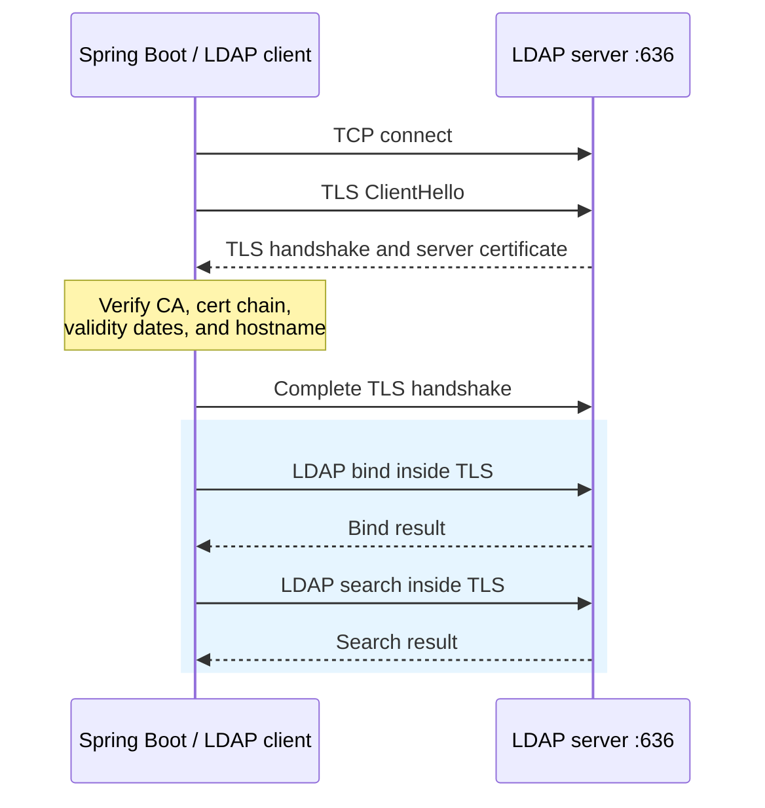
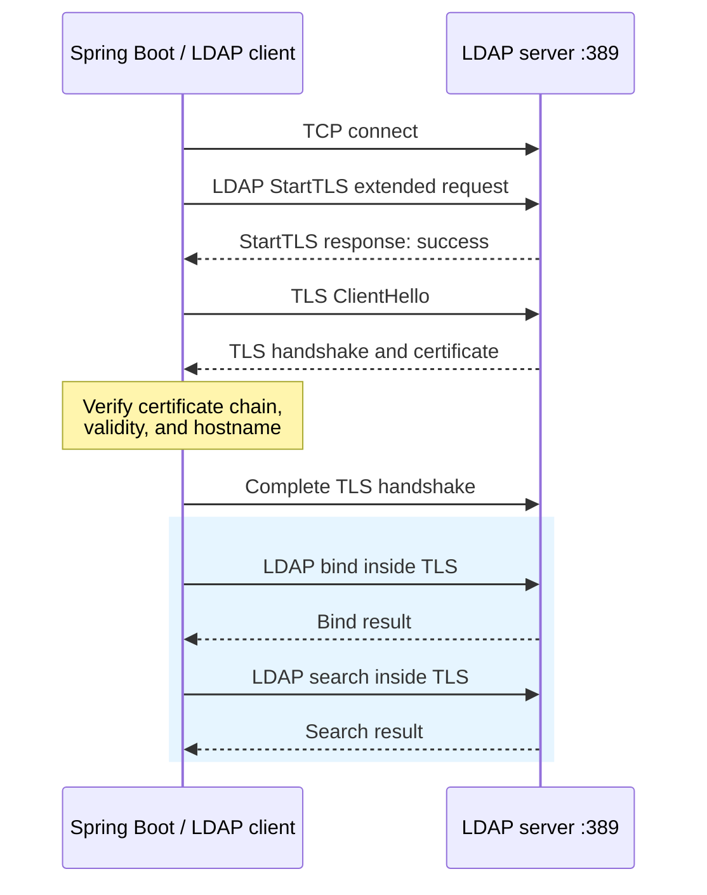

# LDAPS, StartTLS, and Certificate Verification

## 1. Why Do LDAP Connections Need TLS?

In **Spring Boot** integration systems, LDAP (Lightweight Directory Access Protocol) is often used to look up accounts, groups, organizational units, or authenticate login credentials against a directory service like OpenLDAP or Active Directory. The application may need to **bind** using a service account, search users by attributes, read groups, or check access permissions. These operations can carry usernames, passwords, and identity data that must be protected over the network.

If an LDAP connection is unencrypted, anyone able to observe network traffic can read queries, responses, and *simple bind* credentials. Two common ways to protect the connection channel are **LDAPS** and **StartTLS**. Both use TLS, differing in when the TLS session begins and how the client establishes the connection.

**TLS protects the transport channel; user authentication and read/write authorization remain the responsibility of LDAP binds, directory policies, and application logic.** An encrypted connection that accepts an invalid server certificate can still be redirected to a spoofed server.

### 1.1. Terms to Distinguish

| Term | Role | Example |
| --- | --- | --- |
| LDAP | Protocol for querying and operating on a directory service | Searching users by `uid`, reading the `memberOf` attribute. |
| LDAP bind | Authenticating or establishing the identity the client uses with the directory | Binding as `cn=svc-reader,ou=services,dc=example,dc=org`. |
| TLS | Protects confidentiality, integrity, and helps authenticate the remote peer | Client verifies the server certificate before sending a password. |
| LDAPS | LDAP running inside TLS established immediately upon connection | Typically `ldaps://directory.example.org:636`. |
| StartTLS | LDAP extended operation requesting an upgrade of an existing LDAP connection to TLS | Typically `ldap://directory.example.org:389`, followed by StartTLS. |
| CA / truststore | Trusted certificate store used by the client to verify certificate chains | PKCS#12 truststore containing the internal CA authorized to sign LDAP certs. |
| SAN (*Subject Alternative Name*) | Set of DNS/IP identities declared by the certificate | `DNS:directory.example.org`. |

Ports **389** and **636** are merely common conventions; organizations may use different ports. Security depends on whether TLS is established properly **and certificates are verified correctly**, not on the port number alone.

## 2. LDAPS: TLS from Connection Start

With **LDAPS**, the client opens a TCP connection to the LDAP endpoint and performs the TLS handshake before sending any LDAP request, including bind.



Basic flow:

1. The application connects to `ldaps://directory.example.org:636`.
2. The client receives the certificate presented by the server and validates it under the JVM/client's trust policy.
3. Only after the TLS handshake succeeds does the client send LDAP operations like bind and search.
4. If certificate validation fails, the connection must abort; the application reports a connection/directory error rather than sending passwords over an insecure channel.

In integration scenarios, LDAPS fits when directory infrastructure exposes a dedicated TLS endpoint and network intermediaries (load balancers, firewalls, proxies) support it. Verify the certificate actually presented by the **endpoint the application connects to**: it may be the LDAP server itself or a load balancer terminating TLS.

## 3. StartTLS: Upgrading an LDAP Session to TLS Before Bind

With **StartTLS**, the client starts with a normal LDAP connection and then sends a **StartTLS** extended request. Once the server accepts, both sides negotiate a TLS handshake over that same connection. LDAP operations carrying sensitive data must only be sent **after TLS has completed and the certificate has been verified**.



Key point: **`ldap://` does not automatically mean unencrypted if the application actually negotiates StartTLS successfully**. Conversely, configuring only an `ldap://...:389` URL without enabling StartTLS leaves the connection unprotected.

### 3.1. Fail-Closed Rules When Using StartTLS

A secure StartTLS setup must treat the TLS upgrade as mandatory:

- Never perform a password *simple bind* or send sensitive data before the TLS handshake succeeds.
- If the server returns `StartTLS unsupported`, the handshake fails, or the certificate is invalid, **close the connection and report an error**. Never retry automatically over plaintext LDAP.
- Never disable CA or hostname checks just to make the connection "work."
- Do not confuse `ldaps://...:636` with StartTLS: LDAPS negotiates TLS upfront, while StartTLS begins on an `ldap://` connection.
- When using connection pools or reconnects, ensure **every new connection** is TLS-protected before authenticating and executing queries. Exercise particular caution with default JNDI pooling when using StartTLS.

At the protocol level, StartTLS has an initial unencrypted phase prior to TLS. Therefore, the application **strictly insisting on the upgrade** is decisive: an active intermediary must never be allowed to downgrade the client into unencrypted authentication.

### 3.2. Comparing LDAPS and StartTLS

| Criterion | LDAPS | LDAP + StartTLS |
| --- | --- | --- |
| Typical URL | `ldaps://host:636` | `ldap://host:389` |
| When TLS starts | Immediately on connect | After a successful StartTLS extended request |
| Pre-TLS LDAP phase? | No | Yes, to exchange the StartTLS request; **no password sent yet** |
| Server certificate verification | Mandatory for security | Mandatory for security |
| Upgrading from existing LDAP endpoint | Requires an LDAPS endpoint | Requires server and client StartTLS support |
| Typical config pitfalls | Wrong truststore, hostname, cert on listener 636 | Missing StartTLS step, plaintext fallback, wrong pooling |
| Encrypted queries once TLS is up | Yes | Yes |

When configured and certificate-verified properly, both protect LDAP traffic in transit. Choosing between them depends on directory service policy, client capabilities, and deployed infrastructure.

## 4. What Does Server Certificate Verification Actually Entail?

In TLS, receiving a certificate does not automatically mean the server is trustworthy. The client must verify the **trust path** and **endpoint identity**.

### 4.1. Certificate Chain and Trusted CA

Servers typically send their own leaf/server certificate plus any intermediate CA certificates. The client builds a chain up to a **trust anchor** in an authorized truststore. The JVM's default truststore covers public CAs; with an enterprise's internal CA, the application usually needs a truststore holding that internal CA.

```text
      Internal Root CA (trust anchor)
                  │ signs
                  ▼
            Intermediate CA
                  │ signs
                  ▼
        LDAP Server Certificate
        SAN: directory.example.org
                  │
                  ▼
        Client builds trust path
        and verifies endpoint identity
```

Conditions typically checked:

1. **Trust:** the signature chain verifies up to a trusted CA in the appropriate truststore.
2. **Validity:** the certificate is neither expired nor premature (`notBefore`/`notAfter`); system clocks must be accurate.
3. **Hostname:** the DNS name/IP the app actually connects to matches an identity in the certificate's **SAN**. Having a certificate "signed by the right CA" does not substitute for hostname checks.
4. **Purpose and algorithms:** certificate/key/algorithms fit TLS server authentication and current security policies—for example, Extended Key Usage `serverAuth` when EKU applies.
5. **Revocation status (if policy requires):** CRL/OCSP must be configured and verified per operational policy; never assume every JVM checks online revocation across all configurations.

**Core takeaway:** the truststore answers "which CA is trusted?", while hostname verification answers "is this the exact server I intended to reach?". Both are required.

### 4.2. Why a Hostname Mismatch Is Dangerous Even with a Validly Signed Certificate

Suppose the app connects to `directory.example.org`, yet the server certificate lists only `DNS:ldap-node-01.internal.example.org`. The signature and validity dates may be fine, yet it does not prove the peer is authorized to represent `directory.example.org`.

The fix is issuing a certificate with a SAN matching the endpoint used by the app, or switching the endpoint to an **authorized name that matches** the certificate. If connecting by IP, the certificate normally needs a matching `IP Address` SAN; a DNS SAN does not automatically validate an IP address.

Never accept "quick fixes" like returning `true` from `HostnameVerifier`, installing a trust-all TrustManager, or disabling JNDI endpoint identification. They destroy your ability to detect spoofed servers even though the wire is encrypted.

### 4.3. Truststore vs. Keystore

| Component | Contents | Typical Use Case |
| --- | --- | --- |
| Client **Truststore** | Trusted CA certificates or server certificates | Verifies the **LDAP server** certificate. |
| Client **Keystore** | **Client's** private key and certificate | Needed only when the LDAP server requires TLS client certificates (*mutual TLS*, mTLS). |
| Server cert and private key on LDAP server/proxy | Server identity and matching private key | Presented to clients during the TLS handshake. |

LDAP username/password binding over TLS **is not** mTLS. They are two separate authentication layers. Only configure client certificates when the directory system requires mTLS.

## 5. Configuring LDAPS in Spring Boot

Spring Boot integrates LDAP via **Spring LDAP**. When an application needs to bind and query a directory, configure `spring.ldap.*` and let Spring Boot auto-configure connection beans when matching dependencies are present.

### 5.1. `application.yml` Configuration

```yaml
spring:
  ldap:
    urls: ldaps://directory.example.org:636
    base: dc=example,dc=org
    username: cn=svc-reader,ou=services,dc=example,dc=org
    password: ${LDAP_BIND_PASSWORD}
```

Where:

- `urls` is the TLS endpoint; the hostname must appear in the SAN of the certificate served there.
- `base` is the root DN for searches, **not** the DNS name used for certificate checks.
- `username` is the DN of the service account used to bind; its rights should be sufficient for business needs and no broader.
- `password` comes from runtime secrets, never committed to Git or logged.

Specifying `ldaps://` alone does not resolve **internal CAs**: the JVM still needs a truststore trusting the server's certificate chain.

### 5.2. Configuring the JVM Truststore

With an existing PKCS#12 truststore, pass the appropriate JVM system properties at startup:

```text
-Djavax.net.ssl.trustStore=/etc/app/certs/ldap-truststore.p12
-Djavax.net.ssl.trustStoreType=PKCS12
-Djavax.net.ssl.trustStorePassword=<password supplied via secret>
```

These lines illustrate JVM arguments with a placeholder password; **never copy bracketed placeholders into live commands or hardcode secrets in repositories**. Use your deployment's secret mechanism and restrict file read permissions on both the truststore and secret. These JVM properties can affect **other TLS connections using the default `SSLContext`** in the same Java process; if the application integrates with multiple systems needing different CAs, design trust management intentionally instead of accidentally replacing the entire trusted CA set.

You can build a dedicated truststore from a CA certificate **whose authenticity was verified over a trusted channel**:

```bash
keytool -importcert -trustcacerts \
  -alias corporate-ldap-ca \
  -file corporate-ldap-ca.pem \
  -keystore ldap-truststore.p12 \
  -storetype PKCS12

keytool -list -v \
  -keystore ldap-truststore.p12 \
  -storetype PKCS12
```

`keytool` may prompt interactively for a password. Never blindly grab whatever certificate an unverified connection returns and add it to the truststore: that turns an attacker's certificate into a trusted root. When adding a new CA or rotating certificates, update truststores before cutting over the server.

### 5.3. Query Example After TLS Connects Successfully

An `LdapTemplate` from Spring LDAP can execute queries with library-built filters:

```java
import java.util.List;
import javax.naming.directory.Attributes;
import org.springframework.ldap.core.AttributesMapper;
import org.springframework.ldap.core.LdapTemplate;
import org.springframework.ldap.query.LdapQuery;
import org.springframework.stereotype.Service;

import static org.springframework.ldap.query.LdapQueryBuilder.query;

@Service
public class DirectoryLookupService {
    private final LdapTemplate ldapTemplate;

    public DirectoryLookupService(LdapTemplate ldapTemplate) {
        this.ldapTemplate = ldapTemplate;
    }

    public List<String> findCommonNames(String uid) {
        LdapQuery q = query()
                .base("ou=people")
                .where("uid").is(uid);

        return ldapTemplate.search(q, (AttributesMapper<String>) attrs -> {
            var cn = attrs.get("cn");
            return cn == null ? null : cn.get().toString();
        });
    }
}
```

The example focuses on calling LDAP via `LdapTemplate`; TLS configuration operates at the **connection layer**, before this query executes. The filter is built via the API to avoid concatenating user input into LDAP filter strings. In real projects, decide how to handle missing or multi-valued `cn` attributes, read permissions, and empty results per the directory's data contract.

## 6. Configuring StartTLS in Spring LDAP

StartTLS requires explicitly configuring Spring LDAP's authentication strategy. Do not simply change an LDAPS URL to `ldap://` assuming TLS stays enabled.

### 6.1. Application Configuration

```yaml
app:
  directory:
    url: ldap://directory.example.org:389
    base-dn: dc=example,dc=org
    bind-dn: cn=svc-reader,ou=services,dc=example,dc=org
    bind-password: ${LDAP_BIND_PASSWORD}
```

These are **custom-defined properties** (`app.directory.*`) for the bean example below. They are not built-in Spring Boot properties that enable StartTLS automatically.

### 6.2. `LdapContextSource` Bean Using StartTLS Strategy

```java
import org.springframework.beans.factory.annotation.Value;
import org.springframework.context.annotation.Bean;
import org.springframework.context.annotation.Configuration;
import org.springframework.ldap.core.LdapTemplate;
import org.springframework.ldap.core.support.DefaultTlsDirContextAuthenticationStrategy;
import org.springframework.ldap.core.support.LdapContextSource;

@Configuration
public class LdapStartTlsConfiguration {

    @Bean
    public LdapContextSource ldapContextSource(
            @Value("${app.directory.url}") String url,
            @Value("${app.directory.base-dn}") String baseDn,
            @Value("${app.directory.bind-dn}") String bindDn,
            @Value("${app.directory.bind-password}") String bindPassword) {

        LdapContextSource source = new LdapContextSource();
        source.setUrl(url); // ldap://...:389, not ldaps://
        source.setBase(baseDn);
        source.setUserDn(bindDn);
        source.setPassword(bindPassword);
        source.setPooled(false); // avoid native JNDI pooling when using StartTLS
        source.setAuthenticationStrategy(
                new DefaultTlsDirContextAuthenticationStrategy());
        return source;
    }

    @Bean
    public LdapTemplate ldapTemplate(LdapContextSource ldapContextSource) {
        return new LdapTemplate(ldapContextSource);
    }
}
```

Spring LDAP's `DefaultTlsDirContextAuthenticationStrategy` **negotiates StartTLS prior to the bind step**. Here, server certificate validation still relies on the securely configured truststore, SSL/TLS provider, and hostname verification policy of the JVM; enabling StartTLS does not permit skipping certificate validation. The same `LdapTemplate` can run queries once `LdapContextSource` establishes and authenticates the context.

Because this example manually declares `LdapContextSource` and `LdapTemplate`, ensure all application LDAP beans reference this connection source and do not inadvertently spin up a separate plaintext LDAP source. Spring Boot/Spring LDAP versions may differ in auto-configuration and lifecycle handling: test against your project's exact dependency versions.

### 6.3. Illustrating the StartTLS Sequence at the JNDI Level

To understand the connection order, Java JNDI provides `StartTlsRequest` and `StartTlsResponse`. This snippet shows the sequence **open anonymous connection → upgrade to TLS → bind with password → query**, rather than sending the password before TLS:

```java
import java.util.Hashtable;
import javax.naming.Context;
import javax.naming.NamingException;
import javax.naming.ldap.InitialLdapContext;
import javax.naming.ldap.StartTlsRequest;
import javax.naming.ldap.StartTlsResponse;

public class JndiStartTlsExample {
    public void connectAndBind(String bindDn, String password)
            throws Exception {

        Hashtable<String, Object> env = new Hashtable<>();
        env.put(Context.INITIAL_CONTEXT_FACTORY,
                "com.sun.jndi.ldap.LdapCtxFactory");
        env.put(Context.PROVIDER_URL, "ldap://directory.example.org:389");
        env.put(Context.SECURITY_AUTHENTICATION, "none");

        InitialLdapContext ctx = new InitialLdapContext(env, null);
        StartTlsResponse tls = null;
        try {
            tls = (StartTlsResponse) ctx.extendedOperation(
                    new StartTlsRequest());
            tls.negotiate(); // TLS handshake and certificate verification

            ctx.addToEnvironment(Context.SECURITY_AUTHENTICATION, "simple");
            ctx.addToEnvironment(Context.SECURITY_PRINCIPAL, bindDn);
            ctx.addToEnvironment(Context.SECURITY_CREDENTIALS, password);
            ctx.reconnect(null); // Execute bind after TLS is established

            // Only now execute LDAP searches or authorized operations.
        } finally {
            if (tls != null) {
                tls.close();
            }
            ctx.close();
        }
    }
}
```

This illustrates protocol ordering, not a replacement for Spring LDAP when your project uses `LdapTemplate`. In production, add timeouts, resource-close error handling, metrics, and secret management. **Never** put `Context.SECURITY_PRINCIPAL` and `SECURITY_CREDENTIALS` in the initial context environment before StartTLS succeeds: some providers automatically bind immediately when creating the context.

## 7. Verifying Certificates and Endpoints Before Operations

To troubleshoot TLS failures, first confirm the exact **hostname, port, and connection mode** the application uses. Test from a network environment matching the Spring Boot pod/VM because DNS, proxies, firewalls, and truststores may differ from a local laptop.

### 7.1. Testing LDAPS with OpenSSL

Suppose you have the trusted CA certificate `corporate-ldap-ca.pem`:

```bash
openssl s_client \
  -connect directory.example.org:636 \
  -servername directory.example.org \
  -verify_hostname directory.example.org \
  -verify_return_error \
  -showcerts \
  -CAfile corporate-ldap-ca.pem
```

`-verify_hostname` enforces DNS name verification; `-verify_return_error` surfaces verification failures explicitly; and `-CAfile` sets the trusted CA for **this test command**. `-showcerts` is useful for inspecting the full certificate chain presented by the endpoint. If the hostname or OpenSSL build lacks these flags, pick appropriate checks instead of skipping hostname validation.

### 7.2. Testing StartTLS with OpenSSL

```bash
openssl s_client \
  -connect directory.example.org:389 \
  -starttls ldap \
  -verify_hostname directory.example.org \
  -verify_return_error \
  -showcerts \
  -CAfile corporate-ldap-ca.pem
```

`-starttls ldap` tells OpenSSL to send the LDAP StartTLS upgrade request before the TLS handshake. If this succeeds yet the application still fails, inspect the **JVM truststore**, actual endpoint name, TLS policy, and how Spring LDAP activates the StartTLS strategy. OpenSSL may use different CAs and verification rules than Java, so `s_client` succeeding **does not prove** Spring Boot's connection will succeed.

### 7.3. Inspecting Java Truststores and Debugging Handshakes

```bash
keytool -list -v \
  -keystore /etc/app/certs/ldap-truststore.p12 \
  -storetype PKCS12
```

In test environments, temporary JSSE logging can be enabled via JVM option:

```text
-Djavax.net.debug=ssl,handshake
```

Handshake logs help inspect the chosen certificate, TLS version, and failure cause. Enable only in controlled environments, restrict log access, and turn it off after diagnosing; avoid leaking secrets/internal details. You can inspect an exported server certificate and its SANs directly:

```bash
openssl x509 -in ldap-server.pem -noout -text
```

Examine `Subject Alternative Name`, `Issuer`, `Not Before`, `Not After`, `Key Usage`, and `Extended Key Usage` where present. Never rely on `Subject CN` alone instead of SAN validation in modern designs.

## 8. Common Errors, Causes, and Fixes

| Symptom | Possible Cause | Investigation / Fix |
| --- | --- | --- |
| `PKIX path building failed` or `unable to find valid certification path` | Missing trusted CA, missing intermediate cert, wrong truststore loaded by JVM | Inspect endpoint cert chain; verify right CA; configure truststore and provide needed intermediates. |
| `No subject alternative DNS name matching ...` | URL DNS name mismatches SAN | Issue cert with matching SAN or switch to a valid matching endpoint name. |
| `CertificateExpiredException` / `CertificateNotYetValidException` | Certificate expired, not yet valid, or clock skew | Check system time; coordinate timely certificate rotation. |
| `handshake_failure` / `protocol_version` | No matching protocol, cipher, or algorithm, or rejected by TLS policy | Check server/JVM TLS support, security policies, certs, and algorithms; prefer TLS 1.2/1.3 per infra standards. |
| `Connection refused`, timeout | Wrong port/host, firewall, LDAPS/StartTLS not enabled on server, DNS error | Check host/port, listeners, network policies, and routing from the app pod/VM. |
| StartTLS reports `unsupported` or extended error | Server/proxy does not support StartTLS on that endpoint | Verify directory service config; use published endpoint; never fall back to plaintext. |
| LDAPS on port 389 or StartTLS on port 636 protocol error | Mixed up TLS startup method | Use `ldaps://` for LDAPS or `ldap://` + StartTLS per the endpoint. |
| TLS succeeds yet bind returns `invalidCredentials` | Wrong bind DN/password, account locked/expired, or directory policy | Verify bind identity, secret, and directory policy; do not debug by disabling TLS. |
| TLS succeeds yet search returns `insufficientAccessRights` | Directory ACL forbids bind account from reading attributes | Configure least privilege, check base DN and filter; this is not a certificate error. |
| Intermittently succeeds, intermittently fails hostname/CA | Nodes behind load balancer present different certs, incomplete CA rotation | Inspect every backend endpoint and full cert chain under load balancing; plan cert/truststore rollout. |

Never resolve certificate errors by disabling TLS hostname verification, writing a trust-all `TrustManager`, or downgrading to unencrypted LDAP. Those choices hide the root cause and break endpoint authentication.

### 8.1. Example Investigation When a Newly Deployed Pod Hits PKIX Errors

A Spring Boot service connects to `ldaps://directory.example.org:636` in staging yet throws `PKIX path building failed` in a production pod.

1. **Identify the actual endpoint and JVM:** log hostname/port (never passwords), JDK version, `javax.net.ssl.trustStore`, and truststore type.
2. **Check network and cert chain from production:** use an appropriate TLS tool to inspect the cert actually presented by the endpoint or load balancer.
3. **Cross-check CA:** ensure the truststore is mounted at the expected path and holds the signing CA for the active chain; verify process file read permissions.
4. **Check hostname and time:** confirm `directory.example.org` is in SAN, certificate dates are valid, and pod/node clocks are synced.
5. **Test after fixing:** connect via the Java app with the right truststore, verify bind/search succeed, and test against a wrong CA or hostname to ensure connection rejection works.

If OpenSSL succeeds while the JVM fails, focus on truststore differences, JVM version, TLS support, and providers. If both fail, check endpoint configuration and certificates before changing application code.

## 9. Managing Certificates Across Multi-Service Environments

An LDAP integration often runs across many pods/hosts connecting through a load balancer. To prevent outages during certificate rotations:

1. **Monitor expiry:** alert ahead of server and CA certificate expiration, including intermediate certificates.
2. **Rotate in order:** when replacing a CA, distribute the new trust anchor to applications before swapping server certs; maintain a controlled overlap window if policy permits.
3. **Check every node:** each LDAP node or proxy can serve a different cert/chain; never probe one IP and assume the whole cluster matches.
4. **Evaluate referrals and secondary endpoints:** if the LDAP client chases referrals to another host, every secondary connection must also enforce TLS and verify target host identity per security policy.
5. **Protect secrets:** store bind passwords in a secret store, enforce least privilege, and avoid logging bind details or unnecessary personal data.
6. **Bound connections and timeouts:** set proper timeouts so TLS/LDAP failures never stall business threads indefinitely; monitor bind and search latency.
7. **Negative testing:** use test environments to confirm expired certs, untrusted CAs, mismatched SANs, and StartTLS failures are all safely rejected.

When Spring Boot uses LDAP to resolve identities for other integration flows (HTTP, databases, message brokers), distinguish **directory unreachable** from **account not found** or **wrong password**. An LDAP timeout/handshake failure is an infrastructure incident: never turn it into "user lacks permissions" or auto-allow access. Apply bounded retries, circuit breakers, or recovery strategies aligned with availability needs and authentication policies.

## 10. Pre-Production Checklist for LDAP TLS

| Verification Question | Desired Condition |
| --- | --- |
| Does the app connect via LDAPS or StartTLS? | URL, port, and TLS startup mode match the infrastructure-published endpoint. |
| Are credentials ever sent before TLS? | No; StartTLS is strictly required to succeed prior to bind. |
| Is the certificate chain valid? | Builds a trusted path to an authorized CA in the truststore. |
| Is hostname verification active? | Matching SAN connects; mismatched SAN fails. |
| Is the certificate valid and fit for purpose? | Validity dates, algorithms, and server-auth policy verified. |
| Does the JVM use the right truststore? | Path, store type, read permissions, and secret controlled. |
| Is there any plaintext or trust-all fallback? | None. |
| Are load balancers, referrals, or multiple replicas present? | Every involved endpoint verified and managed consistently for certificates. |
| Have TLS/CA/hostname failures been integration-tested? | Operations rejected, no credential leaks, errors classified accurately. |
| Is a certificate rotation and monitoring plan in place? | Expiry alerts, CA update rollout, and post-change verification exist. |

**Connecting the concepts:** LDAPS starts TLS immediately upon connect; StartTLS upgrades an LDAP connection prior to sensitive operations; and **certificate and hostname verification** determine whether the app is actually talking to the trusted directory server. In Spring Boot, URL configuration, StartTLS strategy, truststores, and certificate lifecycles must be verified together so the LDAP integration stays both reliable and securely bounded.
