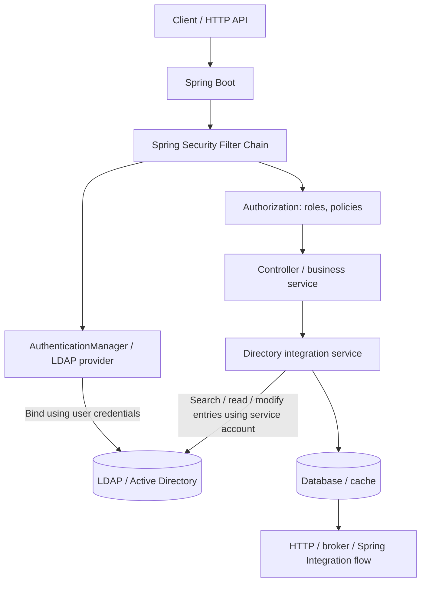
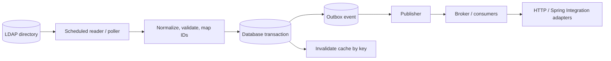
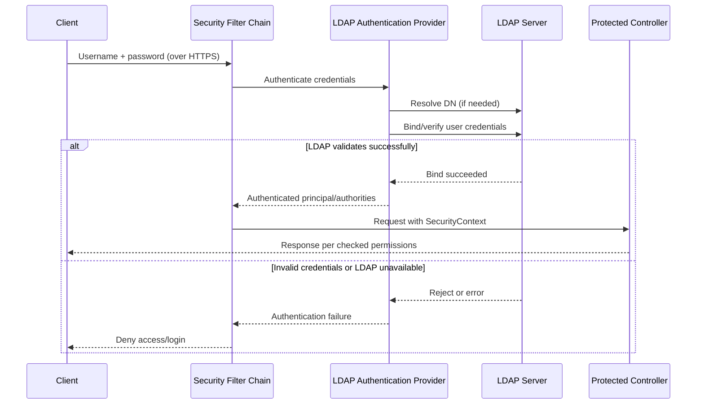

# Distinguishing Directory Data Integration from Spring Security Authentication

## 1. Two Needs Sharing LDAP with Different Architectural Goals

In **SPRING_BOOT_INTEGRATION**, Spring Boot applications often connect to an LDAP or Active Directory (AD) system to look up employees, departments, groups, account statuses, and contact details. At the same time, the application may need to verify the identity of users logging in. Both needs communicate with the directory service yet belong to **two distinct architectural responsibilities**:

- **Directory data integration:** reading, searching, syncing, or updating entries/attributes to supply data for business workflows. Typically uses Spring LDAP, `LdapTemplate`, or LDAP/JNDI APIs orchestrated by a service or integration flow.
- **Spring Security authentication:** validating user credentials via an `AuthenticationProvider` or `AuthenticationManager`, producing an authenticated `Authentication`, and storing it in `SecurityContext` per the application's security model. Spring Security may use LDAP bind or another method such as OIDC; LDAP is **one possible authentication source**, not the definition of Spring Security.
- **Authorization:** after authentication, the application decides who can do what based on authorities/roles and access rules. Fetching groups from LDAP can supply authorization data, yet **looking up groups** and **granting access** remain separate steps.

For example, `GET /employees/{id}` reads `displayName` from LDAP for HR synchronization. `POST /orders/approve` must verify the caller is authenticated and holds `ORDER_APPROVER`. Both may touch the directory, yet a service reading an employee's entry **does not prove** the caller knows that employee's password.

### Diagram of the Two Paths



The diagram shows both directory access paths. In concrete implementations, the auth provider may use a service account to **locate the DN**, then **bind using the user's credentials**; search and bind behavior depend on the directory type.

## 2. Comparison by Responsibility and Data Contract

| Criterion | LDAP Data Integration | LDAP Authentication via Spring Security |
|---|---|---|
| Business question | "Which department does this employee belong to?", "Which entries changed?" | "Did the logging-in user prove their identity?" |
| Inputs | User ID, DN, LDAP filter, search scope, checkpoint | Username + authentication-session credentials, request context |
| LDAP operations | Search, read, compare, modify, add/delete per permissions | Resolve DN and attempt bind/credential verification per provider |
| Connection identity | Usually a least-privileged service account | Possibly service bind to search plus user bind to verify |
| Output | Directory record/DTO or sync result | `Authentication`, principal, and authorities in security context |
| Spring components | Spring LDAP `LdapTemplate`, service, scheduler, IntegrationFlow | `SecurityFilterChain`, `AuthenticationManager`, LDAP authentication provider |
| When not found | Return empty or "entry not found"; business flow decides | Login fails, no authenticated session created |
| When LDAP fails | Can retry, enqueue, preserve checkpoint; data may temporarily lag | Must deny authentication or follow an explicit backup policy, never auto-allow |
| Caching | Can cache low-sensitivity attributes with suitable TTL | Never use synced attribute caches as proof a user authenticated |
| Transactions | May update DB/broker post-sync; no automatic atomic cross-system txn | Auth establishes security/request state; does not commit business changes |
| Observability | Entries read, sync latency, checkpoints, lag, schema errors | Login success/failure rates, bind latency, connectivity errors, audits |

**Never merge both responsibilities** into one monolithic "LDAP service" just because they share a URL. They may share connection infrastructure when appropriate, yet policies for secrets, lifecycles, timeouts, permissions, errors, and caching differ.

## 3. LDAP Concepts You Need to Get Right

LDAP is a directory access protocol. Data forms a tree of entries, each with a **distinguished name (DN)** and multiple attributes. Exact structure depends on the directory product and schema.

Illustrative example with an `inetOrgPerson`-style schema:

```text
dc=example,dc=org
└── ou=people
    └── uid=linh,ou=people,dc=example,dc=org
        objectClass: inetOrgPerson
        uid: linh
        cn: Nguyen Linh
        mail: linh@example.org
└── ou=groups
    └── cn=order-approvers,ou=groups,dc=example,dc=org
```

Components:

- **DN:** entry's position identifier in the tree, e.g., `uid=linh,ou=people,dc=example,dc=org`; can change when moved/renamed.
- **Base DN:** configured search root, e.g., `dc=example,dc=org`.
- **Search base:** specific branch to search, e.g., `ou=people` relative to base.
- **LDAP filter:** entry condition, e.g., `(&(objectClass=inetOrgPerson)(uid=linh))`; user input must be escaped per LDAP filter rules.
- **Attribute:** name, email, account status, group; not every attribute exists in every directory.
- **Bind:** establishes identity on an LDAP connection. Service binds use a service account; user binds verify user credentials per mechanism/provider.

**Implementation differences:** Microsoft Active Directory typically uses `sAMAccountName`, `userPrincipalName`, `objectGUID`, and distinct membership rules; other LDAP servers use `uid`, `entryUUID`, or `memberUid`. The `memberOf` attribute is not guaranteed to exist or behave identically across all servers. Code must specify the expected schema rather than assuming uniform layout across directories.

DN or email are not necessarily stable business keys: employees can change usernames, emails, or departments. For long-term sync, prefer an immutable directory ID if supported by your provider, and persist the source-to-ID mapping.

## 4. Directory Data Integration with Spring LDAP

### 4.1. Configuring the LDAP Source for Data Operations

Suppose an application uses Spring Boot with Spring LDAP against a test-environment directory:

```yaml
# application.yml
spring:
  ldap:
    urls: ${DIRECTORY_LDAPS_URL}
    base: dc=example,dc=org
    username: ${DIRECTORY_SERVICE_DN}
    password: ${DIRECTORY_SERVICE_PASSWORD}

app:
  directory:
    people-base: ou=people
    sync-batch-size: 200
```

`spring.ldap.*` lets auto-configuration create a context source when matching libraries/settings are present. Common dependencies are `spring-boot-starter-data-ldap` for Spring Data LDAP, or the project's Spring LDAP library; ensure `LdapTemplate` uses the right `ContextSource` in your version.

- `DIRECTORY_SERVICE_DN` is the **service account for data operations**, granted minimum read rights to only required branches/attributes—never an admin account.
- Example URL should be `ldaps://directory.example.org:636` protected by valid TLS; on other ports, StartTLS can be used if client/server are configured properly.
- Never place passwords in tracked source files, logs, or arbitrary parameters; use a secret manager or deployment platform secret injection.
- `app.directory.*` properties are **custom-defined** and must be explicitly bound/read by the app; they have no built-in effect merely by appearing in YAML.

**Configuring LDAP here does not turn on Spring Security login.** An app can look up a directory while using JWT, OIDC, SAML, or another system for login.

### 4.2. Reading Entries with `LdapTemplate`

Example targeting a directory supporting `inetOrgPerson` and `uid`. Accepts a user code and builds the filter via a builder rather than concatenating request strings:

```java
@Service
public class DirectoryUserReader {
    private final LdapTemplate ldapTemplate;

    public DirectoryUserReader(LdapTemplate ldapTemplate) {
        this.ldapTemplate = ldapTemplate;
    }

    public Optional<DirectoryUser> findByUid(String uid) {
        AndFilter filter = new AndFilter();
        filter.and(new EqualsFilter("objectClass", "inetOrgPerson"));
        filter.and(new EqualsFilter("uid", uid));

        List<DirectoryUser> matches = ldapTemplate.search(
                "ou=people",
                filter.encode(),
                (AttributesMapper<DirectoryUser>) attrs ->
                        new DirectoryUser(
                                attribute(attrs, "uid"),
                                attribute(attrs, "cn"),
                                attribute(attrs, "mail")
                        )
        );

        if (matches.size() > 1) {
            throw new IllegalStateException("uid is not unique in the search scope");
        }
        return matches.stream().findFirst();
    }

    private static String attribute(Attributes attrs, String name)
            throws NamingException {
        Attribute value = attrs.get(name);
        return value == null ? null : String.valueOf(value.get());
    }

    public record DirectoryUser(String uid, String displayName, String email) {}
}
```

The example requires imports from `org.springframework.ldap.core`, `org.springframework.ldap.filter`, `javax.naming`, Java Collections, and Spring stereotypes. `LdapTemplate.search` returns matching records; `AttributesMapper` converts attributes into the DTO. Validate `null`/blank values and schemas for required fields instead of silently tolerating missing data.

**Security note:** `findByUid` reads via service account permissions and **takes no user password**. Even when finding exactly one entry, `Optional<DirectoryUser>` is not an `Authentication`; never set `authenticated=true` or create a security context merely from a successful lookup.

For untrusted inputs, cap length, validate ID format, and always escape filters. When building a DN to update an entry, use `LdapNameBuilder`/DN APIs instead of concatenating DNs with special characters.

### 4.3. Syncing the Directory to DB, Cache, and Broker

Typical integration flow:



Key responsibilities:

1. **Define the data contract:** map names/IDs/departments/memberships to business DTOs. Specify which attributes are persisted, which may be absent, and which are multi-valued.
2. **Idempotent sync:** upsert by stable key; track source identifier and appropriate version/timestamp/checksum. Rescanning an entry must not create duplicate rows or emit duplicate side effects.
3. **Handle changes/deletes:** querying solely by `modifyTimestamp` can miss deletions, rapid edits, clock skew, or permission changes. Where supported by the provider, consider DirSync/changelog/persistent search; otherwise run controlled periodic full reconciliations.
4. **Paging and load caps:** directories enforce size/time limits, connection limits, and paging. Never assume one LDAP search returns hundreds of thousands of entries.
5. **Errors and retries:** network/timeout errors may be retried with backoff; schema, mapping, or invalid data errors must be classified and persisted for handling. Avoid tight polling loops when the directory is overloaded.
6. **Downstream notifications:** use an outbox or reliable strategy when updating a DB and publishing broker events, as LDAP → DB → broker has no default distributed transaction.
7. **Caching:** configure reasonable TTLs/tenant partitioning; when directory or DB changes, invalidate per business rules. Never rely on stale cached data to assume a password is still valid.

If a sync step fails, the application can retain the latest synced data and expose **data freshness/staleness** per business policy. Allowing reads of stale data is a business choice, never a default rule for authentication.

## 5. Authenticating with Spring Security LDAP

### 5.1. What Is the Authentication Flow?

When Spring Security integrates with LDAP, `AuthenticationManager` delegates to one or more `AuthenticationProvider`s. The provider verifies credentials against the directory and creates an authenticated `Authentication` holding the principal and mapped authorities. HTTP security treats requests as authenticated only after authentication succeeds.



Two common credential verification approaches:

- **Bind authentication:** bind with the user's DN and password. Usually preferred so the directory itself checks passwords and account policies.
- **Password comparison:** read/compare via directory/provider mechanisms; password attributes, hash formats, and read permissions vary by vendor. Never build custom password comparison over LDAP data because security subtle bugs are easy to introduce.

In practice, bind authentication is preferred when supported and aligned with policy. Authentication may include a service-account search to resolve the DN from username before performing the user bind. If the directory reports locked/expired accounts or wrong credentials, handle them per security policy and provider behavior.

Never implement authentication by calling LDAP simple bind directly with an empty or `null` password. Some servers permit *unauthenticated binds* when a DN is non-empty and password is empty; custom client code could misinterpret that as a successful login. Use Spring Security's standard providers, test empty-password cases, and never pass passwords into data-sync services.

### 5.2. Example Configuring an AuthenticationManager Using LDAP Bind

Example for a simple web application on a Spring Security version supporting `LdapBindAuthenticationManagerFactory`, where user DNs follow `uid={0},ou=people,dc=example,dc=org` and `BaseLdapPathContextSource` is configured with base `dc=example,dc=org`:

```java
@Configuration
@EnableWebSecurity
class WebSecurityConfiguration {

    @Bean
    AuthenticationManager ldapAuthenticationManager(
            BaseLdapPathContextSource contextSource) {

        LdapBindAuthenticationManagerFactory factory =
                new LdapBindAuthenticationManagerFactory(contextSource);
        factory.setUserDnPatterns("uid={0},ou=people");
        return factory.createAuthenticationManager();
    }

    @Bean
    SecurityFilterChain apiSecurity(
            HttpSecurity http,
            AuthenticationManager ldapAuthenticationManager) throws Exception {

        http.authenticationManager(ldapAuthenticationManager);
        http.authorizeHttpRequests(requests -> requests
                .requestMatchers("/private/**").authenticated()
                .anyRequest().permitAll());
        http.httpBasic(Customizer.withDefaults());
        return http.build();
    }
}
```

This code is an illustrative skeleton for **HTTPS-protected HTTP Basic**; real applications pick login/session/token mechanisms, CSRF/CORS rules, and authorization policies per context. Requires Spring Security LDAP alongside Spring Security Web/Config, proper imports, and compatible Spring Security/Spring LDAP versions.

Points to remember:

- `setUserDnPatterns(...)` assumes a fixed DN pattern. For non-uniform DN layouts, configure the provider's user-search base/filter with an appropriate search account.
- Setting `spring.ldap.urls` alone does not secure requests with Spring Security, nor does it make `SecurityFilterChain` use LDAP. You must explicitly configure the authentication provider/manager.
- Here, `/private/**` only requires **authenticated**. Role-based authorization requires `hasAuthority(...)`/`hasRole(...)` and consistent authority mapping.
- Spring Boot may auto-configure or customize security beans depending on dependencies; ensure you do not accidentally create conflicting `AuthenticationManager`s or filter chains.
- Health/metrics and login endpoints need explicit access rules; never expose LDAP data publicly via overly broad `permitAll()` rules in production.

With **Active Directory**, usernames may be `user@domain.example` (UPN), `DOMAIN\user`, or `sAMAccountName` depending on policy. A specialized provider like `ActiveDirectoryLdapAuthenticationProvider` may fit better than `uid={0}`. Never blindly apply OpenLDAP patterns to AD.

### 5.3. Successful Authentication Does Not Equal Authorization

Suppose a user binds successfully yet is not in the order-approval group. They are **authenticated**, yet must still be denied at the approval endpoint.

```java
@RestController
@RequestMapping("/orders")
class OrderApprovalController {

    @PostMapping("/{id}/approve")
    @PreAuthorize("hasAuthority('ORDER_APPROVER')")
    ResponseEntity<Void> approve(@PathVariable long id) {
        // Execute business logic via transactional/idempotent service.
        return ResponseEntity.noContent().build();
    }
}
```

This requires enabling method security, e.g., `@EnableMethodSecurity`, and configuring authority mapping so the principal holds `ORDER_APPROVER` only when genuinely eligible. Authorities may come from LDAP groups or another policy service.

When using `hasRole("ORDER_APPROVER")`, keep the default `ROLE_` prefix consistent with mapped authorities. Never check an attribute like `department=Finance` and automatically grant payment approval without an explicit authorization policy decision.

## 6. Groups, Roles, and Directory Data: Where the Two Flows Meet

An LDAP group captures membership, yet application authorization decisions may differ from raw group structures.

| LDAP Data | Possible Meaning | Role Mapping Considerations |
|---|---|---|
| `cn=order-approvers` in groups | User is a group member | Specify namespace, DN, nested groups, and mapping rules |
| `member` or `uniqueMember` | List of member DNs | Not every provider formats them identically |
| `memberOf` | Reverse membership attribute on some servers | May be absent, exclude nested groups, or be server-computed |
| `department` | Organizational metadata | Not automatically equivalent to access permissions |
| `accountStatus`/lock attribute | Account state (directory-dependent) | Must be enforced via auth/provider mechanisms, not only cached DTOs |

Two models exist:

1. **Map at login:** the provider or `GrantedAuthoritiesMapper` reads groups and attaches authorities to `Authentication`. Simple per-request, though roles may remain stale for the duration of the session or token lifetime.
2. **Dynamic permission check:** endpoints verify memberships/rules against a trusted source at sensitive actions, or via a permission service/cache with invalidation. Cuts update lag at the cost of real-time dependency and requiring an outage strategy.

Syncing groups into a database supports search, reporting, or precomputing permissions, yet **does not automatically update an existing `SecurityContext`**. When a user is removed from a group, define exactly when sessions/JWTs/authorities refresh or revoke. For critical security decisions, enforce tighter staleness policies than general directory caches.

## 7. Security Boundaries and Least-Privilege Principles

### 7.1. Separating Service Binds from User Binds

- **Service bind**: a technical identity for searching/reading attributes per ACLs. Proves nothing about any end user logging in.
- **User bind**: verifies a user's credentials. Must run over encrypted transport and honor directory lockout, password expiry, and disabled-account policies.
- **Proxy/impersonation or delegated authentication**: if supported by directory/SSO, design delegation and auditing explicitly. Never swap a user's DN onto a service connection pretending to act as that user.

Use **separate permission sets** for directory integration vs. authentication searches when needed; small systems may share a context source while preserving logical and permission boundaries. A search-only service account should be explicitly denied modify/add/delete rights.

### 7.2. TLS and Secrets

Password-based simple binds must run over **LDAPS or certificate-verified StartTLS**. Never disable hostname verification or trust all certificates to "fix" production errors. Configure proper truststores, certificate rotation plans, and expiry checks.

Never log passwords, sensitive DNs, full LDAP entries, security groups, or tokens. On authentication errors, return external messages that do not disclose account existence; internal security logs should capture event codes and correlation IDs with strict read access and retention.

### 7.3. LDAP Injection and Untrusted Data

**LDAP filter injection:** never concatenate raw input strings into `(&(uid=...))`. Use `EqualsFilter`/filter builders and proper escaping APIs, and validate username length/format. DN construction must likewise handle special characters through structured DN APIs.

**Unsafe attribute data:** usernames, emails, and display names fetched from LDAP are still external inputs when rendered in HTML, placed in SQL, passed to HTTP clients, or written to files. Apply output encoding, parameterized SQL, and path controls accordingly. Never treat LDAP data as automatically "clean" just because the directory is internal.

**Scope and ACLs:** keep search bases narrow, filters exact, result counts bounded, and attribute permissions minimal; never grant service accounts read access to password hashes, private keys, or unneeded fields.

## 8. Errors, Timeouts, and Dependency Policies

Data integration and authentication can both hit LDAP server errors, yet require different responses.

| Incident | Directory Data Integration | Spring Security LDAP Authentication |
|---|---|---|
| LDAP server timeout | Retry with backoff/circuit breaker; keep checkpoint and flag sync lag | Reject new user logins; log dependency failure |
| Wrong service credentials | Alert config/secret error, pause sync cleanly | If used for user search, logins fail; never bypass provider |
| Entry not found | Return `empty` or handle deletion/reconciliation per policy | Login fails, no `Authentication` created |
| LDAP filter/schema changed | Alert mapping/contract error, quarantine bad records | Can break login/role mapping; maintain clean rollback |
| Group membership changed | Sync DB/cache and invalidate | Apply authority/session/token refresh policy |
| Prolonged directory outage | Back off polling and serve snapshot within freshness bounds | Fail closed for new logins, unless a controlled backup auth mechanism exists |
| Excessive data volume | Paging, incremental sync, rate limits | Limit login searches, avoid unbounded group queries |

"Fail closed" here means **never issuing successful logins when credentials cannot be verified**. For already authenticated sessions, keeping or invalidating sessions/tokens depends on the security mechanism, lifetimes, and revocation policies; do not assume every active session instantly dies the moment LDAP goes offline.

Set short, sensible timeouts on authentication to balance UX and security; sync jobs can allow slightly longer bounds while avoiding exhausting connection pools. When sharing LDAP infrastructure, monitor resources so a heavy batch sync does not spike login latency.

## 9. Transactions, Caching, and Consistency in Spring Boot Integration

In systems combining **HTTP clients, databases, caches, message brokers, and Spring Integration**, one LDAP read can trigger updates across multiple systems:

```text
LDAP read
  -> normalize directory DTO
  -> upsert application DB
  -> invalidate Redis cache
  -> publish "directory-user-changed" event
  -> downstream HTTP adapter updates another service
```

LDAP does not join the application's JDBC transaction. Reading an entry successfully and failing the DB write must be handled explicitly; committing the DB while broker publishing fails needs an outbox/retry; failed cache invalidation can leave stale data behind. Therefore:

- Assign a **source of truth** per field type. For example, `mail` owned by the directory, `notificationPreference` owned by the app. Syncs must not overwrite app-owned fields.
- Use stable directory IDs and appropriate versions/checksums/timestamps; design **idempotent upserts** and handle duplicate events.
- Define handling for deleted/DN-changed records, updated groups, and soft-delete/deprovision workflows; never delete business records just because one search returned empty.
- Never attempt to force LDAP, DB, cache, and broker into "one atomic transaction" without real support. Use checkpoints, outbox, reconciliation, and sync-lag monitoring.
- For access-control data, enforce strict freshness policies. If role mapping reads a DB mirror, actively minimize windows where revoked memberships stay accepted.

When LDAP handles **authentication**, priorities are accurate credential validation, account protection, and authorization policies; a single login must never trigger a multi-thousand-entry batch sync.

## 10. Testing Each Responsibility Independently

### 10.1. Data Integration Tests

- **Search:** lookup by `uid`, enforced search base, distinguishing 0/1/multiple entries and missing attributes.
- **Schema data:** test nested groups, multi-valued attributes, Unicode, DN/email changes, and provider GUID/UUIDs.
- **Malicious input:** `*`, `(`, `)`, `\`, invalid bytes; verify filter builder never broadens queries.
- **Sync:** reruns create no duplicates; crash between DB and broker replays cleanly; checkpoints never advance ahead of durable writes.
- **Changes/deletes:** test incremental sync and full reconciliation; never mark all missing entries "deleted" on paged/timed-out searches.
- **Load:** result size limits, paging, and backoff when directory throttles queries.

Integration tests can use embedded LDAP or an isolated LDAP/AD-compatible test server; note that embedded LDAP does not faithfully reproduce real AD quirks and policies.

### 10.2. Authentication and Authorization Tests

- **Valid/invalid password:** user bind succeeds only with the right password; wrong passwords create no `Authentication`.
- **Locked/disabled/expired accounts:** verify provider handles server policies; exact behavior depends on directory and config.
- **Groups and roles:** mappings permit authorized endpoints; users outside the group are denied even after successful login.
- **Directory unavailable:** new authentications fail securely with zero fallback granting `anonymous` access to protected routes.
- **TLS/secrets:** verify certificates, keep passwords out of URLs/logs, and test credential rotation plans.
- **Session/authority freshness:** change directory membership and confirm refresh/revocation policies execute as expected.

Controller tests using `@WithMockUser` or mocked `Authentication` test only application **authorization** logic; they **prove nothing** about real LDAP binds. Write dedicated provider integration tests against a test directory and sample credentials to verify actual authentication paths.

### 10.3. Crucial Error-Distinction Matrix

| Operation | What Did LDAP Return? | What Must the System Conclude? |
|---|---|---|
| `findByUid("linh")` | Matching entry | Directory data exists; **no login conclusion** |
| `findByUid("unknown")` | No entry | No record in search scope |
| `authenticate("linh", "wrong")` | Bind/credentials rejected | Unauthenticated, deny login |
| `authenticate("linh", "correct")` | Valid bind | Authenticated; still must check authorization |
| `getGroups("linh")` | Returns `order-approvers` | Membership data exists; apply right mapping policy/namespace |
| `LDAP temporarily unavailable` | Search or bind timeout | Sync may defer; new logins must never default to success |

## 11. Observability and Operations

Separate operational telemetry across the two channels:

| Metric / Log | Directory Data Integration | Authentication |
|---|---|---|
| Latency | LDAP search, page/batch, DB upsert, broker publish | Resolve DN, bind, group lookup, total auth time |
| Error rates | Connectivity, schema mismatch, paging, checkpoints | Rejected credentials, locked accounts, unavailable provider |
| Progress | Last successful sync, processed/failed entries, freshness lag | Auth success/failure rates, rate limits, suspicious bursts |
| Audit | Who/what modified entries/DB records | Who logged in, outcome, and auth method |
| Alerts | Sync lag breaching SLO, high entry errors, outbox backlog | LDAP unavailable, sudden auth-error spikes, config anomalies |

Metric labels should use bounded values like `operation=search|bind`, `directory=corp`, `result=success|failure`. Never put usernames, full DNs, emails, personal groups, or passwords into metric tags. Security logs may keep correlation identifiers under defined retention and access controls without exposing sensitive data.

Monitoring LDAP connectivity/health via a service account **does not mean** end-user authentication works. Conversely, a single successful user bind does not guarantee batch sync has read rights across all needed OUs. Maintain separate checks for each responsibility.

## 12. Common Design Mistakes

**"Reading an entry in LDAP means the user is logged in."** False. Searching with the app's service account proves only that the entry exists and the client can read it. You still need credential verification or another trusted identity source.

**"I added Spring Security, so `LdapTemplate` automatically runs as the security context user."** False. Spring Security handles authentication/authorization; LDAP data services do not adopt the HTTP caller's identity when binding with a service account. Explicitly enforce access controls and sensitive-data filtering.

**"We synced groups to Redis, so permissions are always current."** False. Caches have TTLs, invalidation can fail, and sessions/JWTs may hold stale roles. Define sensitivity-based policies and revocation mechanisms.

**"Every LDAP server has `uid`, `memberOf`, and identical DN layouts."** False. Schemas, nested groups, paging, and account states vary across AD/OpenLDAP/vendors. Tailor search and mapping to the actual directory.

**"If LDAP fails, temporarily let users log in so service isn't disrupted."** Dangerous. When credentials for a new login cannot be verified, default to deny. Pre-designed HA/federated identity architectures preserve uptime without compromising identity verification.

**"LDAP → DB → Kafka sync is atomic if the method has `@Transactional`."** False. JDBC transactions generally span neither LDAP nor brokers. Use idempotency, outbox/reconciliation, and boundary-specific error handling.

**"All directory attributes can be exposed over REST."** False. Directory records hold PII, org charts, and sensitive groups. Apply caller ACLs, minimal DTOs, and safe logging.

## 13. Process for Choosing the Right Solution

Whenever a new requirement mentions "LDAP," determine upfront:

1. **Is the goal data lookup/sync or login?** For data, build an adapter/service with Spring LDAP; for login, use Spring Security's authentication mechanism or your chosen identity provider.
2. **Who is the caller and which identity touches the directory?** Service account reading data, or end user proving credentials; separate permissions and secrets.
3. **Which attributes are business data vs. security-relevant?** Never copy passwords/hashes; govern which groups/roles can drive security decisions.
4. **Must data sync to DB/cache/broker?** If so, design mapping, idempotency, checkpoints, sources of truth, acceptable lag, and recovery.
5. **What is the impact of bad data or LDAP faults?** Searches may return empty/retry; new authentications must be denied when unverified.
6. **How will it be verified?** Write separate tests for `LdapTemplate` and the LDAP auth provider, covering TLS transport, schemas, role mapping, and directory-unavailable scenarios.

## 14. Conclusion

In the **LDAP and Directories** chapter of **SPRING_BOOT_INTEGRATION**, the same LDAP server can power both **data integration** and **authentication**, yet the two paths have distinct contracts and correctness criteria. Spring LDAP manages entry/attribute operations to sync data across HTTP clients, databases, caches, brokers, and Spring Integration flows. Spring Security establishes trusted identities and enforces access control, optionally using LDAP bind as an authentication method. Sound designs separate service binds from user binds, directory data from authorities, and sync lag from permission effectiveness, testing each layer for its specific security and business goals.
