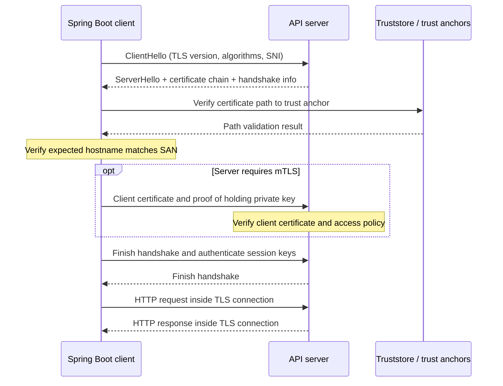
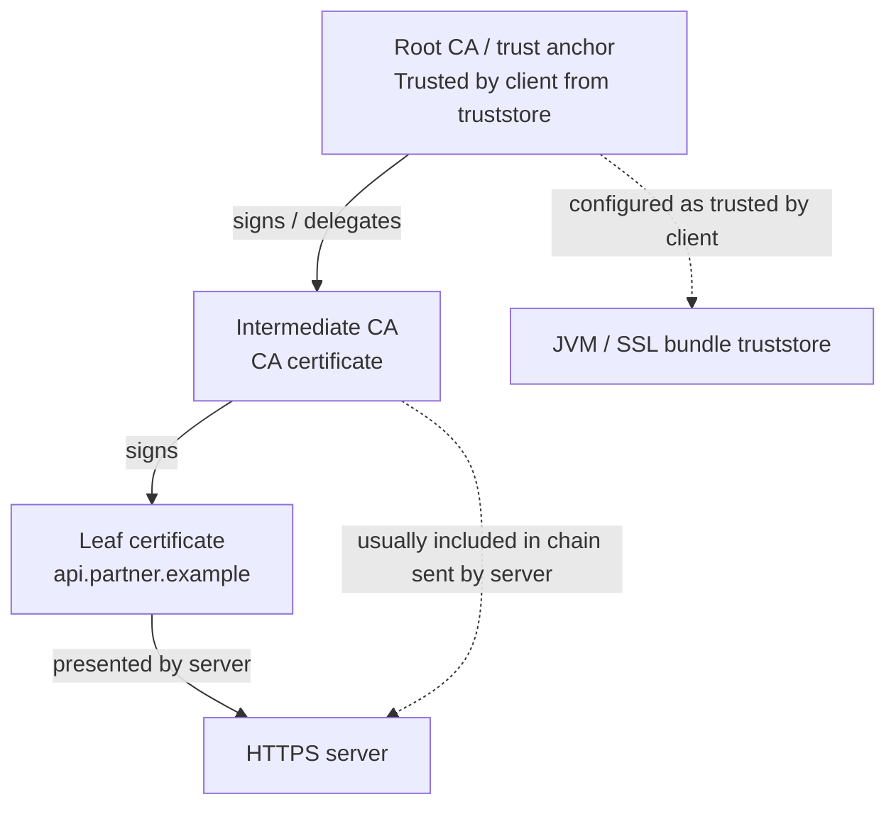
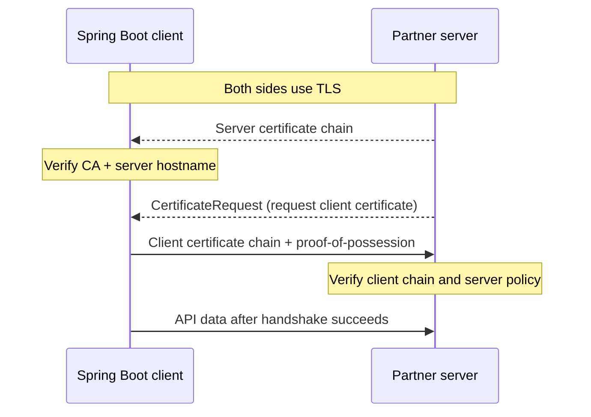

# TLS, Hostname Verification, and Trusted Certificate Chains

## 1. Why Do Integration Connections Need Authentication?

A Spring Boot application typically exchanges data with many systems: calling APIs via `RestClient` or `WebClient`, reading/writing databases with JDBC, connecting to Redis, sending messages to Kafka/RabbitMQ, or using Spring Integration adapters. The exchanged information may include tokens, customer data, transactions, and business events.

**TLS (Transport Layer Security)** protects connections against eavesdropping or data tampering in transit. However, simply seeing a URL start with `https://` or an encrypted socket **is not enough to conclude that a connection is secure**. The application must also:

1. Verify that the server it is talking to has a valid certificate trusted by the caller.
2. Verify that the certificate was issued for the **exact hostname** the application intends to connect to.
3. When **mutual TLS (mTLS)** is required, present a client certificate so the server can authenticate the client.
4. Distinguish connection identity from permission to perform business operations; use an appropriate authorization mechanism.

Within the scope of **SPRING_BOOT_INTEGRATION**, these elements are part of configuration management, data contracts, error handling, testing, and observability. A TLS error at the connection layer can cause HTTP calls, data queries, or message consumption to fail completely, even when JSON, SQL, or event schemas are all valid.

### Learning Objectives

After this lesson, you can:

- Explain the TLS handshake, server certificate, CA, trust anchor, truststore, and keystore.
- Distinguish **certificate chain verification** from **hostname verification**.
- Configure an SSL bundle in Spring Boot and apply it to `RestClient` using the Spring Boot-provided `RestClient.Builder`.
- Extend from one-way TLS to mTLS while still verifying the server's hostname.
- Recognize typical connection errors in HTTP clients, JDBC, and brokers; diagnose them without disabling certificate checks.
- Design tests, certificate rotation, and TLS health observability in real environments.

> **Version scope:** Spring Boot examples use Java 17+, Spring Boot **3.2–3.5**, and compatible Spring Framework versions. Spring Boot introduced SSL bundles in 3.1; support for applying a bundle to `RestClient` via `RestClientSsl` arrived in 3.2. Package names and APIs in Spring Boot 4 differ from the 3.x line, so check the documentation for the exact project version.

## 2. What Does TLS Protect, and What Does It Not Protect?

TLS creates a transport channel with the following key properties:

| Property | Practical Meaning |
| --- | --- |
| **Confidentiality** | Network observers cannot easily read encrypted application data. |
| **Integrity** | Detects data modified in transit. |
| **Server authentication** | The client verifies the server based on its certificate, trust chain, and hostname. |
| **Client authentication (optional)** | The server can require the client to present a certificate to perform mTLS. |

TLS **does not automatically**:

- Authorize access to account A vs. account B; application-layer authentication/authorization is required.
- Guarantee that a JSON payload is business-valid or prevent event replay at the application level.
- Keep a transaction atomic across a database, HTTP, and a broker.
- Encrypt data after it has been decrypted at a reverse proxy, API gateway, or receiving program.
- Make the client trust the right server if hostname verification is disabled or if all certificates are blindly trusted.

For example: an application calls `https://billing.partner.example` through a TLS proxy, and the proxy then calls the backend over HTTP. TLS on the first hop only protects the client → proxy leg. If the data also requires confidentiality on the next hop, TLS for proxy → backend or an equivalent protection mechanism is needed.

## 3. The TLS Handshake Seen from a Spring Boot Client

For HTTPS, the high-level steps of a new connection are:



The diagram simplifies message details, especially differences between TLS 1.2 and 1.3. In TLS 1.3, part of the handshake content is encrypted and the exact message order differs from the general description above. The key takeaway for the application: **certificate chain and hostname verification must succeed before trusting the application channel**.

### 3.1. SNI Is Not Hostname Verification

**Server Name Indication (SNI)** is information sent by the client during the TLS handshake so a server hosting multiple domains on the same IP can select the appropriate certificate. It helps the server choose a certificate, but SNI itself does not prove the certificate is valid.

**Hostname verification** is the step where the client compares the expected server name against the identities allowed by the certificate. Sending the right SNI while disabling hostname verification still risks being routed to another server whose certificate was issued by a trusted CA for a **different name**.

For example, the client wants to call `payments.example.com`: a certificate for `reports.example.com`, even if signed by a valid CA, is still not a certificate for `payments.example.com`.

### 3.2. How Does TLS Use Certificates?

A certificate contains a public key, subject/issuer, validity period, list of valid names, key usage purposes, and the issuer's signature. A certificate **does not contain a private key**. The server proves possession of the corresponding private key during the handshake.

Session keys are negotiated during the handshake; modern cipher suites typically use ephemeral key exchange, and application traffic is then protected by symmetric encryption. You should not assume every HTTP packet is encrypted directly with the public key recorded in the certificate.

## 4. What Is a Trusted Certificate Chain?

A server typically uses a **leaf/end-entity** certificate signed by an intermediate CA. The intermediate CA may be signed by a higher-level CA. The client uses known certificates and trust anchors to build and verify a **certificate path**.



Components:

| Component | Role | Where Is It Usually Located? |
| --- | --- | --- |
| **Leaf certificate** | Endpoint identity certificate, e.g. `api.partner.example` | Presented by the server in the TLS handshake |
| **Intermediate CA** | Intermediate organization signing leaf or other CAs; has CA constraints | The server should send the necessary intermediates |
| **Root CA / trust anchor** | Starting point of trust decided by the client/admin | OS truststore, JVM, or application truststore |
| **Truststore** | Store of trusted certificates; provides trust anchors for the verifier | JVM `cacerts`, PKCS12/JKS, or PEM bundle |
| **Keystore** | Local identity store, typically containing private key and certificate chain for client/server presentation | PKCS12 or PEM cert + private key pair |

Depending on the validation path and trust policy, a trust anchor does not necessarily have to be the self-signed root presented in the handshake. The server usually **does not need to send the root CA** because the client must already possess the trust anchor from a trusted source. A chain missing an intermediate can prevent a Java client from building a path even if a browser on a developer machine still connects due to different intermediate discovery/loading mechanisms.

A valid certificate path must satisfy appropriate conditions such as:

- Signatures between certificates along the path are verified.
- `Not Before` / `Not After` validity matches system time.
- CA certificates are authorized to sign other certificates (`Basic Constraints`, `Key Usage`).
- Certificate purposes match TLS server/client requirements (`Extended Key Usage`, when applicable).
- Algorithms, key strength, and trust policy are accepted by the client.
- The path leads to a trust anchor trusted by the client.

**Certificate revocation** via CRL/OCSP is a separate topic: do not assume every Java TLS client automatically enables revocation checking in every configuration. When a system has strict revocation requirements, PKIX/OCSP/CRL policies must be designed and tested for the exact runtime and library in use.

### A Validly Signed Certificate Can Still Be Rejected

For example, the server sends a leaf signed by **Private CA A**, while the client's truststore only contains **Private CA B**. The signature on the leaf may be completely valid; the client must still reject it because there is no trust path to a CA it accepts.

Conversely, if a client adds a CA to its truststore, the client may begin trusting other endpoints signed by that CA **when the hostname matches**. Therefore, truststore scope and CA import procedures must be controlled; never download a certificate from an untrusted connection and automatically accept it as a new CA.

## 5. Hostname Verification: The Right Target Identity

With HTTPS, the client not only verifies that the leaf is signed by a trusted CA; it must also verify that **the name in the URL** corresponds to the identities granted to the certificate.

In modern systems, valid names are declared primarily in the **Subject Alternative Name (SAN)** extension:

```text
X509v3 Subject Alternative Name:
    DNS:api.partner.example
    DNS:api.internal.partner.example
```

If calling:

```text
https://api.partner.example/v1/orders
```

then the `DNS:api.partner.example` identity matches. However, if calling directly:

```text
https://10.0.0.20/v1/orders
```

then a certificate with only the DNS SANs above does not satisfy IP-address verification. The certificate needs an appropriate **IP Address SAN** when the client connects by IP. You cannot assume that an IP resolved from a DNS name automatically matches a DNS SAN.

### 5.1. Easily Confused Cases

| Certificate SAN | Client Connects To | Expected Outcome |
| --- | --- | --- |
| `DNS:api.partner.example` | `https://api.partner.example` | Name matches if trust chain and other checks are valid |
| `DNS:api.partner.example` | `https://api-internal.partner.example` | Hostname mismatch |
| `DNS:*.partner.example` | `https://api.partner.example` | May match single-label wildcard per verifier rules |
| `DNS:*.partner.example` | `https://v1.api.partner.example` | Must not assume wildcard matches multiple labels |
| `DNS:api.partner.example` | `https://10.0.0.20` | Does not match IP identity |
| `IP:10.0.0.20` | `https://10.0.0.20` | IP matches if other checks are valid |

**Do not rely on Common Name (CN)** as the sole identity source. CN fallback rules can vary between libraries/versions; issuing certificates with accurate SANs is the clear and appropriate choice today.

### 5.2. Why Must Hostname Verification Not Be Disabled?

A very dangerous "quick fix" is using a verifier that always returns `true`, `NoopHostnameVerifier`, or bypassing all trust checks. In that case, a server with a valid certificate for a **different domain** can still be accepted, opening the door to man-in-the-middle attacks or misrouting.

The right fixes:

1. Fix the URL/config to use the hostname for which the server was issued a certificate.
2. Reissue the certificate with SANs matching the actual DNS names/IPs to be served.
3. If going through a proxy, load balancer, or service mesh, confirm the **hostname the client uses** and the certificate presented at the corresponding TLS endpoint.
4. For a private CA, add the **organization-controlled and verified CA** to the connection-specific truststore.

Never use workarounds like "trust all", skipping hostname checks, `curl -k`, or disabling TLS verification as a production configuration.

## 6. One-Way TLS and Mutual TLS (mTLS)

### 6.1. One-Way TLS

Most HTTPS APIs use server authentication:

- The client receives the certificate chain from the server.
- The client verifies the trust chain and hostname.
- After the handshake, the client uses a Bearer token, API key, or another application mechanism to determine API permissions if required by the service.

In this scenario, **the client does not need its own private key and certificate just to call HTTPS**. A custom truststore is only needed if the server cannot be verified by the runtime's appropriate default trust anchors.

### 6.2. mTLS

In mTLS, the server **also requires the client to present a certificate** and prove possession of the corresponding private key:



Conceptually, mTLS requires:

| Party | Whom Do They Trust? | What Secret Must Be Kept? |
| --- | --- | --- |
| Spring Boot client | CA issuing the server certificate; verifies server hostname | The **client's** private key, if mTLS is used |
| Partner server | CA issuing certificates for allowed clients | The **server's** private key |

Once the client's certificate is authenticated, the server must still decide **which APIs and which tenants the client is authorized to call**. A valid certificate may only identify a workload; it is not equivalent to permission to operate on all data.

### 6.3. Keystore vs. Truststore

A short way to remember:

- **Truststore:** "Which CAs/certificates do I trust when verifying the peer?"
- **Keystore:** "Which identity and private key do I present when the peer wants to authenticate me?"

A PKCS12 file can hold both key entries and trusted certificate entries, but their **usage roles** remain distinct. Never give the client's private key to a partner; only provide public certificates/CAs when setting up trust.

## 7. Configuring an HTTPS Client in Spring Boot with an SSL Bundle

A Spring Boot **SSL bundle** groups trust material, key material, and certain SSL options into a named configuration. You can apply a bundle to connections supported by Spring Boot APIs or the corresponding client; it does not mean every driver automatically reads the same bundle.

The example below is an application calling `https://api.partner.example`, using a partner's **Private CA**. The config/code snippets illustrate a Spring Boot 3.2–3.5 environment; certificates, hostnames, and file paths must be replaced with organization-managed values.

### 7.1. Defining a Bundle with PEM Certificates

```yaml
# application.yml
spring:
  ssl:
    bundle:
      pem:
        partner-api:
          truststore:
            certificate: file:/etc/order-service/tls/partner-root-ca.pem

integration:
  partner:
    base-url: https://api.partner.example
```

Here:

- `partner-api` is the **bundle name** defined by the application.
- `truststore.certificate` points to the CA certificate the application is allowed to trust for this connection; the file must contain valid PEM content issued from a trusted source.
- `integration.partner.base-url` is the business endpoint; the hostname must match the certificate presented by the server.

Do not commit private keys or passwords into the repository. Supply secrets via a secret manager, least-privilege file mounts, or an approved secret distribution mechanism. Avoid baking fixed truststores into the JAR if CAs need to rotate independently of build time.

**Note:** if the partner uses a public CA that the default JVM already trusts, a **separate truststore may not be needed**. Configuring a truststore containing only a Private CA can remove trust for public CAs for the client applying that bundle, depending on how the trust manager is initialized; do not assume truststores are automatically merged.

### 7.2. Creating `RestClient` from the Spring Boot-Configured Builder

```java
// PartnerProperties.java
package example.integration.partner;

import org.springframework.boot.context.properties.ConfigurationProperties;

@ConfigurationProperties(prefix = "integration.partner")
public record PartnerProperties(String baseUrl) {
}
```

```java
// PartnerClientConfiguration.java
package example.integration.partner;

import org.springframework.boot.autoconfigure.web.client.RestClientSsl;
import org.springframework.boot.context.properties.EnableConfigurationProperties;
import org.springframework.context.annotation.Bean;
import org.springframework.context.annotation.Configuration;
import org.springframework.http.HttpHeaders;
import org.springframework.http.MediaType;
import org.springframework.web.client.RestClient;

@Configuration(proxyBeanMethods = false)
@EnableConfigurationProperties(PartnerProperties.class)
public class PartnerClientConfiguration {

    @Bean("partnerRestClient")
    RestClient partnerRestClient(
            RestClient.Builder builder,
            RestClientSsl ssl,
            PartnerProperties properties) {

        return builder
                .baseUrl(properties.baseUrl())
                .apply(ssl.fromBundle("partner-api"))
                .defaultHeader(HttpHeaders.ACCEPT,
                        MediaType.APPLICATION_JSON_VALUE)
                .build();
    }
}
```

The key point is that `RestClient.Builder` is **injected by Spring Boot**. `RestClientSsl` applies the SSL bundle named `partner-api` to the client's request factory. This is the API for Spring Boot **3.2–3.5** with import `org.springframework.boot.autoconfigure.web.client.RestClientSsl`; in Boot 4 the package differs.

**Relationship with timeout configuration:** `apply(ssl.fromBundle(...))` can replace a previously configured `ClientHttpRequestFactory`. If the application needs custom timeouts, proxy, or pooling alongside the SSL bundle, configure them using the mechanism compatible with your Spring Boot/HTTP client version (e.g., an appropriate factory builder and settings) and verify that both SSL and timeouts actually take effect. Do not add `requestFactory(...)` elsewhere and assume previous SSL/timeout settings are preserved.

### 7.3. Partner Call Adapter

```java
// PartnerAccountClient.java
package example.integration.partner;

import org.springframework.beans.factory.annotation.Qualifier;
import org.springframework.stereotype.Component;
import org.springframework.web.client.RestClient;

@Component
public class PartnerAccountClient {

    private final RestClient client;

    public PartnerAccountClient(
            @Qualifier("partnerRestClient") RestClient client) {
        this.client = client;
    }

    public PartnerAccountSnapshot getAccount(String accountId) {
        PartnerAccountSnapshot result = client
                .get()
                .uri("/v1/accounts/{id}", accountId)
                .retrieve()
                .body(PartnerAccountSnapshot.class);

        if (result == null) {
            throw new IllegalStateException("Partner response has no body");
        }
        return result;
    }
}

record PartnerAccountSnapshot(String id, String status) {
}
```

`PartnerAccountClient` only handles the HTTP and data contract. In a real integration flow, the business layer above needs to decide whether to retry, which errors map to business errors, idempotency policy, and acceptable latency. Valid TLS does not solve those concerns.

Do not take a full absolute URL from user input to replace `baseUrl`: that can lead to **SSRF** or sending credentials to an unintended host. Only accept validated path variables/parameters and keep the list of trusted endpoints in configuration.

## 8. Using a PKCS12/JKS Truststore Instead of PEM

Some organizations standardize certificate stores on PKCS12/JKS. Spring Boot also supports `jks`-style SSL bundles:

```yaml
spring:
  ssl:
    bundle:
      jks:
        partner-api:
          truststore:
            location: file:/etc/order-service/tls/partner-truststore.p12
            password: ${PARTNER_TRUSTSTORE_PASSWORD}
            type: PKCS12
```

With this configuration, the bundle name remains `partner-api`; the Java `RestClient` above **does not need to change**. Only **one bundle definition with the same name** in one clear format should be used in an application to avoid ambiguity.

You can create a truststore from a verified CA certificate using `keytool`:

```bash
keytool -importcert \
  -alias partner-root-ca \
  -file partner-root-ca.pem \
  -keystore partner-truststore.p12 \
  -storetype PKCS12
```

This command prompts for a password and, depending on options, asks to confirm the certificate. **Verify the CA fingerprint/source through an independent channel before importing**; never fetch an unverified certificate from a failing TLS endpoint and import it into the truststore.

To inspect the truststore after creation:

```bash
keytool -list -v \
  -keystore partner-truststore.p12 \
  -storetype PKCS12
```

Both commands use `keytool` from the JDK. Do not pass `-storepass` with a secret value directly on the command line of shared machines or CI logs, as arguments can leak into command history or process listings.

**JKS/PKCS12 is a storage format**, not a TLS algorithm. Choosing the right certificate container is only a configuration step; the client must still perform chain validation and hostname verification as normal.

## 9. Adding mTLS to `RestClient`

When a partner requires a client certificate, add **key material** to the PEM bundle:

```yaml
spring:
  ssl:
    bundle:
      pem:
        partner-api:
          truststore:
            certificate: file:/etc/order-service/tls/partner-root-ca.pem
          keystore:
            certificate: file:/etc/order-service/tls/order-service-client-chain.pem
            private-key: file:/etc/order-service/tls/order-service-client.key
```

`truststore` continues to be used to verify the **server**. `keystore` provides the **client's** certificate and private key if the server requests mTLS. The code creating `RestClient` via `ssl.fromBundle("partner-api")` does not need to change for this difference.

Several conditions for mTLS to succeed:

- The server must be configured to request/accept client certificates and trust the CA issuing the client certificate.
- The client certificate is unexpired and usable for client authentication per the applicable policy.
- The private key actually matches the public key on the client certificate.
- The client certificate chain file contains the necessary intermediates required by the partner.
- The client **still** must verify the server chain and server hostname.
- Identity information from the client certificate must be mapped to an appropriate workload/business permission on the server.

A common error example: both client and server trust the same CA, yet the server requires `Extended Key Usage: clientAuth` while the client certificate was issued only for `serverAuth`; the handshake can still fail.

Do not reuse one shared private key across environments or multiple workloads when separate identities can be issued; manage expiration and key/certificate rotation procedures. Passwords, keys, and secrets must stay out of source code.

## 10. Database, Cache, and Broker Connections: Same Principles, Different Config

TLS principles are the same across protocols, but each driver has **its own properties and endpoint verification behavior**. Do not assume `spring.ssl.bundle.*` automatically applies to JDBC, Redis, Kafka, or RabbitMQ if the driver and Spring Boot version in use do not support binding that bundle.

### 10.1. PostgreSQL JDBC

Example PostgreSQL JDBC driver with a private CA:

```yaml
spring:
  datasource:
    url: "jdbc:postgresql://db.internal.example:5432/orders?sslmode=verify-full&sslrootcert=/etc/order-service/tls/db-root-ca.pem"
    username: ${DB_USERNAME}
    password: ${DB_PASSWORD}
```

Meaning of this specific configuration:

- `sslmode=verify-full` requires a TLS connection, verifying the server certificate and hostname.
- `sslrootcert` points to the CA material used for verification according to the PostgreSQL JDBC driver's mechanism.
- The host `db.internal.example` must match the certificate of the server/TLS proxy the driver connects to.

Do not treat `sslmode=require` as equivalent to `verify-full`: encrypting a connection and verifying the exact endpoint identity are two different requirements. Properties for MySQL, SQL Server, or other drivers have their own names and semantics; check the exact driver documentation to avoid configurations that encrypt without verifying hostnames.

### 10.2. Kafka

With Kafka over TLS, consider both the connection path to the **bootstrap server** and the broker endpoints in metadata. A client may connect initially and then fail because a broker's certificate does not match the hostname advertised by that broker.

Example options for a Kafka Java client using a PKCS12 truststore:

```yaml
spring:
  kafka:
    bootstrap-servers: broker-1.internal.example:9093,broker-2.internal.example:9093
    properties:
      security.protocol: SSL
      ssl.truststore.location: /etc/order-service/tls/kafka-truststore.p12
      ssl.truststore.password: ${KAFKA_TRUSTSTORE_PASSWORD}
      ssl.truststore.type: PKCS12
```

Brokers must present certificates matching the hostnames of the endpoints the client actually uses. For mTLS, add the client keystore/certificate using the corresponding Kafka mechanism. Do not bypass hostname verification by setting `ssl.endpoint.identification.algorithm` to empty to "fix" a broker configuration error: fix the certificate SAN, DNS, or `advertised.listeners` first.

### 10.3. Redis, RabbitMQ, and Other Adapters

- **Redis:** check the driver and usage model for `rediss://`/TLS, trust material, and endpoint identification; do not assume using a cache removes the need for server authentication.
- **RabbitMQ:** `amqps`/TLS connections require configuring CA, client certificate for mTLS, and hostname verification per the AMQP library in use.
- **Spring Integration:** HTTP outbound gateways, AMQP/Kafka adapters, or service activators use their underlying client/connection factory; TLS must be configured on **the actual client opening the socket**, not merely on a `MessageChannel` or flow.

A system using multiple stores and brokers should maintain a **connection inventory table** by endpoint, protocol, trust source, client identity, certificate expiry, owner, and rotation plan. Do not use one overly broad global truststore for all connections just to reduce file count.

## 11. Diagnosing TLS Errors by Root Cause

TLS errors typically occur before an HTTP request is processed or before JDBC/consumers complete a connection. Therefore, business-layer logs may only show generic exceptions such as `ResourceAccessException`, `SSLHandshakeException`, or driver errors.

| Common Symptom/Log | Likely Cause | Investigation Direction |
| --- | --- | --- |
| `PKIX path building failed`, `unable to find valid certification path` | Cannot build trust path to a trust anchor; missing CA or intermediate | Inspect the certificate chain sent by the server, actual truststore of the **Java process**, CA, and bundle config |
| `No subject alternative DNS name matching ...` | URL hostname is not in SAN | Compare the hostname called by the app with leaf SANs; check proxy, IP, DNS, `advertised.listeners` |
| `CertificateExpiredException` / `NotYetValidException` | Expired/not-yet-valid certificate or clock skew | Check `notBefore/notAfter`, system time, and intermediate chain |
| `Received fatal alert: bad_certificate` | One side rejected the other's certificate; common in mTLS | Check client cert, server-side CA, EKU, chain, and server policy |
| `handshake_failure` | Incompatible TLS version/cipher, client certificate, or policy | Read logs on both sides, check TLS protocol/cipher and mTLS |
| `wrong version number` or non-TLS data error | Sending TLS to a plaintext port or wrong proxy/port | Verify `https`/`amqps`/port and connection path |
| `connection reset` during handshake | Proxy/firewall/network middlebox closed connection, TLS policy, or failing service | Check proxy and server traces/logs; do not immediately assume a CA error |
| Fails only on one broker/replica | Certificate or advertised hostname of an endpoint is wrong | Check every broker/DB node actually connected to, not only the bootstrap host |

All of the messages above are **diagnostic hints**, not a one-to-one mapping. The same exception can stem from multiple causes depending on client, TLS version, and handshake direction.

### 11.1. Inspecting the Certificate Chain Outside the Application

With OpenSSL, you can connect to an endpoint to view the presented certificate and also verify the hostname if you supply a known CA:

```bash
openssl s_client \
  -connect api.partner.example:443 \
  -servername api.partner.example \
  -verify_hostname api.partner.example \
  -CAfile partner-root-ca.pem \
  -verify_return_error \
  -showcerts
```

To inspect SANs and validity of a certificate file:

```bash
openssl x509 -in server-leaf.pem \
  -noout -subject -issuer -dates -ext subjectAltName
```

`openssl s_client` only verifies **according to the trust material/OpenSSL config in use**. Success with OpenSSL does not by itself prove the Java client uses the right truststore, driver, and hostname verifier; results can differ due to different configuration or chain building. If infrastructure includes a TLS proxy, test from the same network path as the application.

### 11.2. Viewing JVM TLS Debug Output When Needed

When an error only occurs in Java, JSSE logging can be enabled in a controlled test environment:

```text
-Djavax.net.debug=ssl,handshake
-Djava.security.debug=certpath
```

These debug flags reveal the handshake, certificates, and runtime path validation decisions. Enable only temporarily during investigation: logs can be very large and contain sensitive metadata. Adjust log levels, redact details, and restrict access; never enable full debug by default in production.

Practical checklist path:

1. Identify the **final URL/hostname and port** the library is calling.
2. Identify the endpoint presenting the certificate: direct service, proxy, ingress, or broker.
3. Read the SANs, issuer, validity, and certificate chain the server actually sends.
4. Check the truststore/bundle/CA used by **that exact client**.
5. If mTLS, check the client cert, private key, and server-side CA/policy.
6. Correlate error events with rotation, deployments, DNS/mesh changes, and certificate expiration.

## 12. Testing TLS Connections in Spring Boot

TLS is a property of **real connections and certificate configuration**; simple HTTP client mocks cannot prove hostname verification is enabled. Tests should be layered:

| Test Level | Goal |
| --- | --- |
| Adapter unit test | Data handling, business errors, fallback/retry per contract; no real socket needed |
| Integration test with local HTTPS server | Perform a real handshake with a test CA, test SAN, and real SSL bundle |
| mTLS integration test | Server rejects missing/invalid client and accepts the right client identity |
| Staging test | Confirm real DNS, proxy/load balancer, all brokers/nodes, CA, and TLS policies |
| Rotation/failure drill | Swap CA/client cert, near-expiry cert, hostname change, disconnect, and recovery |

### 12.1. Minimum Scenarios to Test

| Scenario | Expectation |
| --- | --- |
| Server certificate has valid SAN and is signed by trusted test CA | Handshake succeeds |
| Server certificate is signed by untrusted CA | Handshake rejected |
| Server has valid chain but SAN does not match hostname | Handshake rejected |
| Certificate expired or not yet valid | Handshake rejected |
| mTLS server requires client certificate, client presents none | Handshake or connection rejected |
| mTLS client presents valid certificate/key and server trusts issuing CA | Handshake succeeds, then authorization is still checked |
| Server omits required intermediate | Client may fail to build chain; fix server config to send chain |

When generating test certificates, issue the test CA and leaf with SANs matching the hostname actually used, such as `DNS:localhost` if the test connects to `https://localhost`; if the test calls `https://127.0.0.1`, an IP SAN is required. Never test by disabling hostname verification so an arbitrary test certificate is accepted.

### 12.2. Test Pattern with SSL Bundle

```text
Test starts local HTTPS server
  → server uses leaf cert + key signed by Test CA
  → Spring Boot test profile points SSL bundle to Test CA
  → RestClient makes real call to https://localhost:<port>
  → assert returned data or TLS error per test case
```

You can use an embedded HTTPS server, Testcontainers, or a TLS-capable stub server; any tool works as long as the test **actually traverses a TLS socket**. Use a separate test CA and never copy production private keys into test environments.

With SSL bundles, `@RestClientTest` combined with an in-memory mock server is great for checking URL/headers/body, but it usually **does not replace** a real HTTPS test. The two test groups verify different properties.

## 13. Certificate Lifecycle and Production Operations

Certificates expire; CAs or trust anchors can also change. Unprepared rotation can suddenly break connectivity for a set of clients.

### 13.1. Suggested Rotation Process

1. **Inventory:** catalog endpoints, SANs, leaf/intermediate/root, truststores, client identities, and expiration dates.
2. **Prepare:** issue new certificates with correct SAN/EKU and chain; distribute public CA/certificates to relying parties.
3. **Transition:** if changing CAs, a period trusting both old and new CAs may be needed, per security policy and truststore capabilities.
4. **Deploy:** swap certificates on server/client in a verified order; check instances behind load balancers and across regions.
5. **Verify:** perform real handshakes from affected applications; monitor error rates and verify the new expiry.
6. **Retire:** once cutover completes, remove old unnecessary CAs/certificates per policy while keeping an incident rollback path.

Do not assume updating a certificate file causes every Java connection to reload immediately. SSL contexts, connection pools, open sessions, and reload behavior depend on each library/version. Check **hot reload** support, connection close/recreation mechanisms, and application rollout capabilities; if unsupported, perform controlled restarts/rolling deployments.

### 13.2. Signals to Monitor

- Time remaining until expiry for leaf and essential intermediate certificates; alert early enough for the release workflow.
- Count of TLS handshake errors by client, upstream, hostname, and exception type.
- Timeout/connect error rate, as it can spike when proxies reject handshakes.
- Certificate consistency across instances behind a load balancer.
- Timing of deployments, DNS changes, truststore updates, and CA rotation relative to error onset.
- Request latency, connection counts, and retry impact on upstreams during handshake failures.

Monitoring should use **low-cardinality labels**; do not emit tokens, private key material, sensitive request bodies, or raw PEM certificates into logs. Trace IDs help correlate HTTP adapter/broker consumer errors with calling applications and target endpoints.

### 13.3. Retries Do Not Fix Verification Errors

If a hostname mismatches, a certificate is expired, or a CA is untrusted, retrying the same connection with the same configuration usually only generates extra traffic and logs. This is a configuration/identity error that must be fixed at the source.

Meanwhile, timeouts or transient disconnects may warrant bounded retries with backoff/jitter, but request or event idempotency must still be verified. A payment `POST` that fails right after sending may already have been processed upstream; TLS does not make an operation safe to resend.

## 14. Common Security Mistakes

| Action | Why It Is Dangerous/Wrong | Right Approach |
| --- | --- | --- |
| Using `TrustAllStrategy` or a trust manager that accepts any certificate | Eliminates most of server authentication | Use approved CAs/trust anchors and path validation |
| Using `NoopHostnameVerifier` or an always-`true` verifier | Does not verify we are talking to the intended server | Issue certificates with correct SANs; use matching hostnames |
| Calling a service by IP when the certificate only has DNS SANs | Endpoint identity mismatch | Connect by valid DNS or issue an IP SAN when needed |
| Importing leaf/CA from a failing connection without verification | Could trust an attacker-supplied certificate | Verify CA fingerprint via an independent channel |
| Ignoring a missing intermediate | Java clients may fail to build a certificate path | Configure the server to present the full chain |
| Using one global truststore with too many CAs | Broadens the scope of trusted endpoints | Use per-upstream named bundles/truststores where appropriate |
| Putting private keys and passwords into Git/shared Docker images | Increases risk of workload identity leakage | Use a secret manager, file mounts, and least-privilege permissions |
| Assuming mTLS replaces all business permissions | Machine/client identity does not imply per-record access | Enforce authorization by principal/tenant/scopes |
| Assuming SSL bundles apply to every driver | JDBC and brokers have their own configurations | Check TLS mechanisms for each specific driver and integration |
| Only writing mock unit tests and concluding TLS is secure | Mocks do not verify real certificates/hostnames | Add integration tests using real TLS sockets |

## 15. Real-World Scenario: After a Certificate Change, Both HTTP and Kafka Fail

**Context:** the operations team rotates certificates for a partner service and the Kafka broker. While the Spring Boot app still builds cleanly, multiple instances report `PKIX path building failed`; several consumers report hostname mismatch.

**Systematic analysis:**

1. For the PKIX error, confirm which CA signed the new certificate, whether the server sends the right intermediates, and whether each instance's bundle/truststore was updated.
2. For the hostname mismatch, compare SANs against the actual endpoint. For Kafka, check hostnames from metadata/`advertised.listeners`, not just the bootstrap DNS.
3. Check which TLS endpoint clients are connecting to: a proxy/ingress may present a different certificate than the origin server.
4. Check validity timestamps and clocks on each instance, especially if a new certificate has not yet reached `notBefore`.
5. After fixing CA/chain/SAN, run real handshakes and integration operations to verify; only then process consumer retries/backlogs following idempotent procedures.

**Lesson:** both errors are TLS-related, yet they occur at two different steps. Adding a new CA does not fix a hostname mismatch; issuing a certificate with the right SAN does not fix a missing client trust anchor. Each condition must be checked independently.

## 16. Checklist for Taking TLS Connections to Production

1. **Target name:** fixed URL/DNS/port in trusted config; SAN matches hostname, including post-bootstrap brokers/nodes.
2. **Chain:** server presents leaf and required intermediates; client has verified, managed trust anchors.
3. **Truststore:** scoped per upstream; avoid broad trust and never disable verification.
4. **Keystore/mTLS:** per-workload private key is protected; certificate has appropriate EKU; server trusts client-issuing CA.
5. **Versions:** verify exact TLS protocols, ciphers, Spring Boot APIs, drivers, and configurations for the deployed version.
6. **HTTP/database/broker:** each client actually uses the right SSL context, hostname check, timeouts, and policies.
7. **Authorization:** still authenticate/authorize tokens/roles/scopes and tenants at the business layer; do not equate mTLS with all access rights.
8. **Testing:** include real handshake tests with valid CA, wrong CA, wrong SAN, expired cert, and mTLS when applicable.
9. **Rotation:** monitor expiry, verify SSL context reload behavior, plan CA transitions and rollback.
10. **Observability/errors:** distinguish PKIX, hostname, mTLS, and network errors; bounded retries for transient errors; never log keys/tokens.

### Self-Check Questions

**1.** A server presents a certificate signed by a trusted CA whose SAN contains only `api-a.example`. Why must a `RestClient` calling `https://api-b.example` still fail?

**2.** What is the difference between a truststore and a keystore in a Spring Boot HTTP client using mTLS?

**3.** Why might importing another root CA fail to fix `PKIX path building failed` if the server does not present a required intermediate?

**4.** In Kafka, why can connecting to the bootstrap server succeed while a producer still fails after receiving metadata about another broker?

**5.** Should an HTTP request failing with `SSLHandshakeException` due to an expired certificate be retried multiple times? What information should be checked first?

**6.** If all adapter unit tests pass, how do you prove production is not accidentally using `NoopHostnameVerifier`?

## References

- [Spring Boot 3.4 — Calling REST Services, RestClient SSL Support](https://docs.spring.io/spring-boot/3.4/reference/io/rest-client.html): using `RestClientSsl` with `RestClient.Builder` in Spring Boot 3.x.
- [Spring Boot — SSL bundles](https://docs.spring.io/spring-boot/reference/features/ssl.html): configuring PEM, JKS/PKCS12 bundles, and trust material. When using Boot 3.x, check the documentation page for the exact version.
- [Spring Boot 3.5 API — RestClientSsl](https://docs.spring.io/spring-boot/3.5/api/java/org/springframework/boot/autoconfigure/web/client/RestClientSsl.html): behavior when applying SSL to a request factory.
- [Java JSSE Reference Guide](https://docs.oracle.com/en/java/javase/17/security/java-secure-socket-extension-jsse-reference-guide.html): trust managers, key managers, hostname identification, and TLS debugging in Java.
- [PostgreSQL JDBC — Using SSL](https://jdbc.postgresql.org/documentation/ssl/): certificate/hostname verification configuration in the PostgreSQL driver.

## Conclusion

Reliable TLS connections must simultaneously **encrypt traffic, verify the certificate trust path, and verify the exact hostname**. With mTLS, the client also presents its own certificate and private key for server identification, but business-layer authorization is still required. Spring Boot SSL bundles help organize trust/key material per integration; when applying them to `RestClient`, preserve the proper request factory, timeouts, and real verification. Across JDBC, caches, and brokers, always configure per specific driver and test with real TLS sockets. Managing certificate lifecycles, observing handshake errors, and strictly avoiding bypassed verification form the foundation for safe and stable HTTP, data, and messaging integration flows.
