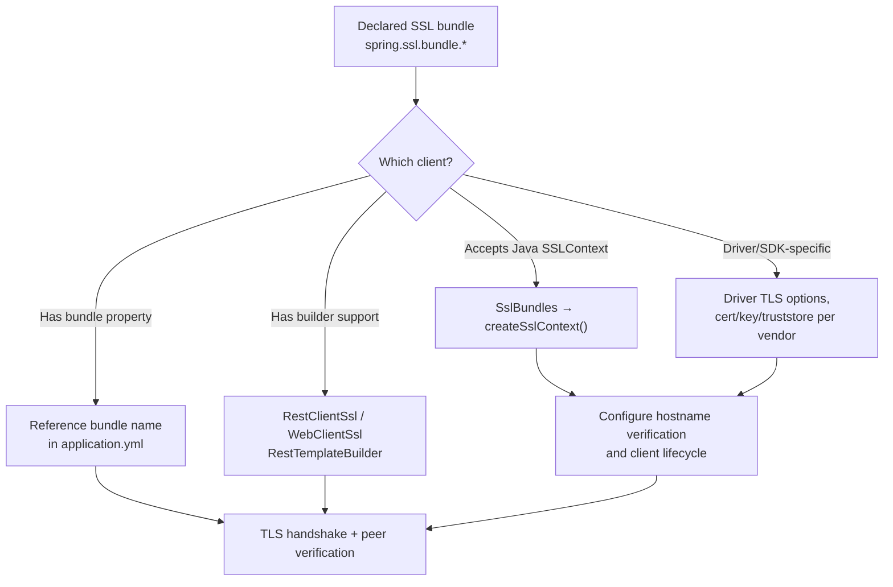
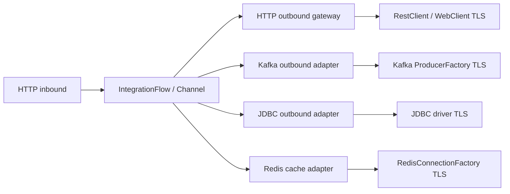

# Applying SSL Bundles Based on Each Client's Support Level

## 1. The Problem: One Application, Many TLS Connection Types

A Spring Boot service may simultaneously accept HTTPS from an API gateway, call partner APIs with `RestClient`, query PostgreSQL, write to a Redis cache, send Kafka events, consume RabbitMQ tasks, and call a service using Apache Pulsar. All of these connections need security, yet **they do not share the same API for applying SSL**.

For example, declaring:

```yaml
spring:
  ssl:
    bundle:
      pem:
        partner-ca:
          truststore:
            certificate: file:/etc/tls/partner-ca.pem
```

only **creates an SSL bundle named `partner-ca`**. It does not automatically make every HTTP client, JDBC driver, cache, or broker client use that CA. Each component must be **bound to the bundle via Spring Boot properties, builder adapters, or the client's own API**. Without that step, the system may still fall back to the JVM's default truststore, use legacy TLS settings, or leave TLS disabled.

In the **SPRING_BOOT_INTEGRATION** module, this is an essential operational concern: an `HTTP → DB → outbox → Kafka → consumer → Redis` pipeline spans multiple connection boundaries, timeout sets, and authentication schemes. Applying SSL bundles properly helps manage CAs, client identities, and mTLS per boundary; misapplying them can reject connections or, worse, leave peer identity verification incomplete.

### Learning Objectives

After this lesson, you can:

1. Identify which clients support **direct `ssl.bundle` properties**, which use **Spring Boot builders**, and which require **driver/SDK-specific configuration**.
2. Bind bundles to an HTTPS server, `RestClient`, `WebClient`, `RestTemplate`, Kafka, RabbitMQ, and Redis in a Spring Boot 3.5 context.
3. Know how to apply a low-level `SslBundle` to libraries expecting an `SSLContext` without disabling hostname verification.
4. Distinguish **truststore for server verification**, **keystore for client identity**, SSL bundles, and business authentication.
5. Organize multiple bundles for multiple upstreams, control TLS/mTLS, timeouts, secrets, and environment variations.
6. Test real TLS, recognize configuration mistakes, plan rotations, and avoid assuming reload works across all clients.

> **Version scope:** examples focus on **Spring Boot 3.5.x, Java 17+**, and Spring Framework/drivers managed by the Boot BOM. SSL bundles appeared in Boot 3.1; client support and Java packages can differ across Boot 3.1–3.4 and Boot 4.x. Endpoints, certificates, and secrets in examples are illustrative. Before deploying, check the **Common Application Properties of your exact version** rather than applying a newer version's property table to an older application.

## 2. Distinguishing Levels of SSL Bundle Support

There are four common integration levels:

| Level | How It Is Used | What to Verify |
| --- | --- | --- |
| **A — Direct property** | Declare `spring.<technology>...ssl.bundle: <name>` or `server.ssl.bundle` | Does Boot create the expected auto-configured bean and client? |
| **B — Supported builder** | Inject builder and `RestClientSsl`/`WebClientSsl`, or `RestTemplateBuilder.sslBundle(...)` | Does applying the bundle replace previously configured factory/connector/timeouts? |
| **C — Low-level API** | Inject `SslBundles`, retrieve `SslBundle`, and create `SSLContext`/managers | Does the client expose a context API? Who enables hostname verification, SNI, and pool lifecycle? |
| **D — Driver/SDK-specific** | Use TLS parameters defined by JDBC, R2DBC, Pulsar, or the SDK | No direct bundle property; map certificate material separately |

Level C **does not guarantee** every library accepts a Java `SSLContext`. For example, Netty-based clients may require `io.netty.handler.ssl.SslContext`, while some drivers only accept separate truststore/certificate files. In those cases, use a vendor-supported adapter or configuration mechanism.



**The first question is not "Where is the SSL bundle?" but "Who owns the actual connection factory/client opening the socket?"** A custom bean, a builder created via `new`, or a client managed by a third-party library may bypass Boot auto-configuration entirely.

## 3. What Does an SSL Bundle Contain, and What Does It Not Do?

A bundle describes key/trust material along with TLS options:

- **Keystore/key material:** certificate chain and private key of the **application itself**. Used when the application acts as an HTTPS server or when a client must present a certificate for mTLS.
- **Truststore/trust material:** CAs/certificates the application uses to **verify peers**.
- **SSL options:** protocols/cipher suites or other options that consumers of the bundle may apply.
- **Bundle name:** configuration identifier, e.g., `web-server`, `partner-orders`, `kafka-broker`.

A bundle is **not**:

1. A global switch enabling TLS on every bean in the Spring context.
2. A replacement for hostname verification, certificate chain validation, and revocation policies.
3. An authorization mechanism for HTTP, databases, or brokers.
4. A tool to request, renew, or revoke certificates.
5. A guarantee that clients automatically reload keys/certificates when files change.

### 3.1. Example: Multiple Bundles Separating Trust Boundaries

```yaml
spring:
  ssl:
    bundle:
      pem:
        partner-orders:
          truststore:
            certificate: file:/etc/order-service/tls/partner-ca.pem
          keystore:
            certificate: file:/etc/order-service/tls/orders-client-chain.pem
            private-key: file:/etc/order-service/tls/orders-client.key
        redis-internal:
          truststore:
            certificate: file:/etc/order-service/tls/redis-ca.pem
        broker-mtls:
          truststore:
            certificate: file:/etc/order-service/tls/broker-ca.pem
          keystore:
            certificate: file:/etc/order-service/tls/broker-client-chain.pem
            private-key: file:/etc/order-service/tls/broker-client.key
      jks:
        web-server:
          key:
            alias: order-service
          keystore:
            location: file:/etc/order-service/tls/server.p12
            password: ${HTTPS_KEYSTORE_PASSWORD}
            type: PKCS12
```

These are **four bundles for four roles**, not four bundles required in every service. Files under `/etc/...` must be distributed via protected secret mounts/provisioning systems. The `partner-orders` bundle has both truststore and keystore because the partner requires **mTLS** in this example; for standard HTTPS, no client key is needed.

**Do not** create one `trust-everything` bundle holding all internal and external CAs and attach it to every connection. Separating bundles by upstream and workload identity limits the blast radius of CA rotation, revocation, and misconfiguration.

### 3.2. PEM vs. PKCS12/JKS

| Aspect | PEM | JKS/PKCS12 |
| --- | --- | --- |
| How material is stored | Separate certificate/key/CA files in text PEM format | Binary keystore/truststore container |
| Boot configuration | `spring.ssl.bundle.pem.<name>.*` | `spring.ssl.bundle.jks.<name>.*` |
| Private key | `keystore.private-key` | Key entry in store, may require alias/key password |
| Trust CA | `truststore.certificate` | Trust entries in store |
| Deployment | Convenient when secret manager issues separate cert/key | Convenient when systems issue `.p12`/`.jks` |

`jks` is the **configuration branch**, not a requirement that the store format be JKS. The example above uses `type: PKCS12`. Never conflate *keystore* with *truststore*: one container can hold different entry types, yet roles must be clearly distinguished in configuration.

## 4. Spring Boot 3.5 Support Matrix by Component

This table is the core reference of this lesson. For **Boot auto-configured** components on compatible versions, the properties below are documented in Spring Boot 3.5 configuration metadata. "Direct" means there is a bundle-name link **in the corresponding configuration group**, not that every custom client automatically uses it.

| Component | How to Apply | Example |
| --- | --- | --- |
| Embedded HTTPS server | **A — direct** | `server.ssl.bundle` |
| Boot-configured RSocket server | **A — direct** | `spring.rsocket.server.ssl.bundle` |
| Synchronous `RestClient` | **B — builder** | `RestClientSsl.fromBundle("name")` |
| Reactive `WebClient` | **B — builder** | `WebClientSsl.fromBundle("name")` |
| `RestTemplate` | **B — builder** | `RestTemplateBuilder.sslBundle(sslBundles.getBundle("name"))` in Boot 3.5 |
| Spring Kafka producer/consumer | **A — direct** | `spring.kafka.ssl.bundle`, overridden at `producer.ssl.bundle` / `consumer.ssl.bundle` |
| Kafka Streams | **A — direct** | `spring.kafka.streams.ssl.bundle` |
| RabbitMQ AMQP | **A — direct** | `spring.rabbitmq.ssl.bundle` |
| RabbitMQ Streams (with appropriate module) | **A — direct** | `spring.rabbitmq.stream.ssl.bundle` |
| Redis (Lettuce/Jedis via Boot auto-configuration) | **A — direct** | `spring.data.redis.ssl.bundle` |
| MongoDB | **A — direct** | `spring.data.mongodb.ssl.bundle` |
| Cassandra | **A — direct** | `spring.cassandra.ssl.bundle` |
| Couchbase | **A — direct** | `spring.couchbase.env.ssl.bundle` |
| Elasticsearch REST client | **A — direct** | `spring.elasticsearch.restclient.ssl.bundle` |
| JDBC/HikariCP (e.g., PostgreSQL) | **D — driver-specific** in Boot 3.5 | JDBC URL, `sslmode`, driver-specific cert/trust params |
| R2DBC driver | **D — driver-specific** unless a specific integration exists | R2DBC driver URL/options and SSL provider |
| Neo4j | **D — driver-specific** per Boot 3.5 config | `spring.neo4j.security.*` |
| Apache Pulsar client | **D/C — Pulsar SDK/customizer** | `PulsarClientBuilderCustomizer`, Pulsar TLS files/parameters |
| Spring Integration adapter | **Follows underlying client/connection factory** | If the adapter uses Kafka/Rabbit/HTTP/DB, configure TLS on the connection owner |
| Any third-party SDK | **C or D**, check its API | `SslBundles`/SSLContext or vendor-specific settings |

Listed properties are **version check points**, not guarantees that every feature exists across all Boot 3.x versions or without the proper starter/driver. For example, `spring.rabbitmq.ssl.bundle` applies to the Boot-configured AMQP connection factory; a manually created RabbitMQ client elsewhere may ignore this property.

### 4.1. Rules for Using the Matrix

1. **Identify the actual bean:** `RestClient`, `LettuceConnectionFactory`, `ConsumerFactory`, `HikariDataSource`, etc.
2. **Check docs for your exact Boot version:** find both the property name **and auto-configuration conditions**.
3. **Check dependency/driver versions:** SSL APIs may differ if you override the BOM.
4. **Declare the bundle** with appropriate trust material and client identity.
5. **Attach the bundle to the right client** via property/builder/driver config.
6. **Test a real handshake** from the same network path, with valid and invalid CA/SAN cases.
7. **Evaluate reload/rotation** for the created client; do not extrapolate from general bundle features.

## 5. Level A: Applying a Bundle to the Embedded HTTPS Server

When Spring Boot itself is the HTTPS server, it needs a key/certificate to prove its identity to clients.

```yaml
spring:
  ssl:
    bundle:
      pem:
        public-api-server:
          keystore:
            certificate: file:/etc/tls/api-server-fullchain.pem
            private-key: file:/etc/tls/api-server.key

server:
  port: 8443
  ssl:
    bundle: public-api-server
```

`server.ssl.bundle` takes only the bundle name, not certificate paths; material lives under `spring.ssl.bundle.pem.public-api-server`. Supported embedded servers use that material to create the TLS listener.

For inbound mTLS, the server also needs a CA to verify **client certificates**:

```yaml
spring:
  ssl:
    bundle:
      pem:
        internal-api-server:
          keystore:
            certificate: file:/etc/tls/internal-server-fullchain.pem
            private-key: file:/etc/tls/internal-server.key
          truststore:
            certificate: file:/etc/tls/trusted-client-ca.pem

server:
  ssl:
    bundle: internal-api-server
    client-auth: need
```

Points to remember:

- `client-auth: need` requires a client certificate when supported by the TLS implementation.
- The server certificate must have SANs matching the hostname/IP callers use.
- Successful mTLS verification **does not grant permission** to read or modify orders; authorization still requires Spring Security/business policy.
- Do not mix `server.ssl.bundle` with individual server SSL properties to declare the **same** keystore/truststore. With bundles, protocol/cipher settings belong under `spring.ssl.bundle.<type>.<name>.options`; certain equivalent server SSL properties are ignored.

If TLS terminates at an ingress/load balancer rather than inside the JVM, inspect **each hop**: client → ingress and ingress → backend are two distinct connections; an embedded server bundle does not configure the proxy.

## 6. Level B: `RestClient` and `RestClientSsl`

With Spring Boot 3.2+ and Spring Framework 6.1+, `RestClient` supports SSL bundles via the `RestClientSsl` bean.

### 6.1. Configuring an HTTP Client for One Partner

```yaml
spring:
  ssl:
    bundle:
      pem:
        partner-orders:
          truststore:
            certificate: file:/etc/tls/orders-ca.pem
          keystore:
            certificate: file:/etc/tls/orders-client-chain.pem
            private-key: file:/etc/tls/orders-client.key

integration:
  orders:
    base-url: https://orders.partner.example
```

Java code:

```java
package example.integration.http;

import org.springframework.beans.factory.annotation.Qualifier;
import org.springframework.beans.factory.annotation.Value;
import org.springframework.boot.autoconfigure.web.client.RestClientSsl;
import org.springframework.context.annotation.Bean;
import org.springframework.context.annotation.Configuration;
import org.springframework.web.client.RestClient;

@Configuration(proxyBeanMethods = false)
public class PartnerHttpConfiguration {

    @Bean
    @Qualifier("ordersRestClient")
    RestClient ordersRestClient(
            RestClient.Builder builder,
            RestClientSsl ssl,
            @Value("${integration.orders.base-url}") String baseUrl) {

        return builder
                .baseUrl(baseUrl)
                .apply(ssl.fromBundle("partner-orders"))
                .build();
    }
}
```

`RestClient.Builder` is supplied by Boot, so it retains application-wide customizers. `RestClientSsl` retrieves the bundle by **name** and applies it to this client's request factory.

**Factory warning:** per Spring Boot 3.5 APIs, applying `RestClientSsl` **replaces any previously configured `ClientHttpRequestFactory`**; the new factory preserves appropriate `ClientHttpRequestFactorySettings` and the SSL bundle. If you need proxy, pooling, connect/read timeouts, HTTP/2, or a specific request factory, combine them via `ClientHttpRequestFactoryBuilder` and compatible settings rather than assuming arbitrary prior customizations remain intact. Verify with both TLS **and** timeout/proxy tests.

### 6.2. Never Share a Mutable Builder Uncontrolled

`RestClient.Builder` is mutable/stateful. If you sequentially invoke:

```text
builder.baseUrl(partnerA).apply(bundleA)
builder.baseUrl(partnerB).apply(bundleB)
```

on the same builder without cloning or creating separate builders, one client risks inheriting another client's settings. Create **separate beans per upstream**, inject Boot-provided builders normally, or clone the builder when needed. Bundle names are part of the trust boundary.

### 6.3. TLS Errors Differ from HTTP 4xx/5xx

A CA/hostname verification exception occurs **before** a complete HTTP request is sent and a response is received. It is not HTTP 401/403 or 503. The HTTP adapter must distinguish:

- PKIX/SAN/handshake: certificate, trust, protocol, mTLS, or network errors.
- HTTP 401/403: application-layer permissions, token/role/API contract.
- HTTP 429/503: partner overload or temporary unavailability.
- Timeouts: distinguish connect, TLS handshake, socket/read, and total request deadline.

Do not infinitely retry certificate errors by scaling thread pools or disabling hostname verification.

## 7. Level B: `WebClient` and `WebClientSsl`

In reactive applications or asynchronous I/O integrations, Spring Boot supports `WebClientSsl`:

```java
package example.integration.http;

import org.springframework.beans.factory.annotation.Value;
import org.springframework.boot.autoconfigure.web.reactive.function.client.WebClientSsl;
import org.springframework.context.annotation.Bean;
import org.springframework.context.annotation.Configuration;
import org.springframework.web.reactive.function.client.WebClient;

@Configuration(proxyBeanMethods = false)
public class ReactivePartnerConfiguration {

    @Bean
    WebClient partnerWebClient(
            WebClient.Builder builder,
            WebClientSsl ssl,
            @Value("${integration.orders.base-url}") String baseUrl) {

        return builder
                .baseUrl(baseUrl)
                .apply(ssl.fromBundle("partner-orders"))
                .build();
    }
}
```

This snippet uses Boot 3.5 APIs and requires the appropriate WebFlux/reactive client dependency. In newer Boot versions, the `WebClientSsl` package may differ.

**Connector note:** `WebClientSsl.fromBundle(...)` may **replace a previously configured `ClientHttpConnector`** on the builder. If using a custom Reactor Netty connector with connection pooling, `responseTimeout`, proxy, wiretap, or a custom DNS resolver, do not assume prior options survive after applying SSL. Configure **connector + SSL** via the appropriate Boot/Netty API and re-test.

In event-processing systems, using `WebClient` does not automatically establish system-wide backpressure:

- Reactive `flatMap` still needs concurrency limits when calling a partner.
- The network client needs timeouts and connection pool limits.
- mTLS handshakes and hostname validation must be verified at runtime.
- Calling HTTP and then sending to Kafka still involves a separate commit boundary; an SSL bundle does not solve idempotency/outbox.

## 8. Level B: `RestTemplate` in Legacy Applications

Spring Boot 3.5 provides `RestTemplateBuilder.sslBundle(SslBundle)`; versions 3.1–3.3 used `setSslBundle(...)`, which is marked deprecated in Boot 3.5.

```java
package example.integration.http;

import org.springframework.boot.ssl.SslBundles;
import org.springframework.boot.web.client.RestTemplateBuilder;
import org.springframework.context.annotation.Bean;
import org.springframework.context.annotation.Configuration;
import org.springframework.web.client.RestTemplate;

@Configuration(proxyBeanMethods = false)
public class LegacyHttpConfiguration {

    @Bean
    RestTemplate partnerRestTemplate(
            RestTemplateBuilder builder, SslBundles bundles) {

        return builder
                .rootUri("https://legacy.partner.example")
                .sslBundle(bundles.getBundle("partner-orders"))
                .build();
    }
}
```

This is a **Boot 3.5** example. Do not copy `.sslBundle(...)` into a 3.2 project assuming the method already exists. Check the API docs for your `RestTemplateBuilder` version.

Never call `new RestTemplate()` and expect `spring.ssl.bundle.*` to apply automatically. Just like `RestClient`, if you need a custom request factory or timeouts/proxy, check builder settings and test.

## 9. Level A: Kafka — Bundle and `security.protocol` Are Two Separate Decisions

Spring Boot 3.5 provides `spring.kafka.ssl.bundle` plus separate overrides for producer, consumer, and Kafka Streams. Example:

```yaml
spring:
  ssl:
    bundle:
      pem:
        kafka-mtls:
          truststore:
            certificate: file:/etc/tls/kafka-ca.pem
          keystore:
            certificate: file:/etc/tls/kafka-client-chain.pem
            private-key: file:/etc/tls/kafka-client.key

  kafka:
    bootstrap-servers: kafka-broker.internal.example:9093
    security:
      protocol: SSL
    ssl:
      bundle: kafka-mtls
```

**Two mandatory steps to distinguish:**

1. `security.protocol: SSL` tells the Kafka client to use TLS transport. If using SASL over TLS, the choice is typically `SASL_SSL` alongside separate SASL configuration.
2. `ssl.bundle: kafka-mtls` supplies trust/client identity material for Boot-configured clients.

Declaring a bundle while leaving `security.protocol=PLAINTEXT` **is not a valid TLS configuration**. Conversely, enabling SSL without trust material for a private CA causes certificate verification errors.

### 9.1. Producer, Consumer, and Streams Can Have Different Policies

Spring Boot 3.5 supports these paths:

```yaml
spring:
  kafka:
    security:
      protocol: SSL
    ssl:
      bundle: kafka-mtls
    producer:
      ssl:
        bundle: kafka-mtls
    consumer:
      ssl:
        bundle: kafka-mtls
    streams:
      ssl:
        bundle: kafka-mtls
```

The `producer/consumer/streams.ssl.bundle` lines here **only demonstrate override capability**; you do not need to repeat the same name when the shared bundle already fits. When producer/consumer apps use different client identities, separate bundles per role and configure at the corresponding level.

Do not forget:

- Kafka producer, consumer, and Kafka Streams use separate connection factories/configs.
- Brokers may return different hostnames after bootstrap via metadata. A valid CA with a wrong broker advertised SAN still fails.
- Kafka ACLs, SASL/mTLS roles, and topic authorization **are not implied** by a truststore.
- For producer retries, consumer replays, and transactions, design idempotency/offset handling independently of TLS.

### 9.2. Pitfall When Constructing `KafkaProducer` Manually

If code directly calls `new KafkaProducer<>(Map.of(...))` bypassing Boot's `ProducerFactory`, **it does not automatically read** `spring.kafka.ssl.bundle`. You must retrieve Kafka `Properties` built by Boot with `SslBundles`, or configure SSL using the corresponding Kafka client properties. Avoid creating an ad-hoc client path that bypasses shared TLS policy.

## 10. Level A: RabbitMQ AMQP and RabbitMQ Streams

With `spring-boot-starter-amqp`, Spring Boot 3.5 supports direct bundle references:

```yaml
spring:
  ssl:
    bundle:
      pem:
        rabbitmq-internal:
          truststore:
            certificate: file:/etc/tls/rabbitmq-ca.pem

  rabbitmq:
    host: rabbitmq.internal.example
    port: 5671
    ssl:
      enabled: true
      bundle: rabbitmq-internal
      validate-server-certificate: true
      verify-hostname: true
```

Accordingly:

- `enabled: true` turns on TLS for the connection per configuration policy.
- `bundle` selects the CA/identity.
- `verify-hostname` and `validate-server-certificate` must never be disabled just to "get a connection working".
- If the broker requires a client certificate, add a keystore containing client cert/key to the bundle.

RabbitMQ also has `spring.rabbitmq.stream.ssl.bundle` for **RabbitMQ Streams** when the corresponding starter/client is used. **AMQP connection factories and Streams clients can be two separate layers**: configuring AMQP does not automatically configure all Streams connections.

### 10.1. Details Outside the SSL Bundle

TLS and broker authentication do not replace:

- `username/password` or RabbitMQ auth mechanisms.
- Virtual host permissions, exchange/queue topology, and publisher confirms.
- Prefetch, ack/nack, retry/DLQ, and consumer concurrency.
- End-to-end idempotency when messages are redelivered.

Just like Kafka, when manually creating a RabbitMQ Java client or connection factory, verify that the custom bean actually applies the bundle; Boot does not alter clients created outside its auto-configuration scope.

## 11. Level A: Redis — Applying SSL Bundles to Boot-Created Connection Factories

Spring Boot 3.5 supports Redis via Lettuce/Jedis auto-configuration with:

```yaml
spring:
  ssl:
    bundle:
      pem:
        redis-internal:
          truststore:
            certificate: file:/etc/tls/redis-ca.pem

  data:
    redis:
      host: redis.internal.example
      port: 6380
      ssl:
        enabled: true
        bundle: redis-internal
```

In many Boot 3.5 configurations, setting `ssl.bundle` enables SSL unless configured otherwise; the example **explicitly sets `enabled: true`** for readability.

Notes:

1. With Redis Cluster/Sentinel, the client may discover other endpoints/nodes; certificates must have SANs matching the hostnames the client actually connects to.
2. Do not specify `rediss://` or driver URLs assuming all truststore control mechanisms behave identically. Check precedence between `spring.data.redis.url` and `host/port` properties.
3. Redis ACLs/passwords remain necessary; TLS does not protect against improper key access rights.
4. Boot's auto-configured `RedisConnectionFactory` accepts the bundle; if replaced by a custom factory bean, you must wire SSL config into the custom factory yourself.
5. Cache serialization, TTL, idempotency, and disconnect handling are independent of TLS setup.

If caches time out after rotation, inspect the **initialized pool/connection factory**, not just the CA file on the filesystem.

## 12. Level A: MongoDB, Cassandra, Couchbase, and Elasticsearch

These technologies have **dedicated SSL bundle properties** in Spring Boot 3.5. Do not expect a single generic `spring.data.ssl.bundle` property to cover all clients.

### 12.1. MongoDB

```yaml
spring:
  data:
    mongodb:
      uri: mongodb://mongo.internal.example:27017/orders
      ssl:
        enabled: true
        bundle: mongo-ca
```

Assuming `mongo-ca` is defined under `spring.ssl.bundle.*`, the SSL bundle is applied to the Boot auto-configured MongoDB client. If `MongoClient` is created manually by the application or a third party, verify how SSL context is attached separately.

MongoDB connection strings also carry TLS/replica-set/credential options. Avoid conflicting URI and SSL properties, and verify certificates for all hosts discovered via topology.

### 12.2. Cassandra

```yaml
spring:
  cassandra:
    contact-points: cassandra.internal.example
    local-datacenter: dc1
    ssl:
      enabled: true
      bundle: cassandra-ca
      verify-hostname: true
```

`local-datacenter`, connection port, auth, and TLS must match topology/driver expectations. Multi-node clusters require valid certificates on every node contacted by the driver. Never disable `verify-hostname` to work around a bad SAN.

### 12.3. Couchbase

```yaml
spring:
  couchbase:
    connection-string: couchbases://couchbase.internal.example
    env:
      ssl:
        enabled: true
        bundle: couchbase-ca
```

The `spring.couchbase.env.ssl.bundle` group configures SSL on the **client environment**. Couchbase also has separate authentication settings (including certificate auth in some cases); do not confuse the **CA trusting the cluster** with the **client identity for login**.

### 12.4. Elasticsearch REST Client

```yaml
spring:
  elasticsearch:
    uris: https://search.internal.example:9200
    restclient:
      ssl:
        bundle: elastic-ca
```

This property applies to the **Boot auto-configured** Elasticsearch REST client. If the system builds an Elasticsearch client manually with a separate SDK/HTTP transport, configure SSL on that transport. Elasticsearch username/password, API keys, and authorization still must be managed independently.

### 12.5. General Rule for Data Clients

Never assume "bundle declared, therefore every driver connection is protected." You must prove:

- That specific client supports the property in the running Boot version.
- Boot actually owns the bean/connection factory.
- The endpoint uses TLS (scheme, port, SSL flag).
- The driver properly verifies certificate chains and hostnames.
- Database or cluster authentication/authorization remains valid.

## 13. Level D: JDBC/HikariCP — No Universal `spring.datasource.ssl.bundle` in Boot 3.5

This is an easy configuration mistake to make: seeing `spring.kafka.ssl.bundle` and trying:

```yaml
# DO NOT use as a general JDBC SSL configuration in Boot 3.5
spring:
  datasource:
    ssl:
      bundle: postgres-ca
```

Do not assume Boot binds and applies this property to every JDBC driver. With PostgreSQL JDBC, configure TLS per **driver**:

```yaml
spring:
  datasource:
    url: "jdbc:postgresql://db.internal.example:5432/orders?sslmode=verify-full&sslrootcert=/etc/tls/postgresql-root-ca.pem"
    username: ${DB_USERNAME}
    password: ${DB_PASSWORD}
    hikari:
      maximum-pool-size: 12
      connection-timeout: 2s
```

The example illustrates PostgreSQL JDBC `verify-full`: checking **certificate chain and hostname** per driver semantics. `HikariCP` manages connection lifecycle; it does not configure PKIX/hostname verification on behalf of the driver.

For mTLS client certificates, PostgreSQL JDBC uses properties such as `sslcert` and `sslkey` with driver-specific file format requirements. Do not blindly copy PEM `SslBundle` settings to the driver; verify PG JDBC version, key format, and how the driver loads certificates.

### 13.1. What If the Organization Wants One Shared Secret Source?

You can use the **same public CA distributed by a secret manager** while configuring it in two places:

```text
Secret manager distributes CA
    ├─ SSL bundle for RestClient/Kafka/Redis
    └─ file/driver-specific property for PostgreSQL
```

Both sides share the same **CA source of truth**, even if they do not share the same **Java API mechanism**. If you build a custom adapter reading `SslBundle` to translate into driver-specific format, only do so when supported by the driver and backed by tests proving cert/hostname/rotation actually take effect.

### 13.2. R2DBC Is a Different Driver Stack

R2DBC uses `ConnectionFactory`, not a Hikari JDBC `DataSource`. Many R2DBC drivers configure TLS via `r2dbc:...` URLs or driver options. Do not declare `spring.datasource.hikari.*` or `spring.ssl.bundle.*` assuming the reactive driver uses those settings. Consult the R2DBC driver API and Spring Boot configuration for your **exact version**.

### 13.3. Neo4j and Other Drivers

Spring Boot 3.5 provides `spring.neo4j.security.*` for encryption, trust strategy, cert file, and hostname verification. Do not assume `spring.neo4j.ssl.bundle` exists. When SSL bundle support is added in another release, verify against that version's docs rather than copying properties from the latest guide.

## 14. Level D/C: Apache Pulsar and SDKs That Do Not Accept Bundles Directly

In Spring Boot 3.5, the Pulsar client has `spring.pulsar.client.service-url` using `pulsar://` or `pulsar+ssl://`, along with authentication plugins. However, there is no Boot-documented generic `spring.pulsar.client.ssl.bundle` property analogous to `spring.kafka.ssl.bundle`.

The standard approach is a **Pulsar client builder customizer** and trust material via Pulsar's API:

```yaml
spring:
  pulsar:
    client:
      service-url: pulsar+ssl://pulsar.internal.example:6651
    admin:
      service-url: https://pulsar-admin.internal.example:8443
```

```java
package example.integration.pulsar;

import org.springframework.context.annotation.Bean;
import org.springframework.context.annotation.Configuration;
import org.springframework.pulsar.core.PulsarClientBuilderCustomizer;

@Configuration(proxyBeanMethods = false)
public class PulsarTlsConfiguration {

    @Bean
    PulsarClientBuilderCustomizer pulsarTlsCustomizer() {
        return builder -> builder
                .tlsTrustCertsFilePath("/etc/tls/pulsar-ca.pem")
                .enableTlsHostnameVerification(true)
                .allowTlsInsecureConnection(false);
    }
}
```

This uses the **Pulsar Java client API**, without calling `SslBundle`. That is a **valid approach, not a Spring Boot failure**, provided the CA file is safely managed and TLS is tested. If the broker requires mTLS, add client certificate/key via the matching Pulsar API, following your client version's format requirements.

**The Admin client is a separate HTTP(S) client:** `PulsarClientBuilderCustomizer` for the binary client **does not configure** the Admin HTTPS client. Add separate Admin builder/auth/TLS config when the application uses the Admin API. Do not confuse the `pulsar+ssl://` service URL with `https://`.

### 14.1. If a Third-Party SDK Accepts `SSLContext`

Spring Boot provides `SslBundles` and `SslBundle`:

```java
package example.integration.security;

import javax.net.ssl.SSLContext;
import org.springframework.boot.ssl.SslBundle;
import org.springframework.boot.ssl.SslBundles;
import org.springframework.stereotype.Component;

@Component
public class SslContextProvider {

    private final SslBundles bundles;

    public SslContextProvider(SslBundles bundles) {
        this.bundles = bundles;
    }

    public SSLContext forOrdersPartner() {
        SslBundle bundle = bundles.getBundle("partner-orders");
        return bundle.createSslContext();
    }
}
```

Use `SSLContext` only when the library genuinely accepts this object type. **Do not create a new context per request/message.** Manage client lifecycle, connection pools, and rotation. If the SDK needs Java `KeyManagerFactory`/`TrustManagerFactory`, `SslBundle` exposes `getManagers()`; if it needs `KeyStore`/passwords, it exposes `getStores()`.

### 14.2. `SSLContext` Does Not Guarantee Hostname Verification

`SSLContext` holds cryptographic mechanics and key/trust managers, yet many libraries also require separate **endpoint identification/hostname verification** on the socket or transport. For instance, creating a raw `SSLSocket` without configuring endpoint identification can validate the chain while **failing to verify the hostname**. Never treat `bundle.createSslContext()` as sufficient proof.

Especially for Netty/SDKs expecting a different `SslContext` type, do not try to cast Java `SSLContext` to a Netty context. Use the official adapter or the client's SSL documentation.

## 15. Spring Integration: TLS Belongs to the Adapter or Underlying Client Below the Channel

Spring Integration provides EIP patterns such as channels, pollers, routers, transformers, and service activators. **A `MessageChannel` is not a TLS connection**, and there is no global `spring.integration.ssl.bundle` automatically securing every boundary.



Inside a Spring Integration flow:

- **HTTP outbound gateway/adapter:** inspect the HTTP client or request factory the endpoint uses; do not assume it uses a `RestClient` bean declared elsewhere.
- **Kafka adapter:** use a properly TLS-configured `ProducerFactory`/`ConsumerFactory`; custom factories must receive equivalent settings.
- **RabbitMQ adapter:** use a `ConnectionFactory` with the right TLS bundle/certificates and credentials.
- **JDBC adapter:** use a `DataSource` with SSL driver properties.
- **Redis adapter/cache:** use an SSL-configured `RedisConnectionFactory`.
- **TCP/UDP adapter:** check the adapter's specific transport/SSL support. UDP is not secured by traditional TLS simply because an SSL bundle was declared.

**Verify bean identity:** if your flow creates a `DefaultHttpClientConnection`, `RestTemplate`, or custom connection factory, do not inspect an unrelated `RestClient` bean and conclude the whole pipeline uses the bundle.

## 16. Multiple SSL Bundles, Multiple Roles, and Least Privilege

An application calling three upstreams might need:

```text
public-api-server     → inbound HTTPS server identity
partner-payments      → partner CA + dedicated client certificate
partner-shipping      → shipping system CA, does not send payments cert
kafka-producer        → cluster CA + publish identity
kafka-consumer        → cluster CA + consume identity
redis-cache           → Redis CA, separate ACL auth
```

**Reusing a bundle** is only appropriate when connections share the **same trust boundary and identity policy**. Two Kafka clients may share the broker CA yet need separate client identities if publish/consume ACLs are separated; in that case, create two bundles.

### 16.1. Truststore vs. Keystore

| Connection Role | Needs Key Material? | Needs Trust Material? |
| --- | --- | --- |
| Standard HTTPS client | Not required | Yes, from appropriate trust sources |
| mTLS HTTPS client | Yes, client private key/cert | Yes, to verify server |
| Standard HTTPS server | Yes, server private key/cert | Not necessarily a dedicated CA to verify clients |
| mTLS-enforcing HTTPS server | Yes, server private key/cert | Yes, CA verifying clients |
| TLS Kafka/RabbitMQ/Redis client | Depends on whether broker requires client cert | Yes, truststore or appropriate trust source |

If a TLS server presents an invalid certificate, **adding the application's private key** will not fix the CA trust error. If a peer rejects a client cert during mTLS, **importing more CAs into the client's truststore** will not necessarily fix it either, because the issue lies in the client identity the peer is verifying.

### 16.2. Do Not Blindly Override the Global JVM Truststore

JVM system properties like `javax.net.ssl.trustStore` affect libraries relying on default JSSE config. However, that setting applies broadly and is hard to scope per upstream. Prefer **named bundles** and driver-specific settings scoped per connection. Use a global truststore only when architecture, JVM provider, and operational policy truly require it.

Never disable certificate validation or hostname checking under names like `trust-all`, `insecure`, or `verify-none` to work around temporary errors. Instead, fix the CA, SAN, DNS, TLS endpoint, or certificate chain.

## 17. Managing Connection Timeouts, Pools, and Consistency After Applying SSL

Merely adding a bundle can accidentally alter client settings if applied with the wrong builder pattern. Before any change, record:

| Component | Must Be Preserved Alongside TLS |
| --- | --- |
| `RestClient` | Request factory, connect/read timeouts, proxy, pooling, redirects |
| `WebClient` | `ClientHttpConnector`, Reactor Netty pool, timeouts, DNS resolver |
| Kafka | Security protocol, serializers/deserializers, ack/retries, transactions, producer/consumer properties |
| RabbitMQ | Connection addresses, heartbeats, channel/publisher confirms, listener prefetch |
| Redis | Endpoint/cluster/sentinel, timeouts, pooling, serialization |
| JDBC | JDBC URL, Hikari limits, transaction isolation, query/socket timeouts |
| MongoDB/Cassandra | Topology discovery, authentication, pooling, retry/read consistency |

A TLS connection that succeeds while losing timeouts or inflating them excessively can still cause operational outages. The goal is **correct security and performance together**, not merely passing a handshake.

### 17.1. Bootstrap vs. Actual Endpoints

Kafka, Redis Cluster, MongoDB replica sets, and Cassandra can start from one seed host and then connect to other advertised hosts. Certificates on **every endpoint the client connects to** must match SANs and trust chains.

When only part of traffic fails TLS, inspect the hostname of the actual node/proxy, not just the bootstrap hostname.

## 18. SSL Bundle Reload and Certificate Rotation: Read Support Limits Carefully

Spring Boot allows reloading certain SSL bundles when material changes. In configuration, place `watch` **at the same level as `pem` under a single `bundle` key**:

```yaml
spring:
  ssl:
    bundle:
      pem:
        public-api-server:
          reload-on-update: true
          keystore:
            certificate: file:/etc/tls/server-fullchain.pem
            private-key: file:/etc/tls/server.key
      watch:
        file:
          quiet-period: 10s
```

In Spring Boot's SSL documentation, **consumers must support reloading**. For example, embedded web servers like Tomcat and Netty support it. That is **not a promise** that every `RestClient`, `WebClient`, Kafka producer, Redis connection, JDBC driver, or SDK swaps its SSL context when files change.

### 18.1. Three Distinct States When Swapping Certificates

```text
CA/cert/key file on filesystem has changed
           ↓
Has SslBundle/SSLContext been reloaded?
           ↓
Does the client/connection pool open a new TLS handshake with that material?
```

A client that created its SSL context at startup and holds a connection pool may **never observe file changes**. Existing sockets can also continue using old TLS sessions until reconnected. For clients lacking reload support, the safe choice is typically a **rolling restart** or **controlled recreation of the client and pool** once new material is distributed.

### 18.2. Reliable Rotation Workflow

1. Record the bundle, client owner, issuer/SAN/EKU, expiry, and secret locations.
2. Issue new certificates/keys or CA from a verified source.
3. If changing CAs, prepare a bounded **trust overlap** before peers switch certificates.
4. Deploy new material to staging; verify CA chain/hostname and mTLS.
5. Verify exactly which consumers support reload and which require restart/recreation.
6. Roll out instances in waves and monitor handshake failures, client errors, consumer lag, and HTTP 5xx.
7. Retire old certs/CAs once all parties have safely cut over.

For mTLS, distribute **matching cert chains and private keys together**. If a watcher sees a new cert with an old key during file updates, TLS reload can fail. Structure file updates atomically with an appropriate quiet period.

## 19. Testing by Support Level, Not Just Spring Context Tests

Checking that the `SslBundles` bean exists and `getBundle("partner-orders")` returns only proves **configuration loaded**. Proving TLS security requires a real handshake.

### 19.1. General Test Matrix

| Scenario | Expectation |
| --- | --- |
| Valid CA, matching SAN hostname, valid cert dates | TLS connection succeeds |
| CA not in truststore | Client rejects chain |
| Valid CA but hostname does not match SAN | Client rejects hostname |
| Expired/not-yet-valid certificate | Handshake fails |
| Broker/API requires client cert, client has none | mTLS fails |
| Valid client cert but lacks topic/endpoint permissions | TLS may succeed, application authorization fails |
| Reference to nonexistent bundle | Configuration error caught early |
| CA/key file missing or unreadable by process | No fallback to trust-all |
| Client built with custom factory missing bundle | Test detects connection does not use expected trust material |
| File updated while app runs | Explicitly verify whether consumer reloaded or needs restart |
| HTTP builder attaching SSL drops timeouts | Timeout/proxy/pool tests catch regression |

### 19.2. Tests per Protocol

**HTTPS server/client:** use a test CA, mock HTTPS server with valid/invalid SAN certificates, and mTLS when required. `MockRestServiceServer` verifies HTTP request mapping but does not replace a real TLS socket.

**Kafka:** run a TLS-enabled broker with Boot-configured listener/producer; test publish, consume, SASL/ACLs, hostname mismatch, and broker metadata returning a different hostname.

**RabbitMQ:** test an AMQP TLS listener with CA, client certificates, vhost permissions, publisher confirms, and redelivery.

**Redis:** test a TLS endpoint via Boot's `RedisConnectionFactory`; if clustered, test redirection to another node and SAN verification.

**JDBC:** test a PostgreSQL/MySQL server with TLS enabled via **driver-specific** configuration; `sslmode=verify-full` must reject mismatched SANs.

**Pulsar:** test both the `pulsar+ssl://` service URL **and** Admin HTTPS if used, since those two clients have separate configurations.

### 19.3. Independent Handshake Verification

Example verifying certificate and hostname of an HTTPS server:

```bash
openssl s_client \
  -connect orders.partner.example:443 \
  -servername orders.partner.example \
  -verify_hostname orders.partner.example \
  -CAfile partner-ca.pem \
  -verify_return_error \
  -showcerts
```

Example inspecting PKCS12:

```bash
keytool -list -v -storetype PKCS12 \
  -keystore server.p12
```

OpenSSL/`keytool` inspect chains, SANs, expiry, and aliases, but **do not prove the real Java app uses the right bundle**. End-to-end tests must run from the real namespace/proxy path with real drivers/clients.

## 20. Troubleshooting by Boundary

| Symptom | Likely Cause | What to Check |
| --- | --- | --- |
| `NoSuchSslBundleException` | Wrong bundle name or profile/config not loaded | `spring.ssl.bundle.*`, exact references |
| App starts fine, HTTP client still reports PKIX | Bundle not bound to actual `RestClient` or factory replaced | Bean identity, `RestClientSsl`, request factory |
| Redis TLS fails while Kafka TLS works | Two connection factories have separate trust configs | `spring.data.redis.ssl.bundle`, Redis CA/SAN |
| Kafka connection plaintext despite declared bundle | `security.protocol` does not enable SSL/SASL_SSL | Effective Kafka client config |
| RabbitMQ only fails when running Streams | AMQP and Streams use separate clients/configs | `spring.rabbitmq.stream.ssl.bundle` |
| PostgreSQL ignores bundle | JDBC driver lacks direct Boot 3.5 bundle property | `sslmode=verify-full`, CA, and driver settings |
| Pulsar Admin API HTTPS fails, binary client OK | Admin HTTP and binary client have separate SSL configs | Admin builder, URL, and trust |
| `PKIX path building failed` | CA untrusted/missing intermediate/different truststore | Server chain and actual client's trust source |
| `No subject alternative ...` | SAN does not match hostname | URL/advertised host, certificate SAN |
| `bad_certificate`/mTLS failure | Server rejected client identity | Client cert/key, EKU, server-side CA trust |
| HTTP TLS passes yet response is 403 | Application-layer authorization error | Principal/role/token; do not waste time editing truststore |
| Fails only after rotation | Client did not reload or instance still holds old file | Secret mount, context lifecycle, rolling restart |
| Timeouts changed after attaching SSL | Request factory/connector replaced | Builder call order, pool/proxy/timeout settings |

### 20.1. Step-by-Step Analysis

1. **Name the endpoint:** which app, outbound/inbound, which hostname/port/protocol.
2. **Identify the owner:** which bean/framework directly opens the socket.
3. **Classify level A/B/C/D:** bundle property, builder support, Java SSLContext, or driver-specific config.
4. **Verify trust/identity:** keystore, truststore, SAN, certificate chain, token/ACL.
5. **Check configuration order:** did a custom bean/factory override Boot? Did a builder replace a connector?
6. **Check runtime:** real TLS handshake, cluster-advertised endpoints, timeouts, pooling.
7. **Check rotation:** files changed, but did the consumer reload?
8. **Verify via integration tests**, rejecting any workaround that skips certificate verification.

## 21. Observability, Alerting, and Safety Policies

SSL failures can halt an entire business pipeline:

```text
HTTP → Order DB → Outbox → Kafka → Billing consumer → Redis
                        ↑
              Broker TLS handshake error
                        ↓
               Outbox backlog grows
```

You cannot rely solely on "SSL handshake error" logs; track these signals too:

| Signal | Purpose |
| --- | --- |
| Handshake/auth failures by client/endpoint | Distinguish CA, hostname, client cert, and token issues |
| Certificate expiry by bundle/owner | Rotate proactively before certificates expire |
| Connect time and timeouts | Distinguish DNS/TLS/proxy delays from app processing |
| HTTP 401/403/5xx, Kafka publish errors, consumer lag | Measure business impact following TLS errors |
| Redis/DB connection failures | Detect disconnected cache/database |
| Outbox age, retries, DLQ | Spot unsent or delayed events |
| Instance counts on old vs. new certificate versions | Verify uniform rollout/rotation |

Metric labels should have bounded cardinality (client name, bundle name, error category); never put raw certificates, private keys, tokens, or personal data into logs/metrics. Certificate fingerprints are metadata for correlation and must still follow organizational data policies.

### 21.1. Certificate Errors Are Not Normal Retry Errors

When a client is rejected for **CA/SAN/expired cert** or **missing permissions**, constant retries rarely help. Bound retries, mark connectivity unhealthy appropriately, preserve unfinished messages in the broker/outbox, and alert operators. For operations with side effects, idempotency keys remain essential because a timeout does not prove the request never reached the server.

## 22. Real-World Scenario: Only One of Four Integrations Fails After a CA Update

**Illustrative context:** `order-service` uses four upstreams:

1. `RestClient` calling partner API, bundle `partner-orders`.
2. Kafka producer using `spring.kafka.ssl.bundle=broker-mtls`.
3. Redis cache using `spring.data.redis.ssl.bundle=redis-internal`.
4. PostgreSQL JDBC using `sslrootcert` in the JDBC URL.

Operations updates the Kafka broker CA. They update `/etc/tls/broker-ca.pem` without restarting the service, assuming all bundles auto-reload.

**Symptom:** HTTP and Redis continue working, PostgreSQL is normal; the Kafka producer starts throwing PKIX errors once the broker switches to the new certificate. Unsent outbox rows grow continuously.

### Proper Analysis

1. Kafka uses a **different bundle** from HTTP/Redis, so the other connections staying healthy says nothing about Kafka trust.
2. The CA file on disk changed, yet the active producer/`SSLContext` **never reloaded**.
3. The Kafka client connects to actual broker hostnames via metadata; a node's SAN or intermediate chain could also be wrong.
4. Kafka `security.protocol` and `ssl.bundle` must be verified on the actual **`ProducerFactory`**, not merely in YAML.
5. Publish retries must be bounded; the outbox preserves unsent events, yet backlog/outbox age needs alerting.

### Remediation and Prevention

- Verify the new CA and broker chain via a trusted channel; inspect SANs on Kafka nodes.
- Check the `broker-mtls` bundle and certificate versions across instances.
- If the client does not support runtime reload, perform a **rolling restart/producer recreation** per runbook instead of relying on a file watcher.
- Test publish/consume against a TLS-enabled broker, verifying ACLs and idempotency remain intact.
- Update the rotation runbook: CA overlap, deploy order, alert signals, and rollback.

**Scenario takeaway:** an SSL bundle is a way to name and supply trust material; **integration and reload support live in the consuming client**. Recognizing that prevents outages localized to one adapter in a long pipeline.

## 23. Per-Client SSL Bundle Adoption Checklist

1. **Inventory TLS hops:** inbound HTTPS, HTTP outbound, JDBC, Redis, Kafka, RabbitMQ, Pulsar, and other adapters.
2. **Pin Boot/client versions:** verify Common Application Properties and SDK APIs for your exact version.
3. **Identify connection owners:** auto-configured factory, builder, custom bean, or direct driver.
4. **Classify level A/B/C/D:** bundle property, builder support, Java SSLContext, or driver-specific TLS.
5. **Scope bundles by boundary:** truststore for peer CAs, keystore for local identity when mTLS applies.
6. **Actually enable TLS:** scheme, port, security protocol/SSL enabled; attaching a CA while remaining plaintext is not enough.
7. **Never skip verification:** trust chain, hostname/SAN, and client certificate as required.
8. **Protect secrets:** private keys/keystore passwords via secret manager, file permissions, and environment isolation.
9. **Preserve timeouts/pooling:** apply SSL without dropping HTTP connector, Kafka properties, or DB client settings.
10. **Verify at runtime:** real SSL handshake, cluster endpoint discovery, and separate authorization.
11. **Assess rotation:** does the consumer support reload, or is restart/pool recreation needed?
12. **Test failure cases:** wrong CA, wrong SAN, missing key, expired cert, mTLS/permissions, custom factory ignoring bundle.
13. **Operate:** expiry alerts, handshake errors, retries, outbox age, broker lag, and rollback.

### Self-Check Questions

**1.** Why doesn't declaring `spring.ssl.bundle.pem.partner-orders` automatically make all `RestClient` and JDBC connections trust that CA?

**2.** What is the difference between `spring.kafka.security.protocol=SSL` and `spring.kafka.ssl.bundle=kafka-mtls`?

**3.** A `WebClient` configured via `WebClientSsl` loses its proxy timeout; which API/step should be inspected?

**4.** Why should `RestTemplateBuilder.sslBundle(...)` only be used on Boot versions that provide that method?

**5.** For PostgreSQL JDBC/HikariCP in Boot 3.5, why isn't `spring.datasource.ssl.bundle` a documented universal TLS property?

**6.** Does a `PulsarClientBuilderCustomizer` configuring TLS on the binary client automatically protect the Admin HTTPS client?

**7.** Is calling `SslBundle.createSslContext()` enough to prove hostname verification is always enabled in a custom SDK?

**8.** Why might updating a certificate file in a Kubernetes Secret not cause existing Kafka/Redis/HTTP sockets to use the new certificate?

**9.** A RabbitMQ TLS connection succeeds, yet the consumer lacks queue permissions. Should you fix the CA/truststore or broker ACLs?

**10.** If a Spring Integration flow has an HTTP outbound gateway and a Kafka outbound adapter, where do you locate the right points to apply bundles?

## References

- [Spring Boot 3.5 — SSL](https://docs.spring.io/spring-boot/3.5/reference/features/ssl.html): creating PEM/JKS bundles, `SslBundles`, material, options, and reload limits.
- [Spring Boot 3.5 — Common Application Properties](https://docs.spring.io/spring-boot/3.5/appendix/application-properties/index.html): look up `spring.kafka.ssl.bundle`, `spring.rabbitmq.ssl.bundle`, `spring.data.redis.ssl.bundle`, MongoDB, Cassandra, Couchbase, Elasticsearch, RSocket, and related groups.
- [Spring Boot 3.5 — Calling REST Services](https://docs.spring.io/spring-boot/3.5/reference/io/rest-client.html): `RestClientSsl`, `WebClientSsl`, builders, and connectors/factories.
- [Spring Boot 3.5 — Embedded Web Servers](https://docs.spring.io/spring-boot/3.5/how-to/webserver.html): `server.ssl.bundle`, protocols/ciphers, and HTTPS endpoints.
- [Spring Boot 3.5 — Working with NoSQL Technologies](https://docs.spring.io/spring-boot/3.5/reference/data/nosql.html): Redis, MongoDB, Cassandra, and data clients.
- [Spring Boot 3.5 — SQL Databases](https://docs.spring.io/spring-boot/3.5/reference/data/sql.html): `DataSource`/HikariCP and driver-level options.
- [PostgreSQL JDBC — SSL](https://jdbc.postgresql.org/documentation/ssl/): `sslmode=verify-full`, certificates, and hostnames.
- [Spring for Apache Pulsar — Reference](https://docs.spring.io/spring-pulsar/reference/): Pulsar client configuration, TLS, and version-specific customizers.

## Conclusion

Applying SSL bundles in Spring Boot must start with asking **which client opens the actual connection and how much bundle support that client provides**. In Boot 3.5, many integrations have direct bundle properties like Kafka, RabbitMQ, Redis, and MongoDB; `RestClient`/`WebClient` use builder adapters; JDBC, R2DBC, Pulsar, and certain SDKs need driver-specific TLS settings or low-level adapters. An SSL bundle only works when **bound to the right connection factory/client**, TLS is enabled on the protocol, certificate chains and hostnames are verified, and valid client identities are supplied for mTLS. Finally, validate timeouts, pooling, rotation, retries, and ack/idempotency with real integration tests so connection security never breaks consistency across HTTP, database, cache, and broker flows.
