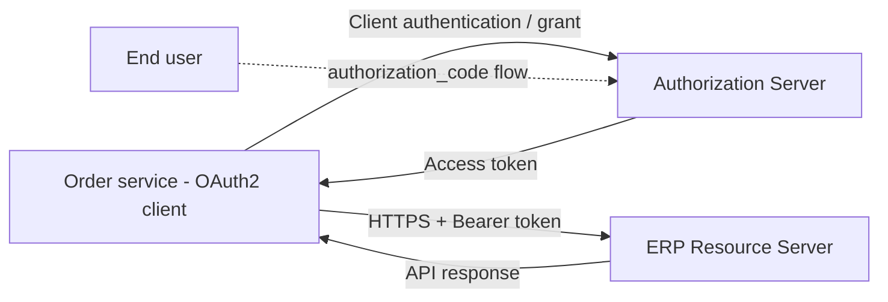
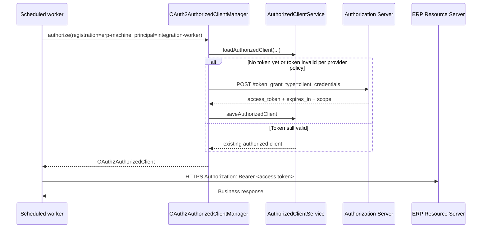
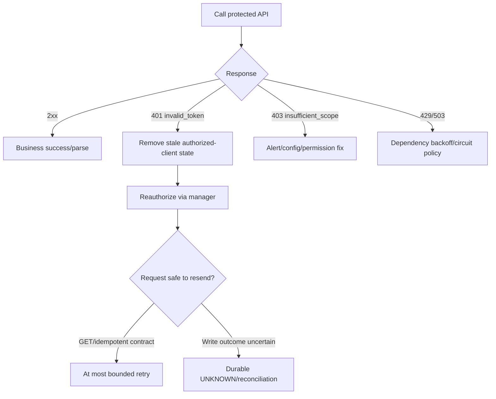
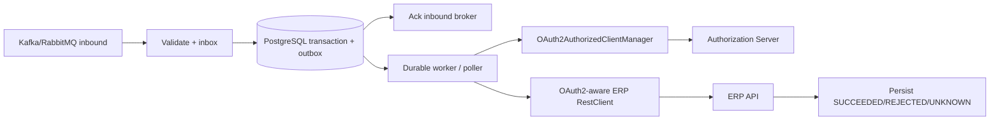
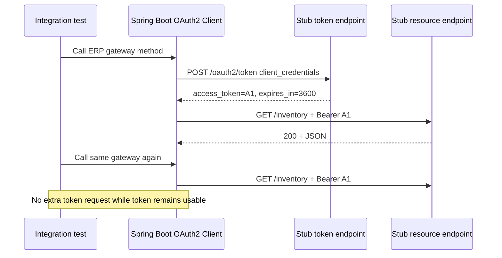

# Acquiring and Refreshing Access Tokens with the Right Spring Security Components

## 1. Why Is Access Token Acquisition Part of Integration Design?

A Spring Boot service receives commands from HTTP or Kafka, queries PostgreSQL, and then calls an ERP API. The ERP protects its endpoints with OAuth 2.0 Bearer access tokens. When a token expires, the integration failure is not just `401 Unauthorized`: the service may be holding a message awaiting acknowledgment, an already-committed database transaction, or a write command with an uncertain outcome.

A manual approach typically suffers from bugs:

```java
// Anti-pattern: fetching a new token on EVERY call and storing tokens in a mutable field.
String token = loginByCallingTokenEndpoint(clientId, clientSecret);
return restClient.get()
        .uri("/inventory/{id}", inventoryId)
        .header("Authorization", "Bearer " + token)
        .retrieve()
        .body(InventoryView.class);
```

This puts token issuance logic inside business handlers, easily causing token-endpoint storms, secret leakage in logs, and missed handling for expiration, refresh, concurrent requests, and error classification. If the API is called across multiple threads or replicas, a hand-rolled cache can hold a token for the wrong client, wrong scope, or wrong user.

**Spring Security OAuth2 Client** provides a dedicated model built around `ClientRegistration`, `OAuth2AuthorizedClient`, `OAuth2AuthorizedClientManager`, and `OAuth2AuthorizedClientProvider`s. These components select the right grant, reuse valid tokens, refresh/reauthorize when needed, and integrate into HTTP clients in the right context.

This lesson **"Acquiring and Refreshing Access Tokens with the Right Spring Security Components"** belongs to the **"Connection Security"** chapter in the **SPRING_BOOT_INTEGRATION** module. The context is Spring Boot integrating HTTP clients, JDBC/JPA, caches, message brokers, and Spring Integration; the focus covers configuration, data contracts, transactions, errors, deduplication, testing, and flow observability.

After this lesson, you will know how to:

1. Choose `client_credentials` vs. `authorization_code` + `refresh_token` according to the authorized subject.
2. Understand how `OAuth2AuthorizedClientManager` differs from `OAuth2AuthorizedClientService`, `Repository`, and `Provider`.
3. Select the right manager for **scheduled/background tasks**, **servlet HTTP requests**, or **reactive WebFlux**.
4. Configure `RestClient` and `WebClient` so bearer tokens are attached automatically on outbound HTTP calls.
5. Distinguish expired tokens, revoked tokens, missing scopes, token endpoint outages, and resource server 401/403 responses.
6. Protect tokens, secrets, tenant/user isolation, and handle safe retries with Kafka/RabbitMQ/ERP.
7. Test token lifecycles, concurrency, HTTP headers, failure/recovery, and observability.

**Principle:** Spring Security owns the **access-token authorization lifecycle** for the client; the application still owns business command correctness and durable retries.

## 2. OAuth 2.0 Roles in an Outbound Call



| Role | Example | Responsibility |
|---|---|---|
| **OAuth2 Client** | Order service. | Acquires and uses tokens per registration/grant. |
| **Authorization Server** | Organization/partner identity provider. | Issues access tokens and refresh tokens per policy. |
| **Resource Server** | ERP Inventory API. | Validates bearer tokens, scopes/audience/claims, and authorization. |
| **Resource Owner** | User or authorizing entity depending on grant. | May participate in consent/redirects in authorization code. |
| **Client registration** | `erp-machine`, `crm-user`. | Defines client ID, secret/auth method, token URI, grant, and scopes. |

**Distinguish inbound vs. outbound:** Spring Boot receiving and **validating inbound JWT/Bearer tokens** as an OAuth2 Resource Server is one responsibility; Spring Boot **acquiring outbound Bearer tokens** as an OAuth2 Client is another. One application can do both, yet configuring `spring.security.oauth2.resourceserver.jwt.issuer-uri` **does not** obtain tokens for `RestClient`.

### 2.1. An Access Token Is Not a Refresh Token

- **Access token**: scoped, time-limited credential for calling APIs; typically sent under `Authorization: Bearer <token>`.
- **Refresh token**: credential issued by the authorization server per grant/policy, used at the token endpoint to obtain a new access token, **never** sent to the resource server.
- **Client secret/private key**: credential authenticating the OAuth2 client to the authorization server; never used as a Bearer token for business APIs unless an API contract explicitly defines another scheme.
- **ID token**: OpenID Connect artifact conveying user identity to the client; **not** used by default as an access token for ERP APIs.

Do not assume an access token is always a JWT; it can be an opaque token. Clients should not parse JWT payloads manually as the sole source of truth for expiry/scopes/business identity when the authorization server specifies another contract.

## 3. Choosing the Right Grant: Machine-to-Machine vs. "On Behalf of User"

| Scenario | Common OAuth2 Flow | Who Is the Token Bound To? | How Is It Re-Issued? |
|---|---|---|---|
| Scheduled job, Kafka consumer, outbox dispatcher calling ERP with app permissions. | `client_credentials`. | Confidential client/application. | Request a **new access token with client credentials** upon expiry; normally no refresh token. |
| Web app calling CRM **on behalf of a logged-in user**. | `authorization_code` + PKCE/appropriate delegation. | User + client + scopes. | Use `refresh_token` **if** issued by server and allowed for client; may require re-authentication. |
| Service calling a partner API using upstream user delegation. | On-behalf-of/token exchange per provider contract. | User/delegated authority. | Depends on authorization server; never silently replace with client credentials. |
| App only validates incoming API tokens. | Resource Server JWT/opaque introspection. | API caller. | Does not acquire outbound tokens automatically. |

### 3.1. Why Doesn't `client_credentials` Usually Have a Refresh Token?

In `client_credentials`, the client already holds credentials to request a new access token, so a refresh token is unnecessary in the standard flow. When a token nears expiry, `ClientCredentialsOAuth2AuthorizedClientProvider` performs a **new authorization** at the token endpoint. Writing code that looks for `refresh_token` in the response and builds a refresh loop for client credentials creates dead logic or contract errors.

Some authorization servers offer proprietary extensions; follow provider docs without treating extensions as OAuth2 defaults.

### 3.2. Authorization Code Has Request/User Constraints

Authorization code requires browser interaction/redirects and a matching user context; never use a web user's callback URL and `HttpServletRequest` to fake a background batch job. When a user's token expires and the refresh token is invalid, the workflow needs a reauthorization policy—never silently switch to a broader-privileged application token without authorization.

## 4. Spring Security Components and Their Distinct Responsibilities

| Component | Role | Question It Answers |
|---|---|---|
| `ClientRegistration` | OAuth client configuration for a provider/grant. | Which token URI, client ID, scopes, and auth method to call? |
| `ClientRegistrationRepository` | Looks up registrations by `registrationId`. | Which config corresponds to `erp-machine`? |
| `OAuth2AuthorizedClient` | Registration + current access token, optionally with refresh token. | Which token is currently authorized for this principal/registration? |
| `OAuth2AuthorizedClientService` | Stores/loads authorized clients, typically keyed by registration/principal. | Where is the token stored, and can it be reused beyond a request? |
| `OAuth2AuthorizedClientRepository` | Stores/loads authorized clients in a web/servlet request context. | Which session/request backing holds the current user's token? |
| `OAuth2AuthorizedClientProvider` | Executes one or more grants/re-authorizations. | If the token is missing/expired, which mechanism re-issues it? |
| `OAuth2AuthorizedClientManager` | Coordinates authorize/reauthorize and persists the result. | Which authorized client should this call use? |
| `OAuth2AuthorizationFailureHandler` | Handles authorization failures and token invalidation. | When must a stale token be evicted? |

**Do not collapse everything into one `String bearerToken` field.** The manager and authorized-client storage use principal/registration keys to maintain proper scope, while providers enforce token issuance conditions.

### 4.1. "Authorized Client" Is Authorization State, Not a Logged-In User

`OAuth2AuthorizedClient` is not a Spring Security `Authentication`. With client credentials, you still need a **stable principal identifier so the manager can store/look up the authorized client**, even without a real HTTP user. With delegated tokens, the principal must represent the exact user so tokens never mix.

## 5. Dependencies and Versions to Verify

With Spring Boot 3.x / Spring Security 6.x aligned via the Spring Boot BOM:

```kotlin
dependencies {
    implementation("org.springframework.boot:spring-boot-starter-oauth2-client")

    // Add only the HTTP stack actually used:
    implementation("org.springframework.boot:spring-boot-starter-web")
    // or for WebClient:
    // implementation("org.springframework.boot:spring-boot-starter-webflux")

    implementation("org.springframework.boot:spring-boot-starter-actuator")

    testImplementation("org.springframework.boot:spring-boot-starter-test")
}
```

In newer Spring Boot 3.x releases, `RestClient` exists since Spring Framework 6.1/Boot 3.2+, while the dedicated `OAuth2ClientHttpRequestInterceptor` arrived in **Spring Security 6.4+**. Rely on BOM dependency management to avoid mixing Spring Security modules across versions.

If a project runs an older Spring Security version, the `RestClient` OAuth2 interceptor may not exist yet; use `WebClient` + servlet filter or an appropriate adapter. **Never copy new class imports assuming every Spring Boot 3.x version includes them.**

### 5.1. OAuth2 Client and Resource Server Use Different Starters

If the app both validates inbound JWTs and makes outbound ERP calls, add `spring-boot-starter-oauth2-resource-server` for inbound validation. However, the two starters cannot substitute for each other: `client.registration` drives outbound grants, while `resourceserver.jwt` validates inbound JWTs.

## 6. Configuring `application.yml` for Client Credentials

A machine-to-machine configuration:

```yaml
spring:
  security:
    oauth2:
      client:
        registration:
          erp-machine:
            provider: erp-identity
            client-id: ${ERP_OAUTH_CLIENT_ID}
            client-secret: ${ERP_OAUTH_CLIENT_SECRET}
            client-authentication-method: client_secret_basic
            authorization-grant-type: client_credentials
            scope:
              - inventory.read
              - inventory.write
        provider:
          erp-identity:
            token-uri: https://identity.example.internal/oauth2/token

integration:
  erp:
    base-url: https://api.erp.example.internal
```

This example uses `client_secret_basic` per the authorization server's contract; other providers may require `client_secret_post`, private-key JWT, or mTLS client authentication. Never swap authentication methods arbitrarily just to "get the server to accept it".

| Property | Meaning |
|---|---|
| `registration.erp-machine` | Internal name used as `clientRegistrationId`. |
| `provider: erp-identity` | Maps to authorization server configuration. |
| `client-id/client-secret` | OAuth client credentials; must be protected. |
| `client-authentication-method` | How the client authenticates at the token endpoint. |
| `authorization-grant-type` | `client_credentials` to acquire tokens for the application. |
| `scope` | Requested permissions; server decides what is actually granted. |
| `provider.erp-identity.token-uri` | Endpoint for requesting access tokens. |
| `integration.erp.base-url` | Application-specific property; **not** automatically bound to HTTP clients by Spring Security. |

Do not assume adding `spring.security.oauth2.client.registration.erp-machine` makes all outbound HTTP requests attach Bearer tokens automatically; you must wire **an HTTP client interceptor/filter or authorized client invocation**.

### 6.1. Distinguishing `issuer-uri` and `token-uri`

A provider supporting OIDC/OAuth discovery can use `issuer-uri` to fetch metadata; for authorization servers without discovery, declare `token-uri` and needed endpoints directly. For pure client credentials, `token-uri` is usually enough for token issuance once other registration details are clear.

**Never derive token URIs from a user-supplied Host header** or call an arbitrary issuer URI. That risks SSRF or leaking client secrets to a fake token endpoint. Endpoints must come from trusted configuration.

## 7. Client Credentials Flow: How Are Tokens Reused and Re-Issued?



This sequence illustrates **one `authorize` call**; exact caching/expiry/re-authorization behavior depends on the configured `OAuth2AuthorizedClientManager`, provider chain, and storage. With `client_credentials`, when a fresh token is needed, the client re-submits its grant and credentials; **it does not use a refresh token**.

When a token is revoked before `expiresAt` or the resource server returns `401 invalid_token`, the cache may still hold a token the manager does not yet know was invalidated. That is why **authorization failure handling** is necessary rather than relying solely on expiration clocks.

## 8. The Right Manager for Scheduled Jobs and Kafka Consumers: Service-Based

For flows **outside a servlet request**—such as `@Scheduled`, Spring Integration pollers, outbox dispatchers, or `@KafkaListener`—use `AuthorizedClientServiceOAuth2AuthorizedClientManager`. It does not require `HttpServletRequest`/`HttpServletResponse`.

```java
import org.springframework.context.annotation.Bean;
import org.springframework.context.annotation.Configuration;
import org.springframework.security.oauth2.client.OAuth2AuthorizedClientManager;
import org.springframework.security.oauth2.client.OAuth2AuthorizedClientProvider;
import org.springframework.security.oauth2.client.OAuth2AuthorizedClientProviderBuilder;
import org.springframework.security.oauth2.client.AuthorizedClientServiceOAuth2AuthorizedClientManager;
import org.springframework.security.oauth2.client.OAuth2AuthorizedClientService;
import org.springframework.security.oauth2.client.registration.ClientRegistrationRepository;

@Configuration(proxyBeanMethods = false)
class MachineOAuth2Configuration {

    @Bean("machineAuthorizedClientManager")
    OAuth2AuthorizedClientManager machineAuthorizedClientManager(
            ClientRegistrationRepository registrations,
            OAuth2AuthorizedClientService authorizedClients) {

        OAuth2AuthorizedClientProvider provider =
                OAuth2AuthorizedClientProviderBuilder.builder()
                        .clientCredentials()
                        .build();

        var manager =
                new AuthorizedClientServiceOAuth2AuthorizedClientManager(
                        registrations, authorizedClients);

        manager.setAuthorizedClientProvider(provider);
        return manager;
    }
}
```

Key points:

- `ClientRegistrationRepository` resolves `erp-machine` from Boot-managed configuration.
- `OAuth2AuthorizedClientService` persists/loads tokens by registration/principal.
- `clientCredentials()` is the only provider needed for purely machine-to-machine calls.
- The bean is explicitly named to avoid confusion with managers for user-delegated web requests.
- `authorizationCode()` and `refreshToken()` are unnecessary for typical machine-only client credentials.

### 8.1. Why Not Use `DefaultOAuth2AuthorizedClientManager` Everywhere?

`DefaultOAuth2AuthorizedClientManager` is tied to `OAuth2AuthorizedClientRepository` and a servlet request context; it fits when authorization happens **within an `HttpServletRequest`**. Invoking it from a Kafka listener/scheduler without a valid request/response fails or relies on nonexistent request data.

A service-based manager for **background execution** keeps ownership clear. Never fake an HTTP request from a scheduled thread just to run client credentials.

## 9. Calling `OAuth2AuthorizedClientManager.authorize(...)` Safely

An adapter can explicitly obtain an authorized client:

```java
import org.springframework.beans.factory.annotation.Qualifier;
import org.springframework.security.oauth2.client.OAuth2AuthorizeRequest;
import org.springframework.security.oauth2.client.OAuth2AuthorizedClient;
import org.springframework.security.oauth2.client.OAuth2AuthorizedClientManager;
import org.springframework.stereotype.Component;

@Component
class ErpTokenAccess {

    private final OAuth2AuthorizedClientManager manager;

    ErpTokenAccess(
            @Qualifier("machineAuthorizedClientManager")
            OAuth2AuthorizedClientManager manager) {
        this.manager = manager;
    }

    OAuth2AuthorizedClient authorizedClient() {
        OAuth2AuthorizeRequest request =
                OAuth2AuthorizeRequest
                        .withClientRegistrationId("erp-machine")
                        .principal("erp-integration-worker")
                        .build();

        OAuth2AuthorizedClient client = manager.authorize(request);
        if (client == null) {
            throw new IllegalStateException(
                    "OAuth2 client could not be authorized");
        }
        return client;
    }
}
```

`authorize(...)` can return `null` if no provider supports the request/grant or reauthorization cannot proceed under certain conditions; **never dereference `client.getAccessToken()` without checking for `null`**.

### 9.1. Stable Principals and Trust Boundaries

`"erp-integration-worker"` is a **technical principal name** partitioning the machine authorized-client cache; it is not an end-user and confers no application permissions via its name. Use a stable name for the same application identity; using `eventId` as the principal on every Kafka message creates unbounded cache entries and forces unnecessary token requests.

With multiple OAuth2 registrations/tenants, design principal/registration keys and cache isolation so tenant A's tokens are never sent to tenant B's API.

### 9.2. Never Persist Bearer Tokens in Domain Events

If an ERP call may occur after Kafka redelivery or an outbox retry, store the **business operation ID and intent**, not the access token, in the outbox payload. Let the worker invoke `manager.authorize(...)` at send time, since a token saved inside an event will likely expire and get replicated across brokers/storage.

## 10. "Refreshing" Tokens: Two Distinct Mechanisms

| Condition | Machine `client_credentials` | User `authorization_code` |
|---|---|---|
| No authorized client yet. | Token request using client ID/secret/cert. | Requires authorization flow or authorized session. |
| Access token nearing expiry. | **Reauthorize with client credentials**. | `refresh_token` grant if a valid refresh token exists. |
| No refresh token issued. | Normal. | User may need to sign in/consent again. |
| Refresh token invalid/revoked. | Typically N/A. | Do not retry infinitely; clear stale auth and trigger user reauthorization. |
| Resource server 401 before expiry. | Handle invalidation/failure handler, then acquire a fresh token safely. | Check that user's token; refresh or force re-login. |
| 403 `insufficient_scope`. | Fix scopes/permissions or client registration. | Adjust consent/roles; do not retry just because of 403. |

**Never build a scheduled job that "refreshes tokens every 5 minutes" for every registration.** When HTTP clients/filters and managers are configured properly, access-token authorization lifecycle runs **on demand** before outbound calls.

### 10.1. Clock Skew and Time Margins

An access token carries `expiresAt`, yet network latency, issuer clocks, HTTP delays, and broker queue lag can make a token still valid on the client appear expired to the resource server. Providers can use clock skew margins to treat nearly-expired tokens as needing re-issuance.

Choose skew margins based on real latency and tolerances rather than arbitrarily refreshing every token at half-life. Never inspect JWT `exp` claims with naive string slicing to decide expiration, as tokens may be opaque or revoked early.

### 10.2. Token Lifetime Does Not Equal Business Job Lifetime

A `ReserveStock` job might sit in an outbox for two hours while a bearer token lives for five minutes. **Acquire the token right before each remote attempt** via the manager; do not attempt to keep one token alive across an entire workflow or tie queue TTLs to token lifetime.

## 11. Refreshing Access Tokens with `refresh_token` for Delegated Access

With authorization code, the authorization server may issue a refresh token when permitted by client/scopes/policy. The provider chain typically includes:

```java
OAuth2AuthorizedClientProvider provider =
        OAuth2AuthorizedClientProviderBuilder.builder()
                .authorizationCode()
                .refreshToken()
                .build();
```

`RefreshTokenOAuth2AuthorizedClientProvider` uses the existing refresh token to obtain a new access token when needed. Spring Security persists the updated authorized client (including a **rotated** refresh token if the server issues a new one) via the configured manager/service/repository.

### 11.1. What If There Is No Refresh Token?

- A refresh token may never have been issued.
- The client logged in without offline access or server policy forbids it.
- The user revoked consent.
- The refresh token expired, or was rotated and the old copy is no longer valid.
- Authorization server policy requires interactive authentication.

An `invalid_grant` error at the refresh-token endpoint normally **cannot** be fixed by endlessly retrying the old refresh token. Remove the stale authorized-client state and transition the user to interactive reauthorization or put the durable job into a re-authentication-required state.

### 11.2. Refresh-Token Rotation and Concurrent Requests

When a provider rotates refresh tokens, two concurrent requests using the old token can result in one succeeding and the other receiving `invalid_grant`. Storage/lifecycle handling must update state safely, potentially synchronizing per principal+registration under high concurrency and strict provider policies. Never use one global lock across **all users**, which creates bottlenecks and risks mixing user tokens.

## 12. Manager for Servlet Requests and User Permissions

A controller calling an API on behalf of a logged-in user typically has an `HttpServletRequest`, `SecurityContext`, session-backed authorized client, and `OAuth2AuthorizedClientRepository`. In that case, use `DefaultOAuth2AuthorizedClientManager`:

```java
import org.springframework.context.annotation.Bean;
import org.springframework.security.oauth2.client.DefaultOAuth2AuthorizedClientManager;
import org.springframework.security.oauth2.client.OAuth2AuthorizedClientManager;
import org.springframework.security.oauth2.client.OAuth2AuthorizedClientProviderBuilder;
import org.springframework.security.oauth2.client.registration.ClientRegistrationRepository;
import org.springframework.security.oauth2.client.web.OAuth2AuthorizedClientRepository;

@Bean("webUserAuthorizedClientManager")
OAuth2AuthorizedClientManager webUserAuthorizedClientManager(
        ClientRegistrationRepository registrations,
        OAuth2AuthorizedClientRepository authorizedClients) {

    var provider = OAuth2AuthorizedClientProviderBuilder.builder()
            .authorizationCode()
            .refreshToken()
            .build();

    var manager = new DefaultOAuth2AuthorizedClientManager(
            registrations, authorizedClients);
    manager.setAuthorizedClientProvider(provider);

    return manager;
}
```

This configuration is for **servlet/web-user** flows. It assumes the app configures `oauth2Login()`/`oauth2Client()` and proper security filter chains/callbacks; the manager bean **does not itself create login UIs, redirect handlers, or consent flows**.

If an application has both a background manager and a web-user manager, use bean names/`@Qualifier` in HTTP clients/gateways to prevent injection ambiguity.

### 12.1. Never Use User Tokens in Out-of-Session Scheduled Jobs

Once an HTTP request ends, the user may log out or revoke access; `SecurityContextHolder` has no user principal inside Kafka/scheduler threads. If a business operation needs delegated authority hours later, design an explicit offline delegation/authorization contract with secure storage and lifecycle. Never "borrow the last user's token" from a singleton field.

## 13. `RestClient`: Prefer the Built-In OAuth2 Interceptor

With Spring Security 6.4+, `OAuth2ClientHttpRequestInterceptor` can be combined with the **Spring Boot-configured `RestClient.Builder`**, preserving shared customizers/observation/HTTP transport.

```java
import org.springframework.beans.factory.annotation.Qualifier;
import org.springframework.beans.factory.annotation.Value;
import org.springframework.context.annotation.Bean;
import org.springframework.context.annotation.Configuration;
import org.springframework.security.oauth2.client.OAuth2AuthorizedClientManager;
import org.springframework.security.oauth2.client.web.client.OAuth2ClientHttpRequestInterceptor;
import org.springframework.web.client.RestClient;

@Configuration(proxyBeanMethods = false)
class ErpHttpClientConfiguration {

    @Bean("erpRestClient")
    RestClient erpRestClient(
            RestClient.Builder bootManagedBuilder,
            @Qualifier("machineAuthorizedClientManager")
            OAuth2AuthorizedClientManager manager,
            @Value("${integration.erp.base-url}") String erpBaseUrl) {

        var oauth2 = new OAuth2ClientHttpRequestInterceptor(manager);

        // Use this registration only for a single endpoint/trust boundary.
        oauth2.setClientRegistrationIdResolver(
                request -> "erp-machine");

        return bootManagedBuilder
                .baseUrl(erpBaseUrl)
                .requestInterceptor(oauth2)
                .build();
    }
}
```

**Version constraint:** this example uses the interceptor introduced in Spring Security 6.4+; when a project does not yet support it, use `WebClient` integration or plan a BOM upgrade. Never copy classes blindly into older projects.

### 13.1. Why Use the Boot-Managed Builder?

Plain `new RestClient` or `RestClient.create(...)` can skip shared observation, proxies, TLS/timeouts, metrics, or customized request factories. Crucially, bearer tokens are only attached when requests go through a client bean **with the OAuth2 interceptor**; calling another client bean elsewhere in the service will omit Authorization headers.

### 13.2. Every Remote API Should Have a Clear Trust Boundary

Example gateway:

```java
import org.springframework.beans.factory.annotation.Qualifier;
import org.springframework.stereotype.Component;
import org.springframework.web.client.RestClient;

@Component
class ErpInventoryGateway {

    private final RestClient erp;

    ErpInventoryGateway(
            @Qualifier("erpRestClient") RestClient erp) {
        this.erp = erp;
    }

    InventoryView find(String sku) {
        return erp.get()
                .uri("/inventory/{sku}", sku)
                .retrieve()
                .body(InventoryView.class);
    }
}
```

`InventoryView` is an application-defined DTO. For **machine tokens**, the OAuth2 interceptor acquires/re-issues tokens via the manager; the gateway never accepts a raw `String token` or manually sets headers.

Never allow users to pass arbitrary URIs into an `erpRestClient` equipped with an OAuth2 interceptor: requests to non-allowlisted hosts could carry the ERP's Bearer token. For HTTP redirects, verify the HTTP transport never forwards credentials to another origin.

## 14. `WebClient` in a Servlet App: Use OAuth2 `ExchangeFilterFunction`

A Spring MVC app can still use `WebClient` to call remote APIs. Spring Security provides `ServletOAuth2AuthorizedClientExchangeFilterFunction`:

```java
import org.springframework.beans.factory.annotation.Qualifier;
import org.springframework.beans.factory.annotation.Value;
import org.springframework.context.annotation.Bean;
import org.springframework.security.oauth2.client.OAuth2AuthorizedClientManager;
import org.springframework.security.oauth2.client.web.reactive.function.client.ServletOAuth2AuthorizedClientExchangeFilterFunction;
import org.springframework.web.reactive.function.client.WebClient;

@Bean("erpWebClient")
WebClient erpWebClient(
        WebClient.Builder bootManagedBuilder,
        @Qualifier("machineAuthorizedClientManager")
        OAuth2AuthorizedClientManager manager,
        @Value("${integration.erp.base-url}") String erpBaseUrl) {

    var oauth2 =
            new ServletOAuth2AuthorizedClientExchangeFilterFunction(manager);
    oauth2.setDefaultClientRegistrationId("erp-machine");

    return bootManagedBuilder
            .apply(oauth2.oauth2Configuration())
            .baseUrl(erpBaseUrl)
            .build();
}
```

This example uses the **Servlet filter function** with a service-based manager for client credentials; even though the client API is `WebClient`, `OAuth2AuthorizedClientManager` is still the **imperative/servlet** variant. With a `ReactiveOAuth2AuthorizedClientManager`, use the **reactive** filter class shown next.

### 14.1. What Are the Risks of `setDefaultClientRegistrationId(...)`?

A default registration keeps a dedicated ERP client concise. However, if one `WebClient` serves multiple domains, **every request** could send tokens to unintended hosts. Prefer one client bean per partner/base URL; if selecting registration per request, use request attributes/filter security APIs and allowlist registration IDs from trusted config.

### 14.2. The Filter Does Not Guarantee Business Success

Even when `WebClient` attaches a Bearer token, it can still receive 401/403/429/503. `retrieve()` has its own status-to-error mapping; bearer acquisition does not determine `POST` idempotency or overall retry budgets. Service gateways must classify outcomes per HTTP contract and persist `UNKNOWN` when a write times out after potentially reaching the server.

## 15. Pure Reactive WebFlux: Choose the Reactive Authorized-Client Manager

In WebFlux, execution models and storage differ from servlets. Spring Security provides `ReactiveOAuth2AuthorizedClientManager` and matching providers; background `client_credentials` can use a service-backed reactive manager:

```java
import org.springframework.context.annotation.Bean;
import org.springframework.security.oauth2.client.ReactiveOAuth2AuthorizedClientManager;
import org.springframework.security.oauth2.client.ReactiveOAuth2AuthorizedClientProviderBuilder;
import org.springframework.security.oauth2.client.AuthorizedClientServiceReactiveOAuth2AuthorizedClientManager;
import org.springframework.security.oauth2.client.ReactiveOAuth2AuthorizedClientService;
import org.springframework.security.oauth2.client.registration.ReactiveClientRegistrationRepository;

@Bean
ReactiveOAuth2AuthorizedClientManager machineReactiveManager(
        ReactiveClientRegistrationRepository registrations,
        ReactiveOAuth2AuthorizedClientService service) {

    var provider =
            ReactiveOAuth2AuthorizedClientProviderBuilder.builder()
                    .clientCredentials()
                    .build();

    var manager =
            new AuthorizedClientServiceReactiveOAuth2AuthorizedClientManager(
                    registrations, service);

    manager.setAuthorizedClientProvider(provider);
    return manager;
}
```

This snippet uses the **reactive API variant**: it does not return `OAuth2AuthorizedClient` synchronously, and WebFlux auth flows should use `ServerOAuth2AuthorizedClientExchangeFilterFunction` where appropriate.

### 15.1. Why Not Call a Blocking Manager on the Event Loop?

Token acquisition performs network I/O to the authorization server. Calling a blocking imperative `OAuth2AuthorizedClientManager.authorize(...)` directly on a Reactor Netty event loop can stall the entire event loop. Prefer reactive managers/filters, or isolate blocking calls on a bounded scheduler with explicit backpressure in hybrid imperative/reactive apps.

In Reactor, `ThreadLocal` security/tracing contexts do not propagate automatically across all operators. Preserve user-delegated tokens and principals via **Reactor Context**/framework-supported security contexts; never store the current user in a static field.

## 16. Token Expiry Is Not the Only Reason a Resource Server Rejects

Even before `expiresAt`, a resource server can return `401` because:

- The token was revoked or is no longer accepted by the issuer.
- Audience/issuer mismatches the endpoint.
- Clock skew exists between AS/RS/client.
- Token signature/key rotation validation failed.
- Scope/tenant claims do not satisfy authorization policies.
- The Bearer header was never attached due to the wrong client bean/config.
- The API expects a different authentication scheme than the requested token.

Conversely, `403 Forbidden` usually indicates the request was identified yet lacked sufficient permissions/scopes or violated resource policy. **Never treat every 403 as an expired token and loop acquiring new tokens.**

### 16.1. Reacting to 401 and `WWW-Authenticate`

Following bearer token conventions, resource servers may return `WWW-Authenticate: Bearer error="invalid_token"` or `insufficient_scope` with diagnostic details. Classify carefully: only contract-defined invalid token/authorization failures should trigger invalidation/reauthorization; a 401 HTML challenge from an intervening proxy requires separate handling.

**Important:** acquiring a new token after a 401 is one step; **resending the business request** is another. An idempotent `GET` can use bounded retries. A money-moving or order-placing `POST` that may have partially executed on the server can create duplicates without an idempotency key and reconciliation.

## 17. `OAuth2AuthorizationFailureHandler` and Evicting Stale Tokens

Spring Security provides authorization failure handling to evict authorized-client state when tokens are rejected per policy. Handlers/utilities exist for both servlet `OAuth2AuthorizedClientRepository` and service-backed `OAuth2AuthorizedClientService`.

With `OAuth2ClientHttpRequestInterceptor` or OAuth2 `WebClient` filters, configure the **authorization failure handler** matching your storage so an `invalid_token` is not repeatedly served from cache on every call. **Do not assume every constructor/overload installs identical default handlers**: verify your version's defaults and specific constructors.

A sound workflow:



Never call `authorizedClientService.removeAuthorizedClient(...)` for another registration/principal in a shared cache, or wipe all users' tokens when one resource server call fails. The failure handler must receive the exact registration/principal and reason.

### 17.1. Never Loop 401s Infinitely

Allow **at most one controlled reauthorization** and, if the resource still rejects, surface the error to the gateway/operations. Retrying infinitely with the same client credentials typically loads the authorization server and obscures the root cause.

## 18. Distinguishing Token Endpoint Errors from ERP API Errors

| Error Path | Examples | Handling |
|---|---|---|
| **Authorization Server** | `invalid_client`. | Wrong client ID/secret/auth method; alert configuration, no hot retries. |
| Authorization Server | `invalid_scope`. | Registration asks for invalid/ungranted scopes; fix policy. |
| Authorization Server | `invalid_grant` on refresh. | Refresh token revoked/expired/rotated; reauthorize user per flow. |
| Authorization Server | 429/503, connect/read timeouts. | Bounded retry/backoff, cap token requests, keep durable job. |
| Authorization Server | TLS/certificate/issuer mismatch. | Fail closed, fix trust/config; never disable verification. |
| **ERP Resource Server** | 401 `invalid_token`. | Invalidate the right authorized client, acquire new token, consider safe retry. |
| ERP Resource Server | 403 `insufficient_scope`. | Fix scopes/audience/permissions; do not loop fetching new tokens. |
| ERP Resource Server | 429/503. | Downstream retry/backoff/quota; do not confuse with token refresh. |
| ERP Resource Server | 200 with business error DTO. | Handle per business contract. |
| ERP Resource Server | POST write timeout. | `UNKNOWN`, query/reconcile by operation ID. |

**Token endpoint failures occur before the outbound ERP request is sent** in most cases, yet never blindly assume zero side effects if an earlier request was already dispatched. Classify by timeline and actual provider outcome.

### 18.1. Exception Mapping

An `OAuth2AuthorizationException` or OAuth2 client exception should be handled as an **integration authentication/authorization error** with a normalized error code, never returning raw token responses/secrets in public APIs. Business/transport errors from `RestClient`/`WebClient` throw different exception classes. Establish an adapter boundary instead of collapsing everything into `IllegalStateException("ERP failed")`.

## 19. Token Storage: In-Memory, Session, and Persisted Authorized Clients

Spring Security provides authorized-client services/repositories for different storage models. Choose based on context:

| Storage | Suitable For | What to Watch |
|---|---|---|
| In-memory `OAuth2AuthorizedClientService` | Simple setups, dev/test, or machine clients not needing a shared cache. | Tokens vanish on restart; each pod may request its own token. |
| Session/request-backed repository | Web login/user-delegated tokens. | Session lifecycle, logout, CSRF, multi-instance sessions. |
| JDBC/custom persistent authorized-client service | Multi-instance/multi-user deployments needing state across restarts per policy. | Encryption at rest, access control, backup/retention, token rotation concurrency. |
| Purpose-built token caching | High-load client credentials across replicas. | TTL/skew, principal/registration isolation, refresh storms, and evictions. |

**Do not store refresh tokens in a shared Redis cache as harmless plain data.** Tokens and secrets are credentials; storage requires encryption/proper TTLs, ACLs, key rotation, auditing, and must stay out of metrics/logs/traces.

### 19.1. Is Multiple Pods Requesting Tokens Simultaneously Wrong?

If every replica runs a service-based manager + in-memory authorized-client service, each pod may fetch its own token. That can be acceptable depending on provider limits, though it increases token endpoint load; there is no distributed cache by default. When token endpoint quotas are tight, consider shared storage, per-registration rate limits, or controlled warm-up.

Never share tokens across tenants/registrations with different audiences merely because `clientId` names look similar. Cache keys must capture principal/registration and, when contracted, tenant/audience.

### 19.2. Cache Expiration and Secret Rotation

A refresh/new-token attempt may fire right when a client secret is rotated before pods reload configuration. Establish a secret rotation and framework-supported reload/redeploy procedure. Never hardcode secrets in `application.yml` relying on `@RefreshScope` when Spring Cloud isn't even present; verify the actual supported reload mechanism.

## 20. Never Pass Raw Access Tokens Through Kafka, RabbitMQ, or JMS

A Kafka consumer receives `OrderPaid(eventId=E42)` and calls the ERP seconds or hours later. The event envelope should carry **business intent** and stable IDs, never a Bearer access token:

```json
{
  "eventId": "E42",
  "operationId": "reserve-O-42",
  "type": "ReserveStock",
  "schemaVersion": 1,
  "orderId": "O-42",
  "quantity": 2
}
```

The worker obtains a token via the manager right before the HTTP call; the broker needs no secret read access, and token lifetime never constrains event retention/replay.

### 20.1. Do Not Use a Caller Token for Background Application Operations

If an event was emitted by user A yet processed by a worker after user A logs out, **never copy user A's token from an HTTP header into a Kafka record**. If a workflow genuinely requires delegated authorization, design provider-specific delegation/offline access with consent, tenant segregation, and audit; otherwise, use least-privilege application-scoped `client_credentials`.

### 20.2. Kafka SASL/OAUTHBEARER Is Not the HTTP OAuth2 Client

A Kafka cluster using SASL/OAUTHBEARER uses dedicated callback/login handlers in the Kafka client. Spring Security's `OAuth2AuthorizedClientManager` for HTTP resource requests **does not** configure tokens for the Kafka protocol, RabbitMQ connections, or JMS providers. Configure the broker's own token/callback integration and check TLS/issuer/audience per broker contract.

## 21. SOAP, HTTP Interfaces, and Other SDKs

If `WebServiceTemplate` sends SOAP over HTTPS and the partner requires OAuth2 Bearer at the **HTTP transport**, it still needs an access token. However, a `RestClient` interceptor **does not automatically apply** to `WebServiceTemplate` if SOAP uses a different `WebServiceMessageSender`.

Controlled options:

- Configure an HTTP message sender supporting authentication/header injection using the manager to obtain the authorized client.
- Use an instrumented, OAuth2-aware transport/HTTP client if Spring-WS/version supports shared config.
- Isolate token handling in a partner/trust-boundary adapter rather than inside XML transformers.
- Test headers on the **raw HTTP request**, verifying `SOAPAction`, WS-Security, and mTLS remain intact.

HTTP Service Interfaces (`@HttpExchange`/`HttpServiceProxyFactory`) can use `RestClientAdapter` or `WebClientAdapter`; if the underlying client has the OAuth2 interceptor/filter, interface methods inherit it. Creating an interface alone does not provide auth.

### 21.1. OAuth Bearer vs. WS-Security UsernameToken

SOAP header UsernameToken/signatures, mTLS client certificates, and HTTP Bearer tokens are distinct security layers. A partner may require one or multiple layers. Never put an OAuth2 client secret inside a SOAP body, and never treat `SOAPAction` as an authorization control.

## 22. Spring Integration Flows: Acquire Tokens at the HTTP Gateway, Not Flow Entry

An `IntegrationFlow` can ingest messages from Kafka/JMS/RabbitMQ, validate them, persist a durable job, and let a worker call HTTP/SOAP:



In this pattern:

1. The inbound handler commits **durable intent** before acking the source.
2. The worker uses a **stable machine principal** and client registration without faking a servlet session.
3. Token acquisition/renewal occurs at the HTTP boundary.
4. Transient token endpoint failures can move the job to `RETRY_WAIT` per policy.
5. An ERP `POST` write timeout becomes `UNKNOWN`/reconciliation, never retrying with a new operation ID.
6. The business outcome commits in its own DB transaction, publishing result events via outbox if needed.

**OAuth2 token management does not replace transactions or idempotency.** An authorization server outage must never drop a Kafka message that was acked while the operation only lived in RAM.

## 23. HTTP Retries, Token Reauthorization, and Idempotency Share One Budget

Suppose:

- The OAuth2 manager tries to acquire a new token.
- `RestClient`/Resilience4j runs HTTP retries.
- Spring Integration `RequestHandlerRetryAdvice` also retries.
- The Kafka container has an error handler and redelivery.

If every layer retries three times independently, one business operation can generate far more calls to the token endpoint and ERP than expected.

Design clear ownership:

| Layer | Responsibility |
|---|---|
| OAuth2 `AuthorizedClientManager` | Decides whether a token is still usable or must be authorized/reauthorized. |
| Token endpoint client | Bounded transport failure handling for authorization requests. |
| API gateway | HTTP status mapping, timeouts, request safety, 401 invalidation. |
| Integration application service | Idempotency keys, business outcomes, transactions. |
| Durable worker | Retry scheduling, total deadline, `UNKNOWN`/quarantine states. |
| Broker listener | Ack/commit after durable handoff or business commit. |

### 23.1. Never Blindly Retry a POST Just Because You Got a New Token

A `401` usually happens before the resource server executes business logic when auth fails, yet behind proxies or complex workflows you cannot **assume** every failing request had no upstream effect. Especially when the first attempt hits a **read timeout**, you do not know whether it committed. Keep the same idempotency key and query by operation ID when needed.

### 23.2. Backoff to Prevent Token Endpoint Stampedes

If the authorization server temporarily fails while 500 Kafka messages process in parallel, 500 requests could simultaneously hammer the token endpoint. Apply concurrency/pool/rate limits, circuit breakers, and durable retries at the **dependency boundary** instead of spawning 500 independent scheduled refresh tasks.

## 24. Protecting Credentials, Tokens, and Tenant Isolation

Mandatory principles:

1. **Call token endpoints and resource servers only over HTTPS with proper certificate/hostname verification.**
2. Keep `client-secret`/private keys in a controlled secret manager/environment, never in Git.
3. Request client credentials grants with least-privilege scopes/audience.
4. Never log `Authorization: Bearer ...`, token endpoint bodies, refresh tokens, cookies, or `Set-Cookie`.
5. Never place tokens/secrets in Kafka headers, outbox events, DLQs, tracing baggage, exception messages, or telemetry.
6. Never copy an inbound user `Authorization` header to ERP if the server expects an application token.
7. Allowlist ERP base URLs and token URIs to prevent SSRF and bearer token leakage.
8. Check redirects: never forward tokens to another origin outside policy.
9. Encrypt authorized-client storage when storing refresh tokens; restrict access and retention.
10. Maintain secret rotation/credential revocation runbooks and a way to purge stale cached authorized clients.
11. Isolate credentials across staging/prod and across partners/trust boundaries.
12. Never use tenant A's token for tenant B because a default registration/manager was mis-shared.

### 24.1. Scope and Audience Are Security Contracts

An issued token may carry `scope=inventory.read`, yet the resource server requires a specific audience or role/tenant claim. Never assume a token is valid for **every** URL under a provider's domain. On `403 insufficient_scope`, update the OAuth client registration or provider policy through review rather than widening application-wide scopes carelessly.

### 24.2. The Resource Server Must Always Validate Tokens

Holding a token does not mean an API call is permitted. The resource server must validate signature/introspection, issuer, audience, expiry, scopes, and permissions. Clients **cannot** grant themselves permissions by altering `Authorization` headers or editing JWT payloads.

## 25. Observability: Measure Token Lifecycle Without Collecting Token Values

Signals to measure (many require explicit instrumentation and are **not** guaranteed Spring Boot defaults):

| Metric/Trace Signal | Question Answered |
|---|---|
| Token acquire/reauthorize success/failure | Is the AS issuing tokens reliably? |
| Token endpoint latency p95/p99 | Is authorization slowing down HTTP calls? |
| `invalid_client`/`invalid_scope`/`invalid_grant` counts | Which config/consent/rotation failures are spiking? |
| Resource server 401/403 rates | Are bearer tokens rejected or lacking permissions? |
| Tokens acquired per minute per registration | Are there cache misses or refresh stampedes? |
| Downstream HTTP latency/status | Is the ERP slow even with a valid token? |
| Kafka lag / outbox oldest age | Is a token endpoint outage stalling business workflows? |
| Authorized-client cache entries/evictions (when instrumented) | Are principal keys exploding? |
| Business operation `UNKNOWN` age | How long have timed-out writes awaited reconciliation? |

Recommended bounded metric labels: `registration=erp-machine`, `grant_type=client_credentials`, `outcome=success|failure`, `error_category=invalid_client|timeout`. Never use `accessToken`, `clientSecret`, `userId`, `orderId`, or `traceId` as high-cardinality tags.

### 25.1. Tracing Across Token Endpoint and ERP

If HTTP transports are instrumented by Micrometer Tracing, token and ERP requests can produce spans per active configuration. However, do not assume every internal OAuth2 token client is automatically instrumented identically to Boot's `RestClient`. Trace backends and logs must **filter Authorization headers** and sensitive response bodies.

An HTTP request finishing and an outbox worker running minutes later may belong to separate traces; use a stable `operationId/eventId` for business correlation. Never use `traceparent` as an idempotency key.

## 26. Unit Testing the Authorized-Client Lifecycle

Unit tests for managers/providers can verify re-issuance rules without calling a real ERP:

- Authorized client exists and access token is still valid → provider/manager reuses it without redundant token calls.
- Token missing or near expiration → client credentials provider reauthorizes.
- Authorization server returns `invalid_client` → classified as configuration error.
- Valid/expired/rotated refresh token → provider responds per contract.
- Distinct principals/registrations never share tokens.
- `manager.authorize(...)` can return `null` when authorization fails per provider setup.
- No tokens logged in exceptions/metrics.

Still, mocking the entire `OAuth2AuthorizedClientManager` and only asserting `RestClient` sends a header **does not prove the refresh flow works**. Test end-to-end against a fake token endpoint and real OAuth2 client wiring to verify acquisition, caching, grant type, and headers.

### 26.1. A Fixed Clock Makes Expiration Tests Reliable

Test expiration by controlling `Clock`/provider clock if supported by your API version, or by returning short `expires_in` tokens from a stub with deterministic polling/waiting. Never use `Thread.sleep(60000)` to wait for real expiration, which makes tests slow and flaky.

## 27. Integration Testing with Authorization-Server + Resource-Server Stubs

A realistic test can use WireMock/MockWebServer or an HTTP stub in Testcontainers:



Test Spring Boot setup outline:

```java
@SpringBootTest
class OAuth2ClientIntegrationIT {

    // Test HTTP stubs define:
    // /oauth2/token:
    //   verify client authentication + grant_type=client_credentials
    //   return {"access_token":"test-token-A1",
    //           "token_type":"Bearer","expires_in":3600}
    //
    // /inventory/sku-42:
    //   assert Authorization: Bearer test-token-A1
    //
    // @DynamicPropertySource registers:
    // spring.security.oauth2.client.provider.erp-identity.token-uri
    // integration.erp.base-url
    //
    // @Autowired ErpInventoryGateway gateway
    //
    // Verify 2 calls succeed and token endpoint received only 1 call.
}
```

This is a **skeleton**, not a complete test class with imports/fixtures/assertions. Never put fake OAuth2 test tokens into production profiles. If Spring Security's clock skew exceeds the stub's `expires_in`, a newly acquired token may immediately appear near-expired; configure lifetime/clock appropriately to test reuse vs. reauthorization independently.

### 27.1. Testing Refresh-Token Flows for Users

Create an authorized-client fixture with a nearly-expired access token and issued refresh token, stubbing `grant_type=refresh_token` at the token endpoint; return a new token and a rotated refresh token if contracted. Assert the stored authorized client was replaced, the new bearer token reaches the right user request, and user B never receives user A's token.

Never test refresh tokens on a `client_credentials` registration and conclude "Spring Security cannot refresh tokens"—those are two distinct mechanisms.

## 28. Token and HTTP Boundary Test Matrix

| Scenario | Outcome to Verify |
|---|---|
| App has no authorized client yet. | Manager sends the right grant to trusted token URI and attaches Bearer. |
| Token still usable. | Does not request a new token on every call. |
| Token near expiry. | Reauthorizes/refreshes per provider with appropriate clock skew. |
| Client credentials grant. | Requests a new token using credentials without expecting a nonexistent refresh token. |
| Authorization code + refresh token. | Refreshes for the right user, handling token rotation and storage. |
| Refresh token invalid/revoked. | No infinite loop; clear reauthorization policy. |
| Token endpoint 429/503/timeout. | Bounded retry/backoff, no stampede. |
| Token endpoint `invalid_client`. | No hot retries and no secret logging. |
| ERP returns 401 `invalid_token`. | Invalidates the right authorized client, bounded reauthorization. |
| ERP returns 403 `insufficient_scope`. | Classified as permission error; no endless token refresh retries. |
| ERP write timeout. | Durable `UNKNOWN`/reconciliation, never minting a new operation ID. |
| Two concurrent users. | Bearer tokens never cross between users. |
| Two tenants/partners. | Tokens/registrations/audiences remain isolated. |
| Cross-origin HTTP redirect. | Bearer token never leaks to another host. |
| Async/Reactive `WebClient`. | Never blocks event loop or loses principal context. |
| Kafka/Integration poller. | Service-based manager runs without a servlet request. |
| Broker outage/replay. | No expired bearer tokens stored inside messages/outbox. |
| Retry after token rotation. | Every attempt uses accurate authorization state. |
| Application restart/multi-pod. | Authorized-client storage/caching behaves as designed. |
| Logging/tracing. | No access tokens, refresh tokens, secrets, or token response bodies captured. |

### 28.1. Do Not Verify Only the HTTP Header and Skip the Token Endpoint

A stub test where you manually inject a Bearer header will miss a manager lacking `clientCredentials()`, a wrong `clientRegistrationId`, or a cache key using `eventId`. Assert both the **token grant request** and the **API request**, plus the exact token endpoint call count.

## 29. Testing Spring Integration/Kafka and Idempotency When Tokens Fail

A Kafka consumer flow calling ERP with a machine token:

1. Receives `ReserveStock(eventId=E42, operationId=R42)`.
2. Commits inbox + durable job before committing offset.
3. Worker starts HTTP attempt; manager requests token; AS returns 503.
4. Worker writes `RETRY_WAIT` with deadline/backoff and does not mark job `SUCCEEDED`.
5. AS recovers; manager obtains token and worker calls ERP.
6. ERP processes command yet response is lost → worker writes `UNKNOWN`, queries by operation ID.
7. Reconciliation confirms operation succeeded; commits `SUCCEEDED` and emits result outbox.
8. Source Kafka event replays: inbox prevents creating a duplicate operation.

Test with PostgreSQL Testcontainers and Kafka Testcontainers when validating transactions/acks/offsets. Authorization Server/ERP can be HTTP stubs with fault injection. Testing only with mock managers and mock `KafkaTemplate` misses these failure windows.

### 29.1. Token Failures and Broker Acknowledgment

**Never ack a message just because the manager acquired a token.** A Bearer token is a prerequisite for calling the API, not durable business completion. If the app already persisted a durable job, it may ack the source broker before calling ERP; if it only queued in RAM, a crash loses work. Ack timing belongs to workflow design, not Spring Security.

## 30. Troubleshooting: Why Is the Token Not Refreshing or Why Is the API Still Returning 401?

| Symptom | Common Cause | What to Check |
|---|---|---|
| No Bearer header in ERP request. | Client uses wrong bean, missing interceptor/filter. | Actual `RestClient`/`WebClient` bean, filter/interceptor chain. |
| Token URI never called. | Wrong registration ID, provider lacks grant support, cached client exists, `authorize` returned null. | Manager/provider, registration, token expiry/state. |
| Token endpoint called on every message. | Random principal name, storage not reusing, token lifetime too short. | Principal+registration cache key, `expiresAt`/skew. |
| Background poller fails for missing `HttpServletRequest`. | Servlet request-based manager used in scheduled flow. | Service-based manager / reactive variant. |
| Authorization code in scheduler fails to redirect. | No interactive user context. | Choose machine grant vs. delegated user grant properly. |
| `invalid_client`. | Wrong/rotated secret, auth method mismatch, disabled client. | Secret source, provider contract, mTLS/private-key requirement. |
| `invalid_scope`. | Client lacks permission, malformed scope. | Registered scopes and AS policy. |
| `invalid_grant` on refresh. | Refresh token revoked/rotated/expired. | Authorized-client service, user reauthorization flow. |
| Resource returns 401 before expiry. | Token revoked, invalid audience/issuer, missing bearer. | `WWW-Authenticate`, AS/RS policy, failure handler. |
| 401 repeats after reauthorize. | Stale client not invalidated or wrong scope/audience. | Correct failure handler storage key, bounded retry. |
| Resource returns 403. | Insufficient scope/role/tenant policy. | Granted scopes, audience, authorization policy. |
| Two users receive each other's permissions. | Misused default client registration/user principal or singleton token field. | User isolation, repository/manager scope. |
| ERP token sent to another host. | Shared client + dynamic URL/redirect. | Fixed base URL, SSRF guard, HTTP redirect behavior. |
| WebFlux blocks/loses context. | Blocking manager called on event loop or bad `ThreadLocal` usage. | Reactive manager/filter, Reactor security context. |
| Multi-pod issues excessive token requests. | Per-pod in-memory cache, refresh stampede. | Registration-level rate/lock, shared storage if needed. |
| REST retry duplicates side effects. | 401/timeout handling resends non-idempotent POST. | Stable operation ID, reconciliation, retry scope. |
| Kafka lag grows during AS outage. | Listener blocks poll thread waiting on token/retries too long. | Durable worker, max poll interval, backpressure. |
| Logs contain Bearer tokens. | Unredacted interceptor/wire logging. | HTTP logging and tracing redaction. |

### 30.1. Ordered Investigation Runbook

1. Identify the actual **client registration ID**, grant type, scopes, and token URI.
2. Inspect the manager instance and authorized-client store wired into the HTTP client.
3. Distinguish background thread, servlet request, and reactive chain execution.
4. Check principal key, token expiry, and authorized-client cache.
5. Separate authorization server errors from resource server errors.
6. On 401, inspect `WWW-Authenticate` and the failure-handler/token invalidation policy.
7. On 403, inspect scopes/audience/tenant permissions; do not hot-retry.
8. Check HTTP client base URL and any Bearer leakage via redirects/other hosts.
9. Check broker ack/outbox/inbox/operation states before replaying remote commands.
10. Add an integration test at the exact authorization boundary that failed.

## 31. Anti-Patterns to Avoid

1. Calling the token endpoint manually with `RestTemplate` on every business request and bypassing `OAuth2AuthorizedClientManager`.
2. Configuring `refresh_token` grant for `client_credentials` when the AS issues no refresh token.
3. Storing tokens in a singleton mutable `String currentAccessToken` shared across all users/tenants.
4. Using `DefaultOAuth2AuthorizedClientManager` (which needs a servlet context) inside a request-less Kafka poller.
5. Mistaking resource-server JWT validation config for outbound token acquisition.
6. Attaching Bearer tokens to every request of a global HTTP client, including non-ERP hosts.
7. Logging `Authorization`, refresh tokens, client secrets, or token endpoint responses.
8. Persisting access tokens in outbox payloads or Kafka messages for later workers.
9. Using `eventId` as the machine token cache principal, causing unnecessary token churn.
10. Using the last user's token to call ERP from a background job.
11. Enabling the `RestClient` OAuth2 interceptor and assuming `WebServiceTemplate`/Kafka SASL automatically get tokens.
12. Ignoring `authorize() == null` or authorization failure exceptions.
13. Treating 403 as an expired token and retrying indefinitely.
14. Retrying mutating POSTs immediately after timeouts without a stable idempotency key.
15. Mixing servlet `OAuth2AuthorizedClientManager` with reactive managers and blocking the event loop.
16. Refreshing active tokens on a global background thread without storage/rotation correctness.
17. Ignoring refresh-token rotation under concurrent user requests.
18. Changing scopes/audiences dynamically from unvalidated user input without an allowlist.
19. Disabling TLS hostname/certificate verification to make a token endpoint work.
20. Assuming successful token fetch means the business command committed/was acked.
21. Building a distributed token cache without encryption, TTL, or tenant isolation.
22. Testing only mock API 200s without testing token issuance, expiry, 401, `invalid_grant`, and concurrency.
23. Letting token-endpoint retry storms stall the Kafka poll loop and trigger rebalances.
24. Attaching client secrets/refresh tokens to tracing baggage or metric tags.

## 32. Access Token Lifecycle Implementation Checklist

- [ ] Clearly separated inbound resource server vs. outbound OAuth2 client roles; never mix them.
- [ ] Selected `client_credentials` for application jobs or `authorization_code`/delegated grants per contract.
- [ ] Client registration/provider/token URI/scopes/audience configured from trusted sources.
- [ ] Client authentication method, TLS, and secret rotation verified with the AS.
- [ ] Spring Boot/Spring Security versions aligned via BOM.
- [ ] Background apps use the right service-based `OAuth2AuthorizedClientManager`.
- [ ] Servlet web-user flows use repository/request-based managers with interactive config.
- [ ] WebFlux uses reactive managers/filters without blocking the event loop.
- [ ] Provider chain uses `clientCredentials()` or `authorizationCode().refreshToken()` matching the grant.
- [ ] Machine principal is stable; token cache is not keyed per `eventId`.
- [ ] Authorized-client store isolates by registration/principal/user/tenant.
- [ ] Refresh-token storage/rotation/revocation are protected with an operational runbook.
- [ ] HTTP `RestClient`/`WebClient` built from Boot-managed builders with OAuth2 filter/interceptor attached.
- [ ] ERP base URL, redirect policy, and registration selection cannot be controlled by untrusted input.
- [ ] Tokens are acquired right before sending, never embedded in durable jobs/broker payloads.
- [ ] Authorization failure handler evicts stale tokens per matching storage.
- [ ] `401 invalid_token` distinguished from `403 insufficient_scope` and token-endpoint `invalid_client`.
- [ ] Total retry budget, backoff, deadlines, and circuit/rate limits enforced for AS/ERP.
- [ ] POST write timeouts use `UNKNOWN`/reconciliation without generating new operation IDs.
- [ ] Source broker acked only after durable business outcome or durable handoff.
- [ ] Every HTTP/SOAP/Integration adapter actually sending traffic uses the right token client.
- [ ] Kafka SASL/OAUTHBEARER is never confused with the HTTP OAuth2 client manager.
- [ ] Logs/traces/metrics contain no tokens/secrets/PII/high-cardinality values.
- [ ] Metrics track token acquisition errors, `invalid_token`, AS latency, and related backlogs.
- [ ] Tested real token endpoint stubs for reuse, expiry, refresh/reauthorize, and rotation.
- [ ] Tested 401/403, concurrent users/tenants, redirects, and auth outages.
- [ ] Tested broker/replay/outbox behavior when tokens are unavailable, preserving idempotency.
- [ ] Runbook covers secret rotation, revoking authorized clients, user reauthorization, and recovery.

## 33. Summary

**Acquiring and refreshing access tokens in Spring Boot should flow through the appropriate Spring Security OAuth2 Client components:** `ClientRegistration` defines the provider/grant; `OAuth2AuthorizedClientProvider` issues or re-issues tokens; `OAuth2AuthorizedClientManager` coordinates and persists `OAuth2AuthorizedClient` by registration/principal; and `RestClient`/`WebClient` attach interceptors/filters to supply Bearer tokens at the outbound HTTP boundary.

The key distinction is that **`client_credentials` acquires a fresh access token using client credentials when needed**, whereas **`authorization_code` can use `refresh_token` if issued and still valid**. Background listeners/workers prefer service-based managers; servlet web requests and reactive WebFlux use their respective managers/contexts. An OAuth2 client does not replace resource server validation, broker authentication, WS-Security, or business authorization.

In **SPRING_BOOT_INTEGRATION**, an access token is only a credential for an authorized call. Flow reliability still depends on **request contracts, tenant isolation, TLS, idempotency keys, transactions, inbox/outbox, bounded retries, reconciliation after write timeouts, proper broker acknowledgment timing, stubbed AS/ERP testing, and safe observability**. By separating the token lifecycle from the business lifecycle, systems handle token expiration or identity-provider outages without dropping integration commands or duplicating side effects.
