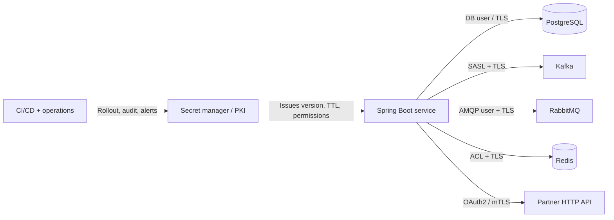
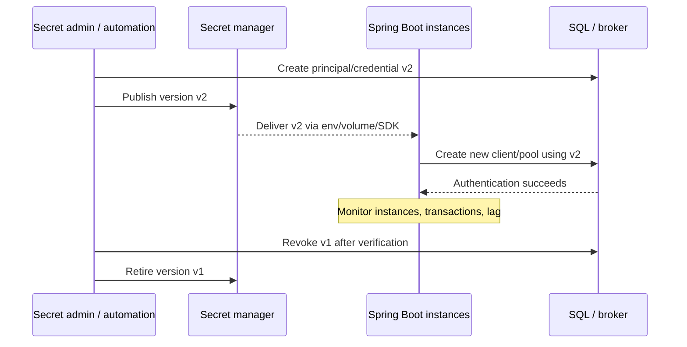

# Secret Management, Password Rotation, and Certificate Rotation

## 1. Context: A Secure Connection Needs More Than the Right Password

In the **SPRING_BOOT_INTEGRATION** module, a Spring Boot application connects to HTTP APIs, SQL databases, Redis, Kafka, RabbitMQ, and Spring Integration adapters. Every connection carries an **identity**, **access permissions**, **authentication credentials**, and sometimes **TLS certificates**. Leaving static passwords in a repository unchanged for years exposes the system to secret leaks, certificate expiration, inability to revoke keys, and outages whenever credentials must change.

The topic **"Secret Management, Password Rotation, and Certificate Rotation"** in the **"Connection Security"** chapter focuses on credential lifecycles and updating mechanisms **inside a running system**. The goal is not merely storing secrets safely, but ensuring the application uses **the right new version**, old connections are replaced on time, rollbacks remain bounded, and key swaps can be proven not to drop data.

Example of an order-processing service:



One credential rotation can impact **drivers**, **connection pools**, **consumers**, and **in-flight transactions**. Distinguish four milestones: *secret changed in the store*, *application received the new value*, *connection component is using the new value*, and *old credential was revoked*. Minutes or more may separate these four checkpoints.

## 2. Identifying Types of Information to Protect

| Information Type | Example | Who Verifies? | How to Replace |
| --- | --- | --- | --- |
| SQL account password | User/password for PostgreSQL | Database server | Change password or switch to a new principal; replace connection pool |
| SASL credential | Kafka SCRAM user/password | Kafka broker | Update principal/credential; recreate clients |
| AMQP credential | RabbitMQ user/password | RabbitMQ broker | Provision new account/permissions; reconnect |
| Redis ACL password | Redis user/password | Redis server | Rotate password or user; reconnect client |
| API key or client secret | Partner HTTP, OAuth2 client credentials | API/gateway/authorization server | Issue new secret and update HTTP/OAuth client |
| Access token | Short-lived OAuth2 bearer token | Resource server | Refresh/re-acquire by expiry; bounded 401 retry |
| X.509 certificate | Server cert / client cert for TLS or mTLS | TLS peer | Issue new cert, update key/cert and TLS context |
| CA trust anchor | Trusted root/intermediate CA | TLS client/server | Update truststore with an overlap window |
| Private key | Private key for TLS/mTLS | Certificate owner | Generate new key, keep least-privilege access, revoke old key |

A **secret** must stay confidential; a **certificate** usually holds the public identity and CA signature; the **private key** paired with that certificate is the ultra-sensitive part. A **truststore** holds CAs or certificates trusted to verify peers, whereas a **keystore** typically holds certificates and private keys used to prove the application's own identity.

### Three Questions Before Implementing

1. **Who owns the credential?** Operations team, secret manager, cloud IAM, Kafka admin, HTTP partner, or the application?
2. **Which component holds the active copy?** Environment variable, Spring `Environment`, `DataSource` bean, Hikari pool, Kafka client, TLS `SSLContext`, HTTP connection pool?
3. **How does it actually take effect?** Update config and restart, invoke a supported reload mechanism, recreate the client/pool, or coordinate a rollout?

An application may receive a notification from a secret manager yet keep using old connections if the pool hasn't cycled or connections remain open. Conversely, rotating a server-side password **before** clients are ready can trigger a wave of authentication failures.

## 3. Secret Lifecycle Principles

A sound solution supports **provisioning, distribution, usage, rotation, revocation, and auditing**:

| Phase | Key Practice |
| --- | --- |
| Provisioning | Create dedicated credentials per application and environment, least-privilege scopes/permissions, appropriate TTL |
| Distribution | Use a secret manager, workload identity, protected volume, or authenticated provisioning channel |
| Loading into app | Never hardcode; never log; restrict reading/passing to components that do not need it |
| Usage | Verify server TLS, enforce timeouts and appropriate retry/idempotency mechanisms |
| Rotation | Prefer an overlap window where both versions are valid if supported by backend; cycle clients/pools |
| Revocation | Remove old credentials after verifying all instances; expedite if key compromise is suspected |
| Auditing | Log who requested the change, version (never the value), rollout time, errors, and outcome |

**Never treat Base64 as encryption.** Kubernetes Secrets store data Base64-encoded in manifests; protecting that data also requires RBAC, etcd protection/encryption at rest, workload provisioning controls, and node access restrictions. Similarly, environment variables are convenient yet can leak via diagnostic dumps, host permissions, process inspection tools, or logs if an application dumps its environment.

Common practices:

- Dedicated vaults: HashiCorp Vault or cloud secret managers with IAM, auditing, versioning, and rotation workflows.
- Authenticate workloads via workload identity rather than long-lived, broad *bootstrap secrets*.
- Short-lived/dynamic credentials where backends support them, with lease renewal and expiry handling.
- Authorize access by **service + environment + purpose**; separate an app's secret-read permissions from automation's create/revoke permissions.
- Keep secrets out of Git, Docker images, WAR/JAR artifacts, commit history, URL queries, exception messages, MDC, or tracing tags.
- Scan for secret leaks in CI and maintain an immediate revocation runbook when detected, because deleting a line in a new commit does not erase the old secret.

## 4. Loading Secrets into Spring Boot from Deployment Environments

Spring Boot supports externalized configuration and property source precedence. A **local demo** may pass passwords via environment variables while `application.yml` only references variable names:

```yaml
spring:
  datasource:
    url: ${ORDERS_JDBC_URL}
    username: ${ORDERS_DB_USER}
    password: ${ORDERS_DB_PASSWORD}
  rabbitmq:
    host: ${RABBIT_HOST}
    username: ${RABBIT_USER}
    password: ${RABBIT_PASSWORD}
```

These placeholders must be supplied by runtime/CI deployment—never put real credentials directly in YAML. Verify startup fails cleanly when required values are missing, avoiding fallbacks to shared accounts or wrong environments.

### Loading from Mounted Files via Config Tree

In containers/Kubernetes, a volume containing secret files can be mounted. Spring Boot supports importing a **configuration tree**, where filenames map to property names:

```yaml
# application-container.yml
spring:
  config:
    import: "configtree:/run/secrets/orders/"
  datasource:
    url: ${ORDERS_JDBC_URL}
    username: ${ORDERS_DB_USER}
```

Example directory prepared by the environment:

```text
/run/secrets/orders/
  spring.datasource.password       # Content: password, readable only by process
```

`configtree:` reads secrets **when Spring initializes configuration**, yet **does not automatically refresh a bean or pool when files change**. In Kubernetes, projected Secret volumes update asynchronously, whereas secrets injected via container **environment variables** do not update when the Secret object changes. Mounting via `subPath` also prevents automatic file updates unlike standard projected volumes. Therefore, explicitly design **change detection + component reload + rollout**.

In production, never prefix a mandatory secret source with `optional:` just to silence errors: skipping a missing configuration source can leave the app using unintended credentials or failing late when borrowing connections.

### Integrating a Secret Manager

Platforms deliver secrets to applications in several ways:

| Model | Strength | Rotation Caveat |
| --- | --- | --- |
| CI/CD fetches secret and sets env vars at startup | Simple, broadly framework-compatible | Updates usually require rollout/restart |
| Secret manager CSI/sidecar writes to volume | Keeps secrets out of images, can update files | App/pools/TLS contexts still need reload or restart |
| Spring Cloud Vault / ConfigData integration | Spring fetches config via native integration | Depends on starter/version, lease renewal, and refresh semantics |
| Cloud SDK fetches secret via workload identity | Fine-grained IAM and active caching | Must design retries, cache TTL, fail-closed behavior, and client refresh |
| Dynamic lease-bound credentials | Limits exposure window of leaked credentials | Must never use expired leases; renew/replace before expiry |

There is no single universal refresh mechanism across every `DataSource`, `KafkaConsumer`, `RabbitTemplate`, and HTTP client. When rotating secret versions, analyze which objects retain the secret and how each library behaves.

## 5. Safe Password Rotation Workflow

Prefer an **overlap-window** strategy: create a new credential valid concurrently with the old one, migrate apps to the new one, verify, and only then revoke the old one. Changing a password **in-place on a single account** can break new connections from instances not yet updated, even if existing connections stay open temporarily.



### Execution Steps

1. **Prepare:** inventory consumers/producers/HTTP clients/DB pools, active secret versions, permissions, expiry, and maximum acceptable switchover duration.
2. **Provision:** create principal or secret version `v2` and grant **exact required permissions**, never adding admin privileges to test faster.
3. **Distribute:** publish `v2` via the secret manager; establish version/metadata verification without logging values.
4. **Roll out in waves:** roll out one instance/canary, verify authentication, new connection creation, consumer behavior, and transaction errors.
5. **Expand rollout:** replace all remaining clients/pools still on `v1`, allowing in-flight transactions to finish and old connections to close.
6. **Verify:** check authentication failures, instances running `v2`, active connections, Kafka consumer lag, broker redeliveries, and HTTP 401/403 errors.
7. **Revoke `v1`:** only after zero clients remain dependent and rollback plans are verified; if key compromise occurred, follow an emergency security-first revocation path.
8. **Audit:** record rotation ID, timestamp, approver/subsystem, version, health check outcomes, and revocation time; never store plaintext credentials.

You cannot conclude every connection uses `v2` solely because the Secret object changed. Revoking `v1` should rely on **deployed version confirmation + real authentication telemetry** and, where possible, backend login telemetry.

## 6. Databases: Swapping Credentials and Refreshing Connection Pools

Suppose Spring Boot uses `spring-boot-starter-jdbc` or JPA with HikariCP. `HikariDataSource` retains authentication config to **open new physical connections**. Already-pooled connections might keep working after a database password change depending on the backend. That is not proof the pool switched to the new password.

### Swapping Users Instead of Mutating One User's Password In-Place

In PostgreSQL, a low-disruption strategy provisions `orders_app_v2`, grants matching schema/table/sequence privileges, verifies login, rolls out applications to the new user, and finally revokes `orders_app_v1`. Inspect object permissions thoroughly; database `CONNECT` does not automatically grant `SELECT/INSERT/UPDATE` across all tables.

```text
T0: orders_app_v1 active; system stable.
T1: provision orders_app_v2 with matching grants; run minimal SQL check.
T2: switch canary/new pool to v2; v1 and v2 both temporarily valid.
T3: roll out all instances; drain/close old connections safely.
T4: check transaction and connection metrics.
T5: revoke/disable v1; verify no v1 logins remain.
```

**Never swap passwords mid-business-transaction** expecting Spring to resync credentials automatically. A new `DataSource` or reloaded pool needs a swap plan aligned with how the app is configured. With HikariCP, updating configuration properties does not recreate existing physical connections; manage eviction/retirement and safe rollback via APIs supported by your version.

With a **container-managed JNDI DataSource** (Tomcat/app server), the **container** owns the pool and secret, not the app's `spring.datasource.hikari.*`. Rotation must update the JNDI resource and force the container pool to adopt the new credential as supported by the server. If the app has multiple datasources, track each pool and transaction manager separately so the wrong one isn't updated.

### Transaction Boundaries During Pool Replacement

During an in-flight order, never abruptly kill connections mid-transaction. You can:

- Drain new incoming traffic from the canary instance and wait a bounded drain interval for in-flight work to finish.
- Start instances with the new credential, verify health, and shift load.
- Remove old instances from the load balancer, let consumers finish or rebalance partitions cleanly, and shut down gracefully.
- Verify commit/rollback, unique constraints, and idempotency in case requests/records replay.

For Kafka/RabbitMQ consumers, restarts during rotation can cause **redeliveries** from uncommitted offsets or unacked messages. Protect business side effects with inbox/unique event IDs before declaring rotation successful.

### DB Configuration Example

```yaml
spring:
  datasource:
    url: ${ORDERS_JDBC_URL}
    username: ${ORDERS_DB_USERNAME}
    password: ${ORDERS_DB_PASSWORD}
    hikari:
      maximum-pool-size: 12
      connection-timeout: 3000
```

Hikari values here **illustrate a Boot-managed pool**; actual pool sizes must reflect replica counts, DB limits, and load tests. New credentials load into new instances during rollout; this snippet **does not imply hot reload**.

## 7. RabbitMQ, Kafka, and Redis: How Password Rotation Differs from Databases

### RabbitMQ

`spring.rabbitmq.username` and `spring.rabbitmq.password` open AMQP connections. Provision a new user with matching vhost/permissions and let applications reconnect. Updating a Secret on the filesystem alone does not make `CachingConnectionFactory` or open connections switch credentials immediately.

```yaml
spring:
  rabbitmq:
    host: ${RABBIT_HOST}
    port: 5671
    username: ${RABBIT_USERNAME}
    password: ${RABBIT_PASSWORD}
    ssl:
      enabled: true
```

Port `5671` is typical for AMQPS, yet it must match your real infrastructure. Verify CA trust and hostname, never disabling certificate checks as a quick rotation fix.

When rolling-restarting consumers:

- Unacked messages may be redelivered; consumers must be idempotent.
- Publisher confirms and consumer acknowledgments are independent signals.
- Monitor connection failures, ready/unacked queue counts, redeliveries, and DLQs.
- Before revoking the old user, verify the new user's vhost permissions and confirm no node still holds old connections/auth.

### Apache Kafka

With Kafka SASL/SCRAM over TLS, clients need valid SASL credentials and must trust the broker's certificate. Illustrative configuration:

```yaml
spring:
  kafka:
    bootstrap-servers: ${KAFKA_BOOTSTRAP_SERVERS}
    properties:
      security.protocol: SASL_SSL
      sasl.mechanism: SCRAM-SHA-512
      sasl.jaas.config: 'org.apache.kafka.common.security.scram.ScramLoginModule required username="${KAFKA_USERNAME}" password="${KAFKA_PASSWORD}";'
```

Resolved JAAS configs contain secrets, so **never print full configuration/exception dumps**. The Kafka broker must support the chosen SASL mechanism; clusters using mTLS or OAuth differ. Truststore/SSL settings must also be supplied for the broker CA. The snippet above shows authentication only—**it does not automatically solve trust chains**.

When rotating:

1. Provision a new principal and matching ACLs to read/write exact topics, consumer groups, and transactional IDs (if used).
2. Deploy the new secret into configuration and create new clients/instances with the new principal.
3. Perform a rolling restart, watching consumer group rebalances, lag, authorization errors, and offsets.
4. Delete the old principal only after confirming all producers, consumers, and Kafka Streams instances migrated.

**Updating username/password in Spring `Environment` does not guarantee existing `KafkaProducer`/`KafkaConsumer` instances pick up the new credentials.** Treat rotation as a Kafka client lifecycle event; a controlled restart is usually simpler and easier to verify unless a library-supported refresh mechanism is explicitly established.

### Redis

Redis can use ACL usernames/passwords. For Lettuce/Jedis clients, inspect how the client holds connections and whether it re-authenticates/opens fresh connections on credential changes. With ACLs, provision a new user with identical permissions and roll out gradually.

```yaml
spring:
  data:
    redis:
      host: ${REDIS_HOST}
      port: ${REDIS_PORT:6379}
      username: ${REDIS_USERNAME}
      password: ${REDIS_PASSWORD}
      ssl:
        enabled: true
```

These properties illustrate Spring Boot 3.x configuration; verify against your exact stack version. When using TLS, configure trust for the Redis certificate and check hostnames. Never widen ACLs to `+@all` or use an admin account just to get tests connecting.

## 8. HTTP API Keys, OAuth2, and Short-Lived Tokens

Long-lived API keys, OAuth2 client secrets, and access tokens have **different lifecycles**:

- **API keys:** typically rotated by issuing a new key, accepting both keys during a short window, switching clients, and revoking the old key.
- **OAuth2 client secret:** secret used to request tokens; rotation requires coordinating the authorization server and client config. Already-issued access tokens may stay valid until expiry depending on revocation policy.
- **Access tokens:** should have short TTLs, refreshed/re-acquired via a token manager; never hardcode a token into a bean once for the lifetime of the app.
- **mTLS client certificates:** do not use bearer headers, yet still require updating the certificate, private key, and HTTP client's SSL context.

If an API returns `401 Unauthorized` after rotation, inspect identity/secret/token expiry before bulk retrying. Never infinitely retry non-idempotent requests like creating a payment; after a timeout or 5xx, side effects may already exist at the target API. Use a stable **idempotency key**, status lookup, or reconciliation.

A running HTTP client may maintain connection pools and TLS sessions. Swapping a client certificate in the secret manager **does not guarantee** existing connections re-handshake with the new certificate. Recreate or reload the client using the framework's supported API while draining in-flight requests cleanly.

## 9. TLS, mTLS, Keystores, and Truststores

TLS **encrypts transport** and verifies server identity. With **mTLS**, both client and server present certificates for the other to verify.

```mermaid
sequenceDiagram
    participant C as Spring Boot client
    participant S as API / broker server
    C->>S: TLS ClientHello + SNI
    S-->>C: Server certificate + chain
    Note over C: Verify CA, hostname, validity, policy
    S-->>C: Request client certificate (mTLS)
    C->>S: Client certificate + proof of private key
    Note over S: Verify CA, policy, and client identity
    C<->>S: Authenticated TLS channel
```

| Component | Function | Rotation Caveat |
| --- | --- | --- |
| Server certificate | Proves endpoint hostname/identity | SAN must include actual hostname; appropriate expiry |
| Client certificate | Proves workload identity to peer | Server must trust issuing CA and map permissions correctly |
| Private key | Used to sign/prove ownership of public key | Never emit private keys into logs; protect files/HSM |
| Certificate chain | Links leaf certificate to trusted CA | Supply complete chain, avoid missing intermediates |
| Truststore | List of trusted CAs/certs | May need to trust both old and new CAs during transition |
| Keystore | Client's or server's certificate/private key | Update key and cert atomically to prevent mismatch |

**PEM** is a text representation typically holding certificates/keys; **PKCS#12** can package certificates, chains, and private keys. Not every library reloads these files automatically when rewritten on disk.

### Never Disable Verification to "Fix" Certificate Errors

Tricks like `trustAll`, `InsecureTrustManagerFactory`, disabling hostname verification, skipping chain checks, or stuffing arbitrary endpoint certificates into truststores create MITM vulnerabilities. When handshakes fail, diagnose the **exact root cause**: SAN mismatch, untrusted new CA, missing intermediate chain, clock skew, expired certificate, wrong EKU/KeyUsage, incompatible protocol/cipher, or mismatched private key.

For the same DNS name, the new certificate needs a matching SAN. Having the right Common Name (CN) without a SAN is insufficient for modern TLS clients. Keep clocks synchronized and monitor `notBefore`/`notAfter`.

## 10. Spring Boot SSL Bundles: Isolating TLS Configuration per Connection

In Spring Boot releases supporting **SSL bundles**, certificates, private keys, and trust material can be declared in external configuration. PEM example for an HTTP client verifying a partner CA and using mTLS:

```yaml
spring:
  ssl:
    bundle:
      pem:
        partner:
          keystore:
            certificate: file:/run/tls/partner/client.crt
            private-key: file:/run/tls/partner/client.key
          truststore:
            certificate: file:/run/tls/partner/ca-chain.crt
```

This example targets Spring Boot with PEM SSL bundle support (common from 3.x onward); confirm property support and client integration for your exact version. `client.key` is a **private key** and must be mounted read-only with least privilege; `ca-chain.crt` is trust material only, containing no private key.

An application using `RestClient` (Spring Framework 6.1+/Spring Boot 3.2+) can apply the bundle when creating the HTTP client:

```java
import org.springframework.boot.autoconfigure.web.client.RestClientSsl;
import org.springframework.context.annotation.Bean;
import org.springframework.context.annotation.Configuration;
import org.springframework.web.client.RestClient;

@Configuration
public class PartnerHttpClientConfig {

    @Bean
    RestClient partnerRestClient(
            RestClient.Builder builder,
            RestClientSsl ssl) {
        return builder
                .baseUrl("https://api.partner.example")
                .apply(ssl.fromBundle("partner"))
                .build();
    }
}
```

If the project uses `WebClient`, Apache HttpClient, or other connectors, bundle application differs; declaring `spring.ssl.bundle.*` alone **does not automatically** make every client use that bundle. For custom certificate validation APIs, test handshakes using the actual bundle-configured client.

### TLS for HTTP Servers

Spring Boot embedded servers in supported versions can reference a dedicated SSL bundle:

```yaml
spring:
  ssl:
    bundle:
      pem:
        inbound:
          keystore:
            certificate: file:/run/tls/server/tls.crt
            private-key: file:/run/tls/server/tls.key
          truststore:
            certificate: file:/run/tls/server/client-ca.crt
server:
  port: 8443
  ssl:
    bundle: inbound
    client-auth: need
```

In this configuration, `client-auth: need` enforces mTLS: clients must present a certificate trusted by the server. Never use `need` if the endpoint serves standard clients without certificates. If TLS terminates at an ingress/load balancer, server certificate ownership belongs to **the ingress** rather than the Spring Boot container; rotation then happens at the ingress, adding internal mTLS only if required by architecture.

### Do SSL Bundles Hot-Reload Automatically?

Some Spring Boot versions and components support **reload on update** for PEM SSL bundles or specific server connectors. **Never assume hot reload always happens** merely because an SSL bundle exists and files changed. Consult docs for your exact Spring Boot version, consuming component, and file mount semantics, then test a new handshake after updating. Clients creating custom `SSLContext`s or holding pools may need a **rebuild** to pick up new keys/trust even after file metadata changes.

If end-to-end reload isn't verified, choosing a **rolling restart with fresh instances** is usually easier to verify: prepare new trust, deploy new clients, check health, then drain old clients.

## 11. Rotating Certificates and CAs Without Breaking TLS

Replacing a leaf certificate under the same CA is simpler than **changing CAs**. When changing CAs, the **verifying side** must trust the new CA before the presenting side switches to the new certificate.

### Scenario A: Swapping a Certificate Under the Same CA

1. Check the new certificate's SANs, EKU, validity timestamps, and chain.
2. Generate/receive a new private key via a secure channel; avoid reusing keys unnecessarily.
3. Update certificate and private key **as one consistent logical version**; never let a client read the new cert with the old key.
4. Reload/restart supported TLS components and open **new connections** to test the handshake.
5. Monitor TLS errors; confirm peers receive the new certificate and no dependencies rely on the old version.
6. Revoke/delete the old key per policy; if the old cert's key leaked, prioritize revocation and incident response.

### Scenario B: Migrating from an Old CA to a New CA

```text
Phase 1: Verifying side trusts CA-OLD + CA-NEW.
Phase 2: Presenting side switches to certificates signed by CA-NEW.
Phase 3: Verify all instances/clients use the new trust + cert.
Phase 4: Remove CA-OLD from truststores after the overlap window.
```

In mTLS, **both verification directions are independent**: client trusts server CA, server trusts client CA. When changing both simultaneously, prepare trust on **both sides** before swapping certificates to prevent outages across rolling deployments.

### Delivering Certificate Files Safely

With secret mounts or sidecars, use **atomic** file updates or versioned paths with coordinated symlink/manifest switches provided by the platform. Never overwrite private keys and certificates sequentially while a library might read mid-update, creating a mismatched pair window. Before reloading, verify the key and cert form a matching pair.

Keep private keys in least-privilege storage; never paste them into tickets/chats, bake them into images/repositories, or send them to observability tools. For high-security requirements, consider HSM/KMS or platform-managed TLS where supported by server/clients.

## 12. When Rotation Goes Wrong: Cause and Remediation Matrix

| Symptom | Possible Cause | Remediation |
| --- | --- | --- |
| After DB password change, new requests fail authentication | Pool still creates connections with old credential | Confirm deployed secret version; refresh/recreate pool via supported mechanism |
| Only a few replicas fail | Uneven rollout or stale mounts/env vars on some nodes | Check version metadata per replica, rollout status, and secret read permissions |
| Kafka consumer lag rises after rotation | Missing SASL credential/ACL, consumer rebalance, or client connect errors | Check auth/authorization logs, group lag, and offset progress |
| RabbitMQ unacked queue grows | Consumers fail to connect/ACK during rotation | Check connections/channels, redeliveries, idempotency, and DLQ |
| `SSLHandshakeException` after cert change | Broken trust chain, SAN, clock, client cert, or stale TLS context | Check hostname/CA/EKU/`notAfter` via real handshake test |
| TLS fails only after restart | Long-lived old connections masked a missing CA in the new truststore | Test **new connections** and handshakes from every client group |
| Env variable updated in deployment, process still uses old value | Container didn't restart; env was snapshotted at process start | Rolling restart/redeploy with readiness checks |
| Mounted file changed, Java still serves old cert | `SSLContext`/client pool wasn't reloaded | Rebuild/reload client or rolling restart |
| API returns 401/403 after OAuth secret rotation | Wrong client secret or stale tokens/scopes | Check client auth, token endpoint, and scopes; bound retries |
| Delayed outage when old key expires | Forgotten secondary instance/cron/background job still using v1 | Inventory workloads, track login versions, update jobs, revoke in stages |

Avoid immediately blaming "TLS" whenever a request fails: separate **DNS → TCP → TLS handshake → authentication → authorization → transaction/business operation**. Only after identifying the failing layer should you swap certificates, rotate secrets, or fix permissions.

## 13. Testing Rotation in a Staging Environment

Tests must reproduce the exact version transition order, because testing once with the final new credential only proves **the end state works**, not that the cutover causes zero disruption.

### Minimum Test Suite

| Scenario | Setup | Outcome to Prove |
| --- | --- | --- |
| v1 password valid | All instances on v1 | Connections and side effects succeed normally |
| Parallel v2 provisioned | Backend accepts both v1/v2 | v2 connects cleanly before v1 is revoked |
| Canary on v2 | One instance rolled out | New connections authenticate as v2; transactions succeed |
| v1 revoked post-rollout | Zero instances left on v1 | No new authentication failures occur |
| Secret swap during long DB transaction | Active in-flight requests | Controlled drain/commit/rollback; no partial leaked state |
| Kafka/RabbitMQ consumer restart | In-flight records incomplete | Redeliveries may happen; idempotency keeps side effects once |
| New leaf cert under same CA | Client/server TLS test | New handshake succeeds; hostname verified |
| Untrusted new CA | Client trusts only old CA | Connection fails as expected; never silently trusts all |
| Trust updated before CA swap | Overlap of old and new CAs | Handshakes succeed across both versions during rollout |
| Expired/unavailable secret | Secret manager outage or expired lease | Alerts fire, clean fail-closed behavior, safe recovery |
| Key/cert mismatch | Test fixture pairs mismatched key and cert | Startup/reload fails explicitly; invalid config never used |

### Spring Boot Integration Check

For `DataSource`, run PostgreSQL Testcontainers with two principals holding equivalent business permissions. During each rollout wave, query through the **real instance/pool** rather than merely reading the new secret from the manager:

```java
import static org.assertj.core.api.Assertions.assertThat;
import javax.sql.DataSource;
import org.junit.jupiter.api.Test;
import org.springframework.beans.factory.annotation.Autowired;
import org.springframework.boot.test.context.SpringBootTest;

@SpringBootTest
class DatabaseConnectionSmokeTest {
    @Autowired DataSource dataSource;

    @Test
    void usesValidDatabaseIdentity() throws Exception {
        try (var connection = dataSource.getConnection()) {
            assertThat(connection.isValid(3)).isTrue();
            assertThat(connection.isReadOnly()).isFalse();
        }
    }
}
```

This is only a **connection smoke test**; it does not verify credential version or exact permissions. Real tests need fixtures/SQL verifying current user, actual grants, rollbacks, and business operations; never extract passwords from connections and log them.

### Verifying TLS from a Test Environment

From a container/test machine with the matching trust chain, verify **server TLS**:

```bash
openssl s_client \
  -connect api.partner.example:443 \
  -servername api.partner.example \
  -verify_hostname api.partner.example \
  -verify_return_error </dev/null
```

With a private CA, pass `-CAfile` in the test environment; verify `Verify return code`, SANs, validity, and chain. This command **does not fully test mTLS client authentication** unless you pass test-fixture client cert/key, and avoid placing production private keys in shell history.

Never test only an already-open connection: **prove rotation via new handshakes, new physical connections, and real business paths post-rollout**.

## 14. Observability, Alerting, and Compromised Secret Response

Never write secret values into logs; log **bounded metadata** instead:

- Service/instance name, environment, logical resource name, version ID, or *non-sensitive* certificate fingerprint.
- Timestamp when new version loaded, when new connections succeeded, reconnect/rollback counts, and when old version was revoked.
- Authentication failure rates, TLS handshake failures, connection pool acquisition timeouts, Kafka lag, RabbitMQ unacked counts, Redis auth failures, HTTP 401/403s.
- Days/hours until certificate expiry, dynamic credential lease TTL, and refresh results.
- Audit events: who created, read, rotated, revoked, or altered access permissions; alert on out-of-hours/out-of-scope secret access.

Example secret-free log lines:

```text
service=orders-api resource=orders-db event=ROTATION_STARTED target=v2
service=orders-api instance=pod-7 event=CONNECTION_READY version=v2
service=orders-api resource=orders-db event=CANARY_PASS version=v2
service=orders-api resource=orders-db event=ROTATION_COMPLETED version=v2
service=orders-api resource=orders-db event=OLD_VERSION_REVOKED version=v1
```

**Note on fingerprints:** public certificate fingerprints are helpful to confirm new versions, yet they do not replace TLS verification, and you should never hash/derive values directly from passwords/tokens and broadcast them into logs.

### If a Secret Compromise Is Suspected

Incident response differs from scheduled rotation:

1. Identify the secret/principal, permission scope, environment, and exposure vector; contain anomalous read access.
2. Provision a replacement credential via a trusted channel, prioritizing rapid invalidation of the compromised credential based on risk.
3. Audit access logs, unauthorized actions, accessed data, and potential side effects.
4. Cut applications over to the new version; if necessary, pause connectors to prevent unauthenticated failures or further harm.
5. Revoke old keys/secrets/certificates, review derived tokens/secrets, and patch the leak source.
6. Verify recovery, archive the incident record, and add safeguards against recurrence.

For a **compromised private key**, keeping both old and new keys active for a long zero-downtime window may be unacceptable; evaluate certificate revocation and peer impact per incident response policy.

## 15. Common Mistakes

1. **Committing a password to Git and only deleting it in a new commit:** commit history, artifacts, and caches can still retain the secret.
2. **Assuming Base64 encoding is security:** Base64 only encodes representation, providing zero confidentiality.
3. **Assuming editing the secret manager updates the app automatically:** beans/pools/clients still hold old values.
4. **Revoking the old credential before rollout finishes:** new connections from v1 instances fail authentication.
5. **Testing only already-open connections:** misses broken trust/key configs that fail on reconnect.
6. **Forgetting ACLs on the new principal:** authentication passes while authorization fails.
7. **Swapping server certificates before updating client trust:** triggers mass TLS failures during CA transitions.
8. **Disabling hostname verification or enabling trust-all as a "quick fix":** destroys peer identity guarantees.
9. **Overwriting cert and key independently during reload:** risks reading a mismatched cert/key pair.
10. **Restarting consumers without idempotency:** redeliveries cause double charges or duplicate events.
11. **Treating DLQ/retries as a fix for bad credentials:** systemic auth failures need investigation and pausing/recovery, not infinite retries creating load.
12. **Confusing token expiry with credential rotation:** unexpired tokens and old client secrets can have different lifetimes.
13. **Forgetting secondary workloads:** batch jobs, scheduled tasks, workers, migrations, and auxiliary connectors still hold v1.
14. **Having no certificate owner:** certificates expire over a weekend and are discovered via production outages.

## 16. Capstone Exercise

**Context:** an order-processing service uses PostgreSQL, RabbitMQ, Kafka, and an mTLS HTTP partner. A secret manager supplies secrets; Spring Boot reads configuration from environment variables and mounted certificate files. You need to rotate DB passwords and client certificates without causing business discrepancies.

**Design requirements:**

1. Build a credential inventory table per resource: owner, issuer, version, expiry, permissions, where cached, and reload mechanism.
2. Propose a `v1 → v2` PostgreSQL transition with two overlapping principals, canary rollout, draining, and revocation.
3. Define how to restart Kafka/RabbitMQ consumers without losing unacked records or uncommitted offsets; design deduplication by event ID.
4. Configure a PEM SSL bundle for the HTTP partner; specify the order of trusting the new CA, updating the client cert, testing handshakes, and retiring the old CA.
5. Write a runbook for post-rollout auth/TLS errors distinguishing missing secrets, wrong permissions, SAN mismatches, unrefreshed pools, and mismatched private keys.
6. Design a dashboard tracking auth failures, TLS errors, certificate expiry, Kafka lag, RabbitMQ unacked, DB connection pools, and request latency.
7. Rehearse rollback before revoking v1, then execute a **real revocation** in staging; confirm v2 authentication succeeds after v1 is disabled.

### Acceptance Criteria

| Evidence | Expected Outcome |
| --- | --- |
| Application configuration | Contains zero plaintext credentials; secrets injected from right source and scope |
| New canary | SQL, brokers, and HTTP successfully open **new connections** with v2 |
| Transactions | Zero partial commits and zero duplicate side effects across restarts/retries |
| Certificates | TLS/mTLS handshakes succeed; hostname/chain and identity verified |
| Revocation of v1 | Zero instances/jobs left on v1; no spike in authentication failures |
| Observability | Clear signals at every milestone and alerts before expiry/lease failures |
| Rollback/incident | Clear rollback criteria before revoke; emergency runbook ready if secrets leak |

## 17. Self-Check Questions

1. Why doesn't updating a Secret in Kubernetes automatically change the password `HikariDataSource` uses?
2. What is the difference between **distributed secret**, **refreshed bean**, and **actual connection authenticated with the new secret**?
3. When rotating a database password, why is creating a `v2` principal usually less disruptive than changing a single user's password in place?
4. Why does restarting a Kafka consumer during rotation require database-level idempotency?
5. In mTLS, why must server and client coordinate **trust** before swapping certificates?
6. How do `keystore` and `truststore` differ? Should a private key ever be placed in a truststore?
7. Why can a certificate with a matching CN yet wrong SAN still throw `SSLHandshakeException`?
8. When should you choose hot reload, and when should you perform a rolling restart?
9. How do you prove an old credential has been safely revoked without disrupting remaining workloads?
10. When a private key leaks, how does the revocation strategy differ from scheduled rotation?

## Summary

Secret management and password/certificate rotation represent a **connection identity transition process**, not merely a configuration edit. In Spring Boot, secrets can arrive via environment variables, mounted files, secret managers, or container JNDI; each SQL pool, Kafka/RabbitMQ client, Redis connection, and HTTP TLS context reloads differently. A reliable rotation provisions new credentials with right permissions, verifies real connections, rolls out with overlap where permitted, preserves transaction safety and idempotency, and then revokes old credentials. For TLS/mTLS, coordinate **certificate + private key + trust chain**, verify hostnames, and roll out trust in the right sequence. Expiry alerts, auditing, and recovery drills keep integration systems running securely over time.

### References

- [Spring Boot Reference — Externalized Configuration](https://docs.spring.io/spring-boot/reference/features/external-config.html)
- [Spring Boot Reference — SSL](https://docs.spring.io/spring-boot/reference/features/ssl.html)
- [Spring Boot Reference — SQL Databases](https://docs.spring.io/spring-boot/reference/data/sql.html)
- [Spring for Apache Kafka Reference](https://docs.spring.io/spring-kafka/reference/)
- [Spring AMQP Reference](https://docs.spring.io/spring-amqp/reference/)
- [Kubernetes — Secrets](https://kubernetes.io/docs/concepts/configuration/secret/)
- [OWASP — Secrets Management Cheat Sheet](https://cheatsheetseries.owasp.org/cheatsheets/Secrets_Management_Cheat_Sheet.html)
