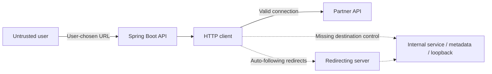
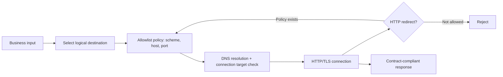
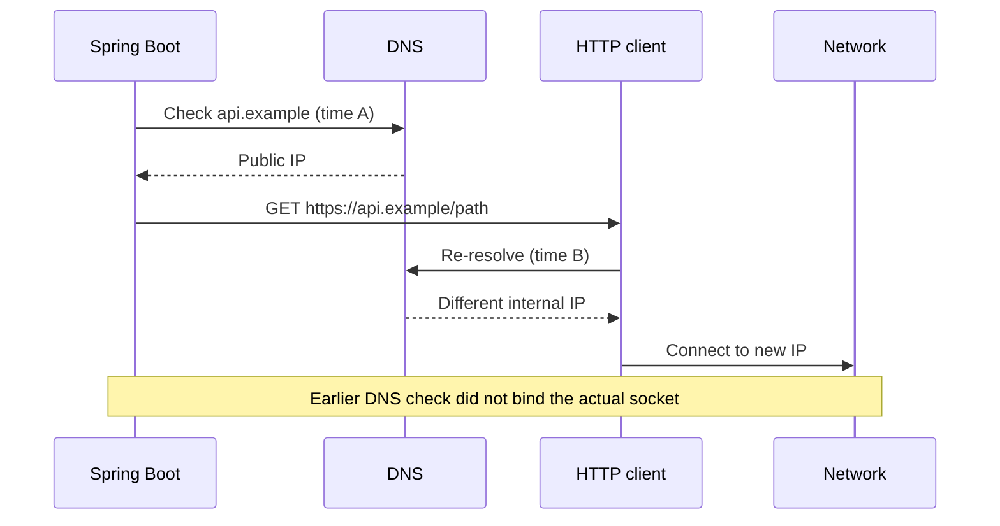

# Restricting Target Addresses, Redirects, and SSRF Risks

> **Chapter:** Connection Security  
> **Scope:** `SPRING_BOOT_INTEGRATION` — system integration in Spring Boot via HTTP clients, databases, caches, message brokers, and Spring Integration adapters. This lesson focuses on the **origin of HTTP connections**, input data contracts, configuration, error handling, testing, and observability to prevent Server-Side Request Forgery (SSRF).

A Spring Boot application may need to call partner APIs, fetch documents from URLs, verify webhooks, retrieve user avatars, or forward requests to a service. If callers can control the **target host** the backend connects to, a seemingly legitimate integration feature can become a gateway into internal networks. That is the core risk of **Server-Side Request Forgery (SSRF)**.

SSRF defense does not stop at checking `https://` in a URL string. You must define **which destinations are allowed**, **which IP is actually connected to**, **whether redirects are followed**, **whether credentials could leak to the wrong host**, and **whether network controls block invalid connections even if the app is bypassed**.

## 1. Learning Objectives

After this lesson, you can:

1. Explain SSRF in Spring Boot integration flows and distinguish it from CORS or missing auth on external APIs.
2. Identify input sources that can influence the destination of `RestClient`, `WebClient`, file-fetching libraries, and HTTP adapters.
3. Design **destination allowlists** by business identifier, scheme, hostname, and port; avoid unsafe string-matching hostname checks.
4. Understand how redirects, DNS rebinding, multiple IPv4/IPv6 addresses, and connection pooling alter the actual connected destination.
5. Configure Spring HTTP clients not to follow redirects automatically while keeping base URLs and paths under backend control.
6. Design defense-in-depth: application policy, DNS/connection policy, proxy/egress firewall, workload permissions, timeouts, and logging.
7. Test rejected behaviors, redirect chains, and address resolution failures without hitting sensitive internal addresses in real environments.

## 2. How Does SSRF Occur?

Suppose an application exposes an API fetching an image from a user-supplied URL:

```text
GET /api/images/preview?url=https://images.example.com/avatar.png
```

If the backend implements it like this:

```java
// Unsafe: userUrl completely determines the endpoint the backend connects to.
String preview(String userUrl) {
    return RestClient.create()
        .get()
        .uri(userUrl)
        .retrieve()
        .body(String.class);
}
```

An attacker can replace `userUrl` with an address that **their browser cannot reach yet the server can**: a service open only on a private network, container loopback, admin endpoint, or cloud metadata address. Since the request originates **from the server's network position**, the server's network reachability becomes an attack vector.



SSRF can cause varied damage depending on the application's network access and privileges:

- **Reading data:** retrieving responses from internal endpoints or configuration sources the caller has no reason to access.
- **Triggering actions:** sending requests to admin/internal services or side-effecting endpoints unreachable directly from outside.
- **Network reconnaissance:** using status codes, response timings, or error differences to infer open services/ports.
- **Leaking credentials:** sending `Authorization` headers, tokens, cookies, or internal headers to unauthorized destinations.
- **Cost/denial of service:** forcing the server to fetch huge resources, hang on slow connections, or issue unexpected request floods.

An SSRF can be **blind SSRF**: the attacker never sees the response body directly yet still triggers requests and observes timing, callbacks, or side effects. Thus "the API doesn't return response content" does not eliminate the risk.

### 2.1. Where Can SSRF Enter the System?

| Input Source | Examples | Boundary to Check |
|---|---|---|
| HTTP query/body | `url`, `callbackUrl`, `imageUrl` | Users may alter hostname, port, scheme, and path. |
| Webhooks/callbacks | Endpoints registered by customers to receive events | A customer could register an internal target or alter DNS post-registration. |
| Broker messages | JSON containing `documentUrl` or `endpoint` | Arriving from a broker does not make inner fields trustworthy; a producer could be compromised. |
| Database/cache records | Previously saved user URLs | Querying the DB does not sanitize or re-validate URLs automatically. |
| Headers/redirects | `Location` from external servers, client-supplied host headers | Forwarded or redirected targets may leave the initial allowlist. |
| Mutable configuration | Base URL edited in admin UI, feature flags | Requires authorization and validation before taking effect. |
| HTTP adapters/gateways | Dynamic URIs in Spring Integration | Untrusted message header values must never dictate the full target URI. |

**Key takeaway:** data sources can be HTTP requests, JMS/Kafka messages, caches, or databases; trustworthiness depends on **who controls the final value**, not the transport channel.

## 3. Connection Trust-Boundary Model

To control SSRF, separate three elements:

1. **Destination policy:** which business services may be contacted, over which scheme/host/port.
2. **Connection decision:** after DNS and redirects, which IP the socket actually connects to, and whether that IP is approved.
3. **Request authority:** which credentials, methods, bodies, and headers are allowed to be sent to that destination.

A URL passes through multiple stages:



For a fixed partner, the simplest and strongest solution is **never letting untrusted input specify an absolute URL**. Instead of accepting `https://...`, the API accepts `partnerId`, `orderId`, or document type; the backend maps it to an approved endpoint.

## 4. Restricting Destinations with Explicit Allowlists

### 4.1. Prefer Business Identifiers Over URLs

Good design:

```json
{
  "partner": "WAREHOUSE_A",
  "orderId": "ORD-10027"
}
```

The backend resolves `WAREHOUSE_A` from an organization-controlled registry/config:

| Logical Destination | Scheme | Host | Port | Allowed Path |
|---|---|---|---|---|
| `WAREHOUSE_A` | HTTPS | `api.warehouse-a.example` | 443 | `/v1/orders/{id}` |
| `CATALOG_B` | HTTPS | `catalog-b.example` | 443 | `/v2/items/{sku}` |

Here the caller controls **data values** like `orderId`, while the backend controls **origin**, method, and API path template. Adding a new partner goes through reviewed config changes and matching network policy updates.

Risk-prone design:

```json
{
  "targetUrl": "https://some-host.example/v1/orders/ORD-10027"
}
```

If an API truly must accept full URLs, enforce a dedicated approval policy (section 6) and typically route through a controlled egress proxy. Never open a "fetch any public URL" feature merely for flexible image or document selection.

### 4.2. Matching Allowlists by Origin

An **origin** is normally evaluated as the triple `scheme + host + port`. For example, a policy permitting only `https://api.partner.example:443`:

| Test URL | Permitted? | Reason |
|---|---|---|
| `https://api.partner.example/v1/orders/42` | Yes, when path fits | Host, scheme, and port match. |
| `http://api.partner.example/v1/orders/42` | No | Plain HTTP not permitted; exposes data in transit. |
| `https://api.partner.example:8443/v1/orders/42` | No | Port 8443 is outside policy. |
| `https://api.partner.example.attacker.invalid/v1/orders/42` | No | Different hostname. |
| `https://attacker.invalid/?next=api.partner.example` | No | Actual host is `attacker.invalid`; allowlisted string is only in query. |
| `https://api.partner.example@attacker.invalid/x` | No | Text before `@` is userinfo, not the real hostname. |
| `https://127.0.0.1/x` | No | Not an allowed destination; also loopback. |
| `https://[::1]/x` | No | IPv6 loopback. |

Never use:

```java
// WRONG: arbitrary substring/suffix checks.
if (rawUrl.contains("partner.example")) { ... }
if (rawUrl.startsWith("https://")) { ... }
if (rawUrl.endsWith(".example")) { ... }
```

Reason: URLs are structured; authority cannot be verified safely with substring search. A policy permitting subdomains needs explicit DNS label-boundary rules, control over subdomain creation, and protection against subdomain takeover. For fixed partner endpoints, an **exact hostname list** is far easier to secure and test than wildcards.

### 4.3. Never Put User-Controlled Host/Port into URL Templates

In Spring, setting `baseUrl` on `RestClient` or `WebClient` does not lock every call to that base URL. Passing an **absolute URI** to `uri(...)` allows the client to call a different origin.

```java
// Risky: rawUserUrl could be an absolute URI overriding the intended target.
client.get().uri(rawUserUrl).retrieve().body(String.class);

// Safer: fixed origin and path template; caller only supplies path value.
client.get()
    .uri(builder -> builder.pathSegment("v1", "orders", "{id}").build(orderId))
    .retrieve()
    .body(String.class);
```

`orderId` must also be validated per business contract (length, characters, format). Use URI templates/path segments so the framework encodes parameters; never concatenate strings into paths, queries, or URLs trying to guess edge cases.

## 5. Configuring Spring HTTP Clients with Redirects Disabled

Spring Boot example with `RestClient` (Spring Framework 6.1+). For fixed partner API calls, create a dedicated client and instruct the JDK HTTP client **not to follow redirects automatically**.

```java
import java.net.http.HttpClient;
import java.time.Duration;

import org.springframework.beans.factory.annotation.Qualifier;
import org.springframework.context.annotation.Bean;
import org.springframework.context.annotation.Configuration;
import org.springframework.http.ResponseEntity;
import org.springframework.http.client.JdkClientHttpRequestFactory;
import org.springframework.stereotype.Service;
import org.springframework.web.client.RestClient;

@Configuration(proxyBeanMethods = false)
class PartnerClientConfiguration {
    @Bean
    RestClient warehouseRestClient(RestClient.Builder builder) {
        HttpClient jdkClient = HttpClient.newBuilder()
            .connectTimeout(Duration.ofSeconds(2))
            .followRedirects(HttpClient.Redirect.NEVER)
            .build();

        var requestFactory = new JdkClientHttpRequestFactory(jdkClient);
        requestFactory.setReadTimeout(Duration.ofSeconds(4));

        return builder
            .baseUrl("https://api.warehouse-a.example")
            .requestFactory(requestFactory)
            .build();
    }
}

@Service
class WarehouseApiClient {
    private final RestClient client;

    WarehouseApiClient(@Qualifier("warehouseRestClient") RestClient client) {
        this.client = client;
    }

    String getOrder(String orderId) {
        ResponseEntity<String> response = client.get()
            .uri(builder -> builder.pathSegment("v1", "orders", "{id}")
                .build(orderId))
            .retrieve()
            .toEntity(String.class);

        if (response.getStatusCode().is3xxRedirection()) {
            throw new IllegalStateException("Unexpected warehouse redirect");
        }
        return response.getBody();
    }
}
```

The example fixes the destination and prevents `orderId` from altering host, scheme, or port. In production, endpoint config should come from **trusted configuration** validated at startup; hardcoding here makes the boundary obvious. `retrieve()` throws exceptions on many `4xx/5xx` error responses, which should be classified per API contract. Never log full URLs, request bodies, or headers if they hold credentials or sensitive data.

The crucial setting in this example is `HttpClient.Redirect.NEVER`. If switching to another request factory (Apache HttpClient, Reactor Netty, OkHttp, etc.), verify that implementation's redirect policy; never assume all clients and versions share identical defaults.

### 5.1. Using `WebClient`

In WebFlux apps, configure the Reactor Netty HTTP client similarly:

```java
import java.time.Duration;
import org.springframework.context.annotation.Bean;
import org.springframework.http.client.reactive.ReactorClientHttpConnector;
import org.springframework.web.reactive.function.client.WebClient;
import reactor.netty.http.client.HttpClient;

@Bean
WebClient warehouseWebClient(WebClient.Builder builder) {
    HttpClient netty = HttpClient.create()
        .followRedirect(false)
        .responseTimeout(Duration.ofSeconds(4));

    return builder
        .baseUrl("https://api.warehouse-a.example")
        .clientConnector(new ReactorClientHttpConnector(netty))
        .build();
}
```

`followRedirect(false)` makes intent explicit for 3xx responses. With `WebClient`, `baseUrl` is likewise **not a security boundary**: never pass an absolute user-supplied URL directly into `uri(...)`. Configure connect timeouts, overall request deadlines, valid TLS trust, and resource limits suited to the workload.

## 6. If Dynamic URLs Are Required, What Must Be Checked?

Some requirements genuinely require dynamic URLs, such as fetching metadata from arbitrary websites or customer-registered webhook platforms. In those cases, a static allowlist cannot satisfy the feature. Policy must be tightened at **both URL ingestion and connection establishment**.

### 6.1. Validating URI Structure Before Use

- Parse with a URI library that understands scheme/authority/host/port, such as `java.net.URI`; reject ambiguous syntax and non-absolute URIs when an interface expects an absolute URL.
- Permit only required schemes, typically `https`. Never arbitrarily allow `file:`, `jar:`, `ftp:`, or other schemes with distinct semantics and attack surfaces.
- Reject `userinfo` in the URI and unnecessary fragments; reject URLs carrying credentials or tokens in queries unless explicitly contracted.
- Normalize hostnames per policy (DNS case-insensitivity, IDN/Punycode where needed), validate exact ports, and **match the parsed host**. Never use substring checks.
- Decide explicitly whether IP literals are supported. Many systems should reject IP literals and only allow registered/controlled hostnames.
- Bound URL length, path/query length, HTTP method, content types, body/response size, and overall processing time.

Example of a **fixed-origin check** in Java; it illustrates input allowlisting only and does not guarantee the final connected IP:

```java
import java.net.URI;
import java.util.Locale;

final class PartnerOriginPolicy {
    private PartnerOriginPolicy() {}

    static URI requireAllowed(URI destination) {
        if (destination == null
                || destination.isOpaque()
                || destination.getRawUserInfo() != null
                || destination.getRawFragment() != null
                || destination.getHost() == null) {
            throw new IllegalArgumentException("Invalid destination URI");
        }

        String scheme = destination.getScheme();
        String host = destination.getHost().toLowerCase(Locale.ROOT);
        int port = destination.getPort() == -1 ? 443 : destination.getPort();

        if (!"https".equalsIgnoreCase(scheme)
                || !"api.warehouse-a.example".equals(host)
                || port != 443) {
            throw new SecurityException("Destination not permitted");
        }

        return destination;
    }
}
```

This example blocks many origin-override tricks, yet it **does not replace fixed client configuration** and is not a general-purpose Internet URL filter. Systems accepting arbitrary URLs must also handle internationalized hostnames, trailing dots, non-standard IP encodings, DNS, proxies, and redirects under stricter policies. For fixed partner integrations, **avoid accepting dynamic URLs** in the API design altogether.

### 6.2. Checking Actual IP Addresses, Not Just Hostnames

Even when a hostname looks acceptable, DNS can return unexpected addresses:

- IPv4 loopback `127.0.0.0/8`, private `10.0.0.0/8`, `172.16.0.0/12`, `192.168.0.0/16`.
- Link-local `169.254.0.0/16`, including addresses used by some environments for metadata; non-routable on the Internet yet reachable from workloads.
- IPv6 loopback `::1`, link-local `fe80::/10`, unique-local `fc00::/7`.
- Non-public Internet destinations: unspecified, multicast, reserved/special-use ranges, and other environment-specific internal routing ranges.
- Private destinations published via cluster DNS, service discovery, split-horizon DNS, or service meshes.

This list is **illustrative**, not an exhaustive public-IP classifier. You must also consider IPv4-mapped IPv6, NAT, additional special-use ranges, and organizational policies. Relying solely on `InetAddress.isSiteLocalAddress()` or `isLoopbackAddress()` misses many prohibited addresses.

**DNS rebinding / time-of-check to time-of-use (TOCTOU):** the app may check DNS at time A and see a valid IP, while the HTTP client re-resolves DNS at time B when connecting and gets a different IP. If the app **checks an IP and then connects by hostname without binding the two actions**, that check can be bypassed.



For dynamic endpoints, **the connection enforcement point** must actually apply the policy: an egress proxy inspecting DNS/IP at connect time, or an HTTP transport built to connect strictly to validated addresses without uncontrolled re-resolution. Consider **all** returned A/AAAA addresses, retries, connection pools, proxies, and redirects. Manually resolving an IP and overriding `Host`/TLS SNI can break TLS verification or introduce bypasses; do not use it as a hasty "workaround".

When network rules allow access to necessary internal endpoints (databases, service discovery), scope permissions **per workload**. A service that fetches external URLs should have tighter egress than an internal business service.

## 7. Redirects Are a New Destination Decision

An HTTP `3xx` with a `Location` header asks the client to go to another URL. Danger does not stop at the initial URL:

1. A user submits an apparently allowed URL.
2. The external server responds with `302 Found` or `307 Temporary Redirect` whose `Location` points elsewhere.
3. The HTTP client automatically follows it, connecting outside the allowlist.

Illustrative example:

```text
Application is permitted to call:
  https://api.warehouse-a.example/order-status/42

Server returns:
  HTTP/1.1 302 Found
  Location: http://internal-service.invalid/admin

If the client follows Location automatically:
  The initially validated URL is no longer the final destination.
```

Hostnames here are illustrative; you do not need a real endpoint to test this logic. What must be verified is that **a 3xx response never causes the client to connect to an unintended destination**.

### 7.1. Recommended Redirect Policy

**For fixed server-to-server APIs:** disable **automatic redirect following** by default. If a partner API changes address, verify and update the registry/config rather than blindly following any `Location`.

**If business logic requires following redirects:** handle them manually or via a tightly hooked HTTP transport; every hop must:

- Resolve relative `Location` values against the current URI per HTTP/URI semantics, then parse and apply **full** scheme/host/port, IP, and TLS policies just like the initial request.
- Allow only the exact origin or an explicitly authorized origin set; without an explicit contract, allow same-origin only.
- Cap hop count (e.g., 2–3 hops), detect loops, and enforce a shared overall deadline across the chain.
- Never forward `Authorization`, cookies, API keys, or sensitive headers to another origin; each origin has its own credential set and explicit policy. Do not rely blindly on default client header-stripping behavior.
- Review method/body semantics: `301`/`302`/`303` and `307`/`308` have different redirect semantics; never blindly replay sensitive POSTs or trigger non-idempotent side effects.
- Disallow downgrades from HTTPS to HTTP when handling protected data.

**Recognize all `Location` forms:** it can be an absolute URI, a relative path, or a protocol-relative `//host/path` inheriting the current scheme. Regexes checking only for `http://` miss the third form.

### 7.2. Redirects Also Leak Credentials

A client calling a partner with a bearer token may receive a redirect to another host. If policy lets the client follow and resend headers, the token goes to the wrong party. Even if HTTP libraries restrict forwarding sensitive headers by default, **credential attachment must be bound to the authorized origin**. For multiple partners, use separate clients/credentials per destination.

Never place access tokens in query strings to "make redirects easier", as URLs end up in logs, history, gateways, monitoring, and `Referer` headers where applicable.

## 8. Defense in Depth Beyond Java Code

No input filter alone completely replaces network policy, especially when dynamic URLs are allowed and DNS can change after checks.

| Layer | Control | Role |
|---|---|---|
| API design | Caller picks `partnerId`/resource ID instead of free-form URL | Eliminates caller control over host at the business layer. |
| Application | Origin allowlist; URI parser; path/query validation; redirects disabled by default | Blocks invalid targets before creating requests. |
| HTTP transport | Enforce policy at actual connect time, timeouts, TLS validation, proxy controls | Protects against DNS/IP shifts and unexpected redirects. |
| Network egress | Firewall, Kubernetes NetworkPolicy/CNI, security groups, egress gateway/proxy | Restricts reachable hosts even if app code has bugs. |
| Cloud metadata | Block metadata access from unneeded workloads; use platform metadata protections | Reduces access to internal cloud credentials/metadata. |
| Identity | Least-privilege service accounts/tokens, per-partner credentials | Limits blast radius if requests hit wrong targets or tokens leak. |
| Observability | Log policy decisions, denied requests, target destinations, and redirects | Detects misconfigurations, probing, and attacks. |
| Testing | Test URLs, redirects, DNS races, and egress policies in isolated environments | Proves enforcement holds all the way to the connection boundary. |

**Caution:** Kubernetes `NetworkPolicy` only works if the network plugin actually enforces it; L3/L4 rules do not inherently understand hostnames or stop DNS rebinding. Domain-based egress policies can be implemented via proxies/gateways or specific CNI features; confirm exact semantics of your platform. Never treat "we added a policy YAML" as proof unauthorized connections are blocked.

When a service talks to internal databases, caches, brokers, or Spring Integration adapters, separate required internal egress from external URL-fetching permissions. A pod needing internal DB access does not mean it should also fetch arbitrary user-provided URLs.

## 9. Relevance to Spring Integration, Message Brokers, and Webhooks

SSRF in the integration module is not confined to REST controllers.

### 9.1. Message Headers Are Not Trusted Policy Sources

A flow may receive a message:

```json
{
  "orderId": "ORD-10027",
  "callbackUrl": "https://somewhere.example/callback"
}
```

After transforming into a Spring Integration `Message<?>`, `callbackUrl` is still external data. If an HTTP outbound gateway computes its URI from untrusted payload fields or headers, attackers can steer the destination. Separate clearly:

- **Business payload:** order ID, event type, customer ID, and validated values.
- **Routing decision:** logical partner/tenant ID mapped via an approved destination registry.
- **Transport configuration:** system-controlled scheme, host, port, credentials, redirect policy, and network access.

With Spring Integration HTTP outbound gateways or custom adapters, inspect how the endpoint resolves its final URL, URI variables, and underlying client's redirect behavior. Do not secure only the inbound REST controller while ignoring broker messages, retry queues, or database-driven triggers.

### 9.2. URLs from DB/Cache Are Not Automatically Trustworthy

If the app stores URLs for deferred processing, data might have been saved under an older lax policy or tampered with via another path. **Re-validate at connection time**, not only when saving records. This is especially important for scheduled jobs, batch imports, JMS/Kafka workers, and replayed messages.

### 9.3. Multi-Tenant Webhooks

Webhooks often require calling customer-managed endpoints. Design a proper registration flow:

1. Tenant registers an HTTPS URL and verifies endpoint control through an appropriate verification flow.
2. Service validates syntax and destination policy, storing an approved configuration version.
3. Workers dispatch through an egress proxy blocking private/special-use addresses at connect time; redirects disabled.
4. Webhook signing credentials are system-managed; payloads contain no internal service secrets.
5. Bounded retries with backoff, stable idempotency key/event ID, auditing, and automatic disabling of risky endpoints.

Verifying domain ownership once does not prevent subsequent DNS changes. Connect-time egress policy must remain active on every delivery.

## 10. How Should Failures Be Handled?

An overly permissive filter leaves SSRF open; an overly strict filter with opaque errors hurts operations.

| Scenario | Appropriate Behavior | Auto-Retry? |
|---|---|---|
| Invalid URL, forbidden scheme | Reject input; emit safe validation error code | No. |
| Host/port outside allowlist | Reject before connecting; record violation | No. |
| DNS resolves to blocked address | Do not open socket; report destination policy error | Do not blindly retry other IPs. |
| Redirect to another origin | Do not follow redirect; log sanitized status and origin | Do not follow unless contract permits. |
| Partner API returns `401`/`403` | Inspect configured credentials/permissions and alert | Do not retry continuously. |
| Partner API returns `429`/`503` | Conditional bounded retry with backoff and deadline | Possibly, if method/idempotency is safe. |
| Timeout calling write API | Query business status using request ID | Retry only with idempotency key or reconciliation. |
| Proxy/egress gateway denies connection | Investigate policy and destination; never bypass proxy | Never route around the gateway. |

Policy rejections are not "transient infrastructure glitches to retry". Crucially, never add a fallback like "if proxy rejects, call directly", which nullifies the security boundary.

In public APIs, avoid exposing internal IPs, service names, network topology, or secrets in responses. Return a stable business error code and correlation ID, keeping investigative details in access-controlled logs.

## 11. Safe, Evidence-Based SSRF Testing

Test **that prohibited requests are never issued**, rather than merely checking that a validator method returns `false`.

### 11.1. Input Test Matrix

| Category | Test Case | Expectation |
|---|---|---|
| Allowed destination | Valid HTTPS hostname, port, and path | Request succeeds against mock partner. |
| Wrong scheme | `http:`, `file:`, or unsupported scheme | Rejected before hitting network. |
| Wrong hostname | Valid hostname embedded in subdomain, query, or userinfo | Not fooled by lookalike strings. |
| Wrong port | Valid hostname with non-allowlisted port | Never called. |
| Internal IPv4/IPv6 | Loopback, private, link-local, ULA, and special-use ranges | Blocked by network/transport policy. |
| Malformed URLs | Overlong URLs, percent-encoding, Unicode hostnames, trailing dot, missing host | Parsed/normalized consistently or rejected. |
| Redirect | `302`/`307` to same-origin and cross-origin | Follows policy; disabled by default. |
| Redirect chain | Multiple hops, relative `Location`, loops | Respects hop limits and never leaves allowlist. |
| DNS change | DNS flips from allowed IP to prohibited IP between checks | Connection-time enforcement still blocks prohibited IP. |
| Headers | Server redirects to another host | Credentials never forwarded to unapproved origin. |
| Message/background job | Invalid `callbackUrl` in broker/DB | Worker enforces same policy as inbound HTTP. |

### 11.2. Structuring Tests

- **Unit tests:** verify URI parsing, origin registry, route selection, and invalid URL rejection. Fast, yet does not prove transport connected to the right IP.
- **HTTP integration tests:** run a mock partner server returning `302 Location` to a **second mock server**. Assert the second mock server receives zero requests when redirects are disabled.
- **Network integration tests:** in an isolated environment, use controlled DNS/egress gateways to simulate A/AAAA shifts and prove sockets to disallowed IPs fail.
- **Runtime tests:** verify actual services, adapters, and background workers use the configured HTTP client—no rogue path instantiates an unconfigured client.
- **Observability tests:** verify logs/metrics emit "destination denied", "redirect rejected", and correlation IDs without leaking secret-bearing queries or sensitive data.

Never probe real metadata services or scan internal ports to demonstrate SSRF. Use mock servers and test network ranges with known routes and assertions at the egress gateway.

Simple integration test example (intentionally pseudocode):

```text
Given:
  allowed.example is HTTP test server A
  blocked.example is HTTP test server B
  A returns 302 Location: https://blocked.example/private

When:
  warehouseClient calls a valid path on A

Then:
  client rejects redirect or surfaces 3xx handling error
  B receives 0 requests
  no Authorization/token is sent to B
```

For accurate tests, the client under test must run with the **exact same request factory/connector, redirect policy, and egress proxy** used in deployment. If a unit test swaps in a different fake client, it may miss automatic redirect-following in production.

## 12. Observability and Operating Destination Policies

SSRF defenses must be observable, yet logging verbatim URLs can leak credentials or PII.

| Signal | How It Is Used |
|---|---|
| `destination_policy_denied_total` by reason | Detects code paths called with invalid schemes/hosts/ports. |
| `redirect_rejected_total` | Detects partners changing endpoints or unexpected redirects. |
| `egress_denied_total` and proxy/gateway logs | Shows requests blocked at network layer even if app passed them. |
| Request latency, connect timeouts, DNS errors | Separates policy blocks from slow external systems. |
| Logical destination ID, normalized hostname, correlation ID | Aids debugging without logging raw URLs containing secrets. |
| Allowlist config changes, approver, and timestamp | Audits why an origin gained access. |

Bound metric **cardinality**: never put arbitrary URLs, queries, user-supplied hostnames, or `orderId`s into metric labels. Detailed logs need rate limiting/redaction and access control. In multi-tenant apps, ensure error responses do not reveal internal hostnames or exact network-layer rejection details.

Allowlist management is a lifecycle: register destination → review need/authority → deploy config and egress rules → test → monitor → revoke when no longer needed. Never "temporarily open all egress" permanently to work around an integration issue.

## 13. Common Mistakes

**"A URL starting with `https://` is safe."** HTTPS authenticates the **TLS-connected peer**, not whether the app permits calling that peer. An internal HTTPS endpoint or attacker-controlled HTTPS host can still be SSRF.

**"Checking that the host contains `trusted.example` is enough."** Substring checks can be bypassed via userinfo, longer hostnames, or query strings. Parse the URI and match the exact origin.

**"Having `baseUrl` prevents `uri(rawUrl)` from escaping."** Absolute URIs override `baseUrl`. Pass data only into controlled URI templates/path segments.

**"Checking DNS once on URL submission is enough."** Addresses can change before connecting, after redirects, or when DNS caches expire. Enforce at connection time and egress networks.

**"Disabling redirects stops all SSRF."** Redirects are only one vector. The attacker's initial URL can already target internal resources, and DNS can change post-validation.

**"Blocking private IPv4 ranges is enough."** Loopback, link-local, IPv6, special-use ranges, internal hostnames, and alternative IP encodings remain. Rely on vetted address policies enforced at the network layer.

**"Customer-verified webhook URLs are always safe."** Domain ownership does not prevent DNS pointing to private networks at delivery time; DNS can also change after registration.

**"CORS protects against SSRF."** CORS is a browser policy governing cross-origin JavaScript reads. Server-to-server HTTP clients receive zero SSRF protection from CORS.

**"If the proxy blocks a request, retry via a direct client."** Bypassing an egress proxy/firewall breaks the security boundary. Update policies through review or fix the destination.

## 14. Capstone Exercise

Suppose a Spring Boot application accepts requests to check order status at one of two registered warehouse partners.

1. Define an API taking `partnerId` and `orderId`, never an absolute URL. A registry maps only those two `partnerId`s to approved scheme/host/port entries.
2. Create one `RestClient` or `WebClient` per partner with fixed base URL, redirects disabled, TLS validation, and timeouts; pass `orderId` strictly via path template.
3. Write tests sending spoofed URLs/partners, lookalike hostnames, wrong ports, and special characters in paths. Assert zero outbound connections occur.
4. Set up a mock partner server returning a redirect to a second mock server; assert `Location` is not followed and no credentials leak.
5. Apply egress policy in the test environment; simulate DNS returning a disallowed IP and assert the connection is blocked, including after DNS changes.
6. Push a broker message containing an invalid `callbackUrl` into a background worker; verify the worker enforces the same destination policy as inbound REST.
7. Add logs/metrics counting policy violations and redirect rejections with logical destination/correlation IDs, without logging raw secrets.
8. Simulate real partner failures (`503`, timeouts) and ensure bounded/idempotent retries never bypass destination rules.

**Acceptance criteria:**

- Only authorized destinations receive connections from the app; business parameters cannot alter scheme, hostname, or port.
- HTTP redirects are rejected by default; for any approved exception, every hop is re-validated with per-origin credentials.
- DNS/IP checks execute at connection/egress boundaries, including IPv6 and post-check DNS changes.
- Tests prove **zero requests** reach prohibited mock endpoints, never relying solely on unit validator return values.
- Safe metrics/logs exist for blocked requests alongside an approved process for updating allowlists.

## 15. Self-Check Questions

**1. Why does `https://trusted.example.attacker.invalid` fall outside the `trusted.example` allowlist?**  
Because hostname is evaluated across the full parsed authority; `trusted.example` is merely a substring of a different host. String `contains`/`startsWith` checks on URLs do not protect boundaries.

**2. Does `RestClient.Builder.baseUrl("https://api.partner.example")` lock all requests to that host?**  
No. If other code passes an absolute URI via `uri(...)`, it overrides the origin. Control how URIs are constructed and use fixed path templates.

**3. Why is checking DNS for a hostname and then calling the client with that hostname unsafe?**  
Because the HTTP client may re-resolve DNS and pick a different IP—a time-of-check to time-of-use (TOCTOU) gap. Policy must be enforced when selecting the IP/socket or at an egress gateway.

**4. An app must let webhooks redirect to another host; what is required?**  
A contract permitting the new origin, full re-validation on every hop (including IP), hop/deadline caps, clear method/body rules, and never forwarding sensitive credentials to unapproved origins.

**5. Does CORS prevent SSRF triggered by internal Spring Boot HTTP calls?**  
No. SSRF happens in server-side HTTP clients; CORS does not restrict which network destinations a backend can reach.

**6. If tests show invalid requests are rejected at the application layer while the egress proxy still permits internal access, is that enough?**  
No. Another bug or code path could bypass the app validator. Enforce egress controls matching the workload's real privileges and test at the network layer.

**7. When a partner API returns `302` to a different hostname, should you follow it automatically for compatibility?**  
Not by default. Evaluate the contract change, origin, TLS, credentials, and egress policy; for fixed integration APIs, reject it and update the destination registry intentionally.

SSRF protection in Spring Boot means protecting **who decides connection destinations**. Sound design starts with logical destinations and explicit allowlists, continues with HTTP clients that refuse automatic redirects, connect-time IP checks, and independent egress controls. Applied consistently across HTTP, DB-driven jobs, webhooks, broker consumers, and Spring Integration adapters, integrations scale without turning backend network privileges into an externally controlled proxy.
