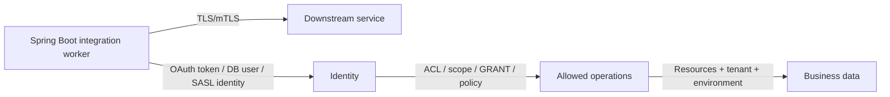
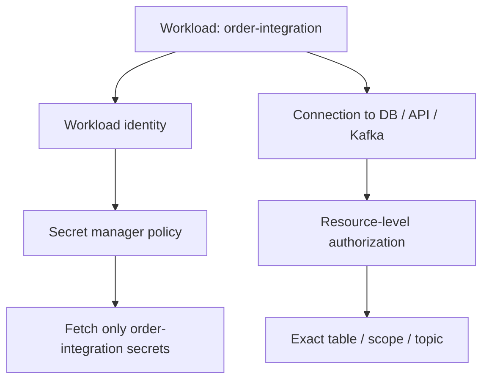
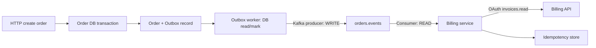
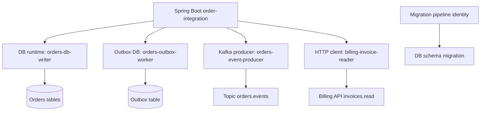

# Least Privilege for Integration Accounts

## 1. Why Do Integration Accounts Need Least Privilege?

In **SPRING_BOOT_INTEGRATION**, a Spring Boot application may simultaneously call HTTP APIs, read/write databases, manipulate caches, and produce or consume Kafka/RabbitMQ messages via Spring Integration adapters. Each connection typically carries a **technical identity**: database user, OAuth2 client, API key, Redis user, Kafka principal, RabbitMQ user, or workload identity.

**Principle of least privilege** means each identity receives only the exact permissions needed to complete its assigned work, on the right resources, in the right environment, and for the right duration. The goal is not only preventing accidental actions, but also bounding the *blast radius* if a credential leaks or code is compromised.

For example, a service that only reads order data and emits `orders.created` events has no reason to hold admin privileges over an entire database, read every Kafka topic, or flush cache keys belonging to other systems.

| Component | Over-Privileged Account | Appropriate Least Privilege |
| --- | --- | --- |
| Partner HTTP API | Admin token with all scopes | Token scoped to exact audience, invoice-read scope, and tenant limit |
| Database | DB superuser with DDL and DML on all schemas | `SELECT` on needed read tables, `INSERT/UPDATE` on needed write tables |
| Redis | Default user with all commands on all keys | Access restricted to assigned key prefixes and command subset |
| Kafka | Principal with cluster-wide or all-topic rights | `WRITE` on target topic; or `READ` on assigned topic and consumer group |
| RabbitMQ | Admin user across all vhosts | `configure/write/read` permissions on exact resources in business vhost |
| Infrastructure | Workload permitted to read all secrets | Reads only secrets belonging to that workload |

### Lesson Objectives

- Distinguish **authentication**, **authorization**, and **transport protection**.
- Design identities, permissions, and resource scopes per connector.
- Configure and operate Spring Boot without leaking secrets or accidentally reusing high-privilege accounts.
- Test **both granted permissions and expected denials**; recognize permission errors and avoid futile retries.
- Combine authorization with data contracts, transactions, idempotency, error handling, and observability in real integration flows.

## 2. Three Boundaries: Connection, Identity, and Permission



Three separate questions to answer:

1. **Is the channel secure?** TLS encrypts the connection and authenticates the server; it does not grant permission to read topics or tables.
2. **Does the system know who is calling?** OAuth client credentials, DB user, SASL principal, or client certificate establishes identity without automatically authorizing every action.
3. **What may this identity do to which resource?** The resource server, database, broker, or IAM system must enforce permissions; merely hiding UI buttons or checking inside the Spring Boot caller is insufficient.

This forms the permission pattern:

> `principal + action + resource + context → allow/deny`

**Context** can include environment (`dev/staging/prod`), tenant, topic prefix, database schema, HTTP endpoint, token scope, or session lifetime. When a principal holds overly broad permissions, controls like TLS and secret managers cannot stop valid holders of that credential from abusing them.

### 2.1. Integration Accounts vs. User Accounts

- **User identity:** end-user identity, often accompanied by OAuth tokens with role- and tenant-dependent permissions.
- **Service identity:** application or workload identity, e.g., `svc-order-publisher`, running non-interactively.
- **Administrative identity:** used for migrations, ACL changes, cluster administration, or provisioning; must remain separate from runtime identities.
- **Emergency identity:** elevated break-glass access for incident response, requiring time-bound grants and auditing; never placed in routine runtime config.

Never blindly forward an end-user token to another API if its `audience` does not match that API. Conversely, a service's `client_credentials` token does not represent an end-user's identity or permissions. When downstreams need user context, design explicit **delegation and identity propagation** (such as token exchange/on-behalf-of when supported by your identity system), never faking arbitrary headers.

### 2.2. Common Design Mistakes

| Design | Problem |
| --- | --- |
| All microservices share one database user | Impossible to isolate permissions, accountability, or access logs |
| Using a DBA account in `spring.datasource` | SQL injection or RCE can alter/drop the entire DB |
| Granting OAuth scope `*` to "avoid 403 errors" | A leaked token unlocks every API |
| One Kafka principal shared across producers/consumers/admins | Cannot isolate read, write, and admin privileges |
| Redis user with `+@all ~*` | Can read/modify/delete every key and run admin commands |
| Using production service accounts in test environments | Breaks environment isolation and risks corrupting real data |
| Logging raw tokens/JAAS/connection strings | Exposes high-privilege identities to log viewers |

**Least privilege must be verified on the target system.** Naming a role "readonly" in application config, or writing in a doc that a service is "read-only", does not prove the database/API blocks writes.

## 3. Start by Inventorying Flows and Building a Permission Matrix

Before provisioning accounts, examine the integration contract operationally:

1. **Trigger:** which HTTP handler, scheduled task, Kafka/RabbitMQ consumer, or Spring Integration gateway initiates it?
2. **Input/output:** what data passes through? Is there PII, tokens, payment details, or multi-tenant data?
3. **Target:** which API, database/schema/table, cache key namespace, or broker/topic/queue/vhost?
4. **Action:** read, write, update, delete, publish, consume, create resources, or modify config?
5. **Boundaries:** prod vs. staging; which tenant; user vs. workload; long-lived vs. temporary access?
6. **Recovery:** on timeout/retry/crash, does the service also need permissions to query status or reprocess?

Example for `order-service` writing orders, publishing events, and calling a payment API:

| Actor/Identity | Target | Needed Permissions | Denied Permissions |
| --- | --- | --- | --- |
| `orders-api-db` | `orders_db.orders` | `SELECT, INSERT, UPDATE` on order-processing tables | `DROP, ALTER, CREATE ROLE`, other schemas |
| `orders-outbox-worker` | `orders_db.outbox_event` | `SELECT` pending events; `UPDATE` status/checkpoint | `DELETE` all events and DDL privileges |
| `orders-event-producer` | Kafka `orders.events` | `WRITE` and needed metadata permissions | `READ` all topics, editing ACLs |
| `billing-consumer` | Kafka `orders.events` and group `billing-sync` | `READ` topic/group plus needed metadata permissions | `WRITE` unrelated topics, cluster admin |
| `orders-billing-client` | Billing API | `payments.read` scope and Billing API audience | `payments.admin` scope, calling other customer APIs |
| `orders-cache-worker` | Redis `orders:summary:*` | `GET, SET` in assigned namespace | `FLUSHALL`, admin commands, all keys |

This is a **permission draft** that must be checked against actual driver, framework, and target system operations. For example, a Kafka client may need `DESCRIBE` or metadata ACLs; RabbitMQ may need `configure` if the app actively declares queues, whereas a consumer bound to pre-provisioned queues should not automatically have create/delete permissions.

### 3.1. Least Privilege Must Account for Auxiliary Operations

Do not model only the happy path. A consumer may need permission to publish to a dead-letter topic or update an idempotency table; an outbox worker needs to read and mark sent rows; an HTTP adapter may query transaction status after a timeout. **Auxiliary permissions** must be documented in the contract rather than opening system-wide privileges when a runtime error appears.

Every permission should record owner, purpose, environment, exact resource, issue/review dates, and approval trail per organizational policy. When a job or integration adapter is retired, revoke its unused permissions too.

## 4. HTTP APIs and OAuth2: Scope, Audience, Endpoint, Tenant

### 4.1. Separate OAuth2 Client Identities per Downstream

Suppose Spring Boot calls a partner API to read invoices. With OAuth2 `client_credentials`, the app fetches an access token from an authorization server. Tokens may carry `scope` and `audience` depending on the IAM system. The resource server must **validate the token and check permissions**.

| Component | Principle |
| --- | --- |
| `client_id` | Represents one specific integration/workload, never shared company-wide |
| `client_secret` or client certificate | Dedicated secret stored in secret manager, with rotation/revocation lifecycle |
| `scope` | Only required actions, e.g., `invoices.read` |
| `audience` | Scopes token to the exact target API; some providers use resource indicators or custom params |
| HTTP destination | HTTPS and host/port allowlist; never send bearer tokens to user-supplied URLs |
| Tenant/object | API server checks permissions per tenant/object, not only per route |
| Expiry | Short-lived tokens acquired/refreshed per provider; never log tokens |

Example declaring a **dedicated registration** in Spring Boot/Spring Security OAuth2 Client:

```yaml
spring:
  security:
    oauth2:
      client:
        registration:
          invoice-reader:
            provider: partner-identity
            client-id: ${INVOICE_CLIENT_ID}
            client-secret: ${INVOICE_CLIENT_SECRET}
            authorization-grant-type: client_credentials
            scope:
              - invoices.read
        provider:
          partner-identity:
            token-uri: https://identity.partner.example/oauth2/token
```

**Note:** this registration tells Spring Security how to acquire tokens, not to attach tokens automatically to every request. Configure an authorized-client manager/filter fitting your Servlet or Reactive stack and select `invoice-reader` explicitly for those calls. `audience` has no single uniform Spring OAuth2 property across all providers; set resource indicators/audience parameters per your identity provider's contract. Never assume every requested scope is always granted verbatim or that downstream validates automatically.

With multiple downstreams, **never enable automatic attachment of the active access token onto every `WebClient` request** without destination controls. A token meant for API A must never go to API B merely because a `WebClient` or filter was reused.

### 4.2. Attaching a Token to a Fixed-Destination Request

Example adapter receiving only an invoice ID while the API endpoint stays fixed:

```java
import org.springframework.http.HttpHeaders;
import org.springframework.web.reactive.function.client.WebClient;
import reactor.core.publisher.Mono;

record InvoiceDto(String id, String status) {}

interface InvoiceAccessTokenProvider {
    // Acquire/retrieve token for the right OAuth registration, audience, and scope.
    Mono<String> tokenForInvoiceRead();
}

class PartnerInvoiceGateway {
    private final WebClient invoiceClient;
    private final InvoiceAccessTokenProvider tokens;

    PartnerInvoiceGateway(WebClient invoiceClient,
                          InvoiceAccessTokenProvider tokens) {
        this.invoiceClient = invoiceClient;
        this.tokens = tokens;
    }

    Mono<InvoiceDto> getInvoice(String invoiceId) {
        if (invoiceId == null ||
            !invoiceId.matches("[A-Za-z0-9_-]{1,64}")) {
            return Mono.error(new IllegalArgumentException("Invalid invoiceId"));
        }

        return tokens.tokenForInvoiceRead()
            .flatMap(token -> invoiceClient.get()
                .uri(uri -> uri.pathSegment("v1", "invoices", invoiceId)
                    .build())
                .headers(headers -> headers.setBearerAuth(token))
                .retrieve()
                .bodyToMono(InvoiceDto.class));
    }
}
```

`InvoiceAccessTokenProvider` is an illustrative interface implemented via the appropriate OAuth2 authorized-client mechanism. `invoiceClient` must be a dedicated `WebClient` with a trusted `baseUrl`, validating final host/scheme/port and controlling redirects; **`baseUrl` alone does not block an absolute URI** passed into `uri(...)`. Never expose tokens in URLs, queries, logs, or exceptions.

**Least privilege is enforced in two places:** the caller requests only narrow-scoped tokens and calls needed endpoints; the resource server validates audience, scope, and tenant/object ownership of `invoiceId`. If the downstream skips tenant checks, even an `invoices.read` token could read another customer's invoice.

### 4.3. 401/403 Errors Are Not Reasons to Escalate Privileges Automatically

- `401 Unauthorized`: check for missing, expired, or wrong-issuer/audience tokens or auth issues; token providers may refresh on schedule per policy. Never loop infinitely with the same failing token.
- `403 Forbidden`: indicates missing scope, policy violation, or insufficient resource permission. Review the contract; never silently fail over to a higher-privilege account.
- `429` or `503`: load/transient failures eligible for bounded retries respecting idempotency and `Retry-After`—**unrelated to requesting broader scopes**.

If an endpoint genuinely needs a new permission, update the contract and policy through review, update the permission matrix, and add tests. Never grant `admin` just to "get it running".

## 5. Databases: Runtime Accounts Separate from Migration/Admin Accounts

A Spring Boot application typically uses a JDBC/HikariCP or R2DBC pool. Effective connection permissions equal the **database principal** used by the datasource to log in. `@Transactional` coordinates transactions, yet it cannot restrict database privileges if the login already holds `DROP` or `ALTER`.

### 5.1. Separate at Least Two Identity Types

| Identity | Responsibility | Typical Required Permissions |
| --- | --- | --- |
| Migration/provisioning | Create/alter schemas, tables, indexes, grants | DDL scoped to migrations; never used as runtime |
| Runtime business service | Read/write tables per application contract | Exact `SELECT/INSERT/UPDATE/DELETE` on required tables/operations |
| Reporting integration | Read aggregated data | `SELECT` on approved views/tables, limiting PII |
| Outbox publisher | Read events and update dispatch status | `SELECT` + `UPDATE` on exact table/columns |

In PostgreSQL, suppose the outbox table was created during migrations in schema `integration`, and database principal `svc_outbox_pub` was created and provisioned with credentials:

```sql
-- Executed by a provisioning account authorized to issue GRANTs.
GRANT CONNECT ON DATABASE appdb TO svc_outbox_pub;
GRANT USAGE ON SCHEMA integration TO svc_outbox_pub;

GRANT SELECT ON TABLE integration.outbox_event TO svc_outbox_pub;
GRANT UPDATE (state, sent_at, attempt_count)
    ON TABLE integration.outbox_event TO svc_outbox_pub;

-- Do NOT GRANT DDL, DELETE, TRUNCATE, or access to other tables.
```

Column-level `UPDATE` restricts updates solely to the listed columns. Check actual queries and permissions on related objects (sequences, views, functions, row-level security) per design. If a worker also needs `INSERT` or additional columns, justify with a concrete use case and expand only that narrow scope.

**This is an illustrative grant example**, not a universal recipe for all databases. Revoke unintended default grants from `PUBLIC` or inherited roles where appropriate. A principal inheriting rights through another role can exceed expectations even when the `GRANT` above looks narrow. Verify **effective permissions** using the actual runtime account.

### 5.2. Minimize by Tenant, Row, and SQL Operation

Table-level limits may still fall short: if an `invoices` table stores multiple tenants, a DB user with `SELECT` on the whole table can read across tenants if code omits a `WHERE` filter.

Consider one or more defense layers:

- Separate databases/schemas or roles per tenant when strong isolation is required.
- Expose views projecting only needed columns; control permissions on both views and base tables.
- Use **row-level security (RLS)** where supported by the database and policies are tested.
- Enforce user/tenant authorization in the business layer rather than treating service-account access as proof any user may read a row.
- Use parameterized queries/ORM bindings to prevent SQL injection; authorization never replaces injection defense.

Never commit DB usernames/passwords into `application-prod.yml`. Example configuration:

```yaml
spring:
  datasource:
    url: ${ORDERS_DB_JDBC_URL}
    username: ${ORDERS_DB_RUNTIME_USER}
    password: ${ORDERS_DB_RUNTIME_PASSWORD}
```

Inject values via a secret store or protected runtime injector. Treat JDBC URLs/usernames as sensitive infrastructure config and keep them out of public logs. With IAM database auth or dynamic credentials, align token acquisition/refresh and pool lifetimes accordingly.

### 5.3. Database Permissions and Transaction Guarantees Are Separate Concerns

An outbox worker holding `SELECT + UPDATE` does not turn Kafka publishing and DB updates into an atomic distributed transaction. You still need event states, idempotency keys, claims/leases, deduplication, or a transactional outbox. Never solve retry failures by granting DBA rights; design recovery permissions around exact operational needs.

## 6. Caches: Restrict Commands and Key Namespaces

Redis is often treated as secondary infrastructure, yet caches frequently hold sessions, tokens, personal data, or deduplication state. If one service's credentials can run `FLUSHALL` or touch keys owned by other services, a bug or breach in one service jeopardizes the whole platform.

With Redis ACLs, restrict in two dimensions:

- **Key patterns**: user reads/writes only `orders:summary:*`, never touching `sessions:*`, `auth:*`, or `payments:*`.
- **Command permissions**: allow only needed commands like `GET`, `SET`, `DEL`, excluding admin commands or `@all`.

Example **ACL provisioned by an administrator**:

```text
user svc_orders_cache
keys: orders:summary:*
commands: GET, SET, DEL, PING (if needed by client)
authentication: password or auth mechanism issued by Redis deployment
```

Exact user creation, password assignment, and ACL syntax should follow your Redis/managed provider's admin workflow. Never pass passwords directly into shell commands, Git scripts, or CLI history for quick tests. Some Redis clients require extra connection/metadata commands; verify with integration tests and grant only what is truly needed.

With Spring Boot:

```yaml
spring:
  data:
    redis:
      host: ${ORDERS_REDIS_HOST}
      port: ${ORDERS_REDIS_PORT:6379}
      username: ${ORDERS_REDIS_USER}
      password: ${ORDERS_REDIS_PASSWORD}
```

When using TLS, configure Redis SSL/TLS matching your Spring Boot version and provider; check CA/hostname and never downgrade transport to fix errors. Do not assume adding a key prefix in a Java key generator locks down the client: **the Redis server must enforce the ACL** on that principal.

**Specifically:** Spring Cache flows may invoke additional commands depending on cache manager, serializer, TTL, and eviction strategy; confirm exact commands before locking down ACLs. Add a negative test targeting a key outside the namespace to prove access is denied.

## 7. Message Brokers: Topics, Groups, Queues, and Admin Permissions

### 7.1. Apache Kafka

Kafka clients authenticate via SASL or mTLS depending on the listener, while read/write permissions are enforced by the broker/managed platform via ACLs or equivalent.

| Principal | Resource | Primary Permissions | Denied Permissions |
| --- | --- | --- | --- |
| `orders-producer` | Topic `orders.events` | `WRITE` plus needed metadata rights | `READ` all topics, delete topics, edit ACLs |
| `billing-consumer` | Topic `orders.events` | `READ` plus needed metadata rights | `WRITE` unrelated topics |
| `billing-consumer` | Consumer group `billing-sync` | Group rights to join/consume | Access to all consumer groups |
| `operations-admin` | Defined cluster/resources | Specific operational admin rights | Never used by runtime applications |

If a consumer publishes to a dead-letter topic `orders.events.dlt`, explicitly model that path: which consumer/recoverer **publishes** to DLT and which principal holds `WRITE`. Never grant `ALL` on every topic because one small ACL was missed.

In Spring Boot, producer and consumer identities can be separated under `spring.kafka.producer.properties` and `spring.kafka.consumer.properties` if one app plays both roles. When a single JVM hosts multiple integration adapters with different trust scopes, consider separate factories or splitting apps to minimize each principal's blast radius.

```yaml
spring:
  kafka:
    bootstrap-servers: ${KAFKA_BOOTSTRAP}
    producer:
      properties:
        "[security.protocol]": SASL_SSL
        "[sasl.mechanism]": SCRAM-SHA-512
        "[sasl.jaas.config]": ${KAFKA_PRODUCER_JAAS}
    consumer:
      group-id: billing-sync
      properties:
        "[security.protocol]": SASL_SSL
        "[sasl.mechanism]": SCRAM-SHA-512
        "[sasl.jaas.config]": ${KAFKA_CONSUMER_JAAS}
```

This shows separating credentials **within one application**; the broker must support the matching mechanism, principals, and ACLs. Configure CA trust/hostname per real TLS policy (JVM truststore or Kafka client SSL properties) rather than assuming `SASL_SSL` handles certificates automatically. Never log JAAS strings containing passwords. Splitting producer/consumer config in YAML achieves nothing if both credentials map to the same broker account.

### 7.2. RabbitMQ

RabbitMQ uses **vhosts** as a primary resource boundary. Permissions typically consist of three regexes—`configure` (declare/alter resources), `write` (publish), and `read` (consume)—within a vhost, plus topic permissions when routing-key authorization is needed.

| Role | Vhost | Example Permissions |
| --- | --- | --- |
| Order event publisher | `/orders` | `write` on the order-publishing exchange; `read` unnecessary |
| Billing consumer | `/orders` | `read` on queue `billing.orders`; `configure` only if app must declare topology |
| Provisioning service | `/orders` | Managed rights to create exchanges/queues/bindings |

Never place a user with the `administrator` tag inside an application container. If Spring AMQP auto-declares queues/exchanges/bindings via `RabbitAdmin`, consider provisioning topology at deploy time rather than granting broad `configure` rights to all consumers. Test actual adapter needs, especially when using retry queues, dead-letter exchanges, or reply queues.

### 7.3. Spring Integration Adapters Also Use Credentials

Spring Integration provides inbound/outbound adapters and gateways for HTTP, JMS, AMQP, Kafka, databases, FTP/SFTP, and more. **Adapters do not grant permissions**; they use their underlying configured connection factory, data source, HTTP client, or session factory.

Examples:

- An outbound HTTP gateway calling a partner only needs scopes/resources for that endpoint.
- An inbound JMS/Kafka adapter only needs to consume its assigned destination and handle acks/groups.
- An outbound JDBC adapter only needs DML on its target table.
- An SFTP inbound poller normally needs `LIST/READ` on the source directory; if it moves/deletes processed files, document those extra permissions explicitly.

If one flow **reads** from system A and **writes** to system B, never default to sharing one credential. Isolate connector credentials so a failure or breach in one adapter does not unlock every other adapter.

## 8. Workload Identity, Secrets, and Infrastructure Permissions

Integration accounts are more than username/password properties in Spring. A workload on Kubernetes, VMs, or cloud platforms often carries an infrastructure identity allowing it to read secrets, call cloud APIs, or connect to managed databases/brokers.

### 8.1. Partition Permissions at Every Boundary



If a Kubernetes service account can read every Secret in a namespace, storing DB passwords in Secret objects does not stop cross-service credential exposure. Control simultaneously:

- Workload permissions to read secrets/configs, token mounts, and pod/VM IAM roles.
- Downstream resource permissions tied to those credentials.
- Egress network policies, DNS, TLS, and allowed destination hosts.
- Access to logs, traces, process dumps, backups, and operations dashboards.
- Strict separation across `dev`, `staging`, and `prod` via independent identities, secrets, and infrastructure.

NetworkPolicy, service meshes, and firewalls help constrain network paths, yet they **do not replace** ACLs/GRANTs/scopes on receiving systems. Conversely, narrow ACLs cannot protect credentials leaked into broadly readable logs.

### 8.2. Credential Lifecycle

1. **Provision:** create a dedicated identity per integration and environment; grant permissions from a reviewed matrix.
2. **Distribute:** inject via secret manager, workload identity, or protected file mounts; never commit into repos, images, or pipeline output.
3. **Use:** bind credentials strictly to the right connector; protect with TLS and prevent sending outside destination allowlists.
4. **Observe:** monitor auth/authz errors, anomalous access, and cert/token expiry; never log secrets.
5. **Rotate:** swap credentials on schedule, verifying client reloads, connection pool/reconnect handling, and overlap windows where supported.
6. **Revoke:** revoke permissions/credentials when flows are retired, services change roles, or compromise is suspected.

A password committed to Git—even after deleting it from the current file—remains in commit history and forks. **Rotate/revoke the credential** and audit logs, images, CI artifacts, and synced secret copies. Narrowing the compromised identity's permissions also limits damage, yet does not replace revoking the leaked secret.

### 8.3. Expiration and Just-in-Time Grants

Long-lived permissions need periodic reviews. Migrations, sensitive data backfills, or incident response can use **temporary (just-in-time) privileges** with expiration, approvers, and auditing. Never let temporary admin privileges linger as permanent runtime permissions after maintenance ends.

With short-lived dynamic DB credentials/tokens, verify connection pool behavior, token refresh, lifetimes, revocation, and mid-transaction expiry behavior. A proper design lets existing connections finish gracefully within bounds without falling back to high-privilege accounts.

## 9. Least Privilege Across Transactions, Retries, and Duplicate Handling

Sound permission design reflects **real execution flows**, including error paths:



In this flow:

- The order-writing API uses a DB role scoped to creating/updating orders, needing no schema admin privileges.
- The outbox publisher uses its own role to read pending events and update state, and its own Kafka principal limited to publishing the business topic.
- The consumer holds topic/group ACLs and rights to its own data store; partner API calls use tokens with dedicated scope/audience.
- The idempotency store needs minimal read/write operations; Kafka redeliveries or HTTP timeouts must never be handled using admin accounts.

**Authorization does not guarantee exactly-once processing.** If a publish succeeds yet the client loses the ACK, a retry can resend the event. Use stable event IDs, outbox/inbox tables, unique constraints, and deduplication. When a downstream API supports idempotency keys, reuse the exact same key across retries. When the DB transaction commits while HTTP/Kafka fails, use durable recovery states or sagas; widening permissions never solves consistency.

### 9.1. Never "Fall Back to Admin" on Failures

| Error | Common Cause | Appropriate Action |
| --- | --- | --- |
| HTTP `401` | Missing/expired/wrong-audience/wrong-issuer token | Inspect token provider config; refresh per policy |
| HTTP `403` | Missing scope/object/tenant permission | Review contract and policy; grant exact permission if legitimately needed |
| SQL `permission denied` | Missing table/schema/column/sequence grant | Check effective role and SQL; apply minimal GRANT |
| Redis `NOPERM` | Command or key outside ACL | Compare command/key against permission matrix; never grant `@all` |
| Kafka `TopicAuthorizationException` | Insufficient topic ACL | Inspect actual principal and topic ACL |
| Kafka group authorization | Insufficient consumer group ACL | Inspect group ID and group ACL |
| RabbitMQ `ACCESS_REFUSED` | User lacks vhost/resource permission | Check `configure`/`write`/`read` on exact queue/exchange |
| TLS handshake failure | Wrong cert/CA/hostname/truststore | Fix chain/hostname/config; never disable TLS checks |

Authorization failures are usually **persistent** until config or policy changes, so do not hammer systems with aggressive retries like transient network glitches. Catch missing permissions via tests and provisioning workflows rather than falling back to high-privilege secrets. When messages land in dead-letter queues/topics due to permission failures, govern retention, replay, and access to sensitive contents.

### 9.2. Distinguish Business Authorization from Connection Permissions

A service authorized to open a connection to a DB or HTTP API is not automatically authorized to read all data inside it. Enforce tenant, user ownership, and object-level authorization at the resource server or DB as appropriate. For instance, `invoices.read` permits reading invoices, yet tenant ownership still must be checked; `SELECT` on a DB table does not replace user-level authorization in the business layer.

## 10. Designing Tests: Prove Denials Too

An integration test confirming "event published successfully" only tests the **allowed path**. It does not prove the account lacks out-of-scope permissions. Write negative tests using the real runtime identity in an isolated environment.

| Test | Setup | Outcome to Verify |
| --- | --- | --- |
| HTTP valid scope/audience | Token with `invoices.read` calls allowed tenant's invoice endpoint | `200` and valid data |
| HTTP missing permission | Token with only `invoices.read` calls admin/write operation | Resource server returns `403`; never self-elevates scope |
| HTTP wrong audience/tenant | Token for API A calls API B or another tenant's invoice | Rejected by resource server policy |
| HTTP redirect to unknown host | API returns `Location` to non-allowlisted host | Token never sent to unknown host |
| Read-only DB | Reporting role attempts `INSERT/DELETE` | DB rejects; other views/schemas unreadable |
| Outbox worker DB | Attempt `UPDATE` on allowed columns and `DROP TABLE` | Needed `UPDATE` succeeds; DDL rejected |
| Redis namespace | Runtime Redis user runs `GET orders:summary:42` and `GET sessions:admin` | Only in-namespace key permitted |
| Redis commands | Runtime user attempts dangerous admin command | Redis rejects |
| Kafka producer | Publish to `orders.events` and attempt `payments.private` | Only granted topic accepts events |
| Kafka consumer | Join allowed group and out-of-scope group | Only allowed group succeeds |
| RabbitMQ | Consume from allowed vhost/queue and attempt another queue/vhost | Out-of-scope access rejected |
| Secret store | `order-service` workload tries reading `billing-service` secret | IAM denies; secret never returned |
| Credential rotation | Rotate secret in test env per runbook | Clients retain proper permissions; old connections handled cleanly |
| Logs/traces | Inject unique synthetic secret marker | Zero marker occurrences in logs, traces, exceptions, metrics, DLQ |

### 10.1. How to Verify Effective Permissions

- Connect to the **real target system** using the exact credentials/identity the runtime app will use.
- Use safe, isolated test resources; never run destructive probes against production DBs/caches.
- Distinguish authorization failures from missing resources, network timeouts, or authentication failures; each requires its own test setup.
- Write at least one *allow* test and one *deny* test for each critical connector.
- When policies change, keep regression tests so permissions do not silently creep outward.

Unit tests mocking DAOs/`WebClient` only confirm code invokes expected methods; **they do not prove DB GRANTs, OAuth scopes, Kafka ACLs, or Redis ACLs are enforced on the server**. Combine unit tests with integration tests running against production-like policies.

### 10.2. Code and Configuration Review Checklist

Before merging or deploying:

1. Verify zero hardcoded secrets in `application.yml`, source code, Dockerfiles, CI configs, and test fixtures.
2. Trace token flows: which `WebClient` sends it, which host receives it, and whether redirects or absolute URIs can occur.
3. Diff new permissions against the approved matrix; flag wildcards, admin roles, and cross-environment privileges.
4. Inspect effective identities on producers/consumers, migrations/runtime, HTTP clients, and cache clients to prevent unintended privilege inheritance.
5. Verify retries, dead-letter handling, backfills, and recovery paths require no hidden admin rights.
6. Ensure logs/tracing hide `Authorization`, API keys, `sasl.jaas.config`, DB passwords, and sensitive payloads.

## 11. Observability, Auditing, and Permission Reviews

Operations must see who exercises which permissions without exposing credentials. A helpful log entry:

```text
flow=orders-outbox
connector=kafka-producer
principal=orders-event-producer
resource=orders.events
operation=publish
result=authorization_denied
error_type=TopicAuthorizationException
```

Never log tokens, passwords, full connection strings, private keys, raw request bodies, or personal messages. Even principals and resource names can be sensitive in some organizations; scope log access and retention accordingly.

Valuable metrics to track:

- Counts of `authentication_failed` and `authorization_denied` per connector/logical resource.
- Expiring credentials, rotation errors, or clients still presenting stale credentials.
- Access attempts outside the expected matrix and changes to policies/ACLs/GRANTs.
- Unused principals, wildcard permissions, shared accounts, or lingering admin rights in runtime.
- Repeated permission failures driven by retries; time to recover after policy fixes.

Metric tags must stay bounded—such as `connector_type`, `target_system`, and `error_category`—without attaching tokens, full URLs, or dynamic user IDs. Server-side audits on the resource server/DB/broker are usually more authoritative than client logs regarding whether access was granted or denied.

### 11.1. Periodic Permission Review Process

Track for every integration account:

| Attribute | Review Question |
| --- | --- |
| Owner | Which team owns and approves these permissions? |
| Service/flow | Which flow or adapter still uses this identity? |
| Resources | Exact endpoint, schema, table, key prefix, topic, or queue? |
| Actions | Read, write, update, delete, admin, or metadata only? |
| Environment | Are credentials isolated across dev/staging/prod? |
| Credential lifecycle | Issue date, last rotation, expiry/revocation policy? |
| Evidence | Latest allow/deny test results and real access logs? |
| Expiration/review | Have temporary grants expired or become obsolete? |

When a principal is unused, verify dependencies, test in staging, then revoke and monitor. Manage permission changes via IaC or audited change control so permissions aren't lost across redeployments.

## 12. Implementation Pattern by Permission Boundary

Suppose an application originally shared one `integration-admin` principal across DB, Kafka, and HTTP. Split into dedicated identities:



Each connector uses its own identity/configuration. While running inside one shared JVM, a full JVM compromise could still access credentials in process memory; splitting credentials narrows blast radius per call and clarifies audits, whereas stronger isolation requires **separating workloads/processes**, runtime permissions, and network policies.

### 12.1. Practical Implementation Steps

1. **Inventory:** list every flow, action, and credential in use, assigning owners and environments.
2. **Define:** write the resource-and-action permission matrix including retries, dead-lettering, replays, migrations, and observability.
3. **Provision:** create new principals with narrow policies; distribute secrets securely without sharing across environments.
4. **Wire:** configure Spring Boot to bind the right identity to each client/factory with zero admin fallback.
5. **Verify:** run allow/deny integration tests, verify permission errors don't hot-retry, and confirm zero secret leaks.
6. **Cut over:** switch connections while monitoring auth/authz errors and keeping controlled rollback options.
7. **Revoke:** revoke old accounts/permissions once zero dependencies remain, and schedule periodic reviews.

**Never weaken TLS or disable authentication to make authorization easier.** If a client hits an SSL handshake failure, wrong grant, or ACL error, resolve it at that boundary and re-test.

## 13. Production Checklist for Integration Accounts

- [ ] Every flow/connector has a clearly identified principal and accountable owner.
- [ ] Runtime accounts are separated from migration/admin accounts; zero superusers or unnecessary wildcards.
- [ ] Permissions specify action, resource, environment, and tenant; effective permissions verified.
- [ ] OAuth tokens carry tight audience/scopes; downstreams enforce object/tenant checks.
- [ ] DB users hold only needed DML on exact schemas/tables/columns; inherited rights and RLS reviewed.
- [ ] Redis ACLs restrict commands and key prefixes; Kafka ACLs restrict topics/groups; RabbitMQ restricts vhosts/queues/exchanges.
- [ ] Spring Integration adapters use their respective connector identities without reusing elevated credentials.
- [ ] Secrets are injected and rotated securely, never appearing in Git, images, logs, traces, or metrics.
- [ ] TLS/hostname verification and egress limits are properly configured.
- [ ] Allow and deny tests run against target systems using real runtime principals.
- [ ] `401/403`, DB permission denied, Redis `NOPERM`, and broker ACL failures never auto-fallback to admin or retry infinitely.
- [ ] Outbox, idempotency, checkpoints, DLQs, and recovery mechanisms run with dedicated minimal rights.
- [ ] Policies/ACLs/GRANTs are managed and audited; temporary/unused grants are revoked.

### Self-Check Questions

1. Can a client with HTTPS and a valid OAuth2 token still read another tenant's data? Which layer must reject it?
2. Why does separating `client_id` per service while giving both an `admin` scope still fail least privilege?
3. How should Spring Boot's runtime account differ from the account running Flyway/Liquibase?
4. If an outbox worker only needs to update `state`, is there any reason to grant `DELETE` or `ALTER TABLE`?
5. Why must a Kafka consumer evaluate both topic ACLs and consumer group ACLs? What changes if the consumer publishes to a DLT?
6. Is restricting Redis keys by prefix in Java code sufficient? Which system must enforce that limit?
7. When seeing `403`, `NOPERM`, or `TopicAuthorizationException`, why do continuous retries rarely help?
8. How do you prove staging credentials cannot access production data?

**Remember:** least privilege must be designed from the **integration flow contract**, enforced on the **target system**, tested with **real runtime principals**, and maintained throughout the secret/permission lifecycle. Combining it with TLS, configuration management, transactions, idempotency, and observability keeps Spring Boot integrations both operational and risk-bounded.
