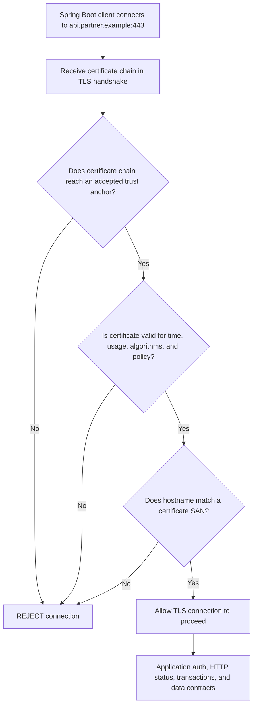
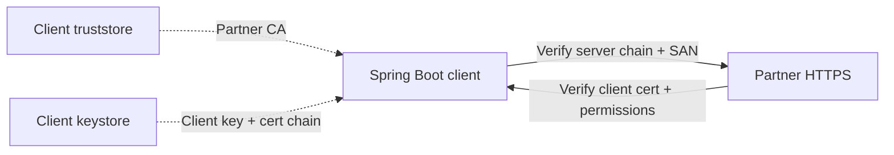
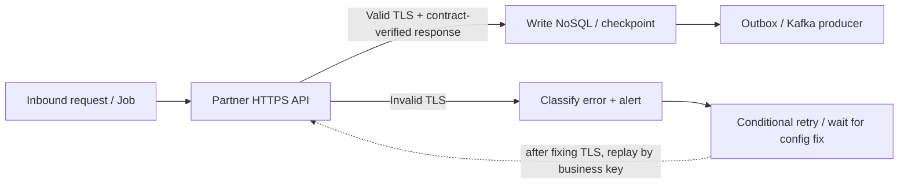

# Rejecting Invalid Connections Instead of Disabling Certificate Checks

A Spring Boot service may connect to HTTP APIs, databases, caches, message brokers, and Spring Integration adapters. When a partner TLS connection fails with `PKIX path building failed` or `No subject alternative DNS name matching`, someone will inevitably suggest enabling "trust all certificates", skipping hostname verification, or temporarily switching to plain HTTP to get the system running again. Such changes make the error vanish, yet they simultaneously destroy the ability to confirm which server the application is actually talking to.

This lesson belongs to the **Connection Security** chapter in the **SPRING_BOOT_INTEGRATION** module. The goal is knowing **when to reject a connection**, finding the real root cause behind invalid certificates, and fixing trust configuration in a controlled way. This discipline must hold across the entire integration flow: from HTTP clients, databases, caches, and brokers to inbound/outbound adapters, including error handling, retries, transactions, deduplication, testing, and observability.

## 1. Why Must TLS Verify Both Certificates and Hostnames?

TLS protects data in transit and, when properly configured, authenticates the remote peer's identity. Encryption **without verifying server identity** can still create an encrypted channel directly to an attacker (*man-in-the-middle*). Therefore, "an encrypted handshake succeeded" is never proof that a connection is secure.



Essential verification layers:

| Check | Question the App Must Answer | Typical Error |
| --- | --- | --- |
| **Certificate chain / trust anchor** | Does the chain verify up to a CA or trust anchor explicitly trusted by the app? | `PKIX path building failed`, `unable to find valid certification path`. |
| **Certificate validity** | Is the certificate currently within its validity window against a trusted clock? | `CertificateExpiredException`, `CertificateNotYetValidException`. |
| **Hostname** | Does the DNS name/IP in the target URL match an appropriate `subjectAltName` (SAN)? | `No subject alternative DNS name matching`, `No subject alternative names present`. |
| **CA constraints and key usage** | Are the chain, basic constraints, key usage, extended key usage, and allowed algorithms valid? | Validation or algorithm constraint errors. |
| **Revocation** | Does security policy require CRL/OCSP checks, and is the client configured to perform them? | Revocation errors when checking is enabled. |
| **Mutual TLS (if used)** | Does the server verify the client certificate and authorize that identity properly? | Rejected handshake or client certificate alerts. |

**Note:** revocation checking (CRL/OCSP) **is not enabled or enforced uniformly by default** across every JVM, driver, and configuration. If your system mandates revocation checks, verify the policy and behavior of the exact TLS provider/client running—never equate "validated certificate" with "checked revocation status".

In common deployments, SAN is the source of DNS/IP identity. If connecting via `https://10.20.30.40`, the certificate needs a matching **IP address** SAN; a DNS SAN alone does not satisfy IP verification. If connecting via `https://api.partner.example`, a matching DNS SAN is required. Never switch URLs to `localhost`, raw IPs, or arbitrary aliases and disable hostname verification to hide mismatches.

## 2. Fail Closed: Invalid Connections Must Fail Explicitly

*Fail closed* means **never continuing operations over a connection when certificate or hostname verification fails**. In integration flows, this typically surfaces as an exception, marks the transaction failed by design, and routes the event into appropriate error handling.

```mermaid
sequenceDiagram
    participant Q as Queue / scheduler
    participant S as Spring Boot service
    participant P as Partner server
    participant E as Retry / DLQ / alert
    Q->>S: Deliver message with business key
    S->>P: Initiate HTTPS / TLS
    P-->>S: Invalid certificate
    S--xP: Reject handshake; send zero business data
    S->>E: Log TLS error + classify incident
    E-->>Q: Hold/controlled retry per broker semantics
```

Do not assume every connection error shares the same retry policy:

- **Wrong trust anchor, wrong hostname, expired certificate, or policy rejection:** typically requires **fixing the certificate, CA, URL, or configuration**. Retrying repeatedly with identical config never makes the connection valid and can trigger request storms.
- **Network timeout, temporary disconnect, overloaded server:** eligible for bounded retries with backoff, jitter, and circuit breakers depending on operation semantics.
- **HTTP 401/403/4xx after TLS succeeds:** usually application auth/authorization or API contract errors—**not** proof of a bad TLS certificate.
- **HTTP 5xx after TLS succeeds:** handle per API contract and idempotency; never tweak truststores to "fix" it.

For message brokers, ACK/NACK, requeue, or DLQ routing must follow actual adapter and transaction semantics. Never ACK a message as processed merely because you logged a TLS error when the write/send never succeeded. When upstream can redeliver, targets must support idempotency keys or reconciliation to prevent duplicate processing.

## 3. Dangerous "Fixes" to Eliminate

| Wrong Approach | Why It Is Dangerous | Right Approach |
| --- | --- | --- |
| Creating a `TrustManager` that accepts all certificates. | Skips CA chains, expiration, and server identity constraints. | Build a truststore with approved CAs/trust anchors; preserve PKIX validation. |
| Using `NoopHostnameVerifier` or an always-`true` `HostnameVerifier`. | A valid certificate issued to a **different host** will still be accepted. | Use URLs matching DNS/IP SANs; keep hostname verification active. |
| Using `InsecureTrustManagerFactory` for real connections. | Bypasses server certificate validation. | Supply accurate trust material and verify in tests. |
| Switching `https://` to `http://` when TLS fails. | Strips encryption and authentication in transit. | Keep HTTPS; return errors or pause flows until root cause is resolved. |
| Auto-downloading the endpoint's certificate and adding it to the truststore. | Under MITM, the app blindly trusts the **attacker's** certificate. | Verify CA or fingerprint via an approved out-of-band channel before importing. |
| Disabling validation in tests and shipping it to production. | Tests fail to catch trust-chain, hostname, or rotation bugs. | Test with valid test certs and negative tests with invalid certs. |
| Pointing `javax.net.ssl.trustStore` to an overly broad shared truststore. | Widens trusted CAs across the whole JVM, hard to scope per partner. | Prefer per-connection truststores/SSL bundles where supported. |

There is no safe "temporary exception" that ships trust-all code inside production binaries. For tests with *self-signed* servers, **explicitly trust a specific, out-of-band-verified test certificate/trust anchor** while still verifying SANs and constraints. "Trusting a specific test cert" is completely different from "accepting any certificate".

## 4. Distinguishing Truststore, Keystore, and SSL Bundle

Three commonly confused terms:

| Concept | Typical Contents | Who Uses It? |
| --- | --- | --- |
| **Truststore** | CA certificates/trust anchors used to verify the remote peer. | Client verifies server; server verifies clients when mTLS is enabled. |
| **Keystore (identity)** | Private key + certificate chain of the **connecting party itself**. | Server presents server cert; client presents client cert in mTLS. |
| **SSL bundle** | Named TLS configuration and material in Spring Boot, holding truststore and/or keystore. | Only those clients/servers/adapters **explicitly configured to use that bundle**. |

An app calling a partner REST API that **only needs to verify the server** typically configures a truststore; no private key or client certificate is needed yet. If the partner requires **mutual TLS (mTLS)**, the app also needs its own client private key and certificate chain. mTLS does not replace bearer tokens, OAuth, or business authorization when required by the system.

mTLS diagram:



**Scope of trust:** a root CA or intermediate CA imported into a truststore can issue certificates for **many different names**. Hostname verification remains a mandatory independent check to restrict connections to the intended host. If only one partner uses an internal CA, isolate that partner's truststore instead of adding the CA to the entire JVM truststore.

## 5. Configuring Spring Boot with a Partner-Specific Truststore

Suppose the application calls `https://api.partner.example`, and the partner's internal CA was delivered via a trusted channel. Example for **Spring Boot versions supporting SSL Bundles** (Spring Boot 3.1+; consult APIs/property names for other versions).

### 5.1. Preparing the Truststore

First, verify the fingerprint and subject of the partner-provided CA certificate through an independent channel:

```bash
# Inspect details only; never blindly trust a file pulled from a failing endpoint.
keytool -printcert -file partner-root-ca.pem

# Create a dedicated truststore; keytool prompts interactively for a password.
keytool -importcert \
  -alias partner-root-ca \
  -file partner-root-ca.pem \
  -keystore partner-truststore.p12 \
  -storetype PKCS12

# Verify the truststore after importing.
keytool -list -v \
  -alias partner-root-ca \
  -keystore partner-truststore.p12 \
  -storetype PKCS12
```

Deliver the truststore via runtime secret/mount mechanisms with minimal read permissions for the process. Never commit private keys, real passwords, or sensitive truststores into Git. Manage truststore passwords via secrets; avoid passing passwords on CLI arguments where they leak into shell history/process listings. Verify fingerprints against authoritative out-of-band channels, never copying them from a failing TLS handshake.

### 5.2. Declaring a Named SSL Bundle

```yaml
spring:
  ssl:
    bundle:
      jks:
        partner:
          truststore:
            location: file:/run/secrets/partner-truststore.p12
            password: "${PARTNER_TRUSTSTORE_PASSWORD}"
            type: PKCS12
```

The bundle name here is `partner`. Properties configure Spring Boot to construct an SSL context from the partner's trust material. **Declaring a bundle does not make every HTTP client, JDBC driver, or messaging adapter use it automatically.** Attach the bundle to the exact client/driver and verify with real connection tests.

If using public CAs already included in the JDK's default truststore, a custom truststore may be unnecessary. Only add trust anchors with clear justification and tight scope. When using a bundle with a custom truststore, confirm the full CA chain the client needs resolves properly; never assume a bundle merges default JVM root CAs automatically.

### 5.3. Using the Bundle in a Java 17+ HTTPS Client

Example of Spring Boot configuring a dedicated `java.net.http.HttpClient` for the partner. It uses the bundle's `SSLContext` and preserves default server identity verification:

```java
import java.net.http.HttpClient;
import java.time.Duration;
import javax.net.ssl.SSLContext;

import org.springframework.boot.ssl.SslBundles;
import org.springframework.context.annotation.Bean;
import org.springframework.context.annotation.Configuration;

@Configuration(proxyBeanMethods = false)
public class PartnerTlsConfiguration {

    @Bean
    HttpClient partnerHttpClient(SslBundles sslBundles) {
        SSLContext sslContext =
                sslBundles.getBundle("partner").createSslContext();

        return HttpClient.newBuilder()
                .sslContext(sslContext)
                .connectTimeout(Duration.ofSeconds(5))
                .build();
    }
}
```

Caller using the `HttpClient` bean:

```java
import java.io.IOException;
import java.net.URI;
import java.net.http.HttpClient;
import java.net.http.HttpRequest;
import java.net.http.HttpResponse;
import java.time.Duration;
import javax.net.ssl.SSLException;

public class PartnerApiClient {
    private final HttpClient client;

    public PartnerApiClient(HttpClient partnerHttpClient) {
        this.client = partnerHttpClient;
    }

    public String fetchStatus() throws IOException, InterruptedException {
        HttpRequest request = HttpRequest.newBuilder()
                .uri(URI.create("https://api.partner.example/status"))
                .timeout(Duration.ofSeconds(10))
                .GET()
                .build();

        try {
            HttpResponse<String> response =
                    client.send(request, HttpResponse.BodyHandlers.ofString());
            if (response.statusCode() != 200) {
                throw new IOException(
                        "Unexpected partner response: " + response.statusCode());
            }
            return response.body();
        } catch (SSLException e) {
            // TLS verification failed: fail loudly, keep cause for diagnosis.
            // Never create a trust-all client to retry.
            throw new IOException("Partner TLS validation failed", e);
        }
    }
}
```

This illustrates the principle; for `RestClient`, `WebClient`, Apache HttpClient, OkHttp, or database/broker drivers, attaching SSL bundles/trust managers uses version-specific APIs. Never swap security config for a trust-all `SSLContext`. Specifically, never set internal JDK flags to disable hostname verification on Java HTTP clients.

The snippet shows only a `GET` call; for side-effecting `POST`/`PUT` calls, retrying after `IOException` must account for whether the request reached the server and enforce idempotency keys. Alongside connect timeouts, enforce request deadlines and retry/circuit-breaker policies aligned with SLAs.

### 5.4. Using Spring `RestClient` or `WebClient`

Spring Boot integrates SSL bundles into certain client builders, though API names can change across major versions. For example, Spring Boot 3.x releases supporting `RestClientSsl` apply named bundles to `RestClient.Builder`. With Reactor Netty-based `WebClient`, configure TLS via connector/Netty APIs for your version. Either way, tests must prove **the exact client bean calling the partner** uses the expected truststore and keeps hostname verification active.

## 6. Internal Certificates, Reverse Proxies, and Hostname Mismatches

Common misconfigurations:

| Scenario | Why the Connection Can Fail | Right Fix |
| --- | --- | --- |
| Calling `https://api.partner.example` while server presents cert for `app.internal`. | SAN mismatches the called hostname. | Issue cert with matching DNS SAN, or update endpoint to call the protected hostname. |
| Calling server by IP while cert only has DNS SANs. | IP does not match certificate identity. | Use valid DNS or issue cert with matching IP SAN. |
| Backend omits intermediate certificate. | Client cannot build a complete trust chain. | Configure server/proxy to send full ordered chain; never import leaf cert from failing connection. |
| TLS-terminating proxy presents its own cert. | Client verifies the proxy's cert, not the backend behind it. | Manage certificates for the exact public/internal hostname clients actually connect to. |
| Host clock skew. | Cert appears not yet valid or prematurely expired. | Synchronize system clocks safely, and renew genuinely expired certs. |
| Internal CA not yet trusted. | PKIX path validation finds no valid trust anchor. | Verify CA out of band and add to a scoped truststore. |
| Load balancer nodes hold differing certs. | Some handshakes succeed while others fail. | Check every node/ingress with right SNI, chain, and SAN. |

**SNI (Server Name Indication)** lets the client advertise the target hostname during the TLS handshake so multi-tenant servers can select the matching certificate. SNI does not replace hostname verification. Probing by IP without SNI can return a proxy's default certificate and mislead debugging about what the real application endpoint sees.

With Kubernetes/service meshes, map out **where TLS terminates**, which server identity clients verify, and which layer enforces mTLS. A valid certificate on a sidecar or ingress does not prove every internal hop is protected as required.

## 7. TLS Across Databases, Caches, Brokers, and Spring Integration Adapters

Fail-closed thinking applies to every outbound/inbound connection, though truststore wiring differs per library:

| Integration Channel | Minimum Verification | Common Mistake |
| --- | --- | --- |
| HTTP `RestClient` / `WebClient` / Java `HttpClient` | CA chain, host SAN, request timeouts, proxies, cert rotation. | Disabling trust/hostname verification on one shared client. |
| JDBC | Whether driver uses TLS; `sslmode` or driver server-identity checks; CA/truststore. | Enabling encryption in a mode that skips identity verification, falsely assuming security. |
| MongoDB/Cassandra/Elasticsearch/Couchbase | Driver/SDK TLS settings, CA, hostname, DNS discovery, cluster node names. | Valid seed node yet secondary cluster nodes present wrong SANs. |
| Redis | TLS client mode, CA, hostname verification, Cluster/Sentinel mode. | Disabling cert checks during node failover. |
| Kafka/JMS/AMQP | TLS truststore, hostname verification, client cert if mTLS; broker advertised listeners. | Verifying only bootstrap endpoint while ignoring redirected brokers. |
| Spring Integration adapters | TLS handled by underlying HTTP client, listener container, SDK, or driver. | Assuming Spring Integration endpoint config enables transport TLS validation automatically. |

With certain JDBC drivers, "require SSL" enforces encryption without full server identity validation; read docs for your **exact driver and version**. In Kafka, hostname verification is a separate client setting; never clear endpoint identification algorithms as a permanent fix. Across database clusters or brokers, verify every node address the client reaches after discovery/failover.

A Spring Integration pipeline chaining HTTP → database → broker must keep certificates valid on **every hop** and ensure failures prevent incomplete events from being marked succeeded. Coordinate TLS errors with message transactions: never commit offsets before DB writes or contract-compliant downstream HTTP responses finish.

## 8. Diagnostic Workflow When TLS Handshakes Fail

When a client rejects a certificate, keep validation enabled and inspect in order:

1. **Identify the actual endpoint:** URL/scheme, hostname, port, proxy, SNI, environment, instance, and discovered cluster nodes. Distinguish configured hostnames from final IPs behind DNS or load balancers.
2. **Inspect the root cause:** read `SSLHandshakeException`, `CertificateException`, `CertPathValidatorException`, and nested causes. Never lump everything into "network error".
3. **Inspect the server certificate:** SAN, issuer, validity, key usage, intermediate chain, algorithms, SNI, and consistency across all nodes.
4. **Inspect client trust material:** whether mounted files exist, JKS/PKCS12 format, alias/trust anchors, secret/password injection, and whether the SSL bundle is actually wired to that client.
5. **Verify operational environment:** system clock, DNS, proxy, accepted TLS protocols/ciphers, and revocation policy if enforced.
6. **Fix configuration or reissue certificates from an authoritative source:** run negative and positive tests before resuming traffic. Never auto-import a certificate seen on a failing connection.

Helpful commands **outside the application**:

```bash
# Show the chain returned by the server, passing SNI for the real hostname.
openssl s_client \
  -connect api.partner.example:443 \
  -servername api.partner.example \
  -showcerts

# Verify the chain against a verified CA while checking DNS hostname.
openssl s_client \
  -connect api.partner.example:443 \
  -servername api.partner.example \
  -CAfile partner-root-ca.pem \
  -verify_hostname api.partner.example \
  -verify_return_error

# Inspect metadata of a local certificate file.
openssl x509 -in partner-server.pem \
  -noout -subject -issuer -dates -ext subjectAltName
```

**Limitation:** `openssl s_client` uses OpenSSL's trust configuration per passed arguments, whereas Java applications use their own truststores/SSL bundles and providers. OpenSSL checks endpoint properties yet **does not prove** the production JVM/driver is properly configured. OpenSSL and TLS versions can differ; confirm SANs, chains, SNI, and algorithms with the actual application after fixing.

For JSSE debugging in controlled environments, Java provides `-Djavax.net.debug=ssl,handshake` (and certpath debug flags per JDK docs). Enable briefly with restricted log access: handshake dumps expose hostnames, certificates, and infrastructure details. Never log private keys, bearer tokens, truststore/keystore passwords, or sensitive business payloads.

### Error Classification Table

| Observed Log/Error | Check First | Recommended Action |
| --- | --- | --- |
| `PKIX path building failed` | CA in truststore, intermediate chain, bundle bound to right client. | Add verified trust anchor/chain; fix server if intermediate is missing. |
| `No subject alternative DNS name matching` | URL hostname vs. cert DNS SANs. | Fix URL/cert; keep hostname verifier active. |
| `CertificateExpiredException` | Expiry on server/proxy, clock skew. | Renew/reissue certificate and ensure new chain is served. |
| `CertificateNotYetValidException` | `notBefore`, system clock. | Fix clock drift or mistimed certificate deployment. |
| `handshake_failure` | TLS version, cipher, auth, mTLS, SNI, server logs. | Align policies on both sides; never weaken security arbitrarily. |
| `bad_certificate` / `certificate_required` | Client cert if mTLS, permissions, server-trusted CA. | Check identity keystore and server truststore. |
| Timeout or connection reset | Network, proxy, server load, firewall, or TLS middlebox. | Separate from PKIX errors; bounded retry where appropriate. |

## 9. Positive and Negative Testing: Prove the Application Knows How to Reject

An "HTTPS call returns 200" test only covers the happy path. More importantly, **prove the client cannot connect when certificates are invalid**. Use a local TLS test server or isolated test environment with a dedicated PKI; avoid depending on production certs or random Internet endpoints in CI.

| Test Case | Setup | Expectation |
| --- | --- | --- |
| **Valid** | Chain leads to trusted test CA, SAN matches hostname, cert unexpired. | Handshake succeeds; request processes per contract. |
| **Untrusted CA** | Server presents cert from a CA absent from client truststore. | Handshake fails; zero business requests succeed. |
| **Wrong hostname** | Cert valid for `other.test` while client calls `api.test`. | TLS rejected even though CA is trusted. |
| **Expired/not yet valid** | Test cert outside valid time window. | Connection rejected by validation policy. |
| **Missing intermediate** | Test server omits needed chain and client lacks cached intermediate. | Client rejects when path to trust anchor cannot be built. |
| **Altered truststore** | Start app with wrong truststore or invalid file. | Startup/call fails per config; zero silent fallback to trust-all. |
| **Valid cert rotation** | Deploy new cert with matching SAN and trusted chain in rotation window. | Connections keep succeeding across rotation stages. |
| **mTLS missing identity** | Server demands client cert; client sends none. | Handshake/authentication rejected. |

With Java's `HttpClient` or JSSE-backed clients, TLS failures surface as `SSLHandshakeException`, `SSLException`, or wrapped client exceptions. Tests should verify the **security root cause and operation failure**, avoiding brittle assertions tied to a single wrapper exception class across HTTP clients.

Illustrative JUnit test structure against a local untrusted TLS test server:

```java
import static org.assertj.core.api.Assertions.assertThatThrownBy;

import java.net.URI;
import java.net.http.HttpClient;
import java.net.http.HttpRequest;
import java.net.http.HttpResponse;
import java.time.Duration;
import org.junit.jupiter.api.Test;

class PartnerTlsRejectionTest {

    // Client configured with a test truststore that does NOT trust the server below.
    private final HttpClient client = createStrictTestClient();
    private final URI wrongCertificateEndpoint = URI.create(
            "https://localhost:8443/test");

    @Test
    void rejectsUntrustedServerCertificate() {
        HttpRequest request = HttpRequest.newBuilder()
                .uri(wrongCertificateEndpoint)
                .timeout(Duration.ofSeconds(3))
                .GET()
                .build();

        assertThatThrownBy(() ->
                client.send(request, HttpResponse.BodyHandlers.ofString()))
                .isInstanceOf(java.io.IOException.class);
        // In a complete test: verify cause includes TLS validation failure
        // and the server handler never processed any business request.
    }

    private static HttpClient createStrictTestClient() {
        // Test fixture supplies SSLContext with an explicit test CA.
        // Never return a trust-all SSLContext.
        return HttpClient.newBuilder().build();
    }
}
```

**This is an illustrative skeleton:** replace `createStrictTestClient()` with a fixture building a client using a real test truststore, and start a real test server at that URL. Never paste this skeleton straight into CI as proof of TLS testing; write full integration tests with real test certs, assert exact cause chains, and prove requests never execute. Calling `HttpClient.newBuilder().build()` in the skeleton has no custom bundle wired; real tests must mirror production TLS wiring.

For Spring Integration, test on the **real adapter**: when the downstream certificate is invalid, messages route to error flows/retries/DLQs as designed and are never marked "synced". Once the certificate is fixed, events replay safely via idempotency keys, transactional outboxes, or checkpoints.

## 10. Rotating Certificates Without Opening Trust Doors

Certificates, intermediate CAs, and sometimes root CAs change over time. To rotate safely without disabling validation mid-incident:

1. **Inventory dependencies:** list clients using each certificate, hostnames, CAs, truststores, expiry dates, and renewal owners. Pay attention to nodes behind load balancers, database clusters, and broker advertised listeners.
2. **Prepare the new chain:** verify CA/fingerprint out of band, check SANs, expiry, and policies. If changing CAs, plan an overlap period trusting both **approved old and new CAs**.
3. **Update clients first per plan:** distribute truststores/bundles containing the new trust anchor, roll out incrementally, and test connections against both old and new chains during the transition.
4. **Switch server certificates:** ensure every node/proxy serves the right chain; verify SNI and hostnames in real connections.
5. **Narrow trust back down:** once all servers and clients cut over, remove the old CA if no longer needed rather than leaving broad trust indefinitely.
6. **Verify business flows:** watch handshake error rates, request success, latency, retries, and backlogs; reconcile events delayed during cutover.

Never assume swapping `partner-truststore.p12` inside a volume makes **every existing `SSLContext`/client reload immediately**. Reload support depends on Spring Boot version, SSL bundle support, and client/driver mechanics. Without verified safe reload, schedule controlled rolling restarts and test across both old and new certificate windows.

### Observability and Alerting

Track: TLS handshake failure rates by destination and cause, upcoming certificate expiries, `connection refused` vs. PKIX/hostname errors, failed message counts, pending retries, backlog/DLQ counts, and recovery times. Attach business correlation IDs to client errors where appropriate, never logging private keys, secrets, or personal payloads.

When a partner rotates a CA, operational alerts should answer: **which targets are impacted, which cert/CA is served, which truststore version is deployed, which apps passed verification, and which events need replay**. An alert stating only "SSL error" slows down recovery.

## 11. Real-World Scenario: HTTP → NoSQL → Broker

Suppose Spring Boot receives an order-sync request, calls a partner HTTPS API, persists the result in Cassandra, and emits a Kafka message:



When the partner API's certificate has the wrong hostname:

- The client **rejects the handshake**; the system never marks the business transaction complete.
- It never writes fake success to NoSQL or emits a "synced" event without partner confirmation.
- It records diagnosable failure state, bounds futile retries while the cert remains broken, and alerts the connection owner.
- After the partner issues a cert with the right SAN and client verification passes, replay by business key; use idempotency to avoid duplicates if any prior attempt had an uncertain outcome.

Not every `SSLException` guarantees zero bytes reached the server across every client type and connection stage; therefore, replay policies for **side-effecting** operations still rely on idempotency/reconciliation, especially if an error occurs on an existing connection or mid-exchange.

## 12. Pre-Release Checklist

- [ ] Zero trust-all `TrustManager`, `NoopHostnameVerifier`, `InsecureTrustManagerFactory`, or plain-HTTP fallbacks in production code paths.
- [ ] Real URLs/hostnames match DNS/IP SANs; TLS chains reach approved CAs with valid dates and certificate policies.
- [ ] Internal CAs/trust anchors verified out of band; truststores and SSL bundles scoped minimally.
- [ ] Exact HTTP clients/SDKs/drivers/adapters configured to use the truststore; never declare properties without wiring the client.
- [ ] mTLS, if used, uses dedicated identity keys/certs and servers still verify clients; secrets managed securely.
- [ ] Covered by both **success** and **rejection** tests for wrong CA, wrong hostname, expired cert, missing chain, and rotation scenarios.
- [ ] TLS errors classified and monitored; retries bounded; zero premature ACKs before business completion.
- [ ] Integration flows enforce idempotency/outbox/checkpoints where needed, with a plan to drain backlogs after certificate fixes.
- [ ] Rotation plans cover certs/CAs, expiry checks, rolling updates/reloads, rollbacks, and retiring old trust anchors.

### References

- [Spring Boot — SSL](https://docs.spring.io/spring-boot/reference/features/ssl.html): SSL bundles and managing TLS material.
- [Spring Boot — Calling REST Services](https://docs.spring.io/spring-boot/reference/io/rest-client.html): configuring HTTP clients per Spring Boot version.
- [Java Secure Socket Extension (JSSE) Reference Guide](https://docs.oracle.com/en/java/javase/21/security/java-secure-socket-extension-jsse-reference-guide.html): TLS, trust managers, and certificates in Java.
- [RFC 5280 — X.509 Public Key Infrastructure](https://www.rfc-editor.org/rfc/rfc5280): certificate profiles, path validation, and extensions.
- [RFC 9525 — Service Identity in TLS](https://www.rfc-editor.org/rfc/rfc9525): principles of TLS service identity verification.
- [OWASP — Transport Layer Security Cheat Sheet](https://cheatsheetseries.owasp.org/cheatsheets/Transport_Layer_Security_Cheat_Sheet.html): safe client and server TLS practices.

**Key takeaway:** when PKIX, SAN, or certificate errors occur, the right reaction is to **reject the connection and fix the root cause**. Disabling certificate checks gets an app running temporarily at the cost of breaking server identity verification. A reliable Spring Boot flow requires tightly scoped truststores, always-on hostname verification, explicit rejection tests, and retry/idempotency policies aligned with data contracts.
