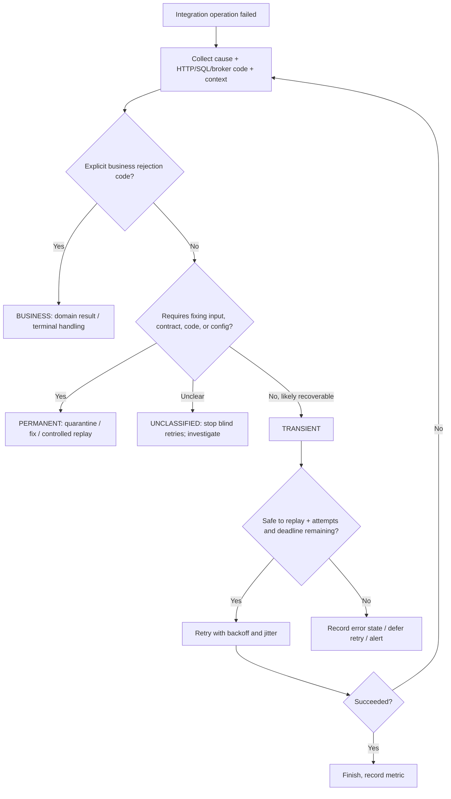
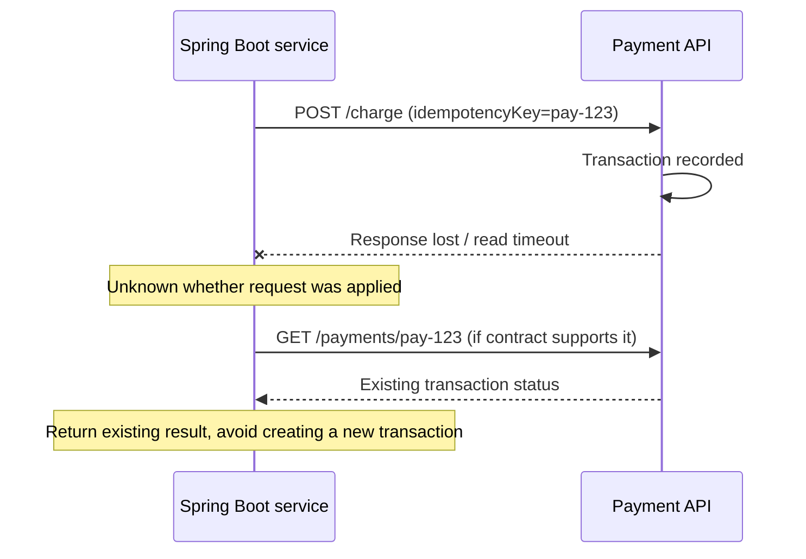
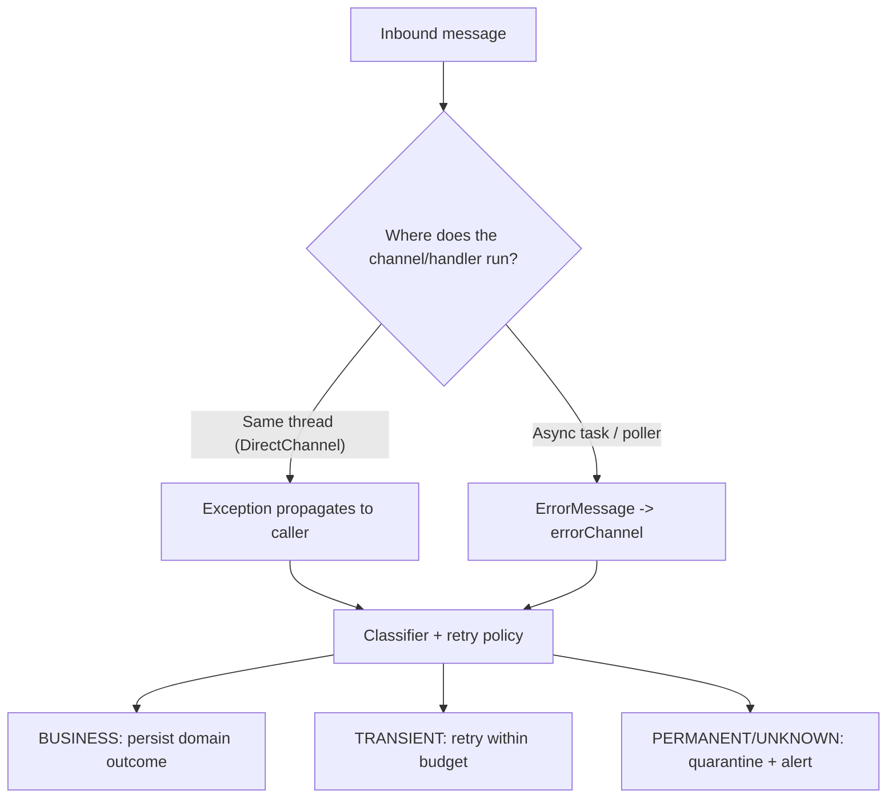

# Classifying Transient, Permanent, and Business Failures

> **Chapter:** Failure Recovery  
> **Scope:** SPRING_BOOT_INTEGRATION — integrating HTTP clients, databases, caches, message brokers, and Spring Integration; focusing on data contracts, transactions, errors, duplicate handling, testing, and observability.

## 1. Why Must Failures Be Classified Before Recovery?

In a Spring Boot system, an order placement request may write to PostgreSQL, check Redis, call a payment HTTP API, and publish an event to RabbitMQ or Kafka. When a step fails, the handling strategy must depend on the **root cause**, the **likelihood that the cause will disappear**, the **business meaning**, and the **side effects of the previous attempt**.

For example:

- An HTTP `503 Service Unavailable` caused by partner maintenance may recover after a short interval.
- A payload missing `orderId` or having an incompatible schema will continue to fail if resent as-is.
- A withdrawal request exceeding the balance is a valid rejection according to business rules; it should not be automatically retried repeatedly.
- An HTTP timeout after sending a payment request **does not prove that the transaction did not occur**. Retrying without an idempotency key could charge the customer twice.

Therefore, you cannot write a single blanket rule like "retry any `Exception` three times." First, failures must be normalized into three groups; only then can you choose the appropriate action for the operation type and recovery budget.

### 1.1. Three Failure Categories

| Category | Definition for Decision-Making | Examples | Default Action |
| --- | --- | --- | --- |
| **Transient** | The cause is likely to disappear without changing input or code; the operation can succeed on retry **under appropriate conditions** | Network timeout, HTTP 429/503, DB deadlock, overloaded broker | Bounded retry **if safe**, backoff + jitter; when budget is exhausted, recover or transition to an error state |
| **Permanent** | With the current input/configuration, immediate retry will not resolve the issue; data, code, contract, or configuration must be fixed | Invalid JSON schema, wrong API path, invalid SQL syntax, permanent missing permission | Do not retry automatically; notify/record, quarantine the bad message, fix the root cause, then replay in a controlled manner |
| **Business** | The system understands the request, but a domain rule decides **not to execute** or selects a different business outcome | Out of stock, limit exceeded, order already cancelled, duplicate request per domain rules | Return a clear domain outcome, persist the rejected/processed status, and finalize the message per the contract |

A failure can carry both a "business" aspect and a "time-varying transient" aspect. For instance, an out-of-stock state may change after restocking, but **an immediate technical retry in a few milliseconds is not the way to wait for inventory replenishment**. Instead, the domain model can accept a backorder, emit a restock event, or ask the user to reorder.

**Important:** The label "transient" is not equivalent to "safe to retry." The retry decision also depends on whether the operation is idempotent, whether deduplication locking is in place, the remaining time, and the number of attempts already made.

### 1.2. Two Separate Questions

**Question A — What is the nature of the failure?**

- Does the failure originate at the connection, data contract, configuration, transaction, or domain rule layer?
- Given the same request and environment, does a subsequent attempt have a chance of succeeding?
- Is there a stable error code from the target system to identify the situation?

**Question B — Is it permitted to execute again?**

- Is the operation a read, an idempotent write, or a write that could create a new side effect?
- Was the previous attempt already applied by the target system? Can status be queried or an idempotency key used?
- Would a retry exceed the HTTP request deadline, allowed latency, broker/DB limits, or maximum attempt count?

If there is insufficient evidence to answer A, mark it as **UNCLASSIFIED** for investigation and safe handling. This is a **triage state**, not a fourth failure category that can be arbitrarily retried.

## 2. Classification Workflow from Signal to Action

A useful classifier does not just inspect the exception class name; it also uses business context and response structure:

1. **Identify the operation:** HTTP `GET` or `POST` call; DB read or write; message consume or publish; whether a transaction and idempotency key exist.
2. **Determine the root cause:** unwrap `CompletionException`/`ExecutionException`, inspect the `cause` chain, HTTP status, SQLState, client/broker errors; distinguish transport failures from business errors in the response.
3. **Prioritize domain contracts:** codes such as `INSUFFICIENT_BALANCE` or `ORDER_CANCELLED` may represent business failures even if the HTTP status is 409/422.
4. **Determine recoverability:** infrastructure errors may be transient; invalid input or misconfiguration will not fix itself; ambiguous evidence requires investigation.
5. **Assess safety and budget:** retry only when the cause is recoverable, replay is safe, and attempts and deadline remain.
6. **Choose a durable exit:** complete, return a business response, perform controlled retry, quarantine to a DLT/parking lot, or alert operations.



In practice, conditions can be more complex than the diagram: an unrecognized permanent error may look like an HTTP 500. Therefore, you must bound retries, persist error codes, and monitor sustained failure rates rather than assuming "5xx is always transient."

## 3. Transient Failures: How to Detect and Retry Safely

### 3.1. Common Signals

| Layer | Typical Signals | When Can It Be Retried? | Notes |
| --- | --- | --- | --- |
| HTTP | `408`, `429`, `502`, `503`, `504` | Target system becomes available again or rate limit resets | Prefer `Retry-After` if present; a timeout may leave the outcome **unknown** |
| HTTP | Temporary DNS failure, connection reset, connection timeout | Short-lived network glitch self-recovers | Wrong hostname, proxy, or certificate is a configuration issue that must be fixed |
| SQL | Deadlock, serialization failure, dropped DB connection | Retry the **entire transaction unit** after backoff | Do not retry a single statement when the transaction is already in a failed state |
| Cache | Redis timeout, server overload, failover | When Redis/cluster recovers | Can fall back if the cache only holds acceleration data |
| Broker | Cannot connect to broker, leader/partition change, quota/backpressure | When connection/coordination recovers | The producer may have sent successfully before losing the response; check confirmations and idempotency |
| Spring Integration | Send/receive adapter temporary connection error | Retry policy on endpoint/handler if appropriate | Avoid retrying across multiple layers simultaneously |

These examples are **initial signals**, not a rigid mapping. Repeated HTTP 500s caused by a bug or data triggering a code defect cannot be cured by retries; an `UnknownHostException` from a misspelled DNS entry will not disappear just by waiting.

### 3.2. Backoff, Jitter, Timeout, and Attempt Limits

A retry policy typically needs four components:

- **Attempt limit:** for example, a maximum of 3 executions (1 initial attempt + 2 retries). Always state explicitly whether you are counting *attempts* or *retries*.
- **Backoff:** increase the wait interval between attempts, usually exponentially. For example, a base of 200 ms and a multiplier of 2 gives 200 ms, then 400 ms before subsequent attempts.
- **Jitter:** add controlled randomness so multiple instances do not slam the failing system in lockstep.
- **Deadline:** total wait time, network time, and processing time must fit the operation's SLA; do not let retries exceed the caller's timeout.

A reference formula:

```text
capDelay(n) = min(maxDelay, initialDelay * 2^(n - 1))
sleep(n)    = random(0, capDelay(n))      // full jitter

n: retry attempt index (starting at 1)
```

**Example:** an HTTP request with 900 ms remaining before its deadline cannot spend 5 seconds retrying on the request thread. For long-running work, hand it off to a queue or scheduler with durable recovery rather than blocking an expired request.

HTTP `429 Too Many Requests` may include `Retry-After` (seconds or an HTTP date). Parse it according to the standard, bound it by the deadline, and pace traffic; do not blindly use the application's shorter backoff if the server asked to wait longer.

### 3.3. Retry Storms and Mistakes to Avoid

If the HTTP client retries 3 times, the service layer retries 3 times, and broker redelivery retries 3 times, a single event can trigger up to **27 downstream calls** even though the user sent only one request. Establish one layer as the owner of the retry budget, or coordinate a shared total budget across layers.

Conditions to prevent early:

- Open a circuit breaker after consecutive failures to reduce pressure; when open, return a fallback or rejection per policy.
- Use bulkheads and concurrency limits so one slow downstream does not exhaust all threads/connections.
- Configure explicit read/connect timeouts; retries must never replace timeouts.
- Bound queues, retry volume over time, and redelivery counts, and alert when backlog grows.
- Retry only read/idempotent operations or writes that have **true idempotency mechanisms**.

For example, `POST /payments` hits a read timeout: the partner may already have recorded the payment. To retry, the API must support a stable idempotency key or allow querying the result by transaction reference. Adding an `Idempotency-Key` header is meaningless if the partner does not enforce the deduplication contract.

## 4. Permanent Failures: Do Not Repeat Before Fixing the Cause

A permanent failure means that **under current conditions**, resending the same request will continue to fail:

| Signal | Situation | Appropriate Action |
| --- | --- | --- |
| Malformed payload schema, missing required fields, invalid data types | Consumer reads an event with an unsupported version | Route to quarantine/DLT, store the reason, update schema or fix producer, then replay |
| HTTP `400`, `415`, many `404` cases | Wrong request structure, media type, or endpoint | Fix contract/URL; do not retry immediately |
| HTTP `401`, `403` due to invalid credentials/permissions | Rejected token or permanently missing role | Fix credentials/permissions; distinguish tokens that can be refreshed via standard flow |
| Invalid SQL syntax, missing column, unapplied migration | Code incompatible with database | Fix code/schema/migration before rerunning |
| Data mapping, serializer, or codec error | Producer and consumer type/schema mismatch | Upgrade contract version or adjust mapping |
| Untrusted TLS certificate, invalid host configuration | Misconfigured deployment environment | Fix TLS/DNS/secrets, then restart or restore connection |

**Do not equate HTTP 4xx with permanent failure.** `408` and `429` are often transient signals; `409 Conflict` may reflect temporary optimistic locking contention or a business rejection; `404` can sometimes mean a resource has not yet been created in an eventually consistent system. Verify the upstream contract before concluding.

For malformed data messages (*poison messages*), if the consumer keeps requeuing indefinitely, every redelivery consumes resources and blocks valid messages. The solution is bounded retries, routing the message to a DLT/quarantine tagged with error code/version, establishing an investigation workflow, fixing the data, and replaying **only after addressing the root cause**.

If the permanent failure is a **service-wide** configuration issue, such as a missing secret or wrong URL, it is usually better to report unhealthy/fail startup or pause intake; pushing thousands of messages into a DLT does not fix this root cause.

## 5. Business Failures: Express Domain Outcomes and Stop Technical Loops

Business failures occur when the system understands a technically valid request, but domain rules do not permit the requested state transition. They can be an **intentional outcome**, rather than an infrastructure incident.

Examples:

| Business Code | Context | Expected Outcome |
| --- | --- | --- |
| `INSUFFICIENT_STOCK` | Order exceeds available inventory | Return rejection or hold in pending state; do not keep calling the API repeatedly |
| `INSUFFICIENT_BALANCE` | Balance is insufficient | Notify customer; wait for top-up or payment method change |
| `ORDER_CANCELLED` | Shipment requested for an already cancelled order | Do not ship; mark the event as processed per policy |
| `LIMIT_EXCEEDED` | Business quota limit, not technical rate limit | Return domain rejection status |
| `DUPLICATE_ORDER` | Same request resent with a stable ID | Return the previous result if idempotent replay, or conflict per contract |
| `VERSION_CONFLICT` | State changed between read and write | Distinguish technical contention that can be retried from business conflict requiring user resolution |

Business error codes should be published with a **stable error code**, alongside status, displayable description, and correlation ID. Do not mix business handling codes with raw exception messages, stack traces, or SQL statements.

### 5.1. Validation Errors vs. Domain Rejections

- **Technical validation:** unparseable JSON, missing required header, invalid date format. Usually belongs to data/contract errors and can return HTTP 400.
- **Business validation:** insufficient balance, closed order, customer limit exceeded. Usually returns a domain failure, representable by HTTP 409 or 422 depending on the API contract.
- **Time-varying conditions:** out-of-stock right now may become in-stock later; that does **not** mean the consumer is allowed to retry the same message indefinitely.

Do not rely **solely** on HTTP status to detect business outcomes: many APIs return HTTP 200 with `success=false` or a business code inside the body. When integrating, normalize this in the adapter into a domain result with a clear type/code. For APIs supporting Problem Details, `ProblemDetail` can be used to present errors consistently.

### 5.2. Decision Rules for Business Errors

1. Detect domain errors by contracted codes, not by inferring from free-form message strings.
2. Determine whether it is a terminal outcome, a business waiting state, or requires user action.
3. Persist the business state durably **before acking** an event in asynchronous processing.
4. Reply to the caller or emit an appropriate *business event*; do not auto-retry at the transport layer.
5. Re-execute only when a **new business signal** arrives: customer changes payment method, inventory is restocked, limit is raised, or an operator approves.

## 6. Classification Matrix by Spring Boot Integration Channel

| Channel | Common Transient Failures | Common Permanent Failures | Business Failures | Recovery Strategy |
| --- | --- | --- | --- | --- |
| HTTP `RestClient` / `WebClient` | Timeout, 429, 502/503/504 | Wrong URL, non-conforming payload, persistent auth failure | Payment declined, business quota exhausted | Map status + error code, deadline, safe retry, idempotency key |
| JDBC/JPA | Deadlock, serialization failure, connection dropped | Invalid SQL/schema, invalid data | Unique business key, disallowed balance/state | Retry the **whole transaction** when appropriate; constraint + domain handling |
| Redis/cache | Timeout, failover, pool exhaustion | Incompatible serializer, broken key mapping | Cache miss is usually **not a business error** | DB fallback when cache is optional, circuit breaker and metrics |
| RabbitMQ/AMQP | Broker disconnected, consumer temporarily unreachable | Message cannot be deserialized | Event requests a forbidden state | Bounded requeue, dead-letter exchange, ack/nack by outcome |
| Kafka/Pulsar | Broker/partition temporarily unavailable, timeout | Schema registry/deserialization error; wrong config/topic | Domain rule rejection on event | Retry/backoff, DLT, proper checkpoint/ack, idempotent consumer |
| Spring Integration | Adapter timeout, endpoint connection error | Transformer/mapping violates contract | Handler rejects per domain rule | Error channel/advice/recoverer, classify before deciding replay |

### 6.1. Key Exception Nuances with JDBC

In the Spring ecosystem, `TransientDataAccessException` and `NonTransientDataAccessException` help guide database-layer classification. However, the exception translator **does not understand all business rules**:

- `DeadlockLoserDataAccessException` (in supported versions) or concurrency-related exceptions may be transient; the failed transaction must roll back before retrying.
- `DuplicateKeyException` can be an idempotent duplicate, a business conflict, **or a bug creating duplicate data**. Convert it into a domain outcome only if you know which unique constraint fired and what the handling contract specifies.
- SQLState categories for connection errors, transaction rollbacks, or constraint violations are only hints; actual mapping depends on the database, driver, and translator.
- Do not retry individual SQL statements after a transaction is already marked rollback-only or the session is no longer valid.

### 6.2. With HTTP, a Transport Failure Does Not Mean the Business Outcome Did Not Happen

After `POST /charge`, the client may encounter:



If the partner lacks a lookup API but supports an idempotency key, you may retry with the **same key** and an equivalent payload per the contract. If neither exists, transition to `UNKNOWN/RECONCILIATION_REQUIRED` and run a reconciliation workflow instead of blindly issuing a new payment request.

## 7. Pattern for Implementing an Error Classifier in Spring Boot

The example below uses Java 17 and classes from Spring Web + Spring JDBC. The goal is to separate **classification** from **retry policy**: classification is based on exceptions and error codes; the calling layer decides whether retrying is safe. The illustrative classes can live in the same package and be split into separate files in a real project.

### 7.1. Decision Model and Domain Error

```java
public enum FailureKind {
    TRANSIENT, PERMANENT, BUSINESS, UNCLASSIFIED
}
```

```java
public record FailureDecision(FailureKind kind, String code) {
}
```

```java
public final class BusinessRejectionException extends RuntimeException {
    private final String code;

    public BusinessRejectionException(String code, String message) {
        super(message);
        this.code = code;
    }

    public String code() {
        return code;
    }
}
```

`UNCLASSIFIED` here is a **triage-pending state**, preventing code from accidentally retrying an unrecognized failure. Once verified with sufficient evidence, the application maps it to one of the three primary categories. The business exception carries a stable code and diagnostic message; the HTTP adapter must not leak internal data when responding to users.

### 7.2. Classifier: Prioritize Domain Codes Before Infrastructure Failures

```java
import java.net.ConnectException;
import java.net.SocketTimeoutException;
import java.net.UnknownHostException;
import java.util.concurrent.CompletionException;
import java.util.concurrent.ExecutionException;
import javax.net.ssl.SSLHandshakeException;

import org.springframework.dao.NonTransientDataAccessException;
import org.springframework.dao.TransientDataAccessException;
import org.springframework.web.client.HttpStatusCodeException;
import org.springframework.web.client.ResourceAccessException;

public final class IntegrationFailureClassifier {

    public FailureDecision classify(Throwable error) {
        Throwable failure = unwrapAsync(error);

        if (failure instanceof BusinessRejectionException business) {
            return new FailureDecision(
                    FailureKind.BUSINESS, business.code());
        }

        if (failure instanceof HttpStatusCodeException http) {
            int status = http.getStatusCode().value();

            if (status == 408 || status == 429 ||
                    status == 502 || status == 503 || status == 504) {
                return new FailureDecision(
                        FailureKind.TRANSIENT, "HTTP_" + status);
            }
            if (status == 409 || status == 422) {
                // Upstream error code must be analyzed before concluding.
                return new FailureDecision(
                        FailureKind.UNCLASSIFIED, "HTTP_CONTRACT_" + status);
            }
            if (status >= 500) {
                // Bounded retry possible; persistent 5xx may be a fixed bug.
                return new FailureDecision(
                        FailureKind.TRANSIENT, "HTTP_SERVER_" + status);
            }
            if (status >= 400) {
                return new FailureDecision(
                        FailureKind.PERMANENT, "HTTP_CLIENT_" + status);
            }
        }

        if (failure instanceof ResourceAccessException) {
            Throwable root = rootCause(failure);
            if (root instanceof SSLHandshakeException) {
                return new FailureDecision(
                        FailureKind.PERMANENT, "TLS_CONFIG_REVIEW");
            }
            if (root instanceof SocketTimeoutException) {
                return new FailureDecision(
                        FailureKind.TRANSIENT, "NETWORK_TIMEOUT_OUTCOME_UNKNOWN");
            }
            if (root instanceof ConnectException) {
                return new FailureDecision(
                        FailureKind.TRANSIENT, "CONNECTION_FAILURE_CHECK_ENDPOINT");
            }
            if (root instanceof UnknownHostException) {
                return new FailureDecision(
                        FailureKind.UNCLASSIFIED, "DNS_CONFIG_OR_OUTAGE");
            }
            return new FailureDecision(
                    FailureKind.UNCLASSIFIED, "HTTP_TRANSPORT_UNKNOWN");
        }

        if (failure instanceof TransientDataAccessException) {
            return new FailureDecision(
                    FailureKind.TRANSIENT, "DB_TRANSIENT");
        }
        if (failure instanceof NonTransientDataAccessException) {
            // DuplicateKeyException falls here, but the specific unique
            // constraint must be identified before mapping to BUSINESS.
            return new FailureDecision(
                    FailureKind.PERMANENT, "DB_NON_TRANSIENT_REVIEW");
        }

        return new FailureDecision(
                FailureKind.UNCLASSIFIED, "UNMAPPED_FAILURE");
    }

    private static Throwable unwrapAsync(Throwable error) {
        Throwable current = error;
        while ((current instanceof CompletionException ||
                current instanceof ExecutionException)
                && current.getCause() != null) {
            current = current.getCause();
        }
        return current;
    }

    private static Throwable rootCause(Throwable error) {
        Throwable current = error;
        while (current.getCause() != null &&
                current.getCause() != current) {
            current = current.getCause();
        }
        return current;
    }
}
```

**Intentional limitations of the example:**

- `HTTP 409/422` are not automatically turned into business errors: the adapter must parse the error code/body against the contract. Only create `BusinessRejectionException` when the code belongs to a known catalog.
- `HTTP 401` can sometimes be resolved by a standard token refresh flow; if the adapter knows how to refresh and retries only once, it may handle that separately. Do not feed all 401s into a generic retry loop.
- `ConnectException` may be caused by a short-lived outage **or** a wrong host/port. The `CONNECTION_FAILURE_CHECK_ENDPOINT` code is only an initial signal; alert if the failure persists.
- `SSLHandshakeException` is treated as a configuration issue requiring investigation in this example. Some TLS issues can be transient, but you should not retry blindly when the certificate, truststore, or system clock is wrong.
- `TransientDataAccessException` is a hint from Spring's translator; it does not prove that retrying the whole transaction has no external side effects.
- When failures come from reactive libraries or other clients, exception types may differ. Write dedicated error-normalization adapters rather than forcing every system through the HTTP classes above.

If an event is a business duplicate, a code like `DUPLICATE_EVENT_ALREADY_APPLIED` should be emitted by the service after checking the unique key/processed-event table; do not automatically turn **every** `DuplicateKeyException` into success.

### 7.3. Retry Policy Decoupled from the Classifier

```java
public record RetryContext(
        boolean replaySafe,
        int attemptsDone,
        int maxAttempts,
        boolean withinDeadline) {
}
```

```java
public final class RetryDecisionPolicy {

    public boolean shouldRetry(FailureDecision failure,
                               RetryContext context) {
        return failure.kind() == FailureKind.TRANSIENT
                && context.replaySafe()
                && context.attemptsDone() < context.maxAttempts()
                && context.withinDeadline();
    }
}
```

For example, `attemptsDone=1, maxAttempts=3` permits up to two more retries. `replaySafe=true` applies only when the request is genuinely **idempotent** or the target system guarantees deduplication by key/contract. `withinDeadline` is computed by the calling layer from the overall deadline, not hardcoded as always true. When using a retry library (Spring Retry, Resilience4j, Spring Integration retry advice, etc.), encode the same rules into the retry predicate, max attempts, and explicit backoff.

This policy only answers **whether to retry**; it does not perform waiting, scheduling, `Retry-After` parsing, networking, or metric emission. Do not replace it with a busy loop or `Thread.sleep` on every HTTP request. At the broker layer, use container/recoverer retries or a retry topic/queue with explicit delays and limits.

### 7.4. Publishing Business Errors via HTTP Contract

Example using `ProblemDetail` in Spring Framework 6 / Spring Boot 3.x:

```java
import org.springframework.http.HttpStatus;
import org.springframework.http.ProblemDetail;
import org.springframework.http.ResponseEntity;
import org.springframework.web.bind.annotation.ExceptionHandler;
import org.springframework.web.bind.annotation.RestControllerAdvice;

@RestControllerAdvice
public class IntegrationExceptionAdvice {

    @ExceptionHandler(BusinessRejectionException.class)
    public ResponseEntity<ProblemDetail> business(
            BusinessRejectionException ex) {
        ProblemDetail problem = ProblemDetail.forStatus(
                HttpStatus.UNPROCESSABLE_ENTITY);
        problem.setTitle("Request failed business rules");
        problem.setProperty("code", ex.code());
        return ResponseEntity.unprocessableEntity().body(problem);
    }
}
```

HTTP 422 here is an **example contract choice**; for resource state conflicts, an API may choose 409. Avoid mapping all exceptions to 200 because that hides failures and makes monitoring and caller handling difficult. Also avoid returning raw stack traces, SQL text, or credentials.

## 8. Applying to Message Consumers and Spring Integration

In asynchronous systems, the question is not just "should we retry?" but also **when to acknowledge message/offset completion**. A failing consumer may receive the same event multiple times from the broker; routing to a DLT is also a processing step that must be durable.

| Classification Result | Recommended Consumer Behavior | Condition Before Ack / Offset Commit |
| --- | --- | --- |
| Success | Complete processing | Required side effects have committed |
| **BUSINESS** | Persist rejection/final status, optionally emit domain event | Business outcome has been durably persisted |
| **TRANSIENT** | Bounded retry/backoff; when budget is exhausted, send to recovery flow | Mark complete only when processing succeeds or durable recovery is persisted |
| **PERMANENT** | Quarantine/route to DLT, open ticket to fix data/contract | Error record/DLT has been confirmed persisted per the active mechanism |
| **UNCLASSIFIED** | Park/quarantine or pause consumer and alert | Do not ack and skip the message without a safe way to retain the data |

**Do not assume that publishing to a DLT and acking the original message automatically form an atomic transaction.** If an error occurs between the two operations, you may end up with duplicate DLT records or redelivery of the original message. Design idempotent DLT consumers or leverage broker transactions when supported, test crash windows, and apply the appropriate recoverer policy.

### 8.1. RabbitMQ and Spring AMQP

With `@RabbitListener`, an exception can cause the container to reject/requeue depending on configuration. Default behavior and dead-letter mechanics depend on the container version, queue type, and properties such as `defaultRequeueRejected`. Two tools to understand:

- `AmqpRejectAndDontRequeueException` rejects without requeuing under the corresponding mechanism; the message goes to a DLX only if the broker/queue has dead-lettering configured.
- `ImmediateRequeueAmqpException` is used when you want to request requeuing regardless of certain general settings.

Do not throw `AmqpRejectAndDontRequeueException` blindly if a DLX or error-persistence workflow has not been declared; doing so can drop messages depending on broker policy. Quorum queues can support broker-side delivery limits, but you still need to verify redelivery counts and counting semantics for your running RabbitMQ version.

### 8.2. Kafka and Spring for Apache Kafka

`DefaultErrorHandler` supports backoff, recoverers, and exception classification; `DeadLetterPublishingRecoverer` can route failed records to a DLT topic. Certain deserialization/conversion exceptions are treated by default as **fatal/not retryable**, because retrying the exact same bytes usually will not fix the payload. Rules can be customized via `addNotRetryableExceptions(...)` or other classification mechanisms depending on your Spring Kafka API version.

When using a DLT, a consumer can still reprocess duplicate records if a crash/commit failure or replay occurs. A DLT does not by itself guarantee exactly-once side effects in databases, HTTP calls, or emails. If using retry topics or DLTs, define how total attempts are counted, key/partition ordering, and lag monitoring.

### 8.3. Pulsar

With a Pulsar listener, distinguish **ack**, **negative acknowledgment**, ack timeout/redelivery, and dead-letter policy. DLT support and retry counts depend on subscription type, client/broker version, and Spring Pulsar configuration. A redelivered message may have partially completed prior operations; use `eventId`/idempotency keys to avoid duplicating side effects.

### 8.4. Spring Integration: Synchronous and Asynchronous Differ

A `DirectChannel` typically executes handlers on the sender's thread: exceptions can propagate directly back to the caller, where retry advice or the calling layer handles them. With channels backed by executors, queues, pollers, or asynchronous flows, exceptions cannot simply be thrown back to the dispatching thread.

Spring Integration represents errors as `ErrorMessage`, looking up the `errorChannel` header or the global `errorChannel` depending on configuration. Errors can be routed via an error handler/router for classification and recovery flows. However, **never assume every exception passes through `errorChannel`**, because behavior differs between synchronous and asynchronous flows.



For Spring Integration, `RequestHandlerRetryAdvice` with an appropriate recoverer can handle endpoint retries; for asynchronous errors, `ErrorMessageSendingRecoverer` can publish failures to a recovery channel. Regardless of mechanism, verify at which step the source adapter acks or checkpoints the message.

### 8.5. Ack Timing and Idempotent Consumers

Suppose a consumer receives `PaymentConfirmed(eventId, orderId)`, updates the order state in PostgreSQL, and then acks the message:

1. Start a database transaction; insert `(consumerName, eventId)` protected by a unique constraint to prevent duplicate processing.
2. If the insert succeeds, update the order and commit **within the same transaction**.
3. If the key already exists per the inbox rule, treat the event as already processed and finish without triggering side effects a second time.
4. After the database commits, ack/commit the offset. If the ack fails, subsequent redelivery will be blocked by the unique key.

An illustrative table:

```sql
CREATE TABLE processed_event (
    consumer_name VARCHAR(120) NOT NULL,
    event_id VARCHAR(120) NOT NULL,
    processed_at TIMESTAMP NOT NULL,
    PRIMARY KEY (consumer_name, event_id)
);
```

This is an **idempotency pattern for database state**. If processing also calls an HTTP partner or sends an email, a unique constraint alone does not guarantee exactly-once behavior at the partner; you need a downstream idempotency key, outbox, or reconciliation protocol.

## 9. Transactions, Timeouts, and Indeterminate Outcomes

Three situations that "look like errors" but require different solutions:

| Failure Timing | Can Side Effects Be Determined? | Handling Approach |
| --- | --- | --- |
| Validation fails **before** calling downstream | Request not yet sent | Return permanent/business error; do not retry |
| Read timeout **after** sending a write operation | Target side may have committed | Do not replay without idempotency; query status / reconcile |
| DB commit succeeds, crash **before** broker ack | DB side effect exists | Redelivery + processed-event unique key; then ack |
| Broker publish succeeds, DB rolls back | Broker has event but DB lacks data | Design outbox, transaction boundaries, and reconciliation |
| DLT publish succeeds, crash before offset commit | Duplicate error records may exist in DLT | Idempotent DLT consumer/replayer keyed by original event ID |

### 9.1. Why Do You Need a Transactional Outbox?

Suppose an order creation API does:

```text
BEGIN DB TRANSACTION
  INSERT orders(...)
COMMIT

publish OrderCreated to broker
```

Crashing between commit and publish drops the event; publishing before commit causes consumers to receive a non-existent order if the DB rolls back. A **transactional outbox** writes the order data and the outbox record in the **same DB transaction**, and a separate publisher reads the outbox and sends to the broker. The publisher may send duplicates if confirmation is lost, so consumers must be idempotent.

An outbox does not fix every business or contract error; it solves the **DB transaction → publish** boundary by enabling recovery from durable state.

## 10. Observability, Alerting, and Operational Procedures

For each failure decision, log structured metadata:

```json
{
  "service": "order-integration",
  "operation": "POST payment",
  "dependency": "payment-api",
  "failureCategory": "TRANSIENT",
  "failureCode": "NETWORK_TIMEOUT_OUTCOME_UNKNOWN",
  "attemptsDone": 1,
  "replaySafe": false,
  "recoveryAction": "RECONCILE",
  "correlationId": "req-9f2",
  "eventId": "evt-42"
}
```

The payment timeout case here has `replaySafe=false` because no idempotency contract is available; `RECONCILE` is the safe decision. Do not log card numbers, tokens, passwords, credentials, full PII, or sensitive payloads.

### 10.1. Metrics That Should Be Separated

| Metric | Question to Answer |
| --- | --- |
| Failure rate by `category/code/dependency` | Are technical errors, contract errors, or business rejections rising? |
| Retry attempts, retry exhausted | Is the system amplifying load due to a retry storm? |
| Timeouts and latency percentiles | Is a downstream slow enough to hit timeouts or breach SLOs? |
| DLT/quarantine count + message age | Are poison messages piling up and exceeding processing age limits? |
| Consumer lag/backlog/redelivery | Are consumers lagging or redelivering too many events? |
| Business rejection rate by code | Is out-of-stock/limit rejection rising due to domain state or anomalous input? |
| Unknown outcome/reconciliation pending | How many payment/event operations remain unconfirmed? |

Separate `business rejection` from technical failure rates on dashboards. A spike in `INSUFFICIENT_STOCK` may call for inventory restocking, not increasing HTTP retry counts.

### 10.2. Runbooks by Failure Category

**TRANSIENT:** verify host/broker/DB health, rate limits/quotas, and connectivity; check retry exhausted, concurrency, backlog, and circuit breakers; shed/reduce load and recover within the defined budget.

**PERMANENT:** identify contract/schema version, URL, TLS, authentication, migrations, and malformed messages; quarantine the data, fix producer/consumer/config, test replay in a controlled environment before running in bulk.

**BUSINESS:** inspect domain codes and order or customer state; update status and notify users/workflows appropriately; do not turn valid rejections into infrastructure incidents.

**UNCLASSIFIED:** preserve evidence, halt blind retries, notify the owner; reconcile the target system before replaying operations with side effects.

## 11. Testing Classification and Recovery Strategies

Verify not only the enum value but also **external behavior**: total call counts, DB state, broker offsets/acks, DLT records, and API output.

| Test Scenario | Expected Category | What to Assert |
| --- | --- | --- |
| `GET` returns 503 once then 200 | TRANSIENT | Retried within budget, returns 200 after recovery, within deadline |
| `POST` returns 429 with `Retry-After` | TRANSIENT | Respects wait schedule; does not replay if not idempotent |
| `POST /charge` read timeout after partner commit | TRANSIENT with unknown outcome | Does not create a second charge; queries status or uses same idempotency key |
| JSON missing required field | PERMANENT | No retry; returns 400 or routes to DLT/quarantine with reason |
| Incompatible message schema | PERMANENT | Does not create infinite redelivery loop; safe DLT/parking |
| Insufficient balance | BUSINESS | Correct domain error code, no automatic retry |
| Optimistic lock conflict | Depends on contract | If retried, retry **whole transaction** with limits and idempotency |
| DB deadlock | TRANSIENT | Rollback, retry whole transaction; no duplicate side effects |
| Event delivered twice by broker | Not always an error | DB side effect occurs only once thanks to unique event ID |
| DLT publish failure | Recovery failure | Do not ack and discard original message without safe persistence |
| `401` due to permanently invalid credentials | PERMANENT | No infinite retry loop; emit configuration alert |
| Exception not mapped in classifier | UNCLASSIFIED | No blind retry; emit triage event/metric |

### 11.1. Unit Test Example for the Classifier

The tests below use JUnit 5/AssertJ and Spring Web exceptions; only the project's matching test dependencies are needed:

```java
import org.junit.jupiter.api.Test;
import org.springframework.http.HttpStatus;
import org.springframework.web.client.HttpServerErrorException;
import static org.assertj.core.api.Assertions.assertThat;

class IntegrationFailureClassifierTest {
    private final IntegrationFailureClassifier classifier =
            new IntegrationFailureClassifier();

    @Test
    void businessRejectionDoesNotRetry() {
        FailureDecision decision = classifier.classify(
                new BusinessRejectionException(
                        "INSUFFICIENT_STOCK", "Insufficient stock"));
        assertThat(decision.kind()).isEqualTo(FailureKind.BUSINESS);
        assertThat(new RetryDecisionPolicy().shouldRetry(
                decision, new RetryContext(true, 1, 3, true)))
                .isFalse();
    }

    @Test
    void serviceUnavailableMayRetryWhenReplayIsSafe() {
        FailureDecision decision = classifier.classify(
                new HttpServerErrorException(
                        HttpStatus.SERVICE_UNAVAILABLE));
        assertThat(decision.kind()).isEqualTo(FailureKind.TRANSIENT);
        RetryDecisionPolicy policy = new RetryDecisionPolicy();
        assertThat(policy.shouldRetry(
                decision, new RetryContext(true, 1, 3, true))).isTrue();
        assertThat(policy.shouldRetry(
                decision, new RetryContext(false, 1, 3, true))).isFalse();
        assertThat(policy.shouldRetry(
                decision, new RetryContext(true, 3, 3, true))).isFalse();
    }
}
```

This is a **test design example**, not a repository build run output. Integration tests must use a mock HTTP server or broker/database containers to verify timeouts, redelivery, commits, DLT routing, idempotency, and observable outcomes under real faults.

## 12. Exercises and Self-Check Questions

**Exercise:** Implement a Spring Boot order service that uses an HTTP client to call a payment service, JDBC to persist orders, and a listener to consume broker events. Design `FailureDecision`, RetryPolicy, DLT/recovery, and an error dashboard by code. Required scenarios: (a) payment times out after the partner commits successfully, (b) partner returns `INSUFFICIENT_BALANCE`, (c) SQL deadlock, (d) malformed JSON message, and (e) the same event delivered twice. Document the business outcome, invocation counts, and post-recovery state.

Questions:

1. Why might a failure labeled `TRANSIENT` still **not be retried**?
2. Distinguish HTTP `429` from the business code `LIMIT_EXCEEDED`. How should each be handled?
3. Is HTTP `409` always a business failure? What information is needed from the contract?
4. For a DB deadlock, why must you retry the transaction unit rather than repeating a single SQL statement?
5. When a broker redelivers a message after a DB commit but before ack, how does an idempotency key help?
6. Why can you not assume every Spring Integration exception goes to `errorChannel`?
7. Why can writing to a DLT and then acking the original message still create duplicates? What measures are needed?
8. If `POST /charge` encounters a read timeout and the partner does not support idempotency keys, what must the application do before issuing a new request?

**Key Takeaways:** Classify failures using **context and contracts**, not just exceptions or status codes; only **TRANSIENT** failures may be retried, and only when replay is safe; **PERMANENT** failures require fixing the root cause; **BUSINESS** failures need domain outcomes; **UNCLASSIFIED** cases must preserve data and be investigated. Any recovery strategy must tie into transaction boundaries, idempotency, retry limits, testing, and monitoring.

### References

- [Spring Framework — REST Clients and Error Handling](https://docs.spring.io/spring-framework/reference/integration/rest-clients.html)
- [Spring Framework — Data Access Exception Hierarchy](https://docs.spring.io/spring-framework/reference/data-access/dao.html)
- [Spring Integration — Error Handling](https://docs.spring.io/spring-integration/reference/error-handling.html)
- [Spring AMQP — Exception Handling](https://docs.spring.io/spring-amqp/reference/amqp/exception-handling.html)
- [Spring AMQP — Resilience: Recovering from Errors and Broker Failures](https://docs.spring.io/spring-amqp/reference/amqp/resilience-recovering-from-errors-and-broker-failures.html)
- [Spring Kafka — Handling Exceptions](https://docs.spring.io/spring-kafka/reference/kafka/annotation-error-handling.html)
