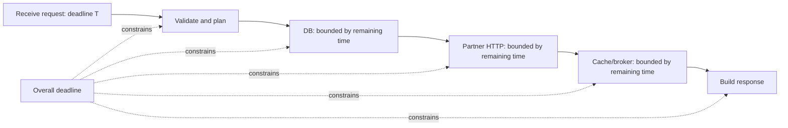
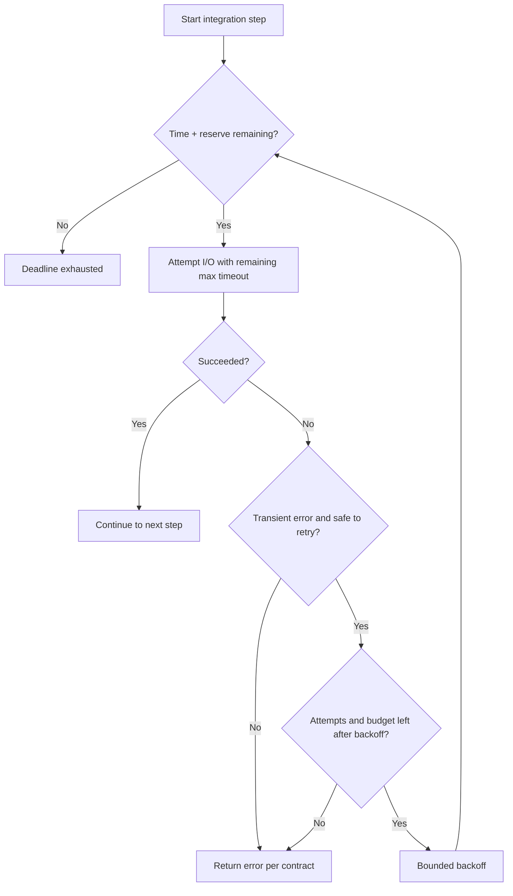
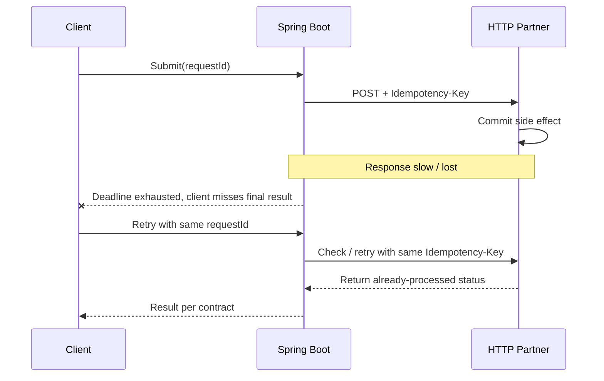

# Per-Step Timeouts and Overall Integration Deadlines

In **SPRING_BOOT_INTEGRATION**, a request may pass through an HTTP controller, query a database, read a cache, call a partner HTTP API, send a message through a broker, and continue processing via Spring Integration adapters. Each step can be slow, wait on resources, or stop responding. If you only configure individual timeouts per client, the total waiting time can still far exceed what the caller accepts.

This lesson in the **Failure Recovery** chapter presents how to establish **per-step timeouts** and an **overall integration timeout/deadline**, while coordinating those limits with configuration, data contracts, transactions, retries, deduplication, testing, and observability. The goal is to clearly define **when an operation must stop waiting** and **what happens to business side effects once waiting ends**.

## 1. Learning Objectives

After this lesson, you will be able to:

1. Distinguish connection timeout, pool-acquisition timeout, response/read timeout, query timeout, lock timeout, gateway reply timeout, and overall task deadline.
2. Allocate a **time budget** across HTTP, JDBC, cache, broker, and Spring Integration steps while keeping a safety reserve.
3. Design a deadline using a monotonic clock, re-evaluated before each step and each retry attempt.
4. Choose timeouts suited to synchronous, asynchronous, transactional, and idempotency requirements.
5. Handle scenarios where the client times out even though the target system may have applied the side effect.
6. Test time limits, retry budgets, error responses, and observability signals when systems are slow or failing.

## 2. A Per-Step Timeout Differs from an End-to-End Deadline

Suppose an integration API receives a **synchronous** request and must return a result within at most 3 seconds. It sequentially checks the DB, calls a partner, updates the cache, and persists the completion state. If the DB is allowed to wait 2 seconds, the HTTP client 3 seconds, and the cache 1 second, total elapsed time can reach **6 seconds or more**, before even counting serialization, queueing, retries, and scheduling.

A per-step timeout answers: *how long is a single activity allowed to wait at most?* An overall deadline answers: *how much total time is the entire request still allowed to consume from its starting point?* Both limits must coexist.

| Concept | Scope | Common Misconception |
| --- | --- | --- |
| **Connection timeout** | Time to establish a TCP/transport connection to the target | Does not include SQL execution or partner business processing time. |
| **Pool acquisition timeout** | Time spent waiting to borrow a connection from a pool | Increasing pool timeout does not make queries run faster. |
| **Read/response timeout** | Waiting for response data; exact semantics depend on the HTTP client/driver | Some clients measure silence between reads; others measure the full response. |
| **SQL statement timeout** | Execution time limit for a statement at the JDBC driver or DB | Does not mean the client still has sufficient overall time budget. |
| **Lock timeout** | Time spent waiting for a database lock | A query that is not waiting on locks can still be slow for other reasons. |
| **Channel/gateway send/reply timeout** | Waiting to send a message to a channel or receive a gateway reply | May bound only a messaging operation, without stopping a running synchronous handler. |
| **Broker delivery/ack timeout** | Waiting for broker receipt/confirmation or delivery progress | Producer timeout does not prove the broker did not receive the message. |
| **Overall deadline** | Contract limit for the entire request/job | Does not emerge automatically just from configuring individual adapter timeouts. |

A **deadline** fits sequential multi-step workflows better than static timeouts. If a request has already spent 1.6 seconds, an HTTP call configured with a 2-second timeout must not be allowed to wait a full 2 seconds when only 1.4 seconds remain for the whole flow.



## 3. Building a Time Budget with a Reserve

For a synchronous operation with an **internal deadline of 2,800 ms** (for example, leaving 200 ms inside a 3-second HTTP SLA for proxy/network overhead), an initial budget can be allocated as follows:

| Item | Example Max Budget |
| --- | ---: |
| Dispatch wait and worker thread acquisition | 100 ms |
| Deserialization, validation, and DTO mapping | 100 ms |
| Database connection/query/update | 450 ms |
| Partner HTTP call | 1,200 ms |
| Cache access | 150 ms |
| Serialization and response preparation | 100 ms |
| **Reserve for variance, cleanup, commit/overhead** | **700 ms** |
| **Total** | **2,800 ms** |

These numbers are **illustrative to explain the principle**, not a configuration suitable for every system. Measure latency percentiles such as p95/p99, connection/pool limits, and partner SLAs, then tune accordingly. When an earlier step uses less than its budget, later steps benefit from the remaining time; however, waiting must never exceed the shared deadline.

Rule at the start of a step:

\[
\text{effective step timeout}
= \min(\text{configured step timeout},\ \text{remaining deadline} - \text{reserve})
\]

If the right-hand side is no longer positive, **do not start a new step**. Do not try "one more attempt" once the deadline is exhausted. In this formula, the reserve is time set aside to record state or complete mandatory final actions; it is not an absolute guarantee that every kind of cleanup will always finish within the reserve window.

### Illustrative Timeline

```mermaid
gantt
    title Illustrative 2.8-second internal budget
    dateFormat X
    axisFormat %L
    section Processing
    Queue and validate        :a1, 0, 200
    Database                  :a2, 200, 450
    Partner HTTP              :a3, 650, 1200
    Cache and serialize       :a4, 1850, 250
    Reserve                   :a5, 2100, 700
```



In reality, steps may run in parallel, reorder, or skip the cache. The time budget must then be based on the **critical path** and concurrency overhead, not simply summing all timeouts. If two HTTP calls run in parallel, the wall-clock duration of the parallel branch is roughly the slower branch's duration, yet both consume resources and need cancellation/control mechanisms when the deadline expires.

## 4. Creating a Deadline with a Monotonic Clock

To measure **elapsed time within a single Java process**, use `System.nanoTime()`. It is designed for measuring intervals; `System.currentTimeMillis()` or `Instant.now()` can jump due to system clock adjustments. Do not compare `nanoTime` values obtained from two different processes or pass them directly to another system.

Example class holding remaining budget, testable with a fake clock:

```java
import java.time.Duration;
import java.util.Objects;
import java.util.function.LongSupplier;

public final class DeadlineBudget {
    private final LongSupplier nanos;
    private final long startedAt;
    private final long totalNanos;

    public DeadlineBudget(Duration total, LongSupplier monotonicNanos) {
        if (total == null || total.isZero() || total.isNegative()) {
            throw new IllegalArgumentException("total must be positive");
        }
        this.nanos = Objects.requireNonNull(monotonicNanos);
        this.startedAt = nanos.getAsLong();
        this.totalNanos = total.toNanos();
    }

    public static DeadlineBudget start(Duration total) {
        return new DeadlineBudget(total, System::nanoTime);
    }

    public Duration remaining() {
        long elapsed = Math.max(0L, nanos.getAsLong() - startedAt);
        return Duration.ofNanos(Math.max(0L, totalNanos - elapsed));
    }

    // Keep a reserve window for mandatory final steps.
    public Duration forStep(Duration maximum, Duration reserve) {
        if (maximum.isNegative() || maximum.isZero() || reserve.isNegative()) {
            throw new IllegalArgumentException("Invalid step budget");
        }
        long available = remaining().minus(reserve).toNanos();
        if (available <= 0) {
            throw new DeadlineExceededException();
        }
        return Duration.ofNanos(Math.min(maximum.toNanos(), available));
    }
}

final class DeadlineExceededException extends RuntimeException {
    DeadlineExceededException() {
        super("Integration deadline exhausted");
    }
}
```

Usage example:

```java
DeadlineBudget budget = DeadlineBudget.start(Duration.ofMillis(2800));

Duration dbTimeout = budget.forStep(
        Duration.ofMillis(450), Duration.ofMillis(400));
// Recalculate after DB finishes: do not reuse dbTimeout for HTTP.
Duration partnerTimeout = budget.forStep(
        Duration.ofMillis(1200), Duration.ofMillis(250));
```

In a real application, call `forStep(...)` **immediately before starting each I/O operation**, because any work between two calls consumes time. Re-check on retries, queue transfers, response processing, and before demanding subsequent commits/side effects.

The class above illustrates short deadlines within a single process, assuming `Duration.toNanos()` fits in `long` and the monotonic clock behaves properly. When a deadline must **cross HTTP/broker boundaries between processes**, transmit a contracted deadline timestamp (such as ISO-8601 UTC or epoch milliseconds) or relative budget with appropriate metadata, and reconstruct a local monotonic deadline on the receiving side. Clocks across machines can skew: design tolerance bounds and prefer the **shorter** deadline between the upstream's cutoff and the current service's protective limit.

### Distinguishing a Deadline from a Call-Start Timeout

If you only configure an 800 ms timeout on the HTTP client, 300 ms spent waiting in a queue before the HTTP call is not subtracted. A deadline must begin at the **entrypoint meaningful to the user** (or be inherited from upstream), not restart from zero at every adapter and inadvertently stretch the SLA.

## 5. HTTP Clients: Connect, Response, and Whole-Request Timeouts

An outbound HTTP call to a partner has many phases: DNS, acquiring a connection from the pool, TCP connect, TLS handshake, sending the request, waiting for the response, reading the body, and deserialization. Each HTTP client's configuration API may measure different phases. Always verify the exact semantics of the **client implementation** used in Spring Boot.

For Spring Boot using `RestClient` (Spring Framework 6.1+), you can supply a configured `ClientHttpRequestFactory` to control transport behavior. Illustrative example with the JDK HTTP client:

```java
import java.net.http.HttpClient;
import java.time.Duration;
import org.springframework.context.annotation.Bean;
import org.springframework.context.annotation.Configuration;
import org.springframework.http.client.JdkClientHttpRequestFactory;
import org.springframework.web.client.RestClient;

@Configuration(proxyBeanMethods = false)
public class PartnerHttpConfiguration {

    @Bean
    RestClient partnerRestClient(RestClient.Builder builder) {
        HttpClient jdkHttp = HttpClient.newBuilder()
                .connectTimeout(Duration.ofMillis(250))
                .build();

        var factory = new JdkClientHttpRequestFactory(jdkHttp);
        factory.setReadTimeout(Duration.ofMillis(900));

        return builder.requestFactory(factory)
                .baseUrl("https://partner.example.org")
                .build();
    }
}
```

Here `connectTimeout` controls the JDK client's connection establishment phase; `setReadTimeout` sets the response wait limit through Spring's request factory. Exact semantics of read/response timeouts vary across JDK, Apache HttpComponents, and Reactor Netty. This example uses **static** values for transport protection; to actually honor the **remaining deadline of each request**, a client wrapper must apply an overall operation limit computed from `budget.forStep(...)` or use the specific HTTP client's per-request timeout API.

If you need a **dynamic per-call** limit with the standard Java HTTP client, you can use `HttpRequest.Builder.timeout(Duration)` per request:

```java
import java.net.URI;
import java.net.http.HttpClient;
import java.net.http.HttpRequest;
import java.net.http.HttpResponse;
import java.time.Duration;

public final class PartnerLookup {
    private final HttpClient client;

    public PartnerLookup(HttpClient client) {
        this.client = client;
    }

    public String fetch(String orderId, DeadlineBudget budget) throws Exception {
        Duration allowed = budget.forStep(
                Duration.ofMillis(900), Duration.ofMillis(150));

        String encoded = java.net.URLEncoder.encode(
                orderId, java.nio.charset.StandardCharsets.UTF_8);
        HttpRequest request = HttpRequest.newBuilder(
                    URI.create("https://partner.example.org/api/orders/" + encoded))
                .timeout(allowed)
                .GET()
                .build();
        HttpResponse<String> response = client.send(
                request, HttpResponse.BodyHandlers.ofString());
        if (response.statusCode() >= 500) {
            throw new IllegalStateException("Partner temporarily unavailable");
        }
        return response.body();
    }
}
```

`HttpRequest.timeout` bounds the time to receive the request's response according to Java HTTP client semantics; it is not an enforcement mechanism over remote server-side side effects. If a request uses another connection pool or callbacks that do not honor interrupts/cancellation, evaluate additional corresponding limits. With `WebClient`, Reactor Netty provides connect/response timeouts and the reactive `timeout(Duration)` operator for the pipeline, yet timing out still cannot prove the partner did not persist data.

**Critical case:** a client timeout after sending `POST /payments` leaves it unknown whether the partner committed. Retrying is safe only if the contract supports deduplication, such as a stable `Idempotency-Key`/`requestId`, or querying the outcome by ID before trying again. Never turn a timeout into a "confirmed failure" in your business ledger.

## 6. Database: Pool Wait, SQL Execution, Lock Wait, and Transactions

With JDBC/HikariCP, distinguish at least these layers:

| Limit | Example Configuration | Purpose |
| --- | --- | --- |
| **Waiting for a pool connection** | `spring.datasource.hikari.connection-timeout` | If no connection is free within this duration, borrowing a connection fails. |
| **SQL execution** | `JdbcTemplate.setQueryTimeout(...)`, JDBC statement timeout, or DB settings | Bounds statement execution according to driver/database capabilities. |
| **Lock wait** | PostgreSQL `lock_timeout` or equivalent DB setting | Prevents waiting indefinitely on another transaction during data contention. |
| **Transaction timeout** | `@Transactional(timeout = ...)` or transaction manager config | Bounds the transaction per Spring/DB support; does not automatically cancel non-DB I/O. |

Boot configuration example:

```yaml
spring:
  datasource:
    url: jdbc:postgresql://db.internal:5432/integration
    username: app_integration
    password: "PLACEHOLDER_FROM_SECRET_MANAGER"
    hikari:
      maximum-pool-size: 12
      connection-timeout: 500
      validation-timeout: 250
```

The password value above is only a placeholder; production must pull it from a secret manager or environment variables and never commit real credentials. `connection-timeout: 500` is in **milliseconds**. `maximum-pool-size` caps connections for one pool in **one instance**; balance total connections across all instances against database limits.

With PostgreSQL, you can bound by session/transaction inside the database:

```sql
BEGIN;
SET LOCAL statement_timeout = '700ms';
SET LOCAL lock_timeout = '250ms';

UPDATE payment
SET status = 'CONFIRMED'
WHERE event_id = 'evt-123';

COMMIT;
```

`SET LOCAL` applies to the current transaction; if using JDBC in Spring, it must be executed **on the same connection and within the same transaction** before the target SQL statement. `statement_timeout` cancels statements exceeding the limit on the PostgreSQL side; `lock_timeout` bounds lock waits. Verify the exception type returned by the driver, transaction state after failure, and how Spring rolls back.

`@Transactional(timeout = 2)` uses **seconds** and operates according to the transaction manager/resource capabilities; it is not a switch guaranteeing that all SQL, HTTP calls, and broker publishes physically terminate within 2 seconds. If you need **millisecond**-level limits for short SQL queries, use database-side timeouts or driver APIs supporting the appropriate resolution.

**Do not configure a pool timeout longer than the remaining budget** when requests wait for connections. A request with only 250 ms left that is willing to wait 5 seconds for a connection will exhaust its deadline before running any SQL. If the library does not support per-request pool acquisition timeouts, enforce protective bounds at the caller, control concurrency, and keep pool timeouts short enough for the request class's SLA.

## 7. Cache/Redis: Connections, Command Timeouts, and Data TTL

Redis may serve as a cache, an idempotency state store, or messaging infrastructure. These roles have different requirements, yet all need timeouts for **Redis connections and commands**. Spring Boot with Spring Data Redis and Lettuce provides corresponding infrastructure properties, such as:

```yaml
spring:
  data:
    redis:
      host: redis.internal
      port: 6379
      connect-timeout: 300ms
      timeout: 400ms
```

`spring.data.redis.connect-timeout` governs connection establishment; `spring.data.redis.timeout` configures timeouts for read/response operations depending on the client and Boot version. If using Redis cluster, replicas, or connection pooling, also check connection acquisition, redirections, and failover timings. These timeouts must fit the request's remaining budget and do not replace service-level deadlines.

**Distinguish cache access timeout from cached data TTL:**

- **400 ms command timeout:** caller stops waiting for a Redis command that exceeds the limit.
- **10-minute TTL:** key expires automatically after the configured retention period for freshness/eviction.
- **2.8-second overall deadline:** the entire request must not exceed the committed cutoff.

A longer or shorter TTL does not control how long a Redis command waits. If Redis is slow, the service needs a clear fallback contract: you can query the DB directly when **the cache is purely a performance optimization**, but you must not silently bypass Redis if it is a **distributed lock store or idempotency state source** protecting correctness.

For cache-aside, an example strategy: check the cache; if it times out and enough time remains, read the authoritative DB; if the DB is also too slow, fail in a controlled manner. Ensure fallback does not cause concurrent requests to trigger a **cache stampede** against the database. Apply bulkheads/rate limits or source-level concurrency controls.

## 8. Brokers: Timeouts on Send, Confirmation, and Consumption

Broker protocols have multiple distinct phases. Never infer "the message was or was not processed" from a single timeout parameter.

### 8.1. Kafka Producer

With Spring Kafka, `KafkaTemplate.send(...)` is usually asynchronous and returns a `CompletableFuture<SendResult<K,V>>`. Typical Kafka producer limits include:

| Kafka Producer Config | Purpose |
| --- | --- |
| `max.block.ms` | Limits how long `send` can block waiting for metadata or buffer memory in certain situations. |
| `request.timeout.ms` | Time spent waiting for a broker response to a protocol request. |
| `delivery.timeout.ms` | Upper bound on reporting delivery outcome by the producer, including configured client retries. |
| `linger.ms` | Batching delay before sending when applicable; also consumes latency budget. |

Typically, `delivery.timeout.ms` should be large enough relative to `request.timeout.ms + linger.ms` per producer constraints. Example configuration:

```yaml
spring:
  kafka:
    producer:
      properties:
        max.block.ms: 300
        request.timeout.ms: 900
        delivery.timeout.ms: 1300
        linger.ms: 10
```

These values are illustrative and must be aligned with broker configuration, ISR/`acks`, operational timings, and real requirements. When calling `future.get(timeout, unit)`, that timeout **only bounds how long the current thread waits for the result**; it does not prove the producer cancelled the request or that the broker did not persist the message. Likewise, cancelling the future does not recall a message the broker has already accepted.

If a synchronous HTTP request has 400 ms remaining while the producer configuration can take 1.3 seconds, do not wait on producer ack until the deadline blows past. For **DB write followed by event publish**, prefer a **transactional outbox** to record publish intent within the DB transaction, then let an independent publisher send to the broker under its own budget/lifecycle. If the API must guarantee broker acceptance before replying, design the HTTP contract and time budget accordingly.

### 8.2. Kafka Consumer

On the consumer side, `max.poll.interval.ms` caps the interval between `poll()` calls before the consumer is considered stalled; `session.timeout.ms` relates to detecting dead consumer group members. These are **not** deadlines for a business order.

A consumer that processes slowly, fails to `poll()` frequently enough, or loses partition ownership can trigger a rebalance and message redelivery. Design processing/batch durations, ack modes, retries, and idempotency appropriately. Do not inflate `max.poll.interval.ms` excessively to mask a stuck handler without monitoring real processing durations.

### 8.3. RabbitMQ/AMQP and Request–Reply

In Spring AMQP, `RabbitTemplate` has wait limits for request–reply patterns (for example, `replyTimeout`). Expiring a reply timeout **does not prove** the queue never received the message or the consumer did not process it; the response may have arrived late or been lost. Publisher confirms, consumer acks, retries, and dead-lettering have distinct semantics and must be configured and tested separately.

For side-effecting commands over a broker, requests must carry a **stable message ID or business key**. Consumers should persist idempotency markers in the same transaction as business effects whenever possible. Producer or gateway timeouts/retries only alter **how long the caller waits**; deduplication policy protects the data.

## 9. Spring Integration: Reply Timeout Is Not Necessarily Total Handler Time

When using Spring Integration, `@MessagingGateway`, `MessageChannel`, `Poller`, `ExecutorChannel`, and adapters each have their own timing parameters. Understand whether they bound **send**, **reply**, **poll**, or **business processing**.

Example:

```java
import org.springframework.integration.annotation.MessagingGateway;

@MessagingGateway(
        defaultRequestChannel = "pricing.requests",
        defaultReplyTimeout = "700")
public interface PricingGateway {
    PricingResponse calculate(PricingRequest request);
}
```

Here `PricingRequest` and `PricingResponse` are application-defined DTOs/commands. `defaultReplyTimeout` is in **milliseconds** when specified numerically as above. This parameter bounds how long the gateway waits for a reply where reply waiting applies; it **does not enforce a 700 ms cap on every handler**.

If the request travels over a synchronous `DirectChannel`, the handler may run directly during the `send` operation and block the caller before the gateway even begins waiting for a reply under channel semantics. Thus, configuring only a reply timeout can still make callers wait longer than expected. If routed through an `ExecutorChannel` or asynchronous queue, the gateway may time out after waiting for a reply while the handler **continues running on another thread**.

| Component | What to Verify | What Not to Assume |
| --- | --- | --- |
| `defaultRequestTimeout` | Bounds a message send operation when the channel supports send timeouts | Not a service-wide timeout. |
| `defaultReplyTimeout` | Gateway waiting for a reply with an appropriate reply channel mechanism | Does not reliably terminate sync or async handlers. |
| `Pollers.fixedDelay(...)` | Interval between polls | Does not limit processing duration per message. |
| `maxMessagesPerPoll` | Number of messages fetched in one poll | Does not limit processing duration per message. |
| `ExecutorChannel` | Hands processing off to an executor | Does not automatically enforce deadlines, queue bounds, retries, or persistence. |
| HTTP/Kafka/JDBC outbound adapter | Timeouts belong to the underlying client/driver | Does not automatically unify timeouts into an overall deadline. |

Therefore, when you need a **multi-step business time limit**, the application service should hold a `DeadlineBudget` or deadline metadata and **recompute allowed time for each I/O call**. Adapters/gateways must also define what happens when time runs out: return an error, persist a pending state, or transition to a durable async flow.

### Propagating Deadlines Across Threads and Systems

If a flow switches threads, do not store the deadline only in `ThreadLocal` and hope it propagates to workers. Pass explicit metadata via controlled command/message headers. Across brokers, never send one process's `System.nanoTime()` to another process; send a **normalized UTC deadline timestamp** or remaining budget with protective bounds and clock-skew checks.

Do not let upstream callers extend deadlines arbitrarily: the receiver must enforce a **local maximum cap**, rejecting or clamping negative or excessively large deadlines per contract. For jobs lasting minutes or hours, use a **persisted job deadline** and job status; an HTTP connection deadline is no longer relevant once a request has returned `202 Accepted`.

## 10. Retries Must Fit Inside the Deadline

Retries allow a single step to consume multiple individual timeouts. With two HTTP calls, each capped at 800 ms, plus a 200 ms backoff, theoretical wait time can reach:

\[
T_\text{retry} \le 800\text{ ms} + 200\text{ ms} + 800\text{ ms} = 1,800\text{ ms}
\]

That is for **one step**, excluding DB, cache, and serialization. If the overall deadline only has 900 ms left, you must not grant 1,800 ms simply because a policy says `maxAttempts=2`.

Safer retry rules:

1. **Before the first attempt:** check remaining deadline and hold back the required reserve; bound the duration of the attempt itself.
2. **After a failure:** classify whether the error is recoverable. Do not blindly retry validation errors, business SOAP Faults, valid unique constraints, or explicit rejections.
3. **Before backoff:** verify there is enough time left to sleep and try again; if not, stop retrying.
4. **Before the next attempt:** call `budget.forStep(...)` again with the actual remaining time; never reuse the prior attempt's timeout.
5. **Global bounds:** configure max attempts, backoff with jitter where appropriate, concurrency/rate limits, and an overall deadline.



When using Spring Retry, Resilience4j Retry, or a client with built-in retries, account for **retries inside the client/driver itself** (Kafka producer, HTTP transport, DB) as well as application retries. Avoid nesting multiple retry layers that multiply execution time unexpectedly. Checking the budget at **each layer that can wait**, combined with caller limits, helps prevent retry storms when a partner is overloaded.

### Circuit Breaker, Bulkhead, and TimeLimiter

- **Circuit breaker** fails fast on calls to a target experiencing consecutive failures; it does not replace timeouts for calls already in flight.
- **Bulkhead/concurrency limit** caps concurrent requests using a target resource; protects pools and prevents unbounded queues.
- **Time limiter** bounds how long a caller waits on a future/reactive chain when supported by the library; a future completing with a timeout **does not guarantee the external task stopped**.

For blocking work, cancellation via `Future.cancel(true)` mainly requests an interrupt and depends on whether code/drivers cooperate. With HTTP/DB/brokers, remote side effects may already have occurred. Thus, **a timeout is a waiting limit and recovery trigger**, not a cross-system rollback mechanism.

## 11. Deadlines for Synchronous Operations vs. Asynchronous Work

Not every flow needs to wait for all steps before returning an HTTP response:

| Operation Type | Meaningful HTTP/API Result | Time Management Approach |
| --- | --- | --- |
| **Fully synchronous** | Caller receives result after mandatory steps finish | Short overall deadline; each I/O step deducts from remaining budget. |
| **Command intake and async processing** | Return `202 Accepted` with job/request ID once accepted per contract | HTTP deadline covers intake only; the job has its own processing deadline, retries, and durable state. |
| **DB write + outbox** | Can return after DB transaction and outbox row commit | Broker publisher has its own deadline/lifecycle; API does not claim the message was consumed. |
| **Saga/long-running workflow** | Progress status; may complete or compensate after many minutes | Per-step deadlines and overall workflow deadline; persist progress, timeout state, and compensation actions. |

For example, if an HTTP request persists a job to the database and returns `202`, **do not continue applying the HTTP request's remaining 2.8 seconds** to restrict the background Kafka publisher that runs afterward. The publisher needs independent policies for retries, leases, expiration, and recoverability, while the client polls or checks status via the job ID.

Conversely, if an API returns `200 OK` meaning "completed end-to-end," it must genuinely wait for and verify the promised steps within the deadline, or revise the API contract to reflect asynchronous behavior.

## 12. Timeouts Do Not Guarantee Cancellation or Rollback

Consider three timelines:

**Case A — timeout before connecting:** the client fails to connect to the partner; you still need clear error classification, though the likelihood of a remote side effect is lower than after data has been transmitted.

**Case B — request sent, response lost:** the partner may have committed, while the client only sees a timeout. Retrying the same command without an idempotency key can duplicate the transaction.

**Case C — DB committed, broker ack delayed:** the client times out waiting for the broker and returns an error, yet data is already persisted in the DB and the broker may have received the event. Use reconciliation/state tracking rather than automatically "undoing" DB data unless explicit compensation is designed.



**Data protection patterns:**

- On inbound APIs, accept a stable `requestId` and store a processing marker in the database with a unique constraint; the same ID with a different payload must be detected as a conflict.
- On outbound APIs, require partners to support idempotency keys or status queries by business ID when status is ambiguous.
- With brokers, consider transactional outbox/inbox; delivery/publishing may duplicate, but business effects must not be applied twice.
- With Redis/cache, distinguish data that can be skipped when slow from locking/idempotency state that must not be silently bypassed.
- Once a transaction commits, a response timeout does not grant automatic rollback/compensation rights; explicit business rules or a saga are required.

In particular, do not handle every timeout with `500` and mark it "confirmed failed." When status is **indeterminate**, the API can expose an ID-based lookup or `PENDING/UNKNOWN` status matching the contract. If acting as a gateway and an upstream times out, HTTP `504 Gateway Timeout` can fit; if the service itself is overloaded or a dependency is unavailable, `503 Service Unavailable` can fit. `408 Request Timeout` typically relates to the server waiting for the **client to finish sending the request**, not a default status for every slow downstream call.

## 13. Observing Where the Deadline Is Spent

If logs only say "timeout," it is hard to distinguish an exhausted DB pool, a query waiting on locks, a slow partner API, or a message stuck in a queue. For multi-system Spring Boot integration flows, track **total duration, per-step duration, and remaining budget**.

| Signal | Example Information | Operational Question |
| --- | --- | --- |
| Total operation latency | HTTP request duration, flow duration, p50/p95/p99 | Is the flow meeting its SLA/overall deadline? |
| Remaining time before each step | `remainingBudgetMs` at the start of HTTP/JDBC/broker steps | Which step consumed most of the budget? |
| Timeouts by type | `connect_timeout`, `pool_acquire_timeout`, `db_statement_timeout`, `partner_response_timeout`, `deadline_exhausted` | Are failures concentrated in network, pool, DB, or app policy? |
| Retries and backoff | Attempt count, retry reason, backoff delay | Are retries actually improving success rate or prolonging an outage? |
| Queues/backlog | Kafka lag, outbox pending, scheduler queue length | Are requests waiting too long before handlers even start? |
| Pools/connections | Hikari active/pending/timeout, HTTP connection pool | Do we need concurrency limits or slow-query tuning? |
| Business outcomes | `SUCCESS`, `TIMED_OUT_UNKNOWN`, `FAILED_PERMANENTLY` | Did the deadline expire with side effects committed or pending reconciliation? |

Spring Boot Actuator/Micrometer can collect infrastructure metrics, and tracing (if configured) helps inspect the span chain HTTP → service → database → broker. Do not assume every client automatically emits identical metrics across all Boot versions. You can define business metrics such as `integration_deadline_exhausted_total{step="partner_http"}` or operation duration histograms, but **never use `requestId`, `customerId`, or payloads as metric labels** due to high cardinality and data exposure risks.

Every request/job should carry a stable **correlation ID** propagated through logs and traces across adapters. In logs, record `operation`, `step`, `durationMs`, `remainingBudgetMs`, `attempt`, `outcome`, and failure category; redact tokens, credentials, and personal data. If a flow switches threads or goes through a broker, propagate tracing/MDC context intentionally and limit exposed details.

### Actionable Alerts

Beyond p95/p99 charts, alert when `deadline_exhausted` rates climb, pool-waiting requests rise, or outbox backlogs grow continuously. Alerts should pinpoint the relevant dependency/step so operations knows whether to throttle concurrency, halt a retry storm, fix a slow query, or contact a partner.

Do not simply increase every timeout when alerts fire: that keeps more connections and threads occupied, deepens queues, and pushes the system toward cascading failure.

## 14. Testing Deadlines, Timeouts, and Recovery

Testing aims to prove **stop-waiting conditions**, **retry bounds**, **no duplicate side effects**, **post-timeout outcomes**, and **observability**. A test where a fast HTTP call succeeds proves nothing about whether timeout policies work.

### 14.1. Unit Testing Budgets with a Fake Clock

`DeadlineBudget` accepts a `LongSupplier` as its `nanoTime` source so tests do not need to sleep. Example:

```java
import static org.junit.jupiter.api.Assertions.assertEquals;
import static org.junit.jupiter.api.Assertions.assertThrows;

import java.time.Duration;
import java.util.concurrent.atomic.AtomicLong;
import org.junit.jupiter.api.Test;

class DeadlineBudgetTest {

    @Test
    void clampsStepTimeoutToRemainingBudgetMinusReserve() {
        var nanos = new AtomicLong(0L);
        var budget = new DeadlineBudget(
                Duration.ofMillis(1000), nanos::get);

        assertEquals(Duration.ofMillis(400),
                budget.forStep(Duration.ofMillis(400),
                               Duration.ofMillis(100)));

        nanos.addAndGet(Duration.ofMillis(850).toNanos());
        assertEquals(Duration.ofMillis(50),
                budget.forStep(Duration.ofMillis(400),
                               Duration.ofMillis(100)));

        nanos.addAndGet(Duration.ofMillis(60).toNanos());
        assertThrows(DeadlineExceededException.class,
                () -> budget.forStep(
                        Duration.ofMillis(400),
                        Duration.ofMillis(100)));
    }
}
```

This test proves that a step is **clamped down to 50 ms** when only 150 ms remain and 100 ms must be reserved. Once remaining drops to 90 ms, `forStep` throws before initiating I/O. This is a **unit test** for budget math; it does not verify whether a real HTTP client respects timeouts.

### 14.2. Integration Testing Each Dependency Boundary

| Boundary | Scenario to Simulate / Verify | Expected Result |
| --- | --- | --- |
| HTTP client with server stub | Partner accepts connection but delays response; times out after receiving request | Client stops waiting within reasonable bounds, classifies timeout, keeps idempotency key across retries. |
| JDBC with real PostgreSQL | Pool exhaustion, slow query, row lock wait, statement timeout | Expected exceptions observed; transaction rolls back and connection releases cleanly. |
| Real Redis | Slow/disconnected Redis; concurrent cache misses | Times out or falls back per contract without overloading the DB. |
| Kafka producer + broker | Broker fails to ack in time, metadata unavailable | Caller does not wait past budget; outbox/publisher continues under control. |
| Spring Integration gateway | Very slow synchronous handler, then try `ExecutorChannel` | Understand what reply timeout bounds; handler is not assumed cancelled just because caller timed out. |
| Consumer redelivery | Message redelivered after crash/ack failure | Business side effect applied only once via idempotency key. |

For HTTP, use WireMock/MockWebServer to inject controlled delays and assert **request contents**, **timeouts**, **failure types**, and **attempt counts**. For JDBC, use Testcontainers PostgreSQL with real migrations/schemas; H2 tests are insufficient to prove PostgreSQL `statement_timeout` and row lock behavior. For Kafka/Redis, use containers or dedicated integration environments rather than mocking clients and assuming real infrastructure is safe.

A timeout integration test should allow enough margin for CI jitter while staying finite; distinguish **application limits** from **test measurement overhead**. Avoid asserting millisecond-exact timings on CI machines, and avoid inflating fixed `Thread.sleep` calls just to hide flaky tests.

### 14.3. End-to-End Test with a Shared Deadline

Example E2E test covering HTTP → DB → partner HTTP:

1. Start the application on a real port, test PostgreSQL, and an HTTP stub server; configure an internal budget of 2,800 ms.
2. Send a request with a stable `requestId`; configure the stub so one downstream step takes longer than its step timeout.
3. Verify the API responds with the contracted timeout/pending status within an **acceptable time window**.
4. Verify the downstream step was not retried beyond allowed attempts or retry budget.
5. Resend the same `requestId` after a lost-response scenario; verify no duplicate payment/order is created and the final state can be queried.
6. Inspect test logs/traces/metrics to verify the budget-exhausting step was recorded accurately.

If the workflow also publishes to Kafka/AMQP or updates cache asynchronously, include those services in the E2E scope and **wait on an observable business condition**. Use Awaitility with a deadline to wait for DB/outbox/cache state changes instead of concluding an event was lost just because no immediate reply appeared.

### 14.4. Testing Timing-Sensitive Race Conditions

Scenarios that often appear only under load or connection failures:

- Timeout **before** the request leaves the client.
- Timeout **after** the partner commits but **before** the caller receives the response.
- Deadline expiration while waiting in a connection pool or queue.
- Deadline expiration right before starting a second retry.
- Deadline expiration while a Spring Integration handler is already running on another executor thread.
- DB committed and event published, but producer missed the ack.
- Two clients simultaneously send the same business key; one times out and retries.

These tests clarify which parts can **genuinely stop/cancel**, which need later reconciliation, and which must rely on constraints/idempotency rather than deadlines.

## 15. Common Pitfalls

**"Setting 3 seconds on every client means the total request takes at most 3 seconds."** False: sequential steps add up, and retries/backoff add time. Use a shared deadline, subtract elapsed time, and keep a reserve.

**"Hikari connection timeout controls SQL execution time."** False: it bounds waiting for an available connection from the pool; SQL requires query/statement/lock timeouts.

**"Gateway reply timeout definitely stops the handler after 700 ms."** False: a synchronous handler can block the sending thread, while an async handler can keep running after the caller times out.

**"Kafka send future timeout means the broker did not receive the message."** False: the caller only timed out waiting for confirmation; outbox, retries, and idempotency may be required.

**"Cancelling a future or reactive timeout rolls back the partner's operation."** False: out-of-process side effects do not roll back automatically; reconcile or use an idempotency-key contract.

**"Retries help recovery, so always exhaust all attempts."** False: retries must stay inside the budget, respect max attempts, and apply only to recoverable errors and safe-to-repeat operations.

**"A slow cache can always be bypassed."** False: you can bypass a read-optimization cache, but never bypass locking/idempotency state if it guarantees data correctness.

**"Longer timeouts are always safer."** False: long timeouts accumulate held threads and connections, deepen backlogs, and trigger cascading failures. Measure latency percentiles, bound concurrency, and fix the root bottleneck.

**"Testing elapsed time once is enough."** False: you must test timeouts across different phases, data contention, commit/ack boundaries, and retries when outcomes are uncertain.

## 16. Checklist for Applying to a Spring Boot Integration Flow

1. **Define the contract:** does the API/job promise a synchronous result or intake only; what is the realistic overall deadline and timeout status/error code?
2. **Identify the critical path:** which steps run sequentially, which run in parallel, and are queueing and serialization accounted for?
3. **Allocate budgets:** are per-step timeouts, retry budgets, and final reserves realistic based on observed latency data?
4. **Recalculate before I/O:** does code track a shared deadline and subtract elapsed time rather than granting a full fresh timeout to every adapter?
5. **Infrastructure config:** have HTTP connect/pool/read timeouts, Hikari acquire, SQL/lock timeouts, Redis connect/command timeouts, and broker delivery/ack semantics been verified?
6. **Spring Integration:** do gateway request/reply timeouts, sync/async channels, pollers, executors, and error flows behave as expected?
7. **Retries/cancellation:** are retry layers free of unintended nesting, bounded with backoff, and stopped when budget runs out? Does caller timeout leave tasks continuing to cause side effects?
8. **Correctness:** are DB transactions, outbox/inbox, unique constraints, idempotency keys, and post-timeout status lookups in place?
9. **Testing:** do you have fake-clock unit tests, HTTP delay stubs, DB lock/pool tests, broker ack/redelivery tests, concurrent duplicate tests, and E2E deadline tests?
10. **Observability:** do you track latency, deadline exhausted, retries, queue backlogs, pool saturation, correlation IDs, and distinguish `UNKNOWN` outcomes from confirmed errors?

**Key Takeaways:** A **per-step timeout** protects a specific call or resource; an **overall deadline** protects the time commitment of the entire integration operation. They must be linked via a budget recalculated before every I/O step and every retry. In Spring Boot, limits across HTTP clients, JDBC, Redis, brokers, and Spring Integration have distinct semantics; running out of waiting time **does not mean side effects were cancelled**. Controlling transactions, idempotency, post-failure states, testing, and observability are mandatory for safe recovery.
