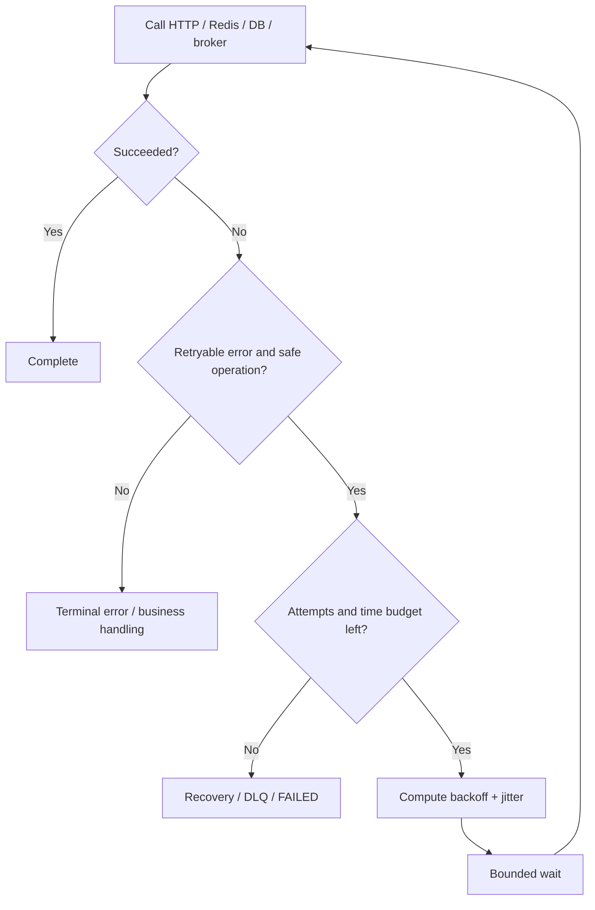
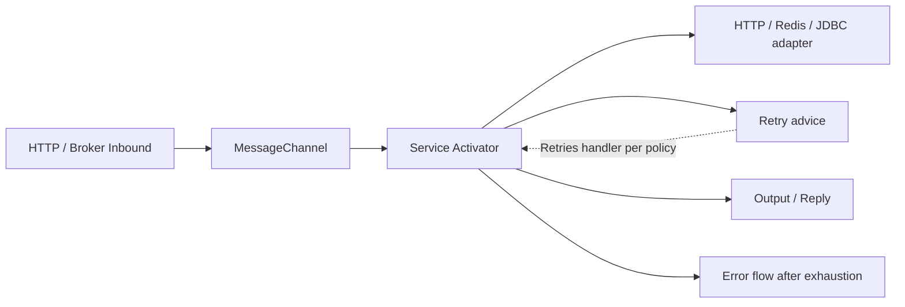
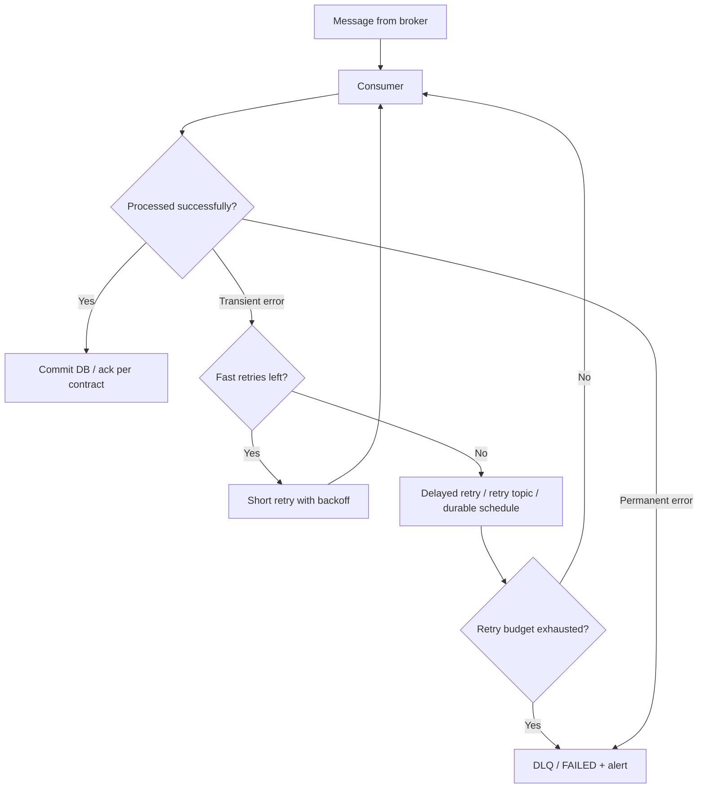
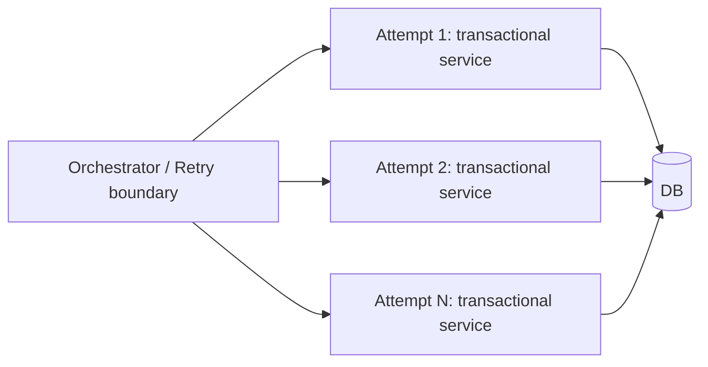
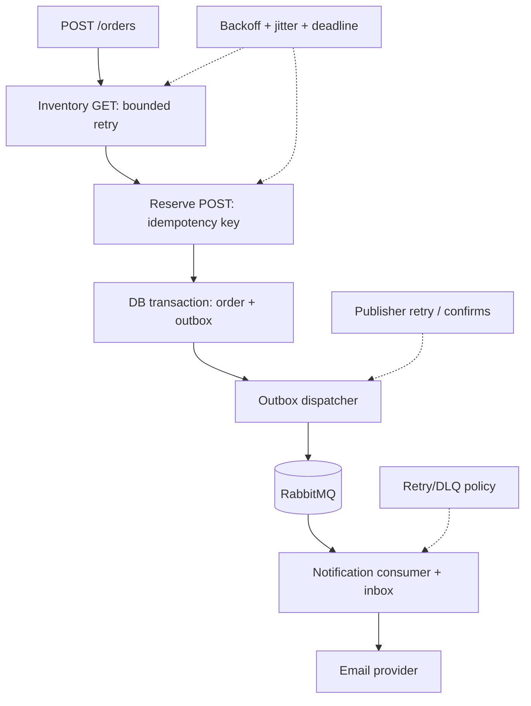

# Retries with Backoff, Jitter, and Attempt Limits

## 1. Retry Is a Recovery Policy, Not a "Retry Every Error" Button

In the **SPRING_BOOT_INTEGRATION** module, a Spring Boot application connects to HTTP APIs, databases, Redis caches, message brokers, and Spring Integration adapters. A transient failure can occur when an Inventory API returns HTTP 503, Redis fails over, a broker disconnects, or a database rejects a transaction due to a deadlock. Properly designed retries can allow an operation to succeed without forcing the user to resubmit the request.

However, unbounded retries can turn a minor glitch into a major outage:

- Hundreds of instances simultaneously call an overloaded HTTP API again, creating a **retry storm**.
- Retrying an order creation command after a timeout creates **two orders** without idempotency.
- A message listener infinitely retries a malformed schema payload, exhausting threads and blocking valid messages.
- A transaction holds locks while calling `sleep` between attempts, worsening database contention.
- One layer retries three times and the layer below retries three times, multiplying actual call volume unexpectedly.

**Retries** should be used only when the failure is recoverable and the operation can be repeated safely. **Backoff** inserts a wait interval between attempts. **Jitter** varies wait intervals across clients so they do not wake up and retry in lockstep. **Attempt limits and deadlines** cap total work, protecting resources across the entire system.



This lesson focuses on designing and applying retries with Spring Boot, Spring Retry, Reactor/WebClient, and Spring Integration, along with their impact on databases, caches, brokers, idempotency, testing, and production observability. Examples use Java 17+, Spring Boot 3.x, and compatible dependencies; always verify version-specific APIs when upgrading frameworks.

## 2. Classify Errors Before Configuring Retries

The decision to retry must not rely merely on "an exception occurred." You need to understand the **failure cause**, **recoverability**, and **consequences of re-executing the operation**.

| Source | Example Errors | Usually Suitable for Retry? | Notes |
| --- | --- | --- | --- |
| HTTP upstream | 502, 503, 504 | Possibly | Only when time budget remains and the request is safe |
| HTTP upstream | 429 Too Many Requests | Conditionally | Honor `Retry-After` and the provider's rate-limit policy |
| HTTP upstream | 400, 422 | No | Invalid payloads/validation errors will not heal after waiting |
| HTTP upstream | 401, 403 | Usually no | Check credentials/permissions; token refresh has its own policy |
| HTTP upstream | 404 | Depends on contract | Often a business outcome or wrong route configuration |
| HTTP client | Connect timeout, connection reset | Possibly | Does not guarantee the server failed to receive/commit the request |
| Redis | Failover, connection reset, timeout | Possibly | `INCR` and side-effecting commands must be evaluated for idempotency |
| Redis | NOAUTH, NOPERM | No | Credential/ACL errors require fixing configuration |
| Database | Deadlock, serialization failure | Conditionally | Usually retry the **entire transaction** per policy |
| Database | Unique constraint violation | Usually no | May indicate a legitimate duplicate or a business error |
| Broker | Connection temporarily unavailable | Possibly | Rely on producer confirms/acks and deduplication |
| Broker | Payload fails deserialization | No | Poison message → error handling/DLQ |
| Spring Integration | Handler error from downstream 503 | Possibly | Bounded retry at the handler; avoid repeating already-committed steps |
| Spring Integration | Validation error, missing required field | No | Cannot self-recover if input stays unchanged |

**Important:** a network error can occur **after the target system has already processed the request**. For instance, the Payment Service recorded the payment, but the response was lost; the client observes a timeout. Retrying a `POST` without an idempotency key can charge the customer twice. Transient/permanent classification alone is not enough: you also need **replay safety**.

### 2.1. Error Classification Belongs in the Adapter

A business service should not know every exception thrown by Lettuce, Netty, JDBC, or Kafka. At the integration boundary, the adapter can translate failures into meaningful domain/adapter types:

```java
public class TransientInventoryException extends RuntimeException {
    public TransientInventoryException(String message, Throwable cause) {
        super(message, cause);
    }
}

public class PermanentInventoryException extends RuntimeException {
    public PermanentInventoryException(String message) {
        super(message);
    }
}
```

For example, the adapter maps HTTP 503 to `TransientInventoryException`, and contract-violating JSON to `PermanentInventoryException`. When writing a retry policy, only allow the approved transient category. Never lump all `RuntimeException`s into a single "retry" rule.

## 3. Terminology: Attempt, Retry, Backoff, Jitter, Deadline

Four numbers are easily confused:

- **Attempt**: one actual invocation of the operation. The initial call is **attempt 1**.
- **Retry**: an additional call **after** an attempt fails. Two retries mean up to **three attempts**.
- **Backoff**: the wait time before the next attempt, typically growing as failures accumulate.
- **Jitter**: a randomized component skewing wait times so clients do not wake up simultaneously.
- **Deadline/time budget**: total allowed time, encompassing call execution, wait intervals, and all retry attempts.

Example policy for "**max 4 attempts**":

```text
Attempt 1 → failed
   wait backoff/jitter #1
Attempt 2 → failed
   wait backoff/jitter #2
Attempt 3 → failed
   wait backoff/jitter #3
Attempt 4 → failed
   ATTEMPTS EXHAUSTED → recovery/throw/DLQ
```

There is no wait after the final attempt. With `maxAttempts=4`, the maximum number of retries is usually **3**. However, many APIs take a "number of retries" parameter instead; for example, Reactor's `Retry.backoff(3, ...)` permits **3 retries after the initial attempt**.

**Always document and instrument in metrics whether parameters count attempts or retries.** An off-by-one mistake can multiply traffic and degrade SLAs unexpectedly.

## 4. Fixed Delay, Exponential Backoff, and Jitter

### 4.1. Fixed Delay

After each retryable failure, wait a fixed 200 ms:

```text
attempt 1 fails → wait 200 ms
attempt 2 fails → wait 200 ms
attempt 3 fails → wait 200 ms
```

This is predictable, yet instances failing together can retry on the exact same cadence, especially when hitting the same timeout.

### 4.2. Capped Exponential Backoff

A common formula for the **wait after the k-th failure** is:

\[
d_k = \min(d_{\max}, d_0 \times m^{k-1}), \quad k \ge 1
\]

Where:

- `d0`: initial wait duration, e.g., 200 ms.
- `m`: multiplier, e.g., 2.
- `dmax`: delay ceiling, e.g., 3,000 ms.
- `k`: failure count so far, starting at 1.

| Failure k | Unjittered Backoff (d0 = 200 ms, m = 2, dmax = 3,000 ms) |
| --- | ---: |
| 1 | 200 ms |
| 2 | 400 ms |
| 3 | 800 ms |
| 4 | 1,600 ms |
| 5 | 3,000 ms |
| 6 | 3,000 ms |

**Never configure uncapped backoff** when an outage can persist: wait times can grow huge or total duration can blow past SLAs. Implementation code must also guard against integer overflow when multiplying/doubling.

### 4.3. Why Can Exponential Backoff Still Trigger a Retry Storm?

Suppose 1,000 concurrent requests receive 503 at 10:00:00. If every instance uses the exact deterministic sequence 200, 400, 800 ms, they tend to hit the service again in synchronized spikes:

```text
10:00:00.200 — 1,000 requests retry
10:00:00.600 — 1,000 requests retry
10:00:01.400 — 1,000 requests retry
```

With **jitter**, requests spread out across a time window instead of colliding at the same instant. Desynchronizing retries is often more important than picking the exact base interval.

### 4.4. Three Common Jitter Strategies

Let `cap_k = min(dmax, d0 × m^(k−1))`.

| Strategy | Illustrative Delay Formula | Characteristics |
| --- | --- | --- |
| **Full jitter** | Random value from `0` to `cap_k` | Strong dispersion; occasionally yields delays near 0 |
| **Equal jitter** | `cap_k/2 + random(0, cap_k/2)` | Never collapses the entire wait interval near 0 |
| **Decorrelated jitter** | `min(dmax, random(d0, previousDelay × 3))` | Delay depends on prior delay, smoother variation |

These formulas illustrate common algorithms; **do not assume `@Backoff(random=true)` or `Retry.jitter(...)` implements those exact equations** across every library version. When a project requires a specific delay distribution, inspect the implementation or provide a tested custom policy.

Example of capped full jitter in milliseconds using a pure Java helper:

```java
import java.time.Duration;
import java.util.concurrent.ThreadLocalRandom;

public final class RetryDelayPolicy {
    private RetryDelayPolicy() {}

    public static Duration fullJitter(int retryIndex) {
        if (retryIndex < 1) {
            throw new IllegalArgumentException(
                "retryIndex must start at 1"
            );
        }

        long cap = 200L;
        for (int i = 1; i < retryIndex; i++) {
            cap = Math.min(3000L, cap * 2L);
        }

        long millis = ThreadLocalRandom.current()
            .nextLong(cap + 1L);

        return Duration.ofMillis(millis);
    }
}
```

This helper only **computes the delay**; it does not execute retries. With `maxAttempts=4`, it is called at most after failures 1, 2, and 3. In unit tests, pass a seeded random source or injectable delay provider so assertions are deterministic instead of depending on real randomness.

## 5. Enforce Three Limits Together: Attempts, Deadline, and Concurrency

Configuring only `maxAttempts` can still produce a slow or overloaded system. A production policy should enforce **three layers of bounds**:

1. **Attempts/retries**: maximum total calls for one logical operation.
2. **Deadline/time budget**: total time the operation is allowed to spend; once time runs out, stop retrying even if attempts remain.
3. **Concurrency/rate budget**: cap on in-flight requests and total retry volume sent downstream.

Example Order API with a 2-second overall deadline:

```text
request starts                     0 ms
Inventory attempt 1             0–450 ms (503)
jittered backoff               450–650 ms
Inventory attempt 2           650–1250 ms (timeout)
planned backoff                400–800 ms
Inventory attempt 3           runs only if time remains
overall deadline                  2000 ms
```

If attempt 3 requires up to a 1-second timeout while only 150 ms remain before the deadline, the system must **clamp the remaining timeout or skip that attempt**. Never "finish all configured retries" and push the user's HTTP request seconds past its SLA.

### 5.1. Retry Amplification When Multiple Layers Retry

Suppose Gateway calls Order Service, Order Service calls Inventory, and Inventory calls Database, and each layer allows 3 attempts:

```text
Gateway:       3 attempts
Order:         3 attempts / Gateway attempt
Inventory:     3 attempts / Order attempt
⇒ Can multiply up to 3 × 3 × 3 = 27 deep operations
```

This is an **illustrative upper bound** when nested retries all trigger; actual totals depend on the failure path. To avoid amplification, designate which layer owns retries, use a shared retry budget, or propagate deadlines; do not leave default retries enabled across every library and handler.

### 5.2. How Rate Limiters, Circuit Breakers, and Bulkheads Work Together

- **Rate limiter**: keeps request dispatch rate within quota.
- **Bulkhead/concurrency limit**: protects maximum threads/connections used for a downstream.
- **Circuit breaker**: temporarily stops calling a failing upstream to avoid wasting resources.
- **Retry**: retries transient failures within bounds.

If a circuit breaker is `OPEN`, repeatedly retrying the resulting "call not permitted" error accomplishes nothing. The composition order of retry/circuit breaker/bulkhead affects call counts and metrics; design and test it intentionally rather than stacking annotations arbitrarily.

## 6. Spring Retry: Synchronous Retries with `@Retryable` and `@Backoff`

Spring Retry fits imperative services calling databases, HTTP clients, or synchronous adapters where retry configuration belongs at a method boundary.

A typical Maven setup requires:

```xml
<dependency>
    <groupId>org.springframework.retry</groupId>
    <artifactId>spring-retry</artifactId>
</dependency>
<dependency>
    <groupId>org.springframework.boot</groupId>
    <artifactId>spring-boot-starter-aop</artifactId>
</dependency>
```

Enable retry proxying:

```java
import org.springframework.context.annotation.Configuration;
import org.springframework.retry.annotation.EnableRetry;

@Configuration
@EnableRetry
public class RetryConfiguration {
}
```

Example service retrying only adapter-classified transient exceptions:

```java
import org.springframework.retry.annotation.Backoff;
import org.springframework.retry.annotation.Retryable;
import org.springframework.stereotype.Service;

@Service
public class InventoryLookupService {
    private final InventoryGateway gateway;

    public InventoryLookupService(InventoryGateway gateway) {
        this.gateway = gateway;
    }

    @Retryable(
        retryFor = TransientInventoryException.class,
        maxAttempts = 4,
        backoff = @Backoff(
            delay = 200,
            multiplier = 2.0,
            maxDelay = 2000,
            random = true
        )
    )
    public InventorySnapshot load(String sku) {
        return gateway.fetch(sku);
    }
}
```

`InventoryGateway` and `InventorySnapshot` are application-defined types. In this setup:

- `maxAttempts = 4` means **one initial attempt + up to three retries**.
- `delay = 200` and `maxDelay = 2000` are in **milliseconds**.
- `multiplier = 2.0` grows backoff according to the policy.
- `random = true` requests **Spring Retry's randomized backoff mechanism**; do not interpret it as full jitter `random(0, delay)` without checking the implementation.
- Exceptions other than `TransientInventoryException` are not eligible for retry under this policy.

### 6.1. `@Retryable` Has a Proxy Boundary

`@Retryable` is normally applied via Spring AOP. Therefore:

```java
@Service
class OrderService {
    public void createOrder() {
        loadInventory(); // self-invocation: can bypass the retry proxy
    }

    @Retryable(maxAttempts = 4)
    public void loadInventory() {
        // ...
    }
}
```

This is **not** a reliable way to apply retries, because internal `this.loadInventory()` calls bypass the proxy in standard proxy mode. Place the retryable operation in a separate injected Spring bean or configure AOP deliberately.

Likewise, objects instantiated manually with `new` outside the Spring context do not receive retry advice. Do not use `@Retryable` expecting to catch failures emitted asynchronously on another thread after the method returns.

### 6.2. Recovery When Attempts Are Exhausted

Spring Retry provides `@Recover` to handle exhaustion when the caller can genuinely receive a meaningful fallback outcome:

```java
import org.springframework.retry.annotation.Recover;

// Defined in the same bean as the matching @Retryable method.
@Recover
public InventorySnapshot recover(
        TransientInventoryException failure,
        String sku) {
    throw failure; // Do not fabricate inventory to hide errors.
}
```

The recovery method must have a compatible return type and matching parameters per Spring Retry's resolution rules. Returning "stale" data from recovery is safe only when the business contract **explicitly permits it**; returning zero stock for every 503 violates business semantics.

## 7. `RetryTemplate`: Explicit Control Over Scope and Policy

When you prefer not to use annotations or need an explicit policy inside an adapter, use `RetryTemplate`. Example with Spring Retry 2.x:

```java
import org.springframework.context.annotation.Bean;
import org.springframework.context.annotation.Configuration;
import org.springframework.retry.support.RetryTemplate;

@Configuration
class PartnerRetryConfiguration {

    @Bean
    RetryTemplate partnerRetryTemplate() {
        return RetryTemplate.builder()
            .maxAttempts(4)
            .exponentialBackoff(200, 2.0, 2000, true)
            .retryOn(TransientInventoryException.class)
            .build();
    }
}
```

Here the builder configures up to 4 attempts, exponential randomized backoff, and the selected retry exception. This configuration is **not** a thread pool and does not orchestrate asynchronous jobs.

Usage:

```java
import org.springframework.retry.support.RetryTemplate;
import org.springframework.stereotype.Component;

@Component
public class RetryingInventoryAdapter {
    private final RetryTemplate retryTemplate;
    private final InventoryGateway gateway;

    public RetryingInventoryAdapter(
            RetryTemplate retryTemplate,
            InventoryGateway gateway) {
        this.retryTemplate = retryTemplate;
        this.gateway = gateway;
    }

    public InventorySnapshot load(String sku) {
        return retryTemplate.execute(
            context -> gateway.fetch(sku)
        );
    }
}
```

`RetryTemplate.execute(...)` runs the operation and can **block the calling thread** during backoff waits. On synchronous HTTP controllers, total wait time affects request threads and latency. On an `ExecutorChannel` worker, backoff occupies that worker while sleeping; for long retry delays, use a durable message broker or scheduler instead of holding threads.

### 7.1. Should `RetryTemplate` and `@Retryable` Be Stacked?

Do not wrap `@Retryable(maxAttempts=4)` around a `RetryTemplate` that also has max 4 attempts for the same operation without explicit reason: on the worst-case failure path, that produces **16 attempts**. Pick **one layer to own retries** to keep call counts, deadlines, and metrics clear. If multi-layer retries are truly required, explicitly coordinate budgets and retryable exceptions at each layer.

## 8. Synchronous HTTP: `RestClient`, Status Codes, and `Retry-After`

`RestClient` is Spring Framework 6.1+'s synchronous HTTP client. Spring Boot provides an auto-configured `RestClient.Builder` to apply timeouts, observability, and customizers consistently.

Example gateway handling errors from an Inventory API:

```java
import org.springframework.http.HttpStatusCode;
import org.springframework.web.client.RestClient;
import org.springframework.web.client.RestClientResponseException;

public class InventoryGateway {
    private final RestClient client;

    public InventoryGateway(RestClient client) {
        this.client = client;
    }

    public InventorySnapshot fetch(String sku) {
        try {
            return client.get()
                .uri("/api/v1/inventory/{sku}", sku)
                .retrieve()
                .body(InventorySnapshot.class);
        } catch (RestClientResponseException ex) {
            HttpStatusCode status = ex.getStatusCode();
            if (status.value() == 503
                    || status.value() == 502
                    || status.value() == 504) {
                throw new TransientInventoryException(
                    "Inventory temporarily unavailable", ex
                );
            }
            throw ex;
        }
    }
}
```

This example assumes the `RestClient` bean was built from Boot's builder with `baseUrl` and upstream connection timeouts; `InventorySnapshot` is a business DTO. Transport failures without an HTTP response, such as DNS/connection failures, throw different exceptions; if you intend to retry them, classify them explicitly instead of catching only `RestClientResponseException`.

### 8.1. Handling HTTP 429 and `Retry-After`

HTTP 429 indicates the server is rate-limiting requests. The `Retry-After` header may contain **delay seconds** or an **HTTP-date**. When the provider returns this header:

1. Parse it according to the header specification and validate the value.
2. Compute remaining wait duration relative to current time (for HTTP-date).
3. Clamp negative, nonsensical, or excessively large values against a client-side policy cap.
4. Respect concurrency/rate quotas and the overall deadline.
5. If too little deadline remains to wait, return a controlled error instead of retrying further.

Do not assume `@Backoff(delay=200)` or `Retry.backoff(...)` automatically honors `Retry-After`. Handling that header requires custom policy logic in the client or retry layer; the response exception itself typically exposes response headers for implementing this.

### 8.2. `GET` and `POST` Do Not Share the Same Safety Profile

- `GET` is safe/idempotent under HTTP semantics, but you still must consider upstream load, deadlines, and implementation fidelity.
- `PUT`/`DELETE` are defined as idempotent by HTTP semantics, yet real implementations can have secondary side effects; test the contract.
- `POST` is **not idempotent by default**. Retrying after a timeout requires a stable `Idempotency-Key`/request ID and contracted server-side deduplication.

Example sending a key for a reservation operation:

```java
ReservationResponse response = client.post()
    .uri("/api/v1/reservations")
    .header("Idempotency-Key", reservationRequestId)
    .body(request)
    .retrieve()
    .body(ReservationResponse.class);
```

`reservationRequestId` must be generated **once per logical operation** and reused across all attempts—never generate a new UUID inside a retry callback. The server must durably store the result/unique fingerprint; sending a header from the client without server enforcement **provides no idempotency guarantee**.

## 9. `WebClient` and Reactor Retry: Non-Blocking Backoff

With `WebClient`, calls typically return `Mono` or `Flux`. Reactor provides the `retryWhen` operator with `Retry.backoff` and `jitter`. Unlike `Thread.sleep`, waits in a reactive pipeline are scheduled asynchronously rather than blocking I/O threads like synchronous retries.

Example retrying only HTTP 502/503/504 up to two times:

```java
import java.time.Duration;

import org.springframework.web.reactive.function.client.WebClient;
import org.springframework.web.reactive.function.client.WebClientResponseException;
import reactor.core.publisher.Mono;
import reactor.util.retry.Retry;

public class ReactiveInventoryClient {

    private final WebClient client;

    public ReactiveInventoryClient(WebClient client) {
        this.client = client;
    }

    public Mono<InventorySnapshot> load(String sku) {
        return client.get()
            .uri("/api/v1/inventory/{sku}", sku)
            .retrieve()
            .bodyToMono(InventorySnapshot.class)
            .retryWhen(
                Retry.backoff(2, Duration.ofMillis(200))
                    .maxBackoff(Duration.ofSeconds(2))
                    .jitter(0.5)
                    .filter(this::isRetryableHttpFailure)
            );
    }

    private boolean isRetryableHttpFailure(Throwable throwable) {
        if (!(throwable instanceof WebClientResponseException ex)) {
            return false;
        }
        int status = ex.getStatusCode().value();
        return status == 502 || status == 503 || status == 504;
    }
}
```

Key behaviors:

- `Retry.backoff(2, ...)` allows up to **two retries** after the initial attempt, meaning up to three HTTP exchanges if eligible errors occur.
- `jitter(0.5)` sets a jitter factor per Reactor's implementation; it is **not equivalent to full jitter**.
- `maxBackoff` caps the delay interval per library mechanics.
- `filter` retries only the intended failure group; here 400/401/404/422, decode failures, and other errors are not retried.
- `retryWhen` **resubscribes** to the upstream publisher. With a cold `WebClient` publisher, that normally re-executes the HTTP request.

If you want to retry certain connection failures, classify `WebClientRequestException` by cause/operation and account for the risk that the request may already have been sent. Never widen the filter to "any exception" just to make a test pass.

### 9.1. Where You Place `timeout` Makes a Major Difference

Compare these two pipelines:

```java
// A: each attempt gets its own timeout; total duration can be large.
Mono<InventorySnapshot> a = httpCall()
    .timeout(Duration.ofSeconds(1))
    .retryWhen(retrySpec);

// B: deadline for the entire pipeline including backoff.
Mono<InventorySnapshot> b = httpCall()
    .retryWhen(retrySpec)
    .timeout(Duration.ofSeconds(3));
```

`httpCall()` and `retrySpec` represent configured publishers/policies. Pipeline A can take more than one second total because each attempt gets a fresh timeout. Pipeline B places the **deadline outside the retry**, so backoff waits are also bounded by the three-second cap.

In critical systems, combine **per-attempt timeouts** with an **overall operation deadline**. Test operator ordering rather than assuming the two placements are equivalent.

### 9.2. Retrying a Streaming `Flux` Can Duplicate Items

With SSE, NDJSON, or a `Flux` stream:

```java
Flux<Event> stream = client.get()
    .uri("/events")
    .retrieve()
    .bodyToFlux(Event.class)
    .retryWhen(retrySpec);
```

If the stream already emitted 100 events and then failed, a retry may **open a new connection and replay some events**. Consumers need offsets/`last-event-id`, deduplication, or an explicit replay contract. Never treat `Flux` retry as resuming from the exact byte offset, and never call `collectList()` on an unbounded stream.

## 10. Spring Integration: Retrying Inside a Handler vs. Dispatching

Spring Integration routes messages across `MessageChannel`s, transformers, routers, service activators, gateways, and adapters. Where you attach retries matters greatly.



If you retry at the **handler**, a retry re-executes the entire handler method. If the handler already wrote to the database before calling an API that failed, retrying the whole handler can **write to the database a second time**. Scope retry boundaries around the safe or idempotent operation.

### 10.1. `RequestHandlerRetryAdvice`

Spring Integration provides `RequestHandlerRetryAdvice` to apply Spring Retry to an endpoint handler. Example:

```java
import org.springframework.context.annotation.Bean;
import org.springframework.context.annotation.Configuration;
import org.springframework.integration.handler.advice.RequestHandlerRetryAdvice;
import org.springframework.retry.support.RetryTemplate;

@Configuration
public class IntegrationRetryConfiguration {

    @Bean("partnerRetryAdvice")
    RequestHandlerRetryAdvice partnerRetryAdvice(
            RetryTemplate partnerRetryTemplate) {

        RequestHandlerRetryAdvice advice =
            new RequestHandlerRetryAdvice();
        advice.setRetryTemplate(partnerRetryTemplate);
        return advice;
    }
}
```

Attach it to a service activator:

```java
import org.springframework.integration.annotation.ServiceActivator;
import org.springframework.stereotype.Component;

@Component
public class PartnerMessageHandler {

    @ServiceActivator(
        inputChannel = "partnerRequests",
        adviceChain = "partnerRetryAdvice"
    )
    public void handle(PartnerCommand command) {
        // Call only operations safe to repeat.
        partnerGateway.send(command);
    }
}
```

`PartnerCommand` and `partnerGateway` are application components. The `RetryTemplate` bean from Section 7 can be reused if exception policies match; if policies differ, define a dedicated template for the flow.

**Verify two points:**

1. The advice chain wraps the **message handler**, not operations happening outside the handler such as manually spawned threads or callbacks fired after the method returns.
2. When retries are exhausted, without a custom recovery callback, the exception propagates. On a `DirectChannel`, it typically returns to the caller. On an `ExecutorChannel` or poller, errors must be routed through an error channel, endpoint error handling, or transport-specific recovery.

Do not confuse `RequestHandlerRetryAdvice` with broker consumer retry/redelivery. One executes **within the same Spring Integration invocation**, while the other **redelivers the message** after reject/nack/rollback by the broker/container.

### 10.2. Recovery Callbacks and Error Channels

To send failed messages to an error flow upon exhaustion, configure a recovery callback on the advice per your Spring Integration version's API. For instance, `ErrorMessageSendingRecoverer` can emit an `ErrorMessage` to a configured channel.

However, **an `errorChannel` is not automatically a durable queue**. If an error is sent only to an in-memory `DirectChannel` and the app crashes, reprocessing is not guaranteed. Critical flows need persisted error state, a broker DLQ, or an outbox/job store for recovery.

## 11. Message Brokers: Immediate Retry, Delayed Retry, and Dead-Letter Queues

With RabbitMQ, Kafka, JMS/Artemis, or a Spring Integration adapter, determine **who owns retries**:

- Internal handler uses retry advice a couple of times to ride out very brief glitches.
- Listener/container applies protocol/configuration-driven retry/redelivery.
- Broker may support retry queues/delays/backoff/dead-lettering under its own patterns.
- Application uses a durable job store so a scheduler retries minutes or hours later.

A common strategy:



**Long retries using `Thread.sleep` inside a listener are rarely good:** consumer threads stay occupied, reducing concurrency and delaying acks/commits. For prolonged errors, use supported redelivery/delayed messaging or a durable scheduler paired with idempotency.

### 11.1. Poison Messages Must Have a Stopping Point

A message with malformed JSON, an unknown event type, or data violating business validation will not heal after 100 retries. Route it to a DLQ/parking queue with:

- Original event ID and appropriate message source metadata.
- Classified error code, timestamp, and attempt count.
- Schema version and payload type (with sensitive data redacted).
- Manual remediation/reprocessing workflow after fixing the defect.

Never create an infinite requeue loop for a poison message; it can consume all consumer capacity and drive up queue lag.

### 11.2. Distinguish Ack, Commit, and "Processed"

If a consumer commits to the database and crashes before acking the broker, the broker may redeliver the message. If the consumer acks before the business side effect commits and the process dies, the message can be lost from processing.

Therefore, design **inbox/deduplication** and proper ordering/transactions rather than assuming retries yield end-to-end "exactly once." Details of acknowledgment, offset commits, dead-lettering, and redelivery depend on Kafka, RabbitMQ, or JMS; never apply one identical config blindly across all brokers.

## 12. Idempotency: Key Precondition Before Retrying

Retrying an operation means **running the behavior again**. If that behavior has side effects, you must know when re-executing is safe.

| Operation | Retry Risk | Strategy |
| --- | --- | --- |
| HTTP GET product | Increased load, data may change | Bounded retry, cache/circuit breaker, deadline |
| POST create reservation | Duplicate reservation after timeout | Stable idempotency key and server-side dedup |
| Redis `INCR` counter | Incremented twice | Pick idempotent operation or suitable script/unique key |
| JDBC insert order | Duplicate insert | Business key/unique constraint + right transaction boundary |
| Send email | Two emails sent | Notification ID, send/reconcile status; provider API if supported |
| Publish event to broker | Multiple copies of same event sent | Stable `eventId`, outbox, consumer inbox |
| Consume `OrderCreated` | Repeated side effects on redelivery | Unique key on `(consumerName, eventId)` |

### 12.1. One Key per Logical Operation

Suppose Order Service calls Inventory Service to reserve stock:

```text
Logical operation:
  reservationRequestId = reserve:ord-1024:sku-123

Attempt 1:
  POST /reservations
  Idempotency-Key: reserve:ord-1024:sku-123
  Response times out; unknown if server committed

Attempt 2:
  POST /reservations
  Idempotency-Key: reserve:ord-1024:sku-123
  Server returns stored result or consistent status
```

If the server generates or logs keys without checking duplicates, there is no guarantee. A solid idempotency contract defines:

- Key scope (by tenant/user/operation).
- Request content fingerprint to detect the same key reused with a different payload.
- Result retention TTL; retrying after TTL expiry may no longer be safe.
- Concurrent arrival of two requests carrying the same key.
- State while an earlier request is `PROCESSING`.
- Replayed response/semantic outcome and exact status codes.

### 12.2. Inbox/Outbox and Retries When Brokers Fail

Outbox pattern:

```text
BEGIN DATABASE TRANSACTION
  INSERT order(...)
  INSERT outbox(event_id, payload, status='PENDING')
COMMIT

Dispatcher:
  Read PENDING outbox rows
  Send to broker (retryable)
  Update sent status per policy
```

If sending succeeds but the response/confirm is lost, the dispatcher may republish the **same event ID**. Consumer:

```text
BEGIN DATABASE TRANSACTION
  INSERT inbox(consumer_name, event_id) UNIQUE
  If duplicate: skip side effects
  If new: update business data
COMMIT
ACK BROKER (per container)
```

The database and broker do not automatically share a single transaction just because Spring Boot has `@Transactional`. **Retries and idempotency must be designed together**, especially once outbox, inbox, downstream email/HTTP calls, and cache invalidation are involved.

## 13. Database Transactions and Retries: Pick the Right Boundary

Transient errors like deadlocks or serialization conflicts can be retried safely if **the entire transaction is restarted cleanly**. However, putting both `@Transactional` and `@Retryable` on the same method does not guarantee the expected advice ordering in every configuration.

An easy-to-reason-about model:



Place retries on an **orchestration bean** and transactions on a **separate business bean**, so each attempt goes through a Spring proxy and starts a fresh transaction per the configured propagation. Example structure:

```java
@Service
public class OrderRetryCoordinator {
    private final OrderTransactionalWriter writer;

    public OrderRetryCoordinator(OrderTransactionalWriter writer) {
        this.writer = writer;
    }

    @Retryable(
        retryFor = TransientOrderWriteException.class,
        maxAttempts = 3,
        backoff = @Backoff(delay = 100, multiplier = 2)
    )
    public void save(OrderCommand command) {
        writer.saveInTransaction(command);
    }
}

@Service
public class OrderTransactionalWriter {
    @Transactional
    public void saveInTransaction(OrderCommand command) {
        // Write order + outbox in a single transaction.
        // Map retryable DB errors to TransientOrderWriteException.
    }
}
```

This is a **boundary sketch**; it needs `@Service`/`@Transactional`/`@Retryable`/`@Backoff` imports and application-defined DTOs/exceptions. Note:

- `OrderRetryCoordinator` and `OrderTransactionalWriter` must be Spring beans called through proxies.
- A failed attempt must completely roll back its transaction before the next attempt.
- Never `sleep` between attempts **inside an active transaction holding locks**.
- Do not send emails or broker events directly inside a transaction and then retry the whole thing; use an outbox so side effects are not duplicated.
- Unique business keys remain critical, because two different requests can run concurrently even with properly configured retries.

## 14. Recovery When Retries Are Exhausted: Error, Fallback, DLQ, or `FAILED` State?

When a policy exhausts attempts or its deadline, never simply log "retry exhausted" and swallow the exception.

| Flow Type | Appropriate Recovery | What Not to Do |
| --- | --- | --- |
| HTTP GET reference data | Stale cache fallback if business permits, or appropriate 503/504 | Return fabricated data without signaling degradation |
| Side-effecting HTTP POST | Return indeterminate status + operation ID for reconciliation | Send a new POST with a different idempotency key |
| Async job | Persist `FAILED`/`RETRY_PENDING` in store, alert, reprocess | Report `SUCCEEDED` just because it was dispatched |
| Message broker | DLQ/delayed retry per policy, ack/commit per semantics | Infinite requeue |
| Database transaction | Roll back and report error with code/trace ID | Keep using a failed transaction |
| Redis as pure cache | Bounded DB fallback protected by circuit breaker | Crush DB with a cache-miss storm |
| Redis holding idempotency/locks | Fail-closed or explicitly designed safe fallback | Pretend a Redis error means no side effect occurred |

**Fallbacks are not always safe.** For inventory quantities or payment prices, serving an old snapshot can violate business integrity. Declare in the API contract whether a response is stale/degraded, and never base irreversible decisions on stale data.

### 14.1. Permanent Failures Should Not Burn the Retry Budget

Upon encountering a 400 validation error or malformed message schema, route immediately to the error path instead of wasting all three attempts. Besides saving latency, this lowers pressure on downstream services and keeps error metrics accurate.

### 14.2. Preserve Root Cause After Exhaustion

For operations, record:

- Logical operation ID, correlation ID, and upstream identifier.
- Actual attempts, start/end timestamps, and error classification.
- A summarized cause chain **free of secrets/PII**.
- Committed/uncertain status (if applicable) and reconciliation plan.
- Remaining deadline and stop reason: attempts exhausted, time budget exhausted, non-retryable, or circuit open.

Never log raw request/response bodies or Redis credentials just to debug retries.

## 15. Testing Retries with Virtual Time and Fake Dependencies

### 15.1. Testing Reactor with `StepVerifier.withVirtualTime`

For reactive retries, use virtual time to test backoff without waiting in real time:

```java
import static org.assertj.core.api.Assertions.assertThat;

import java.io.IOException;
import java.time.Duration;
import java.util.concurrent.atomic.AtomicInteger;
import org.junit.jupiter.api.Test;
import reactor.core.publisher.Mono;
import reactor.test.StepVerifier;
import reactor.util.retry.Retry;

class ReactiveRetryPolicyTest {

    @Test
    void retriesTwiceThenSucceeds() {
        AtomicInteger attempts = new AtomicInteger();

        StepVerifier.withVirtualTime(() ->
            Mono.defer(() -> {
                int n = attempts.incrementAndGet();
                if (n < 3) {
                    return Mono.<String>error(
                        new IOException("temporary outage")
                    );
                }
                return Mono.just("ok");
            }).retryWhen(
                Retry.backoff(2, Duration.ofMillis(100))
                    .jitter(0)
            )
        )
        .thenAwait(Duration.ofSeconds(1))
        .expectNext("ok")
        .verifyComplete();

        assertThat(attempts.get()).isEqualTo(3);
    }
}
```

`jitter(0)` is used only in this test to make delays deterministic; production policies usually need positive jitter. Notice that the **publisher is created inside the `withVirtualTime` supplier**, so the virtual scheduler is installed before the operators are instantiated.

Another test should verify a publisher that always fails and assert there is no fourth attempt once `Retry.backoff(2, ...)` exhausts its budget. If asserting the exact exception type after exhaustion, Reactor may wrap the final failure in a retry-exhausted exception; do not match solely on error message text.

### 15.2. Testing That `@Retryable`/`RetryTemplate` Actually Takes Effect

Several retry annotation bugs cannot be caught by plain unit tests:

- Bean instantiated with `new` instead of injected from Spring.
- Self-invocation within the same bean bypassing the AOP proxy.
- Exception caught by an adapter and turned into `null`/fallback before reaching retry advice.
- Wrapped exception whose outer type does not match `retryFor`.
- Transaction remaining open across attempts due to wrong advice ordering.

Therefore, write integration tests with a real Spring context: have a fake upstream fail twice then succeed; assert **exact total call counts**, final return value, and wait time within acceptable bounds. When testing jitter, do not assert an exact millisecond timestamp; assert bounds/ceilings, or inject a controllable clock/sleeper abstraction.

### 15.3. Required Test Matrix

| Case | Expectation |
| --- | --- |
| Succeeds on attempt 1 | No retries |
| Two 503s, 3rd succeeds | Three attempts, valid response |
| 400/422 or schema mismatch | No retry |
| `maxAttempts` exhausted | Stops at exact limit, preserves cause, invokes recovery |
| Deadline expires before attempts | Stops due to time budget |
| 429 with valid `Retry-After` | Honors policy and wait cap |
| 429 with huge/malformed header | Does not wait indefinitely, clear fallback |
| Two clients hit same outage | Jitter disperses delays, no synchronized spike |
| POST times out after server commit | Does not create a second record |
| Consumer redelivery with same event ID | Side effect executes only once |
| Poison message | Routed to DLQ, no infinite requeue |
| Executor shutdown/saturation | Distinguishes dispatch error from handler error |
| Redis failover / DB deadlock | Bounded retry with proper transactions |
| Circuit breaker OPEN | Does not multiply retries when calls are rejected |

In fault-injection tests, use MockWebServer/WireMock, Testcontainers, or a network proxy such as Toxiproxy to simulate failures rather than disrupting production Redis/brokers. These tests complement contract testing; retries will not fix a breaking API schema change.

## 16. Observing Retries in Production

A retry policy can behave strictly as coded and still worsen an outage when downstream is overloaded. Observability must separate **logical operations** from **physical attempts**.

For example, a user calls `GET /inventory` once and the backend tries three times: logical business request count is 1, outbound HTTP attempt count is 3. Measuring only final successes hides the fact that the upstream is routinely failing on first attempts.

Useful metrics:

- `retry.attempts` or equivalent: attempt counts by upstream, operation, and exception classification.
- `retry.exhausted`: logical operations that ran out of attempts or deadline.
- `retry.backoff.duration`: actual wait durations between attempts and jitter distribution.
- Overall latency of the logical operation alongside per-attempt latency for HTTP/DB/Redis.
- Retries per minute sent downstream and retry-to-success ratio.
- Circuit breaker state, rate-limiter rejections, and bulkhead saturation.
- Broker retry queue age, DLQ count, redelivery count, and consumer lag.
- Idempotency duplicate-detected count and reconciliation backlog.

**Never use `eventId`, `userId`, or ID-containing URLs as metric tags** due to high cardinality; put them in access-controlled structured logs/traces with sensitive fields redacted. Tracing spans per attempt can raise sampling cost; adopt an appropriate observability strategy.

### 16.1. Dashboards and Alerts by Symptom

| Signal | Likely Cause | Action |
| --- | --- | --- |
| Retries rising, final success stable | Upstream degraded but still recovering | Inspect latency/5xx and retry-induced load increase |
| `retry.exhausted` rising | Extended outage or overly tight policy | Inspect root cause, circuit breaker, contingencies |
| p99 latency jumps after enabling retries | Backoff sits on critical path | Review deadlines, attempt counts, and fallbacks |
| DLQ growing, schema errors common | Poison messages, contract drift | Check schema/version, halt futile retries |
| Duplicate side effects increasing | Missing idempotency or bad replay | Audit `eventId`/inbox/outbox and POST keys |
| Thread pool saturated | Synchronous retries holding threads long | Lower concurrency, move to durable delayed retries |
| Mass Redis timeouts then DB overload | Cache fallback stampede | Rate limit, stale policy, isolate error source |

An alert saying "HTTP 5xx up" only reports a symptom; traces/correlation IDs and attempt counts reveal which service failed, which layer retried, and whether work eventually committed.

## 17. End-to-End Scenario: Order Service, Inventory API, and RabbitMQ

Suppose Order Service uses Spring Boot to:

1. Receive `POST /orders`.
2. Call Inventory Service via `WebClient` to check stock.
3. Call the reserve endpoint (side effect).
4. Persist order and outbox to PostgreSQL.
5. Publish `OrderCreated` via RabbitMQ.
6. Notification consumer sends an email and records completion.



### 17.1. Per-Step Policy

| Step | Illustrative Policy | Safety Conditions |
| --- | --- | --- |
| Inventory GET | Max 3 attempts, exponential backoff + jitter, 2s deadline | Retry only permitted 502/503/504/connection failures |
| Reserve POST | Max 2 attempts when provider advertises idempotency | Keep identical request ID and payload across all attempts |
| DB order + outbox | Retry selected transient transaction errors | Open a fresh transaction per attempt; unique business key |
| Outbox publish | Retry with backoff or job reschedule | Keep same `eventId`, handle uncertain publisher confirms |
| Notification consumer | Short retry for transient SMTP/HTTP errors; delayed retry/DLQ after budget | Consumer inbox and duplicate-email mitigation strategy |
| Redis cache | Bounded fallback if read-only cache | Do not fail-open if Redis holds business locks/idempotency |

Numbers are illustrative. If a real environment has different SLAs or throughput, tune based on measurements and each downstream's contract.

### 17.2. Three Key Scenarios

**Scenario A — Inventory API returns 503 twice then 200:** client retries GET within budget, logs/metrics record three attempts, business request succeeds. Total latency must still stay inside the deadline.

**Scenario B — Reserve POST succeeds but response is lost:** client retries with the **same idempotency key**; Inventory Service looks up the prior request result instead of creating a new reservation. If status remains uncertain, Order Service reconciles by operation ID before concluding failure.

**Scenario C — RabbitMQ accepted the event but publisher confirm was lost:** outbox dispatcher may republish the **same `eventId`**; consumer uses its inbox unique constraint to avoid applying side effects twice. If the email provider does not support idempotency, design notification state and reconciliation workflows rather than claiming exactly-once delivery.

### 17.3. Retry Implementation Checklist

- [ ] Classified transient/permanent errors per each downstream's contract?
- [ ] Identified which logical operations are idempotent, have side effects, and use deduplication keys?
- [ ] Explicitly documented whether `maxAttempts` counts total attempts or retries?
- [ ] Configured exponential/fixed backoff with sensible caps and jitter in production?
- [ ] Set overall deadlines and per-attempt timeouts without unintended nested retries?
- [ ] Bounded concurrency/rate and coordinated circuit breakers/bulkheads?
- [ ] For HTTP 429, handled `Retry-After` according to allowed policy?
- [ ] Ensured DB retries open a fresh transaction at the right boundary without holding locks while waiting?
- [ ] Distinguished Spring Integration/consumer handler advice from broker redelivery?
- [ ] Set up DLQ/recovery/`FAILED` state and safe reprocessing tools on exhaustion?
- [ ] Tested exhaustion, post-commit timeouts, duplicates, poison messages, and failovers?
- [ ] Instrumented metrics for logical requests vs. attempts, retry exhausted, backlog, and correlation traces?

**Conclusion:** Retries help Spring Boot applications recover from transient failures, but must be paired with **error classification, attempt caps, deadlines, exponential backoff, jitter, load limits, and idempotency**. `@Retryable`/`RetryTemplate` suit synchronous calls; Reactor `retryWhen` suits reactive HTTP; `RequestHandlerRetryAdvice` supports Spring Integration handlers, while broker redelivery/DLQ has its own lifecycle. Across HTTP, database, cache, and broker integrations, a retry is truly safe only when the operation may be repeated, state exists for reconciliation, and clear stopping bounds are enforced.
