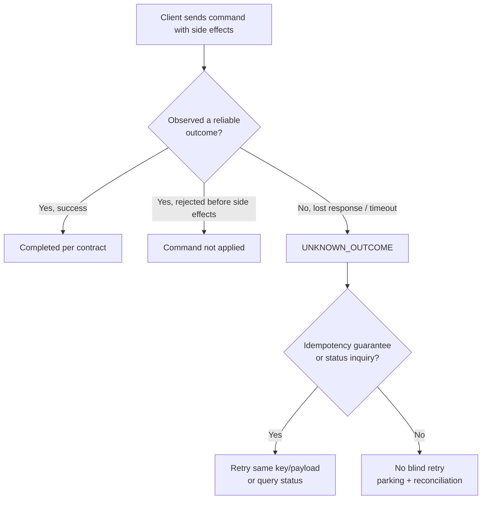
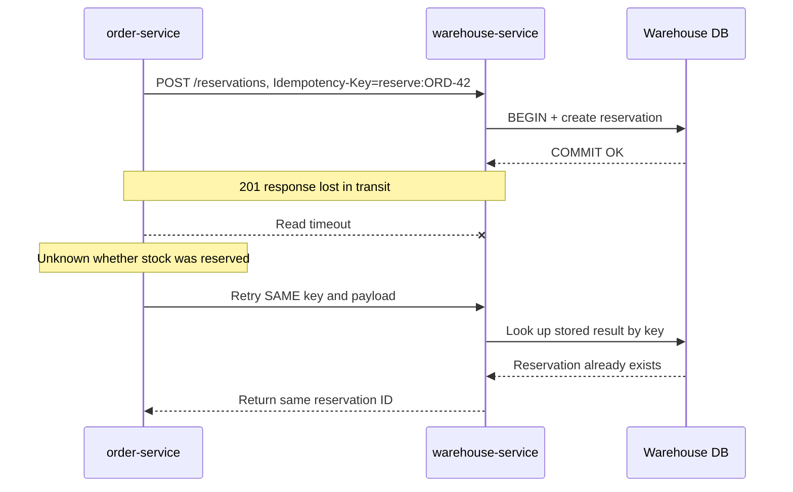
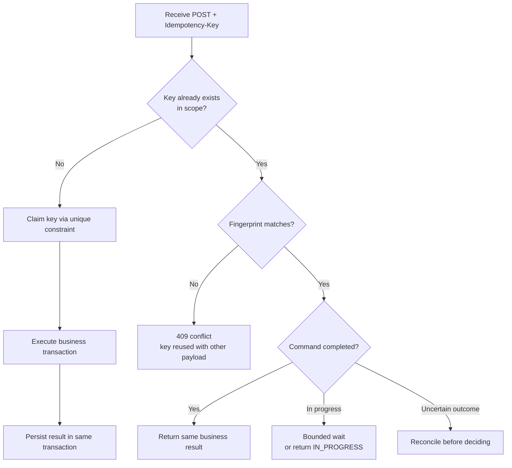
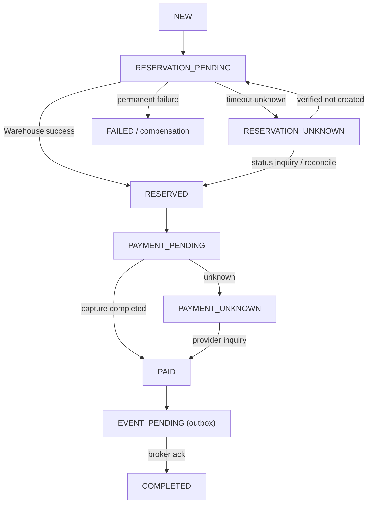
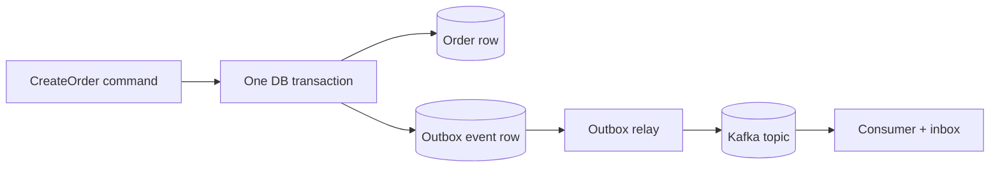
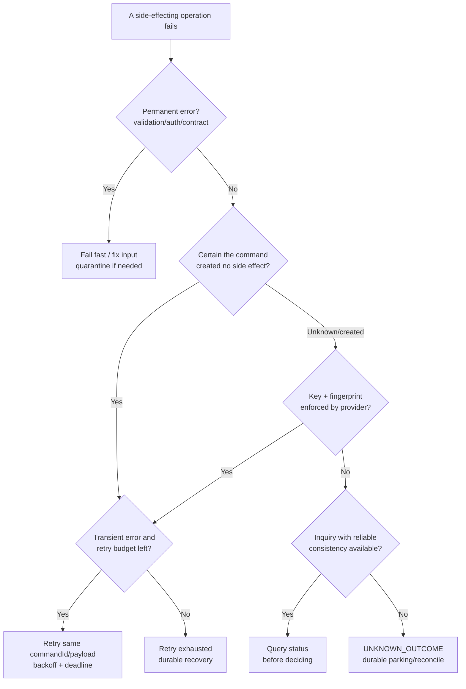

# Evaluating Idempotency Before Retrying Operations with Side Effects

## 1. Why Can a Retry Decision Cause Severe Business Bugs?

A Spring Boot service receives an order command, calls the Warehouse API to reserve stock, and persists the result to a database. When Warehouse returns `503 Service Unavailable`, retrying looks reasonable. Yet if the client experiences a **read timeout** after Warehouse already committed the reservation, sending the command again can reserve inventory twice. With a payment API, the same situation can double-charge a customer; with email, it can send multiple notifications; with Kafka, it can emit duplicate events.

In the **Failure Recovery** chapter of the **SPRING_BOOT_INTEGRATION** module, *idempotency* is a **precondition for deciding whether to retry**, not a checkbox property you turn on in a retry framework. It directly connects HTTP clients, databases, caches, Kafka/RabbitMQ, Spring Integration adapters, transactions, data contracts, deduplication, and real-world observability.

**The central question** is not "can this exception happen transiently?" but rather:

> If the previous execution **already produced side effects**, and I send the **same command** again, will the business outcome be duplicated or altered unintentionally?

**Learning Objectives**

1. Distinguish idempotent operations, non-idempotent operations, and operations that are safe only under specific conditions.
2. Identify three states: definitely not executed, definitely executed, and **unknown whether executed**.
3. Evaluate retries based on side-effect boundaries, commits, idempotency keys, observed outcomes, and deduplication windows.
4. Design APIs with idempotency keys, request fingerprints, unique constraints, and stored results for consistent replay responses.
5. Contrast idempotency across HTTP, databases, Redis/caches, Kafka/RabbitMQ, file adapters, and partner APIs.
6. Combine bounded retries, reconciliation, outbox/inbox, version guards, and compensation when operations cannot be executed exactly once.
7. Test pre/post-commit failure windows, replays, concurrency, and key expiry; monitor duplicates and unknown outcomes in production.

> **Version Scope:** Examples use Java 17+, Spring Boot 3.x, Spring Framework 6.x, Spring JDBC, Spring Integration 6.x, and Spring Kafka 3.x. Spring Boot 4.x and newer driver/framework releases may change APIs or auto-configuration; verify against your active BOM before copying. SQL examples use PostgreSQL; `ON CONFLICT` syntax is not identical across all databases.

## 2. Idempotency Is a Property of **Effects**, Not Exceptions

In mathematics, a transformation `f` is idempotent when applying it again yields no different result:

```text
f(f(state)) = f(state)
```

In integration, we care about the **observable business effects** when the same *logical command* executes once or multiple times. Examples:

| Operation | Second Execution | Initial Assessment |
| --- | --- | --- |
| `SET order.status = 'PAID'` | Final status remains PAID. | May be field-level idempotent, though accompanying events/audits could repeat. |
| `INCREMENT stock_reserved BY 1` | Reserved increases a second time. | Not idempotent. |
| `INSERT order (command_id UNIQUE)` | Second execution violates unique constraint. | Prevents duplicate rows, but the error must be mapped to a meaningful outcome. |
| `PUT /orders/42/status = PAID` | Writes the same status. | Can be idempotent if the server does not repeat other side effects. |
| `POST /payments/capture` | May create a new capture charge. | Unsafe without an idempotency key/contract. |
| `KafkaTemplate.send(event)` | May append another record. | App-level repeated publishing is not automatically idempotent. |
| `Redis SET key value` | Final value is the same. | May be idempotent; TTL, notifications, versions, and side effects still matter. |
| Send email | Recipient may receive multiple copies. | Usually cannot be assumed idempotent. |

An operation can be idempotent in **final state** yet non-idempotent in side effects like audits, billing, events, emails, notifications, or metered API calls. Thus, the precise question is:

**"Idempotent with respect to *which side effects*, over *what time window*, under *which identity key*?"**

### 2.1. Re-creating the Same Resource vs. Creating a New One

```http
PUT /orders/ORD-42
Content-Type: application/json

{"status":"PENDING"}
```

and:

```http
POST /orders
Content-Type: application/json

{"customerId":"C-7","amount":150000}
```

Per HTTP semantics, `PUT` is defined as idempotent and `POST` is not idempotent in general. **However**, the HTTP method does not prove the implementation satisfies business guarantees: a `PUT` that fires an email on every call still duplicates side effects outside resource state, while a `POST` backed by a durable idempotency key can be designed for safe retries.

Do not decide whether to retry based solely on the HTTP method name. Verify the **service contract** and real state.

### 2.2. Idempotent Does Not Mean "Error-Free"

If `INSERT ... ON CONFLICT DO NOTHING` finds an existing row, the second execution does not mutate the database. Yet the client still needs to know:

- Does the existing row belong to **this exact command** or a different command?
- Does the payload match the first attempt's payload?
- Did the first attempt complete, is it still in progress, or did it roll back?
- Does the returned response carry the same business ID/status?

A repeated command might return the stored result, a `409` error for a mismatched payload, or an `IN_PROGRESS` status requiring lookup; it does not have to return `200` on every duplicate.

## 3. Three Outcome States on Failure



### 3.1. Definitely Not Executed

For example, the application validates and detects a missing field before calling upstream, or proves a connection was never established and zero request bytes were transmitted. In that case, no upstream side effect occurred. However, pinpointing that network boundary is **harder than checking an exception class**: a generic `ResourceAccessException` can wrap both connect timeouts and read timeouts.

If the input is invalid, retrying the same input is pointless. Retry only when the cause is recoverable—not merely because "it hasn't executed yet."

### 3.2. Definitely Executed

The client receives an explicit success response per the contract: `201 Created` with a reservation ID or `200 OK` with the command result. The result can be persisted and returned to the caller. Yet receiving a response does not prove all side effects in **other systems** are consistent if the flow continues to subsequent steps (DB, Kafka, email).

### 3.3. Uncertain Outcome: The Most Dangerous Window



When receiving a read timeout after a POST, **you cannot conclude the server did not execute it**. Retrying with a new key makes the server see two independent commands and create two reservations.

**An uncertain outcome must exist explicitly as a business state**, such as `UNKNOWN_OUTCOME` or `PENDING_RECONCILIATION`, whenever evidence is insufficient to prove success or failure.

## 4. Pre-Retry Evaluation Procedure

For **each operation**, answer every question completely:

1. **What is the logical command?** One "place order" click or each HTTP attempt? Does it have a stable business command ID?
2. **Where do side effects occur?** DB, broker, payment partner, email, files, cache, or multiple places?
3. **At the moment the exception occurs, could the side effect already have committed?** Can read timeouts, connection resets, or lost ACKs happen?
4. **Does repeating the same command change state a second time?** Are there increments, appends, charges, or callbacks?
5. **Does the provider genuinely enforce an idempotency key?** What are the scope, TTL, payload fingerprint, and response replay rules?
6. **If there is no key, is there a status inquiry endpoint by business ID?** Is the status endpoint consistent enough to be conclusive?
7. **Do transactions/unique constraints/version checks guard concurrency?** What happens if two pods receive the same command simultaneously?
8. **If retries are needed, which errors are truly transient?** Are schema/validation/permission errors excluded from the whitelist?
9. **Which layer retries?** HTTP client, `RequestHandlerRetryAdvice`, Kafka listener, broker redelivery, or scheduler?
10. **When retry budget is exhausted, where does work go?** Durable parking, DLT, manual reconciliation, or compensation?
11. **If replayed days later, do deduplication markers still exist?** Does TTL align with retry, retention, and backfill windows?
12. **Which failure-window tests verify the guarantee?** Never test only the happy path.

### 4.1. Quick Decision Table

| Operation Type | Example | On Transient Failure | Decision |
| --- | --- | --- | --- |
| Read-only | GET catalog | 503/timeout | Bounded retry possible, still needs latency budget. |
| Idempotent state set | `SET status = PAID` | DB unavailable | Retryable if non-update side effects are also safe. |
| Conditional update | `UPDATE ... WHERE version=?` | Deadlock/timeout | Retry a **fresh transaction**; re-check version/business rules. |
| Increment/decrement | Deduct stock by `-quantity` | Post-commit timeout | Do not retry without a command ID/dedup. |
| Create resource | POST reservation | 502/503/read timeout | Retry only with a stable key and provider guarantee, or use inquiry. |
| External payment | Capture money | 5xx/timeout | Follow payment provider's idempotency contract; prefer inquiry when uncertain. |
| Publish Kafka | Send event | Ack timeout | App-level republish possible; requires event ID + inbox/idempotency. |
| Send email/SMS | Send notification | Timeout | Needs provider-side dedup or capping/reconciliation; do not promise exactly once. |
| File export | Write a complete file | I/O error | Can use temp file + deterministic name + atomic publish if filesystem/contract permits. |

**Evaluating idempotency and evaluating retryability are two separate axes.** An idempotent command is still not worth retrying on permanent errors; a transient error is still dangerous for non-idempotent commands.

## 5. Classifying Failures by Retryability and Side-Effect Certainty

### 5.1. Do Not Use One HTTP Status List for Every Command

| Signal / Error | Typical Nature | For Side-Effecting Commands |
| --- | --- | --- |
| `400/422` | Payload violates validation/schema. | Do not retry the same payload. |
| `401/403` | Invalid credentials/permissions. | Do not retry infinitely with same credentials; refresh/fix permissions in separate workflow. |
| `404` | Resource/endpoint does not exist. | Follow contract; do not make every 404 retryable. |
| `409` | Business conflict, duplicate key with different payload, or concurrency. | Query status; do not retry blindly. |
| `412` | Precondition/ETag/version mismatch. | Re-read state and recompute command if permitted. |
| `429` | Quota/rate limit. | Bounded retry honoring `Retry-After` **if** operation is idempotent. |
| `500` | Server error that could occur before or after side effects. | Treat as unknown outcome unless proven uncommitted. |
| `502/503/504` | Gateway/upstream unavailable. | May be transient; write outcome can still be uncertain. |
| Connect timeout | Failed to establish connection in that specific case. | Verify whether request was sent; do not infer from a broad exception. |
| Read timeout/connection reset | Lost response after sending request. | **Unknown outcome** is the safe default. |
| JSON deserialization error | Response violates schema. | Do not infinitely retry contract failures. |
| DB deadlock/lock timeout | Transaction rolled back or rejected by DB. | Retry full fresh transaction if other side effects are safe. |
| Unique violation | Record with same business key already exists. | Compare fingerprint/result; do not treat every duplicate as success. |

**Important:** HTTP `5xx` does not prove the provider's transaction rolled back. The provider could commit its DB and then fail while publishing an event or serializing the response.

### 5.2. Retryable and Safe-to-Retry Are Two Orthogonal Axes

```text
                 Safe to repeat command?
               Yes                    No / Unknown
Transient err   Bounded retry          Inquiry / idempotency / parking
Permanent err   Fail fast              Fail fast + investigate contract
```

Never write policies like "retry all `RestClientException`" or "retry any `RuntimeException`." Adapter error mapping should distinguish `TRANSIENT_SAFE`, `PERMANENT`, and `UNKNOWN_OUTCOME` per **operation**, and then the retry layer decides the action.

## 6. Idempotency Key: Identifying **One Logical Command** Across Attempts

Suppose we have a stock reservation API:

```http
POST /api/v1/reservations HTTP/1.1
Content-Type: application/json
Idempotency-Key: reserve:ORD-42:v1

{"orderId":"ORD-42","sku":"SKU-1","quantity":2}
```

The client can resend the **same key and same payload** on network errors. The provider returns the stored decision for that key instead of subtracting stock again.

### 6.1. Defining the Key Contract

| Attribute | What Must Be Specified |
| --- | --- |
| Scope | Per tenant, merchant, endpoint, operation, or service-wide? |
| Uniqueness | One key per logical command; never reuse for another command. |
| Stability | Every HTTP retry, worker retry, and broker redelivery uses the **same** key. |
| Payload binding | Same key with a different body must be rejected, typically with a business conflict. |
| Concurrency | When two requests with the same key arrive concurrently, only one executes side effects. |
| Status | `IN_PROGRESS`, `COMPLETED`, `FAILED_FINAL`, or equivalent states. |
| Replay output | Return identical business result/status/important headers, or status lookup guidance. |
| Retention window | At least as long as the contracted retry/replay window; define expiry policy. |
| Security | Bounded size/format, scoped by principal; never treat keys as credentials. |

An idempotency key must not be generated **fresh** on every HTTP attempt:

```java
// WRONG: every retry looks like a brand-new command to the provider.
headers.set("Idempotency-Key", UUID.randomUUID().toString());

// RIGHT: commandId is generated once and kept identical across all attempts.
headers.set("Idempotency-Key", command.commandId());
```

### 6.2. Distinguishing Event ID, Command ID, and Aggregate ID

```text
orderId     = ORD-42         # entity/aggregate being modified
commandId   = reserve-42-v1  # one logical reservation command
eventId     = evt-42-001    # one emitted event
attemptId   = attempt-3     # one delivery attempt; do not use as dedup key
traceId     = trace-xyz     # distributed tracing; not idempotency identity
```

One order may legitimately have multiple reservation commands; using `orderId` as the idempotency key for **every** command could accidentally block valid subsequent commands. Use a clearly scoped business command ID.

## 7. Request Fingerprint: Same Key with Different Payload Must Conflict

If a provider stores only `Idempotency-Key` without comparing payload contents, a client could accidentally send:

```text
Key: reserve-42-v1; quantity=2  -> creates reservation for 2
Key: reserve-42-v1; quantity=5  -> server returns old result for 2
```

The caller might think 5 units were reserved when only 2 were. Therefore, compute a **fingerprint of business-significant fields**.

### 7.1. Hashing Must Use a Canonical Representation

- Include operation, tenant/scope, order ID, SKU, quantity, currency, unit of measure, and fields affecting side effects.
- Exclude JSON whitespace, property ordering, or per-attempt timestamps/trace IDs.
- Normalize Unicode, casing, numeric types, time zones, and null/absent fields per contract.
- Use canonical serialization or length-prefixed encoding to avoid collisions from unseparated string concatenation.
- Use a strong hash like SHA-256; do not treat hashing as data secrecy/encryption.

For instance, whether `{"quantity":2}` and `{"quantity":2.0}` count as the same request is a **contract decision**. Do not normalize arbitrarily if the two values carry distinct semantics.

### 7.2. When Keys Collide



The specific response for `IN_PROGRESS` (409/202/425 or API-specific payload), status URI, and wait behavior are part of the **contract**; no single HTTP status code fits every provider.

## 8. Database Deduplication Using Unique Constraints and Transactions

With PostgreSQL, a stock reservation command consists of:

1. Receive command ID and fingerprint.
2. Claim `(scope, idempotency_key)` using a **unique constraint**.
3. Check/decrement stock with a conditional `UPDATE`.
4. Insert reservation and response status.
5. Commit **in the same transaction**.

### 8.1. Illustrative Schema

```sql
CREATE TABLE warehouse_stock (
    sku         VARCHAR(80) PRIMARY KEY,
    available   INTEGER NOT NULL CHECK (available >= 0)
);

CREATE TABLE idempotency_requests (
    scope          VARCHAR(100) NOT NULL,
    idem_key       VARCHAR(120) NOT NULL,
    fingerprint    CHAR(64)     NOT NULL,
    result_status  INTEGER,
    reservation_id VARCHAR(80),
    error_code     VARCHAR(80),
    created_at     TIMESTAMPTZ NOT NULL DEFAULT CURRENT_TIMESTAMP,
    completed_at   TIMESTAMPTZ,
    PRIMARY KEY (scope, idem_key)
);

CREATE TABLE stock_reservations (
    reservation_id VARCHAR(80) PRIMARY KEY,
    command_id     VARCHAR(120) NOT NULL UNIQUE,
    order_id       VARCHAR(80)  NOT NULL,
    sku            VARCHAR(80)  NOT NULL,
    quantity       INTEGER NOT NULL CHECK (quantity > 0),
    status         VARCHAR(30) NOT NULL
);

INSERT INTO warehouse_stock(sku, available)
VALUES ('SKU-1', 10);
```

Production designs also require tenant scoping, data ownership, time-based indexes, retention controls, least-privilege DB permissions, and auditing. The `idempotency_requests` table here does **not** manage leases for multi-step cross-system operations; it fits when business effects finish inside the local transaction.

### 8.2. Decrementing Inventory with a Conditional SQL Statement

```sql
UPDATE warehouse_stock
SET available = available - :quantity
WHERE sku = :sku
  AND available >= :quantity;
```

If the update modifies **1 row**, the command reserved the requested quantity within the transaction. If it modifies **0 rows**, either the SKU does not exist or stock is insufficient; the business response should distinguish these if required by the API contract. Conditional SQL prevents the "SELECT available then UPDATE" race under concurrent requests.

**However**, retrying that same stock-decrementing UPDATE without claiming the command ID still deducts stock multiple times. Atomic updates enforce non-negative counts; they **do not create idempotency by themselves**.

### 8.3. Spring JDBC Service with Persisted Results

The example below uses `JdbcTemplate` and `TransactionTemplate` to highlight local commit boundaries. It requires `spring-boot-starter-jdbc` and the PostgreSQL JDBC driver matching your BOM. The Java classes use simple custom records/exceptions:

```java
// ReserveCommand.java
public record ReserveCommand(
    String commandId, String orderId, String sku, int quantity
) {}

// ReservationResult.java
public record ReservationResult(
    int httpStatus, String reservationId, String errorCode
) {}

// IdempotencyConflictException.java
public class IdempotencyConflictException extends RuntimeException {
    public IdempotencyConflictException(String message) {
        super(message);
    }
}
```

Implementation:

```java
// ReservationService.java
import java.nio.charset.StandardCharsets;
import java.security.MessageDigest;
import java.security.NoSuchAlgorithmException;
import java.util.HexFormat;
import java.util.List;
import java.util.UUID;
import org.springframework.jdbc.core.JdbcTemplate;
import org.springframework.stereotype.Service;
import org.springframework.transaction.support.TransactionTemplate;

@Service
public final class ReservationService {
    private static final String SCOPE = "warehouse.reserve.v1";

    private final JdbcTemplate jdbc;
    private final TransactionTemplate tx;

    public ReservationService(
        JdbcTemplate jdbc, TransactionTemplate tx
    ) {
        this.jdbc = jdbc;
        this.tx = tx;
    }

    public ReservationResult reserve(ReserveCommand command) {
        validate(command);
        String fingerprint = fingerprint(command);

        return tx.execute(status -> {
            // Unique PK protects even when two pods receive the same key concurrently.
            int claimed = jdbc.update("""
                INSERT INTO idempotency_requests
                    (scope, idem_key, fingerprint)
                VALUES (?, ?, ?)
                ON CONFLICT (scope, idem_key) DO NOTHING
                """, SCOPE, command.commandId(), fingerprint);

            if (claimed == 0) {
                List<Existing> existing = jdbc.query("""
                    SELECT fingerprint, result_status,
                           reservation_id, error_code
                    FROM idempotency_requests
                    WHERE scope = ? AND idem_key = ?
                    """,
                    (rs, rowNum) -> new Existing(
                        rs.getString("fingerprint"),
                        (Integer) rs.getObject("result_status"),
                        rs.getString("reservation_id"),
                        rs.getString("error_code")
                    ),
                    SCOPE, command.commandId()
                );

                if (existing.isEmpty()) {
                    throw new IllegalStateException(
                        "Key not found after conflict; investigate"
                    );
                }

                Existing old = existing.get(0);
                if (!old.fingerprint().equals(fingerprint)) {
                    throw new IdempotencyConflictException(
                        "Key already used with a different payload"
                    );
                }
                if (old.status() == null) {
                    // Occurs only if another writer persisted PENDING
                    // or anomalous data exists outside this atomic design.
                    throw new IllegalStateException(
                        "Command in progress or requires reconciliation"
                    );
                }
                return new ReservationResult(
                    old.status(), old.reservationId(), old.errorCode()
                );
            }

            int updated = jdbc.update("""
                UPDATE warehouse_stock
                SET available = available - ?
                WHERE sku = ? AND available >= ?
                """,
                command.quantity(), command.sku(), command.quantity()
            );

            ReservationResult result;
            if (updated == 1) {
                String reservationId = UUID.randomUUID().toString();
                jdbc.update("""
                    INSERT INTO stock_reservations
                        (reservation_id, command_id, order_id,
                         sku, quantity, status)
                    VALUES (?, ?, ?, ?, ?, 'ACTIVE')
                    """,
                    reservationId,
                    command.commandId(),
                    command.orderId(),
                    command.sku(),
                    command.quantity()
                );
                result = new ReservationResult(
                    201, reservationId, null
                );
            } else {
                // Persist deterministic business failure under the same key.
                result = new ReservationResult(
                    409, null, "INSUFFICIENT_STOCK"
                );
            }

            jdbc.update("""
                UPDATE idempotency_requests
                SET result_status = ?,
                    reservation_id = ?,
                    error_code = ?,
                    completed_at = CURRENT_TIMESTAMP
                WHERE scope = ? AND idem_key = ?
                """,
                result.httpStatus(),
                result.reservationId(),
                result.errorCode(),
                SCOPE, command.commandId()
            );

            return result;
        });
    }

    private record Existing(
        String fingerprint, Integer status,
        String reservationId, String errorCode
    ) {}

    private static void validate(ReserveCommand c) {
        if (c == null
            || c.commandId() == null || c.commandId().isBlank()
            || c.commandId().length() > 120
            || c.orderId() == null || c.orderId().isBlank()
            || c.sku() == null || c.sku().isBlank()
            || c.quantity() <= 0) {
            throw new IllegalArgumentException("Invalid command");
        }
    }

    private static String fingerprint(ReserveCommand c) {
        String encoded = lengthPrefix(c.orderId())
            + lengthPrefix(c.sku())
            + c.quantity();
        try {
            byte[] bytes = MessageDigest.getInstance("SHA-256")
                .digest(encoded.getBytes(StandardCharsets.UTF_8));
            return HexFormat.of().formatHex(bytes);
        } catch (NoSuchAlgorithmException ex) {
            throw new IllegalStateException("Missing SHA-256", ex);
        }
    }

    private static String lengthPrefix(String value) {
        return value.length() + ":" + value;
    }
}
```

**Reviewing the Example**

- `ON CONFLICT ... DO NOTHING` and the primary key ensure only one transaction claims a given key. PostgreSQL resolves concurrent conflicts via unique index/transaction mechanics; a trailing request may wait until the first transaction finishes.
- Inventory deduction, reservation insertion, and result persistence happen **within the same transaction**. If a DB error rolls back the transaction midway, the claim rolls back too; the next attempt can run cleanly since no local side effects committed.
- Once the first transaction commits, retries with the same key/payload read the **persisted result** without decrementing stock again.
- The out-of-stock business failure here is persisted as `409`; whether that error stays fixed or allows retrying after restock is a **product contract decision**, not a universal rule.
- A `409` due to same-key/different-payload must be clearly distinguished from a `409` "insufficient stock"; never infer conflict type from status code alone.

**Important Limitation:** This covers a **single local database**; do not blindly extrapolate this code into "exactly once" for HTTP payments, Kafka publishing, emails, or another DB transaction. Real deployments need proper tenant scoping, exact fingerprint canonicalization, and full HTTP response/header persistence if the contract demands verbatim replay. Persistent `IN_PROGRESS` records that cannot complete in one transaction require separate leases, expiry, and reconciliation.

### 8.4. Why Not `SELECT EXISTS` Followed by `INSERT`?

```text
Pod A: SELECT key -> not found
Pod B: SELECT key -> not found
Pod A: executes side effect
Pod B: executes side effect
```

Check-then-act without a unique constraint or lock is a race condition. Use a **unique constraint as the final source of truth**, then handle conflicts using request fingerprints and committed status.

### 8.5. Prevent Abuse of Private Keys or Fingerprints

Bind idempotency keys to the authenticated tenant/principal in multi-tenant systems. Never let tenant A guess tenant B's key and retrieve a response containing another tenant's data. Include tenant and operation in the scope, bound key length/format, and rate-limit new key creation. Do not put secrets or raw payment card data inside keys.

## 9. HTTP Client: Retry with the Same Key, Never Unconditionally

In a Spring Boot client, `RestClient` can call the reservation API:

```java
// WarehouseReservationGateway.java
import org.springframework.http.MediaType;
import org.springframework.web.client.RestClient;

public final class WarehouseReservationGateway {
    private final RestClient client;

    public WarehouseReservationGateway(RestClient client) {
        this.client = client;
    }

    public ReservationReply reserve(ReserveCommand cmd) {
        ReservationReply reply = client.post()
            .uri("/api/v1/reservations")
            .contentType(MediaType.APPLICATION_JSON)
            .header("Idempotency-Key", cmd.commandId())
            .body(new ReserveBody(
                cmd.orderId(), cmd.sku(), cmd.quantity()
            ))
            .retrieve()
            .body(ReservationReply.class);
        if (reply == null || reply.reservationId() == null) {
            throw new IllegalStateException(
                "Warehouse returned invalid reservation body"
            );
        }
        return reply;
    }
}

// ReserveBody.java
public record ReserveBody(
    String orderId, String sku, int quantity
) {}

// ReservationReply.java
public record ReservationReply(String reservationId) {}
```

The illustrative `public` types belong in their own properly named Java files. `ReservationReply` is the success DTO; a `409` response has its own error body and is treated by `retrieve()` as an HTTP error by default.

**Distinguish clearly:**

- `Idempotency-Key` gives the request a **mechanism to identify the same command** if the provider supports it.
- Sending this header from the client **does not by itself create a guarantee** on the provider; contract and integration tests are required.
- `RestClient` does not automatically retry merely because you call `retrieve()`.
- When the retry layer invokes `reserve(cmd)` again, `cmd.commandId()` must remain unchanged.

### 9.1. Command-Aware Client-Side Classification

```java
import org.springframework.web.client.HttpClientErrorException;
import org.springframework.web.client.HttpServerErrorException;
import org.springframework.web.client.ResourceAccessException;

public ReservationReply reserveWithClassification(
    ReserveCommand cmd
) {
    try {
        return reserve(cmd);
    } catch (HttpClientErrorException.TooManyRequests ex) {
        throw new RetryableWarehouseException("Rate limit 429", ex);
    } catch (HttpClientErrorException ex) {
        throw new NonRetryableWarehouseException(
            "Warehouse rejected command: " + ex.getStatusCode(), ex
        );
    } catch (HttpServerErrorException ex) {
        int status = ex.getStatusCode().value();
        if (status == 502 || status == 503 || status == 504) {
            // Safe to retry ONLY thanks to the idempotency contract.
            throw new RetryableWarehouseException(
                "Warehouse temporarily unavailable", ex
            );
        }
        throw new UnknownOutcomeException(
            "Upstream error after POST; outcome verification required", ex
        );
    } catch (ResourceAccessException ex) {
        // Read timeout after POST: provider may have committed.
        // Without key/inquiry guarantee, DO NOT retry automatically.
        throw new UnknownOutcomeException(
            "Unable to determine reservation outcome", ex
        );
    }
}
```

This is a **policy illustration** placed inside the gateway containing `reserve(cmd)`. `RetryableWarehouseException`, `NonRetryableWarehouseException`, and `UnknownOutcomeException` are application-defined classes (extending `RuntimeException` and preserving the cause). Whether `ResourceAccessException` may be retried depends on caller guarantees: if durable provider idempotency is verified, retrying with the same key may be allowed; otherwise route to inquiry/parking.

**Do not assume `500` means "server rolled back."** Keep `UnknownOutcomeException` whenever the contract gives insufficient certainty.

### 9.2. Exponential Backoff and Total Time Budget

Example using `RetryTemplate` with a whitelist:

```java
import java.util.Map;
import org.springframework.retry.backoff.ExponentialBackOffPolicy;
import org.springframework.retry.policy.SimpleRetryPolicy;
import org.springframework.retry.support.RetryTemplate;

SimpleRetryPolicy policy = new SimpleRetryPolicy(
    3, Map.of(RetryableWarehouseException.class, true), true
);

ExponentialBackOffPolicy backoff = new ExponentialBackOffPolicy();
backoff.setInitialInterval(250L);
backoff.setMultiplier(2.0);
backoff.setMaxInterval(2_000L);

RetryTemplate retryTemplate = new RetryTemplate();
retryTemplate.setRetryPolicy(policy);
retryTemplate.setBackOffPolicy(backoff);

// cmd must already be constructed with an unchanging commandId.
ReservationReply result = retryTemplate.execute(
    ctx -> gateway.reserveWithClassification(cmd)
);
```

`maxAttempts=3` includes the **initial attempt**. `RetryTemplate` does not inherently understand `Retry-After`, HTTP caller deadlines, uncertain outcomes, or external side effects. Attempt limits, backoff/jitter, overall duration, and concurrency must be explicitly designed against SLOs.

If Spring Integration `RequestHandlerRetryAdvice` sits above and HTTP client retries sit below, avoid letting both layers retry the same operation without a coordinated budget.

### 9.3. When Inquiry Replaces Retry

If a provider lacks an idempotent POST contract but offers:

```http
GET /api/v1/reservations/by-command/reserve-42-v1
```

the client can query:

1. If a reservation already exists for that command → return the existing result, do not POST again.
2. If status is in progress → wait/poll within the polling budget.
3. If the provider proves the command does not exist **and the lookup has suitable consistency** → consider resending.
4. If the inquiry times out or lacks reliable consistency → keep `UNKNOWN_OUTCOME` and send to durable reconciliation.

A `404` from a status endpoint **does not necessarily** prove the earlier POST was ignored: a read replica could lag, the request might still be in flight, or the lookup key might be wrong. Inquiry requires a contract on read consistency and command states.

## 10. When One Workflow Has Multiple Side Effects

Consider a Spring Integration handler:

```text
1. Write order to DB
2. Call Warehouse to reserve stock
3. Send Payment capture
4. Publish Kafka event
5. Send confirmation email
```

If step 5 fails and `RequestHandlerRetryAdvice` retries the **entire handler**, steps 1–4 may execute again. Even if every step is individually idempotent, that does not automatically make the whole workflow idempotent: you also need **ordering, execution guards, persisted transitions, and recovery**.

### 10.1. Break into a Resumable State Machine



Each sub-command gets its own distinct yet stable ID:

```text
reserve:ORD-42:v1
capture:ORD-42:v1
publish:OrderPaid:ORD-42:v3
notify:OrderPaid:ORD-42:v3
```

On restart, a worker reads the **committed state** to know which step to resume from. Never re-run all steps simply because an HTTP caller or broker redelivery repeats the initial input message.

### 10.2. Compensation Is Not Distributed Rollback

If Warehouse reserved stock but Payment cannot complete, you can issue a **release reservation** command. However, that release command can itself time out or be sent repeatedly; it needs its own idempotency and reconciliation.

Compensation is a **distinct business operation** that can fail and has its own permissions and rules. It does not erase the audit trail or guarantee the original side effect never happened the way a local DB transaction rollback does.

## 11. Database: Transaction Retries and Duplicate Protection

### 11.1. `@Transactional` Only Wraps Suitable Transactions

```java
@Transactional
public void process(ReserveCommand cmd) {
    orderRepository.save(...);
    warehouseGateway.reserve(cmd);
}
```

Suppose the local DB transaction rolls back after Warehouse already committed. `@Transactional` **cannot roll back** the reservation at Warehouse. Retrying this method can create a new side effect unless protected by an idempotency key.

Conversely, a deadlock in the local database requires **retrying the entire fresh transaction**, not retrying a single query inside a PostgreSQL transaction already marked aborted.

### 11.2. Unique Constraints and Inbox

Kafka/RabbitMQ consumers can receive the same event multiple times:

```sql
CREATE TABLE processed_events (
    consumer_name VARCHAR(100) NOT NULL,
    event_id      VARCHAR(120) NOT NULL,
    processed_at  TIMESTAMPTZ NOT NULL DEFAULT CURRENT_TIMESTAMP,
    PRIMARY KEY (consumer_name, event_id)
);
```

Inside one **local transaction**, attempt to claim the event ID and apply the business update. If inserting the marker fails due to duplicate key, reconcile state and do not repeat side effects. The marker and business update must share the same transaction; if the marker commits first while the update fails, replay may falsely skip the message and drop work.

### 11.3. Version Guards and Out-of-Order Events

Even events for the same aggregate ordered within a Kafka partition can arrive duplicated or delayed due to DLT/replays. A projection guard update:

```sql
UPDATE order_projection
SET status = :newStatus,
    aggregate_version = :incomingVersion
WHERE order_id = :orderId
  AND aggregate_version < :incomingVersion;
```

This condition suits **full snapshots where older versions can safely be ignored**, not delta events where every intermediate step is required. For deltas like "deduct 100,000 from balance," you need gap detection/serialized application and an event inbox with appropriate semantics.

### 11.4. Outbox Protects Event Publishing After Local Commit

When a service must both persist an order and publish to Kafka:



An outbox closes the gap of "DB committed, process crashed before publish." However, the relay may publish and then crash before marking the row as published, causing the **event to be sent again**. Consumers must still deduplicate by `eventId`.

Kafka producer idempotence prevents duplicates during **protocol/session retries within the same producer**, not when the application republishes an event across restarts.

## 12. Integration Adapters: Heterogeneous Idempotency

### 12.1. Kafka Producer and Consumer

| Location | Risk on Retry | Protection |
| --- | --- | --- |
| Producer `KafkaTemplate.send` | Record appended but ack lost; app resends. | Stable event ID, outbox, properly configured producer idempotence, consumer inbox. |
| Consumer updating DB | DB commits but crashes before offset commit. | Unique `eventId`/business command ID inside the DB transaction. |
| Consumer applying delta events | Repeated event applies addition/subtraction twice. | Inbox + version/sequence; never apply deltas twice. |
| Consumer calling HTTP/Email | Kafka redelivery calls external API again. | Provider key/inquiry or workflow state machine. |
| Listener retry/DLT | Older event processed after a newer event. | Version guard or parking/gap handling. |

A Kafka key such as `orderId` helps partition routing; it is **not** a per-event idempotency key: multiple distinct events for the same order must still be processed. Keep `aggregateId` and `eventId` separate.

### 12.2. RabbitMQ

RabbitMQ can redeliver messages when a consumer crashes or fails to ack. Performing `basic.ack` after DB commit does not create a single ACID transaction across broker and database. Use an inbox/business unique key and define clear NACK/requeue/DLX rules. Never infinitely requeue a poison message and stall other messages.

### 12.3. Redis

- `SET key value` is generally idempotent for the value; however, resetting TTL on each attempt shifts expiration time.
- `INCR`, `DECR`, `LPUSH`, `PUBLISH` can duplicate side effects if invoked repeatedly.
- `SETNX`/`SET ... NX` can claim a key, yet **claiming does not mean the business effect completed**. Crashing after claiming and before DB commit can falsely block retries.
- Redis TTL/eviction may remove a marker before an old message is replayed; persistence, quorum, and atomicity must match criticality.

Never use an eviction-prone cache-only Redis as the **sole source of truth** for payment idempotency if TTL and durability fail to meet the contract.

### 12.4. File Adapters

An inbound file may be polled again after restart; an outbound writer may leave `.writing` artifacts or overwrite incomplete files. Design for:

1. Stable batch/file IDs and checksums.
2. An import inbox row with a unique batch ID and `PROCESSING/DONE/FAILED` states.
3. Transactional business writes and row/record deduplication.
4. Archiving/quarantining only after commit status is confirmed.
5. Outbound writing to a temporary file followed by atomic rename if supported by the filesystem, avoiding emitting two differently named files for the same command.

`AcceptOnceFileListFilter` or a "seen" marker does not prove the database import committed. Combine metadata filters with business idempotency; never let retrying a partially processed file duplicate records.

### 12.5. Elasticsearch and Search Indexes

Indexing snapshot content under the same document ID is more idempotent than generating a new document ID on every attempt. Still, out-of-order events can overwrite newer state with stale state. Use stable document IDs, aggregate version/conditional updates, reindex/replay processes, and event IDs when side effects require once-per-event semantics.

### 12.6. Email, SMS, and Third-Party Systems

Email/SMS generally **cannot be recalled** once sent; sending the same payload twice is not necessarily collapsed by the provider. If a provider lacks idempotency keys or reliable status lookup, the application may have to choose between **duplicate notification** risk and **missed notification** risk, and document that trade-off in the business SLA.

Never advertise "exactly-once email delivery" simply because you used Kafka transactions or a DB deduplication table.

## 13. Idempotency Key Retention Windows and Late Replay Risks

An API might keep idempotency keys for only 24 hours. Yet a Kafka DLT might be replayed 7 days later, or payment reconciliation might span weeks.

```text
T0     : Client POST key=cmd-42 -> provider commits
T0+1m  : Retry same key -> returns stored result
T0+24h : Provider deletes key per TTL
T0+7d  : DLT replays event cmd-42 -> sends POST with same key
         Provider may treat it as a NEW command!
```

**Deduplication retention must align with the replay horizon.** Determine:

- How long can HTTP client, worker, broker/container, and scheduler retries run?
- How long are events retained in topics/DLTs, object storage, file archives, or audit logs?
- Are manual replays/backfills performed months later?
- Does the business entity carry another **permanent** unique key to recognize old commands?
- Once TTL expires, does the provider reject old keys, look up the resource by business ID, or allow creating a new command?

Do not assume "longer TTL is always better": deduplication markers incur storage, indexing, cleanup, and privacy costs. Balance them using **well-scoped persistent identifiers** (e.g., non-reusable reservation IDs), audit data, or an archived operation ledger.

### 13.1. Sizing Deduplication Storage

Suppose 100 commands/second with 7-day retention:

```text
100 × 86,400 × 7 = 60,480,000 idempotency records
```

At roughly 200 raw bytes per marker, raw data is around 12 GB, **excluding** indexes, replication, WAL/redo logs, backups, fragmentation, and stored response bodies. Plan partitioning/retention/archival, capacity, and metrics up front.

### 13.2. Never Purge Indeterminate States

`IN_PROGRESS`, `UNKNOWN_OUTCOME`, and `RETRY_WAIT` states must not be evicted like ordinary cache entries. While it remains unknown whether a side effect committed, deleting the record and retrying destroys duplicate protection. Use deadlines, leases, reconciliation, dead/parking states, and operator workflows.

## 14. When Do You Need `IN_PROGRESS` Status and Leases?

In the PostgreSQL transaction in Section 8, key claiming and local side-effect completion happen atomically; concurrent transactions do not see a claimed key until commit. However, if a workflow includes HTTP payments, emails, or multi-minute processing, **do not hold a DB transaction open** for the entire duration.

A more resilient workflow needs a state machine:

```text
NEW -> CLAIMED -> IN_PROGRESS -> COMPLETED
                           |
                           +-> UNKNOWN_OUTCOME -> RECONCILING
                           |
                           +-> FAILED_RETRYABLE -> RETRY_WAIT
                           |
                           +-> FAILED_FINAL / COMPENSATION_REQUIRED
```

Here:

1. Claim via unique key / atomic compare-and-set.
2. Store `leaseOwner`, `leaseUntil`, `attemptCount`, `nextAttemptAt`, and request fingerprint.
3. A worker executes only while holding a valid lease; lease expiry alone does not prove the old worker stopped running.
4. If the lease expires, a new worker may investigate; prevent both old and new workers from committing concurrently using **fencing tokens/versions** where resources support them.
5. External calls still require idempotency keys/inquiries; a local DB lease cannot stop a partner from processing duplicates.
6. Transition to `COMPLETED` only once the result is genuinely confirmed and required side effects have committed.

**Leases are not absolute distributed locks:** an old process can pause on GC, lose connectivity, and resume after its lease expires. Any operation exposed to stale-worker commits needs fencing/optimistic version checks or target-side idempotency.

## 15. Designing Retry Budgets and Recovery

### 15.1. Immediate Retry vs. Delayed Queue

| Scenario | Handling Approach |
| --- | --- |
| Short GET timeout, plenty of deadline left | Bounded synchronous retry with backoff. |
| Idempotent POST, upstream 503 for a few seconds | Retry with same key/payload, capped attempts and deadline. |
| HTTP 429 with multi-minute `Retry-After` | Durable delayed retry/queue/scheduler; do not block servlet threads. |
| Payment timeout without idempotency contract | Do not retry blindly; status inquiry or manual reconciliation. |
| Invalid schema / permission denied | Fail fast/quarantine and fix data/configuration. |
| Retry budget exhausted | Persist to durable parking/DLT with command ID, payload reference, cause, and status. |

**Retry budget** spans attempt counts, backoff delays, overall deadline, total concurrency, and replays from outer layers. Capping `RequestHandlerRetryAdvice` at three attempts is not enough if a Kafka listener redelivers ten times and an HTTP caller retries on top.

### 15.2. Recoverers and Acknowledgment

If a handler exhausts retries and uses `ErrorMessageSendingRecoverer` to forward the failure to an error channel:

- An in-JVM error channel **provides no durability**.
- If the recoverer returns normally, upstream may treat the message as handled and ack/commit the offset.
- Durable parking/DLT must be **committed/acked successfully before** considering the current step's responsibility finished.
- If parking fails, never swallow the error and lose the message.

With Kafka/RabbitMQ, decide who owns retries (listener container, handler advice, or delayed topics/queues) and ensure ack timing stays consistent with the state machine.

### 15.3. Circuit Breakers Do Not Replace Idempotency

A circuit breaker reduces traffic to a failing dependency; it does **not** know whether a POST committed before the response was lost. Once the breaker closes again, replaying queued commands still requires keys, inquiries, and version guards.

## 16. Testing Failure Windows: The Most Important Evidence

**Do not stop at testing "sending two sequential requests yields one row."** A safe retry design must withstand concurrency, crashes, timeouts, and replays at the worst possible moments.

### 16.1. Failure Injection Matrix

| Failure Window | Expectation After Retry / Recovery |
| --- | --- |
| Client fails before sending HTTP | No side effect yet; can retry per policy. |
| Server receives request then crashes before DB commit | Transaction rolls back; retry with same key creates **one** reservation. |
| Server commits DB but response is lost | Retry with same key returns same reservation, **does not decrement stock twice**. |
| Two requests with same key and payload arrive concurrently | Only one transaction executes side effects; the other returns the same result or pending state. |
| Two requests with same key and different payloads | No second side effect; reports structured conflict. |
| Retry after timeout uses a different key | Tests must demonstrate this is a **design violation** and enforce domain guards if needed. |
| Worker crashes after claim before external call | Lease/recovery neither loses the command nor produces bad side effects. |
| External payment commits then worker crashes before DB update | Inquiry/idempotency key recovers status without charging twice. |
| DB commit + outbox row, relay hasn't published | Event stays pending publication. |
| Relay publishes to Kafka then crashes before marking sent | Replay may publish duplicate record; consumer inbox blocks duplicate side effects. |
| Consumer DB commits then crashes before Kafka offset commit | Event redelivered; unique marker/conditional update prevents duplication. |
| DLT replay after key TTL expires | Permanent business unique ID or retention policy still protects the command. |
| Older-version event arrives after newer version | Does not regress aggregate; handles gaps for delta events. |
| Two workers process concurrently after lease expiry | Fencing/unique/version guard protects commit. |
| Parking/DLT unavailable | No false success ack; alert and recovery path exist. |

### 16.2. Unit Testing Key and Fingerprint Contracts

For `ReservationService`:

1. Same `commandId`, `orderId`, `sku`, `quantity` → identical fingerprint.
2. Same `commandId` with different `quantity` → conflict.
3. Blank or oversized `commandId` → validation error before any DB write.
4. Retrying the same command object or persisted command → never generates a new key.
5. With tenant scoping, the same key across two valid tenants must not leak data across tenants.

### 16.3. PostgreSQL Concurrency Integration Test

Use Testcontainers PostgreSQL with the real schema:

```java
// Pseudocode test outline: boot Spring context,
// run migrations, and inject ReservationService/JdbcTemplate.
//
// 1. Seed 10 units of SKU-1 stock.
// 2. Call reservationService.reserve(command) twice with the same key.
// 3. Both results carry the same reservationId.
// 4. SELECT available returns 8, not 6.
// 5. SELECT COUNT(*) stock_reservations by command_id = 1.
// 6. Call same key with quantity=3 => IdempotencyConflictException.
// 7. Run two threads racing with the same key and assert invariants.
```

This is a **test outline**, not a complete JUnit listing; tests must run against the same transaction isolation level, unique indexes, and database driver used in production.

### 16.4. Simulating Lost Responses After Commit

Use WireMock/MockWebServer or a test provider server that controls responses:

1. Server receives POST and commits the reservation to the database.
2. Server intentionally drops the connection **before sending the response**.
3. Client receives an I/O error/timeout.
4. Client resends the **same key and payload**.
5. Server returns the stored result; reservation count remains 1 and stock decrements once.

`MockRestServiceServer` is useful to verify the client sends the same header/payload across attempts, but it cannot by itself prove the server committed before losing the response. That is why you need **integration/fault-injection tests with real side effects**.

### 16.5. Testing Retention and Replay

Simulate clocks or use aged records to verify:

- `DONE` markers are not deleted before the replay horizon.
- `UNKNOWN_OUTCOME` rows do not vanish during cleanup jobs.
- When keys expire, stale requests are rejected or still recognized via permanent business identity per contract.
- DLT replays, Kafka redeliveries, and file reimports do not duplicate side effects.

Never rely on a test lasting a few seconds to claim a 24-hour TTL policy is safe against 7-day replays.

## 17. Security, Privacy, and Idempotency Result Storage

Storing full requests/responses enables verbatim replays, yet they may contain personal data, payment details, or customer information. You must:

- Scope keys by tenant/principal and operation; never return another user's response merely because keys match.
- Store only fingerprints and required result fields; encrypt/restrict access if sensitive payloads must be persisted.
- Cap key/header lengths and body sizes before persisting to deduplication tables.
- Keep secrets like `Authorization`, session cookies, and CVV/card numbers out of audit logs.
- Enforce clear retention; do not flood logs with full payment gateway error bodies.
- Use dedicated correlation IDs for tracing; never treat a trace ID as an idempotency identity.
- Apply rate limits so malicious actors cannot create unbounded keys and exhaust storage.

When replaying a cached response, re-evaluate **authorization at retry time** per the contract. Idempotency is not an authorization bypass mechanism.

## 18. Observability: Successful Retries Are Not Enough to Prove Correct Data

### 18.1. Signals Worth Measuring

| Metric / Signal | Meaning |
| --- | --- |
| Attempts per logical command | Shows how many times a command was tried across layers. |
| Idempotency key hit/miss/conflict | Detects legitimate replays vs. client bugs reusing keys with mismatched payloads. |
| Duplicate prevented count | Number of duplicate side effects blocked. |
| `UNKNOWN_OUTCOME` count and age | Commands whose success or failure remains unresolved. |
| Reconciliation pending/failed/latency | Recovery health when API outcomes are ambiguous. |
| External API 429/5xx/timeouts | Distinguishes rate limits, provider errors, and I/O failures. |
| Retry exhausted and DLT/parking backlog | Ensures unrecoverable failures are not forgotten. |
| Outbox oldest age and publish retries | DB → Kafka consistency lag. |
| Inbox duplicate/version gaps | Detects redeliveries or ordering anomalies. |
| Unique constraint conflicts | Evidence that concurrency/dedup guards are active or clients have bugs. |

These metrics **do not appear automatically** just from adding Spring Boot Actuator. Instrument business code, DBs, and workers with Micrometer and tracing. Never use per-request `commandId`, `eventId`, or email as high-cardinality metric labels; use operation, outcome, error category, service, and tenant tier.

### 18.2. Example Structured Log

```json
{
  "operation": "warehouse.reserve",
  "attempt": 2,
  "outcome": "IDEMPOTENCY_REPLAY",
  "errorCategory": "READ_TIMEOUT",
  "businessState": "COMPLETED",
  "traceId": "trace-example"
}
```

This is an **illustrative application log schema**, not a default `RestClient` log. Log enough detail to distinguish "retry returned stored result" from "retry executed a new side effect."

### 18.3. Runbook for Indeterminate Commands

1. Locate the command ID/operation scope and inspect audit and response history.
2. Check state in the provider's source of truth or a reliable status inquiry endpoint.
3. Verify whether the side effect exists and compare the fingerprint/payload with the original command.
4. If the outcome already exists → update local command state and do not re-execute.
5. If proven not yet executed → consider retrying with the same key per contract.
6. If still uncertain → keep parked, escalate, and never delete deduplication markers.
7. For payments/stock, reconcile ledgers/balances/availability rather than trusting HTTP statuses alone.
8. Post-incident, add a fault-injection test and adjust retry budgets/retention if needed.

## 19. Common Pitfalls

| Mistake | Consequence | Fix |
| --- | --- | --- |
| Treating read timeout as "server never received command" | Can double-charge or double-reserve. | Default to unknown outcome for writes after send. |
| Retrying POST with a fresh UUID each time | Provider treats every attempt as a new command. | Keep a stable command ID across all attempts. |
| Sending `Idempotency-Key` when provider does not store/check it | No real guarantee. | Contract + unique constraints + integration tests. |
| Failing to scope keys by tenant/operation | Leaks results across tenants or blocks valid commands. | Composite scope and authorization checks. |
| Reusing the same key for two different payloads | Returns stale result for the wrong command. | Canonical fingerprint and conflict rejection. |
| Check-then-insert without unique constraint | Two pods execute side effects simultaneously. | Atomic claim / unique index. |
| Committing dedup marker before business DB update | Crash causes retries to skip unfinished business work. | Same local transaction or recoverable state machine. |
| Trusting Redis `SETNX` as exactly-once | Crash after claim can lose commands. | Leases/transactions/inbox + external idempotency. |
| Assuming HTTP 500/503 guarantees rollback | Side effect may already have committed. | Idempotency/inquiry and failure-window tests. |
| Retrying all 4xx/5xx | Pointlessly retries validation and permission errors. | Per-operation exception taxonomy. |
| Retrying SQL inside an aborted PostgreSQL transaction | Subsequent attempts remain rollback-only and fail. | Roll back and retry a fresh unit-of-work. |
| Retrying an entire multi-side-effect IntegrationFlow | Earlier successful steps repeat. | State machine with per-step idempotency. |
| Equating Kafka idempotent producer with business exactly-once | App republishing/restarts still duplicate. | Outbox/inbox/`eventId`/version guards. |
| Using Kafka record key as dedup key | Distinct events of one aggregate get collapsed. | Separate `aggregateId` from `eventId`/`commandId`. |
| DLT replay after dedup TTL expires | Old event triggers fresh side effect. | Retention aligned with replay horizon. |
| Purging `UNKNOWN_OUTCOME` via cache TTL | Loses ability to reconcile. | Durable tracking/owner/reconciliation. |
| Sending duplicate emails/SMS after timeout | Customer receives multiple messages. | Provider inquiry/key if available, or explicit policy trade-off. |
| "Recovering" by swallowing errors and acking | Command lost with no replay possible. | Durable parking before ack. |
| Testing only two sequential requests | Misses races and crash windows. | Concurrency + fault injection + replay tests. |

## 20. Checklist for Deciding **Whether Retry Is Permitted**



**Pre-Production Checklist:**

1. Inventory side effects across HTTP, DB, broker, cache, files, and notifications; locate each system's commit point.
2. Assign every logical command a stable business ID; keep attempt IDs, event IDs, and trace IDs separate.
3. Verify the provider's idempotency contract: scope, fingerprint, concurrent same-key handling, replay response, and retention.
4. For local DB updates, use unique constraints/transactions—never check-then-act alone.
5. Retry only safe operations; classify transient/permanent/unknown outcomes per endpoint.
6. Configure max attempts, timeouts, backoff/jitter, and total retry budget across all layers.
7. When outcomes are uncertain and no key exists, favor inquiry/reconciliation over blind POST retries.
8. For multi-step workflows, persist state and use outbox/inbox/compensation; never retry a whole handler with multiple side effects.
9. Ensure dedup retention and business identities survive DLT replays, backfills, and restarts.
10. Test pre/post-commit failure windows, concurrent identical keys, same key with different payloads, and key expiry.
11. Monitor key conflicts, duplicates prevented, unknown outcomes, retry exhaustions, and reconciliation status.
12. Maintain a runbook naming the owner authorized to decide replays, compensations, or lock commands under investigation.

**Self-Check Questions**

1. Is `SET status='PAID'` fully idempotent if every call also sends an email?
2. How does a read timeout differ from a `400 Bad Request` response when determining whether an operation may have committed?
3. Why is generating a new idempotency key on every HTTP attempt wrong?
4. How should the same key sent with a different quantity be handled?
5. Why is a unique constraint necessary when two pods receive the same command concurrently?
6. Does PostgreSQL `ON CONFLICT DO NOTHING` automatically make a workflow calling payment + email idempotent?
7. If the DB commits and the Kafka relay publishes before crashing prior to marking sent, what must block duplicate side effects?
8. Why should `aggregateId` and `eventId` never be treated as interchangeable?
9. What risk arises from replaying a DLT after 7 days when the provider retains keys for only 24 hours?
10. Why does a local DB lease not stop an old worker from calling an external API after the lease expires?
11. When should you return `UNKNOWN_OUTCOME` instead of retrying immediately?
12. Which test proves side effects are not duplicated **after the provider commits but the response is lost**?

## 21. References

- [RFC 9110 — HTTP Semantics](https://www.rfc-editor.org/rfc/rfc9110.html): safe/idempotent method concepts and HTTP status semantics.
- [IETF Idempotency-Key HTTP Header Field — Draft](https://datatracker.ietf.org/doc/draft-ietf-httpapi-idempotency-key-header/): contract scope, request fingerprinting, replays, and key reuse; check the latest RFC/draft status when adopting.
- [Spring Framework — REST Clients](https://docs.spring.io/spring-framework/reference/integration/rest-clients.html): `RestClient`, status/error handling, and HTTP requests.
- [Spring Framework — Transaction Management](https://docs.spring.io/spring-framework/reference/data-access/transaction.html): local transactions, transaction managers, and rollback boundaries.
- [Spring Integration — Retry Advice](https://docs.spring.io/spring-integration/reference/handler-advice/classes.html#retry-advice): `RequestHandlerRetryAdvice` and `RetryTemplate`.
- [Spring Retry — Reference](https://docs.spring.io/spring-retry/reference/): retry policies, backoff, max attempts, and recovery.
- [Spring for Apache Kafka — Reference](https://docs.spring.io/spring-kafka/reference/): producer/consumer, acknowledgment, retries, and Kafka transactions.
- [Spring for Apache Kafka — Exactly Once Semantics](https://docs.spring.io/spring-kafka/reference/kafka/exactly-once.html): scope of Kafka EOS vs. DB+HTTP transactions.
- [Spring AMQP — Reference](https://docs.spring.io/spring-amqp/reference/): listener acknowledgment, error recovery, redelivery, and DLX.
- [PostgreSQL — INSERT / ON CONFLICT](https://www.postgresql.org/docs/current/sql-insert.html): handling unique key conflicts in the database.
