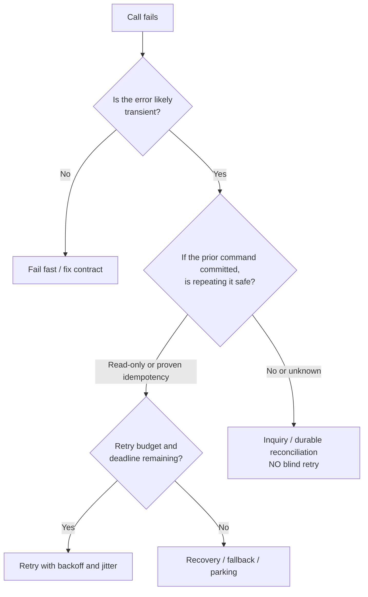
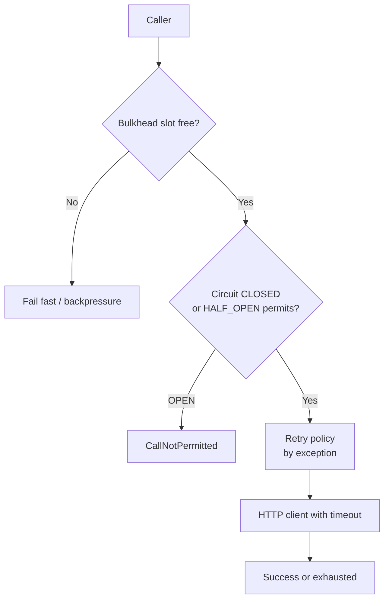
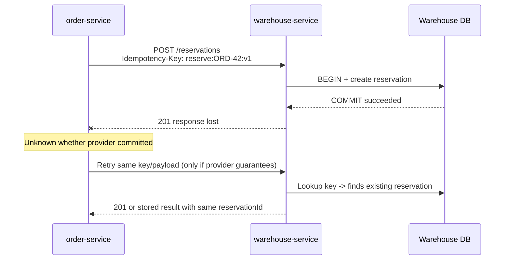
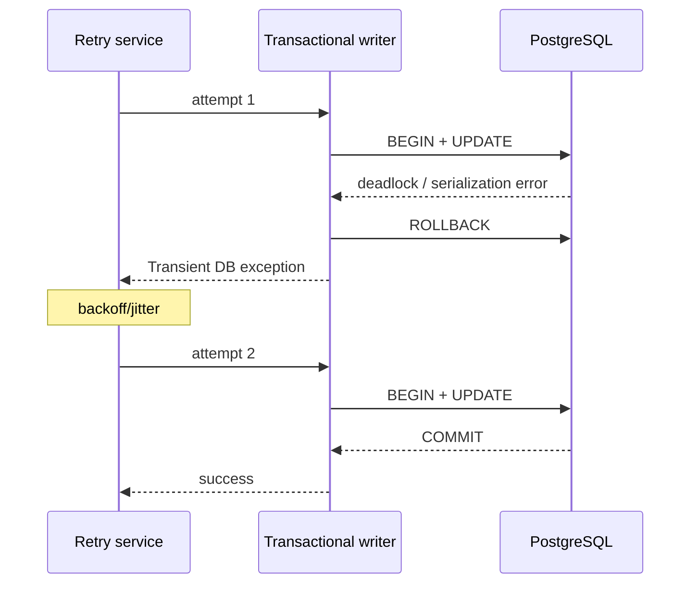
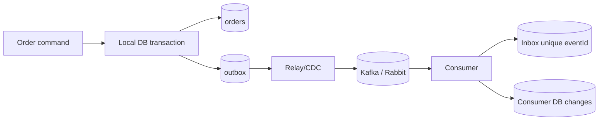

# Integrating Spring Retry or Resilience4j with Appropriate Libraries and Configuration

## 1. Problem Statement and Learning Objectives

A Spring Boot service frequently calls external systems over HTTP, JDBC/R2DBC, Redis, Kafka/RabbitMQ, or Spring Integration adapters. Those I/O operations can encounter transient network errors, rate limiting, database deadlocks, broker rebalances, or ambiguous outcomes after timeouts. Without a recovery policy, a brief glitch can fail a request. Yet adding unconditional retries can trigger a **retry storm**, increase latency, cause duplicate processing, or double-execute side effects.

For example, `order-service` needs to fetch available stock to render the checkout page:

```text
GET /api/inventory/SKU-42
  -> warehouse-service
  -> response 200 / 503 / 429 / timeout
```

For a truly read-only lookup, a `503` error may be worth retrying a couple of times. However, a stock reservation call:

```text
POST /api/reservations
Idempotency-Key: reserve:ORD-42
{"sku":"SKU-42","quantity":2}
```

may **already have committed** in Warehouse before `order-service` receives a read timeout. Resending with a new key risks reserving stock twice. Therefore, retry is a problem of **error classification + safety verification + bounding + post-exhaustion recovery**, not just an annotation.

This lesson belongs to the **Failure Recovery** chapter of the **SPRING_BOOT_INTEGRATION** module: organizing Spring Boot integrations across HTTP clients, databases, caches, message brokers, and Spring Integration adapters, emphasizing configuration, data contracts, transactions, errors, deduplication, testing, and production observability.

**After this lesson, you will be able to:**

1. Choose between **Spring Retry** and **Resilience4j** based on application behavior rather than popularity.
2. Install dependencies and apply `@Retryable`, `@Recover`, and `RetryTemplate`; distinguish proxy-based and programmatic retries.
3. Configure `@Retry`, `@CircuitBreaker`, `@Bulkhead`, and named instances in Resilience4j.
4. Design timeouts, exponential backoff, jitter, retry budgets, and exception whitelists.
5. Distinguish retries for read operations, idempotent writes, **UNKNOWN_OUTCOME** states, and operations that must never be retried automatically.
6. Integrate cleanly with `RestClient`/`WebClient`, Spring Integration, Kafka listeners, and local database transaction boundaries.
7. Write tests proving attempt counts, recovery, backoff, transaction rollbacks, duplicate protection, and behavior under outages.
8. Observe retries, circuit breakers, pool saturation, and DLTs/backlogs, and build runbooks to prevent failure amplification.

> **Scope:** Examples use Java 17+, Spring Boot 3.x, Spring Framework 6.x, Spring Retry 2.x, Resilience4j 2.x, and libraries matching a compatible BOM. Spring Boot 4.x or newer dependency versions may change starters, auto-configuration, properties, or APIs; consult official docs for your deployed version. Snippets are separated by scenario; do not stack **both retry libraries onto the same method** unintentionally.

## 2. What Does Retry Solve, and What Does It Not Solve?

A retry policy describes:

```text
operation
  ├─ attempt #1
  │    ├─ success -> return result
  │    └─ retryable failure -> wait/backoff
  ├─ attempt #2
  │    ├─ success -> return result
  │    └─ retryable failure -> wait/backoff
  └─ attempt #3
       ├─ success -> return result
       └─ fail -> recovery/fallback/error
```

Key terms:

| Term | Meaning |
| --- | --- |
| **Attempt** | One real invocation of the operation. Total attempts usually includes the initial call. |
| **Retry** | Re-invoking after a failure; must preserve the exact same logical command if representing the same operation. |
| **Transient failure** | An error that may clear upon waiting: temporary 503, rate limit, deadlock after rollback. |
| **Permanent failure** | Invalid validation, bad auth/permissions, broken SQL/schema contract; waiting will not fix it. |
| **UNKNOWN_OUTCOME** | A side-effecting command was sent, but it is unknown whether the receiver committed. |
| **Backoff** | Wait interval between attempts; usually increases exponentially. |
| **Jitter** | Randomness added to wait intervals so clients do not retry in lockstep. |
| **Retry budget** | Caps on attempts, time, concurrency, and system-wide retry cost. |
| **Recoverer / fallback** | Handling path when retries exhaust or a circuit is open; not necessarily a fake success result. |
| **Circuit breaker** | Stops calling upstream when error/slow-call rates cross thresholds; does not replace retries. |
| **Bulkhead** | Limits concurrency hitting a dependency to contain congestion. |

**Retries can** help overcome transient failures or brief slowdowns. **Retries cannot**:

- Fix JSON/schema contract mismatches, wrong endpoints, missing credentials, or invalid input data.
- Prove an earlier POST caused no side effects just because the client timed out.
- Turn two local transactions or DB + Kafka into an atomic distributed transaction.
- Guarantee exactly-once delivery across broker redeliveries or process restarts.
- Cure upstream overload if total request + retry volume exceeds capacity.

### 2.1. A Dual Precondition Before Retrying



**A transient exception does not mean an operation is safe to retry.** Decisions must weigh both the failure and side effects.

### 2.2. Classify Errors by Each Operation's Contract

| Signal | Stock GET (Read) | Reservation POST (Write) |
| --- | --- | --- |
| `200` with valid body | Success. | Success if provider confirms reservation. |
| `404` | SKU not found; usually fail/empty per contract. | Resource/endpoint does not exist; do not retry blindly. |
| `400/422` | Bad input/contract. | Do not retry same payload. |
| `401/403` | Auth/permissions: do not retry infinitely with same credentials. | Same. |
| `409/412` | Business conflict/conditional mismatch. | Read state, resolve conflict; no blind retry. |
| `429` | Bounded retry possible, honoring `Retry-After`. | Only if provider guarantees idempotency or proves non-execution. |
| `502/503/504` | Usually retryable within budget. | Side effect may have committed: requires key/inquiry. |
| Read timeout | Retryable if GET truly does not mutate state. | **UNKNOWN_OUTCOME** without a guarantee. |
| Deserialize/type error | Do not retry identical request without transient evidence. | Never retry contract failures. |
| DB deadlock | Retry a **fresh local transaction** if other side effects are safe. | Never retry an aborted transaction or non-idempotent remote payment. |

In HTTP, `GET` semantics are safe by specification, yet you must **verify the API implementation** does not trigger unexpected significant business side effects. On the gateway side, exception wrappers can also hide failure timing: `ResourceAccessException` can wrap both connection failures and response read timeouts, which is insufficient to conclude the remote did not commit.

## 3. Choosing Spring Retry or Resilience4j?

| Criterion | Spring Retry | Resilience4j |
| --- | --- | --- |
| Primary focus | Retry policies, backoff, recovery, and stateful retries in certain workflows. | Retries alongside circuit breaker, bulkhead, rate limiter, time limiter, and metrics. |
| Core annotations | `@Retryable`, `@Recover`, `@EnableRetry`. | `@Retry`, `@CircuitBreaker`, `@Bulkhead`, `@RateLimiter`, `@TimeLimiter`. |
| Imperative API | `RetryTemplate`; straightforward to scope a retried block. | `Retry.decorateSupplier/Callable` or annotations. |
| Configuration | Annotations, `RetryTemplate`, `RetryPolicy`/`BackOffPolicy`. | Named instances via `resilience4j.*`, `RetryConfig`/Registry. |
| Reactor | Do not apply blocking templates directly onto non-blocking publishers as a reactive solution. | `resilience4j-reactor` provides Reactor operators; Reactor-native retry is also an option. |
| Load/fault shedding | Does not natively provide circuit breakers/bulkheads. | Includes dedicated modules with composable policies. |
| Spring AOP | Annotations require proxied invocations. | Annotation starter also relies on AOP/proxies; runtime modules available. |
| Best fit | Simple imperative service flows, a single clear retry policy, or Spring Integration retry advice. | Multiple downstreams needing per-dependency circuit/bulkhead/rate-limit/metrics controls. |

**Use-case recommendations:**

- An HTTP GET in a Spring MVC app needing only bounded retries → **Spring Retry** is a straightforward choice.
- Multiple independent failing upstreams needing overload protection and circuit state observability → **Resilience4j** offers a more centralized configuration model.
- Non-blocking WebFlux apps → consider `Reactor Retry` or Resilience4j Reactor operators; never block on an event loop.
- Spring Integration handlers already using `RequestHandlerRetryAdvice` and a controlled `RetryTemplate` → do not add another `@Retry` layer unnecessarily.

No single library is universally "faster or safer." Business contracts, retry placement, timeouts, concurrency, and transaction boundaries matter far more than library branding.

## 4. Shared Spring Boot Example Setup

The examples use a Warehouse system with:

```text
GET  /api/v1/stock/{sku}       -> read stock
POST /api/v1/reservations      -> reserve stock (write)
```

Demo records:

```java
// StockView.java
package com.example.integration;

public record StockView(
    String sku,
    long available,
    long version
) {}
```

```java
// ReserveStockCommand.java
package com.example.integration;

public record ReserveStockCommand(
    String commandId,
    String orderId,
    String sku,
    long quantity
) {}
```

```java
// ReservationResult.java
package com.example.integration;

public record ReservationResult(
    String reservationId,
    String commandId
) {}
```

Domain/adapter exceptions clearly separating policies:

```java
// WarehouseTemporaryException.java
package com.example.integration;

public class WarehouseTemporaryException
    extends RuntimeException {
    public WarehouseTemporaryException(
        String message, Throwable cause
    ) {
        super(message, cause);
    }
}
```

```java
// WarehousePermanentException.java
package com.example.integration;

public class WarehousePermanentException
    extends RuntimeException {
    public WarehousePermanentException(
        String message, Throwable cause
    ) {
        super(message, cause);
    }
}
```

```java
// WarehouseUnknownOutcomeException.java
package com.example.integration;

public class WarehouseUnknownOutcomeException
    extends RuntimeException {
    public WarehouseUnknownOutcomeException(
        String message, Throwable cause
    ) {
        super(message, cause);
    }
}
```

```java
// WarehouseUnavailableException.java
package com.example.integration;

public class WarehouseUnavailableException
    extends RuntimeException {
    public WarehouseUnavailableException(
        String message, Throwable cause
    ) {
        super(message, cause);
    }
}
```

These are **classes in separate Java files**. Operation-specific exceptions ensure retry policies catch only eligible errors. Never collapse network, SQL, validation, parsing, and business conflict errors into one generic `RuntimeException` and retry everything.

### 4.1. `RestClient` with Per-Attempt Timeouts

An illustrative Spring Framework 6.1+ configuration:

```java
// WarehouseHttpConfiguration.java
package com.example.integration;

import java.net.http.HttpClient;
import java.time.Duration;
import org.springframework.beans.factory.annotation.Value;
import org.springframework.context.annotation.Bean;
import org.springframework.context.annotation.Configuration;
import org.springframework.http.client.JdkClientHttpRequestFactory;
import org.springframework.web.client.RestClient;

@Configuration(proxyBeanMethods = false)
public class WarehouseHttpConfiguration {

    @Bean("warehouseRestClient")
    RestClient warehouseRestClient(
        RestClient.Builder builder,
        @Value("${warehouse.base-url}") String baseUrl
    ) {
        HttpClient httpClient = HttpClient.newBuilder()
            .connectTimeout(Duration.ofSeconds(1))
            .build();

        JdkClientHttpRequestFactory factory =
            new JdkClientHttpRequestFactory(httpClient);
        factory.setReadTimeout(Duration.ofSeconds(2));

        return builder
            .baseUrl(baseUrl)
            .requestFactory(factory)
            .build();
    }
}
```

```yaml
# application.yml — environment-based configuration.
warehouse:
  base-url: ${WAREHOUSE_BASE_URL:http://localhost:8089}
```

Here connect and response/read timeouts bound a **single HTTP attempt**. They do not cap total duration across multiple retries. For example, three attempts with 2-second read timeouts plus 0.3s and 0.6s backoffs can block the caller for nearly 7 seconds before even counting connection setup and processing. Enforce an overall request/command deadline matching your SLA.

**Warning:** production clients also require tuning connection pooling, TLS, proxies, DNS, hostname verification, and resource limits. Do not conflate a connect timeout with "request definitely never sent": I/O exceptions do not always prove provider state.

### 4.2. Error-Classifying Gateway for GET

```java
// WarehouseReadGateway.java
package com.example.integration;

import org.springframework.beans.factory.annotation.Qualifier;
import org.springframework.stereotype.Component;
import org.springframework.web.client.HttpClientErrorException;
import org.springframework.web.client.HttpServerErrorException;
import org.springframework.web.client.ResourceAccessException;
import org.springframework.web.client.RestClient;

@Component
public class WarehouseReadGateway {
    private final RestClient client;

    public WarehouseReadGateway(
        @Qualifier("warehouseRestClient") RestClient client
    ) {
        this.client = client;
    }

    public StockView getStock(String sku) {
        try {
            StockView body = client.get()
                .uri("/api/v1/stock/{sku}", sku)
                .retrieve()
                .body(StockView.class);

            if (body == null || !sku.equals(body.sku())
                || body.available() < 0) {
                throw new WarehousePermanentException(
                    "Warehouse returned contract-invalid response", null
                );
            }
            return body;
        } catch (HttpClientErrorException.TooManyRequests ex) {
            // 429 may be retried, but Retry-After should be honored.
            // This simplified policy retries within a fixed budget.
            throw new WarehouseTemporaryException(
                "Warehouse rate limited GET", ex
            );
        } catch (HttpClientErrorException ex) {
            throw new WarehousePermanentException(
                "Warehouse rejected GET: " + ex.getStatusCode(), ex
            );
        } catch (HttpServerErrorException ex) {
            int status = ex.getStatusCode().value();
            if (status == 502 || status == 503 || status == 504) {
                throw new WarehouseTemporaryException(
                    "Warehouse temporarily unavailable", ex
                );
            }
            throw new WarehousePermanentException(
                "Warehouse error outside retry whitelist", ex
            );
        } catch (ResourceAccessException ex) {
            // GET is read-only per contract so bounded retry is permitted.
            throw new WarehouseTemporaryException(
                "Warehouse GET encountered I/O timeout/network error", ex
            );
        }
    }
}
```

The gateway does not retry itself; it **translates infrastructure errors into business/adapter categories** for the policy layer above. Whitelisting only `502/503/504` is an example choice; a real service may classify additional statuses/errors based on the provider contract.

Here `429` uses simple bounded retries; production code should read and parse `Retry-After` (seconds or HTTP-date), check the deadline, and honor rate-limit budgets. **Never** let callers sleep for long periods on servlet threads unbounded.

## 5. Spring Retry — Dependencies and Activation

With Maven and an appropriate Spring Boot BOM:

```xml
<dependencies>
    <dependency>
        <groupId>org.springframework.boot</groupId>
        <artifactId>spring-boot-starter-web</artifactId>
    </dependency>
    <dependency>
        <groupId>org.springframework.retry</groupId>
        <artifactId>spring-retry</artifactId>
    </dependency>
    <dependency>
        <groupId>org.springframework.boot</groupId>
        <artifactId>spring-boot-starter-aop</artifactId>
    </dependency>
</dependencies>
```

`@Retryable`/`@Recover` annotations require Spring Retry and interception via Spring AOP (or another explicitly configured mechanism). `spring-boot-starter-aop` supplies standard AOP infrastructure; **simply adding the dependency does not enable `@Retryable`** without `@EnableRetry`.

### 5.1. Enabling Annotation-Driven Retries

```java
// SpringRetryConfiguration.java
package com.example.integration;

import org.springframework.context.annotation.Configuration;
import org.springframework.retry.annotation.EnableRetry;

@Configuration(proxyBeanMethods = false)
@EnableRetry
public class SpringRetryConfiguration {
}
```

Do not manually instantiate `new WarehouseReadGateway(...)` and invoke methods directly if relying on Spring annotations: beans must be Spring-managed and calls must pass through the proxy.

### 5.2. `@Retryable` with Exception Whitelist and Exponential Backoff

```java
// StockQueryWithSpringRetry.java
package com.example.integration;

import org.springframework.retry.annotation.Backoff;
import org.springframework.retry.annotation.Recover;
import org.springframework.retry.annotation.Retryable;
import org.springframework.stereotype.Service;

@Service
public class StockQueryWithSpringRetry {
    private final WarehouseReadGateway gateway;

    public StockQueryWithSpringRetry(
        WarehouseReadGateway gateway
    ) {
        this.gateway = gateway;
    }

    @Retryable(
        retryFor = WarehouseTemporaryException.class,
        noRetryFor = WarehousePermanentException.class,
        maxAttempts = 3,
        backoff = @Backoff(
            delay = 250L,
            multiplier = 2.0,
            maxDelay = 1500L,
            random = true
        )
    )
    public StockView getStock(String sku) {
        return gateway.getStock(sku);
    }

    @Recover
    public StockView recover(
        WarehouseTemporaryException cause,
        String sku
    ) {
        // Never return a fake stock = 0 as if it were a valid result.
        throw new WarehouseUnavailableException(
            "Unable to fetch stock for SKU: " + sku,
            cause
        );
    }
}
```

**Notes:**

- `retryFor` accepts only `WarehouseTemporaryException`. Validation, parsing/contract errors, and `WarehousePermanentException` are excluded from retries.
- `maxAttempts=3` means **three total calls** (initial attempt + up to two retries), not three extra retries.
- `delay=250ms` and `multiplier=2` grow wait intervals; `maxDelay` caps growth; `random=true` enables randomization per your Spring Retry version's `@Backoff` behavior.
- `@Recover` runs once eligible attempts exhaust, with matching return type, method arguments, and throwable parameter.
- The recoverer **throws a domain exception** so callers can return 503, or may return **real fallback data with bounded staleness** if allowed by contract. Never return `StockView(available=0)` to fake zero inventory: that causes business defects.

Keep in mind that a method can still fail mid-retry with an unwhitelisted exception; do not assume every failure passes through `@Recover` with the same exception type.

### 5.3. AOP Proxies and Self-Invocation

```java
@Service
class BadStockService {
    public StockView handle(String sku) {
        return this.getStock(sku); // Internal call bypasses retry proxy.
    }

    @Retryable(retryFor = WarehouseTemporaryException.class)
    public StockView getStock(String sku) {
        return externalGateway.getStock(sku);
    }
}
```

In proxy-based AOP, `this.getStock(...)` bypasses the retry interceptor. Have another bean call `StockQueryWithSpringRetry.getStock(...)`, or use `RetryTemplate` programmatically when retrying inside the same class.

Other AOP misconfigurations:

- Method does not live on a Spring-managed bean.
- Method is `private` or cannot be intercepted by the active proxy mechanism.
- Caller holds a manually constructed `new` instance rather than the Spring proxy.
- Retry annotation sits at the **wrong scope**: the retried method also executes non-idempotent side effects alongside a read-only call.
- Method returns `CompletableFuture`/`Mono`, so the interceptor only sees **publisher/future creation**, missing asynchronous failures emitted later; use proper async/reactive retry policies.

### 5.4. `@Recover` Must Match Return Type and Signature

Spring Retry resolves recovery methods by return type, exception type, and method parameters:

```java
@Retryable(retryFor = WarehouseTemporaryException.class)
public StockView getStock(String sku) { /* ... */ }

@Recover
public StockView recover(
    WarehouseTemporaryException exception, String sku
) { /* ... */ }
```

If the recoverer returns `void` while the target method returns `StockView`, or lacks a matching signature, Spring Retry throws an exhaustion exception at runtime. **Integration tests must exercise the recovery path**, not merely retry counts.

## 6. Spring Retry — `RetryTemplate` for Programmatic Retry Control

`RetryTemplate` is useful when:

- The retry policy belongs around **one specific call** inside a method rather than the whole method.
- You need access to retry context/attempt details and caller-controlled recovery.
- Spring Integration uses `RequestHandlerRetryAdvice` or an adapter accepting a template.
- Tests want to verify policy logic without AOP interceptors.

### 6.1. Explicit Policy Configuration

```java
// StockRetryTemplateConfiguration.java
package com.example.integration;

import java.util.Map;
import org.springframework.context.annotation.Bean;
import org.springframework.context.annotation.Configuration;
import org.springframework.retry.backoff.ExponentialBackOffPolicy;
import org.springframework.retry.policy.SimpleRetryPolicy;
import org.springframework.retry.support.RetryTemplate;

@Configuration(proxyBeanMethods = false)
public class StockRetryTemplateConfiguration {

    @Bean("warehouseReadRetryTemplate")
    RetryTemplate warehouseReadRetryTemplate() {
        SimpleRetryPolicy retryPolicy =
            new SimpleRetryPolicy(
                3,
                Map.of(WarehouseTemporaryException.class, true),
                true
            );

        ExponentialBackOffPolicy backoff =
            new ExponentialBackOffPolicy();
        backoff.setInitialInterval(250L);
        backoff.setMultiplier(2.0);
        backoff.setMaxInterval(1500L);

        RetryTemplate template = new RetryTemplate();
        template.setRetryPolicy(retryPolicy);
        template.setBackOffPolicy(backoff);
        return template;
    }
}
```

Here `maxAttempts=3` includes the initial attempt. The `true` constructor flag enables cause-chain traversal per policy; verify classification carefully, because any wrapper exception containing `WarehouseTemporaryException` as a nested cause would also be retried. Avoid letting cause traversal accidentally retry unpredictable nested exceptions in production.

`ExponentialBackOffPolicy` here **does not add jitter**; with concurrent clients, choose a randomized backoff policy appropriate for your Spring Retry version or implement bounded jitter. `@Backoff(random=true)` in the previous section offers a simple annotation equivalent.

### 6.2. Calling `RetryTemplate.execute(...)`

```java
// StockQueryWithTemplate.java
package com.example.integration;

import org.springframework.beans.factory.annotation.Qualifier;
import org.springframework.retry.support.RetryTemplate;
import org.springframework.stereotype.Service;

@Service
public class StockQueryWithTemplate {
    private final WarehouseReadGateway gateway;
    private final RetryTemplate retry;

    public StockQueryWithTemplate(
        WarehouseReadGateway gateway,
        @Qualifier("warehouseReadRetryTemplate") RetryTemplate retry
    ) {
        this.gateway = gateway;
        this.retry = retry;
    }

    public StockView getStock(String sku) {
        return retry.execute(
            ctx -> gateway.getStock(sku),
            ctx -> {
                Throwable cause = ctx.getLastThrowable();
                throw new WarehouseUnavailableException(
                    "Warehouse retry budget exhausted: " + sku,
                    cause
                );
            }
        );
    }
}
```

This is **an alternative to** `StockQueryWithSpringRetry`; do not invoke this template inside an already `@Retryable` method unless deliberately designing a two-tier shared budget.

### 6.3. Observing Attempts

A `RetryListener` can measure attempt counts, last exception, and duration; never log sensitive payloads on every attempt. Each `RetryTemplate` supports registering listeners per version:

```text
retry attempt=1, outcome=503
retry attempt=2, outcome=timeout
retry attempt=3, outcome=success
```

Aggregate metrics by dependency/operation/error category—never make each SKU or order ID a metric label. Do not mistake in-JVM retry counts for **end-to-end total retries** if callers, brokers, and API gateways also retry independently.

## 7. Spring Retry — Stateful Retry and Transaction Boundaries

Spring Retry also supports **stateful retry**: attempts can span separate invocations keyed by a logical operation ID, supporting certain workflows involving transaction rollbacks and message delivery. This is an advanced feature; it **does not automatically persist state across process restarts** and does not replace a business idempotency ledger.

When a message broker redelivers after a rollback, identify the same message using a stable business/event ID, and align the retry context cache, transaction boundary, and broker acknowledgment. Using the wrong key or evicting retry context prematurely can skew attempt counts.

A critical principle:

```text
Safer for local DB deadlocks:
  Retry layer
    -> BEGIN new transaction
       -> UPDATE DB
       -> COMMIT or ROLLBACK
    -> retry a fresh transaction if transient

Dangerous:
  BEGIN transaction
    -> retry SQL repeatedly inside an already-aborted transaction
    -> COMMIT fails or state is no longer valid
```

Especially in PostgreSQL, certain SQL errors put the transaction into an aborted state; retrying a query inside that same transaction cannot recover it. When `@Transactional` and `@Retryable` sit on the same method, advice ordering decides whether retry wraps transaction or vice versa. Default advisor ordering can shift when AOP is customized; **test actual transaction begin/rollback per attempt** rather than guessing from annotation placement.

**Best practice:** place an outer retry service calling a separate `@Transactional` bean:

```java
@Service
class RetryOrderWrites {
    private final TransactionalOrderWriter writer;
    private final RetryTemplate retry;

    RetryOrderWrites(
        TransactionalOrderWriter writer, RetryTemplate retry
    ) {
        this.writer = writer;
        this.retry = retry;
    }

    public void run(OrderCommand command) {
        retry.execute(ctx -> {
            writer.apply(command); // Each invocation goes through the bean proxy.
            return null;
        });
    }
}

@Service
class TransactionalOrderWriter {
    @Transactional(transactionManager = "ordersTxManager")
    public void apply(OrderCommand command) {
        // Local DB updates; do not call remote payment here.
    }
}
```

This is a **structural sketch**; `OrderCommand` and `ordersTxManager` are project-defined components, not Spring framework classes. The DB retry template should have a **dedicated policy** targeting deadlock/serialization exceptions—never reuse `warehouseReadRetryTemplate` for everything.

## 8. Resilience4j — Dependencies for Spring Boot 3

Resilience4j provides modular components: `retry`, `circuitbreaker`, `bulkhead`, `ratelimiter`, `timelimiter`, `micrometer`, plus framework/reactive integrations. For Spring Boot 3, use the matching starter:

```xml
<!-- Illustrative pom.xml: Spring Boot 3.x, Java 17+. -->
<dependencyManagement>
    <dependencies>
        <dependency>
            <groupId>io.github.resilience4j</groupId>
            <artifactId>resilience4j-bom</artifactId>
            <version>2.2.0</version>
            <type>pom</type>
            <scope>import</scope>
        </dependency>
    </dependencies>
</dependencyManagement>

<dependencies>
    <dependency>
        <groupId>io.github.resilience4j</groupId>
        <artifactId>resilience4j-spring-boot3</artifactId>
    </dependency>
    <dependency>
        <groupId>org.springframework.boot</groupId>
        <artifactId>spring-boot-starter-aop</artifactId>
    </dependency>
    <dependency>
        <groupId>org.springframework.boot</groupId>
        <artifactId>spring-boot-starter-actuator</artifactId>
    </dependency>
    <!-- If using WebFlux / Reactor, add the matching Reactor module. -->
    <dependency>
        <groupId>io.github.resilience4j</groupId>
        <artifactId>resilience4j-reactor</artifactId>
    </dependency>
</dependencies>
```

Version `2.2.0` is an **example of pinning a Resilience4j 2.x release** compatible with Spring Boot 3 in many setups; do not assume it is the latest or fits every organizational BOM. Pick a release verified with your Spring Boot, Spring Framework, Reactor, and Java versions, and use a single BOM to avoid mixing Resilience4j module versions.

If the app uses only Spring MVC/imperative HTTP, `resilience4j-reactor` can be omitted. For Prometheus, add the Micrometer registry and configure exposure policies; Actuator does not automatically publish all business metrics.

**Do not add** `resilience4j-spring-boot2` to a Spring Boot 3 project just because an older guide used it. For Spring Boot 4, locate the integration artifact targeting that **exact framework generation** rather than copying `spring-boot3` blindly.

### 8.1. Resilience4j Uses Named Instances

In applications with multiple external dependencies, define distinct policies:

```text
warehouseRead     -> GET stock: retry 3 attempts, circuit breaker
warehouseReserve  -> POST reservation: retry only with idempotency guarantee
pricingRead       -> GET prices: retry 2 attempts
paymentCapture    -> POST payment: inquiry when outcome unknown
orderDatabase     -> retry whole transaction for deadlock, no HTTP retry
```

A `warehouseRead` entry under `resilience4j.retry.instances` is separate from an entry under `resilience4j.circuitbreaker.instances`; each module owns its own registry/policy even if names match by convention.

## 9. Resilience4j — Configuring Retry, CircuitBreaker, Bulkhead

Example `application.yml`:

```yaml
resilience4j:
  retry:
    instances:
      warehouseRead:
        maxAttempts: 3
        waitDuration: 250ms
        enableExponentialBackoff: true
        exponentialBackoffMultiplier: 2
        retryExceptions:
          - com.example.integration.WarehouseTemporaryException
        ignoreExceptions:
          - com.example.integration.WarehousePermanentException

  circuitbreaker:
    instances:
      warehouseReadBreaker:
        slidingWindowType: COUNT_BASED
        slidingWindowSize: 20
        minimumNumberOfCalls: 10
        failureRateThreshold: 50
        slowCallDurationThreshold: 2s
        slowCallRateThreshold: 80
        waitDurationInOpenState: 10s
        permittedNumberOfCallsInHalfOpenState: 3
        recordExceptions:
          - com.example.integration.WarehouseTemporaryException
          - com.example.integration.WarehouseUnavailableException
        ignoreExceptions:
          - com.example.integration.WarehousePermanentException

  bulkhead:
    instances:
      warehouseReadBulkhead:
        maxConcurrentCalls: 12
        maxWaitDuration: 0ms
```

**Retry:**

- `maxAttempts=3` means three total calls, not three additional retries after the first attempt.
- `waitDuration=250ms` is the base wait; enabling exponential backoff scales subsequent waits by the multiplier per Resilience4j policy.
- `retryExceptions` is the whitelist; `ignoreExceptions` keeps business/contract errors from being retried.
- If you want jitter, check randomization properties supported by your exact release or configure an explicit `IntervalFunction/IntervalBiFunction`; **never assume exponential backoff includes jitter by default**.

**Circuit breaker:**

- The `COUNT_BASED` window tracks outcomes of relevant calls; evaluation to open begins once `minimumNumberOfCalls` is reached.
- `failureRateThreshold=50` sets a 50% error rate threshold; `slowCallRateThreshold` can also open the circuit when slow calls exceed threshold.
- When `OPEN`, the circuit rejects calls with `CallNotPermittedException` rather than hitting the upstream, relieving overload.
- Once the open wait expires, the circuit permits a bounded number of `HALF_OPEN` calls to test recovery instead of unleashing full traffic immediately.

**Bulkhead:**

- `maxConcurrentCalls=12` caps concurrent invocations within the instance scope.
- `maxWaitDuration=0ms` opts for fail-fast without waiting for slots; rejected calls must be mapped to a clear response.
- This is a **semaphore bulkhead**, not a database pool, and does not replace web server or Kafka consumer limits.

**Never copy these numbers as universal defaults:** 12 calls, 20 samples, 10 seconds, and 50% are illustrative only. Tune against throughput, upstream quotas, p95 latency, error budgets, and pod counts.

### 9.1. Applying `@Retry` in a Separate Bean

```java
// RetryingStockLookup.java
package com.example.integration;

import io.github.resilience4j.retry.annotation.Retry;
import org.springframework.stereotype.Service;

@Service
public class RetryingStockLookup {
    private final WarehouseReadGateway gateway;

    public RetryingStockLookup(WarehouseReadGateway gateway) {
        this.gateway = gateway;
    }

    @Retry(name = "warehouseRead")
    public StockView find(String sku) {
        return gateway.getStock(sku);
    }
}
```

This bean performs a read-only GET; `@Retry` is applied via Resilience4j Spring AOP when called through the proxy. It reuses `WarehouseReadGateway` from Section 4 **without** adding Spring Retry's `@Retryable` inside.

### 9.2. Adding a Circuit Breaker on an Outer Facade

```java
// ProtectedStockQuery.java
package com.example.integration;

import io.github.resilience4j.circuitbreaker.annotation.CircuitBreaker;
import org.springframework.stereotype.Service;

@Service
public class ProtectedStockQuery {
    private final RetryingStockLookup retrying;

    public ProtectedStockQuery(RetryingStockLookup retrying) {
        this.retrying = retrying;
    }

    @CircuitBreaker(
        name = "warehouseReadBreaker",
        fallbackMethod = "unavailable"
    )
    public StockView getStock(String sku) {
        return retrying.find(sku);
    }

    public StockView unavailable(String sku, Throwable error) {
        throw new WarehouseUnavailableException(
            "Warehouse failing or circuit open: " + sku,
            error
        );
    }
}
```

**Why separate into two beans?** The circuit breaker facade wraps **one logical GET** and observes the final outcome after retries; inner attempts are not each counted as separate circuit breaker invocations at this boundary. This is far easier to reason about than stacking `@Retry` and `@CircuitBreaker` on one method and guessing advisor precedence.

In Section 9's config, `WarehouseUnavailableException` is recorded as a circuit failure. `WarehouseTemporaryException` may also be recorded unless mapped/fallback-handled into another type; configure record/ignore rules per contract.

**Never let a fallback fabricate success.** Returning `StockView(sku, 0, 0)` when the circuit is OPEN tricks users into thinking the warehouse has zero stock, leading to bad decisions. Valid fallbacks include:

- Returning a cached snapshot tagged `stale=true/asOf` if the product allows it.
- Returning `503 Service Unavailable` or a domain error so the caller knows reading failed.
- Enqueuing the command to a durable queue if it is a recoverable async write.

### 9.3. Bounding Concurrency with `@Bulkhead`

To allow at most 12 logical requests into the facade at once, create a separate wrapper:

```java
// BoundedStockQuery.java
package com.example.integration;

import io.github.resilience4j.bulkhead.annotation.Bulkhead;
import org.springframework.stereotype.Service;

@Service
public class BoundedStockQuery {
    private final ProtectedStockQuery protectedQuery;

    public BoundedStockQuery(ProtectedStockQuery protectedQuery) {
        this.protectedQuery = protectedQuery;
    }

    @Bulkhead(name = "warehouseReadBulkhead")
    public StockView getStock(String sku) {
        return protectedQuery.getStock(sku);
    }
}
```

Here an outer Bulkhead holds a slot **across the entire Retry + CircuitBreaker path** of a logical request, including synchronous backoff sleeps on the thread. That can hold slots longer; an alternative design puts the bulkhead around each individual attempt to cap active HTTP calls without holding slots while sleeping. Neither ordering is universally optimal: choose based on your concurrency vs. latency goals and test it.

When the bulkhead is full, `BulkheadFullException` is thrown; do not retry immediately inside the same bulkhead, which only increases contention. Consider returning 503/429 and an appropriate `Retry-After` if the API contract permits.

### 9.4. Programmatic Resilience4j Retry

When you prefer to avoid AOP dependencies:

```java
import io.github.resilience4j.retry.Retry;
import io.github.resilience4j.retry.RetryConfig;
import java.time.Duration;
import java.util.function.Supplier;

RetryConfig config = RetryConfig.custom()
    .maxAttempts(3)
    .waitDuration(Duration.ofMillis(250))
    .retryExceptions(WarehouseTemporaryException.class)
    .ignoreExceptions(WarehousePermanentException.class)
    .build();

// In real applications, keep Retry in a singleton Registry/bean.
Retry warehouseRetry = Retry.of("warehouseRead", config);

Supplier<StockView> guarded = Retry.decorateSupplier(
    warehouseRetry,
    () -> warehouseReadGateway.getStock(sku)
);
StockView result = guarded.get();
```

`warehouseReadGateway` and `sku` come from the service/caller. Never create a fresh `Retry.of(...)` **on every HTTP request**, as metrics, state, and policy tracking would fragment. Use a singleton `RetryRegistry` or Spring Boot-configured instances.

## 10. How Circuit Breakers Differ from Retries and Rate Limiting



| Mechanism | Question Answered | What It Does Not Solve |
| --- | --- | --- |
| Retry | "Is a failed attempt worth trying again?" | Upstream overload if retries are unbounded. |
| Circuit breaker | "Is upstream failing badly enough to pause calls temporarily?" | Duplicate side effects. |
| Bulkhead | "How many calls may run concurrently?" | Business ordering and exactly-once semantics. |
| Rate limiter | "How many calls may start in a time window?" | Uncertain outcomes of already-sent POSTs. |
| Time limiter | "How long may an async operation be awaited?" | Cancelling side effects already committed on the provider. |
| HTTP client timeouts | "How long may one connect/read attempt wait?" | Total budget across retries and broker redeliveries. |

An `OPEN` circuit protects Warehouse, yet if 1,000 callers immediately retry `CallNotPermittedException`, the retry storm simply shifts up a layer. Typically, **do not retry immediately** on `OPEN` circuit or full bulkhead rejections; return a degraded response or schedule a controlled delayed retry.

### 10.1. `TimeLimiter` Does Not Mean the Remote Operation Stops

Resilience4j `TimeLimiter` works with `CompletionStage` or reactive publishers via the corresponding integration module. Placing `@TimeLimiter` on a blocking method returning `StockView` **does not** interrupt a `RestClient` call the way it cancels a `CompletableFuture`. For synchronous HTTP, configure connect/read timeouts on the request factory/client alongside an overall deadline at the appropriate boundary.

With async:

```text
Caller hits 2 seconds -> TimeLimiter emits timeout/cancel per config
Upstream already received POST -> may still commit reservation at 3 seconds
```

**Timeouts/cancellation do not roll back remote side effects.** Idempotency/inquiry policies remain mandatory for writes.

### 10.2. When Do You Need `@RateLimiter`?

If Warehouse permits 100 requests/second per API key, configure rate limiters and/or distributed quotas at the API gateway. A local Resilience4j rate limiter per pod **does not share quota across the cluster**; 10 pods at 100 rps each can breach the partner's limit. You need global quota awareness, distributed coordination, or per-pod budget partitioning.

**Never mistake a rate limiter for a retry policy.** A rate limiter rejects/throttles new calls; retries consume extra quota and can worsen rate-limit rejections.

## 11. WebFlux / `WebClient`: Retries Must Stay Inside the Reactive Pipeline

If a service uses `WebClient` and returns `Mono<StockView>`, avoid:

```java
// WRONG: turns reactive I/O into blocking; unsafe on event loops.
StockView result = webClient.get()
    .uri("/api/v1/stock/{sku}", sku)
    .retrieve()
    .bodyToMono(StockView.class)
    .block();
```

### 11.1. Reactor-Native `retryWhen` for GET

```java
// ReactiveWarehouseReadGateway.java
package com.example.integration;

import java.time.Duration;
import org.springframework.stereotype.Component;
import org.springframework.web.reactive.function.client.WebClient;
import reactor.core.publisher.Mono;
import reactor.util.retry.Retry;

@Component
public class ReactiveWarehouseReadGateway {
    private final WebClient client;

    public ReactiveWarehouseReadGateway(WebClient.Builder builder) {
        this.client = builder
            .baseUrl("http://warehouse-service")
            .build();
    }

    public Mono<StockView> getStockOnce(String sku) {
        return Mono.defer(() -> client.get()
                .uri("/api/v1/stock/{sku}", sku)
                .retrieve()
                .onStatus(
                    code -> code.value() == 503,
                    response -> Mono.error(
                        new WarehouseTemporaryException(
                            "Warehouse 503", null
                        )
                    )
                )
                .bodyToMono(StockView.class)
            );
    }

    public Mono<StockView> getStock(String sku) {
        return getStockOnce(sku)
            .retryWhen(
                Retry.backoff(2, Duration.ofMillis(250))
                    .maxBackoff(Duration.ofSeconds(1))
                    .jitter(0.5)
                    .filter(ex ->
                        ex instanceof WarehouseTemporaryException)
            )
            .timeout(Duration.ofSeconds(4));
    }
}
```

Key details:

- `Retry.backoff(2, ...)` in Reactor means **up to two retries after the first attempt**, totaling three subscriptions/attempts. Notice the syntax difference from Spring Retry/Resilience4j's `maxAttempts=3`.
- `Mono.defer` ensures each subscription re-runs the reactive request creation logic.
- `retryWhen` retries only `WarehouseTemporaryException` (here mapped from 503). Other error status codes produce `WebClientResponseException` by default and are **not** retried by this filter.
- `timeout(4s)` **outside** `retryWhen` bounds the whole attempt/backoff chain in this example. Placing `timeout` before `retryWhen` bounds each individual attempt.
- `timeout` emits an error downstream and cancels the subscription, without proving upstream halted or rolled back.
- Reactive HTTP client drivers still need explicit connect/read/pool timeouts in production; `Mono.timeout` does not replace socket timeouts.

This snippet assumes URI `http://warehouse-service` resolves in cluster; production should inject base URL, TLS, and authentication from properties.

### 11.2. Resilience4j Reactor Operator

Once a Resilience4j Registry is configured via the starter, you can use `resilience4j-reactor`:

```java
import io.github.resilience4j.retry.RetryRegistry;
import io.github.resilience4j.reactor.retry.RetryOperator;
import org.springframework.stereotype.Service;
import reactor.core.publisher.Mono;

@Service
class ReactiveStockQuery {
    private final ReactiveWarehouseReadGateway gateway;
    private final RetryRegistry registry;

    ReactiveStockQuery(
        ReactiveWarehouseReadGateway gateway,
        RetryRegistry registry
    ) {
        this.gateway = gateway;
        this.registry = registry;
    }

    Mono<StockView> find(String sku) {
        var retry = registry.retry("warehouseRead");
        // Use non-retrying GET; Resilience4j is the sole policy owner.
        return gateway.getStockOnce(sku)
            .transformDeferred(RetryOperator.of(retry))
            .timeout(java.time.Duration.ofSeconds(4));
    }
}
```

**Never apply the Resilience4j operator on top of `gateway.getStock(...)` which already has `retryWhen(...)` from Section 11.1.** That is why this example calls `getStockOnce(...)` so `RetryOperator` is the **sole** policy owner. Stacking both makes the outer Resilience4j operator resubscribe the inner retrying chain, multiplying total attempts.

Similarly, `CircuitBreakerOperator` and `BulkheadOperator` exist depending on module version; choose operator order deliberately for clear concurrency and metric semantics. Never assume `@Retry` on a reactive method works without a Publisher-aware integration module.

### 11.3. Blocking Spring Retry Is Not Reactor Retry

`RetryTemplate.execute(ctx -> repository.findById(id))` only retries **creating the Mono** if that method throws synchronously before returning the publisher. Actual DB/HTTP errors emit **upon subscription**, after the template has already returned, so the policy never retries the I/O.

For reactive code, compose operators like `retryWhen`/`RetryOperator` on the real Publisher. Never convert a `Mono` via `.block()` just to reuse `RetryTemplate`.

## 12. With Side Effects: Prerequisites Before Enabling Retries

**Scenario:** `order-service` calls Warehouse to reserve two units of SKU-42, and the client gets a read timeout. What can happen:



If the provider **does not actually persist and compare the idempotency key**, sending the header gives zero protection. Once the provider commits, retrying can deduct stock twice. Neither Resilience4j `@Retry` nor Spring Retry `@Retryable` on a POST solves this automatically.

### 12.1. An Idempotency Contract Sufficient for Retrying Writes

| Attribute | Required Question |
| --- | --- |
| Stable command ID | Do all attempts send the exact same `commandId`? |
| Scope | Is the key isolated by tenant/merchant/operation? |
| Request fingerprint | Is the same key with a different payload rejected rather than replaying the wrong result? |
| Atomic claim | Do two concurrent requests with the same key produce only one side effect? |
| Result replay | Does the provider replay the same business result/reservation ID or offer unambiguous status inquiry? |
| Retention | Does the provider keep the key longer than the retry/DLT/replay horizon? |
| Expiry | Once the key TTL expires, how are late retries handled? |
| Unknown outcome | Is there a lookup endpoint by business command ID when responses are lost? |
| Authorization | Is the key protected against cross-tenant access and never treated as a credential? |

Example request:

```http
POST /api/v1/reservations HTTP/1.1
Content-Type: application/json
Idempotency-Key: reserve:ORD-42:v1

{"orderId":"ORD-42","sku":"SKU-42","quantity":2}
```

**Do not:**

```java
// WRONG: every retry becomes a brand-new command on the provider.
headers.set("Idempotency-Key",
    java.util.UUID.randomUUID().toString());
```

**Do:**

```java
// commandId was generated before the workflow step began.
headers.set("Idempotency-Key", command.commandId());
```

One order can legitimately have multiple reservation commands; do not use `orderId` for every idempotency key when commands throughout the order lifecycle must stay distinct. A good key combines the logical operation identifier with a stable contract version/context.

### 12.2. Single-Attempt POST Gateway Without Retries

```java
// WarehouseReservationGateway.java
package com.example.integration;

import org.springframework.beans.factory.annotation.Qualifier;
import org.springframework.http.MediaType;
import org.springframework.stereotype.Component;
import org.springframework.web.client.HttpClientErrorException;
import org.springframework.web.client.HttpServerErrorException;
import org.springframework.web.client.ResourceAccessException;
import org.springframework.web.client.RestClient;

@Component
public class WarehouseReservationGateway {
    private final RestClient client;

    public WarehouseReservationGateway(
        @Qualifier("warehouseRestClient") RestClient client
    ) {
        this.client = client;
    }

    public ReservationResult reserveOnce(
        ReserveStockCommand command
    ) {
        if (command.commandId() == null
            || command.commandId().isBlank()
            || command.quantity() <= 0) {
            throw new IllegalArgumentException("Invalid reservation");
        }

        try {
            ReservationResult body = client.post()
                .uri("/api/v1/reservations")
                .contentType(MediaType.APPLICATION_JSON)
                .header("Idempotency-Key", command.commandId())
                .body(command)
                .retrieve()
                .body(ReservationResult.class);

            if (body == null || body.reservationId() == null
                || !command.commandId().equals(body.commandId())) {
                throw new WarehousePermanentException(
                    "Response violated contract", null
                );
            }
            return body;
        } catch (HttpClientErrorException ex) {
            // 409 same-key-different-body differs from 409 insufficient stock.
            // Map details based on provider error codes.
            throw new WarehousePermanentException(
                "Reservation rejected: " + ex.getStatusCode(),
                ex
            );
        } catch (HttpServerErrorException ex) {
            // A 5xx after POST can still happen after remote COMMIT.
            throw new WarehouseUnknownOutcomeException(
                "Warehouse 5xx after reservation request", ex
            );
        } catch (ResourceAccessException ex) {
            // Read timeout / reset may have occurred after remote COMMIT.
            throw new WarehouseUnknownOutcomeException(
                "Unknown whether reservation was created", ex
            );
        }
    }
}
```

This method **does not retry**. It returns `ReservationResult` on confirmed success, throws a permanent/business error on explicit provider rejection, and throws `WarehouseUnknownOutcomeException` when the write response is too ambiguous to conclude.

Some `HttpClientErrorException` responses (such as 429) may be classified differently if the provider contract guarantees the request was not processed; verify per endpoint. Keeping them permanent here **prevents automatic write retries** without a proven guarantee.

### 12.3. Enable POST Retries Only When the Provider Enforces Idempotency

Only after contracts and integration tests prove the provider:

1. Handles same key/payload atomically.
2. Replays the previous result.
3. Retains keys long enough.
4. Produces no second side effect when the client retries after an unknown outcome.

may you add a retry wrapper using the same key:

```java
// IdempotentReservationService.java
package com.example.integration;

import org.springframework.retry.annotation.Backoff;
import org.springframework.retry.annotation.Retryable;
import org.springframework.stereotype.Service;

@Service
public class IdempotentReservationService {
    private final WarehouseReservationGateway gateway;

    public IdempotentReservationService(
        WarehouseReservationGateway gateway
    ) {
        this.gateway = gateway;
    }

    // Enable ONLY when the provider contract in Section 12.3 is proven.
    @Retryable(
        retryFor = WarehouseUnknownOutcomeException.class,
        maxAttempts = 3,
        backoff = @Backoff(
            delay = 300L,
            multiplier = 2.0,
            maxDelay = 1200L,
            random = true
        )
    )
    public ReservationResult reserve(
        ReserveStockCommand command
    ) {
        // Identical object/commandId/payload on all attempts.
        return gateway.reserveOnce(command);
    }
}
```

This is a **conditional option**, not a pattern safe for every POST. When retries exhaust, persist durable state `RESERVATION_UNKNOWN`, perform a provider status inquiry, or open a reconciliation task. Never treat retry exhaustion as "reservation definitely does not exist," and never issue a new command with a fresh key.

### 12.4. Why Must a Post-POST Timeout Have Its Own State?

```text
NEW -> RESERVATION_PENDING
          |
          +-> HTTP 201 -> RESERVED
          |
          +-> HTTP 4xx business failure -> REJECTED
          |
          +-> timeout / uncertain 5xx -> RESERVATION_UNKNOWN
                                            |
                                            +-> inquiry finds reservation -> RESERVED
                                            +-> proven unexecuted -> retry same command
                                            +-> still unclear -> PARKED / MANUAL_RECONCILE
```

If a provider lacks reliable keys/inquiries, no resilience library can turn a non-idempotent remote side effect into a "safe retry." That is a **business and protocol constraint**, not a missing library setting.

## 13. Database Transactions: Retry the Unit-of-Work, Never Inside an Aborted Transaction

A PostgreSQL transaction may roll back due to a deadlock or serialization failure. If classified as transient and the entire unit-of-work has no uncertain remote side effects, retrying a **fresh** transaction can be safe.



**Conditions:**

- Retry advice/template **wraps outside** the `@Transactional` service.
- Each attempt calls through a Spring proxy to open a new transaction.
- Database state/invariants are re-read; never blindly replay stale reads captured outside the transaction.
- Commands carry business IDs and unique constraints in case callers/messages redeliver.
- Do not put HTTP payments or non-outbox Kafka publishes inside a retried transaction where side effects would repeat.

Common JDBC/Spring exceptions to evaluate include `CannotAcquireLockException`, `CannotSerializeTransactionException`, or appropriate `TransientDataAccessException` subclasses. **Do not whitelist all `DataAccessException`** because constraint/schema/permission errors are permanent.

### 13.1. Do Not Abuse a Single `TransactionTemplate` Across Two Databases

If you have separate `ordersTxManager` and `auditTxManager`, retrying an outer service containing:

```text
ordersTx COMMIT
auditTx FAIL
retry whole service
```

can create duplicate order rows unless idempotent. Multiple local transaction managers do not gain distributed atomicity from an outer retry wrapper. Use a transactional outbox in the source of truth and relay to audit/Kafka to avoid losing events.

### 13.2. Never Hold a DB Transaction Open During Backoff or HTTP Waits

A transaction holding connections and locks for seconds can overload the DB:

```text
BEGIN DB transaction
  UPDATE order
  call HTTP 2s
  retry HTTP + sleep 500ms
  retry HTTP + sleep 1s
COMMIT
```

Better:

```text
BEGIN DB transaction
  UPDATE order
  INSERT outbox event
COMMIT

worker:
  READ outbox
  CALL HTTP/Kafka with timeout + retry budget
  MARK outbox state/reconcile
```

An outbox does not make remote side effects automatically exactly-once, yet it makes **execution intent** durable across crashes and enables controlled retries after the DB commit.

## 14. Transactional Outbox and Inbox: Durable Recovery Paths

When an operation updates the database and emits an event:



The local transaction writes both the order and the outbox row. The relay can use Spring Retry/Resilience4j for **broker publishing**, provided it:

- Publishes events with a stable `eventId`, never generating a new ID per attempt.
- Awaits the proper broker acknowledgment before marking published.
- Recognizes that crashing after broker ack and before marking published means **replay can publish duplicates**.
- Requires consumers to maintain an inbox/unique `eventId` and apply business updates inside the same local transaction.
- Ensures that if consumer DB commits before crashing prior to offset commit, redelivery will not duplicate side effects.
- Distinguishes broker transport retries from business command processing; never rely on producer idempotence alone for app-level republishing.

### 14.1. Minimal Schema

```sql
-- In the source of truth:
CREATE TABLE order_outbox (
    event_id VARCHAR(160) PRIMARY KEY,
    command_id VARCHAR(100) NOT NULL,
    payload_json TEXT NOT NULL,
    published BOOLEAN NOT NULL DEFAULT FALSE,
    created_at TIMESTAMPTZ NOT NULL DEFAULT CURRENT_TIMESTAMP
);

-- In the consumer database:
CREATE TABLE processed_events (
    consumer_name VARCHAR(100) NOT NULL,
    event_id VARCHAR(160) NOT NULL,
    processed_at TIMESTAMPTZ NOT NULL DEFAULT CURRENT_TIMESTAMP,
    PRIMARY KEY (consumer_name, event_id)
);
```

This is an illustrative schema; production needs claims/leases, retention, payload schema versions, tenant scoping, poison-message handling, cleanup, trace/correlation IDs, and metrics. The inbox marker must share the same transaction as the DB business side effect; if the marker commits first and the business update fails, redelivery would skip the work erroneously.

### 14.2. Post-Timeout Retry Exhaustion Is Not Proof of Failure

In outbound HTTP:

```text
provider COMMIT succeeds
    -> response lost
    -> client exhausts attempts
```

Do not transition business state to `FAILED_NOT_EXECUTED`. Set `UNKNOWN_OUTCOME`, query the provider by stable command ID, or reconcile against the business ledger. For payments, check the provider payment intent/charge ID before charging again.

### 14.3. Durable Retries Differ from In-Process Retries

Spring Retry/Resilience4j mostly retry within the lifetime of one invocation/process. If the pod restarts, in-flight attempts vanish. Only a worker backed by a pending table, delayed topic/queue, or durable scheduler can resume after a crash.

Complete systems often combine two tiers:

```text
Fast: 2-3 attempts in-process (seconds)
Slow: durable retry in worker/queue (minutes/hours)
Final: DLT/parking + operator reconciliation
```

All tiers **share the same logical command ID and idempotency contract**.

## 15. Spring Integration — `RequestHandlerRetryAdvice`

Spring Integration allows attaching retry advice to a message handler. This helps synchronous service activators/outbound gateways, yet **does not automatically turn an entire IntegrationFlow into a transaction**.

### 15.1. Dependencies and Configuration

```xml
<dependency>
    <groupId>org.springframework.boot</groupId>
    <artifactId>spring-boot-starter-integration</artifactId>
</dependency>
<dependency>
    <groupId>org.springframework.retry</groupId>
    <artifactId>spring-retry</artifactId>
</dependency>
```

Example reusing `warehouseReadRetryTemplate` from Section 6:

```java
// WarehouseIntegrationConfiguration.java
package com.example.integration;

import org.springframework.beans.factory.annotation.Qualifier;
import org.springframework.context.annotation.Bean;
import org.springframework.context.annotation.Configuration;
import org.springframework.integration.dsl.IntegrationFlow;
import org.springframework.integration.handler.advice.RequestHandlerRetryAdvice;
import org.springframework.retry.support.RetryTemplate;

@Configuration(proxyBeanMethods = false)
public class WarehouseIntegrationConfiguration {

    @Bean
    RequestHandlerRetryAdvice warehouseReadAdvice(
        @Qualifier("warehouseReadRetryTemplate")
        RetryTemplate template
    ) {
        var advice = new RequestHandlerRetryAdvice();
        advice.setRetryTemplate(template);
        return advice;
    }

    @Bean
    IntegrationFlow stockLookupFlow(
        WarehouseStockHandler handler,
        RequestHandlerRetryAdvice warehouseReadAdvice
    ) {
        return IntegrationFlow.from("stockLookups")
            .handle(handler, "handle", endpoint ->
                endpoint.advice(warehouseReadAdvice)
            )
            .get();
    }
}
```

```java
// WarehouseStockHandler.java
package com.example.integration;

import org.springframework.stereotype.Component;

@Component
public class WarehouseStockHandler {
    private final WarehouseReadGateway gateway;

    public WarehouseStockHandler(
        WarehouseReadGateway gateway
    ) {
        this.gateway = gateway;
    }

    public StockView handle(String sku) {
        return gateway.getStock(sku);
    }
}
```

The flow receives a `String sku` payload on `stockLookups` and invokes the stock lookup handler. `RequestHandlerRetryAdvice` retries **this handler's** invocation per `RetryTemplate`, not components upstream or downstream of the channel. If upstream already uses `@Retryable`, drop one layer to avoid multiplying attempts.

### 15.2. Recovery Callbacks and Error Channels

When retries exhaust, Spring Integration can forward failures to an error channel via a configured recovery callback/recoverer. However:

- An in-memory `errorChannel` does not guarantee preserving messages across a process crash.
- If the recoverer **returns normally** and the inbound adapter treats the handler as succeeded, the message can be acked/committed.
- To prevent losing work, publish/commit to **durable parking/DLT** before treating the message as handled.
- For side-effecting commands, retry advice neither generates idempotency keys nor rolls back remote HTTP calls.
- Advice ordering with transaction advice/pollers determines whether each retry attempt gets a fresh transaction.

**Tests must verify the acknowledgment path and database side effects**, not merely how many times the handler ran.

### 15.3. Poller Transactions vs. Handler Retries

```text
JDBC poller claims message
  -> DirectChannel -> handler retry -> handler returns
  -> poller transaction commits
```

In a synchronous flow sharing the same datasource/context, the source claim and business update may sit inside the poller transaction. Yet once a handler dispatches onto an `ExecutorChannel`, `QueueChannel`, or outbound broker, the poller transaction may commit before the downstream task finishes. Retrying the handler on another thread then cannot roll back the already-committed poller claim.

Never apply "retry a fresh transaction per attempt" mechanically if an outer source poller already holds a transaction around the entire flow. Map real transaction boundaries and run failure-injection tests.

## 16. Kafka/RabbitMQ Consumer Retries vs. HTTP Client Retries

Brokers can **redeliver messages** when a consumer crashes or fails to ack. This constitutes another retry layer separate from retries inside listeners or services.

### 16.1. Spring Kafka: Container Error Handler

With Spring Kafka 3.x, you can configure `DefaultErrorHandler` with backoff and a dead-letter recoverer:

```java
// KafkaFailureConfiguration.java
package com.example.integration;

import org.springframework.context.annotation.Bean;
import org.springframework.context.annotation.Configuration;
import org.springframework.kafka.listener.DefaultErrorHandler;
import org.springframework.kafka.listener.DeadLetterPublishingRecoverer;
import org.springframework.util.backoff.FixedBackOff;

@Configuration(proxyBeanMethods = false)
public class KafkaFailureConfiguration {

    @Bean
    DefaultErrorHandler kafkaErrorHandler(
        DeadLetterPublishingRecoverer recoverer
    ) {
        var handler = new DefaultErrorHandler(
            recoverer,
            new FixedBackOff(500L, 2L)
        );
        handler.addNotRetryableExceptions(
            InvalidEventContractException.class
        );
        return handler;
    }
}
```

`InvalidEventContractException` is an application-defined exception for malformed messages/schemas. `DeadLetterPublishingRecoverer` must be wired with an appropriate producer/serializer/DLT target and existing topics; this example injects it as an application-provided bean—**do not assume Spring Boot auto-creates a recoverer bean** in every setup.

In `FixedBackOff(500ms, 2L)`, `2` specifies **two retries after the initial attempt** under Spring `BackOff` semantics, unlike `maxAttempts=3`. Once exhausted, the recoverer runs per Spring Kafka container configuration; offset commit, DLT, and ack behaviors depend on the consumer container, transaction mode, error handler settings, and version. Test end-to-end.

### 16.2. `@RetryableTopic` and Non-Blocking Retries

Spring Kafka supports retry topics to delay message reprocessing per policy, typically ending at a DLT. Records move across delay topics rather than blocking listener threads. Trade-off: **business ordering can break** when an older failed record shifts to a retry topic while a newer event version continues on the main topic.

If ledger or delta-event processing requires strict ordering, pause/park by key/partition or implement version-gap handling. Do not enable `@RetryableTopic` blindly as a universal default for every domain.

### 16.3. Ack After Commit and Idempotency

```text
Consumer receives event e-42
  -> BEGIN orders DB transaction
  -> INSERT inbox marker e-42
  -> UPDATE business state
  -> COMMIT orders DB
  -> Kafka offset commit / Rabbit ACK
```

If the DB commits and the process crashes before offset commit, the event may be redelivered. Neither `@Retryable` nor Resilience4j `@Retry` **replaces** a unique inbox marker. Conversely, if a listener calls `.subscribe()` on a reactive DB write and returns/acks immediately, the DB write may still be unfinished; bridge completion and acknowledgment properly per framework contract.

### 16.4. RabbitMQ Redelivery and DLX

With RabbitMQ, retries can live in handler advice, listener containers, or delayed queues/DLXs. Infinite NACK/requeue on a poison message wastes resources and stalls valid messages. Use bounded retries, DLX/DLT routing, explicit ack/nack semantics, and persisted message/business command IDs.

**Kafka producer idempotence** and **RabbitMQ publisher confirms** solve transport/delivery concerns; they do not guarantee exactly-once remote DB or business side effects.

## 17. Retry Amplification, Backoff, and Latency Budgets

### 17.1. When Three Layers Retry, Attempts Multiply

A command may traverse:

```text
Kafka listener retries 2 times
  -> application service retries 3 times
     -> HTTP client retries 3 times
        -> Warehouse actual HTTP call
```

If those counts are **total attempts** of 2, 3, and 3 respectively, the worst case generates:

```text
2 × 3 × 3 = 18 Warehouse calls for one logical command
```

That excludes API gateways, load balancers, service meshes, or SDKs with default retries. Never configure each layer in isolation and assume "three retries is small."

### 17.2. One Retry Owner per Boundary

For stock HTTP GET:

```text
HTTP client gateway: 1 attempt (timeouts, error mapping)
Service policy: retry max 3 attempts (Spring Retry OR Resilience4j)
HTTP caller: do not immediately repeat after 503,
             or enforce an explicit global retry budget
```

For Kafka events:

```text
Listener/container: bounded retry on transient DB errors
Application DB writer: 1 transaction per attempt
Kafka redelivery: expected, guarded by inbox
DLT/parking: durable recovery once retries exhaust
```

If the Kafka listener already owns DB retries and the inner service also has `@Retryable` for the same policy, attempts multiply. Pick **one owner** at the boundary that can observe side-effect outcomes and control acknowledgment/transactions.

### 17.3. Approximating the Latency Budget for GET

Suppose:

- Max 3 attempts.
- Each HTTP attempt has a 2-second read timeout.
- Backoff 1 is 250ms, backoff 2 is 500ms.

If every attempt hits its read timeout, total wait can **approximate**:

```text
3 × 2s + 0.25s + 0.50s = 6.75s
```

That ignores connect, DNS, TLS, queueing, framework overhead, and scheduling. If your API commits to a 3-second p99, this configuration is **unacceptable**: returning after nearly 7 seconds violates the SLA.

Practices:

1. Define an overall deadline for the logical request, not just per-attempt timeouts.
2. Reserve time for caller/network/serialization overhead outside the HTTP client.
3. Permit fewer attempts as the deadline approaches.
4. Avoid holding servlet threads or executor slots across long backoffs.
5. For retries spanning minutes, offload to durable delayed work instead of sleeping on request threads.

### 17.4. Exponential Backoff and Jitter

A simple formula:

```text
baseDelay = 200ms
delay(k) = min(maxDelay, baseDelay × 2^(k-1))
maxDelay = 2s

retry #1 -> around 200ms
retry #2 -> around 400ms
retry #3 -> around 800ms
```

If 1,000 pods receive `503` simultaneously and all wait exactly 200ms, they generate synchronized load spikes. Jitter spreads attempt start times; full jitter, equal jitter, and decorrelated jitter have distinct statistical profiles. Pick a mechanism supported by your library version or write a custom policy and **test its bounds**.

### 17.5. `Retry-After`, 429, and Quotas

An HTTP response:

```http
HTTP/1.1 429 Too Many Requests
Retry-After: 20
```

asks the client to wait at least 20 seconds **if budget remains and retries are allowed**. `Retry-After` can also be an HTTP-date; write a proper parser, guard against negative or extreme values, and cap against SLAs and provider policy. Never hardcode a 200ms retry when upstream explicitly asked for 20 seconds.

If 20 seconds exceeds a synchronous HTTP request's deadline, return an error or deferred status and enqueue work into a durable delayed queue/scheduler when the business contract permits. Never tie up a thread for 20 seconds waiting to retry deferrable work.

### 17.6. Circuit Breakers and Bulkheads Also Need Budgets

When a circuit is OPEN, failing fast beats running 3 doomed attempts. When a bulkhead is full, retrying immediately only worsens queue/traffic pressure. Consider:

- Circuit OPEN → degrade/503; do not continuously retry `CallNotPermittedException`.
- Bulkhead full → fail fast/backpressure; do not queue 100 waiting tasks.
- Overall timeout → cancel/terminate client attempts within API limits; never claim remote side effects rolled back.
- Retry exhausted → route to durable parking/DLT and alert; never fake success.

## 18. Testing Spring Retry with `RetryTemplate`

Unit tests must prove **actual invocation counts** and the **exact exception whitelist**, not just check that an annotation is present.

### 18.1. Two Transient Failures Then Success

```java
// RetryTemplatePolicyTest.java
package com.example.integration;

import static org.junit.jupiter.api.Assertions.*;
import java.util.Map;
import java.util.concurrent.atomic.AtomicInteger;
import org.junit.jupiter.api.Test;
import org.springframework.retry.backoff.NoBackOffPolicy;
import org.springframework.retry.policy.SimpleRetryPolicy;
import org.springframework.retry.support.RetryTemplate;

class RetryTemplatePolicyTest {

    private static RetryTemplate fastTemplate() {
        var retry = new RetryTemplate();
        retry.setRetryPolicy(new SimpleRetryPolicy(
            3,
            Map.of(WarehouseTemporaryException.class, true),
            true
        ));
        // Do not sleep in unit tests verifying attempt-count logic.
        retry.setBackOffPolicy(new NoBackOffPolicy());
        return retry;
    }

    @Test
    void twoTransientFailuresThenSuccess() {
        AtomicInteger attempts = new AtomicInteger();
        RetryTemplate retry = fastTemplate();

        String result = retry.execute(ctx -> {
            int attempt = attempts.incrementAndGet();
            if (attempt < 3) {
                throw new WarehouseTemporaryException(
                    "Warehouse 503", null
                );
            }
            return "OK";
        });

        assertEquals("OK", result);
        assertEquals(3, attempts.get());
    }

    @Test
    void permanentFailureIsNotRetried() {
        AtomicInteger attempts = new AtomicInteger();
        RetryTemplate retry = fastTemplate();

        assertThrows(WarehousePermanentException.class,
            () -> retry.execute(ctx -> {
                attempts.incrementAndGet();
                throw new WarehousePermanentException(
                    "Schema contract invalid", null
                );
            })
        );

        assertEquals(1, attempts.get());
    }

    @Test
    void exhaustedRetryTriggersRecovery() {
        AtomicInteger attempts = new AtomicInteger();

        String outcome = fastTemplate().execute(
            ctx -> {
                attempts.incrementAndGet();
                throw new WarehouseTemporaryException(
                    "Always 503", null
                );
            },
            ctx -> "RECOVERED"
        );

        assertEquals("RECOVERED", outcome);
        assertEquals(3, attempts.get());
    }
}
```

In the last test, `"RECOVERED"` is purely a **test sentinel** verifying the callback ran. **Never return `"RECOVERED"` as a business success** when Warehouse has not actually supplied data. Application recovery must return fallback data with clear provenance/freshness, throw a domain exception, or write durable parking.

### 18.2. Testing Annotations Must Go Through the Spring Proxy

A unit test like:

```java
new StockQueryWithSpringRetry(gateway).getStock("SKU-42");
```

**does not test `@Retryable`**, because the class was instantiated directly with `new` and bypasses the Spring AOP proxy. To test annotations:

1. Start a Spring test context with `@EnableRetry`, AOP starter, and the `StockQueryWithSpringRetry` bean.
2. Replace `WarehouseReadGateway` with a test double/mock bean compatible with your Spring Boot version.
3. Have the gateway throw `WarehouseTemporaryException` twice and then return `StockView`.
4. Invoke the service bean injected from the context.
5. Assert **3 calls** to the gateway and the expected return value.
6. For permanent errors, assert the gateway receives only 1 call.
7. For persistent transient errors, assert `@Recover` runs / throws the expected domain exception.

If `@Transactional` is involved, verify transaction begin/rollback per attempt with an integration test against a real database.

### 18.3. Testing `RestClient` Status Classification

Use `MockRestServiceServer` with `RestClient.Builder` or an equivalent HTTP test server:

| HTTP Scenario | Gateway Failure Emitted | Expected Retry Policy |
| --- | --- | --- |
| 200 valid body | Returns `StockView`. | One attempt. |
| 503 then 200 | `WarehouseTemporaryException` on first try. | Retries with backoff then succeeds. |
| 429 then 200 | Temporary in example, yet must consider `Retry-After`. | Bounded retry within budget. |
| 404 | `WarehousePermanentException`. | No retry. |
| 401/403 | Permanent/auth error. | Never retry infinitely with same credentials. |
| 200 schema-invalid JSON | Contract/parsing error. | Fail fast; no infinite retry. |
| GET read timeout | Temporary per GET contract. | Retries with timeout and max attempts. |
| POST read timeout | `WarehouseUnknownOutcomeException`. | Retry only with proven provider idempotency guarantee. |

Mocking HTTP responses verifies attempts/headers/bodies, yet **cannot prove the provider committed before dropping the response**. Run fault-injection tests against real provider state to prove idempotency.

## 19. Testing Resilience4j Under Consecutive Failures

### 19.1. Mandatory Scenarios

| Test | Expectation |
| --- | --- |
| Two temporary errors then success | `@Retry` executes 3 total attempts. |
| Permanent exception | No retry; status/exception mapped accurately. |
| 10/20 recent calls fail per config | Circuit evaluates threshold after minimum calls and can OPEN. |
| Circuit OPEN | Warehouse not called; fallback/callback returns contracted failure. |
| Transition to HALF_OPEN | Only bounded trial calls permitted, closing or reopening based on outcomes. |
| 12 active calls then 13th arrives | Bulkhead rejects or waits per `maxWaitDuration`. |
| Retry on both facade and gateway | Test catches retry amplification; remove redundant policy. |
| Reactive `retryWhen` + `RetryOperator` | Test proves attempts are not unintentionally multiplied. |
| Per-attempt timeout vs. total deadline | Overall deadline does not exceed SLA across retries. |
| 429 with large `Retry-After` | Does not retry immediately or hold threads past deadline. |
| Process restart | In-process retries do not survive restarts; durable work stays in outbox/queue. |

### 19.2. Avoid Over-Reliance on Real Wall-Clock Time in Circuit Breaker Tests

Circuit breakers have temporal transitions. When testing OPEN/HALF_OPEN, use registry/state-machine configuration APIs or a controllable clock/test harness where supported by your version. Avoid `Thread.sleep(10000)` assertions, which make suites slow and flaky under CI load.

When placing the circuit outside retries, verify the sliding window records **logical calls**, not individual HTTP attempts; changing aspect ordering alters that counter. This test quickly catches real resilience wiring bugs.

### 19.3. Bulkhead Tests Need True Concurrency

Hold 12 calls deterministically using a latch in a test double, then fire a 13th call:

```text
requests #1 ... #12: hold slots
request #13: rejected when maxWaitDuration=0ms
release latch: 12 calls finish
request #14: succeeds again
```

Never spawn 1,000 threads or perform unintended real network calls in unit tests. Measure actual active calls/threads or bulkhead stats to verify semantics, and distinguish semaphore bulkheads from thread-pool bulkheads.

## 20. Fault Injection in Real Integration Flows

### 20.1. Failure Matrix to Test Against Real State

| Failure Window | Where Might Commit Have Happened? | Correct Behavior |
| --- | --- | --- |
| GET gets 503 before body | No business write. | Bounded retry per policy. |
| GET gets 200 with malformed JSON | No write, contract broken. | Fail fast; no infinite retry. |
| POST fails validation before send | No side effect. | Fail fast. |
| POST provider commits then response drops | Warehouse holds reservation. | Same key/inquiry; **do not deduct stock twice**. |
| Two concurrent POSTs with same key/payload | Provider may receive in parallel. | One reservation, identical result or `IN_PROGRESS` per contract. |
| Two POSTs with same key, different payload | Another logical command already exists. | Conflict; do not replay old result for new payload. |
| PostgreSQL deadlock | Transaction rolled back by DB. | Retry **fresh transaction** with same business ID. |
| Outbox insert fails in DB transaction | Business write in same DB uncommitted. | Roll back both; retry unit-of-work if safe. |
| DB commits then crash before Kafka send | Business row + outbox row intact. | Relay publishes after restart. |
| Kafka send ack lost | Broker may hold the record. | Stable event ID + consumer inbox. |
| Consumer DB commits then crash before broker ack | DB has side effect; broker may redeliver. | Inbox marker prevents duplication. |
| DLT replay days later | Idempotency marker TTL may have expired. | Permanent business unique ID / sufficient retention or reconciliation. |
| Redis evicts after DB commit failure | DB changed, cache possibly stale. | Retry DEL/outbox/TTL/alert; do not fake DB rollback. |
| Circuit OPEN mid-workflow | External request not sent on this attempt. | Degrade/park; no retry storm. |
| Spring Integration recoverer returns normally | Upstream may ack. | Return normally only after durable parking or contracted success. |

### 20.2. Test Doubles Do Not Replace Proof of Side Effects

Testing layers:

1. **Unit:** attempt counts, exception whitelists, fallback semantics, retry budget math.
2. **Spring context:** AOP annotations/proxies, property binding, named instance registries, and actuator health behavior.
3. **HTTP integration:** server 429/503/timeouts, idempotency key header preserved across attempts.
4. **Database integration:** PostgreSQL Testcontainers, unique constraints, rollbacks, deadlocks/concurrency, outbox atomicity.
5. **Messaging integration:** Kafka/RabbitMQ Testcontainers/embedded broker, redelivery, DLT, ack after DB commit, dedup.
6. **Fault injection:** provider commits then drops response; worker crashes after broker ack before marking published; network partitions/Redis outages.

Testing "two sequential POSTs yield one row" is insufficient: test **concurrent arrivals**, crashes between commit and ack, idempotency key TTLs, and post-restart replays.

## 21. Observing Retries, Circuit Breakers, and Recovery

### 21.1. Minimum Observability Signals

| Component | Metrics / Logs / Events to Measure | Purpose |
| --- | --- | --- |
| HTTP client | Requests, status groups, read/connect timeouts, latency. | Identify genuine upstream failures. |
| Retry | Attempts, retries exhausted, success-after-retry, backoff duration. | Prove whether policies help or amplify load. |
| Resilience4j retry | Registry instance/call outcomes, failed with/without retry. | Monitor each named policy. |
| Circuit breaker | CLOSED/OPEN/HALF_OPEN, failure/slow-call rates, rejected calls. | Detect unhealthy upstreams and recovery windows. |
| Bulkhead | Available/concurrent calls, rejected calls, queue/wait (if used). | Spot saturation and overload. |
| DB transactions | Commits/rollbacks, lock waits, deadlocks, pool active/pending. | Separate transient contention from misconfiguration. |
| Outbox | Pending count, oldest unpublished event age, send attempts. | Catch stalled event propagation. |
| Consumer | Lag, redeliveries, retry topics/DLT count, inbox duplicate count. | Track replays and processing failures. |
| Business | `UNKNOWN_OUTCOME` count, reconciliation age, duplicates prevented. | Protect side-effect correctness. |
| SLO | End-to-end command completion latency, error budget burn. | Confirm retries are not degrading user experience. |

Spring Boot Actuator + Micrometer can expose Resilience4j metrics with matching dependencies/configuration. Meters often use prefixes like `resilience4j.retry.calls` or `resilience4j.circuitbreaker.calls` and bulkhead meters; **verify exact names, tags, and availability in your running registry/version** rather than guessing from snippets.

Spring Retry provides hooks such as `RetryListener` for instrumentation. Enabling `@EnableRetry` does not automatically create business/unknown-outcome dashboards.

### 21.2. Restrict Actuator Exposure

Example:

```yaml
management:
  endpoints:
    web:
      exposure:
        include: health,info,metrics
```

This only illustrates exposure; production requires authentication/authorization, TLS, and restricted access to management endpoints. Circuit breaker registry/events endpoints, if enabled, can expose infrastructure topology; never widen endpoint exposure carelessly just to inspect state.

### 21.3. Cardinality and Sensitive Data

Good:

```text
dependency=warehouse
operation=getStock
result=retry_exhausted
errorCategory=HTTP_503
policy=warehouseRead
```

Never use per-item `sku`, `orderId`, `eventId`, PII-bearing URL paths, or idempotency keys as high-cardinality metric tags. Put correlation IDs/command IDs in structured logs/traces protected by access controls, sampling, redaction, and retention; never log `Authorization` headers, passwords, full payment bodies, or stack traces exposing secrets.

### 21.4. Distinguish Success-After-Retry from Silent Failure

If a fallback always returns 200 with a default body:

```text
HTTP 200 count rises
Warehouse unavailable disappears from dashboards
Customers see stock = 0 instead of "Unable to look up"
```

This policy turns failures into bad data. When returning a cache fallback, include `stale`/`asOf` fields and respect a max freshness contract; error metrics must still record the upstream failure.

## 22. Runbook When a Dependency Fails Continuously

1. **Identify policy owner:** Are retries happening in the HTTP client, service AOP, Spring Integration advice, Kafka listener, gateway, or mesh? Count total attempts per logical command.
2. **Classify errors:** `503/429`, connect/read timeouts, schema mismatch, auth, duplicates, DB deadlocks, or provider business conflicts.
3. **Verify side effects:** For uncertain POST/UPDATEs, query status by idempotency key before issuing more attempts.
4. **Inspect circuit/bulkhead:** Did the circuit go OPEN/HALF_OPEN from failure rate, slow calls, or overly sensitive thresholds? Is the bulkhead saturated?
5. **Check deadlines:** Are prolonged retries exceeding SLAs or caller timeouts? Are upstream callers retrying and amplifying load?
6. **Check infrastructure:** Upstream quotas, Redis/DB connections, thread pools, Kafka lag, network/TLS/DNS, broker leaders/ISRs.
7. **Shed load safely:** Tune concurrency, disable redundant retries, widen backoff/jitter per policy—never raise `maxAttempts` blindly.
8. **Check durable recovery:** Are outbox/retry queue/parking/DLT records intact within deadline and idempotency retention windows?
9. **Controlled replay:** Use identical `eventId`/`commandId`, unique markers, and version guards. Never reset offsets or purge DLTs recklessly.
10. **Reconcile business state:** Verify the source-of-truth DB, provider reservations/payments, and consumer state—not just HTTP 200s or zero Kafka lag.
11. **Update tests:** Capture the real failure window as a fault-injection/integration test.
12. **Review SLOs/alerts:** Distinguish retry-induced latency growth from lost business commands caused by faulty recovery.

Never treat a `CLOSED` circuit or high retry success rate as proof that all business side effects are accurate. Transport recovery can still double-charge or drop events without idempotency and reconciliation.

## 23. Common Pitfalls

| Mistake | Consequence | Fix |
| --- | --- | --- |
| Retrying all `RuntimeException` | Retries validation, permission, and code bugs that cannot self-heal. | Per-operation exception whitelist. |
| Retrying GET 503 with zero backoff | Retry storm worsens upstream outage. | Max attempts + exponential backoff + jitter. |
| Read timeout without an overall deadline | Multiple attempts stretch past SLA. | End-to-end timeout / retry budget. |
| Assuming `maxAttempts=3` means 4 calls | More calls than intended. | Test attempt counts; distinguish Reactor `retry(2)`. |
| Using Spring Retry `@Retryable` without `@EnableRetry`/AOP | Method runs only once. | Enable infrastructure and test via Spring proxy. |
| Self-invoking `this.getStock()` | Bypasses retry proxy. | Split beans or use `RetryTemplate`. |
| Wrong `@Recover` signature/return type | Fails to recover as expected. | Test exhaustion path. |
| Wrapping `Mono` creation in `RetryTemplate` | Never retries I/O errors emitted on subscribe. | Reactor `retryWhen`/Resilience4j Reactor. |
| Stacking Spring Retry + Resilience4j Retry | Attempts multiply. | Single policy owner per boundary. |
| Immediately retrying when circuit breaker is OPEN | Wastes local CPU/logging capacity. | Fail fast/park; do not retry rejections. |
| Untuned semaphore bulkhead too small/large | Over-throttles or fails to protect upstream. | Capacity metrics + load tests. |
| Putting `@TimeLimiter` on blocking `RestClient` and assuming remote stopped | Timeout does not cancel remote commit. | HTTP client timeouts + idempotency. |
| Treating POST read timeout as definitely uncommitted | Can duplicate reservations/payments. | `UNKNOWN_OUTCOME` and provider key/inquiry. |
| Generating a fresh `Idempotency-Key` per retry | Provider treats each attempt as a new command. | Stable logical command ID. |
| Sending key header when provider does not enforce it | No duplicate protection. | Contract + unique constraints + concurrent tests. |
| Retrying SQL inside an aborted PostgreSQL transaction | Subsequent attempts fail as rollback-only. | Retry a fresh transaction at outer boundary. |
| Retrying whole workflow spanning DB/HTTP/Kafka | Repeats already-committed steps. | State machine, outbox/inbox, compensation. |
| Spring Integration recoverer returns normally without durable parking | Upstream acks and drops work. | Durable handoff before ack. |
| Kafka `@RetryableTopic` on strictly ordered events | Later events process ahead of failed ones. | Gap/version handling or partition pause. |
| Ignoring `Retry-After` and retrying immediately | Breaches partner quota. | Parse header; delay or park per deadline. |
| Returning fake valid data from fallback | Hides outages and causes wrong business actions. | Return domain error or contracted stale snapshot. |
| Mocking only the library without testing broker/provider commit windows | Misses duplicates/dropped events. | Testcontainers + fault injection. |
| Using per-item business IDs as metric labels | High cardinality and possible data leakage. | Group by operation/policy/outcome. |

## 24. Implementation Checklist

1. **Inventory operations:** categorize read-only, idempotent write, non-idempotent write, local transactions, broker acks, and cache/file side effects.
2. **Error taxonomy:** separate transient, permanent, unknown outcome, and business conflicts per endpoint.
3. **Pick one resilience owner:** Spring Retry or Resilience4j; prevent accidental layered retries.
4. **Pin stack-compatible dependencies:** Spring Boot 3.x, Java 17+, compatible Resilience4j release, and exact AOP/Reactive modules.
5. **Timeouts:** connect/read/query, per-attempt and end-to-end deadlines; remaining budget check before retries.
6. **Backoff:** max attempts, exponential backoff, jitter, 429 `Retry-After`, and concurrency/rate quotas.
7. **Safety:** POSTs carry stable command IDs, fingerprints, provider idempotency/inquiry—or disable auto-retry.
8. **Transactions:** retry a **fresh transaction** when safe; never retry inside an aborted transaction or hold DB locks across network calls.
9. **Durability:** outbox/inbox, broker acknowledgments, delayed retries, DLT/parking, and post-crash reconciliation.
10. **Resilience controls:** scope circuit breakers/bulkheads/rate limits properly and test thresholds and rejection paths.
11. **Testing:** AOP proxies, attempt counts, recovery, classification, timeout windows, concurrency, idempotency, and replays.
12. **Observability:** metrics for retry exhausted, circuit state, pool saturation, outbox age, duplicates prevented, and `UNKNOWN_OUTCOME`.

## 25. Hands-On Exercises

**Exercise A — Selecting a library for an HTTP GET**

Build two independent versions of `getStock("SKU-42")`:

1. Spring Retry: `@Retryable` with 3 attempts, retrying only 503/timeouts, `@Recover` throwing a domain error.
2. Resilience4j: `@Retry` with 3 attempts and `@CircuitBreaker` on a separate facade bean.
3. Use a test HTTP server returning 503 twice then 200; measure attempts, latency, and response.
4. Return 404; prove neither implementation retries.
5. Trip the circuit to OPEN on consecutive errors and compare actual HTTP call counts.

**Exercise B — Safe retry for a reservation**

1. Build a test provider with a reservation table backed by a unique key.
2. Deliberately commit the DB reservation and then drop the HTTP response.
3. Resend with the same `Idempotency-Key` and payload.
4. Assert only one reservation, one stock deduction, and the identical reservation ID.
5. Resend the old key with a different quantity and assert a conflict.
6. Disable idempotency on the provider and prove retrying POST is no longer safe.

**Exercise C — Recovery in Spring Integration/Kafka**

1. Create a Spring Integration handler calling Warehouse GET with `RequestHandlerRetryAdvice`.
2. Assert the advice retries **only that handler**, not unrelated services.
3. Create a Kafka listener writing to PostgreSQL and an `eventId` inbox table.
4. Simulate DB commit followed by a crash before Kafka ack/offset commit.
5. Replay the event; assert no duplicate business rows and consistent inbox markers.
6. Test DLT replay with a strictly ordered delta event; design gap handling.

## 26. Self-Check Questions

1. Why shouldn't a `503` on GET and a `503` on a reservation POST always share the same retry policy?
2. How does `@Retryable(maxAttempts=3)` differ from Reactor's `Retry.backoff(2, ...)` in how attempts are counted?
3. When should `@Recover` throw a domain error instead of returning fallback data?
4. Why can `this.methodWithRetry()` fail to be intercepted?
5. What are the pros and cons of `RetryTemplate` compared to `@Retryable`?
6. How do Resilience4j Retry, CircuitBreaker, and Bulkhead differ?
7. When a circuit breaker wraps outside a retry bean, does the sliding window count logical invocations or individual HTTP attempts?
8. Why does `TimeLimiter` not guarantee a remote POST did not commit?
9. Why might `Retry-After: 20` require deferred durable work rather than sleeping in an HTTP controller?
10. Does Spring Retry's `RetryTemplate.execute(ctx -> Mono<T>)` retry errors emitted via Publisher `onError`?
11. Why does retrying SQL inside an aborted PostgreSQL transaction fail to recover?
12. When a Kafka listener commits to the DB before crashing prior to offset commit, what prevents duplicate side effects?
13. If three retry layers each allow 2, 3, and 3 total attempts, how many HTTP calls occur in the worst case?
14. When a broker DLT replays after 7 days while the provider's idempotency TTL is 24 hours, what must be adjusted?
15. Which signals reveal that a fallback is masking an unavailable upstream?

## 27. References

- [Spring Retry — Reference](https://docs.spring.io/spring-retry/reference/): `@Retryable`, `@Recover`, `RetryTemplate`, exception classification, and backoff.
- [Spring Retry — API Javadoc](https://docs.spring.io/spring-retry/docs/current/apidocs/): `@Backoff`, `@EnableRetry`, and policy interfaces.
- [Resilience4j — Getting Started](https://resilience4j.readme.io/docs/getting-started-3): Spring Boot 3 integration and module configuration.
- [Resilience4j — Retry](https://resilience4j.readme.io/docs/retry): `RetryConfig`, `RetryRegistry`, and decorators.
- [Resilience4j — CircuitBreaker](https://resilience4j.readme.io/docs/circuitbreaker): sliding windows, OPEN/HALF_OPEN/CLOSED, and threshold semantics.
- [Resilience4j — Bulkhead](https://resilience4j.readme.io/docs/bulkhead): semaphore/thread-pool bulkheads and concurrency limits.
- [Resilience4j — TimeLimiter](https://resilience4j.readme.io/docs/timeout): async timeouts and cancellation limits.
- [Spring Framework — REST Clients](https://docs.spring.io/spring-framework/reference/integration/rest-clients.html): `RestClient` and HTTP status/error handling.
- [Spring Framework — WebClient](https://docs.spring.io/spring-framework/reference/web/webflux-webclient.html): reactive client and non-blocking request/response.
- [Project Reactor — Retry](https://projectreactor.io/docs/core/release/reference/coreFeatures/error-handling.html#_retrying): `retryWhen`, backoff, jitter, and operator placement.
- [Spring Framework — Transaction Management](https://docs.spring.io/spring-framework/reference/data-access/transaction.html): local transaction boundaries and rollbacks.
- [Spring Integration — Retry Advice](https://docs.spring.io/spring-integration/reference/handler-advice/classes.html#retry-advice): `RequestHandlerRetryAdvice`, recoverers, and advice chains.
- [Spring for Apache Kafka — Handling Exceptions](https://docs.spring.io/spring-kafka/reference/kafka/annotation-error-handling.html): `DefaultErrorHandler` and retry/recovery.
- [Spring for Apache Kafka — Non-Blocking Retries](https://docs.spring.io/spring-kafka/reference/retrytopic.html): retry topics/DLTs and ordering trade-offs.
- [RFC 9110 — HTTP Semantics](https://www.rfc-editor.org/rfc/rfc9110.html): method idempotency, 429/503, and `Retry-After`.
- [IETF — Idempotency-Key Header Field](https://datatracker.ietf.org/doc/draft-ietf-httpapi-idempotency-key-header/): key scope, fingerprinting, and duplicate requests; verify current standardization status at implementation time.
- [Testcontainers Java](https://java.testcontainers.org/): integration and fault-injection tests with real databases and brokers.


