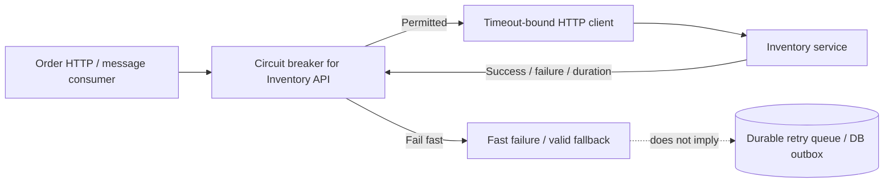
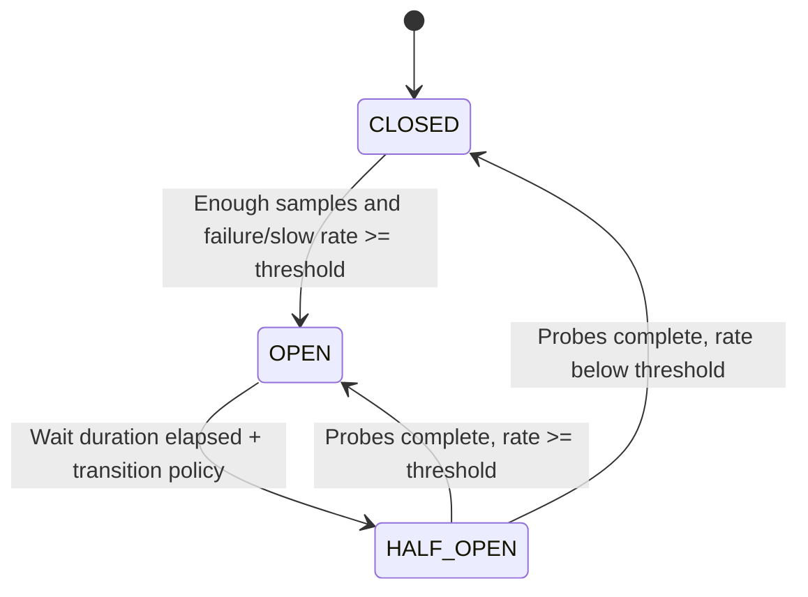
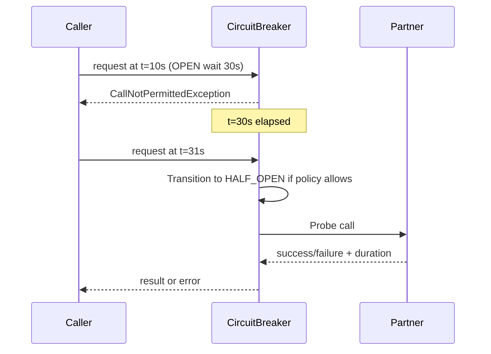
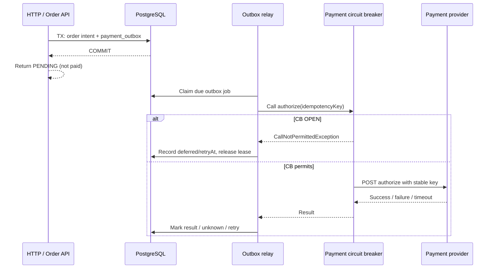
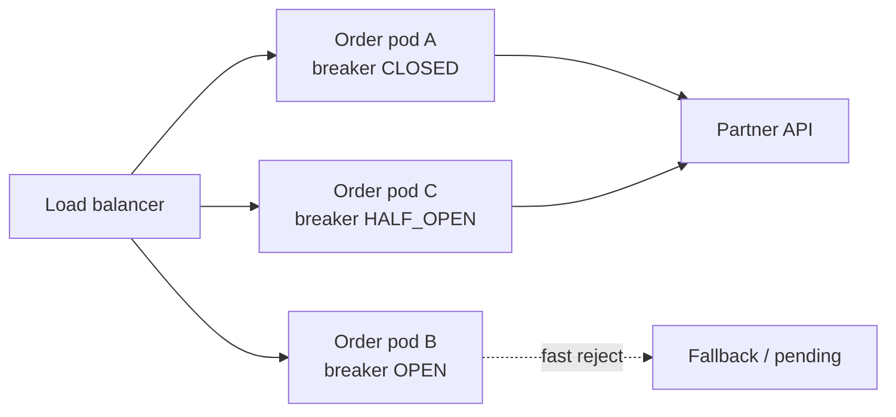
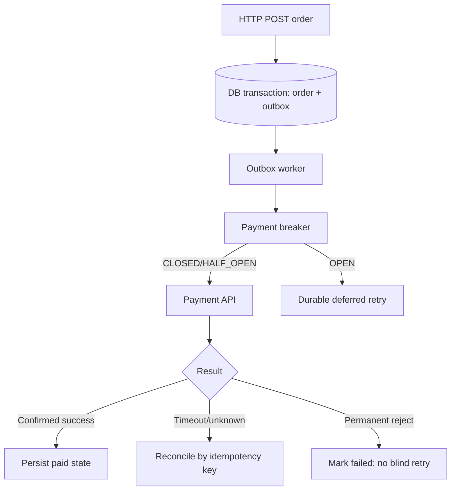
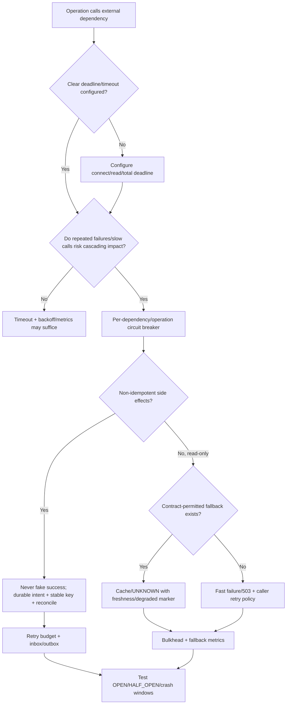

# Circuit Breakers and State Transition Conditions

> **Chapter:** Failure Recovery  
> **Module:** `SPRING_BOOT_INTEGRATION` — organizing Spring Boot system integrations across HTTP clients, databases, caches, message brokers, and Spring Integration adapters. Emphasis on configuration management, data contracts, transactions, errors, deduplication, testing, and real-world observability.
>
> **Technical Scope:** Java 17+, Spring Boot 3.x, Spring Framework 6.x, and Resilience4j for the examples. API, configuration, and metric names may differ across Resilience4j, HTTP client, and starter versions; always pin versions via BOM/dependency management. Business classes such as `PartnerCatalogGateway`, `CatalogView`, or `PaymentCommand` are application-defined. A circuit breaker **does not by itself provide durability, multi-system transactions, or exactly-once delivery**.

## 1. Real-World Scenario: A Slow Partner Brings Down the Order Service

A Spring Boot order application must call the Inventory API for stock levels and the Payment API to confirm transactions. When the Inventory API drops connectivity, every request hangs for several seconds before timing out. Under rising traffic:

- HTTP worker threads or client connection pools stay occupied for long durations.
- p95/p99 latency spikes, slowing down even unrelated APIs.
- Concurrent retries flood extra traffic into the already failing service.
- Hikari pools suffer indirect exhaustion if transactions hold DB connections while waiting on HTTP.
- Queue/outbox backlogs grow because consumers also depend on upstream.
- Restarting pods does not heal upstream and can trigger a reconnect storm.

One solution is a **circuit breaker**: once sufficient recent evidence shows a dependency/operation is repeatedly failing or too slow, the system **stops actively calling it for a period**, failing fast or returning a business-approved degraded response, and later allows a **small number of probe calls** to decide whether to restore normal traffic.



**Core Question:** When does a breaker transition `CLOSED → OPEN → HALF_OPEN → CLOSED`, what data drives those transitions, and what must happen when the breaker rejects a call that was meant to produce a side effect?

### Learning Objectives

After this lesson, you will be able to:

1. Explain the `CLOSED`, `OPEN`, `HALF_OPEN`, and special states.
2. Calculate failure rates and slow-call rates from sliding windows, understanding `minimumNumberOfCalls` and transition conditions.
3. Distinguish circuit breakers from timeouts, retries, bulkheads, rate limiters, queues, and cache fallbacks.
4. Configure Resilience4j for an HTTP client in Spring Boot using both annotations and programmatic APIs.
5. Classify 4xx/5xx responses, timeouts, connection errors, business errors, and `CallNotPermittedException`.
6. Design contract-compliant fallbacks for reads; never fake success for payments or DB writes.
7. Combine breakers with transactions, inbox/outbox, broker ACK/redelivery, and idempotency.
8. Observe state transitions, error/slow-call rates, rejected calls, and business impact.
9. Test thresholds, half-open probes, concurrent calls, outages, recovery, and multi-replica behavior.
10. Build runbooks and rollback policies for tuning thresholds or forcing breaker states.

## 2. What Does a Circuit Breaker Solve, and What Does It Not Solve?

A circuit breaker is a **gatekeeping mechanism deciding whether to let a call proceed** based on recent measurements of **the protected call itself**. It helps halt *cascading failures* originating from a failing dependency.

| Mechanism | Primary Question | Does Not Provide |
|---|---|---|
| Circuit breaker | **Should we try calling the dependency right now?** | Timeouts, durable queues, idempotency |
| Timeout/deadline | How long may one attempt wait? | Halting calls when the whole dependency is failing |
| Retry | Should a failed call be tried again? | Protection against duplicate side effects |
| Bulkhead | How many calls may run **concurrently**? | Detecting whether a dependency is healthy or failing |
| Rate limiter | How many requests are allowed within a time window? | Classifying responses as success or failure |
| Queue/outbox | Is execution intent durably stored and retried after restarts? | Awareness of whether upstream is healthy |
| Idempotency/inbox | Will a repeated business event duplicate side effects? | Load control or blocking failing calls |
| Cache fallback | Can a substitute value be returned when upstream is unavailable? | Real-time correctness where freshness is required |

A breaker **does not fix DNS, TLS, credentials, database locks, or broker ACLs**. It only changes call-attempt strategy once failures are observed. You still need root-cause diagnostics and remediation.

### 2.1. Do Not Confuse a Circuit Breaker with a "Whole-App Kill Switch"

An application typically has multiple breakers:

```text
catalog-read       -> Inventory GET /items/{sku}
payment-authorize  -> Payment POST /authorizations
shipping-rate      -> Carrier GET /quotes
redis-cache-lookup -> Redis read (if a breaker is chosen)
```

Each breaker name identifies **a group of calls sharing equivalent SLOs and fallback behavior**. Sharing one breaker across unrelated partners/operations allows a non-critical API failure to block critical APIs. Conversely, creating a breaker **per customer ID** explodes cardinality, memory, and metrics.

## 3. Three Primary States: `CLOSED`, `OPEN`, and `HALF_OPEN`



- **`CLOSED`**: allows calls through and records success/failure outcomes and call durations into the measurement window. "Closed" means the **call circuit is connected**, not that the dependency is guaranteed healthy.
- **`OPEN`**: rejects protected calls immediately—typically throwing `CallNotPermittedException`—**without calling upstream**. Rejected requests are not upstream HTTP failures.
- **`HALF_OPEN`**: permits a **limited number of probe calls**. Once enough probe outcomes are recorded per policy, the breaker closes if recovery criteria are met, or reopens if errors/slowness persist.

Resilience4j implements a widely used pattern; other implementations may define additional states or transition rules.

### 3.1. "`OPEN`" Does Not Necessarily Mean "Server Is Down"

A breaker can open because:

- The partner returns `503` repeatedly.
- Socket timeouts or TLS handshake failures repeat.
- Calls **succeed but run very slowly**, crossing the slow-call threshold.
- A misconfigured predicate **counts valid business 404s** as infrastructure failures.

Thus, `OPEN` only tells you **the breaker's measurements and thresholds tripped**, not that the remote server is literally down.

## 4. State Machine Timeline in Practice

Example configuration:

- `slidingWindowSize = 20` (`COUNT_BASED`).
- `minimumNumberOfCalls = 10`.
- `failureRateThreshold = 50%`.
- `slowCallRateThreshold = 70%`.
- `slowCallDurationThreshold = 2s`.
- `waitDurationInOpenState = 30s`.
- `permittedNumberOfCallsInHalfOpenState = 4`.

```text
CLOSED:
  Calls 1..9: metrics recorded; minimumNumberOfCalls not yet reached.
  Call 10 completes:
    6 failed / 10 = 60% >= 50% => OPEN.
  Subsequent calls: fail fast, never sent to provider.

OPEN:
  Wait 30 seconds per config.
  If auto transition = false: the next call arriving after the
  wait duration triggers HALF_OPEN.
  If auto transition = true: a background scheduler transitions
  to HALF_OPEN once the timer expires, even without new calls.

HALF_OPEN:
  Allow up to 4 probe calls per permission budget.
  Once all 4 outcomes arrive:
    3 success + 1 failure => failure rate 25% < 50%,
    slow-call rate below 70% => CLOSED.
    2 success + 2 failure => failure rate 50% >= 50% => OPEN.
```

This illustration assumes no ignored exceptions and no anomalies like hung probes or races with manual state overrides. **One successful probe does not prove the dependency is healthy** if the policy requires 4 probe outcomes.

### 4.1. Threshold Evaluation Is "Greater Than or Equal To"

In Resilience4j, once minimum samples are reached, if the failure rate or slow-call rate **equals or exceeds** the configured threshold, the breaker opens. With a 50% threshold, 5 failures out of 10 calls is **50%**, which is enough to trip—51% is not required.

## 5. `CLOSED`: Recording Outcomes and Deciding When to Open

In `CLOSED`, the breaker generally lets calls execute without **capping concurrent calls**. It tracks reported outcomes:

- Success.
- Recorded failure.
- Slow success.
- Slow failure.
- Ignored exception per policy (excluded from normal success/failure counts).

Once valid recorded samples reach `minimumNumberOfCalls`, the breaker evaluates the **failure rate** and **slow-call rate** over its sliding window. If either hits its threshold, it transitions to `OPEN`.

### 5.1. Window Size vs. `minimumNumberOfCalls`

Suppose `slidingWindowSize=20` and `minimumNumberOfCalls=10`:

| Recorded Outcomes | Failures in Window | Failure Rate | Trip OPEN at 50% Threshold? |
|---:|---:|---:|---|
| 3 | 3 | 100% | **Not yet**, fewer than 10 calls |
| 9 | 8 | 88.9% | **Not yet**, fewer than 10 calls |
| 10 | 5 | 50% | **Yes**, if those failures are recorded |
| 10 | 4 | 40% | Not yet |
| 15 | 8 | 53.3% | **Yes** |
| 20 | 9 | 45% | Not by failure rate; could still trip by slow-call rate |

The window tracks **recent outcomes**, not cumulative requests since application startup. As new samples arrive past window capacity, older data drops out according to the window type.

### 5.2. Breaker Failure Rate Is Not Raw Exception Log Count

If a call fails and the application retries **inside** the breaker, the breaker sees a single outer outcome (success or final failure) rather than three attempts. Conversely, if the breaker sits **inside** retries, each attempt counts as a separate sample. Know your decorator/aspect ordering to interpret metrics correctly.

## 6. `COUNT_BASED` Sliding Window: Counting the Last N Calls

Resilience4j provides `SlidingWindowType.COUNT_BASED`. Example:

```text
size = 5, minCalls = 5, failureThreshold = 60%

Results: S, S, F, F, F
         3/5 = 60% -> OPEN

If no trip occurs and another call completes:
Window slides forward, evicting the oldest result.
```

Characteristics:

- Measurements track the **last N completed outcomes**, independent of clock time.
- Easy to understand under steady traffic.
- Very low-traffic services can take a long time to accumulate `minimumNumberOfCalls`.
- Does not cap in-flight calls; the sliding window is a **statistics buffer**, not a queue capacity.
- Slow in-flight calls are recorded only once they finish or throw.

### 6.1. A Small Burst Should Not Trip Immediately When `minCalls` Is High

With `minimumNumberOfCalls=100`, even if the first 10 calls all fail, the breaker waits for enough samples before tripping under normal policy. This trades off **outage sensitivity** against **false positives**. Never copy thresholds from a 1,000 RPS service to a 2 req/min service.

## 7. `TIME_BASED` Sliding Window: Measuring Recent Seconds

`SlidingWindowType.TIME_BASED` aggregates outcomes over a time span; for example, `slidingWindowSize=30` typically represents **the last 30 seconds** of data, not 30 calls.

```text
time-based size = 30 seconds, minimumNumberOfCalls = 20

Seconds t=0..29:
  25 completed calls, 15 failures -> 60%.
  threshold = 50% => OPEN.

Seconds t=0..29:
  4 completed calls, 4 failures -> 100% rate,
  but fewer than 20 calls => does not trip yet.
```

Resilience4j aggregates time windows using fixed-size time buckets rather than retaining individual Java objects for every call in memory. Time-based windows suit time-bounded health evaluation, yet low-volume periods are still gated by `minimumNumberOfCalls`.

### 7.1. Window Size Is Not Open-State Wait Duration

- `slidingWindowSize`: sample span used to **evaluate tripping** while `CLOSED`.
- `waitDurationInOpenState`: time spent **blocking calls** before becoming eligible for `HALF_OPEN`.
- `slowCallDurationThreshold`: duration above which a call is classified as "slow."
- `maxWaitDurationInHalfOpenState`: optional cap preventing `HALF_OPEN` from waiting indefinitely on hung probes.

These are **four distinct concepts**. Never tweak `waitDurationInOpenState` to fix a breaker that hasn't collected enough samples.

## 8. Failure-Rate Threshold: What Counts as a Failure?

In the basic model:

\[
\text{Failure rate (\%)} =
\frac{\text{Calls counted as failures}}
     {\text{Total valid recorded calls in window}} \times 100
\]

Failure classification is **not identical to catching all exceptions**. For HTTP clients:

| Operation Outcome | Count as Upstream Breaker Failure? | Reason |
|---|---|---|
| HTTP 200 with contract-valid response | Usually no | Dependency fulfilled request |
| TCP connect timeout / read timeout | Usually yes | Upstream/network unresponsive |
| TLS hostname/certificate mismatch | May record, **never retry infinitely** | Security/config error; alert and fail closed |
| HTTP 500/502/503/504 | Usually yes | Upstream/gateway error or overload |
| HTTP 429 | Policy-dependent; coordinate backoff/rate limit | Indicates overload/quota; avoid retry storms |
| HTTP 400/422 from bad client input | Usually **no** | Opening circuit will not fix payloads |
| HTTP 401/403 from wrong credentials/permissions | Usually do not hide behind breaker | Fix auth/ACL |
| Valid business HTTP 404 "item not found" | Usually no | Expected domain outcome |
| Malformed JSON schema in upstream response | Contract-dependent; often yes | Provider returned invalid data |
| Local validation failure before HTTP call | **Never** charge to upstream breaker | Provider was never called |
| `CallNotPermittedException` from OPEN | Rejected by breaker, not an HTTP failure | Must not inflate upstream error rate |

### 8.1. A Misconfigured Predicate Causes Self-Inflicted Outages

Suppose 70% of requests look up non-existent SKUs and the provider legitimately returns HTTP 404 per contract. If the client throws an exception and the breaker **counts all 404s as failures**, the breaker will trip `OPEN` even while the provider is healthy.

A sound policy:

- Translate expected 404s into a domain result like `NotFound` **inside the adapter** before the breaker sees it.
- Or configure `ignoreException`/`recordException` predicates carefully.
- Never ignore all HTTP 4xx blindly if `429` signals overload you want tracked.
- Keep local validation failures outside the breaker boundary.

## 9. Slow-Call Rate: Slow Successes Can Still Trip `OPEN`

A dependency might return HTTP 200 while taking 8 seconds against a 500 ms SLO. Tracking only failure rate makes the breaker report "100% success" while resources remain pinned.

Resilience4j provides:

- `slowCallDurationThreshold`: duration threshold above which a completed call is marked slow.
- `slowCallRateThreshold`: percentage of slow calls that trips `OPEN` once `minimumNumberOfCalls` is satisfied.

\[
\text{Slow-call rate (\%)} =
\frac{\text{Calls exceeding slow threshold}}
     {\text{Total valid recorded calls}} \times 100
\]

### 9.1. Slow-Call Rate and Failure Rate Are Independent Metrics

Consider 10 calls:

- 10 succeed, 8 take over 2 seconds → failure rate 0%, slow rate 80%; with slow threshold 70%, trips **OPEN**.
- 6 fail fast, 4 succeed fast → failure rate 60%; with failure threshold 50%, trips **OPEN** even with 0% slow calls.
- A call that is both slow and failed can count in **both** metrics. **Do not add the two percentages together** against a combined threshold.

### 9.2. Timeouts Shorter Than the Slow Threshold Skew Measurements

If the HTTP read timeout is 1 second while `slowCallDurationThreshold=2s`, slow calls fail at ~1 second rather than finishing as >2-second slow successes. That is valid, yet alerts and breaker tuning must watch **failure rate/timeout counts**, not only slow-call rates.

Never use `slowCallDurationThreshold` in place of HTTP socket/response timeouts. The breaker **observes** elapsed duration; it does not abort blocking I/O mid-call when duration crosses the threshold.

## 10. `OPEN`: Fast Failure with Business Semantics

When `OPEN`, Resilience4j skips executing the protected supplier/call and throws:

```java
import io.github.resilience4j.circuitbreaker.CallNotPermittedException;
```

Callers must understand that **the breaker refused to try the dependency right now**:

- Catalog HTTP GET may return `503 Service Unavailable` or a cached snapshot if the contract allows.
- Payment HTTP POST **must never pretend to succeed**.
- A message consumer can persist durable pending/outbox state and ACK the source, or let the source redeliver with backoff depending on the delivery contract.
- Background jobs must not "drop the message" simply because a fallback returned `null`.

### 10.1. `OPEN` Does Not Block Every Call in the Application

A breaker protects only code wrapped by that decorator/AOP interceptor. Calls bypassing the adapter, self-invocations bypassing proxies, or separate clients targeting the same host **still hit upstream**. Maintain a dependency/operation inventory so you do not assume opening one breaker halts all cluster traffic.

### 10.2. `OPEN` Duration Is Not a Healing Command

`waitDurationInOpenState=30s` does not guarantee upstream will recover in 30 seconds. It is only the minimum wait before the breaker **tries probing again**; prolonged outages cycle `OPEN → HALF_OPEN → OPEN` repeatedly.

## 11. `OPEN → HALF_OPEN`: When Does the Transition Actually Occur?

Resilience4j typically supports:

- `waitDurationInOpenState`: minimum duration after opening.
- `automaticTransitionFromOpenToHalfOpenEnabled=false`: **no automatic transition solely from elapsed time**; when a caller requests permission after the wait expires, the breaker transitions to `HALF_OPEN`.
- `automaticTransitionFromOpenToHalfOpenEnabled=true`: a background scheduler/monitor transitions automatically once the wait expires, even if no new request has arrived.



### 11.1. Why Enabling Auto-Transition Is Not an Active Health Check

When a background transition moves the breaker to `HALF_OPEN`, it is merely **ready to accept probes**. Without incoming calls, no fresh data arrives to close it again. The flag does not send an active HTTP health request to upstream.

If you need active probing, build a dedicated health-check mechanism targeting an appropriate low-cost endpoint—do not abuse a readiness ping as proof that business mutations will succeed.

## 12. `HALF_OPEN`: Bounding Probes to Test Recovery

`permittedNumberOfCallsInHalfOpenState` sets **how many calls are allowed to execute** in `HALF_OPEN`. Example with 4 permits:

```text
4 permits:
  Probe A -> success (400ms)
  Probe B -> success (650ms)
  Probe C -> failure (503)
  Probe D -> success (300ms)
  Extra call while permits exhausted -> rejected until state decision.

Results: 1/4 failures = 25%.
If failure threshold = 50% and slow rate < threshold => CLOSED.
```

Key behaviors:

- Permits in `HALF_OPEN` are a **trial cap**, not a general concurrency bulkhead for `CLOSED`.
- If the breaker requires 4 outcomes, one or two successes are **not enough** to close it.
- Once all required probes complete, if either failure rate or slow-call rate hits threshold, the breaker **reopens (`OPEN`)**.
- If probes hang or take forever, `HALF_OPEN` can linger; configure `maxWaitDurationInHalfOpenState` where supported.
- Test how ignored exceptions, cancellations, or incomplete calls interact with permit completion in your library version.
- Under concurrent arrivals, extra callers are rejected once permits are taken even if upstream is healthy—this is intentional protection.

### 12.1. Do Not Use `HALF_OPEN` as a Heavy Warm-Up Phase

Probes should be **real operations representative** of the protected endpoint, yet bounded by timeouts and idempotency. If a non-idempotent payment POST acts as a probe under flaky timeouts, probing risks duplicate charges. Consider isolating a **read-only path** or enforcing strict command idempotency; never swap in a dummy ping that fails to exercise real dependency paths.

## 13. `HALF_OPEN → CLOSED` or `OPEN`: Evaluation Math

Suppose:

```yaml
permittedNumberOfCallsInHalfOpenState: 4
failureRateThreshold: 50
slowCallRateThreshold: 75
slowCallDurationThreshold: 2s
```

| 4 Probe Outcomes | Failure Rate | Slow Rate | Transition |
|---|---:|---:|---|
| 4 successes, all fast | 0% | 0% | `CLOSED` |
| 3 successes + 1 failure, all fast | 25% | 0% | `CLOSED` |
| 2 successes + 2 failures | **50%** | Any | `OPEN` |
| 4 successes, 3 took > 2s | 0% | **75%** | `OPEN` |
| 1 slow failure + 2 slow successes + 1 fast success | 25% | **75%** | `OPEN` |
| Only 2/4 probes finished | Insufficient for example | Insufficient | Stay `HALF_OPEN` or apply `maxWait` policy |

**Do not mix old `CLOSED` samples with the 4 probes.** `HALF_OPEN` evaluates its own dedicated permit-bounded sample set, and upon returning to `CLOSED`, statistics/windows reset or roll per implementation. Test metric behavior for your exact version.

### 13.1. Distinguish "Permission Denied" from "Probe Failed"

A call rejected because `HALF_OPEN` ran out of permits is **not permitted**, not an upstream HTTP 503. Lumping both under one generic "failure" counter makes dashboards show spikes even when upstream only received 4 probe requests.

## 14. Special States: `DISABLED`, `FORCED_OPEN`, `METRICS_ONLY`

Beyond the three normal states, Resilience4j provides special administrative states depending on release:

| State | General Behavior | When to Use |
|---|---|---|
| `DISABLED` | Lets all calls through; disables breaker protection/measurement per special-state semantics | Temporarily bypassing a breaker under controlled conditions |
| `FORCED_OPEN` | Rejects all protected calls immediately without waiting on thresholds | Emergency manual cut-off for a dangerous dependency |
| `METRICS_ONLY` | Lets calls through and keeps recording metrics, **never trips `OPEN`** | Observing thresholds in shadow mode before enabling enforcement |

Notes:

- These states apply **per breaker instance inside one JVM**, not as a cluster-wide synchronized kill switch.
- Entering/exiting special states is an **impactful operational action** requiring an owner, audit log, and rollback plan.
- `DISABLED` can immediately expose an overloaded upstream to full traffic.
- `FORCED_OPEN` still requires business fallbacks or durable retries; otherwise "protecting the system" turns into dropped work.
- `METRICS_ONLY` is great pre-rollout, yet provides zero cascading-failure protection.

### 14.1. Never Confuse `FORCED_OPEN` with Automatic `OPEN`

Automatic `OPEN` has a wait timer and `HALF_OPEN` recovery logic. `FORCED_OPEN` is pinned manually; do not expect it to self-recover after `waitDurationInOpenState`. An explicit state transition per operational policy is required to resume calls.

## 15. Manual Transitions and Resets: Use with Extreme Care

Resilience4j exposes manual state controls on a breaker instance, such as:

```java
import io.github.resilience4j.circuitbreaker.CircuitBreaker;

// breaker injected or looked up from CircuitBreakerRegistry.
breaker.transitionToForcedOpenState(); // Temporarily block calls.
breaker.transitionToClosedState();     // Force back to CLOSED after verification.
breaker.reset();                       // Reset state/metrics per API.
```

These are **operational commands**, never normal business logic. Calling `reset()` wipes the instance's statistical history and can send a traffic burst straight into a still-failing dependency. During an incident:

1. Identify the exact breaker name, instance/pod, and dependency.
2. Review reason, timeline, failure/slow-call rates, and downstream impact.
3. Fix the root cause (TLS, credentials, routing, server outage, thread starvation).
4. Allow canary/probe recovery per policy—never force `CLOSED` across all pods simultaneously.
5. Monitor 4xx/5xx, p95 latency, queue/outbox backlog, and duplicate effects.
6. Audit the action, owner, and rollback trigger.

Never expose `transitionToClosedState()` to regular users or call it inside request handlers whenever a breaker is observed `OPEN`.

## 16. Event Publishers and Transition Timing

Resilience4j provides `CircuitBreakerEventPublisher` to observe state transitions, successes/errors, not-permitted calls, and ignored errors per implementation.

```java
import io.github.resilience4j.circuitbreaker.CircuitBreaker;
import io.github.resilience4j.circuitbreaker.CircuitBreakerRegistry;

public final class CircuitBreakerEvents {

    public static void attach(CircuitBreakerRegistry registry) {
        CircuitBreaker cb = registry.circuitBreaker("partnerCatalog");

        cb.getEventPublisher()
            .onStateTransition(event ->
                System.out.println("Breaker transition: "
                    + event.getStateTransition()))
            .onCallNotPermitted(event ->
                System.out.println("Breaker rejected an invocation"));
    }
}
```

In production, replace `System.out.println` with structured logging/metrics carrying the breaker name and transition; never log request bodies, tokens, full query strings, or PII. Register subscribers **once** during bean initialization, not per request.

### 16.1. A Transition Event Does Not Prove Service Recovery

A `HALF_OPEN → CLOSED` transition only proves the probes stayed below current thresholds. It **does not prove**:

- Upstream can sustain full production throughput.
- Every region/tenant has valid permissions.
- Pending outbox messages have drained.
- Cache/DB/business state is reconciled.
- The provider will not collapse again once full traffic returns.

Correlate transitions with dependency latency/error rates and business SLAs.

## 17. Scoping Breakers: Per Dependency or Per Operation?

Suppose one HTTP provider exposes:

```text
GET /inventory/{sku}                 read path, can fall back to UNKNOWN
POST /reservations                  write path, requires idempotency
GET /reservations/{requestId}       status/reconciliation path
```

Using a single breaker `inventoryApi` for all three is often flawed:

- Read-path 5xx spikes trip `OPEN`, blocking the reconciliation lookups needed to resolve ambiguous POST outcomes.
- A POST timeout is an ambiguous outcome that must never turn into a cached fake success.
- Health/status endpoints have different SLOs than reservation creation.
- Rate-limit quotas may differ by tenant or operation.

A cleaner separation:

| Breaker | Protects | Policy |
|---|---|---|
| `inventoryRead` | Stock lookup | Short timeout, stale/unknown fallback if API permits |
| `inventoryReserve` | Create reservation | Strict error handling, stable idempotency key, outbox |
| `inventoryReservationStatus` | Outcome reconciliation | Read-only query, dedicated budget |
| `shippingQuote` | Shipping quote | Can fall back to "quote temporarily unavailable" |

Never create per-customer or per-session breakers at scale; keep registry and metric cardinality bounded. Where tenants have isolated quotas, consider bounded tier-based policies and proper authorization.

## 18. Spring Boot Dependencies: Resilience4j CircuitBreaker

A Spring Boot 3 project can declare:

```gradle
dependencies {
    implementation("org.springframework.boot:spring-boot-starter-web")
    implementation("org.springframework.boot:spring-boot-starter-aop")

    implementation("io.github.resilience4j:resilience4j-spring-boot3")
    implementation("io.github.resilience4j:resilience4j-micrometer")

    implementation("org.springframework.boot:spring-boot-starter-actuator")
    testImplementation("org.springframework.boot:spring-boot-starter-test")
}
```

Resilience4j versions should be pinned via a compatible build BOM; the **Spring Boot BOM does not automatically manage all Resilience4j artifacts** for every project setup. For WebFlux/Reactor, include the matching reactive decorator/operator module for your Resilience4j version; the blocking `RestClient` examples below target traditional Servlet/imperative services.

### 18.1. Resilience4j vs. Spring Cloud CircuitBreaker

- **Resilience4j core/annotations**: provides the state machine, registries, decorators, annotations, and YAML config.
- **Spring Cloud CircuitBreaker**: a Spring Cloud abstraction that can use Resilience4j as a backend, with different configuration properties and factory APIs.
- **Spring Retry**: an independent retry library; does not replace a circuit breaker.
- **Micrometer/Actuator**: observes metrics and health according to enabled integrations.

Never mix `spring.cloud.circuitbreaker.*` snippets with `resilience4j.circuitbreaker.*` assuming they configure the same breaker. Verify the active integration and test it.

## 19. Configuring Resilience4j via `application.yml`

Example configuration for a `partnerCatalog` breaker:

```yaml
resilience4j:
  circuitbreaker:
    instances:
      partnerCatalog:
        registerHealthIndicator: true
        slidingWindowType: COUNT_BASED
        slidingWindowSize: 20
        minimumNumberOfCalls: 10
        failureRateThreshold: 50
        slowCallRateThreshold: 70
        slowCallDurationThreshold: 2s
        waitDurationInOpenState: 30s
        permittedNumberOfCallsInHalfOpenState: 4
        automaticTransitionFromOpenToHalfOpenEnabled: false
        maxWaitDurationInHalfOpenState: 20s
```

Property breakdown:

| Property | Meaning | Impact |
|---|---|---|
| `slidingWindowType` | Call-count or time-based window | Determines sampling strategy |
| `slidingWindowSize` | Number of calls or seconds, per type | Measurement span |
| `minimumNumberOfCalls` | Minimum samples before evaluating thresholds | Prevents premature tripping |
| `failureRateThreshold` | Failure % that opens the circuit | Error sensitivity |
| `slowCallRateThreshold` | Slow-call % that opens the circuit | Latency sensitivity |
| `slowCallDurationThreshold` | Duration marking a call as slow | Must align with timeouts and SLOs |
| `waitDurationInOpenState` | Wait duration before allowing `HALF_OPEN` | Recovery probe cadence |
| `permittedNumberOfCallsInHalfOpenState` | Number of allowed probes | Recovery sample size |
| `automaticTransitionFromOpenToHalfOpenEnabled` | Whether to transition automatically after `OPEN` wait without incoming calls | Lifecycle behavior |
| `maxWaitDurationInHalfOpenState` | Upper bound waiting for `HALF_OPEN` probes, if supported | Prevents `HALF_OPEN` stalls |
| `registerHealthIndicator` | Exposes health indicator when supported | Should not dictate whole-app liveness |

If `registerHealthIndicator=true` causes an `OPEN` state to mark health `DOWN`, **never wire it into Kubernetes liveness probes**, which would restart pods continuously during external outages. Separate observability health from liveness/readiness and contracted service availability.

### 19.1. Configuring YAML Alone Does Not Wrap Your HTTP Client

A `resilience4j.circuitbreaker.instances.partnerCatalog` block only registers configuration/instances. Calls must actually pass through an AOP `@CircuitBreaker` interceptor or programmatic decorator; otherwise HTTP traffic bypasses the breaker and metrics stay empty.

### 19.2. Choosing Initial Thresholds

Do not copy `failureRateThreshold=50` and `wait=30s` onto every endpoint. Estimate from:

- Normal traffic volume and burst sizes.
- Baseline failure rate and p50/p95/p99 latency.
- HTTP connect/read timeouts.
- Upstream capacity, quotas, and error budgets.
- Typical recovery durations and cold-start behavior.
- Volume of business 404/validation outcomes excluded by your classifier.
- Sensitivity to false-positive rejections.
- Plan for pending requests and retries while `OPEN`.

Validate initial settings in staging/fault injection and refine against SLOs.

## 20. Creating Breakers via Java API: Exact Call-Scope Control

Beyond YAML properties, `CircuitBreakerConfig` and `CircuitBreaker` can be built in Java to control **which errors record, which clock is used, and which supplier is wrapped**.

```java
import java.time.Duration;

import io.github.resilience4j.circuitbreaker.CircuitBreaker;
import io.github.resilience4j.circuitbreaker.CircuitBreakerConfig;
import io.github.resilience4j.circuitbreaker.CircuitBreakerConfig.SlidingWindowType;

public final class PartnerBreakerFactory {

    private PartnerBreakerFactory() {}

    public static CircuitBreaker createCatalogReadBreaker() {
        CircuitBreakerConfig config = CircuitBreakerConfig.custom()
            .slidingWindowType(SlidingWindowType.COUNT_BASED)
            .slidingWindowSize(20)
            .minimumNumberOfCalls(10)
            .failureRateThreshold(50.0f)
            .slowCallRateThreshold(70.0f)
            .slowCallDurationThreshold(Duration.ofSeconds(2))
            .waitDurationInOpenState(Duration.ofSeconds(30))
            .permittedNumberOfCallsInHalfOpenState(4)
            .automaticTransitionFromOpenToHalfOpenEnabled(false)
            .build();

        return CircuitBreaker.of("partnerCatalog", config);
    }
}
```

This creates a **standalone** breaker suited for tests or application-managed Java configuration. Do not create one instance via `CircuitBreaker.of(...)` while also annotating `@CircuitBreaker(name="partnerCatalog")` against a separate registry and expect them to share state. **State and metrics belong to the exact instance executed by the call.**

### 20.1. When to Use `CircuitBreakerRegistry`?

`CircuitBreakerRegistry` manages named breaker instances, shares base configurations, and attaches event consumers. Spring Boot/Resilience4j auto-configuration provides a registry populated from `resilience4j.circuitbreaker.*`.

Using a shared application registry:

```java
import io.github.resilience4j.circuitbreaker.CircuitBreaker;
import io.github.resilience4j.circuitbreaker.CircuitBreakerRegistry;

public final class CatalogBreakerLookup {

    private final CircuitBreaker breaker;

    public CatalogBreakerLookup(CircuitBreakerRegistry registry) {
        this.breaker = registry.circuitBreaker("partnerCatalog");
    }

    public CircuitBreaker breaker() {
        return breaker;
    }
}
```

Obtain `registry.circuitBreaker("partnerCatalog")` once when constructing the adapter—**never create a new breaker per request**, which resets failure history so the breaker practically never trips `OPEN`.

### 20.2. Do Not Mix Annotations and Programmatic Wrapping Unintentionally

The two approaches are **alternatives**:

- `@CircuitBreaker` relies on AOP interception and Spring bean wiring.
- `breaker.executeSupplier(...)`/decorators explicitly wrap code blocks.
- Wrapping **both** around the same call unintentionally double-counts metrics/permits or uses two distinct instances.

Pick one instrumentation layer as the owner so thresholds and event logs remain predictable.

## 21. Programmatic Execution: Protecting the Outbound Adapter

Example using Spring Framework 6.1+ `RestClient` (typically included in Spring Boot 3.2+). This uses blocking I/O for Servlet/imperative flows; never invoke it on a Reactor event loop.

```java
import org.springframework.beans.factory.annotation.Qualifier;
import org.springframework.stereotype.Component;
import org.springframework.web.client.RestClient;

import io.github.resilience4j.circuitbreaker.CircuitBreaker;
import io.github.resilience4j.circuitbreaker.CircuitBreakerRegistry;

@Component
public class PartnerCatalogGateway {

    private final RestClient restClient;
    private final CircuitBreaker breaker;

    public PartnerCatalogGateway(
            @Qualifier("partnerCatalogRestClient") RestClient restClient,
            CircuitBreakerRegistry registry) {
        this.restClient = restClient;
        this.breaker = registry.circuitBreaker("partnerCatalog");
    }

    public CatalogView find(String sku) {
        return breaker.executeSupplier(() -> {
            CatalogView response = restClient.get()
                .uri("/v1/catalog/{sku}", sku)
                .retrieve()
                .body(CatalogView.class);

            if (response == null) {
                throw new IllegalStateException(
                    "Partner returned an empty catalog response");
            }
            return response;
        });
    }
}
```

`CatalogView` is an application DTO, not a JPA entity. `PartnerCatalogGateway` isolates the outbound call; database transactions and HTTP controllers live in separate layers.

### 21.1. Configure Timeouts on the HTTP Client; Breakers Do Not Timeout Unbounded I/O

```java
import org.springframework.context.annotation.Bean;
import org.springframework.context.annotation.Configuration;
import org.springframework.http.client.SimpleClientHttpRequestFactory;
import org.springframework.web.client.RestClient;

@Configuration(proxyBeanMethods = false)
class PartnerCatalogHttpConfiguration {

    @Bean("partnerCatalogRestClient")
    RestClient partnerCatalogRestClient(RestClient.Builder builder) {
        var requestFactory = new SimpleClientHttpRequestFactory();
        requestFactory.setConnectTimeout(1500); // milliseconds
        requestFactory.setReadTimeout(2500);    // milliseconds

        return builder
            .baseUrl("https://catalog.partner.example")
            .requestFactory(requestFactory)
            .build();
    }
}
```

`SimpleClientHttpRequestFactory` is used for simplicity; production commonly uses Apache HttpClient, JDK HttpClient, or a managed connector with TLS, pooling, proxy, and dedicated timeouts. Verify connection acquisition timeouts, TLS handshake timeouts, and overall retry deadlines for your chosen client.

**A breaker does not time out an active blocking call:** if upstream holds a socket open indefinitely, threads stay stuck. Always enforce client/operation timeouts, letting the breaker record the resulting failure once the call finishes.

## 22. Recording the Right Exceptions: 404 Differs from 503

By default, a breaker records non-ignored exceptions as failures. Since Spring HTTP clients throw `RestClientResponseException` for 4xx/5xx responses under `retrieve()`, business classification is essential.

An **alternative** programmatic config to Section 20:

```java
import java.time.Duration;
import io.github.resilience4j.circuitbreaker.CircuitBreakerConfig;
import org.springframework.web.client.HttpClientErrorException;

CircuitBreakerConfig catalogConfig = CircuitBreakerConfig.custom()
    .slidingWindowSize(20)
    .minimumNumberOfCalls(10)
    .failureRateThreshold(50)
    .waitDurationInOpenState(Duration.ofSeconds(30))
    .ignoreException(error ->
        error instanceof HttpClientErrorException clientError
            && clientError.getStatusCode().value() != 429)
    .build();
```

Rationale:

- HTTP 400/401/403/404/422 classified as client/auth outcomes should not pollute infrastructure failure statistics for the catalog dependency.
- HTTP 429 is retained so the breaker tracks overload; you still need `Retry-After` handling and rate limiting.
- HTTP 5xx, I/O timeouts, and other failures continue to be recorded via default/record predicates.
- A 401/403 error **must trigger alerts and fail closed** at the auth/ACL layer even though it is excluded from the breaker's failure rate.

### 22.1. Mapping Business 404s to Domain Outcomes Can Be Cleaner

If "SKU does not exist" is an ordinary answer, the client adapter can return `Optional.empty()`/`NotFound` instead of throwing an exception. The breaker then observes a cleanly completed HTTP call.

Conversely, if `404` indicates a broken URL after an API version change, it is **no longer a valid outcome**; classify by contract rather than hardcoding status rules.

### 22.2. Keep Local Validation Exceptions Outside the Measurement Boundary

Validate `sku` and tenant access before calling `breaker.executeSupplier(...)` so bad local inputs are never counted as catalog provider failures.

```java
public CatalogView findAuthorized(String sku, CallerIdentity caller) {
    validateSkuAndTenantAccess(sku, caller); // Outside the breaker.
    return partnerCatalogGateway.find(sku);
}
```

`CallerIdentity` and `validateSkuAndTenantAccess` are application components. This keeps security/business validation separated from downstream transport failures.

### 22.3. Beware Exception Predicate Edge Cases

Exceptions may be wrapped inside `CompletionException`, `ResourceAccessException`, or framework adapters. Test predicates against real wrapped exception types and cause chains rather than fragile message-string matching. Because changing ignore/record predicates alters the breaker's sample denominator and rates, write regression tests before rolling out changes.

## 23. `@CircuitBreaker` Annotation and AOP Proxy

A concise annotation variant:

```java
import io.github.resilience4j.circuitbreaker.annotation.CircuitBreaker;
import org.springframework.stereotype.Service;
import org.springframework.web.client.RestClient;
import org.springframework.web.client.HttpClientErrorException;

@Service
public class InventoryReadAdapter {

    private final RestClient client;

    public InventoryReadAdapter(RestClient client) {
        this.client = client;
    }

    @CircuitBreaker(name = "inventoryRead",
                    fallbackMethod = "fallbackRead")
    public AvailabilityView read(String sku) {
        AvailabilityView result = client.get()
            .uri("/inventory/{sku}", sku)
            .retrieve()
            .body(AvailabilityView.class);

        if (result == null) {
            throw new IllegalStateException("Empty inventory response");
        }
        return result;
    }

    public AvailabilityView fallbackRead(String sku, Throwable error) {
        // 4xx errors (except rate-limit 429) must follow contract,
        // never silently turning into fake inventory data.
        if (error instanceof HttpClientErrorException clientError
                && clientError.getStatusCode().value() != 429) {
            throw clientError;
        }
        return new AvailabilityView(sku, "UNKNOWN", true);
    }
}

record AvailabilityView(
    String sku,
    String status,
    boolean degraded
) {}
```

This example is valid only if **the API permits returning `UNKNOWN`/degraded** and has appropriate fallback classification and alerting. The fallback method takes **the original parameters plus a trailing `Throwable`** and returns `AvailabilityView`. The snippet checks direct 4xx exceptions for brevity; if the HTTP client wraps errors, inspect the cause chain and test per version. HTTP 429 still needs rate-limit/backoff policies rather than treating `UNKNOWN` as the sole response.

**Warning:** Fallbacks execute for many AOP-intercepted exceptions, including `CallNotPermittedException`. For 401/403/404, malformed payloads, or security incidents, **never silently mask the error as `UNKNOWN`** if the contract requires an error or `NotFound`; classify and alert explicitly before returning a DTO.

### 23.1. AOP and Self-Invocation

If code in the same bean calls `this.read(sku)`, Spring proxying is bypassed, preventing metrics recording and tripping. Methods that are `private`/`final` or inside `final` classes may not be proxied depending on the AOP mechanism.

Checklist:

1. Is the bean managed by Spring?
2. Is `resilience4j-spring-boot3`/AOP integration present on the classpath?
3. Does the call enter the proxy from **another bean**, avoiding self-invocation?
4. Does `inventoryRead` match the registry config name?
5. Under a test returning enough 5xx responses, does the breaker state actually change?

### 23.2. Custom Fallbacks Must Avoid Recursion

Never let a fallback call **the same `@CircuitBreaker`-protected method** indefinitely. If a secondary provider or cache is used, give it its own policy/timeout/breaker; when the primary breaker is `OPEN`, the fallback must not inadvertently call the same primary endpoint via another client and cause a storm.

## 24. Fallbacks Are a Business Decision, Not a "Catch-All"

| Operation | Is Fallback Valid? | Careful Design Notes |
|---|---|---|
| GET reference catalog | Can serve stale cache with timestamp | Explicitly mark `stale/degraded` and enforce max TTL |
| GET shipping quote | Can return "quote temporarily unavailable" | Never fabricate shipping fee = 0 |
| GET stock | Can return `UNKNOWN` | Never treat `UNKNOWN` as `AVAILABLE` during checkout |
| POST payment | **Never fake success** | Use stable idempotency key, pending state/reconciliation |
| Send notification email | Can enqueue to durable job/outbox | Never mark `DELIVERED` when only enqueued |
| Write PostgreSQL business state | Never "return success" on DB fail | Transactions, fail-fast/degraded intake per contract |
| Redis cache miss due to Redis outage | Can fall back to DB under quota | Bulkhead/rate-limit to avoid DB stampede |
| Publish broker event | ACK only once intent/commit is durable | Outbox, broker confirms, consumer dedup |

### 24.1. Fallbacks Must Preserve Response Semantics

If `GET /inventory/A-1` normally returns real-time `availableUnits=10`, a 3-hour-old cache snapshot must not masquerade as live data. Return a contract-explicit DTO instead:

```json
{
  "sku": "A-1",
  "availability": "UNKNOWN",
  "degraded": true,
  "source": "cached",
  "asOf": "2026-11-21T08:00:00Z"
}
```

Timestamps here are illustrative. Clients need provenance/freshness fields to decide whether proceeding with a transaction is allowed.

### 24.2. Never Let Resilience Mask Outages

A fallback returning `200 OK` while upstream is blocked can make error-rate dashboards look falsely healthy. Still emit `breaker_rejected`/`fallback_used` metrics and track business SLO degradation. For some contracts, returning `503`/`Retry-After` transparently is far safer than silent fallbacks.

## 25. Retry + CircuitBreaker: Wrapper Order Changes Everything

Two compositions are **not equivalent**:

```text
A. Retry(CircuitBreaker(HTTP call))
   Attempt 1 -> CircuitBreaker permission -> HTTP
   Attempt 2 -> CircuitBreaker permission -> HTTP
   Attempt 3 -> CircuitBreaker permission -> HTTP

B. CircuitBreaker(Retry(HTTP call))
   One breaker permission -> Retry can make multiple HTTP attempts
   Breaker records outer result/duration of entire retry operation
```

| Placement | What the Breaker Observes | Risk |
|---|---|---|
| Retry **outside**, breaker **inside** | Each individual attempt | If Retry retries `CallNotPermittedException`, causes futile rejected storms |
| Breaker **outside**, retry **inside** | Aggregate outcome and duration of the whole retry chain | One permitted call can still trigger multiple requests into a failing upstream |
| No retry | Single attempt per call | Fails faster without leveraging transient recovery |

### 25.1. Do Not Rely Implicitly on Aspect Order

When combining `@Retry`, `@CircuitBreaker`, `@TimeLimiter`, and `@Bulkhead` on one method, **aspect precedence** is configurable and can vary across versions. Verify effective execution order with tests rather than guessing from source annotation order.

### 25.2. Retry Policies Should Exclude `CallNotPermittedException`

When a breaker is `OPEN`, immediately retrying `CallNotPermittedException` generates noise with virtually no chance upstream healed in a few milliseconds. Configure retries to **skip** not-permitted errors, or defer via durable scheduled retries if the business requires eventual execution.

### 25.3. Timeouts Do Not Mean Operations Never Happened

Across HTTP POST, JDBC commits, Kafka publishes, and JMS ACKs, timeouts can happen after the other side persisted state. Retries are safe only with proper **idempotency keys, unique constraints, and reconciliation**. Circuit breakers do not add idempotency.

## 26. Bulkhead + CircuitBreaker: Protecting Different Resources Together

While `CLOSED`, a circuit breaker does not cap concurrency. If the Inventory API slows down before reaching `minimumNumberOfCalls` or during transition, hundreds of concurrent requests can tie up sockets and threads.

**Bulkheads** cap concurrency, for example:

```text
HTTP client concurrency budget:
  max 20 inflight calls
  queue wait 0..small bounded duration

Circuit breaker:
  sample recent call outcomes
  OPEN when >= threshold and minCalls satisfied
```

Use Resilience4j's semaphore bulkhead or thread-pool bulkhead depending on blocking vs. async code and version. Never substitute `minimumNumberOfCalls` for a semaphore bulkhead—`minimumNumberOfCalls` only gates **statistical sample sufficiency**, not thread/socket limits.

### 26.1. Avoiding Thundering Herds Upon Full Recovery

`HALF_OPEN` admits only a few probes. Once they succeed, transitioning to `CLOSED` lifts the gate for normal traffic, which can create a sudden spike. Client-side bulkheads/rate limiters combined with server autoscaling/capacity controls prevent the breaker from tripping right back to `OPEN`.

### 26.2. Backpressure for Message Consumers

Kafka/JMS consumers cannot rely on circuit breakers alone for broker flow control. When a breaker is `OPEN`, throwing exceptions endlessly in a listener triggers hot redelivery loops. Combine:

- Pausing/backing off the listener/container per version capabilities.
- Durable inbox/outbox or retry/DLQ topics/queues.
- Consumer max concurrency and poll settings.
- Timeouts and idempotency.
- Broker lag and dead-letter backlog metrics.

## 27. `TimeLimiter` and Reactive Calls: Measure the Final Outcome

`TimeLimiter` targets asynchronous tasks (such as `CompletionStage`) and bounds completion waits. With `WebClient`/Reactor, use `resilience4j-reactor` operators or matching integration so the breaker observes the **terminal signal of `Mono`/`Flux`**, not merely publisher creation.

```text
Wrong idea:
  CircuitBreaker records success as soon as Mono<T> is returned,
  even though the HTTP request fails seconds later.

Right goal:
  Decorate the reactive publisher/CompletionStage with proper integration,
  observing onComplete/onError/cancel of the real operation.
```

### 27.1. Cancellation Does Not Always Stop Underlying I/O

Even after `TimeLimiter` or a future times out, underlying blocking I/O can continue if the driver lacks cooperative cancellation. A breaker recording a failure does not mean upstream stopped processing; payment POSTs still require idempotency and reconciliation.

### 27.2. Never Call Blocking `RestClient` Inside a Netty Event Loop

In WebFlux apps, prefer reactive clients and compatible decorators/operators. Wrapping blocking calls in `subscribeOn(boundedElastic())` merely offloads blocking I/O to a worker pool—it **does not make it non-blocking** or provide durable retries. Still enforce concurrency limits, timeouts, and architectural alignment.

## 28. Circuit Breakers Do Not Participate in Database Transactions

Anti-pattern example:

```java
@Transactional
public void reserveAndPay(OrderCommand command) {
    orderRepository.reserve(command);   // DB write in transaction.
    paymentPartnerClient.authorize(command); // Remote HTTP call.
    orderRepository.markPaid(command);  // DB write.
}
```

If the breaker wrapping `paymentPartnerClient.authorize(...)` is `OPEN`, it fails fast. The DB transaction normally rolls back when the unchecked exception escapes (per Spring transaction rules), yet:

- Earlier DB actions may still have caused issues if exception handling swallows errors.
- If the HTTP partner timed out instead of rejecting `OPEN`, the partner may have authorized the payment.
- A DB rollback **cannot revoke a payment authorization already committed at the HTTP provider**.
- Catching the exception and returning normally commits an inconsistent DB state.

A cleaner design:

1. Inside the DB transaction: validate, create a payment intent with an idempotency key, and write an outbox command.
2. Commit the DB.
3. An outbox worker calls the payment adapter protected by the breaker.
4. Persist response/correlation per the business state machine.
5. For uncertain outcomes, reconcile via status lookup or provider API—never double-charge.
6. Downstream consumers process events with inbox/dedup.

**Place circuit breakers around outbound adapters**; never mistake them for distributed transactions spanning DB and HTTP.

## 29. Durable Outbox When Breaker Is `OPEN`: Never Lose Work

For business commands that must not be dropped:



`CallNotPermittedException` does not mean "job succeeded." Workers must persist a deferred retry state or let the broker handle backed-off redelivery—never ACK and drop uncommitted intent.

### 29.1. Example Outbox States

| State | Meaning |
|---|---|
| `PENDING` | Work committed, not yet attempted |
| `IN_PROGRESS` | Worker holds lease/claim |
| `DEFERRED_BREAKER_OPEN` | Not attempted; waiting for scheduled retry time |
| `RETRYABLE_ERROR` | Attempted, transient failure |
| `UNKNOWN_OUTCOME` | Side effect uncertain; needs reconciliation |
| `SUCCEEDED` | Provider confirmed per contract; state persisted |
| `FAILED_PERMANENT` | Do not auto-retry until remediated |
| `QUARANTINED` | Invalid payload/contract or awaiting operator review |

All of these states are **application-level design**; Resilience4j does not create DB tables or job schedulers for you.

### 29.2. When `OPEN`, Should Jobs Defer by Exactly `waitDuration`?

`waitDurationInOpenState` hints when the breaker will allow probes, yet outbox `next_attempt_at` scheduling must also factor in batch backlogs, jitter, quotas, and business deadlines. Never schedule millions of deferred jobs to wake up together at `t+30s` and create a spike.

## 30. Breakers on Broker Producers: Do Not Confuse Enqueue with Publish ACK

With Kafka, RabbitMQ, Pulsar, or JMS producers, a send API may return a `Future`/`CompletionStage` or enqueue in a local buffer **before the broker confirms persistence**.

Wrong idea:

```text
CircuitBreaker.executeSupplier(() -> kafkaTemplate.send(...))
  -> returns CompletableFuture immediately
  -> breaker records "success"
  -> Future completes with error seconds later
```

Better approach:

- Measure **publish confirmation outcomes** when actual broker ACKs arrive.
- Use async decorators compatible with `CompletionStage`/Reactor publishers per library version, or explicitly hook completion callbacks.
- Avoid blocking threads indefinitely via `future.get()` just so the breaker sees ACKs; enforce bounded timeouts/deadlines.
- Persist durable outbox intents and `eventId`s so relays retry when brokers go down or outcomes are ambiguous.
- Keep downstream consumer deduplication; broker ACK does not prove consumer DB commit.

### 30.1. JMS Listeners When a Downstream Breaker Is `OPEN`

When a JMS source feeds a handler calling a Payment API whose breaker is `OPEN`:

- If the JMS session is transacted and the listener throws `CallNotPermittedException`, the broker may redeliver per policy. Avoid hot redelivery loops.
- If the handler persists a durable inbox/outbox command, it can ACK JMS after DB commit and let a worker execute payment later.
- If the handler drops the message into an in-memory Spring Integration `QueueChannel` and returns to ACK JMS, a pod crash loses the message.
- Never treat an internal `errorChannel` as a durable DLQ without real persistent backing.

## 31. Circuit Breakers with Redis Caches: Fallbacks Must Protect the Database

Redis is typically a cache rather than the source of truth for order state. When Redis times out:

```text
GET order summary:
  Redis read -> timeout / breaker OPEN
  -> fallback PostgreSQL query
  -> build DTO response
```

This works for read paths, yet if 1,000 RPS all bypass Redis at once, PostgreSQL suddenly absorbs 1,000 extra queries/second. A breaker protecting Redis can **shift the outage onto the DB** if fallbacks are unbounded.

Mitigations:

- Bulkhead/rate-limit the database fallback.
- Use TTL/soft caching where staleness is allowed.
- Never return "order not found" just because Redis is down.
- Distinguish Redis cache miss (`key absent`) from Redis unavailable (`timeout/TLS/ACL`).
- Never serve unversioned cached payment state in place of an authoritative lookup.
- Track fallback load, DB pool pending counts, and stale-read metrics.

### 31.1. Redis Breakers and Database Breakers Must Be Separate Instances

Both dependencies have different recovery speeds, timeouts, and risk profiles; never share one `orderDataBreaker` across both Redis GET and PostgreSQL SELECT. If Redis fails while the DB is healthy, a shared breaker could trip and block the database fallback itself.

## 32. Multi-Pod Circuit Breakers: State Is Not Automatically Synchronized

Spring Boot apps normally run multiple replicas:



Resilience4j circuit breakers store state/metrics **in local JVM memory** by default:

- Pod A might observe fewer errors and stay `CLOSED`.
- Pod B might hit the error threshold and go `OPEN`.
- Pod C's timer might expire, entering `HALF_OPEN`.
- Restarting a pod resets its local metrics/state and lets traffic try again.
- Manual overrides/config changes on one pod do not automatically sync to peers.
- Consumer pods may open/close at different times depending on partition/queue load.

### 32.1. Do You Need a Distributed Circuit Breaker?

Not always. Local breakers avoid global coordination overhead and respond accurately to per-pod/per-AZ network issues. However, when all pods hit a partner sharing a tight quota, local probes can add up: 20 pods × 4 half-open permits equals **up to roughly 80 probe calls** cluster-wide in one cycle depending on timing.

Options to evaluate per need:

- Cluster-wide rate limiter/quota when the provider enforces shared quotas.
- Per-pod bulkheads and connection limits.
- A TTL-bounded, owner-managed global incident flag when emergency cut-off is genuinely needed.
- Canary recovery by pod group or availability zone.
- Metrics tagged by breaker **and instance/region**, aggregated to see true blast radius.

Do not blindly build a "global breaker state" in Redis without weighing latency, SPOF risk, consistency, and the danger of Redis outages breaking your resilience layer. Resilience4j core does not turn breakers into distributed consensus.

## 33. Error Classification by Layer: DNS, TLS, Auth, HTTP, and Timeouts

An effective runbook needs to know **why** calls are being counted as failures.

| Symptom | Stage | What Should the Breaker Do? | Remediation Action |
|---|---|---|---|
| `UnknownHostException` | DNS | Can `OPEN` after sufficient samples | Fix hostname/CoreDNS/private DNS; avoid aggressive retries |
| `Connection refused` | TCP/listener | Record failure | Check port, Service/EndpointSlice, listener health |
| `Connect timed out` | Routing/firewall | Record failure; bounded retries | Check NetworkPolicy, NAT, routes |
| `SSLHandshakeException` | TLS | Fail closed, can `OPEN` | Fix CA, SNI, hostname, mTLS; never trust-all |
| HTTP `401` | Authentication | Usually exclude from upstream failure rate, still alert | Refresh credentials/tokens/scopes |
| HTTP `403` | Authorization | Never mask with stale success | Check principal, tenant/ACL, IP allowlist |
| Business HTTP `404` | Valid business outcome | Do not trip provider breaker | Return `NotFound` per contract |
| HTTP `429` | Quota/rate limit | Consider recording overload | Honor `Retry-After`/rate limiter |
| HTTP `503/504` | Upstream/gateway | Record failure | Inspect provider health/deadlines |
| Hikari pool exhausted | Local/DB capacity | Do not misattribute as HTTP upstream failure | Check SQL, pool pending, DB limits |
| Kafka `TopicAuthorizationException` | Broker ACL | Never mask with infinite retries | Fix topic/group ACLs |
| Redis `NOPERM` | Redis ACL | Never treat as cache miss | Fix command/key permissions |
| JMS listener rollback | Consumer/business | Evaluate broker redelivery | Classify message, DLQ/inbox |

### 33.1. Breakers Cannot Distinguish "Misconfiguration" from "Transient Outage"

A TLS hostname mismatch produces 100% recorded errors and trips `OPEN`. Once ops fixes the hostname/CA, allow controlled probes and watch transitions. Never use `FORCED_OPEN` or fallbacks to hide security misconfigurations from alerts indefinitely.

### 33.2. Root Causes Can Be Wrapped Across Multiple Exception Layers

For example, `WebClientRequestException` wrapping `UnknownHostException` or `RestClientException` wrapping I/O errors. A real classifier must inspect the cause chain and HTTP client/version behavior. Ignoring all `RuntimeException` leaves the breaker reporting success while upstream is dead; recording every local `IllegalArgumentException` causes false `OPEN` trips.

## 34. Observability: Metrics, State Transitions, and Business State

Track both **breaker decisions** and **integration outcomes**, not just JVM health.

| Group | Metric / Event | Meaning |
|---|---|---|
| Breaker state | `CLOSED`/`OPEN`/`HALF_OPEN`, transitions | When did protection engage? |
| Permits | Not-permitted calls | How many calls were prevented from hitting upstream? |
| Calls | Successful/failed/ignored | Denominator and classification |
| Latency | Slow-call count/rate, duration p95 | Is provider slow despite few exceptions? |
| Traffic | Calls/sec, source/operation | Are there enough samples to evaluate tripping? |
| HTTP client | Connect/read timeouts, 5xx, 429, 401/403 | Where are errors occurring? |
| Bulkhead | Available/active permits, rejections | Is concurrency exhausted? |
| Retry | Attempts, breaker rejections, exhaustions | Is there a retry storm or loop? |
| Outbox | `PENDING`, `DEFERRED`, oldest age, retries | Is work persisted and advancing? |
| Broker | Consumer lag, queue depth, DLQ, publish ACKs | Are downstreams keeping up? |
| DB | Hikari active/pending, transaction latency | Are fallbacks overloading the DB? |
| Business | Payment pending age, reconciliation rate | Are users impacted? |

Resilience4j Micrometer integration provides common meters such as `resilience4j.circuitbreaker.calls` and `resilience4j.circuitbreaker.state`; exact meter names and tags depend on Resilience4j/Actuator/Micrometer versions and binder configuration. **Verify actual exposed meters** rather than guessing from snippets.

### 34.1. Structured Transition Logs

```text
service=order-service
breaker=inventoryRead
previousState=CLOSED
newState=OPEN
failureRate=55.0
slowCallRate=15.0
minimumNumberOfCalls=20
instance=order-7b...
reason=threshold
timestamp=...
```

This is a **design log template**, not an automatic Resilience4j output format. Never log bodies, API tokens, emails, user identifiers, or URL queries containing secrets. Record trace/correlation IDs in request logs, yet **never use high-cardinality IDs as metric labels**.

### 34.2. Alerts Should Reflect Business Impact

An `OPEN` breaker for a few seconds on a cache-backed catalog API may not be critical. Yet payment authorizations staying `DEFERRED` past SLA can be high-severity even if HTTP error rates look low because the API returns `202 PENDING`.

Actionable alerts:

- `breaker=paymentAuthorize` remains `OPEN` beyond a duration threshold.
- Outbox oldest pending age exceeds business deadline.
- Spike in unknown payment outcomes.
- High fallback rate or stale cache age past limits.
- Repeated half-open flapping after every wait interval.
- DB pool pending rises whenever the Redis breaker opens.
- Broker consumer lag grows because upstream calls are rejected.

## 35. Actuator Health, Readiness, and Liveness When a Breaker Is `OPEN`

Applications can register circuit breaker health indicators. However, **an `OPEN` breaker does not mean the process itself should be restarted**.

### 35.1. Three Concepts That Must Stay Separate

- **Liveness:** is the process still capable of running? External dependency outages are usually **not** a reason for continuous restarts.
- **Readiness:** can the instance serve the work the service commits to handle?
- **Dependency health/observability:** is an upstream failing or gated by a breaker?

Examples:

- An Order API can still write `PENDING` orders into PostgreSQL while the Payment API is down, continuing partial contracted functionality.
- A payment-only worker makes zero progress while its breaker is `OPEN` and lacks durable deferred handling—needing dedicated ops alerting.
- If credentials expired, restarting pods will not fix ACL failures.

### 35.2. Avoid Restart Storms

If a health indicator switches `DOWN` when a breaker opens and Kubernetes liveness probes depend on it, pods get killed and restarted in lockstep. Restarting wipes local breaker state/metrics, sending fresh traffic straight back into the failing upstream and compounding cascading failures.

Configure readiness/liveness probes around **real serviceability semantics**, keeping external dependency breakers out of liveness. If exposing Resilience4j actuator endpoints, lock them down with RBAC/network policies and keep them off public ingress.

## 36. Unit Test: Breaker Opens Only After `minimumNumberOfCalls`

JUnit 5 + AssertJ example using the core API:

```java
import static org.assertj.core.api.Assertions.assertThat;
import static org.assertj.core.api.Assertions.assertThatThrownBy;

import java.time.Duration;
import java.util.concurrent.atomic.AtomicBoolean;

import io.github.resilience4j.circuitbreaker.CallNotPermittedException;
import io.github.resilience4j.circuitbreaker.CircuitBreaker;
import io.github.resilience4j.circuitbreaker.CircuitBreakerConfig;
import org.junit.jupiter.api.Test;

class CircuitBreakerFailureThresholdTest {

    @Test
    void opensAtThresholdOnlyAfterMinimumSampleCount() {
        CircuitBreakerConfig config = CircuitBreakerConfig.custom()
            .slidingWindowSize(4)
            .minimumNumberOfCalls(4)
            .failureRateThreshold(50)
            .waitDurationInOpenState(Duration.ofSeconds(30))
            .build();

        CircuitBreaker breaker = CircuitBreaker.of("threshold-test", config);

        assertThat(breaker.executeSupplier(() -> "ok")).isEqualTo("ok");
        assertThat(breaker.executeSupplier(() -> "ok")).isEqualTo("ok");
        assertThat(breaker.getState())
            .isEqualTo(CircuitBreaker.State.CLOSED);

        for (int i = 0; i < 2; i++) {
            assertThatThrownBy(() ->
                breaker.executeSupplier(() -> {
                    throw new IllegalStateException("upstream failed");
                })
            ).isInstanceOf(IllegalStateException.class);
        }

        // 2 failures / 4 completed calls = 50% => OPEN.
        assertThat(breaker.getState())
            .isEqualTo(CircuitBreaker.State.OPEN);

        AtomicBoolean upstreamExecuted = new AtomicBoolean(false);

        assertThatThrownBy(() ->
            breaker.executeSupplier(() -> {
                upstreamExecuted.set(true);
                return "should-not-run";
            })
        ).isInstanceOf(CallNotPermittedException.class);

        assertThat(upstreamExecuted.get()).isFalse();
    }
}
```

This test proves three facts:

1. Below 4 outcomes, the breaker stays `CLOSED`.
2. At 4 outcomes with failure rate **equal to threshold**, the breaker trips `OPEN`.
3. Once `OPEN`, the supplier **is not executed**, rather than running HTTP and throwing afterward.

### 36.1. Why Asserting Exceptions Alone Is Insufficient

A test merely asserting `IllegalStateException` never verifies **state transitions**. Assert `breaker.getState()`, metrics/not-permitted counts, and the `upstreamExecuted` guard. With annotations, run tests through the **Spring proxy** to prove calls actually pass through the breaker.

## 37. Unit Test: `HALF_OPEN` Admits Probes and Closes After Sufficient Outcomes

You can test state transitions deterministically without waiting on wall clocks by **manually transitioning only within the test**:

```java
import static org.assertj.core.api.Assertions.assertThat;

import io.github.resilience4j.circuitbreaker.CircuitBreaker;
import io.github.resilience4j.circuitbreaker.CircuitBreakerConfig;
import org.junit.jupiter.api.Test;

class CircuitBreakerHalfOpenTest {

    @Test
    void closesOnlyAfterPermittedSuccessfulProbeResults() {
        CircuitBreakerConfig config = CircuitBreakerConfig.custom()
            .slidingWindowSize(4)
            .minimumNumberOfCalls(4)
            .failureRateThreshold(50)
            .permittedNumberOfCallsInHalfOpenState(2)
            .build();

        CircuitBreaker breaker = CircuitBreaker.of("half-open-test", config);

        // Isolates HALF_OPEN logic only; does not test the OPEN timer.
        breaker.transitionToHalfOpenState();

        assertThat(breaker.executeSupplier(() -> "first"))
            .isEqualTo("first");
        assertThat(breaker.getState())
            .isEqualTo(CircuitBreaker.State.HALF_OPEN);

        assertThat(breaker.executeSupplier(() -> "second"))
            .isEqualTo("second");
        assertThat(breaker.getState())
            .isEqualTo(CircuitBreaker.State.CLOSED);
    }
}
```

Add tests covering:

- Both probes fail → reopens (`OPEN`).
- One failure out of two probes at 50% threshold → `OPEN`.
- Two slow successes exceeding `slowCallDurationThreshold` and `slowCallRateThreshold` → `OPEN`.
- One long-running probe; permits exhausted → next call rejected.
- `maxWaitDurationInHalfOpenState` when a probe hangs.
- Ignored exceptions in `HALF_OPEN` per your exact version.
- Forced states/resets and concurrent calls per design.

### 37.1. Test Timers Separately Instead of Faking via Manual Transitions

The test above **does not test `waitDurationInOpenState`**. To verify real timers, use short controlled waits, clock abstractions if supported by your version's API, or Awaitility with a deadline. Never put `Thread.sleep(30000)` into a suite and expect stable CI runs.

### 37.2. Testing Concurrency with `CountDownLatch`

A useful scenario:

1. Transition breaker to `HALF_OPEN` with 2 permits.
2. Enter two suppliers and block them on a `CountDownLatch` before returning.
3. Invoke a third supplier; assert `CallNotPermittedException` and `upstreamExecuted=false`.
4. Release the first two suppliers and assert final state once both finish.

This proves **in-flight probe limits**, not merely sequential outcome counting.

## 38. HTTP Integration Tests: False Positives, Timeouts, and Fallbacks

Use a mock HTTP server with controllable status/latency (WireMock, MockWebServer, or an internal stub server) and invoke the **real Spring bean intercepted by `@CircuitBreaker`/AOP**.

| Scenario | Stub Behavior | Verification |
|---|---|---|
| 10 fast 200 calls | Valid JSON | Breaker stays `CLOSED` |
| High errors below `minimumNumberOfCalls` | 5xx on a few requests | Does not trip prematurely |
| Failure threshold reached | 503 until failure rate hits threshold | Breaker `OPEN`; upstream request count stops growing |
| 404 is business `NotFound` | Repeated 404s | Does not `OPEN` when classifier ignores properly |
| 401/403 auth failure | Invalid credentials/ACL | Alert/auth error; never masked as success |
| Slow calls | 200 delayed past slow threshold | Slow rate rises and trips `OPEN` |
| Timeouts | Response delayed past HTTP deadline | Failure rate rises; resources stay bounded |
| Breaker `OPEN` | More calls through adapter | `CallNotPermittedException`/fallback; **never hits HTTP stub** |
| `HALF_OPEN` success | 4 fast valid probes | Transitions to `CLOSED` |
| `HALF_OPEN` failure | Probes with high error rate | Reopens to `OPEN` |
| Retry + breaker | 503 then 200 | Expected attempt counts and final outcome |
| Bulkhead saturated | N calls holding permits | Clean rejection/timeout without thread leaks |

### 38.1. Tests Must Count Real HTTP Requests

Mocking `PartnerCatalogGateway` and asserting the controller returns `UNKNOWN` does not test the circuit breaker. Keep the real adapter/client/proxy wired in integration tests, stubbing only **upstream network**. Assert that once `OPEN`, upstream HTTP requests stop increasing beyond allowed probes.

### 38.2. 404 Tests Are Mandatory with Exception-Based Clients

With Spring `RestClient.retrieve()`, 4xx responses throw exceptions by default. If your classifier treats any exception as a failure without inspecting status codes, legitimate "SKU not found" responses will trip the breaker. A test sending more 404s than `minimumNumberOfCalls` catches this bug immediately.

## 39. End-to-End Fault Injection Across HTTP, DB, and Brokers

A thorough reliability test verifies **state machines and business outcomes**:



Scenario matrix:

1. Payment API DNS fails to resolve and breaker opens after minimum samples.
2. While `OPEN`, outbox jobs **are not deleted** even though provider calls are skipped.
3. After `OPEN` wait expires, `HALF_OPEN` allows only the permitted probe count.
4. Successful probes → `CLOSED`; backlog drains under rate limits.
5. Failing half-open probes → `OPEN`; no retry storm.
6. Worker crashes after payment acceptance before DB `mark-paid`; reconciliation detects the charge.
7. Worker crashes after DB claim before partner call; lease expires and another worker reclaims.
8. Duplicate Kafka/JMS events carry the same business key; inbox unique constraint blocks duplicate work.
9. Redis cache fails concurrently; DB fallback uses a bulkhead so outbox transactions do not starve.
10. 401/403 from credential rotation: never masked as transient success; alerts fire clearly.
11. API 429 with `Retry-After`/shared quota across pods: pods do not probe simultaneously and overload partner.
12. Rolling deploy changes thresholds between two versions: metrics and behavior are compared.

### 39.1. Never Run Fault Injection Against Production Partners Without Permission

Use staging/sandbox environments or dedicated test accounts with clear policies. Never issue real payments or test charges in production just to "test the circuit breaker." Production canaries must be side-effect-free or use stable idempotency keys with reconciliation accountability.

## 40. Tuning for Traffic Volume and Failure Budgets

A breaker for a 500 req/s API differs greatly from one for a 1 req/hour API:

| Condition | Configuration Risk | Recommendation |
|---|---|---|
| Low traffic | `minimumNumberOfCalls` never reached | Use controlled smaller samples or dedicated active health/recovery policy |
| Bursty traffic | Short 5xx spike opens breaker rapidly | Align classifier and `minCalls` with traffic shape |
| Chronically high latency | Low slow threshold keeps breaker `OPEN` | Align with SLO/upstream baseline and timeouts |
| Multi-pod traffic | Each pod opens/closes on its own samples | Track per-pod/zone metrics; add cluster rate limit if needed |
| Slow-recovering provider | Short `OPEN` wait causes flapping | Tune wait duration and half-open permits alongside retry budget |
| Spike-sensitive provider | Transitioning to `CLOSED` causes a surge | Bulkhead, rate limiter, gradual traffic ramp-up |
| Frequent business 404s | Breaker misdiagnoses healthy provider | Ignore/convert legitimate 404s |
| Config-level 401/403 | Breaker opens without fixing root cause | Fail closed/alert; fix secrets/ACLs |
| Non-idempotent API | Probes/retries cause duplicate side effects | Idempotency keys and status reconciliation |

### 40.1. Align `slowCallDurationThreshold` with Timeouts

Example SLO alignment:

```text
Business read SLO: p95 < 800ms
HTTP connect timeout: 1s
HTTP response timeout: 2s
slowCallDurationThreshold: 1.5s
slowCallRateThreshold: 60%
```

This is an **example**, not a universal formula. The slow threshold may sit above p95 SLO depending on tolerance (avoiding `OPEN` trips from occasional tail latencies) while remaining tight enough to protect resources. Never leave client timeouts unbounded while the breaker only measures completed calls.

### 40.2. Flapping: Continuous `OPEN ↔ HALF_OPEN ↔ CLOSED` Cycling

Common causes:

- Wait duration shorter than upstream recovery time.
- Too few or unrepresentative probes.
- All pods probing together after an outage, overloading upstream.
- Unthrottled fallbacks/retries.
- Upstream deployment cold starts or cache warm-up periods.
- Predicate miscounting 404s or mishandling 429s.

Never "fix" flapping by forcing `CLOSED` indefinitely. Tune thresholds alongside **capacity, concurrency, and retry ownership** using real metrics.

## 41. Troubleshooting: Symptoms and Investigation Steps

| Symptom | Common Causes | What to Check |
|---|---|---|
| Breaker stays `CLOSED` despite continuous HTTP errors | Bypassed AOP proxy, mismatched name, wrong registry, below `minimumNumberOfCalls` | Verify proxy/wiring; check buffered-call metrics |
| Breaker opens after just a few errors | `minimumNumberOfCalls` too low or predicate counts business errors | Inspect 404/validation distribution |
| Many 200 responses yet still `OPEN` | Slow-call rate exceeded threshold | Inspect p95, slow threshold, timeouts |
| Breaker stays `OPEN` and never enters `HALF_OPEN` | Wait not elapsed, `auto=false` with no incoming calls, `FORCED_OPEN`, wrong config | Inspect state, timestamps, policy |
| `HALF_OPEN` lingers without closing | Insufficient probes, hung I/O, ignored exceptions, `maxWait` setting | Inspect in-flight/probe completions |
| `HALF_OPEN` sees many rejections | Permitted probe slots full | Inspect permit count and concurrency |
| Breaker `OPEN` yet upstream still receives traffic | Alternate code path or another breaker | Trace actual callers/adapters |
| Breaker recreated per request | Registry not shared | Use singleton/registry bean |
| Fallback returns 200 with wrong user data | Silent stale data or fake success | Enforce degraded/`UNKNOWN` contract, 503 on writes |
| 404 trips the breaker | Faulty exception classifier | Map business `NotFound` or update ignore predicate |
| 401/403 hidden by fallback | Auth/ACL not separated | Fail closed; alert and rotate credentials |
| Retry storm while breaker is `OPEN` | Retries keep looping on `CallNotPermittedException` | Exclude not-permitted from retry policy |
| Provider recovers then crashes immediately | `HALF_OPEN` -> `CLOSED` releases full burst | Add rate limiter/bulkhead/ramp-up |
| DB pool saturates after Redis `OPEN` | Fallback traffic floods DB | Bulkhead/cache quotas/read replicas |
| Kafka producer breaker records success while broker fails | Measuring Future creation only | Measure async completion/ACK |
| JMS queue enters hot redelivery loop | Listener throws not-permitted immediately | Broker backoff, durable job, consumer pause |
| Pod restart resets breaker to `CLOSED` | Local in-memory state cleared | Canary rollout + shared quota if needed |
| Missing Resilience4j metrics | Missing Micrometer binder or uninstrumented instance | Check dependencies/Actuator/config and bean path |
| Liveness restart storm | Health mapping `OPEN=DOWN` wired to liveness | Fix health groups/probe policy |
| Payment double-charged after timeout | Missing stable idempotency/reconciliation | Outbox keys, provider lookups, inbox/dedup |

Never "fix" an `OPEN` state by converting every exception into success, disabling TLS verification, or resetting state in a loop. That only silences signals without fixing the root cause.

## 42. Operational Runbook When a Breaker Opens

Actionable procedure:

1. **Scope the incident:** breaker name, dependency/operation, pod/region, start time.
2. **Gather metrics:** failure rate, slow rate, buffered calls, thresholds, not-permitted count, last transition.
3. **Classify root cause:** DNS/TCP/TLS, 5xx, 429, credentials/ACL, local pools, serialization.
4. **Assess impact:** degraded/failed requests, DB fallback load, outbox pending, broker lag, unknown payment outcomes.
5. **Stabilize system:** pause intake if needed, rate-limit, lower concurrency, preserve durable work.
6. **Fix root cause:** infrastructure/network/secrets/provider/capacity with clear ownership.
7. **Pick recovery path:** wait for timer + `HALF_OPEN` probes, or approved manual transition.
8. **Watch probes:** sufficient samples, latency, classification, no traffic spike.
9. **Restore traffic gradually:** bulkheads/rate limiters/canaries to prevent thundering herds.
10. **Drain backlog:** outbox/broker retries honoring ordering, quotas, and idempotency.
11. **Reconcile side effects:** payment confirmations, shipments, and uncertain email/broker ACKs.
12. **Close incident:** state stable, business SLAs restored, alerts cleared; write postmortem and rollback plan.

### 42.1. Governing State Controls

When exposing `FORCED_OPEN`, `DISABLED`, `reset`, or `transitionToClosedState` via dashboards or internal APIs:

- Restrict to authorized operations staff.
- Audit actor, reason, breaker name, TTL, and before/after state.
- Ensure commands target the **intended instances**; local state does not sync across the cluster automatically.
- Provide rollback mechanisms and post-change verification.
- Never allow untrusted HTTP requests to force a service-wide breaker state.

## 43. Decision Flowchart: Should You Use a Breaker and Fallback?



**A circuit breaker is a risk-containment control during dependency instability**, not a promise that every request will be fulfilled. Whenever work must not be lost, durability must come from appropriate transactions, outboxes, or brokers.

## 44. Pre-Production Rollout Checklist

1. **Boundary:** does the breaker guard the right downstream operation without mixing reads/writes/tenants improperly?
2. **Libraries:** are Resilience4j, Spring Boot, and Spring AOP/Reactor modules version-compatible?
3. **Instrumentation:** do annotations truly pass through proxies, or do programmatic decorators share one registry?
4. **Classifier:** do 404/422/validation errors stay out of failure counts while 429/5xx/timeouts are classified properly?
5. **Minimum samples:** tuned to actual traffic, not oversized for low-volume services?
6. **Window:** `COUNT_BASED`/`TIME_BASED` and size documented for operations?
7. **Failure threshold:** tested at the exact boundary (`== threshold`), not only strictly above it?
8. **Slow threshold:** aligned with HTTP timeouts/SLOs without waiting on unbounded blocking I/O?
9. **`OPEN` wait:** justified against recovery times to avoid flapping?
10. **`HALF_OPEN`:** probe count, concurrent probe rejection, and `maxWait` policy tested?
11. **Special states:** manual force/reset protected by RBAC/audit and scoped safely across pods?
12. **Retry order:** decorator/aspect ordering verified and `CallNotPermittedException` excluded from immediate retries?
13. **Bulkhead:** concurrency/queues bounded and DB fallback load within capacity?
14. **Timeouts:** connect/read/TLS/total request budgets and async cancellation semantics clear?
15. **Fallbacks:** return only contracted values carrying degraded/staleness markers?
16. **Transactions:** remote HTTP/broker I/O kept out of long-lived DB transactions wherever possible?
17. **Idempotency:** payments/jobs/broker publishes have stable keys, inboxes, and unique constraints?
18. **Outbox:** when `OPEN`, durable intents are neither acked/dropped nor lost, and reschedule cleanly?
19. **Brokers:** Kafka/JMS/Pulsar ACKs and redeliveries avoid hot retry loops?
20. **Multi-pod:** local state, aggregate half-open probe counts, shared quotas, and canary recovery accounted for?
21. **Metrics:** failure/slow/not-permitted/fallback, Hikari/outbox/broker lag/unknown outcomes instrumented?
22. **Health:** dependency breaker `OPEN` states never wired directly to liveness to avoid restart storms?
23. **Testing:** unit thresholds, half-open, HTTP failures, concurrent probes, forced states, and failovers tested?
24. **Security:** TLS/credential/ACL errors alerted without bypassing trust or authorization?
25. **Runbook:** clear breaker ownership, manual overrides, rollback triggers, and business reconciliation steps?

## 45. Self-Check

**Q1:** Does `CLOSED` guarantee upstream is healthy?  
**A:** No. It only lets calls through and collects metrics; once sufficient samples cross thresholds, it trips `OPEN`.

**Q2:** 8/8 calls fail with `minimumNumberOfCalls=10`. Does the breaker trip `OPEN` immediately?  
**A:** Not yet; minimum sample count has not been reached under normal conditions.

**Q3:** Failure threshold is 50%, and 10 completed calls have 5 failures. What happens?  
**A:** 50% **equals** the threshold, so it can trip `OPEN` since minimum calls are met.

**Q4:** 10/10 calls return HTTP 200, yet 8 exceed the slow threshold with `slowCallRateThreshold=70`. What happens?  
**A:** The breaker can open due to the 80% slow-call rate even though failure rate is 0%.

**Q5:** Under `TIME_BASED`, does `slidingWindowSize=30` mean 30 calls or 30 seconds?  
**A:** Roughly the last 30 seconds of recorded data under the time-based window, not 30 calls.

**Q6:** Does `waitDurationInOpenState=30s` automatically send an HTTP health check after 30s?  
**A:** No. It only governs readiness to enter `HALF_OPEN`; probes come from real calls or an explicit separate mechanism.

**Q7:** Why might an application still see high 503 counts while its breaker is `OPEN`?  
**A:** Callers are failing fast or fallbacks are returning 503; upstream is not necessarily receiving those requests.

**Q8:** `HALF_OPEN` allows 4 probes and 2 succeed so far. Should it close immediately?  
**A:** No, if the policy requires all 4 outcomes.

**Q9:** 4 probes produce 2 failures at a 50% threshold. What happens?  
**A:** 2/4 = 50%, meeting the threshold, so it transitions back to `OPEN`.

**Q10:** Does `FORCED_OPEN` recover automatically after `waitDurationInOpenState`?  
**A:** Never assume so; it is a manually pinned operational state, unlike automatic `OPEN`.

**Q11:** Is a `CallNotPermittedException` an upstream HTTP 503 failure?  
**A:** No. The breaker rejected the call before sending, so track not-permitted rejections separately.

**Q12:** Does a circuit breaker limit concurrent calls while `CLOSED`?  
**A:** No; use bulkheads, connection pools, or rate limiters to bound concurrency.

**Q13:** Why can HTTP 404 falsely trip a breaker?  
**A:** The client throws an exception on valid `NotFound` responses, and the classifier counts it as an upstream failure.

**Q14:** How does placing retry outside the breaker differ from placing retry inside?  
**A:** An inner breaker sees every individual attempt; an outer breaker observes only the overall outcome and duration of the retry sequence. Always test actual execution order.

**Q15:** Does a circuit breaker time out a blocking socket read?  
**A:** No. Configure client timeouts/deadlines or an appropriate `TimeLimiter`/cancellation mechanism.

**Q16:** When the breaker is `OPEN` while a worker tries to publish to Kafka, should the outbox row be marked `PUBLISHED`?  
**A:** No; no publish ACK occurred, so defer and retry durably.

**Q17:** Does a payment POST timeout prove the provider did not charge?  
**A:** No. Use idempotency keys, unknown-outcome states, and reconciliation.

**Q18:** Do three replicas sharing one breaker name share one state?  
**A:** Not by default. Each JVM maintains its own local registry and state.

**Q19:** Should an `OPEN` breaker fail a liveness probe and restart the pod?  
**A:** Usually no. An upstream outage does not mean the process is broken; restarts wipe local state and increase recovery load.

**Q20:** Must unit tests assert that upstream was not invoked while `OPEN`?  
**A:** Yes. Asserting the exception alone does not prove the supplier was skipped before sending requests.

**Q21:** When a breaker transitions from `HALF_OPEN` to `CLOSED`, has the outbox finished draining?  
**A:** No. It only shows probes passed thresholds; backlog draining must run and be monitored separately.

**Q22:** Is a fallback returning `available=true` when the Inventory API is unreachable safe?  
**A:** Not if it drives order commitment. Return `UNKNOWN`/503, or stale data only if permitted by contract.

### References for Version Verification

- [Resilience4j — CircuitBreaker Concepts and State Machine](https://resilience4j.readme.io/docs/circuitbreaker).
- [Resilience4j — Spring Boot 2/3 Integration](https://resilience4j.readme.io/docs/getting-started-3).
- [Resilience4j — Retry](https://resilience4j.readme.io/docs/retry).
- [Resilience4j — Bulkhead](https://resilience4j.readme.io/docs/bulkhead).
- [Spring Boot — Calling REST Services](https://docs.spring.io/spring-boot/reference/io/rest-client.html).
- [Spring Boot — Actuator Endpoints](https://docs.spring.io/spring-boot/reference/actuator/endpoints.html).
- [Spring Framework — Transaction Management](https://docs.spring.io/spring-framework/reference/data-access/transaction.html).
- [Spring Kafka — Reference](https://docs.spring.io/spring-kafka/reference/).
- [Spring Integration — Reference](https://docs.spring.io/spring-integration/reference/).

Every example should be compiled and tested against your project's exact dependency and client versions. Thresholds, timeouts, state transitions, retry ordering, and metrics must be verified by tests rather than guessed from property names.

---

In the **Failure Recovery** chapter of `SPRING_BOOT_INTEGRATION`, remember: **`CLOSED` admits and measures calls; `OPEN` fails fast once enough samples exceed failure or slow-call thresholds; `HALF_OPEN` grants a bounded probe budget to decide between closing and reopening**. Circuit breakers protect resources when HTTP clients, databases, Redis, or message brokers destabilize, yet **they do not replace timeouts, bulkheads, retry budgets, transactions, inbox/outbox, ACKs, idempotency, or business observability**. State transition rules are trustworthy only when failure predicates, sample counts, window types, and breaker scopes are verified both per pod and system-wide.


