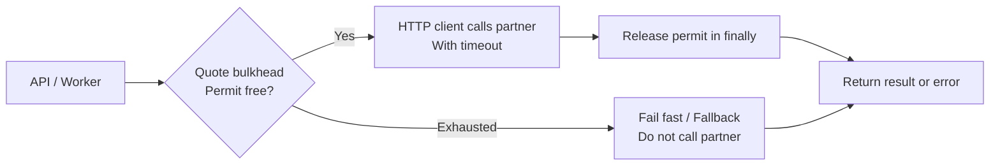

# Bulkheads, Concurrency Limits, and Isolating Slow Systems

## 1. Context: One Slow Partner Can Stall the Entire Application

In a **Spring Boot Integration** application, one API often coordinates multiple components: external HTTP services, databases, Redis, message brokers, and Spring Integration flows. Suppose an order API must call a partner quoting service before confirming an order:

1. Normally, the quoting service responds in 200 ms.
2. When the partner degrades, response time rises to 5–10 seconds.
3. Each request waiting on the partner holds a processing thread or an active task along with associated resources.
4. If incoming traffic keeps climbing, worker pools, HTTP connections, or queues fill up. Even APIs that never touch the quoting service start slowing down.

Adding more threads does not fix the root cause: it may simply let more tasks sit waiting longer. A **bulkhead** sets resource caps per dependency or workload group. When one group overloads, the impact stays contained inside that boundary instead of spreading across the whole system.

After this lesson, you should be able to:

- Distinguish bulkheads from timeouts, rate limiting, circuit breakers, and retries.
- Choose concurrency limits, isolation styles, and overflow policies.
- Implement a bulkhead for a Spring Boot HTTP client, run load tests, and monitor saturation signals.
- Combine bulkheads with error handling, transactions, caches, databases, and brokers without adding pressure to slow dependencies.

## 2. What Does a Bulkhead Actually Limit?

A **semaphore-based bulkhead** allows at most `N` *in-flight* calls at the same time. Each new call must acquire a `permit` before entering the protected zone; upon finishing—whether succeeding or failing—it releases the `permit`. Once permits run out, the system can fail immediately or wait at most a very short duration.

For instance, the quoting service has a limit of 12 concurrent calls. If all 12 slots are stuck on slow calls, the 13th call fails fast under policy rather than tying up more resources waiting. Meanwhile, the inventory service uses its own bulkhead and keeps serving normally.



A bulkhead caps **the number of concurrent operations**, not how fast each operation finishes. Without timeouts, permits can remain held for a long time. If backed by an unbounded queue, latency simply moves from HTTP waits into queue waits.

### Comparing Resilience Mechanisms

| Mechanism | Controls | When a Dependency Is Slow or Failing |
| --- | --- | --- |
| **Bulkhead** | Concurrent call count, or dedicated thread pool/queue | Caps held resources and isolates blast radius |
| **Timeout** | Maximum time waiting on an operation | Stops waiting past threshold so resources can be freed |
| **Rate limiter** | Accepted request rate over a time window | Blocks excess traffic rate, yet does not cap concurrent in-flight waits |
| **Circuit breaker** | Call admission state based on error and slow-call rates | Pauses requests temporarily when dependency shows unhealthy signals |
| **Retry** | Re-attempts for likely transient errors | Can boost success rate, yet amplifies load if misused |
| **Backpressure / load shedding** | Rate at which a pipeline accepts new work | Slows sources or rejects overflow work |

**Important example:** A partner accepts 100 requests/second, and each call takes 5 seconds. A rate limiter set to 100 requests/second still allows around 500 concurrent in-flight requests. A 20-permit bulkhead forces the application to allow at most 20 calls into that dependency at once; excess requests follow rejection, bounded wait, or fallback rules.

## 3. Three Common Isolation Patterns

### 3.1. Semaphore Bulkhead

- Runs calls on the caller's current thread and manages only a `permit` count.
- Fits synchronous calls with well-configured timeouts, such as `RestClient`, JDBC, or blocking adapters.
- Lower overhead than maintaining a separate pool; does not isolate waiting threads, so watch out for caller threads held by slow calls.
- Non-blocking `tryAcquire()` enables fail-fast. `tryAcquire(timeout, unit)` adds bounded waiting, which adds directly to total latency.

### 3.2. Thread-Pool Bulkhead

- Offloads work to a **dedicated executor** with a bounded worker count and bounded queue.
- Separates blocking work from executors serving other features, at the cost of thread overhead, context switching, and queue management.
- Requires a clear rejection policy when pool and queue fill up. Never rely on unbounded queues or `CompletableFuture.supplyAsync(...)` on the common pool as a substitute for explicit isolation.
- With `Future.get(timeout)`, the caller timing out **does not prove** the worker stopped executing. Cancellation and HTTP/JDBC timeouts are still required.

### 3.3. Resource-Layer and Consumer-Layer Limits

A bulkhead is only one layer in overall concurrency control. `HikariCP.maximumPoolSize`, HTTP connection pool sizes, `@KafkaListener(concurrency = ...)`, Spring Integration consumer/poller settings, and per-flow executors all govern actual concurrency. Shared connection pools across multiple dependencies can still cross-contaminate; where strict isolation is required, dedicate separate pools or executors per dependency.

In reactive applications, avoid using blocking semaphore waits on event-loop threads. Bound concurrency using Reactor operators such as the `concurrency` parameter of `flatMap`, alongside timeouts and backpressure. Virtual threads also do not eliminate the need for bulkheads: they lower per-waiting-thread memory cost, yet **do not** expand partner quotas, database connection limits, or downstream capacity.

## 4. Spring Boot Implementation Example: Protecting a Quoting Service

Design example: an order service makes HTTP calls to a partner quoting service. Each application instance allows at most 12 concurrent quote requests, rejects immediately when permits are exhausted, and bounds connect/read durations.

### 4.1. Per-Dependency Configuration

```yaml
# application.yml — illustrative values; measure before production use
integration:
  partner:
    base-url: https://partner.example
    max-concurrent: 12
```

Create a dedicated `RestClient` for the partner instead of sharing configuration and connection pools indiscriminately with other clients:

```java
import java.net.http.HttpClient;
import java.time.Duration;

import org.springframework.beans.factory.annotation.Value;
import org.springframework.context.annotation.Bean;
import org.springframework.context.annotation.Configuration;
import org.springframework.http.client.JdkClientHttpRequestFactory;
import org.springframework.web.client.RestClient;

@Configuration
class PartnerHttpConfiguration {

    @Bean("partnerRestClient")
    RestClient partnerRestClient(
            @Value("${integration.partner.base-url}") String baseUrl) {
        HttpClient httpClient = HttpClient.newBuilder()
                .connectTimeout(Duration.ofMillis(500))
                .build();

        JdkClientHttpRequestFactory requestFactory =
                new JdkClientHttpRequestFactory(httpClient);
        requestFactory.setReadTimeout(Duration.ofSeconds(2));

        return RestClient.builder()
                .baseUrl(baseUrl)
                .requestFactory(requestFactory)
                .build();
    }
}
```

This example uses Spring Framework 6.1+'s `RestClient` and `JdkClientHttpRequestFactory` in the Spring Boot 3.x ecosystem. These two timeouts are sample assumptions for a synchronous API; choose real values from SLAs, measured latencies, overall request deadlines, and business requirements.

### 4.2. Guarding Calls with a Semaphore

```java
import java.math.BigDecimal;
import java.util.Objects;
import java.util.concurrent.Semaphore;

import org.springframework.beans.factory.annotation.Qualifier;
import org.springframework.beans.factory.annotation.Value;
import org.springframework.stereotype.Component;
import org.springframework.web.client.RestClient;

record PriceQuote(String sku, BigDecimal amount) {}

class PartnerBusyException extends RuntimeException {
    PartnerBusyException() {
        super("Partner quote bulkhead is full");
    }
}

@Component
public class PartnerQuoteGateway {
    private final RestClient restClient;
    private final Semaphore permits;

    public PartnerQuoteGateway(
            @Qualifier("partnerRestClient") RestClient restClient,
            @Value("${integration.partner.max-concurrent:12}") int maxConcurrent) {
        if (maxConcurrent < 1) {
            throw new IllegalArgumentException("max-concurrent must be positive");
        }
        this.restClient = restClient;
        this.permits = new Semaphore(maxConcurrent);
    }

    public PriceQuote getQuote(String sku) {
        // Do not queue on request threads once all permits are busy.
        if (!permits.tryAcquire()) {
            throw new PartnerBusyException();
        }

        try {
            PriceQuote quote = restClient.get()
                    .uri("/quotes/{sku}", sku)
                    .retrieve()
                    .body(PriceQuote.class);
            return Objects.requireNonNull(quote, "Empty partner quote");
        } finally {
            // HTTP 5xx, timeouts, and body parse failures must all release permits.
            permits.release();
        }
    }
}
```

Key checks in this example:

1. `Semaphore` is a field on the singleton Spring bean—**never** instantiated per request, which would enforce no shared limit.
2. `tryAcquire()` runs **before** the HTTP call. Once permits run out, no requests are sent to the partner.
3. `release()` sits in `finally`, running only after a permit was successfully acquired; this avoids leaks or inflating permit counts.
4. The semaphore is scoped to **one JVM/instance**. Across 5 replicas, theoretical cluster-wide concurrency is `5 × 12 = 60` concurrent calls, excluding other services calling the same partner. Account for replica count, autoscaling, and sibling callers in global quotas.
5. `RestClient.retrieve()` throws exceptions on HTTP error statuses by default; timeouts/connection errors also throw. The calling layer must translate them into responses or fallbacks matching the API contract.

In production, bind configuration via validated `@ConfigurationProperties`, emit metrics, and consider a bulkhead library instead of maintaining many manual semaphores.

### 4.3. Responding When the Bulkhead Is Full

For APIs where the quote is **mandatory**, map `PartnerBusyException` to HTTP `503 Service Unavailable` with a stable error code so clients know the request is temporarily unserviceable. `429 Too Many Requests` is generally more appropriate when the caller itself exceeded a client-facing quota/rate limit. Include `Retry-After` if backed by a sensible retry policy and wait estimate.

```java
import org.springframework.http.HttpStatus;
import org.springframework.http.ProblemDetail;
import org.springframework.http.ResponseEntity;
import org.springframework.web.bind.annotation.ExceptionHandler;
import org.springframework.web.bind.annotation.RestControllerAdvice;

@RestControllerAdvice
class PartnerFailureAdvice {
    @ExceptionHandler(PartnerBusyException.class)
    ResponseEntity<ProblemDetail> onPartnerBusy(PartnerBusyException exception) {
        ProblemDetail problem = ProblemDetail.forStatusAndDetail(
                HttpStatus.SERVICE_UNAVAILABLE,
                "Quoting service is overloaded, please try again later.");
        problem.setTitle("Partner quote temporarily unavailable");
        return ResponseEntity.status(HttpStatus.SERVICE_UNAVAILABLE).body(problem);
    }
}
```

If quotes are **optional informational enrichment** and the business allows it, you may serve valid cached data, a value marked `stale`, or omit the optional field. Fallbacks must stay honest about data reliability; never invent prices, fake payment confirmations, or report success for unfinished operations.

For side-effecting operations (creating orders, charging money, emitting events), determine true operation state before retrying. A client-side timeout **does not prove** the downstream cancelled the action. Use idempotency keys, business locks, or reconciliation where appropriate.

## 5. Using Resilience4j Bulkhead for Centralized Management

Resilience4j provides declarative bulkhead configuration, metrics, and Spring Boot integration. For Spring Boot 3, add dependencies matching your BOM/project version (alongside Spring AOP if using annotations):

```kotlin
// build.gradle.kts — versions managed by BOM or dependency management
implementation("io.github.resilience4j:resilience4j-spring-boot3")
implementation("org.springframework.boot:spring-boot-starter-aop")
```

```yaml
resilience4j:
  bulkhead:
    instances:
      partnerQuote:
        maxConcurrentCalls: 12
        maxWaitDuration: 0ms
```

Annotate a **public method on a Spring bean invoked through a proxy**:

```java
import io.github.resilience4j.bulkhead.annotation.Bulkhead;
import org.springframework.stereotype.Service;

@Service
class ProtectedPartnerQuoteService {
    private final RawPartnerQuoteClient client;

    ProtectedPartnerQuoteService(RawPartnerQuoteClient client) {
        this.client = client;
    }

    @Bulkhead(name = "partnerQuote", type = Bulkhead.Type.SEMAPHORE)
    public PriceQuote getQuote(String sku) {
        return client.fetchQuote(sku);
    }
}
```

`RawPartnerQuoteClient` represents the timeout-configured HTTP client from Section 4; the snippet shows where the annotation belongs. When using Resilience4j, the library manages the bulkhead, so **do not** wrap the same call in an additional manual semaphore unless two separate caps are intentional. Verify AOP proxying: calling an annotated method directly from another method **inside the same object** bypasses advice. For `CompletableFuture`/dedicated thread-pool tasks, evaluate `THREADPOOL` bulkheads with bounded pools/queues matching the return type.

Property names, annotations, ordering with `@Retry`/`@CircuitBreaker`, and metrics can vary across versions; verify against your Resilience4j release. More important than annotation syntax is proving via tests that calls reaching the client are **genuinely bounded** at the configured limit.

## 6. Choosing Permit Counts and Wait Durations

Little's Law for a stable system gives an estimate of average concurrent executions:

**Average in-flight operations ≈ throughput (requests/second) × average latency (seconds).**

Suppose the partner serves about 40 requests/second with a healthy average latency of 250 ms:

```text
L ≈ 40 × 0.25 = 10 active calls
```

An initial setting of 12–16 permits can be load-tested if partner capacity and quotas permit. If the partner slows down to 2 seconds while 40 requests/second keep arriving, demand jumps toward 80 concurrent calls. A 16-permit bulkhead caps active executions at 16; excess requests are rejected or routed to fallback. In the simplified case where every call takes 2 seconds, completion throughput caps near `16 / 2 = 8` requests/second; this illustrates the principle, not a throughput guarantee.

Tuning guidelines:

| Parameter | How to Determine | Common Mistake |
| --- | --- | --- |
| `maxConcurrentCalls` | Based on target load, measured latency, partner quotas, connection pools, replica count, and resource budget | Setting equal to peak RPS without factoring in call duration |
| `maxWaitDuration` | Consider 0 (fail-fast) by default; allow short waits only if total deadline allows | Long waits keep request threads occupied and worsen tail latency |
| Connect/read timeouts | Align with upstream contract and full request deadline; include bulkhead wait, retries, and internal work | Having a bulkhead while leaving I/O timeouts unbounded |
| Executor queue | Small, bounded size with explicit rejection policy and metrics | Unbounded queues hide overload until memory runs out |
| Retry/backoff | Retry only transient failures with bounds, jitter, idempotency, and overall deadline | Synchronized retries hammer a slow dependency harder |

Good sizing cannot rely on `p95` alone; watch **mean latency**, latency distribution, real arrival rates, and active call counts. When multiple instances share a partner quota, per-instance caps must reflect aggregate load. With autoscaling, fixed per-instance caps can exceed quotas when replicas scale out; consider shared coordination/quotas.

### Overall Time Budget

A request with a 3-second deadline might reserve 200 ms for internal work, 300 ms for database queries, and ~2 seconds for the partner, leaving the rest for overhead. Configuring `maxWaitDuration=2s`, a 2s read timeout, and 3 retries blows far past the original deadline. Enforce **one end-to-end time budget**, check remaining time before each call, and skip retries once insufficient time remains.

## 7. Interactions with Other Integration Components

### HTTP and Multiple Partners

If the system calls two shipping partners A and B, give A and B independent bulkheads alongside separate timeouts, clients, metrics, and fallback policies. Sharing one semaphore across A and B lets a slow partner A starve healthy partner B. Conversely, if A and B genuinely share **one** scarce resource (such as a shared quota), add a shared resource cap alongside their individual caps.

### JDBC, Databases, and Transactions

A bulkhead ahead of database work limits concurrent operations competing for DB resources; align it with connection pool size and other flows' load. Avoid wrapping `@Transactional` around slow HTTP calls: transactions hold DB connections and locks while waiting on the network. Move remote calls outside transactions; when coordinating data updates and events, consider transactional outbox, idempotency, or compensation.

### Redis, Caches, and Fallbacks

Caches reduce traffic hitting partner bulkheads. Yet if the cache fails, mass fallbacks straight to origin can trigger a **cache stampede**. Use jittered TTLs, per-key single-flight/request coalescing, stale-while-revalidate, or miss concurrency caps; never let a cache outage break partner limits.

### Message Brokers and Spring Integration

For listeners/consumers, a full bulkhead does not mean the message was processed. Decide **ack**, retry, delay, pause/resume, dead-lettering, and idempotency by error type. Never ack an unprocessed message as successful; equally, never infinitely immediate-requeue into a hot loop. In `@KafkaListener`, RabbitMQ listeners, or Spring Integration flows, align `concurrency`, `maxMessagesPerPoll`, executor/channel queues, and source backpressure with downstream caps. Async handlers must release permits **only once the task truly finishes**, not right after submitting a `Future`.

## 8. Combining Retries, Circuit Breakers, and Bulkheads

A sound resilience stack typically combines:

1. **Timeouts** on every I/O operation so resources are never held indefinitely.
2. **Bulkheads** to bound concurrent access to each dependency.
3. **Circuit breakers** to fail fast when a dependency is consistently failing or slow.
4. **Selective retries** with backoff, jitter, idempotency, and an overall deadline.
5. **Fallbacks** only when business rules genuinely allow substitute data or outcomes.

**Nesting order matters.** If retries sit *inside* the semaphore, a request holds its permit while sleeping during backoff, shrinking effective throughput. If retries sit *outside*, each attempt re-acquires a permit, yet total downstream calls can multiply. With annotations or aspects, verify execution order in your exact framework version and measure real attempt counts. Never retry `PartnerBusyException` in a tight local loop; that turns fail-fast protection into a load amplifier.

Useful error routing:

| Situation | Preferred Behavior |
| --- | --- |
| Bulkhead full | Fail fast or fallback, record `rejected` metric; usually do not retry immediately |
| Connection cannot be established | Short timeout; bounded retry if operation is safe and deadline remains |
| HTTP 429 from partner | Honor `Retry-After` policy/guidance; slow dispatch rate |
| HTTP 5xx or gateway timeout | Circuit breaker; backoff retry where safe and idempotent |
| 4xx input data error | Return contract error; do not retry blindly |
| Timeout after side-effecting call | Reconcile state / check idempotency before resending |

## 9. Observability and Testing to Prove Isolation Works

Track at minimum **per dependency name and instance**:

- `in-flight` calls, available permits, and max limit.
- Admitted calls, full rejections, timeouts, HTTP errors, fallbacks, and retries.
- End-to-end latency, permit/queue wait duration, and real upstream latency.
- Thread pool, queue, and connection pool utilization, plus latency of **unrelated APIs that do not call that dependency**.

Export metrics via Micrometer/Actuator. If using Resilience4j, enable the version-matched metric integration and verify actual meter names. Alert on **sustained rejection rates**, latency, error spikes, queue growth, and permit saturation rather than firing alerts whenever available permits momentarily hit 0.

### Meaningful Test Scenarios

| Scenario | How to Execute | Acceptance Criteria |
| --- | --- | --- |
| Healthy partner | Moderate load, fast responses | Requests succeed within SLA; permits mostly available |
| Slow partner | Mock upstream intentionally stalls calls | `in-flight` never exceeds 12 per instance; excess fails fast |
| Partner timeout/500 | Return errors or exceed timeouts | Permits are released; available count never leaks down to 0 |
| High concurrent load | Fire >12 concurrent quote requests while holding initial calls | At most 12 actual upstream calls; remaining requests follow rejection policy |
| Isolation | Concurrently invoke an endpoint independent of quoting | Independent endpoint's latency/throughput stays within acceptable bounds |
| Multi-replica | Scale instance count and repeat test | Aggregate concurrency/partner quota stays within design budget |
| Retries under errors | Combine 5xx errors with steady traffic | Total attempts, queues, and latency do not explode |

Measure concurrency **at the mock upstream**, not merely by counting API entry calls. Hold mock responses long enough for requests to genuinely overlap; instant mocks prove nothing about concurrency caps. For Section 4's semaphore code, verify permits restore accurately after successes, exceptions, and timeouts.

## 10. Common Design Mistakes and Checklist

- **One shared pool for all dependencies:** a slow dependency starves healthy ones. Isolate by dependency, priority, or resource class when needed.
- **Limiting RPS only:** fails to stop concurrent executions from piling up when latency rises. Add concurrency limits.
- **Oversized queues:** turns early rejections into request buildup and late timeouts. Keep queues small, bounded, deadline-aware, and instrumented.
- **Holding permits across unrelated work:** e.g., holding a partner HTTP permit during lengthy local processing. Guard only the resource-consuming segment.
- **Releasing permits too early in async code:** calling `release()` immediately after submitting a task lets active tasks exceed limits. Release upon task completion.
- **Wrapping transactions around slow networks:** keeps DB connections and locks held. Shrink transaction scopes.
- **Ignoring replica counts and connection pools:** single-pod settings understate aggregate load.
- **Retrying every error:** retrying bulkhead rejections or 4xx errors creates loops and load spikes.
- **Semantically dishonest fallbacks:** serve stale/default values only when the public API contract permits it.

Before shipping to production, answer: *Which dependency does this limit protect? Are we bounding concurrent calls or threads? Who handles rejections? Are timeouts and deadlines enforced? Are permits released on every error path? What is the aggregate quota across all replicas? Which metrics and tests prove a slow partner cannot stall unrelated endpoints?*

A bulkhead works when it is a **measurable, tested boundary paired with explicit failure policies**. In Spring Boot, place limits close to resource consumption, keep waits bounded, coordinate with timeouts and circuit breakers, and continuously tune against real traffic.
