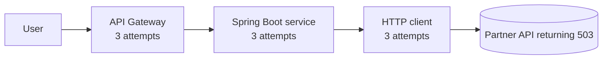
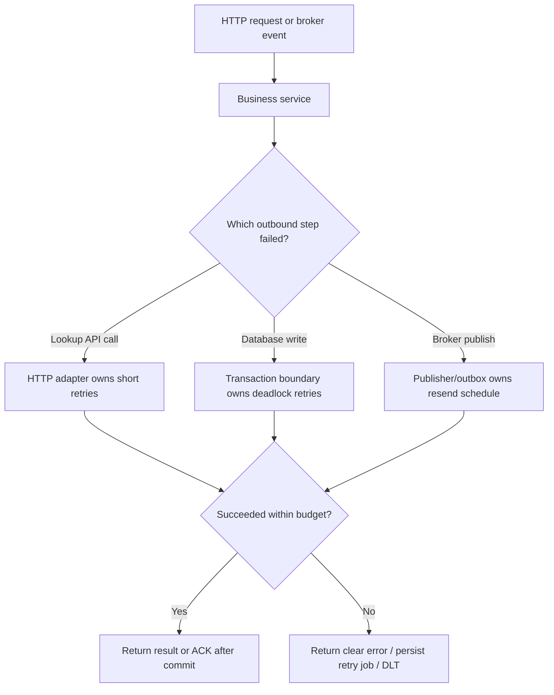
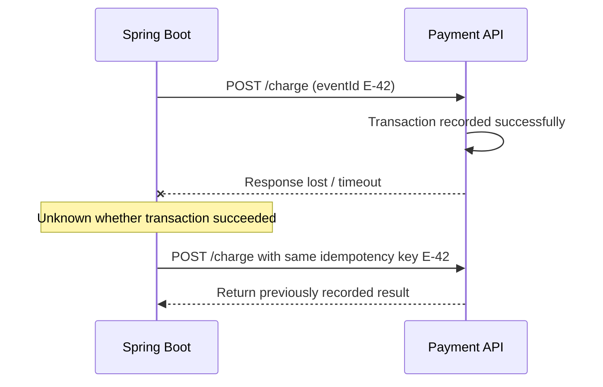

# Avoiding Multi-Layer Retries That Amplify Traffic

## Context and Objectives

In **Spring Boot Integration**, a single request may traverse an HTTP gateway, business service, HTTP client, database, cache, and message broker. Each component can independently retry transient errors. When layers retry without coordination, a minor downstream glitch turns into a **request storm** (*retry storm*), making an overloaded service even harder to recover.

This topic in the **Failure Recovery** chapter of the `SPRING_BOOT_INTEGRATION` module covers designing retries for HTTP, database, cache, messaging, and Spring Integration flows, emphasizing **error classification, retry budgets, deadlines, idempotency, observability, and testing**.

After this lesson, you will be able to:

1. Explain and calculate the amplification factor when multiple layers independently retry the same failure.
2. Distinguish retries within **one synchronous execution** from **redeliveries/reprocessing** by brokers or durable tasks after restarts.
3. Choose a clear retry owner and bound attempts via an **attempt budget** and a **time budget**.
4. Configure Spring Retry, Resilience4j, or Reactor at the proper retry boundary while avoiding unsafe side-effect repetition.
5. Test using real downstream call counters and alert when retries cause overload.

> **Example Scope:** Java snippets use Spring Boot 3.x / Spring Framework 6.x, Spring Retry 2.x, Resilience4j 2.x, and Reactor 3.x. For Spring Framework 7 / Boot 4 or upgraded libraries, verify exact APIs and properties against your active BOM. Retry policies must be verified by behavior rather than inferred from annotation names.

## 1. How Do Retries Amplify Traffic?

Suppose a catalog lookup request traverses three layers:



If **each attempt at an outer layer triggers all configured attempts at the inner layer**, total HTTP calls hitting the partner API when **every attempt fails** can reach:

\[
N_{downstream}=N_{gateway}\times N_{service}\times N_{http-client}=3\times3\times3=27.
\]

One logical request can generate **27 requests** to the same downstream. At 100 inbound requests/second, downstream load during total failure surges toward **2,700 attempts/second**, before even counting fan-out or background retries. This is a **theoretical upper bound for nested retries**, not a claim that every system always multiplies by exactly 27: circuit breakers, timeouts, cancellations, caches, error classifiers, and retry policies can alter actual counts.

In general, with `k` independent retry layers each allowing up to `a_i` attempts including the first:

\[
N_{downstream,max}=\prod_{i=1}^{k} a_i.
\]

For instance, five layers with three attempts each can produce **3⁵ = 243** calls at the bottom of the chain. The danger is that retries fire **precisely when the downstream is already failing or overloaded**: the more requests fail, the more attempts the system sends, rapidly exhausting queues, connection pools, and thread pools.

### 1.1. Why Exponential Backoff Alone Is Not Enough

Backoff spreads attempts over time, yet **does not eliminate the multiplication of attempts**. If three layers each retry three times, even with delays, the total can still hit 27. Moreover, if all instances use identical fixed delays, they wake up together in recurring load spikes. **Jitter** desynchronizes retry timings; **retry budgets** cap total attempts; **load shedding** and **circuit breakers** stop generating extra work when downstream cannot respond.

| Measure | Problem Solved | Does Not Solve by Itself |
|---|---|---|
| Lower `maxAttempts` | Cuts max attempts within a single layer. | Stacked retries across other layers. |
| Exponential backoff + jitter | Reduces retry rate bursts and client synchronization. | Cumulative attempt multiplication if multiple layers still retry. |
| Timeouts/deadlines | Prevents one request from holding resources forever. | Undoing server-side side effects when responses time out. |
| Circuit breakers | Temporarily blocks calls when error rates cross thresholds. | Replacing retry/idempotency design or guaranteeing recovery. |
| Rate limits / bulkheads | Bounds concurrent load and dispatch rate sent downstream. | Ensuring rejected messages are not lost. |
| Idempotency | Ensures replaying the same business command creates no duplicate side effects. | Reducing bandwidth or retry call volume. |

## 2. Map Every Retry Source Before Configuring

Before enabling a new retry, trace the entire chain from event origin to final side effects. **Retries do not live solely in `@Retryable`**: clients, proxies, brokers, and schedulers often have built-in retries too.

| Layer in Integration Flow | Mechanism That Can Repeat Calls | Common Mistake |
|---|---|---|
| User / frontend / API gateway | Client resubmits; gateway retries on 502/503/504. | Backend already retried, yet gateway retries the whole request again. |
| Spring service | Spring Retry `@Retryable`, `RetryTemplate`, or Resilience4j Retry. | Placing retry on both controller and service for the same operation. |
| HTTP client | Resilience4j decorators, Reactor `retryWhen`, SDK/transport retries if enabled. | Combining SDK retries with service and gateway retries. |
| Spring Integration | `RequestHandlerRetryAdvice` on handler; error channel/recoverer. | Broker redelivery triggers the full handler retry advice on every delivery. |
| Database access | Spring Retry around transactions, driver/framework retries, job retries. | Retrying a partial transaction after external side effects already occurred. |
| Message broker | Kafka listener error handlers/retry topics, RabbitMQ requeue, Pulsar NACK/redelivery, JMS rollback/redelivery. | Event redelivered multiple times, running full HTTP `maxAttempts` on every delivery. |
| Scheduler / batch | Re-polling failed jobs, retrying workflows after restarts. | Keeping attempt counters only in RAM; restarts reset the budget. |
| Partner system | May process request before dropping connection or timing out. | Client resends writes without an idempotency key. |

For example, a Kafka listener delivers an event up to **4 times**, and each handler calls an HTTP client allowing **3 attempts**: one failing event generates **12 HTTP calls** before landing in a dead-letter topic (DLT). If an outer gateway also retries three times per HTTP attempt, calls at the far end reach **36**. You cannot observe that total from `@Retryable` metrics alone; observe the **entire causal chain**.

### 2.1. Distinguish Attempt, Retry, Redelivery, and Reprocessing

- **Attempt:** one actual execution try. `maxAttempts=3` normally means **one initial try + up to two retries**, though always verify the specific API.
- **Retry:** a subsequent attempt of the same operation inside one retry policy.
- **Redelivery:** broker sends a message again due to missing ACK, processing error, seek/requeue, or timeout. It can trigger a **fresh handler invocation** with a fresh local retry budget.
- **Reprocessing:** operations manually reruns an event/job after an error or from a DLT; may happen hours/days later and must not rely solely on in-memory retry counters.

Spring Retry 2.x `RetryTemplate.builder().maxAttempts(3)` and Resilience4j `RetryConfig.maxAttempts(3)` both count the initial call. By contrast, Reactor `Retry.backoff(2, ...)` takes the **number of additional retries**, producing up to **three subscriptions/attempts** total. Read parameter semantics carefully before budgeting.

## 3. Pick Where Retries Belong: One Policy per Failure at One Boundary

A solid design rule: **each outbound operation has one retry owner**; all other layers inspect the final outcome or exhausted error to decide fallback, error response, DLT routing, or deferred scheduling.



**Put retries close to the failure or at the outer layer?** Retrying at the outbound adapter is cheaper because it repeats only one lightweight call rather than re-running parsing, validation, transactions, or completed steps. However, the outer layer holds the business context needed to judge replay safety. Split responsibilities clearly: **the business service defines which operations may be retried**, while **the adapter enforces the policy around that specific call**. There is no absolute rule forcing all retries to the lowest or highest layer.

Typical ownership assignment:

| Activity | Recommended Retry Owner | What Other Layers Should Do |
|---|---|---|
| Safe-to-retry `GET /catalog/{sku}` | Service HTTP adapter: 2–3 short attempts with deadline. | Gateway avoids re-running the whole business request on that error; disable transport-level duplicate retries. |
| Payment creation POST | Workflow with `idempotencyKey`; query status on ambiguous timeouts. | Never retry blindly across HTTP layers; never generate a new key per attempt. |
| Database deadlock or serialization failure | Retry the **entire safely repeatable transaction** at the transaction boundary. | Never retry single SQL statements inside a broken transaction; keep HTTP side effects outside the retried block. |
| Kafka/RabbitMQ/Pulsar consumer transient error | One redelivery/retry-topic policy with backoff, bounds, and DLT. | Avoid long retries inside handlers; if ultra-short local retries exist, budget them together. |
| Spring Integration service activator | `RequestHandlerRetryAdvice` or outbound adapter policy—pick one. | On broker redelivery, do not blindly grant an infinite fresh processing budget. |
| Outbox dispatcher sending events | Dispatcher manages `attempt_count`, `next_attempt_at`, leases, and terminal states. | Transport may use tiny connection retries without multiplying logical retries uncontrollably. |

### 3.1. Classify Errors Before Retrying

| Error / Outcome | Should You Retry? | Conditions / Notes |
|---|---|---|
| HTTP `400`, `401`, `403`, validation `422` | Usually **no**. | Bad data/authorization will not heal by repeating identical input. |
| HTTP `404` | Contract-dependent. | Often a valid "not found"; retry only for explicitly designed eventual consistency. |
| HTTP `408`, network timeout, connection reset | **Conditionally**. | Unknown whether the server received/applied the request; needs idempotency or keys. |
| HTTP `429` | Conditionally; **honor `Retry-After`** when present. | Slow dispatch; if deadline disallows waiting, return error or defer to a job. |
| HTTP `502`, `503`, `504` | Usually safe for short retries on **read/idempotent calls**. | Bounded retries, jitter; trip circuit breaker on prolonged errors. |
| HTTP `500` | Semantics-dependent. | Never retry all 500s blindly; may reflect a permanent bug or an already-applied write. |
| DB deadlock/serialization conflict | Can retry the **complete transaction**. | Only when transaction rolled back and side effects are safe to repeat. |
| Unique constraint / invalid SQL / schema error | Usually **no**. | Retries do not fix data or schema errors. |
| Unparseable message payload | **Never retry the same payload infinitely**. | Route to DLT/quarantine with diagnostics and controlled remediation. |

**Idempotent** does not strictly mean "GET only." A `POST` can be safe if the partner enforces stable idempotency keys and replays prior results. Conversely, a broken `GET` could trigger side effects; always trust actual API contracts.

## 4. Design Retry Budgets and Deadlines Together

Attempt counts and wait times are **two separate bounds**. `maxAttempts=3` with 30 seconds per attempt can still stall a request over a minute. A 2-second timeout with unbounded retries can still flood downstream if every attempt fails immediately with 503.

### 4.1. Attempt Budget

Example for a catalog lookup request:

- `totalAttempts ≤ 3` **including the initial call** for the outbound HTTP step.
- Retry only network exceptions and HTTP 503 per the idempotency contract.
- The gateway and outer service layers **do not** repeat the whole request on failures already handled by the adapter.
- Once the budget exhausts, return a classified error and emit `retry_exhausted`; never start another retry loop at a higher layer without a shared budget.

When multi-layer retries are **unavoidable**, define a **shared chain-wide budget** (such as `attemptsRemaining` or a deadline in request context) and ensure each layer **deducts from that same budget**. Custom headers like `X-Retry-Attempt` are unreliable unless gateways and SDKs understand them; enforce a contract and never let untrusted clients grant themselves infinite budgets. If cross-layer budget propagation is impractical, the safer choice is **reducing one layer's retry policy to a single attempt**.

### 4.2. Time Budget

Given overall deadline `D`, attempt latencies `t_i`, backoffs `b_i`, and overhead `o`:

\[
\sum_{i=1}^{n} t_i+\sum_{i=1}^{n-1} b_i+o \le D.
\]

For a **2-second** SLA where each HTTP attempt allows a **600 ms** timeout: three attempts alone already consume **1,800 ms** before counting connects, backoffs, serialization, and business logic. Enabling three attempts merely because "three is the default" can violate the SLA. Check **remaining deadline** before every attempt and skip starting a new attempt when insufficient time remains.

Note that `Resilience4j Retry.maxAttempts` bounds **attempt count** only, not the **overall deadline** of a business operation. API gateway, HTTP client, DB driver, thread pool, and Kubernetes timeouts may all differ; verify they align coherently.

### 4.3. Backoff and Jitter

A common policy for the `k`-th retry after the first call:

\[
b_k=\operatorname{random}\bigl(0,\min(b_{max},\; b_0\cdot2^{k-1})\bigr).
\]

This illustrates **full jitter**. Libraries implement different jitter algorithms (such as randomizing within a band around the base delay), so do not label every `jitter(0.5)` setting as full jitter. Add a `maxBackoff` cap, attempt limits, and **exclude non-recoverable errors**. When upstream returns a valid `Retry-After`, honor that guidance within agreed deadlines and wait caps.

Under high load, consider a **retry token bucket**: grant a limited token pool for retries, consuming tokens on retries and refilling on healthy completions. A circuit breaker pauses calls during sustained outages; bulkheads cap occupied connections/threads. Size these controls by measuring real downstream load.

## 5. Configuring a Single Retry Layer in Spring Boot

### 5.1. Example: `RestClient` + Resilience4j for HTTP GET

Illustrative setup: a Spring Boot adapter calls `GET /products/{sku}` on a partner service. **Only this adapter retries**. The gateway, business service, and lower-level transport add no extra business retries for this operation.

Required dependencies per active BOM: `spring-boot-starter-web` (for `RestClient`) and `io.github.resilience4j:resilience4j-retry` (with compatible core modules). Spring Boot supplies `RestClient.Builder` via auto-configuration.

```java
import java.net.http.HttpClient;
import java.time.Duration;

import io.github.resilience4j.core.IntervalFunction;
import io.github.resilience4j.retry.Retry;
import io.github.resilience4j.retry.RetryConfig;
import org.springframework.context.annotation.Bean;
import org.springframework.context.annotation.Configuration;
import org.springframework.http.client.JdkClientHttpRequestFactory;
import org.springframework.web.client.HttpServerErrorException;
import org.springframework.web.client.ResourceAccessException;
import org.springframework.web.client.RestClient;

@Configuration(proxyBeanMethods = false)
class CatalogHttpConfiguration {

    @Bean("catalogReadRetry")
    Retry catalogReadRetry() {
        RetryConfig config = RetryConfig.custom()
                .maxAttempts(3) // Initial attempt + up to two retries
                .intervalFunction(IntervalFunction.ofExponentialRandomBackoff(
                        200L, 2.0, 0.5, 1_000L))
                .retryOnException(ex ->
                        ex instanceof ResourceAccessException
                        || ex instanceof HttpServerErrorException.ServiceUnavailable)
                .build();

        return Retry.of("catalog-read", config);
    }

    @Bean("catalogRestClient")
    RestClient catalogRestClient(RestClient.Builder builder) {
        HttpClient nativeClient = HttpClient.newBuilder()
                .connectTimeout(Duration.ofMillis(250))
                .build();
        JdkClientHttpRequestFactory requestFactory =
                new JdkClientHttpRequestFactory(nativeClient);
        requestFactory.setReadTimeout(Duration.ofMillis(600));

        return builder.baseUrl("https://catalog.partner.example")
                .requestFactory(requestFactory)
                .build();
    }
}
```

```java
import java.util.function.Supplier;

import io.github.resilience4j.retry.Retry;
import org.springframework.beans.factory.annotation.Qualifier;
import org.springframework.stereotype.Component;
import org.springframework.web.client.RestClient;

record ProductDto(String sku, String name) {}

@Component
class CatalogGateway {
    private final RestClient client;
    private final Retry retry;

    CatalogGateway(
            @Qualifier("catalogRestClient") RestClient client,
            @Qualifier("catalogReadRetry") Retry retry) {
        this.client = client;
        this.retry = retry;
    }

    ProductDto findProduct(String sku) {
        Supplier<ProductDto> oneAttempt = () -> client.get()
                .uri("/products/{sku}", sku)
                .retrieve()
                .body(ProductDto.class);

        return Retry.decorateSupplier(retry, oneAttempt).get();
    }
}
```

**Reading the example accurately:**

- `maxAttempts(3)` allows **at most three HTTP GETs** per `findProduct` call on eligible failures—not three retries on top of the first call.
- Retries only `ResourceAccessException` or HTTP **503 Service Unavailable** via its specific subclass. This snippet **does not handle `Retry-After`**; if the partner sends 429/503 with wait headers, inspect them and check deadlines before retrying.
- `IntervalFunction.ofExponentialRandomBackoff(...)` grows delays exponentially with bounded randomization to reduce synchronized spikes. With **synchronous** `Retry`, backoff waits occupy the calling thread; WebFlux event loops need non-blocking alternatives.
- `connectTimeout` and `readTimeout` bound specific I/O phases; they **do not** enforce an end-to-end deadline. HTTP libraries vary in how response vs. request timeouts are measured.
- Never add `@Retryable(maxAttempts = 3)` onto `CatalogGateway.findProduct` or turn on gateway/SDK retries for the same failure without adjusting the shared budget.

The hostname above is an **example placeholder**, not a real endpoint. Production code should externalize base URLs and timeouts, validate values, and monitor per partner.

### 5.2. Expressing the Same Policy in Spring Retry 2.x

Do not use both Resilience4j and Spring Retry on the same operation. Where a module already uses `RetryTemplate`, an equivalent **attempt-count** policy looks like:

```java
import org.springframework.retry.support.RetryTemplate;

RetryTemplate template = RetryTemplate.builder()
        .maxAttempts(3)
        .exponentialBackoff(200, 2.0, 1000, true)
        .retryOn(TransientPartnerException.class)
        .build();

ProductDto product = template.execute(ctx -> partnerClient.getProduct(sku));
```

`TransientPartnerException` and `partnerClient` are **illustrative application types/adapters**. `maxAttempts(3)` includes the initial call plus two retries; `true` enables randomized exponential backoff in Spring Retry 2.x. Use **either** Section 5.1 or 5.2—never both—for one outbound call.

If using `@Retryable`, enable required infrastructure (`@EnableRetry` in Spring Retry 2.x plus Spring AOP where needed) and invoke through the Spring proxy. Internal `this.someMethod()` calls within the same bean bypass proxy advice. Also distinguish Spring Retry 2.x from native retry support in Spring Framework 7, as annotation names and features differ.

### 5.3. `WebClient` and Reactor: Retry at the Upstream Publisher

In WebFlux flows, place retries **directly on the single HTTP call** and filter only classified errors:

```java
import java.time.Duration;
import reactor.core.publisher.Mono;
import reactor.util.retry.Retry;
import org.springframework.web.reactive.function.client.WebClient;
import org.springframework.web.reactive.function.client.WebClientRequestException;
import org.springframework.web.reactive.function.client.WebClientResponseException;

Mono<ProductDto> findProduct(WebClient client, String sku) {
    return client.get()
            .uri("/products/{sku}", sku)
            .retrieve()
            .bodyToMono(ProductDto.class)
            .retryWhen(Retry.backoff(2, Duration.ofMillis(200))
                    .maxBackoff(Duration.ofSeconds(1))
                    .jitter(0.5)
                    .filter(ex -> ex instanceof WebClientRequestException
                            || ex instanceof WebClientResponseException.ServiceUnavailable));
}
```

**`Retry.backoff(2, ...)` allows up to two retries after the first subscription**, equivalent to three attempts. Reactor schedules backoffs asynchronously instead of blocking event loops with `Thread.sleep`. Never wrap `.retryWhen(...)` **outside** operators that mutate DBs or send messages, because resubscription repeats side effects. Likewise, never attach a second `Retry` operator around the same publisher unless deliberately coordinating budgets. Handle 429 `Retry-After` per contract.

## 6. Retries Across HTTP, Transactions, and Message Brokers

### 6.1. Timeouts Do Not Prove Failure

Consider HTTP payment capture:



Without `idempotencyKey`, two calls can create **two charges**. Concluding "we can retry because timeouts are transient" is incomplete. For writes:

1. Generate a **stable business operation ID** and pass it in headers/payload per partner contract.
2. The receiver must genuinely **deduplicate** by key with suitable TTL/lifecycle; sending a header alone makes nothing safe.
3. On uncertain outcomes, prefer **status lookup by key** or idempotent APIs—never generate a fresh order/payment ID per retry.
4. Enforce a **whole-operation retry budget**, including worker/outbox restarts when business rules require an overall cap.

### 6.2. Database Retries at Transaction Boundaries

Databases may require retries on deadlocks or serialization failures. Never retry a single `UPDATE` inside an already-rolled-back transaction, and never retry a whole workflow that already fired external HTTP calls. Safer pattern:

```text
retry policy for eligible transaction errors
    -> begin a NEW transaction
       -> read/validate business state
       -> update database + write outbox in SAME transaction
       -> COMMIT
    -> on retryable error: roll back; backoff wait; rerun whole transaction
```

In Spring, wrap `RetryTemplate` **outside** `TransactionTemplate` so every attempt starts a fresh transaction. Avoid relying implicitly on `@Retryable` + `@Transactional` AOP ordering without verifying advisor precedence. Keep non-rollbackable HTTP side effects outside retried transactions; write an outbox row and send after commit.

### 6.3. Broker Redeliveries Multiply Handler Retries

Suppose Kafka redelivers an event up to four times while the handler uses Resilience4j for three HTTP attempts. Under continuous downstream failure, one event calls the partner **4 × 3 = 12** times. With RabbitMQ (requeues) and Pulsar (NACK/ack timeouts), mechanics differ yet amplification risk is identical when handlers repeat outbound calls.

In Spring for Apache Kafka, `@RetryableTopic`/retry topics route failures through delay topics before hitting a DLT. This is **asynchronous message-level retry**, distinct from synchronous HTTP client retries. `DefaultErrorHandler` or in-listener retries can still multiply attempts; always evaluate **combined blocking and non-blocking retries** before enabling both. Retry topics can also relax per-key ordering guarantees.

Design approach:

- Keep HTTP adapter retries **short** for transient blips on idempotent operations, paired with **one** bounded broker redelivery policy for longer outages; budget the product of attempts.
- Or set **no HTTP retries inside the listener** (`maxAttempts = 1`) and let broker retry topics/backoff/DLT govern pacing.
- Never sleep consumer threads for tens of seconds under large backlogs; use broker retry topics, delayed queues, or durable schedulers.
- ACK/commit offsets **only after** side effects or durable job states are persisted; acking merely upon submitting to an in-memory executor risks losing work.
- Use **event IDs and inbox/deduplication** to block duplicate side effects across crash redeliveries, even if in-memory attempt counters reset.

### 6.4. Spring Integration `RequestHandlerRetryAdvice`

Spring Integration provides `RequestHandlerRetryAdvice` to apply retries around a message handler. That can be the right place to manage outbound handler retries, yet consider the **message source**:

```text
RabbitMQ / JMS / Kafka inbound adapter
    -> Spring Integration flow
    -> service activator + RequestHandlerRetryAdvice (3 attempts)
    -> HTTP gateway/SDK (3 attempts)
    -> partner

When message is requeued/redelivered 4 times:
  Up to 4 x 3 x 3 = 36 partner calls for 1 event
```

`RequestHandlerRetryAdvice` supports **stateless** retries (within one invocation) and **stateful** retries (tracking progress by key across redeliveries). Stateful advice does not automatically give you a **distributed restart-durable retry budget**. When using advice, define retry policy, backoff, `RecoveryCallback`/error channel, and broker ack/requeue rules together so three layers do not independently retry one error. Default attempt counts also vary across Spring Retry versions—configure explicitly and verify in tests.

## 7. Preventing Retry Storms When Downstream Is Overloaded

Retries must be a **bounded recovery opportunity**, never unconditional load amplification.

### 7.1. Recommended Protection Stack

1. **Per-I/O timeouts and overall deadline:** refuse new attempts once time runs out.
2. **Error classifier:** retry only failures that can actually recover; separate network errors, 503, 429, validation, and data errors.
3. **Few attempts + capped exponential backoff + jitter:** e.g., max 3 attempts with randomized delays.
4. **Rate limiter / retry budget:** cap total outbound rate and retry ratio, especially as error rates climb.
5. **Circuit breaker:** pause calls temporarily on sustained failures; probe recovery carefully.
6. **Bulkhead / concurrency cap:** cap threads, connections, and queues with clear rejection behavior.
7. **Fallbacks and DLTs:** return clear errors, conditional stale caches, or move work to durable queues instead of looping forever.

For HTTP 429, prefer **throttling upstream dispatch** over having thousands of instances wait on the same `Retry-After` and fire simultaneously. For sustained HTTP 503s, open circuit breakers, lower concurrency, and surface temporary unavailability. For mandatory business commands, persist into durable queues/outboxes and drain at a rate downstream can sustain.

### 7.2. Synchronous Retries vs. Durable Retries

| Type | Time Horizon | Where State Lives | Limitations |
|---|---|---|---|
| Sync retry in HTTP adapter | Milliseconds to seconds | In-memory during request | Holds request resources; lost if process dies. |
| Reactive `retryWhen` | Milliseconds to seconds (or per design) | Subscription/Reactor pipeline | Cancelling subscription stops retries; not durable storage. |
| Broker retry topic / delayed redelivery | Seconds to minutes/hours | Broker and mechanism metadata | Must manage retry counts, ordering, retention, DLTs, and ACKs. |
| Durable outbox / job scheduler | Minutes to days | Database/job store | Survives restarts; needs idempotency, leases, monitoring, and bounds. |

A short-lived HTTP policy does not replace durable recovery across restarts. Conversely, knowing a broker will redeliver an event is no excuse to add heavy synchronous retries inside every outbound call.

## 8. Testing to Catch Multi-Layer Retry Multiplication

Tests that check only the final response miss actual outbound call counts. When downstream always returns 503, the system still returns "failed" as expected—even if it hit the partner 27 times instead of 3.

### 8.1. Proving Multiplication with a Minimal Unit Test

This JUnit snippet illustrates the **logical multiplication**: three nested layers each executing three failing attempts. Zero wait keeps tests deterministic:

```java
import static org.junit.jupiter.api.Assertions.assertEquals;
import static org.junit.jupiter.api.Assertions.assertThrows;

import java.util.concurrent.atomic.AtomicInteger;
import org.junit.jupiter.api.Test;

class NestedRetryTest {
    static class TemporaryFailure extends RuntimeException {}

    static void atMostThreeAttempts(Runnable action) {
        for (int i = 1; i <= 3; i++) {
            try {
                action.run();
                return;
            } catch (TemporaryFailure ex) {
                if (i == 3) throw ex;
            }
        }
    }

    @Test
    void threeNestedPoliciesProduceTwentySevenCalls() {
        AtomicInteger downstreamCalls = new AtomicInteger();
        Runnable downstream = () -> {
            downstreamCalls.incrementAndGet();
            throw new TemporaryFailure();
        };

        assertThrows(TemporaryFailure.class, () ->
                atMostThreeAttempts(() ->
                        atMostThreeAttempts(() ->
                                atMostThreeAttempts(downstream))));

        assertEquals(27, downstreamCalls.get());
    }
}
```

This illustrates the math and **does not replace** real tests with Spring AOP, HTTP transports, Spring Integration, or brokers. Business tests must place WireMock/a mock HTTP server at the real downstream boundary and count actual HTTP requests received, because SDKs may hide transport retries too.

### 8.2. Required Integration Test Matrix

| ID | Injected Fault | Acceptance Criteria |
|---|---|---|
| **R01** | HTTP GET returns 503 continuously. | At most three HTTP attempts per logical operation; zero extra retries at controller/gateway. |
| **R02** | HTTP 503, 503, then 200. | Succeeds after exactly three attempts; backoff observed. |
| **R03** | HTTP 400/422. | Exactly one attempt; returns appropriate validation error. |
| **R04** | HTTP 429 with `Retry-After`. | Honors wait or stops at deadline; never bursts past rate limit. |
| **R05** | HTTP read timeout after partner created transaction. | Retries with same idempotency key or queries status; single side effect. |
| **R06** | Kafka/RabbitMQ/Pulsar redelivers three times. | Total HTTP attempts per event stay within documented budget; ACK/DLT follow policy. |
| **R07** | Spring Integration advice + HTTP adapter retry both active. | Test catches multiplied attempts; after fix, single retry owner or shared budget enforced. |
| **R08** | DB deadlock/serialization conflict. | Retries fresh transaction within bounds; never duplicates external events. |
| **R09** | Downstream slower than deadline. | Skips starting new attempt once time runs out; caller receives controlled timeout. |
| **R10** | Multiple instances hit 503 simultaneously. | Retry throughput reflects jitter/budget; no synchronized backoff spike. |
| **R11** | Process restarts mid-retry workflow. | Job/event recovers from durable store; total attempts honor business policy if required. |
| **R12** | Circuit breaker open or bulkhead full. | Zero extra HTTP calls sent downstream; fallback/rejection observed. |

**How to test:** use HTTP mock servers for call counts and status codes; Testcontainers for real brokers/DBs when verifying ACKs, transactions, and restarts; Awaitility/`StepVerifier` for async behavior; proxy fault injection for connection drops. Count **real calls hitting downstream**, not just Java method invocations (proxies, SDKs, and transport retries can diverge). Use reasonable tolerances for timing tests rather than brittle exact `Thread.sleep()` checks.

## 9. Observing Retry Amplification in Production

A good retry setup measures not just "how many errors happened" but "how many attempts one logical request generated."

| Signal / Attribute | Meaning |
|---|---|
| `logical_operations_total` | Incoming business operations, split by endpoint or message type. |
| `downstream_attempts_total` | **Total physical HTTP/DB/broker attempts**, tagged with `downstream`, `operation`, `outcome`. |
| `retry_attempts_total` | Extra attempts after the initial call, tagged with `retry_owner`, `reason`, `outcome`. |
| `retry_exhausted_total` | Logical operations that burned their budget and entered fallback/error/DLT. |
| 429/5xx/timeout rates | Separates throttling, overload, and I/O failures; distinguishes chronic from transient issues. |
| P95/P99 end-to-end latency | Checks whether retries are breaching timeouts or SLAs. |
| In-flight requests, connection pools, worker queues | Catches retry storms draining resources before throughput collapses. |
| Broker redeliveries, backlog, retry/DLT volume | Spots messages looping and piling up over time. |
| `traceId`, `operationId`, `eventId`, `attempt`, `retryOwner` | Correlates all attempts back to **one** logical operation; uncovers hidden retries. |

Over the same time window and operation scope:

\[
\text{amplification ratio} =
\frac{\text{downstream attempts}}{\text{logical operations}}.
\]

When each normal operation calls downstream once, a baseline ratio near **1** is expected; 3 can reflect single-layer retries, while 9 or 27 flags nested retries or fan-out. **Never read this ratio mechanically** if one business operation legitimately fans out or cache hits skip downstream calls; define baselines per operation and measurement point.

Never put `eventId`, `userId`, or `traceId` into high-cardinality metric labels. Keep them in sampled traces/logs; keep metric labels bounded to service, endpoint, dependency, and normalized exception category.

### 9.1. Budget-Driven Alert Thresholds

For a `catalog-read` policy allowing at most three HTTP attempts, alert when:

- P95 amplification ratio deviates sharply above baseline across consecutive windows.
- Retry exhaustion and error rates rise together while downstream CPU/latency worsens.
- Circuit breaker/bulkhead rejections spike or broker backlog/DLTs grow.
- Any single operation records **more than three attempts under the same retry owner**, especially after deploys touching interceptors, gateways, or client SDKs.

Never hardcode `3` as a universal threshold everywhere: document retry policies, fan-out, timeouts, and SLOs per dependency.

## 10. Checklist When Reviewing an Integration Flow

1. **Draw the call graph:** ingress, services, HTTP SDKs, DB, Spring Integration advice, brokers, schedulers; mark every layer capable of repeating work.
2. **Count units accurately:** does `attempts` include the first call, do redeliveries reset budgets, and do retries re-run whole transactions?
3. **Classify failures:** separate transient, throttling, validation, poison messages, and uncertain side-effect outcomes.
4. **Assign one retry owner** per outbound operation and disable/trim overlapping retries elsewhere.
5. **Configure attempt caps, jittered backoff, deadlines**, and I/O timeouts; honor `Retry-After` when supplied.
6. **Contain overload** using retry budgets, rate limiters, bulkheads, or circuit breakers.
7. **Protect idempotency and transactions:** reuse business IDs across retries, never ACK early, and use inbox/outbox for crash recovery.
8. **Test real faults** and count actual downstream calls rather than checking only the final outcome.
9. **Monitor amplification ratios** per operation/downstream and alert against SLOs.

A helpful rule of thumb: **retries help recover when errors are likely to clear**, yet they must be bounded by **attempts, time, and load**, and must never duplicate unintended side effects. When downstream is overloaded, the safest reaction is usually **reducing incoming work** and shifting durable tasks to queues paced at a sustainable rate.

## References

- [Amazon Builders’ Library – Timeouts, retries, and backoff with jitter](https://aws.amazon.com/builders-library/timeouts-retries-and-backoff-with-jitter/): multi-layer retry amplification, timeouts, jitter, and retry budgets.
- [Resilience4j – Retry](https://resilience4j.readme.io/docs/retry): `maxAttempts`, exception/result predicates, intervals/backoff, and decorators.
- [Resilience4j – `IntervalFunction` source](https://github.com/resilience4j/resilience4j/blob/master/resilience4j-core/src/main/java/io/github/resilience4j/core/IntervalFunction.java): exponential/random backoff functions and delay bounds.
- [Spring Retry 2.x – `RetryTemplateBuilder`](https://docs.spring.io/spring-retry/docs/2.0.x/apidocs/spring.retry/org/springframework/retry/support/RetryTemplateBuilder.html): attempt counting and randomized exponential backoff configuration.
- [Spring Retry 2.x – `@Retryable`](https://docs.spring.io/spring-retry/docs/current/apidocs/spring.retry/org/springframework/retry/annotation/Retryable.html): declarative retry configuration.
- [Spring Integration – Retry Advice](https://docs.spring.io/spring-integration/reference/handler-advice/classes.html): `RequestHandlerRetryAdvice`, stateless/stateful retries, and recovery channels.
- [Spring Kafka – Non-blocking retries](https://docs.spring.io/spring-kafka/reference/retrytopic.html): retry topics, DLTs, and message-level retry constraints.
- [Project Reactor – `RetryBackoffSpec`](https://projectreactor.io/docs/core/3.7.18/api/reactor/util/retry/RetryBackoffSpec.html): `Retry.backoff`, backoff schedulers, `filter`, `jitter`, and `maxBackoff`.
- [Spring Framework – `JdkClientHttpRequestFactory`](https://docs.spring.io/spring-framework/docs/6.2.x/javadoc-api/org/springframework/http/client/JdkClientHttpRequestFactory.html): read timeout configuration for `RestClient` backed by Java HTTP Client.
