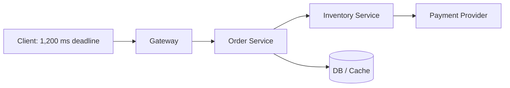
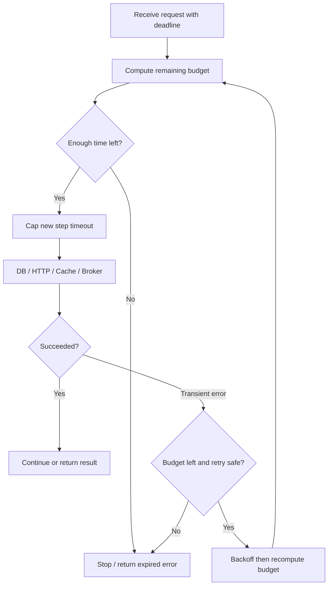
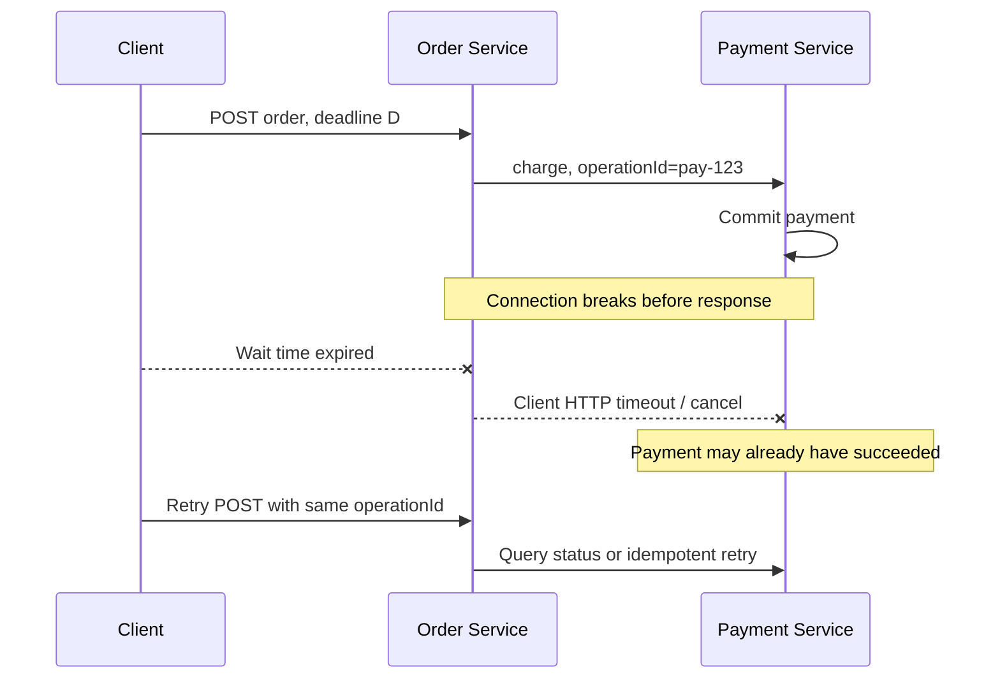

# Honoring Remaining Time When Propagating Requests Across Multiple Services

## 1. Why Can Individual Service Timeouts Still Let the Whole Chain Exceed Its Limit?

In **SPRING_BOOT_INTEGRATION**, a request can travel from an HTTP gateway into Spring Boot, check a cache, read a database, make an HTTP call to another service, and publish a message to a broker or Spring Integration adapter. Even when every hop sets its own timeout, **nothing guarantees the whole chain completes within the caller's allowed time**.

Suppose a customer waits at most 1,200 ms to place an order. The gateway grants 1,000 ms to Order Service; Order Service grants 1,000 ms to Inventory Service; Inventory Service grants 1,000 ms to the payment gateway. Because each hop starts a fresh countdown, total elapsed time can soar far past 1,200 ms. Even a successful response can arrive after the client already gave up, while threads, connections, and downstream systems remain busy.



To keep control, use an **end-to-end deadline**: the latest timestamp by which a result is still useful to the request. Every step must work from **remaining budget** rather than resetting the clock when calling the next service.

| Concept | Meaning | Example |
|---|---|---|
| Operation timeout | Maximum wait for one individual activity | Single HTTP attempt capped at 350 ms |
| Request deadline | Timestamp after which the result is expired | Before 14:00:01.200 UTC |
| Remaining budget | Time left from now until the deadline | 420 ms left after reading DB |
| Retry budget | Time left sufficient for retries and backoff | Retry only if still within deadline |
| Safety margin | Buffer reserved to record state, serialize, and return response | Keep final 40 ms |

**Key invariant:** the deadline a service enforces on downstream calls must be **no later than** the deadline that service itself is operating under. A service may choose an **earlier** cutoff to protect its own resources, never extend the caller's deadline.

## 2. How Budget Shrinks as Requests Cross Steps

Suppose the gateway receives a request with a 1,200 ms budget:

| Elapsed Time | Completed Work | Remaining Budget |
|---:|---|---:|
| 0 ms | Gateway receives request | 1,200 ms |
| 100 ms | Validate token and payload | 1,100 ms |
| 150 ms | Request reaches Order Service | 1,050 ms |
| 350 ms | Order Service reads DB/cache | 850 ms |
| 390 ms | Request reaches Inventory Service | 810 ms |
| 840 ms | Inventory receives provider result | 360 ms |
| 900 ms | Result returns to gateway/client | 300 ms |

If the DB query takes an extra 600 ms, only ~210 ms remain when calling Inventory. Launching an HTTP call with a static 1,000 ms timeout is pointless now. The service should inspect remaining time, reserve a response margin, and refuse to open new steps once insufficient time remains.

```text
remaining      = max(0, deadline - now)
usable         = remaining - responseMargin
attemptTimeout = min(usable, perAttemptLimit)

If usable <= 0: skip new step; return deadline error or record status.
```



This is a **shared budget**, not a rigid fixed slice per service. Steps finishing early leave more headroom for later steps; slow earlier steps tighten later steps' budgets accordingly.

## 3. Propagating Deadlines Over HTTP: Contracts, Clocks, and Trust

### 3.1. Absolute Deadlines vs. Relative Timeouts

Internal HTTP services can standardize on a custom header, such as:

```http
POST /internal/inventory/reserve HTTP/1.1
X-Request-Deadline-Epoch-Ms: 1795279201200
X-Correlation-Id: order-flow-8f2c
Idempotency-Key: reserve-order-123
Content-Type: application/json

{"orderId":"123","quantity":2}
```

`X-Request-Deadline-Epoch-Ms` is an absolute deadline in Unix epoch milliseconds (the number is illustrative). The receiver subtracts current time to determine remaining budget. This captures network transit time across hops, though it relies on **reasonably synchronized clocks across machines**.

Alternatively, pass `X-Request-Timeout-Ms: 420` (remaining duration). The receiver converts it into a local deadline upon arrival. If you send a number computed **before network transit**, wire latency can go uncounted and stretch total elapsed time across hops. Agree clearly on transit deduction or use infrastructure propagation such as gRPC deadlines where supported end-to-end.

| Contract | Advantage | What to Control |
|---|---|---|
| Absolute deadline (UTC epoch) | Each hop recomputes against the same target timestamp | Clock skew, trusted header origin |
| Remaining duration (ms) | Easy monotonic elapsed-time math inside each process | Network transit time may be omitted |
| Standard RPC framework deadline | Infrastructure handles propagation automatically | Understand exact framework and adapter semantics |

Never trust arbitrary deadlines sent by public clients. The gateway assigns deadlines by API type, strips or overwrites untrusted incoming headers, and forwards trusted headers internally. Every service also caps deadlines by its own local ceiling:

```text
effectiveDeadline = min(upstreamDeadline, receivedAt + localMaxDuration)
```

If the header is absent, apply a local default timeout; if malformed, return `400 Bad Request` or handle per published contract. If the deadline is already in the past, fail immediately per API rules without opening transactions or making long downstream calls.

### 3.2. Wall Clock for Propagation, Monotonic Clock for Elapsed Time

UTC deadlines let nodes share a common cutoff. Yet to measure **elapsed time within one process**, `System.nanoTime()` is safer than repeatedly calling `Instant.now()`, because wall clocks can jump under NTP/OS adjustments. Upon receiving a request:

1. Parse and clamp the deadline using current UTC wall time.
2. Convert the remaining duration into a local budget tracked with monotonic elapsed time.
3. Keep the absolute deadline timestamp for downstream headers while computing local step timeouts from the remaining monotonic budget.

Runnable Java example suitable for Spring Boot (imports included for standalone clarity):

```java
import java.time.Clock;
import java.time.Duration;
import java.time.Instant;
import java.util.function.LongSupplier;

final class RequestBudget {
    private final Instant deadlineUtc;
    private final long startedAtNanos;
    private final long initialBudgetNanos;
    private final LongSupplier ticker;

    private RequestBudget(
            Instant deadlineUtc,
            long startedAtNanos,
            long initialBudgetNanos,
            LongSupplier ticker) {
        this.deadlineUtc = deadlineUtc;
        this.startedAtNanos = startedAtNanos;
        this.initialBudgetNanos = initialBudgetNanos;
        this.ticker = ticker;
    }

    static RequestBudget start(
            Instant effectiveDeadline,
            Clock clock,
            LongSupplier ticker) {
        long remaining = Math.max(
            0L,
            Duration.between(clock.instant(), effectiveDeadline).toNanos());

        return new RequestBudget(
            effectiveDeadline, ticker.getAsLong(), remaining, ticker);
    }

    Duration remaining() {
        long elapsed = Math.max(0L, ticker.getAsLong() - startedAtNanos);
        return Duration.ofNanos(
            Math.max(0L, initialBudgetNanos - elapsed));
    }

    Instant deadlineUtc() {
        return deadlineUtc;
    }
}
```

`Duration.toNanos()` can overflow if a deadline is centuries away. Therefore, **always clamp deadlines at ingress policy before calling `start()`**. Injecting `Clock` and `LongSupplier` allows deterministic timing tests without `Thread.sleep()`.

### 3.3. Deadline Acceptance Policy in Spring Boot

Example enforcing a local cap of 1,500 ms. If upstream sends an earlier cutoff, the service honors that earlier cutoff.

```java
import java.time.Clock;
import java.time.Duration;
import java.time.Instant;
import java.util.function.LongSupplier;

@Component
class DeadlinePolicy {
    static final String HEADER = "X-Request-Deadline-Epoch-Ms";
    private static final Duration LOCAL_MAX = Duration.ofMillis(1_500);

    private final Clock clock;
    private final LongSupplier ticker;

    DeadlinePolicy() {
        this(Clock.systemUTC(), System::nanoTime);
    }

    DeadlinePolicy(Clock clock, LongSupplier ticker) {
        this.clock = clock;
        this.ticker = ticker;
    }

    RequestBudget accept(String headerValue) {
        Instant now = clock.instant();
        Instant localDeadline = now.plus(LOCAL_MAX);
        Instant requested = localDeadline;

        if (headerValue != null && !headerValue.isBlank()) {
            try {
                requested = Instant.ofEpochMilli(
                    Long.parseLong(headerValue));
            } catch (RuntimeException invalid) {
                throw new IllegalArgumentException(
                    "Invalid deadline header", invalid);
            }
        }

        Instant effective = requested.isBefore(localDeadline)
            ? requested : localDeadline;
        return RequestBudget.start(effective, clock, ticker);
    }
}
```

In real applications, inject `Clock`/ticker via DI for testing, distinguish empty vs. missing headers per contract, account for clock skew, and map errors cleanly. In REST APIs, `IllegalArgumentException` for bad headers maps to 400; an exhausted budget can map to 504 when acting as a gateway/downstream proxy (or a documented business error code).

**Never store mutable budgets in singleton fields** or assume `ThreadLocal` automatically follows work across `@Async`, Reactor, or Spring Integration channels. Pass budgets explicitly as arguments or via technology-appropriate request context.

## 4. Applying Budgets to HTTP Clients and Retries

### 4.1. One HTTP Attempt Must Not Consume the Whole Deadline

In Spring Boot, `RestClient`, `WebClient`, OpenFeign, or Spring Integration HTTP outbound adapters support connect/read/response timeouts. Static timeouts bound only one slice of client work; **recalculate remaining budget right before each outbound send**.

Limits to separate:

| Limit | What It Prevents |
|---|---|
| Connection pool acquisition | Prevents waiting too long for a pool slot under load |
| DNS / connect / TLS handshake | Prevents burning the entire deadline establishing a connection |
| Response / read timeout | Prevents waiting forever after connecting |
| Per-attempt timeout | Prevents a single try from starving retries and response writing |
| Total retry deadline | Prevents stacked attempts and backoffs from exceeding upstream's cutoff |

If the client library supports per-request timeouts, pass `min(remaining, configuredTimeout)`; otherwise wrap with deadline enforcement while keeping network-level timeouts active. Never assume one timeout annotation automatically bounds connection pools, DNS, database transactions, and blocking tasks.

### 4.2. `WebClient` Example: Bounding Total Retries and Each Attempt

Example using Spring WebFlux `WebClient` and Reactor. `OrderCommand` carries a stable `operationId()` for the logical operation; `Reservation` is the response DTO. Standard Spring/Reactor imports are omitted for brevity.

```java
record OrderCommand(String operationId, String orderId, int quantity) {}
record Reservation(String reservationId, String status) {}

@Service
class InventoryClient {
    private static final Duration RESPONSE_MARGIN =
        Duration.ofMillis(40);
    private static final Duration MAX_ATTEMPT =
        Duration.ofMillis(350);

    private final WebClient webClient;

    InventoryClient(
            WebClient.Builder builder,
            @Value("${integrations.inventory.base-url}") String baseUrl) {
        this.webClient = builder.baseUrl(baseUrl).build();
    }

    Mono<Reservation> reserve(
            OrderCommand command, RequestBudget budget) {
        return Mono.defer(() -> {
            Duration usable = budget.remaining().minus(RESPONSE_MARGIN);
            if (usable.isNegative() || usable.isZero()) {
                return Mono.error(new DeadlineExceededException());
            }

            return Mono.defer(() -> attempt(command, budget))
                .retryWhen(
                    Retry.backoff(1, Duration.ofMillis(80))
                        .jitter(0.2)
                        .filter(this::retryable))
                .timeout(usable)
                .onErrorMap(
                    TimeoutException.class,
                    DeadlineExceededException::new);
        });
    }

    private Mono<Reservation> attempt(
            OrderCommand command, RequestBudget budget) {
        Duration usable = budget.remaining().minus(RESPONSE_MARGIN);
        if (usable.isNegative() || usable.isZero()) {
            return Mono.error(new DeadlineExceededException());
        }

        Duration attemptLimit = usable.compareTo(MAX_ATTEMPT) < 0
            ? usable : MAX_ATTEMPT;

        return webClient.post()
            .uri("/internal/reservations")
            .header(
                DeadlinePolicy.HEADER,
                Long.toString(budget.deadlineUtc().toEpochMilli()))
            .header("Idempotency-Key", command.operationId())
            .bodyValue(command)
            .retrieve()
            .bodyToMono(Reservation.class)
            .timeout(attemptLimit);
    }

    private boolean retryable(Throwable cause) {
        return cause instanceof TimeoutException
            || (cause instanceof WebClientResponseException response
                && response.getStatusCode().value() == 503);
    }
}

class DeadlineExceededException extends RuntimeException {
    DeadlineExceededException() {
        super("Remaining request time exhausted");
    }

    DeadlineExceededException(Throwable cause) {
        super("Remaining request time exhausted", cause);
    }
}
```

In `@Value` above, use the application property `integrations.inventory.base-url` so URLs come from environment configuration rather than hardcoding production hostnames. Dependencies include Spring WebClient and Reactor Retry from the matching stack.

Key technical details:

1. `Mono.defer()` re-evaluates remaining time at **subscription time** and on **every retry**, instead of freezing the budget when building the publisher.
2. `.timeout(usable)` sits **after `retryWhen`**, bounding the entire retry + backoff sequence. Backoffs longer than remaining time are also cut off by the outer timeout.
3. `attemptLimit` shrinks dynamically as real time elapses, capped by both remaining usable budget and per-attempt ceiling.
4. `command.operationId()` stays **identical** across retries. Inventory must treat this key idempotently because the first attempt may have committed before the response dropped.
5. `.timeout(...)` cancels the client subscription upon expiry; the target HTTP server **may already have received and processed the request**. Timeout never proves zero side effects.

This snippet allows at most **one retry** after the initial attempt for timeouts or HTTP 503. Production code must also handle Reactor's retry-exhausted wrapper, error mapping, and 429/502/504 rules where relevant, while excluding 4xx validation errors. Because retries add load to failing dependencies, coordinate attempt counts, backoff, jitter, and circuit breakers under the budget.

This controls timing at the reactive layer. Production readiness also requires configuring Reactor Netty connect/response/read timeouts, connection pools, and resource caps. `.timeout(...)` **does not replace** socket/driver timeouts or cancel remote side effects.

### 4.3. Why Retries Must Use Remaining Budget

Suppose 650 ms remain when calling Inventory:

| Time | Activity | Remaining Time |
|---|---|---:|
| T0 | Start attempt 1, capped at 300 ms | 650 ms |
| T0 + 300 ms | Attempt 1 times out | 350 ms |
| T0 + 400 ms | 100 ms backoff finishes | 250 ms |
| T0 + 600 ms | Attempt 2 returns | 50 ms |

If after backoff only 20 ms remained and the service still launched a new attempt with a static 300 ms timeout, it would **breach the time promised to the client**. Stop before that attempt and fail fast to free resources.

For side-effecting APIs (charging, reserving stock, placing orders), retry only when the receiver enforces **idempotency keys or safe replay contracts**. An HTTP timeout may happen *after* the target committed the transaction. Recovery may require querying status by operation ID rather than issuing a new create request.

## 5. How Deadlines Affect Databases, Caches, and Transactions

### 5.1. Database Queries and Connection Waits Consume Budget Too

An HTTP request spending 400 ms just waiting for a DB connection from the pool loses 400 ms from its query budget. For multi-statement transactions, bound **lock wait**, **query execution**, and **commit time**, not just HTTP calls.

Mechanisms available in Spring Boot:

- Connection pool timeouts (e.g., HikariCP `connectionTimeout`) to bound waiting for a connection.
- JDBC driver, JPA query, or database timeouts (e.g., PostgreSQL `statement_timeout`) to stop runaway SQL.
- `@Transactional(timeout = ...)` for static transaction bounds. Enforcement depends on the transaction manager and DB operations; it does not automatically interrupt arbitrary non-DB calls or cancel remote side effects.
- Checking `budget.remaining()` before starting expensive transactions and after long blocking waits.

If only 90 ms remain for a query that typically takes 300 ms, fail fast or switch to an asynchronous workflow per contract. Never start a long transaction assuming `@Transactional` stops all overhead.

**Rollback warning:** exceeding a request deadline **does not automatically roll back a database transaction**. When a Spring-managed transaction observes a rollback-eligible exception (unchecked by default), it rolls back. Yet if a background worker keeps running after the HTTP caller timed out, that worker's transaction can still commit. Define clear transaction boundaries and step-level cancellation rules.

### 5.2. Caches Are Fast, Yet Still Have Wait Times and Failures

Cache hits are usually fast, yet remote Redis instances still incur network delays or timeouts. When a cache fails to respond, define clear rules:

- Fall back to the DB only if **enough budget remains** and DB capacity allows.
- Serve stale cache when the business permits and freshness bounds hold.
- Fail fast if falling back would breach the deadline or overload a struggling DB.

When falling back from cache to DB and then calling HTTP, every step draws from **the same budget**. Never grant a fresh "1 second for DB" just because Redis timed out.

### 5.3. Never Hold a Transaction Open While Waiting on Downstream Calls

Holding a DB transaction open across HTTP calls prolongs locks, increases contention, and risks timeouts. Even if the DB rolls back, the payment gateway that already received the HTTP call may have committed side effects.

A safer pattern for recoverable operations:

1. In a **short transaction**, persist business state and an outbox event.
2. Commit the database.
3. A durable publisher forwards the outbox event to a broker with retries.
4. A consumer executes external calls with idempotency and its own state tracking.

The order-creation HTTP request deadline governs **whether enough time remains to intake and commit**. Once committed under an asynchronous contract, downstream work gets its own deadline/SLA—never discard an accepted business order merely because the client closed its socket.

## 6. Propagating Budgets Across Spring Integration and Async Flows

### 6.1. `DirectChannel`, `ExecutorChannel`, and `QueueChannel`

Spring Integration passes `Message<?>` carrying payloads and headers. Business deadlines can travel in a message header such as `requestDeadlineEpochMs`. Over a `DirectChannel`, handlers typically run on the sender's thread; across an `ExecutorChannel`, `QueueChannel`, poller, or broker inbound adapter, downstream steps run on different threads and **potentially much later**.


A common bug is checking "800 ms remaining" **before enqueueing**, then having the worker still grant a full 800 ms to the HTTP outbound adapter 450 ms later. Budgets must be **recomputed when the consumer starts**, using the original deadline or contracted timing metadata.

A handler checking the deadline header before processing:

```java
@Component
class DeadlineGuard {
    private final Clock clock = Clock.systemUTC();

    public void verify(Message<?> message) {
        String raw = message.getHeaders().get(
            "requestDeadlineEpochMs", String.class);
        if (raw == null) {
            throw new MessageHandlingException(
                message, "Missing deadline header");
        }

        final long deadlineEpochMs;
        try {
            deadlineEpochMs = Long.parseLong(raw);
        } catch (NumberFormatException invalid) {
            throw new MessageHandlingException(
                message, "Invalid deadline header", invalid);
        }

        if (clock.millis() >= deadlineEpochMs) {
            throw new MessageHandlingException(
                message, "Request deadline exceeded");
        }
    }
}
```

This is only an **entry check before the next step**; afterward, the handler must still bound the outbound call using remaining budget because time keeps advancing. Real apps should share the ingress deadline policy/clock abstraction and integrate cleanly with `errorChannel`, retry, and dead-letter strategies—avoiding infinite retries on already-expired messages.

### 6.2. Request Deadlines vs. Durable Business Time Limits

There is a crucial difference between a **synchronous HTTP request** and an **accepted durable message**:

| Context | What Should the Deadline Govern? | After Expiration |
|---|---|---|
| HTTP request waiting on reply | When a response must be returned or wait aborted | Skip new steps; return error per contract |
| Request queued to in-memory executor/queue for reply | Budget includes queue wait time | Drop pointless work if no side effect occurred |
| Event committed to transactional outbox | Deadline of the intake request that created the event | Event must still be delivered if business committed to handle it |
| Message broker for long-running workflows | Workflow-specific business deadline/expiry | Transition to `FAILED`, DLQ, or compensation per policy |
| Quartz job or scheduler | SLA/deadline of a run or business period | Checkpoint and reschedule; never blindly "delete" committed data |

For example, an API returns `202 Accepted` after writing an order and outbox row. If the client times out waiting for the HTTP reply, that does not mean the order vanished. Consumers must continue processing, using durable business state so clients can query progress and avoid duplicate orders on retry.

Conversely, if a queued message represents **a pending synchronous query** whose caller deadline already expired before the worker started, the work has lost value. The worker should detect expiry before calling downstream, record the timeout, and stop.

### 6.3. Broker TTL Does Not Replace End-to-End Deadlines

Message TTL/expiration in a broker keeps stale messages from lingering in queues, yet broker TTL:

- Has broker-specific semantics and does not necessarily interrupt a consumer already processing the message.
- Does not limit how long a consumer spends on HTTP/DB work after dequeuing.
- Does not guarantee earlier side effects roll back if a message expires.

Never treat broker TTL as the sole source of truth for business deadlines. Decide explicitly whether **messages may expire or require compensation**, and persist state to survive crashes.

## 7. Expiry, Cancellation, and Side Effects Do Not Vanish Automatically

### 7.1. Three Milestones to Distinguish

When a request exceeds its deadline, these three events are **not equivalent**:

1. **The caller stopped waiting.** HTTP client timed out or the user closed the connection.
2. **Cancellation was requested on the running task.** Reactive subscription cancelled, thread interrupted, or client issued a cancel signal.
3. **Target side effects definitely did not happen.** A much stronger guarantee that cannot be inferred from the first two.

Suppose Order Service calls Payment Service to capture funds:



If the service handles timeouts by resending with a brand-new operation ID, the customer can be charged twice. Keep the same idempotency key, persist transaction state, and query uncertain outcomes before initiating new side effects.

### 7.2. Cancellation Requires Cooperation at Every Layer

Each layer has distinct cancellation limits:

| Component | What Cancellation Can Do | What Not to Assume |
|---|---|---|
| Reactor `Mono.timeout()` | Cancels upstream subscription on expiry | Remote HTTP or target DB transaction rolls back |
| Java thread interruption | Signals cooperative code checking interrupts | Every blocking I/O call stops immediately |
| JDBC query cancellation / statement timeout | Asks DB to abort the running statement | Entire multi-statement transaction always rolls back cleanly |
| HTTP client timeout | Client stops waiting for response/call | Target server never received the request |
| Kafka/RabbitMQ consumer | May stop processing or withhold ack per policy | Broker undoes already-committed side effects |

At safe checkpoints, handlers should check remaining budget and exit cleanly. Yet once an **irreversible** step has committed, prioritize completing recovery/compensation rather than aborting mid-flight and leaving inconsistent state.

### 7.3. "Fail Fast" Can Be an Architectural Success

When only 20 ms remain, failing immediately with deadline exceeded is often better than opening a 500 ms partner connection. It spares wasted work and lets upstream recover cleanly. However:

- **Never mark as definitely failed** when downstream might have committed and lost the response.
- **Never retry past the deadline** simply because a retry library still has attempts left.
- **Never turn a durably accepted job into "cancelled"** if returning `202 Accepted` promised completion.
- **Never use 504 for every failure:** 429 is throttling/rate limit, 503 is service temporarily unavailable, 400 is malformed header, and 504 fits gateway/upstream timeouts—map per API semantics.

## 8. Testing Deadline Propagation Across Services

Good tests prove **time spent at an earlier hop reduces the next hop's budget** and **unnecessary steps do not start once budget runs out**. Simply asserting `TimeoutException` is insufficient.

### 8.1. Testing Monotonic Clocks Without Sleeping

Because `RequestBudget` accepts a `LongSupplier` ticker, tests can advance time instantaneously:

```java
@Test
void budgetDecreasesAndNeverBecomesNegative() {
    Clock wallClock = Clock.fixed(
        Instant.parse("2026-11-21T08:00:00Z"),
        ZoneOffset.UTC);
    AtomicLong nanos = new AtomicLong(1_000_000L);

    RequestBudget budget = RequestBudget.start(
        wallClock.instant().plusMillis(500),
        wallClock,
        nanos::get);

    assertEquals(Duration.ofMillis(500), budget.remaining());

    nanos.addAndGet(Duration.ofMillis(400).toNanos());
    assertEquals(Duration.ofMillis(100), budget.remaining());

    nanos.addAndGet(Duration.ofMillis(150).toNanos());
    assertEquals(Duration.ZERO, budget.remaining());
}
```

This proves the budget tracks elapsed monotonic time and clamps at zero without sleeping 550 ms. Another test can use `Clock.fixed(...)` and incoming headers to verify `DeadlinePolicy.accept()` picks the **earlier** of upstream deadline and local cap.

### 8.2. Testing Downstream HTTP Behavior with Stubs

Use WireMock, MockWebServer, or an HTTP stub controlling delays and recording incoming requests:

| Test Case | How to Simulate | What Must Be Asserted |
|---|---|---|
| Upstream has 800 ms left | Send matching deadline header | Downstream receives identical absolute deadline or properly reduced duration |
| Upstream has 100 ms left, attempt cap 350 ms | Stub holds response >100 ms | Attempt does not wait the full 350 ms; aborts when budget expires |
| Attempt 1 times out, attempt 2 succeeds | Stub times out once then replies fast | Retry reuses same idempotency key; total time stays inside deadline minus margin |
| Backoff exceeds remaining budget | Stub returns 503; advance time near deadline | Next attempt never starts once budget runs out |
| Client times out after server accepts command | Stub records side effect before dropping connection | System does not blindly duplicate side effects |
| Expired deadline header | Send timestamp in the past | Fails fast; makes zero downstream HTTP calls |
| Malformed or huge header | Non-numeric string or far-future timestamp | Clamps or returns 400 per policy; never grants infinite time |

With Reactor `StepVerifier` virtual time, keep `timeout()`/`Retry.backoff()` schedulers and custom tickers **synchronized**; if the virtual scheduler advances while `System.nanoTime()` stays frozen, tests break. Pair `StepVerifier.withVirtualTime` with a fake ticker, or run real-time integration tests with generous tolerances rather than millisecond-fragile CI checks.

### 8.3. Multi-Service Integration Testing

An end-to-end test should spin up at least two Spring Boot services (or one real service and a stubbed downstream) and verify:

1. Gateway assigns deadline `D` and forwards correlation ID.
2. Service A runs or stalls for a controlled duration.
3. Service A calls Service B preserving `D` instead of resetting to `D` + default timeout.
4. Service B computes remaining budget from `D` before deciding whether to call the next step.
5. Simulate Service B finishing **after Service A timed out**; verify retries/state updates stay safe.
6. Measure total caller-observed latency, Service B state, and downstream call counts.

For Spring Integration `ExecutorChannel`, hold messages in the executor queue before releasing the consumer and assert **queue wait time is deducted from the budget**. If queued messages remain valid durable work after `202 Accepted`, verify the separate business SLA instead of applying HTTP deadlines to async consumers.

### 8.4. Testing Databases, Caches, and Transactions

To verify real transaction boundaries, use a DB container and query state after transaction completion. For instance, hold a row lock longer than the budget and verify the expired response and commit/rollback state. Similarly, simulate a Redis timeout and test DB fallback—verifying fallback triggers only while budget suffices and causes no retry storm. Mock repositories cannot prove how JDBC drivers, lock waits, and transaction managers behave on deadline expiry.

## 9. Observing Remaining Time in Production

A trace showing Service B took 400 ms cannot explain why the client timed out unless you know Service B received the request with only 200 ms remaining. Record both **elapsed time** and **remaining budget** at handoff points.

| Signal / Metric | Benefit |
|---|---|
| `request_deadline_remaining_ms` at ingress | Spots upstreams burning most of the budget before calling |
| `downstream_attempt_timeout_ms` | Shows how much budget each attempt received |
| `retry_attempts_total` by endpoint and outcome | Detects retries amplifying load |
| `deadline_exceeded_total` | Distinguishes budget expirations from ordinary 4xx/5xx errors |
| `queue_wait_duration` | Reveals budget lost sitting in executor/broker queues |
| `db_pool_wait_duration` and query/lock duration | Pinpoints budget consumed in the database layer |
| `accepted_to_completed_duration` | Tracks SLAs for async workflows after `202 Accepted` |
| `side_effect_unknown_outcome_total` | Tracks timed-out HTTP writes requiring reconciliation |

In Spring Boot, combine Spring MVC/WebFlux observations, Micrometer, Actuator, and distributed tracing (OpenTelemetry or your observability stack). Per-hop structured logs should record `traceId`, `correlationId`, `operationId`, `upstreamDeadline`, `remainingMs`, `attemptNumber`, retry/cancellation state, and business outcome—without logging sensitive payloads, tokens, or auth headers.

Never use high-cardinality fields like `orderId` as **metric tags**; keep them in logs/traces while keeping metric tags bounded to operation name, outcome, and service group.

### Signs a Design Is Ignoring Deadlines

- Service B always sets a 2-second timeout for Service C even when upstream has 100 ms left.
- API timeout is 1 second while `retry * perAttemptTimeout + backoff` is several times larger.
- Requests sit 800 ms in an executor queue and workers still grant full downstream timeouts.
- Retrying a payment command with a new operation ID after the first response dropped.
- Cancelling `Mono.timeout()` and claiming remote DBs/APIs definitely rolled back.
- Deleting durably accepted messages simply because the origin HTTP socket closed without compensating.
- Lacking metrics for connection pool wait, queue wait, retries, or remaining time per hop.

## 10. Pre-Implementation Design Checklist

1. Define **end-to-end deadlines** per request class and client/gateway agreements.
2. Pick a propagation contract with clear timezone, units, and header validation; synchronize clocks across nodes if using absolute timestamps.
3. Each service enforces the **earliest** of upstream deadline and local cap, using monotonic elapsed time for remaining budget.
4. Before **every** HTTP attempt, DB query, cache fallback, or message step, check remaining budget and reserve margin for responses/commits.
5. Bound connect, pool, read, attempt, and total retry time; stop retrying on expired budgets and keep idempotency keys constant.
6. In Spring Integration, propagate deadlines via headers and deduct executor/queue wait time; define error channels, retries, and DLQs for expired messages.
7. Separate synchronous request deadlines from **business SLAs** for durable work accepted via outbox/broker/Quartz.
8. Test expirations **before sending**, **while waiting**, **after side effects committed**, across retries, and when downstreams hang.
9. Emit traces/metrics for remaining budget, attempts, queue wait, downstream timeouts, and final outcomes to pinpoint bottlenecks.

**Core Principle:** Every request gets **one end-to-end time budget** spent progressively across services. Client, database, cache, broker adapter, and retry timeouts must all serve that shared budget. Once the deadline expires, stop pointless synchronous waits while ensuring committed side effects and accepted asynchronous work are tracked, recovered, or compensated per contract.
