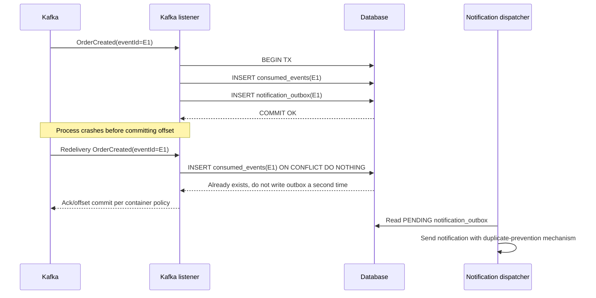
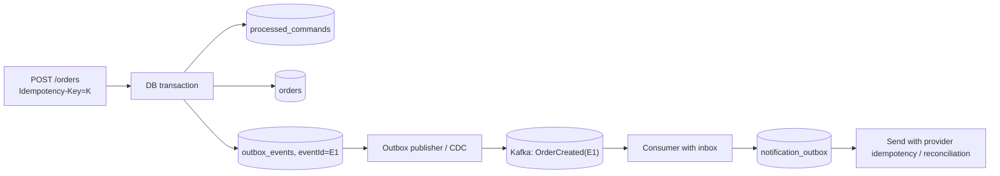
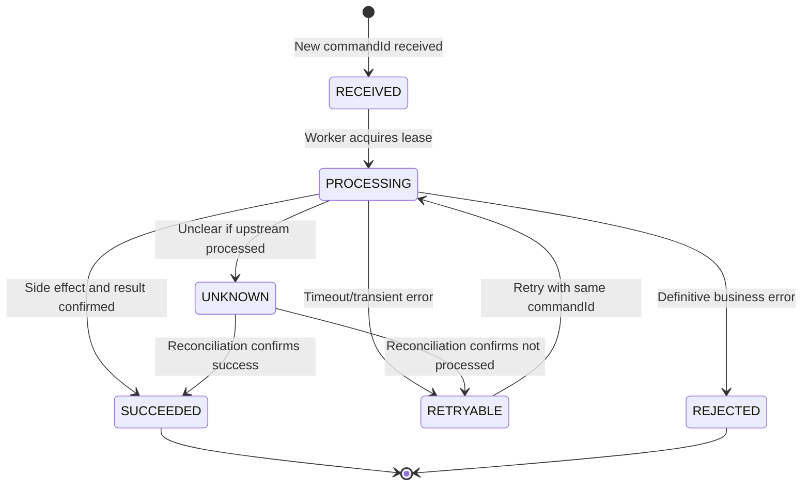

# Idempotency of Commands and Events

## 1. Why is idempotency a core integration requirement?

An HTTP request may be resent due to a client timeout; Kafka or RabbitMQ may redeliver a message after a consumer restart; a scheduler may execute a job twice; a payment HTTP callback may be sent multiple times by the provider. In those cases, **the same business effect may be requested or observed multiple times**.

For example: a customer places an order. `order-service` creates the order successfully, but the connection with the browser drops before returning the response. The browser retries `POST /orders`. If the server creates another new order, a communication error has turned into a business error. Similarly, `inventory-service` receives the `OrderCreated` event again and deducts inventory a second time if it does not detect the duplicate.

In the **SPRING_BOOT_INTEGRATION** module, HTTP client flows, databases, caches, message brokers, and Spring Integration adapters can all encounter retries and redeliveries. Idempotency is one of the essential tools for keeping results consistent when an operation is executed again.

**Learning objectives**

1. Distinguish idempotency from delivery guarantees, exactly-once semantics, and concurrency control.
2. Design an `Idempotency-Key` contract for commands from HTTP, schedulers, or messages.
3. Build deduplication mechanisms using unique constraints and transactions in Spring Boot.
4. Design consumers capable of reprocessing events using an inbox, business keys, and aggregate versions.
5. Coordinate inbox/outbox with Kafka, RabbitMQ, Redis, caches, and external HTTP calls.
6. Test race conditions, crashes, timeouts, retries, replays, and observe deduplication errors.

> **Example scope:** Java 17+, Spring Boot 3.x, Spring JDBC, and PostgreSQL. The Kafka examples use the `@KafkaListener` model of Spring Kafka 3.x. For other database management systems or Spring versions, replace the UPSERT syntax and corresponding configuration; the business invariants remain the same.

## 2. Concepts and guarantee boundaries

### 2.1. Definition of idempotency

An operation `f` is **idempotent** if applying it again to an already achieved result does not change the final outcome of the system under the semantics under consideration:

\[
f(f(s, x), x) = f(s, x)
\]

Where `s` is the state and `x` is the same logical request. Examples:

- Setting the status of order `ORD-42` to `CANCELLED` can be idempotent if processing it a second time produces no additional side effects.
- Incrementing the reserved item count `reserved = reserved + 1` is **not** idempotent; executing it twice adds two units.
- Inserting a record with a unique key can be idempotent when a repeated command is recognized and returns the previous result.
- Sending an "order created" email multiple times is usually **not** idempotent from the recipient's experience, even if the database does not change.

Idempotency does not necessarily mean every execution returns the same timestamp or HTTP headers. However, for APIs that allow retries, **returning the same business result**, the same resource identifier, and consistent response status is a useful contract.

### 2.2. Distinguishing easily confused concepts

| Concept | Question to answer | Limitation |
| --- | --- | --- |
| Idempotency | Does repeating the same operation create additional effects? | Requires rules defining "same operation" and the guarantee scope. |
| At-most-once delivery | Can a message be delivered at most once? | Messages may be lost; does not mean processing succeeded. |
| At-least-once delivery | Does the system keep retrying delivery until acknowledged? | Duplicates may occur; consumers must be safe on replay. |
| Exactly-once processing | Is the result recorded exactly once within the guaranteed scope? | Always specify the scope: Kafka, DB, or which side effect. |
| Optimistic locking | Do two **different** commands accidentally overwrite each other? | Controls concurrent updates; does not automatically prevent duplicate messages. |
| Deduplication | Are copies of the same operation detected and skipped? | Requires an identifier, durability, and marker retention time. |
| Ordering | Are events applied in business order? | Deduplication alone does not handle out-of-order events. |

**Distinction example:** the event `OrderPaid(eventId=E1)` is sent twice. Deduplicating by `E1` prevents recording the payment twice. However, if `OrderCancelled(version=3)` arrives before `OrderPaid(version=2)`, deduplication alone is not enough to prevent the state from regressing. The system also needs versions, state transition rules, and an out-of-order handling policy.

### 2.3. HTTP methods and business idempotency

According to HTTP semantics, `GET` is a safe method, while `PUT` and `DELETE` have idempotent semantics with respect to the **intended effect on the resource**. `POST` is not inherently idempotent, and `PATCH` is also not guaranteed to be idempotent in all cases.

However, the HTTP method name does not guarantee that the entire downstream workflow has no duplicate side effects. A `PUT /orders/42/status` command could still write audit events, charge money, or call webhooks every time if the business code does not deduplicate. When an operation involves multiple systems, you must define the **unit of idempotency at the business level**, not solely based on the REST method.

## 3. Identifying "same command" and "same event"

Choosing the right identifier is the first prerequisite. You should not use a single `id` concept for every purpose.

| Identifier | Source | What is it used for? |
| --- | --- | --- |
| `Idempotency-Key` | Client or upstream of the **command** | Identifies retries of the same logical command. |
| `commandId` | Travels with internal/scheduler/message commands | Identifies the same execution intent across multiple transport steps. |
| `eventId` | Created by the producer **once per logical event** | Identifies the same event when a broker redelivers or a publisher republishes. |
| `orderId` | Domain/aggregate | Identifies an order; many commands and events can belong to the same order. |
| `aggregateVersion` | Domain model | Identifies the order of state changes on an aggregate. |
| `correlationId`/trace ID | Observability system | Connects steps in a request/flow; usually insufficient as a deduplication key. |
| Kafka record offset | Broker, per topic/partition | Locates a record in Kafka; not identical to a business eventId. |

Rules:

1. **Scoped key**: combine tenant/merchant/account, operation type, and idempotency key. Two customers using the same key string must not block each other.
2. **Payload binding**: the same key with a different payload is a **conflict**; do not silently return the old operation's result or execute the new payload.
3. **Stable across retries**: do not generate a new UUID every time HTTP times out or a worker receives a redelivered message. The ID must live with the business intent.
4. **Do not rely solely on timestamp/trace ID** to decide duplication: two valid transactions may share auxiliary metadata, and two retries may carry different trace IDs.
5. **Do not deduplicate on overly broad business data**: two valid orders may share the same customer, SKU, and amount; hashing only the payload without a command identifier will accidentally merge two real commands.

### 3.1. Payload fingerprint

Store a **request fingerprint** to confirm that the same key represents the same business parameters. You can use SHA-256 of a canonicalized data representation. Rules must be clearly agreed upon, such as:

- Field names are ordered stably and data types are consistent.
- Monetary amounts are normalized (for example, are `100.0` and `100.00` considered equal?).
- Distinguish between missing fields, `null`, and empty strings according to the contract.
- Fields such as request receipt time, trace ID, and access token are excluded from the fingerprint if they do not affect the business outcome.
- Do not rely on arbitrary field ordering of a JSON parser or an object's `toString()`.

A fingerprint helps detect key reuse with the wrong payload. It does **not** replace authentication or authorization, and it is not proof that two commands were authorized by the same user.

## 4. Designing an idempotent contract for an HTTP command

Suppose a client calls:

```http
POST /api/orders HTTP/1.1
Authorization: Bearer <token>
Idempotency-Key: create-order-req-7f2c
Content-Type: application/json

{"customerId":"C-42","amount":125000,"currency":"VND"}
```

When processed successfully the first time:

```http
HTTP/1.1 201 Created
Content-Type: application/json
Location: /api/orders/550e8400-e29b-41d4-a716-446655440000

{"orderId":"550e8400-e29b-41d4-a716-446655440000","status":"CREATED"}
```

When the client retries with the same key and the same payload: return the **same orderId** and completed result, without creating another order or event. If the client retries with the same key but a different payload, return `409 Conflict` (or the error code specified by the API) and do not execute the new command.

### 4.1. State matrix of a key

| Observed state | What the server should do | Response to the client |
| --- | --- | --- |
| Key does not exist in that scope | Claim execution rights via an atomic operation; record the result in the transaction. | First-time execution result. |
| Completed, matching fingerprint | Do not re-run business logic; read the stored result. | Previous result, same resource ID. |
| Completed, different fingerprint | Reject to surface the key reuse error. | `409 Conflict`. |
| Command with same key is in progress | Wait with a bound, or respond "in progress" per contract. | `202` + status lookup URL, or `409/425` with retry guidance. |
| Failed with full rollback guaranteed | Allow retry according to policy. | Retryable error with the same key. |
| Uncertain whether upstream executed | Query status by key before sending a command with side effects again. | Reconciliation result or unknown status. |
| Key retention expired | Behavior must be documented; may be treated as a new command. | Warn about the risk of re-execution past expiration. |

**Key retention policy (TTL)** must relate to how long clients can retry, recovery job schedules, and regulatory/business requirements. For payments or money transfers, blindly deleting markers after 24 hours out of habit can be dangerous if replays happen days later. Long-term business keys can be preserved via a unique constraint on the transaction code, even after the response cache table has been cleaned up.

### 4.2. Implementation prerequisites

- Derive the tenant/customer scope from the **authenticated** identity; do not directly trust a tenant header set by the client.
- Reject keys that are too long or contain disallowed characters; cap key size to prevent storage abuse.
- Write the marker, business data, and response result in the **same transaction** if using the same database.
- Completed results must be **reproducible**: store a fixed response or store the ID and fetch the resulting state according to the contract.
- For long-running tasks, an `IN_PROGRESS/COMPLETED/FAILED` model needs leases, timeouts, takeover mechanisms, and fencing so an old worker cannot overwrite a new worker.
- If there are effects outside the DB (sending Kafka/email/HTTP), add an outbox or receiver-side idempotency; a database transaction alone does not cover those systems.

## 5. Spring Boot example: safe order creation on HTTP retry

This example uses **PostgreSQL** and `JdbcTemplate` because SQL provides unique constraints and `INSERT ... ON CONFLICT DO NOTHING` clearly expresses key claiming. With MySQL/SQL Server, substitute the corresponding upsert/locking mechanism and verify actual isolation behavior.

### 5.1. Tables and invariants

```sql
CREATE TABLE orders (
    id UUID PRIMARY KEY,
    tenant_id VARCHAR(80) NOT NULL,
    customer_id VARCHAR(120) NOT NULL,
    amount NUMERIC(19, 2) NOT NULL CHECK (amount > 0),
    currency CHAR(3) NOT NULL,
    status VARCHAR(30) NOT NULL
);

CREATE TABLE processed_commands (
    tenant_id VARCHAR(80) NOT NULL,
    operation VARCHAR(60) NOT NULL,
    idem_key VARCHAR(128) NOT NULL,
    payload_hash CHAR(64) NOT NULL,
    order_id UUID NOT NULL,
    created_at TIMESTAMPTZ NOT NULL DEFAULT now(),
    PRIMARY KEY (tenant_id, operation, idem_key)
);
```

Meaning of constraints:

- `PRIMARY KEY(tenant_id, operation, idem_key)` ensures only one transaction can **win writing the marker** for the same command.
- `payload_hash` detects a key being reused for a different request.
- `order_id` enables returning the same resource on retry.
- An immediate foreign key from `processed_commands.order_id` to `orders.id` is omitted in this example because we claim the key before inserting the order; the integrity of the two records is guaranteed by the shared transaction. If you want to add an FK, adjust the write order or use a deferrable constraint.

Minimal dependencies when using the Spring Boot BOM:

```xml
<dependency>
    <groupId>org.springframework.boot</groupId>
    <artifactId>spring-boot-starter-jdbc</artifactId>
</dependency>
<dependency>
    <groupId>org.postgresql</groupId>
    <artifactId>postgresql</artifactId>
    <scope>runtime</scope>
</dependency>
```

To test the service's own logic, you can configure `spring.datasource.*` using Testcontainers PostgreSQL and `spring-boot-starter-test`; do not assume H2 behaves identically to PostgreSQL regarding conflict or lock handling.

### 5.2. DTOs and exceptions

```java
// CreateOrderInput.java
public record CreateOrderInput(
    String customerId,
    java.math.BigDecimal amount,
    String currency
) {}

// CreateOrderResult.java
public record CreateOrderResult(
    java.util.UUID orderId,
    String status
) {}
```

`public` records must be placed in their corresponding Java files. Handle HTTP 409 for a key reused with mismatched content:

```java
// IdempotencyKeyConflictException.java
import org.springframework.http.HttpStatus;
import org.springframework.web.bind.annotation.ResponseStatus;

@ResponseStatus(HttpStatus.CONFLICT)
public class IdempotencyKeyConflictException extends RuntimeException {
    public IdempotencyKeyConflictException() {
        super("Idempotency-Key has already been used for another request");
    }
}
```

### 5.3. Safe transactional algorithm

Key steps:

1. Compute the fingerprint from the **canonicalized** business fields.
2. Attempt to `INSERT` the marker with the unique constraint, using `ON CONFLICT DO NOTHING`.
3. If the insert succeeds, only this transaction is allowed to create the order and result.
4. If it conflicts, read the committed marker; compare the hash; return the same orderId or throw 409.
5. Let the database commit or roll back both the marker and the order together.

```java
import java.nio.charset.StandardCharsets;
import java.security.MessageDigest;
import java.security.NoSuchAlgorithmException;
import java.util.HexFormat;
import java.util.Locale;
import java.util.UUID;

import org.springframework.jdbc.core.JdbcTemplate;
import org.springframework.stereotype.Service;
import org.springframework.transaction.annotation.Isolation;
import org.springframework.transaction.annotation.Transactional;

@Service
public class CreateOrderCommandService {
    private static final String OPERATION = "create-order";
    private final JdbcTemplate jdbc;

    public CreateOrderCommandService(JdbcTemplate jdbc) {
        this.jdbc = jdbc;
    }

    @Transactional(isolation = Isolation.READ_COMMITTED)
    public CreateOrderResult execute(
        String authenticatedTenantId,
        String idempotencyKey,
        CreateOrderInput input
    ) {
        validate(authenticatedTenantId, idempotencyKey, input);

        String customerId = input.customerId().trim();
        String currency = input.currency().toUpperCase(Locale.ROOT);
        String amount = input.amount().stripTrailingZeros().toPlainString();
        String hash = sha256(
            part(customerId) + part(currency) + part(amount)
        );
        UUID candidateOrderId = UUID.randomUUID();

        int inserted = jdbc.update(
            """
            INSERT INTO processed_commands
              (tenant_id, operation, idem_key, payload_hash, order_id)
            VALUES (?, ?, ?, ?, ?)
            ON CONFLICT (tenant_id, operation, idem_key) DO NOTHING
            """,
            authenticatedTenantId,
            OPERATION,
            idempotencyKey,
            hash,
            candidateOrderId
        );

        if (inserted == 0) {
            SavedCommand previous = jdbc.queryForObject(
                """
                SELECT payload_hash, order_id FROM processed_commands
                WHERE tenant_id = ? AND operation = ? AND idem_key = ?
                """,
                (rs, rowNum) -> new SavedCommand(
                    rs.getString("payload_hash"),
                    (UUID) rs.getObject("order_id")
                ),
                authenticatedTenantId,
                OPERATION,
                idempotencyKey
            );

            if (previous == null || !previous.hash().equals(hash)) {
                throw new IdempotencyKeyConflictException();
            }
            return new CreateOrderResult(previous.orderId(), "CREATED");
        }

        jdbc.update(
            """
            INSERT INTO orders
              (id, tenant_id, customer_id, amount, currency, status)
            VALUES (?, ?, ?, ?, ?, 'CREATED')
            """,
            candidateOrderId,
            authenticatedTenantId,
            customerId,
            input.amount(),
            currency
        );

        // If OrderCreated must be published, insert an outbox event
        // in THIS SAME transaction; do not send to Kafka directly.
        return new CreateOrderResult(candidateOrderId, "CREATED");
    }

    private record SavedCommand(String hash, UUID orderId) {}

    private static String part(String value) {
        return value.length() + ":" + value;
    }

    private static String sha256(String canonicalPayload) {
        try {
            byte[] digest = MessageDigest.getInstance("SHA-256").digest(
                canonicalPayload.getBytes(StandardCharsets.UTF_8)
            );
            return HexFormat.of().formatHex(digest);
        } catch (NoSuchAlgorithmException e) {
            throw new IllegalStateException("SHA-256 is not available", e);
        }
    }

    private static void validate(
        String tenantId,
        String key,
        CreateOrderInput input
    ) {
        if (tenantId == null || tenantId.isBlank()
            || key == null || !key.matches("[A-Za-z0-9._:-]{1,128}")
            || input == null
            || input.customerId() == null
            || input.customerId().isBlank()
            || input.amount() == null || input.amount().signum() <= 0
            || input.currency() == null
            || !input.currency().matches("(?i)[A-Z]{3}")) {
            throw new IllegalArgumentException("Invalid order creation input");
        }
    }
}
```

**Usage conditions:** `@Transactional` must be invoked through a Spring bean proxy (no self-invocation on `this`); the data runs on PostgreSQL with `READ COMMITTED` isolation. `IllegalArgumentException` for invalid input must be mapped by the application to HTTP `400` via a validation/exception handler; if exposing this code directly as an API, do not let that exception accidentally become a 500.

For two concurrent requests with the same key: the second request may block on the unique index until the first transaction commits or rolls back. If the first transaction commits, the second request reads the marker and returns the previous result; if the first transaction rolls back, the second transaction gets the chance to create the order. Under other isolation levels or when encountering deadlocks/lock timeouts, you need a bounded **whole-transaction** retry strategy, not an infinite loop inside an already failed transaction.

**Why not use "SELECT first, then INSERT"?** Both requests could observe "does not exist yet" and both execute the effect. Relying on a unique constraint to arbitrate contention is what prevents the race at the database level.

### 5.4. HTTP layer and response contract

Illustrative controller method (assuming a `tenantResolver` component reads the tenant from the authenticated security context):

```java
@PostMapping("/api/orders")
public ResponseEntity<CreateOrderResult> create(
    @RequestHeader("Idempotency-Key") String key,
    @RequestBody CreateOrderInput input
) {
    String tenantId = tenantResolver.currentTenantId();
    CreateOrderResult result = service.execute(tenantId, key, input);

    return ResponseEntity
        .created(URI.create("/api/orders/" + result.orderId()))
        .body(result);
}
```

The snippet above is an **illustrative method**, placed inside a `@RestController` with `tenantResolver` and `service` injected; add imports for `java.net.URI`, `ResponseEntity`, `PostMapping`, `RequestBody`, `RequestHeader`. Do not take the tenant directly from the request body to serve as the idempotency scope.

This simple example stores `orderId` and infers the `CREATED` body/status. For APIs whose response depends on quotas, spot prices, or results from multiple systems, store the response body, status, and headers needed to replay **in the same transaction**, or model a command result so the exact outcome can be read back. Do not re-run the same side effect just to reconstruct the response.

## 6. Event consumer idempotency: transactional inbox

An HTTP command gets its key from the client, whereas an event is emitted by a producer with a stable `eventId`. A broker can redeliver the **same event** because the consumer crashed before committing its offset, a network error occurred during ack, or the coordinator rebalanced.

For example, `notification-service` reads `OrderCreated` to create a notification dispatch request. We want the same `eventId` to create **only one notification record**.

### 6.1. Designing the inbox and notification outbox tables

```sql
CREATE TABLE consumed_events (
    consumer_name VARCHAR(100) NOT NULL,
    event_id UUID NOT NULL,
    consumed_at TIMESTAMPTZ NOT NULL DEFAULT now(),
    PRIMARY KEY (consumer_name, event_id)
);

CREATE TABLE notification_outbox (
    notification_id UUID PRIMARY KEY,
    source_event_id UUID NOT NULL UNIQUE,
    order_id UUID NOT NULL,
    customer_id VARCHAR(120) NOT NULL,
    state VARCHAR(20) NOT NULL DEFAULT 'PENDING',
    created_at TIMESTAMPTZ NOT NULL DEFAULT now()
);
```

`consumed_events` is the **inbox marker**: each business consumer has its own progress and deduplication. `notification_outbox` holds the **work to be sent**; a notification record is not yet proof that the recipient has received the email/SMS.

### 6.2. DTO and Spring Boot handler

```java
// OrderCreatedEvent.java
public record OrderCreatedEvent(
    java.util.UUID eventId,
    java.util.UUID orderId,
    String customerId,
    long aggregateVersion
) {}
```

```java
import java.util.UUID;
import org.springframework.jdbc.core.JdbcTemplate;
import org.springframework.stereotype.Service;
import org.springframework.transaction.annotation.Transactional;

@Service
public class NotificationEventHandler {
    private final JdbcTemplate jdbc;

    public NotificationEventHandler(JdbcTemplate jdbc) {
        this.jdbc = jdbc;
    }

    @Transactional
    public void handle(OrderCreatedEvent event) {
        int inserted = jdbc.update(
            """
            INSERT INTO consumed_events (consumer_name, event_id)
            VALUES (?, ?)
            ON CONFLICT (consumer_name, event_id) DO NOTHING
            """,
            "notification-service",
            event.eventId()
        );

        if (inserted == 0) {
            return; // Already finished writing inbox + outbox in a prior run.
        }

        jdbc.update(
            """
            INSERT INTO notification_outbox
              (notification_id, source_event_id, order_id, customer_id)
            VALUES (?, ?, ?, ?)
            """,
            UUID.randomUUID(),
            event.eventId(),
            event.orderId(),
            event.customerId()
        );
    }
}
```

The listener calls a **different Spring bean** so `@Transactional` is activated:

```java
import org.springframework.kafka.annotation.KafkaListener;
import org.springframework.stereotype.Component;

@Component
public class OrderCreatedKafkaListener {
    private final NotificationEventHandler handler;

    public OrderCreatedKafkaListener(NotificationEventHandler handler) {
        this.handler = handler;
    }

    @KafkaListener(
        topics = "orders.created.v1",
        groupId = "notification-service-v1"
    )
    public void onOrderCreated(OrderCreatedEvent event) {
        handler.handle(event);
    }
}
```

The example assumes the consumer has a JSON deserializer/message converter configured for `OrderCreatedEvent`. With Spring Kafka, a common configuration is `enable-auto-commit=false` and an appropriate container acknowledgment mode, such as `ack-mode=record`. The listener returns after the database transaction succeeds; the container then commits the offset according to its policy.

**Critical invariant:** the marker and the business effect are committed in the same transaction. If you only write the marker first and then sending the email fails, redelivery may be skipped and the effect lost. If you perform the effect first and write the marker afterward, a crash between the two steps can cause duplicate effects. The pattern above saves the **intent to send** into the outbox together with the marker; the actual sender worker must have its own recovery and idempotency.

### 6.3. Timeline when a consumer crashes



In Kafka, `eventId` is a business ID, not `topic-partition-offset`. If an outbox publisher resends the same event to Kafka, it may appear at a **new offset**; deduplicating by offset will fail to recognize the logical copy.

## 7. Transactional outbox: from command to event

The HTTP command in Section 5 creates an order in the database. If you call Kafka only after the database commits:

1. The database commit succeeds.
2. The application crashes before `KafkaTemplate.send(...)`.
3. The order exists, but the `OrderCreated` event is never sent.

If you send to Kafka before committing the database, a consumer may receive an event for an order that is later rolled back. Two systems do not automatically share an ACID transaction.

**Transactional outbox** writes `orders`, `processed_commands`, and `outbox_events` in the **same database transaction**.

```sql
CREATE TABLE outbox_events (
    event_id UUID PRIMARY KEY,
    aggregate_id UUID NOT NULL,
    event_type VARCHAR(100) NOT NULL,
    payload JSONB NOT NULL,
    created_at TIMESTAMPTZ NOT NULL DEFAULT now(),
    published_at TIMESTAMPTZ
);
```

In the `inserted == 1` branch of `CreateOrderCommandService.execute(...)`, after writing `orders` and **before returning**, insert an outbox row with a once-generated `event_id` and a payload with a schema version. A worker or CDC connector reads the outbox table and publishes to Kafka. Marking a publish as succeeded requires retries; the outbox publisher itself can still resend an event after a crash, so consumers must have an inbox/deduplication mechanism.



Boundaries:

- **Command → database:** unique constraint + transaction prevents creating duplicate orders.
- **Database → broker:** outbox avoids losing the publish intent when a process crashes.
- **Broker → consumer database:** inbox + business transaction prevents applying duplicate events.
- **Consumer → HTTP/email/payment provider:** requires idempotency or reconciliation on the **receiving** system itself; outbox/inbox cannot automatically guarantee outcomes outside the database.

This is a chain of clearly scoped guarantees and should not be loosely called "system-wide exactly-once".

## 8. Duplicate events and out-of-order events are two different problems

Suppose aggregate `ORD-42` emits:

```text
OrderCreated(eventId=E1, aggregateVersion=1)
OrderPaid(eventId=E2, aggregateVersion=2)
OrderCancelled(eventId=E3, aggregateVersion=3)
```

A consumer can receive `E2` twice and `E3` before `E2` if events arrive from different topics, producers, or relay systems. Deduplicating by eventId handles the copy of `E2`, but it does not prevent applying `E2` after `E3` and overwriting `CANCELLED` with `PAID`.

### 8.1. Aggregate version and conditional updates

For a sequential projection of an aggregate, you can store `last_version` and apply the next event only when the version matches:

```sql
-- Example of an existing projection table for an order.
UPDATE order_projection
SET status = 'PAID',
    last_version = 2
WHERE order_id = '550e8400-e29b-41d4-a716-446655440000'
  AND last_version = 1;
```

If the number of updated rows is 0, classify the case:

- Already applied version or newer: the event may be stale; do not roll back the projection.
- Current version is less than `expectedVersion - 1`: intermediate events are missing; wait/retry, hold in a pending buffer, or rebuild the projection from a snapshot.
- Aggregate does not exist yet: requires an initialization event, buffering, or a controlled upsert strategy.
- Same version but different eventId: may be a contract bug or an unauthorized split-branch emission; alert/reconcile.

If you intentionally allow writing the latest state by highest version, `WHERE last_version < incoming_version` may be valid for a **last-write-wins projection**, but it skips intermediate events. Do not use it for business logic that must apply **every cumulative change**, such as loyalty points, accounting ledgers, or inventory deductions.

### 8.2. Kafka keys and partitions

Producers often use `orderId` as the Kafka record key so events of the same aggregate land in the same partition, supporting ordering **within a partition**. However:

- Kafka does not guarantee topic-wide ordering across multiple partitions.
- Consumer groups can rebalance; retry/DLT flows can create different processing paths.
- Sending the same aggregate across multiple topics does not establish cross-topic order.
- Changing the partition count or partitioning logic can alter the partition of subsequent events.

Therefore, using the right Kafka key is good practice, but you still need version/sequence checks and replay logic when data requires strict ordering.

## 9. Idempotency when calling external systems

### 9.1. HTTP clients and payment/warehouse providers

Illustrative reservation flow:

```text
order-service  --POST /reservations [Idempotency-Key=reserve:ORD-42]-->
warehouse-service
```

If the warehouse created the reservation but the HTTP response was lost on the way back, `order-service` **does not know the final outcome**. The solution requires a two-sided contract:

1. The client preserves the same key `reserve:ORD-42` when retrying the same logical operation.
2. The warehouse checks the key scoped by tenant/operation and fingerprint, returning the existing reservation ID on a valid duplicate.
3. The client can look up reservation status by key/orderId after a timeout.
4. If the warehouse does not support idempotency, the client must have reconciliation and compensation; a key is only meaningful when the **receiver** enforces the contract.

For a "charge money" command, do not use a hash of amount/customer to merge multiple legitimate payments. The key must be bound to a specific **payment attempt/intent**. If a new authorized charge operation arises, use a new key and record its relationship to the old intent.

### 9.2. Are Redis `SET NX` and locks enough?

`SET key value NX EX ttl` can help a worker quickly acquire processing rights in Redis. However:

| Case | What can happen? |
| --- | --- |
| Write Redis marker first, then DB transaction fails | Marker remains; retries may be skipped even though the business operation never completed. |
| DB commits, Redis marker fails to write | Incoming retry can execute an extra side effect. |
| TTL expires while worker is still running | A second worker can acquire the key and run concurrently. |
| Redis failover/eviction or data loss | Marker disappears while the business result already exists. |
| Worker holds an expired lock and continues writing | Two workers write concurrently; requires a fencing token/compare-and-set on the target resource. |

Redis is suitable as a **temporary deduplication filter, result cache, or coordinator** to reduce load. When correctness depends on never creating duplicate orders or double charges, unique constraints and transactions in the system of record—or the provider's idempotency capability—must be the final line of defense. Never treat a distributed lock as transactional exactly-once.

### 9.3. Cache and read models

An operation like `cache.put("order:42", latestState)` looks idempotent if writing the same value twice. However, if an old event arrives late, the cache can regress. Prefer versioning or invalidation:

- Repeated invalidations of the same key usually do not corrupt state, provided a cache miss reads back from the authoritative source.
- Event-driven cache updates should apply only when the incoming version is newer than the existing version, using atomic compare-and-set/Lua or storage-layer support.
- TTL is only a freshness strategy; it does not solve out-of-order data.

### 9.4. Spring Integration, RabbitMQ, and schedulers

A message flowing through an `IntegrationFlow`, channel adapter, RabbitMQ listener, or scheduler still needs to identify **the same business intent** where data is written. Frameworks provide transport/retry/ack, but cannot infer idempotency of a business handler merely from successful message delivery.

- RabbitMQ can redeliver when a listener does not ack, a connection drops, or a consumer restarts.
- Spring Integration `MessageHeaders.ID` or IDs generated across transformation steps may change; prefer a stable commandId/eventId from the source contract.
- Scheduler/job retries need a business job key (e.g., period + target entity), not just a lock on the job name.
- With mixed caches, brokers, and DBs, document clearly **which key protects each side effect and who owns that key**.

## 10. Retries, transactions, and "exactly once" in Kafka

In Kafka, there are multiple layers of guarantees:

| Mechanism | What problem does it prevent? | What does it NOT solve? |
| --- | --- | --- |
| Producer `enable.idempotence=true` | Prevents duplicate records caused by send retries at the Kafka producer protocol level. | Two independent business calls to `send(...)` with the same payload. |
| Kafka transaction | Atomically writes records and offsets in a Kafka consume-process-produce pattern when properly configured. | Database commits, HTTP calls, or emails outside Kafka. |
| Consumer `read_committed` | Avoids reading records from aborted Kafka transactions. | Business duplicates coming from two logical events or external replays. |
| Consumer group offset commit | Records the read position to resume after restart. | Proving a database or external system wrote exactly once. |
| Inbox + database transaction | Prevents applying the same eventId twice to side effects inside the database. | Side effects sent out via HTTP/email where the provider lacks deduplication. |
| Outbox | Durably persists publish intent after DB commit. | Guaranteeing the relay never publishes duplicates. |

A common scenario:

```text
1. Consumer reads Kafka record E1.
2. Consumer updates DB and COMMITS successfully.
3. Process crashes before committing the Kafka offset.
4. Kafka redelivers E1.
```

If the DB operation is `balance = balance + amount` without an inbox or unique business transaction ID, money can be credited twice. Enabling Kafka producer idempotence does not fix this bug. The right approach is a DB transaction tied to eventId/transactionId, committing the Kafka offset only after successful processing.

Do not configure an error handler to **silently skip** unprocessed records just to stop continuous retries. Use error classification: retry transient errors with backoff, send permanent errors to a DLT/quarantine with alerting, and keep the same eventId on replay so the consumer deduplicates properly.

## 11. Designing the lifecycle of an idempotency key

In small applications, a short transaction writing the marker and order as in Section 5 is enough. For workflows lasting minutes or depending on multiple partners, a durable state machine is usually needed:



**Points that must be specified:**

1. **Leases and fencing:** when an old worker loses ownership, the new worker must get a new processing epoch/token; the destination resource recording the result must reject updates from stale epochs.
2. **Terminal results:** if a command is definitively rejected due to business rules, should the rejection result be stored against the key? Storing it keeps retries consistent; not storing it can cause the command's outcome to change later if underlying state shifts.
3. **Unknown outcome:** a timeout after calling a provider must not be immediately marked FAILED, because the provider may have completed it. Inquiry/reconciliation is required.
4. **TTL/retention:** balance storage volume against retry/replay windows and audit data requirements.
5. **Scope/multi-tenant:** keys with the same name from two tenants do not intersect; when a tenant's permissions change, idempotency records must still obey current authorization.
6. **Key reuse after TTL:** explicitly document whether the server may treat it as a new operation, or enforce a long-lived business unique key.

Do not build a complex state system if a simple transaction suffices, but when there are calls outside the DB, long processing times, or reconciliation requirements, model the states explicitly.

## 12. Testing idempotency and failure scenarios

**Testing "call twice in a row" is not enough.** Deduplication bugs typically surface when two requests run concurrently, a transaction rolls back, a broker redelivers, or a network timeout happens at the exact wrong moment.

### 12.1. Test matrix

| Test | Scenario | Required outcome |
| --- | --- | --- |
| Sequential HTTP retry | Send the same tenant/operation/key/payload twice. | Same orderId; exactly one order row and one business result. |
| Key conflict | Same key, different payload. | `409`; no second order created. |
| Scope | Same key across two tenants or two operation types. | Two independent valid commands. |
| Concurrent duplicate | Two requests with the same key run in parallel. | Only one request wins order creation; the other reads back the result. |
| Transaction rollback | Error inserting order after writing marker. | Both marker and order roll back; retry can execute again. |
| Response lost | DB commits successfully, but client never receives HTTP response. | Retry returns the existing orderId. |
| Kafka redelivery | Same eventId arrives twice. | One inbox marker and one side effect in the DB. |
| Different event | Different eventIds but same orderId for two valid changes. | Not wrongly merged just because they share the same aggregate. |
| Reorder | Version 3 arrives before version 2. | Does not regress state; applies policy for missing version. |
| Retry after crash | DB commits, but Kafka offset not yet committed. | Safe replay, no duplicated side effect. |
| Outbox publish twice | Relay resends the same eventId to broker. | Consumer applies exactly one business effect. |
| Provider ambiguous | HTTP provider processed request, but client timed out. | Inquiry/retry uses the same key; no new transaction created. |
| Dedup retention | Replay after marker has been cleaned up. | Behavior follows documented contract; long-lived invariants remain intact. |

### 12.2. Race condition test example

With PostgreSQL/Testcontainers, use two independent transactions and a startup barrier to submit the same command:

```java
// Illustrative code: service and executor are already created in the test.
ExecutorService pool = Executors.newFixedThreadPool(2);
CountDownLatch start = new CountDownLatch(1);

Callable<CreateOrderResult> call = () -> {
    start.await();
    return service.execute(
        "tenant-A",
        "test-key-001",
        new CreateOrderInput("C-42", new BigDecimal("125000"), "VND")
    );
};

Future<CreateOrderResult> first = pool.submit(call);
Future<CreateOrderResult> second = pool.submit(call);
start.countDown();

CreateOrderResult a = first.get(10, TimeUnit.SECONDS);
CreateOrderResult b = second.get(10, TimeUnit.SECONDS);

assertEquals(a.orderId(), b.orderId());
assertEquals(1, jdbc.queryForObject(
    "SELECT count(*) FROM orders WHERE tenant_id = ?",
    Integer.class,
    "tenant-A"
));
pool.shutdown();
```

This is an **illustrative test snippet**; place it in a JUnit class with imports for `java.util.concurrent.*`, `BigDecimal`, `assertEquals`, and clean up test data between runs. Do not wrap the entire test in a JUnit-thread `@Transactional` assuming both workers will share the transaction: Spring's transaction context is typically thread-bound, so workers open separate transactions. Concurrency tests should run against a real database with unique indexes and appropriate isolation.

### 12.3. Fault injection testing

Useful cut points:

1. Before writing the marker.
2. After writing the marker but before writing business data.
3. After updating business data but before DB commit.
4. After DB commit but before returning the HTTP response.
5. After outbox DB commit but before Kafka confirmation.
6. After Kafka consumer DB commit but before offset commit.
7. After external provider accepts the command but before callback/response.

At each point, simulate a process crash/timeout, then **replay the same ID** and verify the total number of side effects—do not inspect only HTTP statuses or logs. DLT, outbox pending counts, and lag must also be checked, because a "no duplicates" state that drops messages is still an integration failure.

## 13. Observability and operating deduplication mechanisms

An idempotency mechanism needs metrics to detect abnormal client retries, event loops, or misconfigured TTLs:

- **Command:** count of new requests, valid duplicate retries, key conflicts, requests waiting on locks, and latency safely aggregated by operation and tenant.
- **Database:** unique-conflict rate, lock waits, deadlocks, marker count, marker age, rollback rate, cleanup throughput, and index overhead.
- **Broker:** consumer lag, redeliveries, retries, DLT count, replay rate, time from event to side effect, and outbox backlog.
- **Outbox/side effects:** unpublished intents, publish failures, UNKNOWN outcome counts and reconciliation duration, duplicates rejected by providers.
- **Audit:** link commandId/eventId, orderId, correlationId, topic/partition/offset per policy; avoid logging full payloads, tokens, or personal data.

Do not use individual `Idempotency-Key` or `eventId` values as Micrometer/Prometheus tags because cardinality is extremely high. You can include IDs in controlled structured logs/traces and use low-cardinality metric labels such as operation, status, exception class, and consumer group.

In operations, define clearly **who has authority to replay the DLT**, who handles UNKNOWN outcomes, who manages TTLs, and who owns schema compatibility. Manual replays must preserve the original eventId/commandId when it is still the same logical event/command; issue a new ID only if the business genuinely requires a **new operation**.

## 14. Typical mistakes

| Mistake | Consequence | Fix |
| --- | --- | --- |
| Using `SELECT EXISTS` then `INSERT` without a unique constraint | Two concurrent requests both pass the check. | Unique index + atomic insert/upsert. |
| Writing a "processed" marker in Redis before DB commit | Side effect fails, yet retries are skipped. | Marker in the same DB transaction as business logic. |
| Using a payload hash as the unique key | Two legitimate operations with identical data are merged. | Separate command ID from fingerprint. |
| Using `orderId` to deduplicate all events | Blocks other valid update events on the same order. | EventId for duplicates, version for ordering. |
| Generating a new eventId on outbox retry | Consumer cannot detect the same event was resent. | Fixed eventId stored in the outbox. |
| Letting clients set the tenant scope freely | Can leak results or block another tenant's operations. | Derive scope from the authenticated principal. |
| Retrying a provider POST with a new key | Can double-charge or double-reserve inventory. | Reuse the key and inquire on timeout. |
| Enabling Kafka producer idempotence and omitting an inbox | DB side effects can still duplicate on consumer replay. | Inbox + transaction at the consumer. |
| Cleaning up dedup records too early | Historical replay produces duplicate side effects. | Retain per replay window or use long-lived business unique keys. |
| Treating duplicates and out-of-order events as the same | Stale events overwrite newer state. | Enforce aggregate version and transition checks. |
| Storing `IN_PROGRESS` without leases/reclaim | A crash leaves the command stuck forever. | Leases, fencing, recovery, and alerts for stuck commands. |
| Returning a generic error on every timeout | Unclear whether the provider processed the request. | `UNKNOWN` state + reconciliation. |

## 15. Design checklist for a real integration flow

1. **Choose the business unit:** command, event, payment intent, reservation, or aggregate update; distinguish retries from new operations.
2. **Define identity:** commandId/Idempotency-Key/eventId, tenant/operation scope, version, and payload fingerprint.
3. **Choose the source of truth:** DB unique constraint/transaction, provider idempotency, or a storage system with equivalent guarantees.
4. **Specify transaction boundaries:** can the marker, business update, outbox event, or response result commit atomically?
5. **Define failure modes:** key conflict, validation rejection, retryable failure, unknown outcome, stuck processing, and replay past TTL.
6. **Protect the entire chain:** DB → outbox → broker → inbox → external side effect; each hop needs a deduplication or recovery rule.
7. **Control ordering:** partition key, aggregateVersion, and policies for late or missing events.
8. **Test real failures:** concurrent retries, rollbacks, crash before ack, duplicate publishes, DLT replays, and provider timeouts.
9. **Operate:** monitor conflicts/retries/lag/stuck/UNKNOWN, maintain reconciliation procedures, retention, and replay permissions.

**Self-check questions**

1. Why is "already using `@Transactional`" not enough to stop two HTTP requests from creating the same order?
2. When the same `Idempotency-Key` is sent with a different `amount`, why shouldn't you simply return the old orderId without an error?
3. Why does a Kafka offset not replace `eventId` in an inbox?
4. When a consumer database commits but the Kafka offset has not committed yet, what invariant must the system uphold?
5. Can Redis `SET NX EX 60` be used as the sole layer preventing duplicate charges? What happens after 60 seconds?
6. Distinguish how to handle a duplicate event versus an event with an older `aggregateVersion`.
7. In the flow `orders → outbox → Kafka → inbox → email`, where can duplicates still occur at each stage?

## 16. References

- [RFC 9110 — HTTP Semantics, Idempotent Methods](https://www.rfc-editor.org/rfc/rfc9110.html#section-9.2.2): idempotent semantics of HTTP methods.
- [Spring Framework — Transaction Management](https://docs.spring.io/spring-framework/reference/data-access/transaction.html): declarative transactions and `@Transactional` boundaries.
- [Spring for Apache Kafka — Transactions](https://docs.spring.io/spring-kafka/reference/kafka/transactions.html): Kafka transaction scope, offsets, and Spring Kafka configuration.
- [Spring for Apache Kafka — Handling Exceptions](https://docs.spring.io/spring-kafka/reference/kafka/annotation-error-handling.html): retries, dead-letter records, and listener error handling.
- [Apache Kafka — Documentation](https://kafka.apache.org/documentation/): producer idempotence, topics/partitions, consumer groups, and processing semantics.
- [PostgreSQL — INSERT / ON CONFLICT](https://www.postgresql.org/docs/current/sql-insert.html): handling unique constraint conflicts with UPSERT.
- [Transactional Outbox Pattern — microservices.io](https://microservices.io/patterns/data/transactional-outbox.html): persisting publish intent in the same database transaction.
- [Idempotent Consumer Pattern — microservices.io](https://microservices.io/patterns/communication-style/idempotent-consumer.html): safely handling redelivered events.
