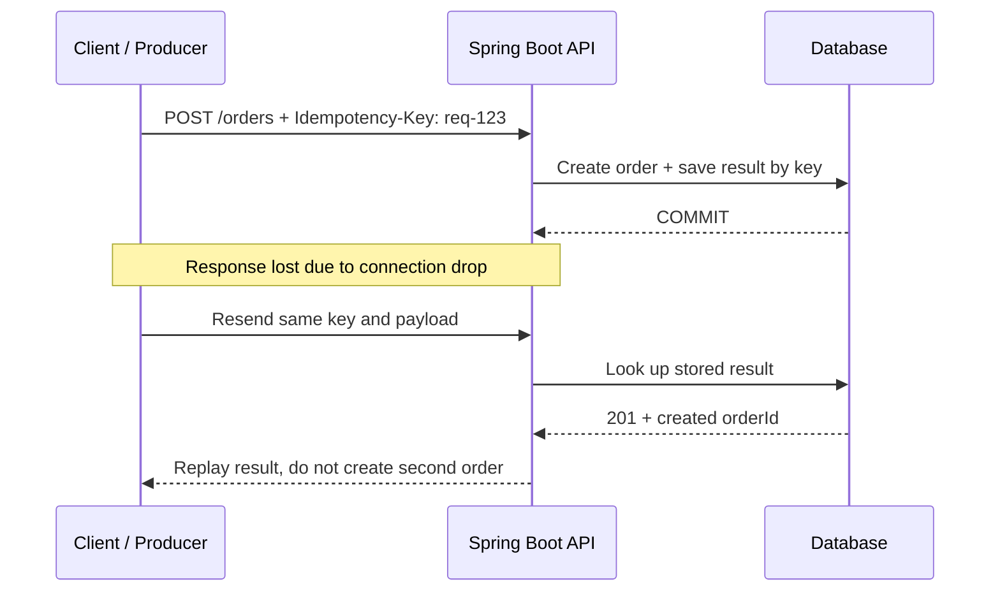
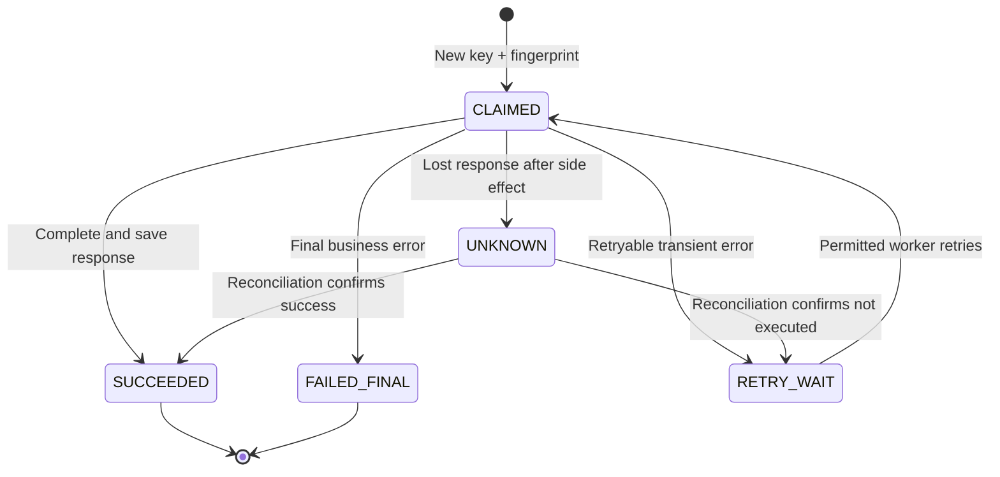
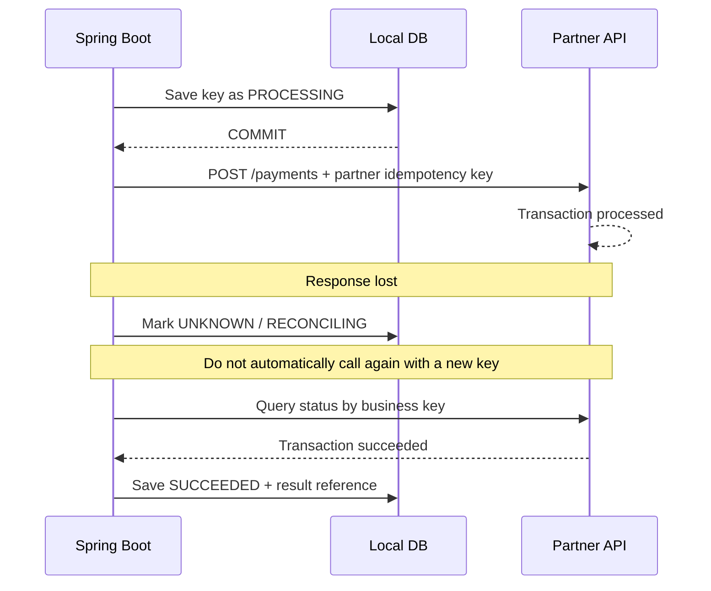

# Idempotency Key, Identity Scope, and Result Retention

> **Chapter:** Consistency and Deduplication  
> **Scope:** In the **SPRING_BOOT_INTEGRATION** module, a request may traverse HTTP clients, databases, caches, message brokers, and Spring Integration adapters. This lesson focuses on how to use an **idempotency key** to safely handle repeated requests or events; define the right **identity scope**; and decide on a **result retention period** long enough to prevent duplicate processing in real integration flows.

## 1. The problem: an operation can be sent multiple times

Consider a flow where a partner sends an order creation request to a Spring Boot application:

1. The client sends `POST /orders` with a key identifying the request.
2. The server writes the order to the database and commits.
3. The connection drops before the client receives the response.
4. Not knowing whether the operation succeeded, the client resends it.

If the resend creates a new order, **the same business intent has produced two side effects**. The same issue happens with Kafka/RabbitMQ when a consumer commits to the DB successfully but crashes before committing the offset/ack; the broker may redeliver the event.

**Idempotency** means that repeating *the same operation under the same contract* produces no unintended extra side effects. The application can return the recorded result or report an in-progress status instead of blindly running it again.



**Do not equate idempotency with "a request is only received once."** A request can still be resent and pass through multiple layers, yet the business operation must reach the correct outcome per contract.

## 2. Distinguishing idempotency key, business key, and message ID

| Concept | Example | Purpose | Interchangeable? |
| --- | --- | --- | --- |
| **Idempotency key** | `req-20261121-abc` | Identifies **one intentional execution** across retries | Not necessarily equal to order ID or message ID |
| **Business key** | `externalOrderId=ORD-0042` | Identifies a **business entity or operation** across systems | Can serve long-term deduplication if semantics guarantee it |
| **Event ID** | `eventId=evt-987` | Identifies a specific event emitted by a producer | Suitable for consumer deduplication when the producer keeps the ID stable |
| **Correlation ID / trace ID** | `corr-55` | Links logs and processing steps across a journey | Do not use as a deduplication key if multiple operations share one correlation |
| **Broker offset / delivery tag** | Partition + offset, delivery tag | Manages position/acks within the broker | Does not replace business identity across redeliveries or republishes |

An order can go through multiple valid operations such as `create`, `confirm`, and `cancel`. If all of them use only `orderId` as the key without an **operation**, the confirm operation could be mistaken for a duplicate of create.

Conversely, two HTTP requests using **two different idempotency keys** but sharing the same `externalOrderId` may still be a duplicate order creation request in business terms. Therefore, critical systems often need both an **idempotency record** and a **unique constraint on the business key**.

### Retries and redeliveries differ in key origin

- **HTTP client retry:** the client sends the **same idempotency key** across attempts of the **same intent**. When a user intentionally creates a new transaction, a new key must be used.
- **Broker consumer:** use the producer's stable `eventId` together with the source/consumer name in the scope. Do not generate a new UUID each time a message is received, as that breaks redelivery detection.
- **Batch/import:** if a file is re-ingested multiple times, you may need `importJobId + rowId` or a stable business key—not a standalone row number if different files can share row numbers.
- **Scheduled sync:** if a subsequent run should be allowed to update the same entity, bind the key to a **change marker/version** or defined processing window rather than permanently blocking all operations on that entity.

## 3. Identity scope: *within what space* must a key be unique?

A standalone key like `abc-123` is usually insufficient to identify an operation. You must design a **scope**—the set of attributes that distinguishes independent valid requests.

### 3.1. Recommended scope for HTTP APIs

A common design:

```text
(tenantId, operationCode, idempotencyKey)

tenantId          = authenticated and authorized tenant
operationCode     = order.create.v1
idempotencyKey    = value kept stable by the client across retries
```

| Scope attribute | When needed | Reason |
| --- | --- | --- |
| **Tenant/account ID** | Multi-tenant applications | Two tenants may coincidentally generate the same key string for independent operations |
| **Operation code** | Multiple command types exist | `order.create` and `order.cancel` do not accidentally block each other |
| **Producer/client ID** | Multiple independent apps share a tenant without tenant-wide unique keys | Prevents accidental collisions; requires verifying source identity |
| **Contract version** | When operation semantics change | Differentiate only when genuinely needed; avoid splitting scope if the new version must still dedup the old operation |
| **Business key** | Acts as an independent business safeguard | Prevents duplicate entities even if a request sends a new key |

**Do not trust a self-declared `X-Tenant-Id` header from the client to determine scope** without authentication and authorization. The tenant must come from the trusted authentication context or be strictly matched against the caller's identity.

**Do not arbitrarily widen the scope.** For instance, adding `attemptNumber`, request timestamp, or connection ID into the scope turns every retry into a new operation, rendering idempotency useless. Conversely, too narrow a scope will block valid operations from other tenants or operations.

### 3.2. Recommended scope for event consumers

For event consumers, an inbox key is typically:

```text
(consumerGroupOrHandlerId, producerId, eventId)
```

If the producer guarantees globally unique event IDs, `producerId` may be omitted; if an event must be independently processed by **two different business handlers**, separate the scope by handler/subscription. Do not share a single global "processed" record that blocks handler B simply because handler A received the event.

**Example:** the same `evt-41` must update both the "order projection" and the "analytics projection." Both consumers must execute once per consumer; the scope should include the respective handler identity. If a consumer group is renamed during deployment, plan inbox state migration to avoid unnecessarily replaying all historical events.

## 4. One key must bind to only one meaningful payload

If a client sends the same key while **changing the request content**, the server must not silently return the result of the old payload:

```text
Attempt 1:
Idempotency-Key: req-123
POST /orders
{"externalOrderId":"ORD-0042","amountMinor":100000,"currency":"VND"}

Attempt 2:
Idempotency-Key: req-123
POST /orders
{"externalOrderId":"ORD-0042","amountMinor":999999,"currency":"VND"}

Result:
Different fingerprint detected -> reject key reuse (e.g. HTTP 409)
```

The solution is to store a **request fingerprint/digest** alongside the key. The fingerprint is computed from **business-meaningful** fields using an agreed canonicalization algorithm version.

Recommended steps:

1. Authenticate the sender and determine scope.
2. Validate syntax, length, request size, and data schema.
3. Canonicalize meaningful fields: monetary representation, enums, timestamps, characters, and JSON field ordering if allowed by the contract.
4. Produce a canonical string/bytes stable across retries, then compute a digest (e.g., SHA-256).
5. Look up or claim `(scope, key)`; if the digest differs, respond with **key reused with different request**.

**Do not simply hash raw JSON bytes** if clients are allowed to vary whitespace or property order while still representing the same request. Conversely, do not strip out business-meaningful differences during canonicalization—for example, differing `amountMinor`, or `null` versus an omitted field if they carry distinct semantics.

A digest helps match requests and reduces the need to store plaintext, but it is **not a sender authentication mechanism**. Keys still require tenant access control and must never allow reading another tenant's results.

### 4.1. Client-side key generation

For HTTP APIs, clients typically generate **unpredictable random values with sufficient entropy** such as UUID v4 and keep them identical across all retries of the same operation. Avoid plain timestamps or local auto-incrementing numbers as global keys when collisions are possible.

Restrict key length, charset, and delivery mechanism (e.g., `Idempotency-Key` header) to avoid uncontrolled header payloads; you may store a digest/HMAC of the key if raw keys should not be retained long-term. A key alone grants no permissions: authentication and authorization still apply on every request.

## 5. Lifecycle of an idempotency record

Depending on business needs, a system can store these states:

| State | Meaning | Response when the same key is resent |
| --- | --- | --- |
| **CLAIMED / PROCESSING** | A worker has taken ownership; outcome is not yet known | Return "processing", wait with a bound, or instruct to retry later |
| **SUCCEEDED** | Side effect and result are complete | Return the stored result if the fingerprint matches |
| **FAILED_FINAL** | Definitive business error and contract chooses to persist that result | Return the recorded final error |
| **RETRY_WAIT** | Transient error; can be retried in a controlled way | Do not launch an uncoordinated new execution |
| **UNKNOWN / RECONCILING** | Downstream may have processed it, but confirmation was lost | Look up status before retrying the side effect |

**These are application-designed business states**, not a state machine that Spring Boot creates automatically upon seeing a header. For operations that write strictly within **one database transaction**, a persistent `PROCESSING` state may not be necessary: insert the key, write the business data, and save the response in the same transaction. For long-running operations calling external systems, explicit claims/leases and recovery states are required.



Store the `response status`, response body, or an **immutable result reference** per contract. Do not blindly persist every response: results containing tokens, personal data, or expiring information may require encryption, redaction, or reconstruction from finalized business state.

### Replay the response or only return the same business result?

Two common policies exist:

- **Exact replay:** store the HTTP status and a normalized response; retries return the same status/body. Easy to preserve the contract when the client loses a response.
- **Business-state replay:** store `orderId` and final state, then construct a fresh response (e.g., still with the same `orderId`). Useful when the body contains time-varying fields, provided you document which fields may differ and never re-trigger side effects.

Do not pick error-caching behavior arbitrarily. Certain validation errors occurring **before claiming the key** might not be stored; definitive business errors after claiming may be stored per contract. Transient errors with uncertain outcomes require retry/reconciliation mechanisms rather than being mistakenly saved as final results.

## 6. Spring Boot + PostgreSQL example: recording the result in the same DB transaction

Suppose an order-creation API writes to the **same database** as the idempotency table. The goal is to prevent race conditions when two identical requests arrive simultaneously and to replay the result after commit if the client loses the response.

### 6.1. Migration and unique keys

```sql
CREATE TABLE orders (
    id VARCHAR(36) PRIMARY KEY,
    tenant_id VARCHAR(80) NOT NULL,
    external_order_id VARCHAR(80) NOT NULL,
    amount_minor BIGINT NOT NULL CHECK (amount_minor >= 0),
    currency VARCHAR(3) NOT NULL,
    CONSTRAINT uk_orders_tenant_external UNIQUE (tenant_id, external_order_id)
);

CREATE TABLE api_idempotency (
    tenant_id VARCHAR(80) NOT NULL,
    operation_code VARCHAR(80) NOT NULL,
    idempotency_key VARCHAR(160) NOT NULL,
    request_digest CHAR(64) NOT NULL,
    response_http_status INTEGER,
    response_json TEXT,
    created_at TIMESTAMPTZ NOT NULL DEFAULT CURRENT_TIMESTAMP,
    expires_at TIMESTAMPTZ NOT NULL,
    PRIMARY KEY (tenant_id, operation_code, idempotency_key),
    CONSTRAINT ck_response_both_or_none CHECK (
        (response_http_status IS NULL AND response_json IS NULL)
        OR (response_http_status IS NOT NULL AND response_json IS NOT NULL)
    )
);

CREATE INDEX idx_api_idempotency_expiry
    ON api_idempotency (expires_at);
```

The two constraints protect **two different things**:

- `PRIMARY KEY (tenant_id, operation_code, idempotency_key)` guarantees a single execution for the same request identity while the record exists.
- `UNIQUE (tenant_id, external_order_id)` protects the invariant **never create two orders for the same partner order code**, even if the client generates a new key.

Create tables via Flyway/Liquibase or versioned migrations; do not rely on `ddl-auto=update` for production schema changes. Compute `expires_at` using the DB clock and `TIMESTAMPTZ` to avoid timezone skew across instances.

### 6.2. Atomic claim and business result persistence

Example service using Spring JDBC on PostgreSQL. `requestDigest` has been computed by a versioned canonicalization function **after validating the DTO**; `tenantId` comes from the authenticated user context. The example assumes the request body has passed syntax validation and the key has passed length/charset checks.

```java
package com.example.integration.orders;

import java.util.Objects;
import java.util.UUID;
import org.springframework.jdbc.core.JdbcTemplate;
import org.springframework.stereotype.Service;
import org.springframework.transaction.annotation.Transactional;

record CreateOrder(String externalOrderId, long amountMinor, String currency) {}
record StoredHttpResult(int status, String json) {}
record SavedResponse(String digest, Integer status, String json) {}

@Service
public class CreateOrderService {
    private static final String OPERATION = "order.create.v1";
    private final JdbcTemplate jdbc;

    public CreateOrderService(JdbcTemplate jdbc) {
        this.jdbc = jdbc;
    }

    @Transactional
    public StoredHttpResult create(
            String tenantId,
            String key,
            String requestDigest,
            CreateOrder request
    ) {
        int claimed = jdbc.update("""
            INSERT INTO api_idempotency (
                tenant_id, operation_code, idempotency_key,
                request_digest, expires_at
            )
            VALUES (?, ?, ?, ?, CURRENT_TIMESTAMP + INTERVAL '72 hours')
            ON CONFLICT (tenant_id, operation_code, idempotency_key)
            DO NOTHING
            """,
            tenantId, OPERATION, key, requestDigest
        );

        if (claimed == 0) {
            SavedResponse existing = jdbc.queryForObject("""
                SELECT request_digest, response_http_status, response_json
                FROM api_idempotency
                WHERE tenant_id = ?
                  AND operation_code = ?
                  AND idempotency_key = ?
                """,
                (rs, index) -> new SavedResponse(
                        rs.getString("request_digest"),
                        (Integer) rs.getObject("response_http_status"),
                        rs.getString("response_json")
                ),
                tenantId, OPERATION, key
            );
            if (existing == null) {
                throw new IllegalStateException("Idempotency record missing");
            }
            if (!Objects.equals(existing.digest(), requestDigest)) {
                throw new IdempotencyConflictException(
                        "Key reused with different request"
                );
            }
            if (existing.status() == null) {
                throw new IllegalStateException(
                        "Result not yet finalized; retry with same key"
                );
            }
            return new StoredHttpResult(
                    existing.status(), existing.json()
            );
        }

        // This is a DB operation in the same transaction as the idempotency record.
        String orderId = UUID.randomUUID().toString();
        jdbc.update("""
            INSERT INTO orders (
                id, tenant_id, external_order_id, amount_minor, currency
            ) VALUES (?, ?, ?, ?, ?)
            """,
            orderId,
            tenantId,
            request.externalOrderId(),
            request.amountMinor(),
            request.currency()
        );

        String response = "{\"orderId\":\"" + orderId + "\"}";
        jdbc.update("""
            UPDATE api_idempotency
               SET response_http_status = 201, response_json = ?
             WHERE tenant_id = ? AND operation_code = ?
               AND idempotency_key = ?
            """,
            response, tenantId, OPERATION, key
        );
        return new StoredHttpResult(201, response);
    }
}

class IdempotencyConflictException extends RuntimeException {
    IdempotencyConflictException(String message) {
        super(message);
    }
}
```

**Example limitations:** string concatenation for JSON only illustrates a response containing a server-generated UUID with no arbitrary characters; in real applications, use `ObjectMapper` to serialize DTOs per contract. Limit stored response size and sanitize sensitive fields; the code above focuses on transaction and uniqueness mechanics.

In PostgreSQL under default `READ COMMITTED` isolation, two transactions inserting the same unique key are coordinated by the unique index: one transaction may have to **wait for the other transaction to finish** before determining whether its insert succeeded or conflicted. If the first transaction commits, the second normally enters the read-result branch; if the first transaction rolls back, the second can claim and execute.

When **inserting the order** or **saving the response** fails, the entire transaction rolls back; the uncommitted idempotency record rolls back as well. Thus, in this design pattern, the database will not retain a committed order without its idempotency result.

**No guarantee that every concurrent request returns immediately:** a request may wait on a DB lock, hit a lock timeout, or encounter a connection error. The API must distinguish in-progress outcomes and instruct the client to retry with the same key; never generate a new key just because a request waited too long.

### 6.3. Mapping HTTP results

The controller receives the `Idempotency-Key` header, authenticates the caller, canonicalizes/validates the payload, computes the digest, invokes `CreateOrderService` **via a Spring-managed bean** so `@Transactional` takes effect, and returns the stored status/body.

Contract options:

| Case | Example response | Notes |
| --- | --- | --- |
| New key, valid data | `201 Created` + `orderId` | Confirm success only after DB commit |
| Retry same key, same digest, completed | `201 Created` + **same** `orderId` | May include a custom header indicating a replayed response |
| Same key, different digest | `409 Conflict` + code `IDEMPOTENCY_KEY_REUSED` | Do not execute the new payload |
| Request currently processing | `409`/`202` and `Retry-After`, per contract | Do not start another independent execution |
| Missing key on an API requiring a key | `400 Bad Request` | Return structured error code |
| Same business key, new idempotency key | Conflict or previous result per **business rules** | Unique constraint protects the order invariant |

There is no single mandatory HTTP status code across all idempotency implementations; choose and document the error codes, body, and retry behavior so clients do not misinterpret them. For asynchronous processing, `202 Accepted` should accompany a resource/status URL or polling mechanism per contract.

## 7. When operations cross partner HTTP APIs, brokers, or multiple databases

The single-transaction solution in Section 6 applies only when **both the side effect and the result record are stored atomically in the same database transaction**. If the flow calls a partner HTTP API or publishes a broker message, a JPA/JDBC `@Transactional` **cannot roll back** side effects that already occurred in another system.

Dangerous example:



For long-running tasks or operations lacking a shared transaction, design:

1. **Claim atomically:** create a `PROCESSING` record with owner/lease, request digest, deadline, and attempt count; a unique key blocks other workers from claiming the same scope.
2. **Execute the external task:** call the partner using an **idempotency key accepted by the partner**, or use a queryable business key; configure timeouts and retry bounds.
3. **Finalize:** write `SUCCEEDED`/`FAILED_FINAL` or a state requiring reconciliation.
4. **Recovery:** a worker scans expired leases; look up actual status before re-executing uncertain side effects.
5. **Fencing/ownership:** only the worker holding a valid lease/token may update state or trigger the next step. If a lease expires mid-flight, the old worker might still be running; use versions/fencing tokens and make downstream systems tolerate duplicate requests.

**Do not hold a DB transaction open while waiting on partner HTTP calls**, as this increases lock duration and exhausts connections. Also do not automatically delete a claim on timeout: a timeout usually only reflects that the caller stopped waiting, not that the partner failed to process the request.

### 7.1. Transactional outbox helps the "DB → broker" leg

If a service needs to both write an order and emit `OrderCreated`:

- Inside **one DB transaction**, store the order and an **outbox** record with a stable event ID.
- After commit, a separate publisher reads the outbox and publishes to the broker.
- The publisher marks it sent, yet may publish duplicates if the broker receives the message while the acknowledgment is lost.
- Consumers use inbox/deduplication keyed by `consumerScope + producerId + eventId` to process safely.

An outbox ensures events can be emitted after DB commit by design, **without automatically creating "exactly once" from DB to broker and every consumer**. Idempotency of the order-creation API and idempotency of event consumers are two distinct scopes; they may share a business ID while maintaining separate records and ownership.

## 8. Consumer inbox: deduplication must share a transaction with the side effect

Suppose a Kafka consumer receives `OrderCreated(eventId)` and writes a projection to PostgreSQL. Safe inbox pattern:

```sql
CREATE TABLE processed_events (
    consumer_id VARCHAR(100) NOT NULL,
    producer_id VARCHAR(100) NOT NULL,
    event_id VARCHAR(160) NOT NULL,
    processed_at TIMESTAMPTZ NOT NULL DEFAULT CURRENT_TIMESTAMP,
    PRIMARY KEY (consumer_id, producer_id, event_id)
);
```

Inside one DB transaction:

```text
BEGIN;
INSERT INTO processed_events(consumer_id, producer_id, event_id)
VALUES ('order-projection', 'checkout-service', :event_id)
ON CONFLICT DO NOTHING;

IF inserted = 1:
    apply business update to projection tables;
ELSE:
    skip duplicate business update;

COMMIT;
Only after DB commit does the broker container ack/commit the offset per policy.
```

This is **transactional pseudocode**, not a directly executable PostgreSQL SQL block because of the application-layer `IF`. If updating the projection fails, the transaction rolls back the inbox record too; subsequent redelivery can retry. If the DB commits while the broker ack fails, redelivery hits the inbox record and does not re-run the side effect.

Do not place a partner HTTP call inside the same DB transaction and assume the inbox protects the remote side effect. You need partner-side idempotency, status-queryable commands, or an intermediate outbox/job.

### Event keys must remain stable across republishes

For example, when a producer processes a request and then republishes the event due to a network error: **eventId should remain identical if it represents the same event**. If each publish creates a new `UUID.randomUUID()`, the inbox cannot recognize that two messages are the same event. If the business intentionally emits **a new event** for a different state version, issue a new event ID with the corresponding sequence/business version.

## 9. Redis can be used for fast claims, but understand its limits

Some integration flows use Redis to reduce load and avoid two workers running concurrently:

```text
SET "claim:order.create:<tenant>:<key>" "<unique-token>" NX EX 120
```

The `SET NX EX` operation is atomic in Redis for acquiring a TTL-bounded claim. However:

- The TTL can expire while the first worker is still working, letting a second worker claim the key.
- Redis can experience eviction, failover, or data loss depending on persistence settings; the claim may vanish even after the business side effect happened.
- After a Redis timeout, the client does not know whether `SET` was executed on the server.
- To release a claim, you must **compare the token and delete atomically**; calling `DEL` directly risks deleting a claim already owned by another worker.

Therefore, a Redis claim is a **coordination/contention-reduction layer**, not proof of "exactly once" business execution. For critical operations, rely on database unique constraints, inbox/outbox, and durable status verification.

A Redis cache storing idempotency results can also help with high-volume, short-deadline requests, but if keys are evicted or expire early, old requests may re-execute. Establish the **final source of truth** as the DB or the system that executed the side effect, and treat Redis only as a cache before permitting re-execution.

## 10. Result retention period: TTL is a business commitment

The **retention window** is how long the system commits to recognizing repeated submissions of the same operation. If keys expire too early, a client may retry an old command and create a new side effect. If every result is stored forever, storage costs and sensitive data exposure increase.

TTL should derive from **actual retry/replay behavior**, not an arbitrary guess just because Redis or a DB table has an `expires_at` column.

### 10.1. Inputs to calculate

| Factor | Why does it affect TTL? |
| --- | --- |
| **HTTP client retry window** | Clients may hold the same key for hours or days after network errors |
| **Gateway/load balancer timeouts and retries** | Automatic retries may happen before the client decides to retry |
| **Broker retention/replay window** | Consumers may receive events again after restarts, rebalancing, or intentional replays |
| **DLQ and manual replay schedules** | Old events may be redriven to topics/queues days or weeks later |
| **Maximum processing duration/lease** | Never purge a claim/result while a task's outcome is undetermined |
| **Lag during system outages** | Partner outages can cause messages to arrive later than normal schedules |
| **External status reconciliation capability** | Reliable lookups allow recovery even after old records are purged |
| **Data policy and storage cost** | Responses containing PII/payment data may not be retained indefinitely |

A rough way to think about it:

```text
Minimum key retention
  >= longest retry/replay window the contract must deduplicate
   + margin for operational delays / clock skew / late processing
```

This is a **design rule of thumb**, not an exact technical formula for every broker/consumer. If an event can be replayed from historical archives months later, a few days of inbox TTL will not guarantee "no duplicate processing" when that replay occurs.

### 10.2. Examples of reasoned retention choices

| Assumed context | Reference choice | Accompanying condition |
| --- | --- | --- |
| Report generation API, client retries only within one hour | Keep results longer than the retry window and job runtime | If regenerating the report is a valid new task, the client must use a new key |
| Order creation API, partner may retry for three days | Retain records at least past that window plus operational margin | Unique `externalOrderId` still protects orders after record expiration |
| Consumer with DLQ replay after two weeks | Inbox must cover the replay schedule or have an independent durable business-version/constraint | Do not drop dedup records just because a cache TTL is short |
| Payments/refunds with long-term dedup obligations | Maintain a durable business ledger/reference and unique constraints | Do not rely on a short Redis TTL as the final guarantee |

These durations are solely **illustrative of the reasoning**, not defaults for Spring Boot, Kafka, Redis, or any HTTP standard. Agree on SLAs with producers, consumers, and operations teams before setting retention.

### 10.3. Retention differs from processing timeouts and lease lifetimes

- **Request timeout:** how long a client waits on one attempt.
- **Processing lease:** how long a worker holds a claim before renewal or investigation is needed.
- **Result retention:** how long results and fingerprints are kept for replay/deduplication.
- **Business record retention:** orders/transactions may need to be kept much longer for business or legal obligations.

Do not turn a 30-second HTTP timeout into a 30-second idempotency TTL. An in-flight task can outlast the client timeout and still succeed, and clients may retry days later.

## 11. Handling expired keys and cleaning up results

### 11.1. What happens when a record expires?

Suppose `expires_at` has passed, yet the row still sits in the database. With a unique index, the key **still conflicts** until the record is deleted or archived. Therefore:

1. Clearly define whether `expires_at` means **eligible for cleanup** or the cutoff when the API **accepts the key as new**.
2. If key reuse after expiry is required, coordinate record deletion and concurrency using an atomically safe mechanism—do not simply check `now() > expires_at` and blindly re-run.
3. Never delete `PROCESSING`/`UNKNOWN` records merely because the clock passed a TTL threshold; reconcile status and leases first.
4. Before purging final records, verify there is a clear **business invariant** or policy for retries/replays beyond retention.

For tables containing only completed records like the single-transaction pattern in Section 6, a cleanup job can delete by `expires_at` in small batches, limiting lock/I/O pressure and monitoring deleted row counts. For multi-system flows with intermediate states, cleanup must obey state and recovery rules.

### 11.2. TTL does not mean "the operation is allowed to run again"

Once an idempotency record is purged, the same key may be treated as a new key by policy. That **does not turn a business operation meant to happen once into a valid repeat**. For orders with unique external IDs or payment ledgers, business constraints must still block a second side effect.

If the contract requires **permanent** deduplication by a business ID, retain a minimal long-lived identifier/tombstone (per data compliance) or a ledger mechanism with durable constraints. Sensitive response payloads can be purged earlier while keeping the minimal identifying hash/key if retention policy permits.

### 11.3. Capacity and sizing calculations

When choosing retention, estimate:

```text
Steady-state record count
  ≈ new keyed operations per day × retention days

Actual storage footprint
  ≈ record count × average record size
    + indexes, WAL, replication, backups, overhead
```

If full large JSON bodies are stored for every request, long retention creates unnecessary storage and security exposure. You may store a `resultId` and status code instead of the full response, provided contract-compliant replay capability is preserved.

Multi-instance systems should run scheduled cleanup under a lock/ownership mechanism or use partitioning for large datasets; cap rows deleted per batch and avoid full-table scans that stall production traffic.

## 12. Design flaws that break idempotency

| Mistake | Consequence | Fix |
| --- | --- | --- |
| Generating a new key on every retry | Every resend is treated as a new operation | Client keeps the key stable per intent |
| Using only `orderId` for all operations | Create/confirm/cancel block one another | Add operation code to the scope |
| Missing tenant/client scope | Key collisions or cross-tenant result leaks | Use authenticated identity and authorization checks |
| Not comparing fingerprints | Same key can apply a different payload | Hash canonical payload; conflict on mismatch |
| `SELECT` then `INSERT` without a unique constraint | Two parallel requests both run the side effect | Unique index + transaction/atomic claim |
| Saving key and creating order in separate transactions without recovery | Order commits while result record is missing | Same DB transaction or state machine/reconciliation |
| Relying solely on Redis TTL to dedup critical transactions | Eviction/expiry/failover allows re-execution | Durable business unique constraints/inbox/ledger |
| TTL shorter than retry/DLQ replay window | Old messages trigger new side effects | Size retention according to replay SLA |
| Storing sensitive response data indefinitely | Increases security risk and storage cost | Policy-based retention, encrypt/redact/store references |
| Acking broker before DB commit | Crash can lose the side effect | Coordinate ack after commit; handle redelivery via inbox |
| Retrying side effects after timeout without reconciliation | Partner may have processed the first request | Query status and use partner idempotency key |
| Using key as a metric tag | Massive cardinality, high metrics cost | Tag by operation, result/replay/conflict, tenant group |

## 13. Observability and security

A sound idempotency system should answer: *how many new requests*, *how many replayed requests*, *how many keys were misused*, and *how many pending operations cannot be reconciled*.

Suggested metrics (application-defined names):

- `idempotency_claim_new_total`: new keys claimed.
- `idempotency_replay_total`: requests with matching key and fingerprint returning stored results.
- `idempotency_conflict_total`: same key, different payload.
- `idempotency_processing_wait_total`: requests hitting an in-progress task.
- `idempotency_unknown_total` and `idempotency_reconciliation_duration`: uncertain outcomes and reconciliation duration.
- `idempotency_expired_removed_total` and `idempotency_storage_rows`: cleanup and capacity.
- `consumer_inbox_duplicate_total`: events redelivered without re-running side effects.

Do not use `idempotencyKey`, `eventId`, `orderId`, or user IDs as **metric tags**. In logs/traces, you may log a key digest or correlation ID sanitized per security policy. Restrict access to stored responses by tenant, encrypt where needed, and avoid dumping raw request bodies, credentials, or tokens into logs or DLQs.

Client-supplied keys are untrusted input: enforce length and charset limits, rate-limit, and prevent arbitrary keys from causing unbounded storage growth; always authenticate and authorize before returning a previously stored result. Hashing requests for matching never replaces schema validation, signatures, authentication, or authorization.

## 14. Testing difficult scenarios

| Scenario | Pass criteria |
| --- | --- |
| New request | Side effect runs once; key/digest/result stored properly |
| Retry same key, same payload after commit | Returns same result or business result; no second record created |
| Same key, different amount/currency | Clear conflict; old result is not updated |
| Two concurrent requests with same key | Only one transaction claims; the other waits/returns result or processing status |
| Two requests with different keys, same externalOrderId | Unique business constraint prevents creating two orders |
| DB commit succeeds, HTTP response lost | Retry retrieves stored result without re-executing |
| DB transaction rolls back before commit | Claim/side effect roll back together; next attempt processes properly |
| Broker redelivery after DB commit, before ack | Inbox detects duplicate; projection is not updated again |
| External HTTP side effect succeeds, reply lost | Recovery queries remote status; does not issue a new command |
| Key expires right as multiple requests arrive | Expiry/cleanup policy never permits two competing side effects |
| Replay from DLQ after retention | Independent business constraint or reconciliation policy holds |
| Wrong tenant, oversized key, or unauthorized | Safely rejected, never leaking another tenant's response |
| Cleanup runs while worker is processing | Never deletes unreconciled claims; preserves recovery state |

**How to test:** use Spring Boot integration tests with real PostgreSQL (e.g., via Testcontainers) to verify unique indexes, transactions, and `ON CONFLICT` behavior under concurrency. Simulate lost responses at the HTTP boundary, broker redeliveries, and "processed downstream but no reply" states. Unit tests for hashing/canonicalization are useful, but mocking repositories **cannot prove** DB atomicity.

To test retention, control the clock via `Clock` in application code or an equivalent test setup; for SQL using `CURRENT_TIMESTAMP`, design explicit tests for expiry boundaries and cleanup. Avoid long `Thread.sleep()` calls that make tests flaky.

## 15. Design workflow for a new integration flow

1. **Define the deduplicated operation:** an API command, an event per consumer, or a business state transition.
2. **Choose the scope:** tenant/client/producer, operation, and stable key; document the meaning of each component.
3. **Lock down the key contract:** who generates it, length, charset, when to reuse, when to generate anew; whether mandatory in the API.
4. **Lock down the fingerprint:** business fields and canonicalization; rule when a key is reused with a different payload.
5. **Choose the source of truth:** DB unique index/inbox/ledger; Redis cache/claims only as supporting layers when appropriate.
6. **Set transaction boundaries:** if all side effects are in one DB, persist key + business data + result in the same transaction; if external, use claim/lease/reconciliation/outbox.
7. **Define result replay:** which HTTP status/body to return, how to signal `PROCESSING`, `FAILED_FINAL`, or `UNKNOWN`.
8. **Calculate retention:** retry/replay SLA, DLQ, outages, processing duration, data policies; define when cleanup runs and when business constraints remain active.
9. **Test concurrency and network faults:** commit then lost response, crash before ack, retry after downtime, expiry, and old replays.
10. **Observe:** replay/conflict rates, waiting records, reconciliation backlog, cleanup errors, and storage growth.

### Self-check questions

1. Why does `Idempotency-Key` differ from `externalOrderId`, and why are both needed in an order creation API?
2. If two tenants both send `key=abc`, should two independent orders be created? Which scope decides?
3. If the key is the same but the amount differs, why is returning the old result dangerous?
4. Why does check-then-insert without a unique constraint fail against two concurrent requests?
5. What happens when the database commits but the HTTP response is lost?
6. Why is a 30-second idempotency TTL insufficient just because the HTTP timeout is 30 seconds?
7. Why can a DLQ replay weeks later exceed the deduplication coverage of a cache with a multi-day TTL?
8. When can you delete a response payload while keeping the business key/tombstone long-term?
9. Why can't a local DB transaction roll back an HTTP command already executed by a partner?
10. When two different consumers process the same event, how should the inbox scope be designed?

**Key takeaway:** An idempotency key is only effective when paired with **the right scope, a stable fingerprint, an atomic claim operation, result storage/replay capability, and retention sized to the retry/replay window**. Redis, caches, and brokers do not automatically deliver cross-system exactly-once semantics. In Spring Boot, protect business invariants with durable unique constraints/ledgers, set transaction boundaries accurately, build reconciliation for lost confirmations, and test real duplicate-message scenarios.
