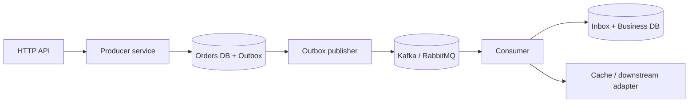
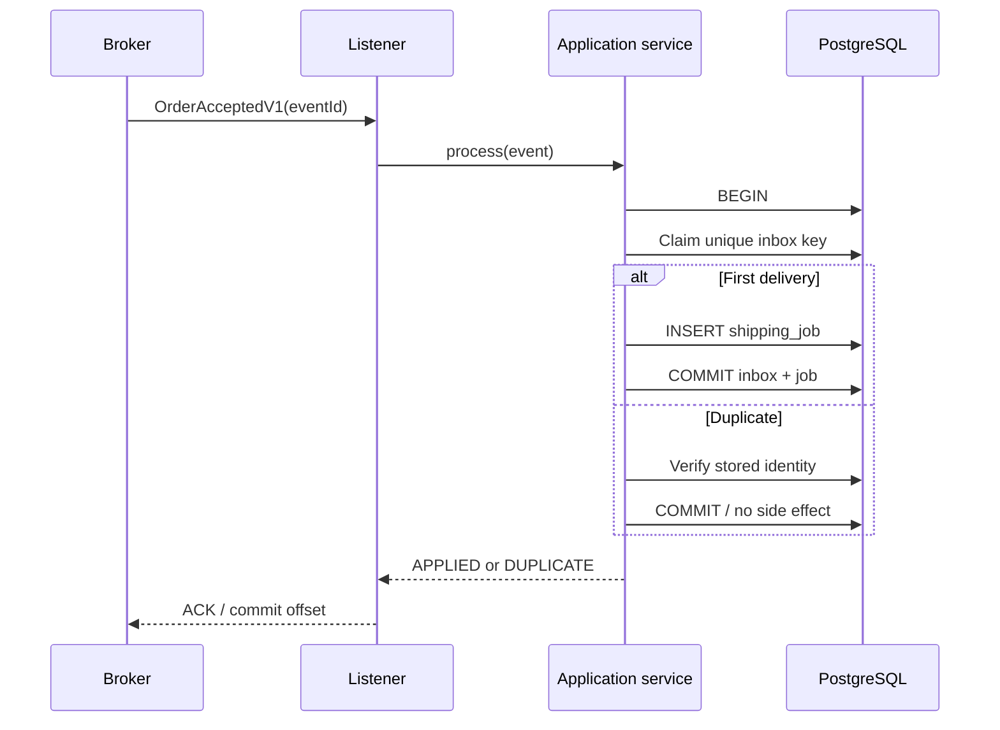

# Inbox, Unique Constraints, and Detecting Processed Messages

In **SPRING_BOOT_INTEGRATION**, an operation may begin as an HTTP request, be written to PostgreSQL, be published via Kafka/RabbitMQ, and then be routed by a consumer through Spring Integration adapters to a database, cache, or external service. When part of a flow fails, systems typically **resend** messages to prevent data loss. Yet resending also creates the risk of recording the same order twice, charging twice, sending two emails, or corrupting state.

The **Consistency and Deduplication** chapter addresses this problem with a key pattern: an **inbox** (a ledger of processed messages) combined with **unique constraints in durable storage** and a **transaction wrapping both the processed marker and the business effect**. The goal is not to stop brokers from delivering duplicates at all costs, but to keep the **business effect accurate** even when a message appears multiple times.

This lesson focuses on **Inbox, unique constraints, and detecting processed messages**. Illustrative examples use Java 17+, Spring Boot 3.x, Spring JDBC, PostgreSQL, and Kafka/AMQP consumer models. With other technologies or versions, the principles hold, while SQL syntax, transactions, and acks must be verified separately.

## 1. Learning objectives

After this lesson, you will be able to:

1. Distinguish message ID, event ID, correlation ID, idempotency key, and business key; define the right deduplication key scope.
2. Explain why **at-least-once delivery** commonly leads to repeated processing and why "exactly once" does not automatically span databases/HTTP.
3. Design inbox tables, unique constraints, and transactions to record processing markers alongside side effects.
4. Implement an idempotent consumer with Spring JDBC and PostgreSQL `INSERT ... ON CONFLICT DO NOTHING`, handling ID/content conflicts.
5. Distinguish the **mark-on-completion** pattern in a short transaction from **claim/lease/state machine** patterns for long jobs or external side effects.
6. Determine Kafka/RabbitMQ ack ordering, retry/DLQ, replay, and inbox cleanup without introducing future duplicate bugs.
7. Write integration/concurrency tests and establish observability to prove consistency across crash scenarios.

## 2. Why are messages processed more than once?

Suppose a Kafka consumer receives `OrderAcceptedV1`, inserts a `shipping_job` into the database, and then confirms processing. If the process stops **after the database commit but before committing the offset**, the next startup may read that event again. With RabbitMQ, a delivery whose DB work succeeded but remains un-**acked** can also be redelivered by the broker.

```mermaid
sequenceDiagram
    participant B as Broker
    participant C as Consumer
    participant D as PostgreSQL
    B->>C: OrderAccepted(eventId=evt-123)
    C->>D: BEGIN; INSERT shipping_job; COMMIT
    Note over C: Process crashes before ack
    B->>C: Redelivery with same eventId
    C->>D: INSERT shipping_job again?
```

Situations causing repeated processing:

- **Lost ack/offset commit** after the business operation has completed.
- **Producer retries** when the broker accepted the message but the producer did not see confirmation.
- **HTTP client retries** because the response was lost after the server committed.
- **Kafka rebalances**, consumer restarts, or offset reset/replay procedures.
- **RabbitMQ requeues**, dead-letter redrives, or delivery handoffs after errors.
- **Outbox publisher** sends an event and crashes before marking it `published`.
- **Multiple instances** receiving the same business command from different sources.

**Do not treat duplicate delivery as an isolated deployment bug.** Many systems deliberately choose *at-least-once delivery* to prioritize zero data loss; handling duplicates is a responsibility of business design.

| Concept | Guarantee boundary | What else must be done |
| --- | --- | --- |
| **At-most-once delivery** | Messages may be lost on failure, minimal resending per chosen mechanism | Unsuitable when work cannot be lost. |
| **At-least-once delivery** | Retries until completion is acknowledged; duplicates may be delivered | Consumers must be idempotent or use an inbox. |
| **Exactly-once within broker scope** | Can guarantee certain operations within specific broker/transaction boundaries | Does not automatically turn HTTP, DB, Redis, and email into a distributed transaction. |
| **Exactly-once business effect** | Final business data is never duplicated | Requires unique constraints, state, transactions, and/or idempotency at the side-effect target. |

With Kafka, transactional producers and exactly-once guarantees for supported topologies **do not replace** a unique constraint in PostgreSQL when a consumer causes effects in an external database. With RabbitMQ, publisher confirms and consumer acknowledgements likewise do not form an atomic commit spanning PostgreSQL and the broker.

## 3. What is an inbox and how does it differ from an outbox?

An **inbox** is durable data on the **receiving side** used to record that a message, event, or business operation has been processed within a defined scope. It lets the consumer answer: "Has this logical message already produced its effect here?"

An **outbox** sits on the **publishing side**, recording business data changes and the intent to emit an event in the same DB transaction. An outbox can resend messages; the inbox on the receiving side blocks duplicate effects.



| Question | Outbox | Inbox |
| --- | --- | --- |
| Which side? | Producer | Consumer |
| What does it record? | Events/commands **to be published** | Messages/operations **that have already produced their defined effect** |
| Atomic with which data? | Business changes in the producer's DB | Business effects in the consumer's DB, if sharing the transaction |
| Which crash does it survive? | DB commits but process dies before publish | DB commits but process dies before ack/offset commit |
| Can duplicates still happen? | **Yes**: publisher may resend | **Yes**: broker may redeliver, but consumer skips the repeated effect |
| Interchangeable? | No | No |

A flow with both an outbox and an inbox still requires designing **event contracts**, idempotency keys, transactions, retries, acks, and recovery capabilities. An inbox does not turn a partner HTTP call into part of a database transaction.

## 4. Choosing the right deduplication identifier

An infrastructure-generated **message ID** and a **business event ID** are not necessarily the same. When an event is republished, transport metadata such as a Kafka offset or Spring Integration's `Message<?>` ID can change, whereas the **logical event ID must remain stable**.

| Identifier | Example | Usable for deduplication? |
| --- | --- | --- |
| `eventId` | `evt-order-792` | **Yes**, if the producer commits to keeping it stable across retries and unique per logical event. |
| `requestId` / `idempotencyKey` | `pay-req-551` | **Yes** for a business command when the contract defines scope/retention. |
| `businessKey` | `orderId=ORD-792` | Can guard a "once-per-order" action, but **do not** use instead of event ID when multiple valid events share the same order. |
| Kafka `topic + partition + offset` | `orders.v1 / 3 / 1045` | Identifies a **specific record**; does not identify two republished records for the same logical event. |
| RabbitMQ delivery tag | `deliveryTag=20` | No: it is a channel-scoped delivery identifier that changes upon redelivery. |
| `correlationId` | `trace-abc` | Typically used for multi-step tracing; **insufficient** to define event uniqueness. |
| UUID of `MessageHeaders.ID` | UUID generated when creating a Spring Message | Not guaranteed stable across serialization/recreation/redelivery. |
| Hash of raw JSON | SHA-256 of bytes | Fragile under field ordering, whitespace, number formatting, or schema evolution; does not replace business keys. |

**Key scope** is part of the contract. If both `shipping-service` and `analytics-service` need to process the same event, they must not share a global table with only `event_id PRIMARY KEY` that causes the second function to be treated as a duplicate.

A typical inbox key is:

```text
(consumer_name, event_id)
```

In a multi-tenant system, determine whether `eventId` is globally unique or unique only per tenant. If unique only per tenant, expand the key to `(tenant_id, consumer_name, event_id)`. Do not blindly insert a tenant from an unverified header into the key and treat that as tenant isolation.

### Same ID with different payloads

A valid redelivered event should have the **same ID and the same meaning**. If a producer emits:

```json
{"eventId":"evt-1","orderId":"ORD-100","schemaVersion":1}
```

and later emits:

```json
{"eventId":"evt-1","orderId":"ORD-999","schemaVersion":1}
```

that is **not** a valid duplicate; it is an **identity/contract conflict**. The inbox should store enough identifying fields/version or a fingerprint computed over a well-defined canonical representation, and verify it before returning `ALREADY_PROCESSED`. **Do not ignore conflicts just because the unique key already exists.**

## 5. Designing a PostgreSQL schema for the inbox

Example: a shipping system receives `OrderAcceptedV1` and creates a shipping job. We use **two tables in the same PostgreSQL database** so they can commit or roll back atomically.

```sql
CREATE TABLE consumer_inbox (
    consumer_name   VARCHAR(100) NOT NULL,
    event_id        VARCHAR(160) NOT NULL,
    order_id        VARCHAR(160) NOT NULL,
    schema_version  INTEGER NOT NULL CHECK (schema_version > 0),
    processed_at    TIMESTAMPTZ NOT NULL DEFAULT now(),
    PRIMARY KEY (consumer_name, event_id)
);

CREATE INDEX idx_consumer_inbox_processed_at
    ON consumer_inbox (processed_at);

CREATE TABLE shipping_job (
    order_id     VARCHAR(160) PRIMARY KEY,
    state        VARCHAR(40) NOT NULL,
    created_at   TIMESTAMPTZ NOT NULL DEFAULT now()
);
```

Significance:

1. **`PRIMARY KEY (consumer_name, event_id)`** is the contention barrier in the database. Two transactions attempting to insert the same key cannot both commit two rows.
2. **`order_id` and `schema_version`** help verify whether a duplicate delivery carries the same core content or represents a conflict. If an event includes additional critical fields, store/compare all protected fields or a canonicalized fingerprint.
3. **`processed_at`** is the timestamp recorded within the transaction for tracing and retention policy. It does **not** by itself indicate that the broker has acked.
4. **`shipping_job.order_id PRIMARY KEY`** enforces an extra business invariant: "never create two shipping jobs for the same order," even if two distinct event IDs request the same action.
5. The timestamp index supports queries/retention, though it adds write overhead. Design the cleanup policy carefully.

**Separate the two deduplication forms:** the inbox blocks **the same logical message/event** already processed within a consumer scope; the unique constraint on the business table blocks **the same business effect**. They do not completely replace each other. For example, a message resent with a new event ID will bypass an `eventId`-keyed inbox, yet can still be caught by `shipping_job.order_id`.

### Why not just "SELECT then INSERT"?

Problematic code:

```java
if (!repository.existsByEventId(eventId)) {
    repository.insertShippingJob(orderId);
    repository.markEventProcessed(eventId);
}
```

Two consumers can both observe "does not exist" before either inserts; this is a **check-then-act race**. Without a unique constraint and transaction, both can create side effects. Adding Java `synchronized` also fails to protect across multiple pods/containers or other applications sharing the database.

To prevent cross-instance races, **database constraints are the final arbiter**; application logic acts on the result of an atomic insert or handles constraint violations per contract.

## 6. Standard transaction pattern: writing inbox and business effect together

Principle:

```text
BEGIN TRANSACTION
  INSERT inbox key ON CONFLICT DO NOTHING
  IF inserted:
      APPLY business effect
  ELSE:
      CHECK identity/payload compatibility
COMMIT
ACK / COMMIT OFFSET AFTER DB transaction committed
```

If **inserting the inbox succeeds and applying the business effect fails**, the transaction rolls back both. The next redelivery can retry properly. If **both the business effect and inbox commit successfully while the ack fails**, redelivery checks the inbox and skips repeating the business effect.



The sequence in the diagram is the **design goal**: you must verify how the listener container, transaction manager, DB, and ack are actually configured. There is no automatic distributed transaction between the broker and PostgreSQL, so a window remains between **DB commit** and **broker ack**; the inbox exists specifically to cover that window.

## 7. Implementing an inbox with Spring JDBC and PostgreSQL

For hands-on practice, assume the payload has already been JSON-validated. The event has two identifier fields and a contract version:

```java
public record OrderAcceptedV1(
        String eventId,
        String orderId,
        int schemaVersion
) {}

public enum InboxOutcome {
    APPLIED, DUPLICATE
}
```

`public` top-level types belong in separate Java files. This example uses `NamedParameterJdbcTemplate` and Spring-managed transactions; the tables are created by migrations before running the handler.

```java
import java.util.Objects;
import org.springframework.jdbc.core.namedparam.MapSqlParameterSource;
import org.springframework.jdbc.core.namedparam.NamedParameterJdbcTemplate;
import org.springframework.stereotype.Service;
import org.springframework.transaction.annotation.Transactional;

@Service
public class ShippingInboxHandler {
    private static final String CONSUMER = "shipping-service";
    private final NamedParameterJdbcTemplate jdbc;

    public ShippingInboxHandler(NamedParameterJdbcTemplate jdbc) {
        this.jdbc = jdbc;
    }

    private record SavedIdentity(String orderId, int schemaVersion) {}

    @Transactional
    public InboxOutcome process(OrderAcceptedV1 event) {
        if (event == null
                || event.eventId() == null || event.eventId().isBlank()
                || event.orderId() == null || event.orderId().isBlank()
                || event.schemaVersion() != 1) {
            throw new IllegalArgumentException("Invalid event contract");
        }

        var params = new MapSqlParameterSource()
                .addValue("consumer", CONSUMER)
                .addValue("eventId", event.eventId())
                .addValue("orderId", event.orderId())
                .addValue("schemaVersion", event.schemaVersion());

        // PostgreSQL resolves concurrent conflicts via the unique constraint.
        int inserted = jdbc.update("""
                INSERT INTO consumer_inbox
                    (consumer_name, event_id, order_id, schema_version)
                VALUES (:consumer, :eventId, :orderId, :schemaVersion)
                ON CONFLICT (consumer_name, event_id) DO NOTHING
                """, params);

        if (inserted == 0) {
            SavedIdentity saved = jdbc.queryForObject("""
                    SELECT order_id, schema_version
                    FROM consumer_inbox
                    WHERE consumer_name = :consumer AND event_id = :eventId
                    """, params, (rs, rowNum) ->
                    new SavedIdentity(
                            rs.getString("order_id"),
                            rs.getInt("schema_version")));

            if (saved == null
                    || !Objects.equals(saved.orderId(), event.orderId())
                    || saved.schemaVersion() != event.schemaVersion()) {
                throw new EventIdentityConflictException(event.eventId());
            }
            return InboxOutcome.DUPLICATE;
        }

        // Business effect belongs to the SAME JDBC transaction as the inbox.
        jdbc.update("""
                INSERT INTO shipping_job (order_id, state)
                VALUES (:orderId, 'REQUESTED')
                """, params);
        return InboxOutcome.APPLIED;
    }
}

class EventIdentityConflictException extends RuntimeException {
    EventIdentityConflictException(String eventId) {
        super("Different payload for eventId: " + eventId);
    }
}
```

Key points to observe in the code:

1. `INSERT ... ON CONFLICT DO NOTHING` returns **1** if a new inbox marker was written, **0** if the key already exists; the unique constraint arbitrates contention, not a prior `existsById()`.
2. When `inserted == 0`, the code **reads back the stored fields** to avoid treating the same event ID with a different order or version as a valid retry.
3. When `inserted == 1`, the code creates the shipping job. **Both inserts share the same transaction**, so an error on the shipping job rolls back the newly inserted inbox row too.
4. `shipping_job` has `order_id PRIMARY KEY`. If the producer emits a **different event ID** yet still requests creating a second shipping job for the same order, the `INSERT` violates uniqueness and the transaction rolls back; the application must classify this error per business contract and **not retry endlessly**.
5. Do not catch and swallow `DataIntegrityViolationException` inside the transaction; doing so can leave the transaction in an aborted state (especially on PostgreSQL) or mask the root cause. Let the exception propagate so the transaction manager rolls back and the error handler decides the next step.

**Operational conditions:** `@Transactional` must be placed on a Spring bean called **through a Spring proxy**, `DataSource`/`JdbcTemplate` must participate in the same transaction manager, and the handler must use a database suitable for storing both the inbox and business effect. Calling a method on the same class via `this.process(...)` bypasses the AOP proxy in standard proxy mode.

### 7.1. Why is the approach above safe when two consumers race?

Two instances can run simultaneously:

```text
Consumer A: INSERT inbox ("shipping-service", "evt-123")
Consumer B: INSERT inbox ("shipping-service", "evt-123")
```

PostgreSQL forces both transactions to obey the unique constraint. One insert will win once its transaction finishes; the other cannot commit a second row with the same key. If the winning transaction **commits**, the other sees the conflict and skips the side effect. If the winning transaction **rolls back**, the waiting transaction can claim and process the event. Verify exact behavior against the database's isolation level and specific statements; do not assume this automatically holds identically across every storage engine.

What matters is **scoping the key properly and bounding the transaction accurately**, not lucky thread timing. Concurrency tests against real PostgreSQL must assert the final invariant: **one inbox row and one shipping job**, regardless of whether consumer A or B wins.

### 7.2. When should `ON CONFLICT DO NOTHING` be avoided?

`ON CONFLICT` is PostgreSQL syntax; MySQL has different syntax and semantics, and JPA may require native queries or exception handling. In particular, never use `ON CONFLICT DO NOTHING` **without specifying a conflict target** when multiple unique constraints carry distinct meanings: it can trick the application into assuming an event was already processed when a different constraint actually conflicted.

In the example above, explicitly specifying `ON CONFLICT (consumer_name, event_id) DO NOTHING` skips only **inbox key** conflicts. A uniqueness violation on `shipping_job.order_id` is a separate business scenario and must be handled differently.

## 8. Inbox across multiple functions and tenants

A single `OrderAcceptedV1` event may simultaneously be handled by shipping, analytics, and audit. Because each function requires its own side effect, deduplication keys must be separated:

```text
("shipping-service",  "evt-123")  -> shipping job created
("analytics-service", "evt-123")  -> report updated
("audit-service",     "evt-123")  -> audit event stored
```

If the same inbox table is shared across functions, each consumer uses a **fixed functional name**, not a pod/instance name or an environment-varying Kafka `group.id`. If the same function runs two pipeline generations in parallel during a migration, explicitly decide whether they share an idempotency scope or need versioned scopes.

In multi-tenant SaaS, for example:

```sql
CREATE TABLE tenant_consumer_inbox (
    tenant_id       VARCHAR(80) NOT NULL,
    consumer_name   VARCHAR(100) NOT NULL,
    event_id        VARCHAR(160) NOT NULL,
    payload_digest  CHAR(64) NOT NULL,
    processed_at    TIMESTAMPTZ NOT NULL DEFAULT now(),
    PRIMARY KEY (tenant_id, consumer_name, event_id)
);
```

Use this schema only if **event IDs are not guaranteed globally unique**. Even when the tenant is embedded in an upstream business ID, still validate ownership and consistency. `tenant_id` must come from an authenticated source and contract, not blindly from a message header sent by an untrusted publisher.

### 8.1. Fingerprints for complex payloads

When an event has many important fields, storing every field in the inbox can be expensive. You can store a **digest** of a **canonicalized** representation (such as schema version + deterministic business fields in fixed order and types), e.g., SHA-256.

Do not hash raw JSON directly and assume two different byte sequences always mean two different events: property order, whitespace, timestamp formatting, Unicode normalization, and decimal scale can vary while business meaning stays identical. Conversely, if the contract specifies that **exact bytes** define identity, byte comparison under that convention may be appropriate.

A digest does not replace the idempotency key: the **key** identifies "one logical event," while the **digest/fields** verify "whether a retry has the same content." If silent data corruption upstream is a risk, also store schema version, producer identity, and safe metadata for investigation.

## 9. Acks and offset commits: confirm only after DB commit

A consistent consumer model typically aims to keep this order:

```text
Parse + validate -> BEGIN -> Claim inbox -> Apply business -> COMMIT
  -> ACK RabbitMQ / commit Kafka offset
```

However, **the ack occurs outside the DB transaction**. A crash can happen between commit and ack; that is precisely when the inbox protects the data.

### 9.1. Kafka listener and manual acknowledgment

Example Spring Kafka setup with a String JSON payload, deserializing via `ObjectMapper` and calling a Spring-managed service:

```yaml
spring:
  kafka:
    consumer:
      enable-auto-commit: false
      key-deserializer: org.apache.kafka.common.serialization.StringDeserializer
      value-deserializer: org.apache.kafka.common.serialization.StringDeserializer
    listener:
      ack-mode: manual_immediate
```

```java
import com.fasterxml.jackson.databind.ObjectMapper;
import org.apache.kafka.clients.consumer.ConsumerRecord;
import org.springframework.kafka.annotation.KafkaListener;
import org.springframework.kafka.support.Acknowledgment;
import org.springframework.stereotype.Component;

@Component
public class ShippingKafkaListener {
    private final ObjectMapper mapper;
    private final ShippingInboxHandler handler;

    public ShippingKafkaListener(
            ObjectMapper mapper, ShippingInboxHandler handler) {
        this.mapper = mapper;
        this.handler = handler;
    }

    @KafkaListener(
            topics = "orders.accepted.v1",
            groupId = "shipping-service")
    public void onMessage(
            ConsumerRecord<String, String> record,
            Acknowledgment acknowledgment) throws Exception {

        OrderAcceptedV1 event = mapper.readValue(
                record.value(), OrderAcceptedV1.class);
        InboxOutcome outcome = handler.process(event);

        // Called only after process(...) returns,
        // meaning the @Transactional transaction completed successfully.
        acknowledgment.acknowledge();
    }
}
```

If `handler.process` throws an exception, do not call `acknowledge()` on the failure path. `DefaultErrorHandler`, retries, backoff, recoverers, and DLT must be configured **intentionally**, as listener/offset behavior also depends on the ack mode and error handler. Do not assume simply omitting ack in all cases guarantees a message will be retried forever.

In the example, `outcome` can feed an `APPLIED`/`DUPLICATE` metric; if unused, remove the variable to avoid compiler warnings. `Kafka` does not delete records from a topic when offsets are committed; replays or another consumer group can still read that record.

### 9.2. RabbitMQ listener and ack

With Spring AMQP/Spring Boot:

```java
import com.fasterxml.jackson.databind.ObjectMapper;
import java.nio.charset.StandardCharsets;
import org.springframework.amqp.core.Message;
import org.springframework.amqp.rabbit.annotation.RabbitListener;
import org.springframework.stereotype.Component;

@Component
public class ShippingRabbitListener {
    private final ObjectMapper mapper;
    private final ShippingInboxHandler handler;

    public ShippingRabbitListener(
            ObjectMapper mapper, ShippingInboxHandler handler) {
        this.mapper = mapper;
        this.handler = handler;
    }

    @RabbitListener(queues = "shipping.order.accepted")
    public void onMessage(Message message) throws Exception {
        String json = new String(
                message.getBody(), StandardCharsets.UTF_8);
        OrderAcceptedV1 event =
                mapper.readValue(json, OrderAcceptedV1.class);
        handler.process(event);
        // With container AcknowledgeMode.AUTO, success -> container acks.
    }
}
```

In Spring AMQP's **`AcknowledgeMode.AUTO`**, the listener container typically acks when the listener returns normally and handles errors when the listener throws an exception. It is **not the same** as RabbitMQ broker `autoAck=true`. Verify the actual container configuration, retry count, `defaultRequeueRejected`, and DLX/DLQ. If JSON parsing fails or the schema version is unsupported, do not requeue infinitely; reject/quarantine per policy.

A RabbitMQ queue uses **competing consumers**; Kafka with the same `group.id` splits partitions. Both can redeliver on error, but ack/offset mechanics differ. An inbox at the application service layer is a more stable model because it does not rely on delivery tags or offsets as business idempotency keys.

## 10. Four most critical failure scenarios

Use this matrix to evaluate the impact of a crash:

| Failure point | Inbox/DB state | What does the broker see? | Behavior to verify |
| --- | --- | --- | --- |
| **Before claiming inbox** | Neither marker nor side effect exists | Delivery unacked or processing incomplete | Can be retried and processed normally. |
| **After inserting inbox, before DB commit** | Transaction still open; on rollback both inbox and effect vanish | Delivery unacked | Next delivery is allowed to claim again, not wrongly blocked as "processed". |
| **After DB commit, before ack/offset commit** | Inbox and effect are durable | Broker may redeliver | Consumer sees existing key, verifies content, **does not repeat effect**, then acks. |
| **After ack/offset commit** | Inbox and effect are durable | Broker normally treats delivery as complete for that group/queue | Intentional replays or redrives must still be idempotent. |

An incorrect implementation:

```text
INSERT inbox -> COMMIT
CALL external payment API -> error / process crash
Broker redelivers
SELECT inbox -> already exists -> skip
```

Here, the inbox is marked **processed** while the side effect **never completed**. This pattern is safe only when the recorded marker means **"accepted for follow-up processing by another durable process"**—such as creating a durable job or outbox row in the same transaction—and never misread as "payment completed."

Another incorrect pattern:

```text
CALL external payment API -> succeeds
INSERT inbox -> COMMIT
```

If the process dies between the two steps, redelivery can call the payment API again. No single JDBC transaction can roll back an effect already committed in an external system.

**Key takeaway:** precisely define the word **"processed"** in your inbox table name. In the shipping job example, "processed" means the consumer **recorded the job in PostgreSQL**; it **does not mean** the parcel was delivered or the carrier HTTP API confirmed pickup.

## 11. Distinguishing "received," "processing," and "completed"

The `INSERT inbox + business effect + COMMIT` pattern fits **relatively short DB effects** inside a single transaction. For long-running work, multi-gigabyte files, payment APIs with external side effects, or multi-minute workflows, a different durable state model is required.

| State | Meaning | Can duplicate delivery be skipped immediately? |
| --- | --- | --- |
| `RECEIVED` | Input durably recorded for follow-up processing | Only if a durable worker/job will continue processing without losing work. |
| `PROCESSING` | A worker holds a **lease/claim** on the work | Other workers usually need to wait or inspect the lease; should not treat as finished. |
| `SUCCEEDED` | Effect completed according to the **workflow definition** | Can return duplicate result after verifying ID/payload. |
| `FAILED_RETRYABLE` | Encountered a transient error; still eligible for retry | Allow retry per policy and deadline. |
| `FAILED_PERMANENT` | Unprocessable data, contract, or business error | Do not auto-retry; quarantine/DLQ and report clearly. |
| `UNKNOWN` | External side effect may have occurred, but unverified | Query/reconcile by business ID; do not blindly resend. |

Example schema for long-running jobs:

```sql
CREATE TABLE integration_job (
    job_id         VARCHAR(160) PRIMARY KEY,
    event_id       VARCHAR(160) NOT NULL,
    status         VARCHAR(30) NOT NULL
                   CHECK (status IN (
                       'RECEIVED', 'PROCESSING', 'SUCCEEDED',
                       'FAILED_RETRYABLE', 'FAILED_PERMANENT', 'UNKNOWN')),
    attempt_count  INTEGER NOT NULL DEFAULT 0,
    leased_until   TIMESTAMPTZ,
    lease_token    BIGINT NOT NULL DEFAULT 0,
    updated_at     TIMESTAMPTZ NOT NULL DEFAULT now()
);

CREATE UNIQUE INDEX uq_integration_job_event_id
    ON integration_job(event_id);
```

A **lease** lets one worker hold processing rights for a period of time; if the worker dies, ownership can be reclaimed after the lease expires. However, **lease expiration does not prove the old worker has stopped**. The old worker might wake from a GC pause, be mid-HTTP request, or still write to the target.

When two workers must be prevented from both writing state:

1. Grant claims/leases via an atomically conditional update or database row lock.
2. Increment **`lease_token`** every time ownership changes; on completion, a worker may write final state only if the current token still matches (fencing).
3. If downstream storage supports fencing tokens, pass the token with writes so an old worker cannot overwrite a new worker.
4. If the side effect lives in an **external service that does not understand fencing tokens**, you still need a target-supported **idempotency key** or reconciliation process.

Never use a permanent `PROCESSING` flag without recovery; one dead worker would stall the message forever. Conversely, do not allow workers to steal jobs too early and issue duplicate payment commands.

### 11.1. Durable intake inbox and job outbox

A safe design for external effects:

```mermaid
sequenceDiagram
    participant B as Broker
    participant C as Consumer
    participant D as DB: inbox + durable job
    participant W as Background worker
    participant X as External payment API
    B->>C: PaymentRequested(requestId)
    C->>D: BEGIN; claim inbox + INSERT durable job; COMMIT
    C-->>B: ACK after job is durable
    W->>D: Claim job with lease/token
    W->>X: POST payment (idempotency key)
    alt Confirmed success
        X-->>W: Success/paymentId
        W->>D: Mark SUCCEEDED if lease/token valid
    else Timeout with uncertain outcome
        W->>D: Mark UNKNOWN / schedule reconciliation
        W->>X: Query status by requestId
    end
```

Here, the **inbox commits alongside the durable job** and the ack means "recoverable work accepted," **not** "payment executed." The API/broker contract must reflect that distinction. If promising payment completion is required, add a dedicated verification/status step.

## 12. Are Redis `SET NX`, caches, and Spring Integration filters enough?

A common pattern uses Redis:

```text
SET dedup:shipping:evt-123 1 NX EX 86400
```

`SET ... NX` sets a key only if absent. It is useful as a **fast filter/load reducer** or to assist distributed claims under a designed policy, but it **does not by itself guarantee correct business processing**.

Problems when using it as a `processed` marker:

- The key is created **before** writing to the DB. If the handler fails/crashes after `SET NX`, redelivery sees the key and skips even though the side effect never occurred.
- The key has a **TTL**. If a message is replayed after TTL expiry, the system can re-apply a completed effect.
- Redis can suffer eviction, failover, or state loss depending on durability/configuration; a cache is rarely the system of record for transactions.
- If the key contains only `eventId`, multiple consumer groups or tenants may accidentally block one another.
- Deleting the key on error is unsafe under concurrency; worker A can delete a key already owned by worker B without an owner token and atomic conditional delete.

| Redis/metadata usage | Where it can fit | Limitations |
| --- | --- | --- |
| Redis key as a **hint** ("likely saw this event") | Reduces DB lookups in certain flows, still checking the source of truth afterward | Does not replace durable unique constraints/inboxes. |
| Redis lock/lease with TTL | Reduces contention, coordinates short tasks when paired with owner tokens | Does not automatically protect external side effects or fencing. |
| Redis as primary inbox | Only with acceptable durability/atomicity/TTL/consistency design | Does not atomically commit with PostgreSQL. |
| Spring Integration metadata store | Prevents pollers from reprocessing files/messages within scope | In-memory stores lose state on restart; persistent stores require configuration and understanding of semantics. |

Spring Integration provides **message filters** and metadata stores to drop seen messages or record adapter progress. However, an in-memory `SimpleMetadataStore`, a newly generated `MessageHeaders.ID`, or a one-shot filter cannot prove **business side effects** are never duplicated across multiple instances, replays, or crashes.

**Pragmatic rule:** if business effects are written to PostgreSQL, prefer letting **PostgreSQL unique constraints + transactions** be the deciding boundary. Use Redis or filters as supplementary optimizations or pre-checks when appropriate, never as the sole guarantee unless backed by another rigorous consistency design.

## 13. Retention, replay, and cleaning up the inbox table

An inbox grows continuously if every event leaves a row. Cleaning up too early destroys deduplication for events resent much later.

Answer these questions before applying a TTL:

1. How long does Kafka retain records? Are there **offset-reset/replay** procedures months later?
2. How long can a RabbitMQ DLQ/DLT be redriven? Are there backup/restore or historical import jobs?
3. How long can a producer outbox keep pending events before publishing?
4. Over what period can HTTP partners retry with the same idempotency key?
5. Does the business require **permanent uniqueness** (e.g., never charge twice for the same operation) or only within a published window?

For example, if the inbox keeps only 7 days while a Kafka topic can replay events from 60 days ago, deleting inbox rows turns old deliveries into "first-time" events at the consumer. Unique constraints on **business tables** may still save some invariants, yet they do not protect every side effect (emails, HTTP calls, balances lacking a business key).

Strategies:

- **Retain per contract:** keep inbox rows at least through the entire redelivery/replay window, plus a safety margin.
- **Archive:** move history to queryable archive storage for replays instead of treating deleted history as "never happened."
- **Time-based partitioning:** helps manage storage, but uniqueness must be designed properly on PostgreSQL partitioned tables: unique/primary keys on partitioned tables carry rules requiring the partition key. Do not blindly partition by `processed_at` and assume `(consumer_name,event_id)` remains globally unique across all history.
- **Rely additionally on business invariants:** maintain long-lived unique keys per operation in business tables when correctness exceeds the inbox window.
- **Controlled replay:** for intentional backfills, use a dedicated consumer scope/version or dry-run mode, explicitly deciding whether side effects may re-execute.

### Sensitive data and operational overhead

An inbox does not need to store full payloads. Usually only the key, schema version, verifying fields/digest, and safe metadata are required. Minimizing personal data in the inbox simplifies access control and retention. Indexes, autovacuum, partitions, backups, and row counts must be monitored because the inbox sits on the consumer's hot write path.

Do not run a cleanup job executing `DELETE FROM consumer_inbox WHERE processed_at < NOW() - INTERVAL '7 days'` merely because the table grew large without verifying actual retry/replay windows. If deleting in batches, avoid large transactions holding locks too long and monitor throughput impact.

## 14. Handling permanent errors, retries, and DLQ

Different failure scenarios should not trigger the same reaction:

| Situation | Retry? | Appropriate behavior |
| --- | --- | --- |
| Temporary DB connectivity failure | Usually yes, bounded attempts/backoff | Do not ack success before commit; monitor and retry per policy. |
| Deadlock or serialization failure | Can retry the **whole transaction** if idempotent | Avoid mid-transaction retries that keep an aborted transaction open. |
| Malformed JSON or unsupported schema version | Usually do not retry blindly | Reject/quarantine/DLQ with metadata; fix producer/consumer then redrive. |
| Same `eventId` with different `orderId` | Must not be treated as a normal duplicate | Raise conflict, alert on data anomaly, quarantine for investigation. |
| New event ID violating a business invariant | Rule-dependent; often a contract/business bug | Do not retry endlessly; reconcile and handle the conflict explicitly. |
| DB commit succeeded, ack failed | Broker may redeliver | Inbox detects duplicate; ack without repeating the effect. |
| Downstream HTTP timeout after sending request | Outcome **unknown** | Query by request ID; retry with idempotency key if contract permits. |
| Filtering Redis temporarily unavailable | Depends on whether Redis is cache or source of truth | Do not bypass core deduplication just to keep the flow moving. |

Configure **max attempts**, **backoff**, **deadlines**, and dead-letter policies per consumer. With Kafka, a `DefaultErrorHandler`/recoverer can route failed records to a DLT per configuration; with RabbitMQ, error handlers/rejects/DLX must be wired to the right queues. Never catch an exception just to log and return, as the listener may ack/commit the offset as if processing succeeded.

### 14.1. Replay from DLQ is also a new delivery

When an operator redrives an event from a DLQ, it must preserve a **stable business event ID** if it is still the same event. Even if the redrive tool adds delivery metadata or creates a new Kafka offset, the inbox still keys on the event ID in the payload/contract.

If an operator intentionally edits the payload while keeping the old event ID, inbox comparison logic will flag a conflict; that is usually a healthy signal because the old event carried different content. For data-correction workflows, define a **correction event/new version** or a controlled reconciliation action rather than silently bypassing the inbox.

## 15. Testing concurrency, rollbacks, and redelivery

A unit test mocking repositories cannot prove the atomicity of `INSERT ... ON CONFLICT`, lock waiting between contending transactions, or PostgreSQL rollbacks. Those properties require **integration tests against a real database**; to test broker ack/redelivery, add real Kafka/RabbitMQ in an isolated test environment.

### 15.1. Testing repository/handler with PostgreSQL Testcontainers

Assume the project has `spring-boot-starter-jdbc`, the PostgreSQL driver, migrations creating the two tables from Section 5, `spring-boot-starter-test`, and Testcontainers PostgreSQL/JUnit Jupiter. Example testing the Spring-managed handler:

```java
import static org.junit.jupiter.api.Assertions.*;

import java.util.UUID;
import java.util.concurrent.Callable;
import java.util.concurrent.CountDownLatch;
import java.util.concurrent.Executors;
import java.util.concurrent.TimeUnit;
import org.junit.jupiter.api.Test;
import org.junit.jupiter.api.Timeout;
import org.springframework.beans.factory.annotation.Autowired;
import org.springframework.boot.test.context.SpringBootTest;
import org.springframework.dao.DataIntegrityViolationException;
import org.springframework.jdbc.core.JdbcTemplate;
import org.springframework.test.context.DynamicPropertyRegistry;
import org.springframework.test.context.DynamicPropertySource;
import org.testcontainers.containers.PostgreSQLContainer;
import org.testcontainers.junit.jupiter.Container;
import org.testcontainers.junit.jupiter.Testcontainers;

@SpringBootTest
@Testcontainers
class ShippingInboxHandlerIT {

    @Container
    static final PostgreSQLContainer<?> postgres =
            new PostgreSQLContainer<>("postgres:16-alpine");

    @DynamicPropertySource
    static void jdbcProperties(DynamicPropertyRegistry registry) {
        registry.add("spring.datasource.url", postgres::getJdbcUrl);
        registry.add("spring.datasource.username", postgres::getUsername);
        registry.add("spring.datasource.password", postgres::getPassword);
    }

    @Autowired ShippingInboxHandler handler;
    @Autowired JdbcTemplate jdbc;

    private OrderAcceptedV1 event() {
        return new OrderAcceptedV1(
                "evt-" + UUID.randomUUID(),
                "ORD-" + UUID.randomUUID(), 1);
    }

    private int inboxCount(String eventId) {
        return jdbc.queryForObject("""
                SELECT COUNT(*) FROM consumer_inbox
                WHERE consumer_name = 'shipping-service' AND event_id = ?
                """, Integer.class, eventId);
    }

    private int shippingCount(String orderId) {
        return jdbc.queryForObject(
                "SELECT COUNT(*) FROM shipping_job WHERE order_id = ?",
                Integer.class, orderId);
    }

    @Test
    void redeliveryDoesNotRepeatBusinessEffect() {
        var event = event();
        assertEquals(InboxOutcome.APPLIED, handler.process(event));
        assertEquals(InboxOutcome.DUPLICATE, handler.process(event));
        assertEquals(1, inboxCount(event.eventId()));
        assertEquals(1, shippingCount(event.orderId()));
    }

    @Test
    @Timeout(20)
    void simultaneousDeliveriesHaveOneWinner() throws Exception {
        var event = event();
        var gate = new CountDownLatch(1);
        Callable<InboxOutcome> task = () -> {
            gate.await();
            return handler.process(event);
        };

        var executor = Executors.newFixedThreadPool(2);
        try {
            var first = executor.submit(task);
            var second = executor.submit(task);
            gate.countDown();

            var a = first.get(15, TimeUnit.SECONDS);
            var b = second.get(15, TimeUnit.SECONDS);
            assertTrue(
                    (a == InboxOutcome.APPLIED && b == InboxOutcome.DUPLICATE)
                    || (b == InboxOutcome.APPLIED && a == InboxOutcome.DUPLICATE));
            assertEquals(1, inboxCount(event.eventId()));
            assertEquals(1, shippingCount(event.orderId()));
        } finally {
            gate.countDown();
            executor.shutdownNow();
        }
    }

    @Test
    void sameEventIdDifferentOrderIsNotSilentlyIgnored() {
        var original = event();
        assertEquals(InboxOutcome.APPLIED, handler.process(original));

        var conflict = new OrderAcceptedV1(
                original.eventId(), "ORD-" + UUID.randomUUID(), 1);
        assertThrows(EventIdentityConflictException.class,
                () -> handler.process(conflict));
        assertEquals(1, inboxCount(original.eventId()));
        assertEquals(0, shippingCount(conflict.orderId()));
    }

    @Test
    void businessInsertFailureRollsBackInboxClaim() {
        String orderId = "ORD-" + UUID.randomUUID();
        String eventId = "evt-" + UUID.randomUUID();
        jdbc.update("""
                INSERT INTO shipping_job (order_id, state)
                VALUES (?, 'REQUESTED')
                """, orderId);

        assertThrows(DataIntegrityViolationException.class,
                () -> handler.process(
                        new OrderAcceptedV1(eventId, orderId, 1)));

        assertEquals(0, inboxCount(eventId));
        assertEquals(1, shippingCount(orderId));
    }
}
```

Notes:

- Tests invoke the **Spring-managed handler**; each `process(...)` call opens and commits/rolls back its own transaction. **Do not annotate the test method itself with `@Transactional`** when testing real commits prior to redelivery.
- Tests generate unique IDs so they do not depend on execution order. In large projects, isolate schemas/migrations/fixtures; never share production topics, Redis keys, or database tables.
- The rollback test deliberately pre-inserts `shipping_job` so the new event hits `order_id PRIMARY KEY` on the second business step. The inbox insert that ran in the same transaction **must roll back**.
- The concurrency test verifies the **final effect**, not which thread wins. The same event can arrive concurrently across pods; using fake repositories or `synchronized` will not prove DB constraints.
- Since the example uses Testcontainers, the test environment requires a container runtime, drivers, dependencies, and corresponding migrations. These are **code examples for learning and integration**; during documentation authoring, Gradle/Maven builds or verification suites were not executed.

### 15.2. Testing brokers and crash sequences

| Scenario | Setup | Key assertion |
| --- | --- | --- |
| **Kafka redelivery** | Send the same payload twice or intentionally replay a record in a test group | Inbox writes one row; only one side effect; offset follows error policy. |
| **RabbitMQ redelivery** | Consumer throws/crashes before ack after DB commit in a controlled test | Message arrives again; `process` returns DUPLICATE; listener acks after checking. |
| **Two parallel consumers** | Run two test listeners/pods on the same queue/group or call handler concurrently from two threads | Unique constraint stops both from committing duplicate effects. |
| **Error before commit** | Deliberately fail the business write after inserting inbox | Transaction rolls back both inbox and business row; subsequent retry succeeds. |
| **Same ID, different payload** | Send old eventId with new orderId/schemaVersion | Conflict/quarantine; never silently ack as a valid duplicate. |
| **Contract error** | Send malformed JSON or unsupported version | Bounded retry or DLT/DLQ per policy; does not block partition/queue forever. |
| **Outbox republish** | Simulate publisher sending an event without marking it published | Consumer maintains a single business effect despite multiple records. |
| **Replay after cleanup** | Replay an old event outside the retention window | Exposes dedup limits and verifies designed recovery/prevention mechanisms. |

At the HTTP → broker → DB boundary, E2E tests should send requests with real `requestId/eventId` values through the entry point, wait for completion using bounded conditions (such as Awaitility), and inspect both DB and broker state. Never rely on `Thread.sleep(5000)` or a single `HTTP 200` check to declare an entire pipeline safe.

## 16. Observing and reconciling the inbox in production

An inbox is not just a technical table; it is valuable evidence when answering "Why was this message skipped?" or "How was the post-crash retry handled?".

| Signal | Operational meaning |
| --- | --- |
| `APPLIED` and `DUPLICATE` counts per consumer | Duplicate delivery rate and volume of work producing new effects. |
| `event_identity_conflict_total` | Is a producer reusing IDs for different payloads, or is data violating contract? |
| DB unique conflicts by table/constraint | Conflict in the inbox or a business invariant? Never lump everything into one duplicate metric. |
| Wait time on unique constraints/locks | Are there hot events/partitions or excessive contention between workers? |
| Kafka group lag, RabbitMQ ready/unacked | Are consumers keeping up with messages? |
| DLT/DLQ depth, redrive/retry counts | Are there poison messages or recurring infrastructure errors? |
| Expired `PROCESSING` leases, `UNKNOWN` jobs | Are tasks stalling or needing external side-effect reconciliation? |
| Outbox pending age | Are events committed at the producer yet unaccepted by the broker? |
| Inbox size/retention age | Is the table growing rapidly; does cleanup violate replay windows? |

**Logs/traces should include** `consumer_name`, `eventType`, `schemaVersion`, `eventId` (within access-control policy), `correlationId`, outcome, and error category. Never log full payment payloads or credentials. In metrics, **do not use eventId/orderId/customerId as tags**, due to extreme cardinality and data exposure risk.

A reconciliation query for the shipping example:

```sql
SELECT i.consumer_name, i.event_id, i.order_id, i.processed_at
FROM consumer_inbox AS i
LEFT JOIN shipping_job AS s ON s.order_id = i.order_id
WHERE i.consumer_name = 'shipping-service'
  AND s.order_id IS NULL
ORDER BY i.processed_at DESC
LIMIT 100;
```

With the **same-DB short transaction pattern** from Section 7, an inbox row **without** a shipping job is abnormal; investigate migrations, manual interventions, deleted records, or business changes before fixing. However, if the inbox only means **a durable job was accepted** in an async architecture, the query must inspect `integration_job` and its status, **not** expect an immediate final effect.

When discrepancies appear, do not blindly resend every message lacking a shipping job without reconciling whether payment or shipping already occurred externally. Use a **controlled reconciliation workflow** that queries status by ID and records remediation or replay decisions.

### When to alert?

- Sudden spikes in `DUPLICATE` coinciding with Kafka rebalances/consumer restarts may indicate redelivery; correlate with lag and ack errors.
- `EventIdentityConflictException` occurring even once: risk of producer violating ID policy; prioritize alerting and quarantine.
- Inbox growing steadily while business completions drop: jobs may be recorded while downstream workers are stalled.
- Growing DLT/DLQ depth and exhausted retries: poison messages or incompatible new schemas.
- Sudden drop in inbox row count: check cleanup jobs, partition drops, and migrations before a replay triggers duplicate side effects.

## 17. Misconceptions to avoid

**"Having an `eventId` automatically deduplicates."** False. An ID only works when the producer keeps it stable across retries and the consumer **enforces uniqueness** within the proper scope.

**"`SELECT EXISTS` before `INSERT` is enough."** False in multi-instance environments: two transactions can both see it as absent. Constraints and atomic claims stop races.

**"Write inbox and commit first, then call the external API safely."** False if the inbox is treated as completed. A process crash can cause retries to skip before the effect ever happens.

**"Just catch any `DataIntegrityViolationException` and return DUPLICATE."** False. Constraint violations on business tables or payload conflicts mean something very different. Only ignore conflicts on the exact inbox key after verifying content.

**"Kafka offset or RabbitMQ delivery tag is an event ID."** False. They identify broker position/delivery and can change when the same event is republished.

**"`@Transactional` rolls back HTTP, Kafka, Redis, and email too."** False. A JDBC transaction covers only resources enlisted in that transaction manager; external side effects require idempotency, outbox/jobs, and reconciliation.

**"Inbox `processed_at` proves the parcel was delivered."** False if the transaction meant "shipping job created." Status names must match the business milestone actually committed.

**"Redis `SET NX` with TTL equals exactly once."** False. Keys can be set before side effects, expire before replay, or fail to commit atomically with the database.

**"As long as `@KafkaListener` or `@RabbitListener` doesn't throw, we're fine."** False if the handler acked before commit, swallowed exceptions, or handed work off to an non-durable async thread.

**"Deleting inbox rows after a few days is always safe."** False if DLQs, backups, Kafka retention, or outboxes can replay older events. Size retention to cover the entire replay lifecycle.

**"Tracking duplicate count using eventId as a metric label."** False: explodes time-series cardinality and can leak data. Use consumer/event type/outcome as tags, keeping IDs in access-controlled traces/logs.

## 18. Inbox design checklist for Spring Boot Integration

Before deploying a consumer with side effects, verify:

1. **Contract:** Is `eventId`/`requestId` unique within a clear scope and preserved across retries, replays, and outbox redeliveries?
2. **Key scope:** Are `consumer_name`, tenant, operation version, and business key separated so independent groups do not block one another?
3. **Constraints:** Is the unique constraint placed in a real DB on the right columns; avoiding non-atomic `SELECT then INSERT` and avoiding swallowing arbitrary unique conflicts?
4. **Identity conflict:** Are identical event IDs with differing payloads/schemas detected, quarantined, and alerted?
5. **Transaction:** Do the inbox and business side effect commit/roll back in the same local transaction; is the handler invoked via a Spring-managed proxy?
6. **Ack/offset:** Are Kafka/RabbitMQ confirmations sent only after the promised commit point; are retry and DLT/DLQ policies explicit?
7. **External side effects:** For HTTP/payment/email/files, does the inbox record a **durable job** rather than falsely marking complete; are target idempotency keys, leases/fencing, and reconciliation in place?
8. **Outbox:** Does the producer persist intended events in the same business transaction; can consumers tolerate publisher resends?
9. **Business uniqueness:** Beyond event IDs, are invariants like one shipping job/order or one payment/operation protected by constraints/state?
10. **Retries:** Are transient errors, schema poison messages, ID conflicts, and business errors classified with bounded retries and no infinite requeuing?
11. **Retention:** Does inbox retention match Kafka retention, DLQ redrives, backups/replays, and committed idempotency windows?
12. **Testing:** Are there tests for two racing threads, rollback on the second step, crash after commit before ack, replay, same ID with different payload, multi-consumer, and E2E with real brokers?
13. **Observability:** Are there metrics for applied/duplicate/conflict, outbox backlog, broker lag, DLQ, lease/UNKNOWN durations, and safe correlation logs?

**Key takeaway:** **An inbox does not prevent messages from being redelivered; it prevents business effects from being re-applied wrongly.** For consumers writing to one database, the clean and robust pattern is **unique inbox key + event identity verification + business effect in the same transaction, followed by ack**. For external side effects or long-running jobs, extend the pattern with **durable jobs, leases/fencing, target-side idempotency, and reconciliation**. In Spring Boot, whether messages arrive over HTTP, Kafka, RabbitMQ, or Spring Integration, correctness depends on key scope, commit boundaries, retry policies, and tests proving post-crash behavior.
