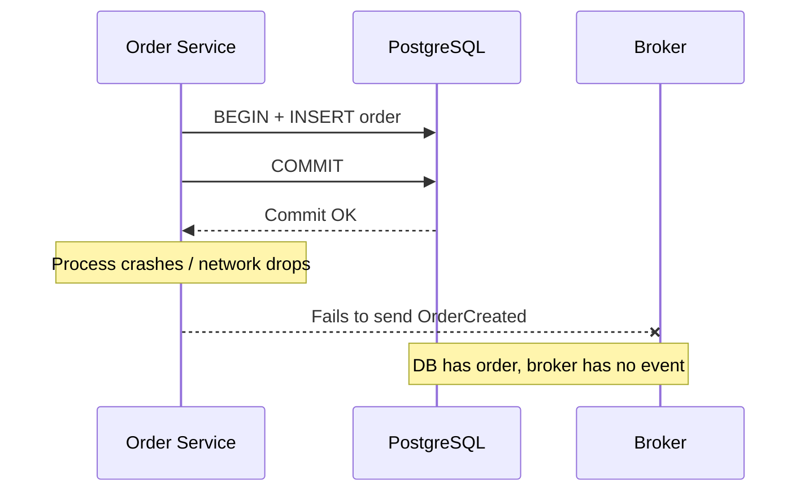
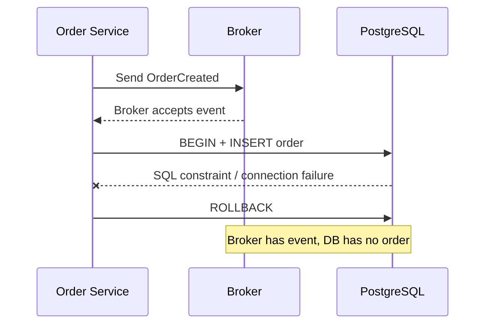
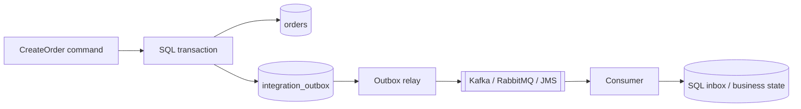
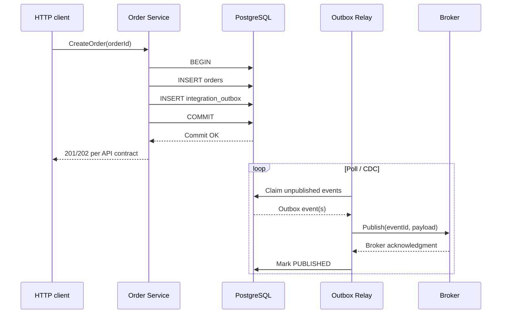
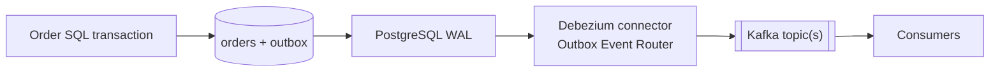
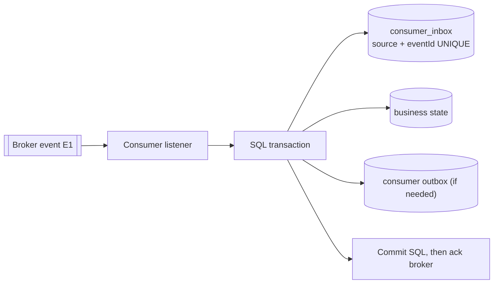
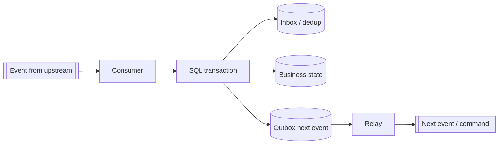
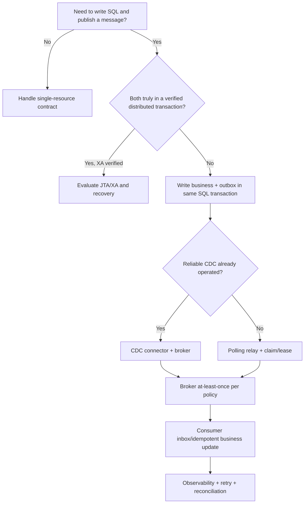

# The Gap Between Database Commit and Message Publishing

A Spring Boot application receives an order creation command, writes a record to PostgreSQL, and then emits an `OrderCreated` event to Kafka or RabbitMQ. Looking at the code, the operation seems simple: **save data → send message**. Yet the two systems do not inherently participate in a single transaction. If the process dies within a few milliseconds between the two calls, **the data is committed while the message is never sent**. If you reverse the order—sending the message first and committing SQL afterward—consumers may receive an event describing an order that never existed.

This is the **dual-write problem**, or the gap between **database commit** and **message publishing**. The problem does not disappear when adding `@Transactional`, `@Async`, retries, or a message broker with strong delivery mechanisms. It requires defining true atomic boundaries, durably persisting the intent to publish, and designing consumers that tolerate duplicate messages.

This lesson belongs to the **Consistency and Deduplication** chapter of the **SPRING_BOOT_INTEGRATION** module. In this module, Spring Boot integrates HTTP clients, databases, caches, message brokers, and Spring Integration adapters. Therefore, alongside Transactional Outbox, we connect the problem to configuration, data contracts, transactions, failures, idempotency, retries, testing, and observability across the entire integration flow.

> **Illustrative scope:** Java 17+, Spring Boot 3.x/Spring Framework 6.x, Spring JDBC, PostgreSQL, and Kafka/RabbitMQ/JMS brokers. Specialized SQL snippets use PostgreSQL; for MySQL, SQL Server, or other databases, adjust statements, locks, and transaction isolation accordingly. Broker guarantees depend on publisher configuration, acknowledgments, transactions, and deployed durability settings.

## 1. Learning objectives

After this lesson, you will be able to:

1. Describe the **dual-write gap** accurately for both `DB commit → broker send` and `broker send → DB commit` orderings.
2. Analyze every **failure window**: before commit, after commit, during send, after broker acknowledgment, and before marking sent.
3. Explain why `@Transactional` only manages resources covered by its transaction manager.
4. Distinguish `@TransactionalEventListener(AFTER_COMMIT)` from **Transactional Outbox**.
5. Design an outbox schema and persist **business state + outbound intent** in a single SQL transaction.
6. Implement a polling relay, claim/lease with `FOR UPDATE SKIP LOCKED`, retries, and conditional `PUBLISHED` marking.
7. Compare polling with **CDC/change data capture** and understand connector/relay restart risks.
8. Design an **idempotent consumer/inbox** to tolerate at-least-once delivery.
9. Manage ordering, schema versioning, outbox cleanup, backlogs, and cases requiring reconciliation.
10. Build fault-injection tests proving zero lost publish intents and zero duplicate side effects.

## 2. One business call, two independently committing systems

Suppose a request arrives:

```text
POST /orders
{
  "orderId": "ORD-1001",
  "amountMinor": 125500,
  "currency": "VND"
}
```

Business goal: save the order and emit `OrderCreated` so the inventory system continues processing.

Common illustrative code:

```java
@Transactional
public void createOrder(CreateOrder command) {
    orderRepository.insert(command);
    messagePublisher.publish(
            new OrderCreated(command.orderId()));
}
```

The method carries `@Transactional`, yet we must ask:

- Is Spring using `JdbcTransactionManager`, `JpaTransactionManager`, or another transaction manager?
- Is the broker publisher enlisted in **that same transaction**?
- When `publish(...)` returns, has the broker confirmed durable storage or was it only buffered in the client?
- If the SQL commit fails **after** `publish` succeeds, is there any way to recall the external message?
- If the broker is temporarily unavailable, is the publish intent preserved for resending after restart?

In typical Spring Boot configurations, **JDBC transactions and broker sends are two independent operations**. One annotation does not magically create an ACID transaction across two resources.

### 2.1. Invariants to protect

For the order-creation use case, a practical set of invariants may be:

- **I1:** If an order is committed, the system must durably preserve the **intent to emit `OrderCreated`**, eventually publishing it or escalating to controlled incident handling.
- **I2:** Never emit an event claiming an order exists if the order-saving transaction rolled back.
- **I3:** When relays, brokers, or consumers retry, one business event must not produce **duplicate business side effects**.
- **I4:** State transitions for the same order must not invert so that a consumer overwrites newer state with an older event.
- **I5:** When progress stalls, the system detects backlog, fires alerts, and supports replay/reconciliation.

**I1 does not mean "the broker is guaranteed to have received the message by the time the HTTP request returns 201."** With an asynchronous outbox, there is a window where SQL data is committed while the message awaits the relay. The system contract must allow **eventual delivery**.

## 3. Both write orderings have a gap

### 3.1. Write database first, then send to broker



This is a **lost event**. If the application held the event only in a Java variable or an in-memory queue, a restart loses the information needed to send it.

You cannot recover merely by saying "retry on startup": **retry what** if no durable record of the event to send exists?

### 3.2. Send to broker first, then commit database



A consumer can process `OrderCreated` before the order exists or after SQL rolled back. **Do not try to patch this with a `sleep`** in the consumer: a delay does not guarantee the order will ever appear.

### 3.3. Failure windows table

| Failure timing | DB state | Broker state | Risk |
| --- | --- | --- | --- |
| Before SQL commit | No order | Not sent | Generally safe if no external side effects occurred |
| After SQL commit, before send | Order exists | No event | **Lost event** |
| After send, before SQL commit | Order uncertain | Event likely present | **Phantom event** |
| During broker send | Order exists | **Uncertain** if received | Retry may produce duplicate publishes |
| After broker ack, before marking "sent" | Order exists | Event present | Relay retry causes duplicate publish |
| After consumer SQL commit, before broker ack | Consumer updated SQL | May redeliver | Consumer must deduplicate |

Distinguish **at-least-once delivery** from **exactly-once business effect**. Accepting duplicate message emissions can be a sound engineering choice if consumers guarantee the same `eventId` produces side effects only once.

## 4. Why doesn't @Transactional solve dual-write automatically?

### 4.1. Transaction managers have resource boundaries

`@Transactional` works through Spring's transaction interceptor and the configured transaction manager. For example, with `JdbcTransactionManager`:

```java
@Transactional
public void createOrder(String orderId) {
    jdbc.update(
        "INSERT INTO orders(order_id, state) VALUES (?, ?)",
        orderId, "CREATED");

    kafkaTemplate.send("order-events", orderId, someJson);
}
```

SQL statements using the same datasource can belong to one transaction. However, `KafkaTemplate.send` is managed by the Kafka producer and broker under their own protocol; **it does not automatically join the JDBC commit**.

One more detail: `KafkaTemplate.send(...)` typically returns an asynchronous result (such as `CompletableFuture<SendResult<...>>`). Returning immediately from the method may only mean the publisher queued the send in its client pipeline, not that the broker stored the message. **Waiting on the future to succeed still does not make the broker commit atomic with the SQL commit.**

### 4.2. Where the message is sent inside the method does not create atomicity

Four common variations:

- Publishing before the `@Transactional` method returns.
- Publishing after calling `repository.save(...)`.
- Publishing inside `TransactionSynchronization.afterCommit`.
- Publishing inside `@TransactionalEventListener(phase = AFTER_COMMIT)`.

These differ in **ordering and timing**, yet without persisting the event durably in the SQL transaction, a crash window still exists between **SQL commit** and **broker publish**.

### 4.3. Local Kafka/JMS transactions do not automatically cover SQL

Kafka producers offer idempotence and transactions for certain guarantees **within Kafka's scope**. JMS supports session transactions or JTA/XA in suitable environments.

However:

- A Kafka transaction does not automatically merge a PostgreSQL commit into one atomic operation.
- A JMS transacted session does not automatically enlist a JDBC datasource into the same transaction.
- Using transaction synchronization between two resources still faces commit ordering and failure of the **second resource**.
- Only when a genuine distributed transaction mechanism is used—with both resources properly enlisted and recovery configured—can you speak of cross-resource coordination.

**Never take the phrase "transactional producer" to mean you have a distributed transaction.**

## 5. Does an AFTER_COMMIT callback close the gap?

### 5.1. Common idea

Spring supports event listeners that execute after transaction commit:

```java
@Component
public class OrderCreatedListener {

    private final MessagePublisher publisher;

    public OrderCreatedListener(MessagePublisher publisher) {
        this.publisher = publisher;
    }

    @TransactionalEventListener(
        phase = TransactionPhase.AFTER_COMMIT
    )
    public void onOrderCreated(OrderCreated event) {
        publisher.publish(event);
    }
}
```

It partially solves **publishing before DB commit**: the listener is scheduled to run after commit if the event was published inside a matching transaction. However, a gap remains:

```text
SQL COMMIT succeeds
       |
       | process crashes right here
       v
@TransactionalEventListener(AFTER_COMMIT)
       |
       v
Send message
```

If the process dies in that gap, **the event existed only in memory** and may never be sent. Nothing automatically revives the event after restart unless you persisted it in durable storage first.

### 5.2. When is AFTER_COMMIT useful?

It fits reactions that can be skipped or reconstructed, such as:

- Invalidating a cache that has a TTL and self-healing strategy.
- Sending a wake-up signal so a worker checks the outbox sooner.
- Internal latency-optimization hints where **the outbox row remains the source of truth**.

If a listener needs to **write new SQL after commit**, understand the transaction phase carefully: resources from the just-committed transaction may still be bound to the thread, and new SQL work might not commit as expected. For new SQL side effects, use a separate transaction boundary (`REQUIRES_NEW` through a proper proxy) or an independent job/event-driven workflow.

**Never treat an AFTER_COMMIT listener as a substitute for a durable outbox.**

## 6. Transactional Outbox: publish intent lives inside the same DB transaction

### 6.1. Principle

Instead of saving the order and calling the broker directly, save **the order + an outbox record** inside the **same SQL transaction**:



New invariant:

\[
\text{COMMIT(order)} \Longleftrightarrow
\text{COMMIT(outbox intent)}
\]

This holds **within the SQL transaction on the same database**, provided both writes execute in that transaction and no code path bypasses the outbox. It **does not** mean the broker receives the message at the moment of commit.

### 6.2. Failure windows when using an outbox

| Failure timing | What remains durable | Recoverability |
| --- | --- | --- |
| Before SQL commit | No new order or outbox row | Caller can retry command via idempotency key |
| After commit, before relay | Order + `READY` outbox row | Relay reads and sends after restart |
| Relay claims job, before send | Outbox remains, with lease/claim | Lease expires, another worker retries |
| Broker accepts, relay dies before update | Outbox not yet `PUBLISHED` | Relay resends; **may duplicate message** |
| After updating `PUBLISHED` | Order/outbox reflects published state | Monitor downstream; broker delivery contract still requires verification |

**Transactional Outbox solves the "DB committed, publish intent lost" gap**, in exchange for accepting **at-least-once publishing** and designing idempotent consumers.

### 6.3. Why not delete the record immediately after send?

If the relay calls the broker and then deletes the outbox row, the exact same failure window exists at the moment of deletion. Deleting after confirmed send per contract is possible, yet a crash before deletion still produces duplicates. Keeping the `PUBLISHED` status for a retention period aids auditing, debugging, and reconciliation; cleanup deletes rows later after retention expires.

## 7. Designing an outbox schema on PostgreSQL

### 7.1. Business table

```sql
CREATE TABLE orders (
    order_id        UUID PRIMARY KEY,
    amount_minor    BIGINT NOT NULL CHECK (amount_minor >= 0),
    currency        CHAR(3) NOT NULL,
    state           VARCHAR(32) NOT NULL,
    event_id        UUID NOT NULL UNIQUE,
    created_at      TIMESTAMPTZ NOT NULL DEFAULT now()
);
```

`order_id` is the business identifier supplied by the command or assigned **stably** by the server. `event_id` is generated **once when creating the order**, stored in the database, and reused to identify the corresponding event. If an HTTP caller retries the same command, the application does not generate a new order or event.

### 7.2. Outbox table

```sql
CREATE TABLE integration_outbox (
    event_id          UUID PRIMARY KEY,
    aggregate_type    VARCHAR(64) NOT NULL,
    aggregate_id      VARCHAR(128) NOT NULL,
    aggregate_version BIGINT NOT NULL,
    event_type        VARCHAR(128) NOT NULL,
    schema_version    INTEGER NOT NULL,
    payload_json      JSONB NOT NULL,

    status            VARCHAR(24) NOT NULL DEFAULT 'READY'
                      CHECK (status IN
                          ('READY', 'IN_FLIGHT', 'PUBLISHED', 'BLOCKED')),
    attempt_count     INTEGER NOT NULL DEFAULT 0,
    next_attempt_at   TIMESTAMPTZ NOT NULL DEFAULT now(),
    claim_token       UUID,
    leased_until      TIMESTAMPTZ,
    published_at      TIMESTAMPTZ,
    last_error        VARCHAR(500),
    created_at        TIMESTAMPTZ NOT NULL DEFAULT now()
);
```

Field meanings:

- `event_id`: immutable key for consumer deduplication, even if the same event is published multiple times.
- `aggregate_type`/`aggregate_id`: business entity identifier, usable as the Kafka key.
- `aggregate_version`: change sequence **of the aggregate**, distinct from `schema_version`.
- `payload_json`: event content **frozen at the time of the business transaction**.
- `status`: relay state; **not** whether consumers finished processing.
- `attempt_count`, `next_attempt_at`: retry budget and backoff.
- `claim_token`, `leased_until`: temporary claim to reduce contention across multiple workers.
- `published_at`: when the relay recorded send confirmation under the **publisher contract**.

**Caution:** `PUBLISHED` in the outbox is only as strong as the acknowledgment mechanism configured on the producer/broker. It does **not** prove downstream consumers have finished processing.

### 7.3. Indexes and storage control

```sql
CREATE INDEX idx_outbox_ready
ON integration_outbox (next_attempt_at, created_at, event_id)
WHERE status = 'READY';

CREATE INDEX idx_outbox_lease
ON integration_outbox (leased_until, created_at)
WHERE status = 'IN_FLIGHT';

CREATE INDEX idx_outbox_aggregate
ON integration_outbox (aggregate_type, aggregate_id,
                       aggregate_version);
```

Production deployments must also manage:

- Retention for `PUBLISHED` rows, e.g., based on days needed for investigation/replay.
- Partitioning/archiving when event volume is high.
- Autovacuum, index bloat, WAL, and database capacity.
- `last_error` storing only **redacted error codes/info**; never log tokens or raw PII.
- Unique constraints suited to **business command idempotency**, not just event IDs.
- Payload schema evolution, especially while older consumers remain active.

## 8. Writing order and outbox inside one @Transactional method

### 8.1. Dependencies

Gradle example (Groovy DSL):

```groovy
dependencies {
    implementation 'org.springframework.boot:spring-boot-starter-jdbc'
    implementation 'org.springframework.boot:spring-boot-starter-json'
    runtimeOnly 'org.postgresql:postgresql'

    testImplementation 'org.springframework.boot:spring-boot-starter-test'
    testImplementation 'org.springframework.boot:spring-boot-testcontainers'
    testImplementation 'org.testcontainers:junit-jupiter'
    testImplementation 'org.testcontainers:postgresql'
}
```

**Note:** JSON starter names and versions may vary across Spring Boot lines. In **Spring Boot 3.x**, `spring-boot-starter-json` can bring in Jackson in matching contexts; if the app already includes `spring-boot-starter-web`, Jackson is typically already managed. Avoid adding multiple manual Jackson versions when managed by the Boot BOM. For Boot 4.x, check the starter documentation for the deployed branch.

### 8.2. DTOs and event contract

```java
package com.example.integration.orders;

import java.util.UUID;

public record CreateOrder(
        UUID orderId,
        long amountMinor,
        String currency
) {}

public record OrderCreated(
        UUID eventId,
        UUID orderId,
        long amountMinor,
        String currency,
        long aggregateVersion,
        int schemaVersion
) {}
```

Production code must validate currency, amount, tenant/partner, and event contract. An outbox record should not hold a reference to an unserialized mutable entity: **serialize the finalized event content right inside the transaction**.

### 8.3. Service with JDBC and unique command ID

The pattern below highlights the key operations (for brevity, JSON exception handling and domain classes are kept minimal):

```java
package com.example.integration.orders;

import java.util.Map;
import java.util.UUID;

import com.fasterxml.jackson.core.JsonProcessingException;
import com.fasterxml.jackson.databind.ObjectMapper;

import org.springframework.jdbc.core.namedparam.NamedParameterJdbcTemplate;
import org.springframework.stereotype.Service;
import org.springframework.transaction.annotation.Transactional;

@Service
public class OrderCommandService {

    private final NamedParameterJdbcTemplate jdbc;
    private final ObjectMapper mapper;

    public OrderCommandService(
            NamedParameterJdbcTemplate jdbc,
            ObjectMapper mapper) {
        this.jdbc = jdbc;
        this.mapper = mapper;
    }

    @Transactional
    public UUID create(CreateOrder command) {
        if (command.orderId() == null
                || command.amountMinor() < 0
                || !"VND".equals(command.currency())) {
            throw new IllegalArgumentException("Invalid command");
        }

        UUID newEventId = UUID.randomUUID();

        int rows = jdbc.update("""
                INSERT INTO orders
                    (order_id, amount_minor, currency, state, event_id)
                VALUES (:orderId, :amount, :currency, 'CREATED', :eventId)
                ON CONFLICT (order_id) DO NOTHING
                """, Map.of(
                    "orderId", command.orderId(),
                    "amount", command.amountMinor(),
                    "currency", command.currency(),
                    "eventId", newEventId));

        if (rows == 0) {
            // Retry with same order ID: compare original command, do not emit a new event.
            return jdbc.queryForObject("""
                    SELECT event_id FROM orders
                    WHERE order_id = :orderId
                      AND amount_minor = :amount
                      AND currency = :currency
                    """, Map.of(
                        "orderId", command.orderId(),
                        "amount", command.amountMinor(),
                        "currency", command.currency()),
                    UUID.class);
        }

        OrderCreated event = new OrderCreated(
                newEventId,
                command.orderId(),
                command.amountMinor(),
                command.currency(),
                1L,
                1);

        String json;
        try {
            json = mapper.writeValueAsString(event);
        } catch (JsonProcessingException ex) {
            throw new IllegalStateException(
                    "Failed to serialize OrderCreated", ex);
        }

        jdbc.update("""
                INSERT INTO integration_outbox (
                    event_id, aggregate_type, aggregate_id,
                    aggregate_version, event_type,
                    schema_version, payload_json
                )
                VALUES (
                    :eventId, 'Order', :aggregateId,
                    1, 'OrderCreated', 1,
                    CAST(:payloadJson AS jsonb)
                )
                """, Map.of(
                    "eventId", newEventId,
                    "aggregateId", command.orderId().toString(),
                    "payloadJson", json));

        return newEventId;
    }
}
```

**Two mandatory implementation notes:**

1. In this example, if `rows == 0` while the data with the same `orderId` has a **different amount/currency**, `queryForObject` finds no row and throws an error. This blocks reusing an idempotency key with a different payload. Production code should translate that into a meaningful `409 Conflict` exception; never treat every `ON CONFLICT` as a valid retry.
2. `UUID.randomUUID()` is used only when attempting to create a **new order**. On a retry for the same `orderId`, the method reads back the stored `event_id` and does not insert a new outbox entry. In real designs, business keys/tenants belong in appropriate unique constraints to prevent cross-tenant collisions.

**Critical invariant:** If the outbox INSERT fails due to a database, schema, or JSONB constraint, the SQL transaction rolls back the `orders` INSERT as well. Never catch the exception and return success before the transaction completes.

### 8.4. @Transactional only takes effect across proper boundaries

To achieve atomicity across the two tables:

- Both `jdbc.update` calls use the **same datasource** and participate in the same transaction manager.
- The service is invoked through a **Spring transactional proxy** or another active transaction boundary.
- Neither step opens a separate auto-commit connection outside the transaction.
- DB errors are never caught and swallowed so the method returns normally.
- `@Async` is never used to run the outbox INSERT on a different thread/transaction.

With `TransactionTemplate`, transaction boundaries are explicit, while the requirement of **both SQL writes sharing one transaction** remains identical.

## 9. Message publishing must live outside the command's SQL transaction

### 9.1. Functional sequence



Even if the relay takes a few seconds, the command API can return right after the SQL commit. The HTTP status should reflect what **actually completed**:

- `201 Created`: the order was durably created in SQL; downstream services have not necessarily processed it yet.
- `202 Accepted`: the operation was accepted for asynchronous processing, if the API contract uses that model.
- The response can return `orderId` and status `PENDING_INTEGRATION`/`CREATED`, with a lookup endpoint if needed.

Never return "inventory reserved successfully" when you have only written an outbox record for an upcoming Inventory call.

### 9.2. The poller must not send messages inside @Transactional

A worker should:

1. Select a batch of unsent outbox rows.
2. **Claim them briefly in SQL**, then commit the claim transaction.
3. Send the messages to the broker with timeouts and publisher acknowledgments.
4. Update `PUBLISHED` in a short SQL transaction **if the claim token is still valid**.
5. On failure, schedule a retry or let the lease expire.

Do not hold a PostgreSQL transaction open while waiting on broker network calls unless you have a specialized, analyzed design for it: doing so holds connections/row locks, increases contention, and easily exhausts the pool.

## 10. Claim/lease: preventing multiple relays from fighting over the same event

### 10.1. Why is claiming needed?

If two instances run simultaneously:

```text
Worker A: SELECT event WHERE status = READY
Worker B: SELECT event WHERE status = READY
Worker A: sends E1
Worker B: sends E1
```

Both can read the same row and publish twice. Idempotent consumers are still necessary, yet claiming reduces unnecessary duplicates.

### 10.2. PostgreSQL SKIP LOCKED for work queues

Example of claiming up to a batch in a **short** transaction:

```sql
WITH picked AS (
    SELECT event_id
    FROM integration_outbox
    WHERE
        (status = 'READY' AND next_attempt_at <= now())
        OR
        (status = 'IN_FLIGHT' AND leased_until <= now())
    ORDER BY created_at, event_id
    FOR UPDATE SKIP LOCKED
    LIMIT :batchSize
)
UPDATE integration_outbox AS o
SET status = 'IN_FLIGHT',
    claim_token = :claimToken,
    leased_until = now() + INTERVAL '45 seconds',
    attempt_count = attempt_count + 1
FROM picked AS p
WHERE o.event_id = p.event_id
RETURNING
    o.event_id, o.aggregate_id, o.aggregate_version,
    o.event_type, o.payload_json;
```

**Conditions:**

- The UPDATE with a `FOR UPDATE SKIP LOCKED` CTE is an atomic statement inside a PostgreSQL transaction. Each worker uses its own **random claim token** to distinguish claim attempts.
- `SKIP LOCKED` lets pollers skip rows currently locked by another worker during claiming. It fits certain work queues, yet **does not guarantee global ordering**.
- The claim lock ends as soon as the statement's transaction commits. The relay does not hold row locks across the broker send.
- An `IN_FLIGHT` event can be picked up again only after its lease expires; if a worker is still publishing longer than the lease, **two workers may publish concurrently**. Size lease durations/renewals, send timeouts, and consumer idempotency accordingly.
- Claiming is purely a **coordination optimization**, not exactly-once delivery.

### 10.3. Marking PUBLISHED with compare-and-set

Only the worker holding the matching claim token may update the outcome:

```sql
UPDATE integration_outbox
SET status = 'PUBLISHED',
    published_at = now(),
    leased_until = NULL,
    claim_token = NULL,
    last_error = NULL
WHERE event_id = :eventId
  AND status = 'IN_FLIGHT'
  AND claim_token = :claimToken;
```

If the UPDATE returns `0 rows`, the worker lost ownership of the claim (or the status already changed). **Never infer that the broker did not receive the event.** The message may have been sent successfully before the lease was reclaimed or the state updated by another process.

### 10.4. Conditional retry

When a broker send fails explicitly, the worker can return the event to `READY`:

```sql
UPDATE integration_outbox
SET status = 'READY',
    next_attempt_at = now() + INTERVAL '15 seconds',
    claim_token = NULL,
    leased_until = NULL,
    last_error = :safeError
WHERE event_id = :eventId
  AND status = 'IN_FLIGHT'
  AND claim_token = :claimToken;
```

Real systems need exponential backoff, jitter, error classification, and a `BLOCKED`/quarantine threshold. Do not retry permanent invalid-payload errors the same way as brief broker outages. If a failure occurs between **broker acknowledgment** and the marking UPDATE, it is unknown whether the publisher committed the state; **no outbox table alone can eliminate that gap**.

## 11. Java relay with Spring JDBC and JmsTemplate

### 11.1. Why illustrate with JMS?

`JmsTemplate` provides a relatively concise send API to keep the focus on failure windows. For Kafka, swap the publisher for `KafkaTemplate` and **await the future/broker ack per contract**; for RabbitMQ, verify publisher confirms/returns per configuration. The **outbox claim → send → mark** pattern is identical, though send-acknowledgment semantics differ across brokers.

### 11.2. Relay skeleton with claim checks

The condensed example below uses the same schema from Sections 7–10. It illustrates one poll cycle, sending a JMS TextMessage from a JSON string and marking `PUBLISHED` after the send call returns under the JMS provider contract.

```java
package com.example.integration.outbox;

import java.util.List;
import java.util.Map;
import java.util.UUID;

import org.springframework.jdbc.core.namedparam.NamedParameterJdbcTemplate;
import org.springframework.jms.core.JmsTemplate;
import org.springframework.scheduling.annotation.Scheduled;
import org.springframework.stereotype.Component;

@Component
public class JmsOutboxRelay {

    private static final String DESTINATION = "OrdersOut";

    record PendingEvent(
            UUID eventId,
            String aggregateId,
            long aggregateVersion,
            String eventType,
            String payloadJson
    ) {}

    private final NamedParameterJdbcTemplate jdbc;
    private final JmsTemplate jms;

    public JmsOutboxRelay(
            NamedParameterJdbcTemplate jdbc,
            JmsTemplate jms) {
        this.jdbc = jdbc;
        this.jms = jms;
    }

    @Scheduled(fixedDelayString =
            "${integration.outbox.poll-delay-ms:1000}")
    public void poll() {
        UUID claimToken = UUID.randomUUID();

        List<PendingEvent> events = jdbc.query("""
                WITH picked AS (
                    SELECT event_id
                    FROM integration_outbox
                    WHERE (status = 'READY'
                           AND next_attempt_at <= now())
                       OR (status = 'IN_FLIGHT'
                           AND leased_until <= now())
                    ORDER BY created_at, event_id
                    FOR UPDATE SKIP LOCKED
                    LIMIT :limit
                )
                UPDATE integration_outbox o
                SET status = 'IN_FLIGHT',
                    claim_token = :token,
                    leased_until = now() + INTERVAL '45 seconds',
                    attempt_count = attempt_count + 1
                FROM picked p
                WHERE o.event_id = p.event_id
                RETURNING o.event_id, o.aggregate_id,
                          o.aggregate_version,
                          o.event_type, o.payload_json
                """,
                Map.of("limit", 10, "token", claimToken),
                (rs, rowNum) -> new PendingEvent(
                        rs.getObject("event_id", UUID.class),
                        rs.getString("aggregate_id"),
                        rs.getLong("aggregate_version"),
                        rs.getString("event_type"),
                        rs.getString("payload_json")));

        for (PendingEvent event : events) {
            try {
                jms.convertAndSend(
                        DESTINATION,
                        event.payloadJson(),
                        message -> {
                            message.setStringProperty(
                                    "eventId",
                                    event.eventId().toString());
                            message.setStringProperty(
                                    "eventType",
                                    event.eventType());
                            message.setStringProperty(
                                    "aggregateId",
                                    event.aggregateId());
                            return message;
                        });

                jdbc.update("""
                        UPDATE integration_outbox
                        SET status = 'PUBLISHED',
                            published_at = now(),
                            claim_token = NULL,
                            leased_until = NULL,
                            last_error = NULL
                        WHERE event_id = :eventId
                          AND status = 'IN_FLIGHT'
                          AND claim_token = :token
                        """, Map.of(
                            "eventId", event.eventId(),
                            "token", claimToken));

            } catch (RuntimeException ex) {
                jdbc.update("""
                        UPDATE integration_outbox
                        SET status = 'READY',
                            next_attempt_at =
                                now() + INTERVAL '15 seconds',
                            claim_token = NULL,
                            leased_until = NULL,
                            last_error = 'PUBLISH_FAILURE'
                        WHERE event_id = :eventId
                          AND status = 'IN_FLIGHT'
                          AND claim_token = :token
                        """, Map.of(
                            "eventId", event.eventId(),
                            "token", claimToken));
            }
        }
    }
}
```

Add `@EnableScheduling` on the appropriate configuration class or enable scheduling per application conventions.

### 11.3. Limitations of the relay example

The code above is **only an illustrative skeleton**; production deployments must add:

1. Proper tables/schemas/migrations and SQL permissions.
2. A real **physical JMS queue name** or `JndiDestinationResolver` matching the deployment; `OrdersOut` in the example is an illustrative destination.
3. Verification that the broker actually uses **durable send/persistent delivery** and understanding of what `convertAndSend` succeeding guarantees on the chosen provider.
4. Coupling **publish timeouts** with `leased_until`; 45 seconds may not suffice if messages send slowly or the broker stalls.
5. Separating exceptions from the **mark/return READY SQL update** from send exceptions. In the snippet, the catch block could run after a successful broker send if the SQL UPDATE fails; in that case, republishing on retry is expected behavior—do not log "broker did not receive".
6. Backoff/jitter by `attempt_count`, retry budget, and a `BLOCKED` state.
7. Never writing raw exception messages containing credentials/PII into `last_error`.
8. Monitoring updated row counts and lost-claim events (CAS returning 0).
9. If per-aggregate ordering matters, **adding ordering coordination**, since batch polling with `SKIP LOCKED` does not preserve order when running in parallel.

Do not cite this example as proof of exactly-once semantics; **duplicates are an acceptable transport-level outcome** when the full flow is properly designed.

## 12. Failure windows in the relay: what happens?

### 12.1. Failure before claim

If the database lacks connections or the scheduler has not run, `READY` outbox rows remain in SQL. The HTTP request committed, while integration lag grows.

### 12.2. Failure after claim, before send

The record is in `IN_FLIGHT`. When the worker dies, the lease expires and another worker reclaims it. There is no need to roll back the already committed business order.

### 12.3. Send timeout or lost broker acknowledgment

Three possibilities exist:

- The broker did not receive the message.
- The broker received the message, but the client never received the acknowledgment.
- The broker received it, yet durability fell short of expectations due to producer/broker config.

Without proof, treat this as an **unknown outcome** and retry with the stable idempotency key. Never conclude "send failed, so the broker definitely does not have the message."

### 12.4. Broker acks, then SQL connection drops

The message was confirmed by the broker per policy, yet the outbox status remains `IN_FLIGHT`. The lease expires and the relay resends. **This is the inherent duplicate window of outbox polling.**

### 12.5. Worker hangs longer than the lease

Worker A claims E1 for 45 seconds, while the broker send hangs for 60 seconds. Worker B can reclaim E1 and send it before A finishes. Therefore:

- Choose a send timeout smaller than the lease with a buffer.
- Or renew the lease during long-running sends.
- Use `claim_token` so worker A cannot accidentally overwrite B's claim.
- Still enforce consumer deduplication when two sends happen.

### 12.6. Crash after marking PUBLISHED

The relay obtained send evidence per contract and marked `PUBLISHED`. However, if the broker is not truly durable or a consumer fails without DLT/retry, **business processing** downstream can still be lost. An outbox **does not replace broker delivery and consumer reliability design**.

## 13. Polling relay vs. CDC/transaction-log tailing

There are two common ways to move outbox records to a broker.

### 13.1. Polling publisher

A worker periodically runs:

```text
SELECT/claim READY outbox
    -> SEND broker
    -> UPDATE outbox PUBLISHED
```

**Pros:**

- Easy to understand and quick to implement in Spring Boot/JDBC.
- Minimal CDC infrastructure dependencies.
- Easy to customize backoff, retries, quarantine, and leases in business terms.
- Easy to tune batch sizes and worker access permissions.

**Cons:**

- Continuous polling creates SQL workload and periodic latency.
- Requires claims/leases and concurrency control when scaling.
- Can cause duplicates or reordering across multiple workers.
- Table grows quickly without proper cleanup/partitioning.
- Overly large batches can cause spikes on the broker and connection pool.

### 13.2. CDC from transaction logs

**Change Data Capture** reads committed changes from the database transaction log, such as PostgreSQL WAL, and streams outbox changes via a connector like Debezium.



Pros:

- Detects changes from the commit log without every app instance polling the table.
- Reduces polling pressure under certain workloads.
- Usually tracks log positions/offsets for resuming.
- Fits well when a Kafka Connect/CDC platform is already properly operated.

Cons:

- Requires managing replication slots/log retention, connector state, offsets, DB privileges, and monitoring.
- Long connector downtime can cause massive WAL accumulation.
- Connector/broker restarts and replays can still emit **duplicate records**.
- Mapping outbox rows to message keys/topics/headers requires a versioned contract.
- Outbox cleanup and row deletions can emit extra CDC events if the connector is not configured to filter them.
- Does not turn consumer side effects into exactly-once.

### 13.3. Do not mix polling and CDC on the same events without coordination

If both a polling relay and a CDC connector publish the same rows without ownership/routing separation, **every event risks being published twice even with zero failures**. Pick **one primary publisher** per outbox stream, or use a clearly controlled migration design.

### 13.4. When to choose which?

| Condition | Polling | CDC |
| --- | --- | --- |
| Low–medium volume, minimal infrastructure | Often easier to deploy | May be overly complex |
| Already operating Kafka Connect/Debezium | Can still fit | Leverages existing platform |
| Needs intricate business routing/retry | Easy to place policy in worker | Often needs an extra processing stage |
| Constrained DB query load | Needs index and batch tuning | Log reading may fit better |
| Very low latency and high volume | Requires polling tuning | Strong potential, still requires measurement |
| Needs multiple distinct target brokers | Worker can route directly | CDC router/processor needs configuration |
| Operational capability for replication/WAL | Not required | Mandatory |

There is no universal answer: choose based on throughput, latency, infrastructure, rollback needs, and **team operational maturity**.

## 14. Idempotent consumer: the other half of the problem

### 14.1. Why do we need an inbox if we already have an outbox?

An outbox protects the **publishing side** from losing send intent. It **does not prevent**:

- The publisher resending after a crash.
- Broker redeliveries after a consumer crash.
- The same business event being replayed from a DLT.
- An event being sent multiple times by operations/manual repair.
- A consumer receiving old messages during rollbacks/reprocessing.

Therefore, the consumer needs an **inbox/idempotency ledger** sharing a transaction with its business changes.



### 14.2. Inbox schema

```sql
CREATE TABLE consumer_inbox (
    source_system VARCHAR(64) NOT NULL,
    event_id      UUID NOT NULL,
    payload_hash  CHAR(64) NOT NULL,
    processed_at  TIMESTAMPTZ NOT NULL DEFAULT now(),
    PRIMARY KEY (source_system, event_id)
);
```

Note: `event_id` is the verified business event ID from payload/headers—**do not blindly use Kafka offset or JMSMessageID** as the idempotency key.

### 14.3. Atomic processing algorithm

Inside the SQL transaction:

1. Validate schema version, event ID, source/tenant, and payload.
2. Compute canonical payload hash if required by contract.
3. Attempt to insert into the inbox guarded by the unique constraint.
4. If the insert succeeds, apply business updates and write any outbound events in the same transaction.
5. If the insert conflicts, verify whether the existing event ID has the same payload/business meaning.
6. Commit the transaction.
7. Only after success, acknowledge the broker per listener contract.

```sql
INSERT INTO consumer_inbox (source_system, event_id, payload_hash)
VALUES (:source, :eventId, :payloadHash)
ON CONFLICT (source_system, event_id) DO NOTHING;
```

If row count is 0, read back the existing row to verify hash/status. **Never** treat the same event ID with a different payload as a normal duplicate; it may be a contract violation or inconsistent event emission.

### 14.4. Application service example

```java
@Service
public class OrderCreatedConsumerService {

    private final NamedParameterJdbcTemplate jdbc;
    private final InventoryProjector projector;

    public OrderCreatedConsumerService(
            NamedParameterJdbcTemplate jdbc,
            InventoryProjector projector) {
        this.jdbc = jdbc;
        this.projector = projector;
    }

    @Transactional
    public void process(
            String source,
            UUID eventId,
            String payloadHash,
            OrderCreatedEvent event) {

        int firstSeen = jdbc.update("""
                INSERT INTO consumer_inbox
                    (source_system, event_id, payload_hash)
                VALUES (:source, :eventId, :hash)
                ON CONFLICT (source_system, event_id) DO NOTHING
                """, Map.of(
                    "source", source,
                    "eventId", eventId,
                    "hash", payloadHash));

        if (firstSeen == 0) {
            String existing = jdbc.queryForObject("""
                    SELECT payload_hash FROM consumer_inbox
                    WHERE source_system = :source
                      AND event_id = :eventId
                    """, Map.of(
                        "source", source,
                        "eventId", eventId), String.class);

            if (!payloadHash.equals(existing)) {
                throw new IllegalStateException(
                        "Same eventId with different payload");
            }
            return; // Valid duplicate: do not re-run business logic.
        }

        projector.apply(event); // Must join the same SQL transaction.
    }
}
```

`OrderCreatedEvent` and `InventoryProjector` are application-defined types/ports. `projector.apply` must share the same datasource/transaction or use another side-effect protection mechanism. If `projector.apply` calls an **external HTTP API**, a unique inbox alone cannot make the HTTP side effect atomic: you may need an outbox/command ledger and a partner-side idempotency key.

**Note:** Under concurrent access, the unique constraint ensures two transactions cannot both insert the same inbox key. However, business state still requires proper isolation and locking/versioning when multiple distinct events update the same aggregate.

## 15. Ordering: an aggregate must not move backward

### 15.1. Outbox does not automatically guarantee order

Suppose an order receives two updates:

```text
E1: OrderCreated, aggregateVersion=1
E2: OrderPaid,    aggregateVersion=2
```

If worker A claims E1 and hits a slow broker send, worker B can claim E2 and send it first. The consumer receives `OrderPaid` before `OrderCreated` and may fail or build a corrupted projection.

### 15.2. Ordering protection layers

- **Sequence per aggregate**: write an incrementing `aggregate_version` inside the state-guarding transaction.
- **Kafka partition key = aggregateId** when preserving per-partition order, paired with compatible producer/publish policies.
- **Poller coordination**: do not claim E2 if E1 has not met publish preconditions, or assign only one worker per aggregate.
- **Consumer version guard**: reject/wait on events when the version is not sequential, or use commutative/reorder-safe logic where appropriate.
- **Gap handling**: handle E1 becoming `BLOCKED` without letting E2 silently skip ahead and corrupt state.

### 15.3. A condition to hold back later events

Illustrative idea for picking candidates in a poller:

```sql
SELECT o.event_id
FROM integration_outbox o
WHERE o.status = 'READY'
  AND o.next_attempt_at <= now()
  AND NOT EXISTS (
      SELECT 1
      FROM integration_outbox earlier
      WHERE earlier.aggregate_type = o.aggregate_type
        AND earlier.aggregate_id = o.aggregate_id
        AND earlier.aggregate_version < o.aggregate_version
        AND earlier.status <> 'PUBLISHED'
  );
```

This is only a **logical condition**. Production implementations must still handle concurrency and transaction isolation during claims so two events for the same aggregate are never claimed/sent concurrently out of order. Moreover, `PUBLISHED` only proves broker acknowledgment per policy, not that consumers processed E1 before E2.

### 15.4. Aggregate version vs. schema version

- `aggregate_version` indicates which change number this is for an order.
- `schema_version` indicates which JSON event contract is used.
- `event_id` identifies a business event for deduplication.

Never use `schema_version` for business ordering; a schema v2 event can describe aggregateVersion 1, while schema v1 might still be emitted at version 15.

## 16. Broker acknowledgment and send durability

### 16.1. Kafka

When the relay uses Kafka:

```java
CompletableFuture<SendResult<String, String>> future =
        kafkaTemplate.send(
                "order-events",
                event.aggregateId(),
                event.payloadJson());

// Mark PUBLISHED only when the future completes successfully
// within the deadline, producer/broker config, and retry policy.
```

In practice, await the result with a deadline or handle completion callbacks with proper durability and error classification. Producer settings like `acks`, replication, retries, delivery timeout, and idempotence determine acknowledgment quality.

**Never mark `PUBLISHED` simply because `send(...)` returned a future.** A future represents an asynchronous computation, not proof that the broker received the record.

Kafka producer idempotence and transactions protect retries within producer/Kafka boundaries per contract, yet **do not eliminate** the outbox relay republishing the same business `eventId` in a new producer session after a crash.

### 16.2. RabbitMQ

With RabbitMQ, distinguish:

- Publisher **confirms** from the broker.
- Publisher **returns** when a message cannot be routed to a queue under mandatory-routing policy.
- Queue/exchange durability and persistent delivery mode.
- Consumer manual acknowledgments, retries, and DLX/DLQ.

Merely having `RabbitTemplate.convertAndSend` return on the application thread does not prove the message reached the target queue. When certainty is needed, configure publisher confirms/returns and await/record them via the corresponding Spring AMQP APIs.

### 16.3. JMS

With JMS, `JmsTemplate.convertAndSend` and JMS session semantics depend on the provider, delivery mode, transactions, and managed resources. A successful send does not mean the **consumer has processed** the message. Understand local JMS session transactions/JTA and persistence policies before marking the outbox.

### 16.4. Do not mix producer and consumer acknowledgment responsibilities

| Indicator | Valid meaning | Invalid inference |
| --- | --- | --- |
| Producer send API returns | Client API finished invoking the send step | Message is guaranteed durable |
| Broker producer ack/confirm | Broker acknowledged per policy | Consumer finished processing |
| Outbox `PUBLISHED` | Relay recorded send met criteria | Business workflow completed |
| Consumer ack/offset commit | Consumer confirmed with broker | All external side effects are durable if code is poorly designed |
| SQL inbox commit | Consumer persisted processing state in DB | An external HTTP call had an ACID rollback |

## 17. Retries, timeouts, and error classification

### 17.1. Do not retry every error infinitely

| Category | Example | Handling |
| --- | --- | --- |
| Broker unavailable | Network outage, broker restart | Exponential backoff, jitter, deadline |
| SQL pool exhausted | DB claim/update timeout | Reduce concurrency, alert, retry later |
| Bad payload/schema | Invalid JSON, unrecognized enum | `BLOCKED`/quarantine, fix producer or migration |
| Authorization/TLS | Invalid credentials, bad certificate | Stop, ops intervention; avoid retry storms |
| Broker throttling | Quota, backpressure | Respect rate limits, reduce batch/concurrency |
| Unknown producer outcome | Post-send timeout | Safe to republish; rely on eventId idempotency |
| Duplicate inbox | EventId already processed | Verify hash/contract then ack; do not repeat side effects |
| Semantic conflict | Same ID, different payload | Investigate; do not auto-skip |

### 17.2. Bounded backoff

Example relay schedule:

```text
Attempt 1:   immediately when job is ready
Attempt 2:   after ~2 seconds
Attempt 3:   after ~5 seconds
Attempt 4:   after ~12 seconds
Attempt 5:   after ~30 seconds
...
Limit:       max 10 attempts or per business deadline
Jitter:      prevent all instances retrying simultaneously
After limit: BLOCKED + alert/manual replay
```

Illustrative numbers. For prolonged outages, a `BLOCKED` event still needs a remediation workflow and priority policy. Never silently delete unsent events and pretend the backlog is clear.

### 17.3. Deadlines and leases must align

A worker may spend time:

- Waiting to borrow a SQL connection.
- Querying/claiming.
- Waiting on Kafka futures or Rabbit confirms.
- Writing `PUBLISHED`.
- Retrying on network errors.

Total elapsed time can exceed the lease. Compute a **publish operation deadline** with enough buffer for status updates, or renew leases with a tested mechanism. Never set the lease equal to just the polling interval.

### 17.4. Circuit breakers do not guarantee correctness

If the broker is down, a circuit breaker can temporarily pause sends to reduce load. However, `READY` outbox rows must stay in the database and resume processing once the breaker closes. A circuit breaker is a **failure-throttling mechanism**, not a durable queue replacing the outbox.

## 18. Exactly-once: publishing once and processing once are not the same

### 18.1. Concepts

- **At-most-once delivery:** messages may be lost; no proactive resending.
- **At-least-once delivery:** keeps resending to avoid loss, so duplicates can occur.
- **Exactly-once delivery/processing:** depends on **boundaries and systems**; always state whether you mean broker log, producer transaction, or business database.
- **Effectively-once business effect:** transport duplicates do not cause duplicate business side effects thanks to IDs, unique constraints, and idempotent state transitions.

Example:

```text
Relay publishes E1 twice.
Broker holds two records with the same business eventId.
Consumer receives E1 twice.
First SQL inbox INSERT succeeds, second conflicts.
Business order update happens only once.
```

The transport saw duplicates, yet the **business effect** occurred once.

### 18.2. Boundaries that must not be conflated

A system may use Kafka transactions/exactly-once stream processing, while HTTP payments or PostgreSQL sit outside Kafka's transaction scope. If a consumer calls a payment API and then commits a Kafka offset, a gap still exists between the external side effect and the offset commit.

**Always ask: "Exactly once where?"** If the answer is "across all external APIs, databases, and brokers," that requirement demands dedicated architectures/protocols and cannot be deduced from a single config flag.

## 19. Relationship to sagas, compensation, and reconciliation

### 19.1. Outbox does not replace distributed transactions for external side effects

Consider the flow:

```text
Order SQL commit + outbox OrderCreated
    ↓
Inventory Consumer
    ↓
POST /reservations (Inventory API)
    ↓
Payment Consumer
    ↓
POST /charges (Payment API)
```

The outbox delivers **intents and events** durably, yet cannot make `POST /reservations` or `POST /charges` roll back with SQL.

If an external step commits and a later step fails, you need:

- A **Saga state machine** tracking progress.
- Stable **idempotency keys** for each external operation.
- **Compensating actions** where business permits (cancel reservation, refund).
- **Reconciliation** when HTTP times out or outcomes are unknown.
- Deadlines and manual review operations for cases that cannot recover automatically.

### 19.2. Inbox + outbox in each service

A reliable integration pipeline often repeats this structure in every service:



If a consumer receives an event again, the inbox blocks duplicate processing. If SQL commits before the relay sends the next event, the outbox protects the intent. This structure repeats across services **without requiring every service to share the same Spring Boot/driver version**, as long as event contracts are compatible.

## 20. Commonly overlooked design issues

### 20.1. One command emitting multiple events

Never assume an order always emits just one event. If a command creates both `OrderCreated` and `PaymentRequested`, both outbox rows must be written per contract in the same SQL transaction if business requires them together. Each event gets its own **eventId**; the command keeps its own **idempotency key**.

### 20.2. Multi-tenant

A global UUID `eventId` has negligible collision probability, yet the identity contract must still verify tenant/source for authorization. Prevent a consumer from accepting a tenant A payload and updating tenant B's SQL merely by trusting unverified headers.

### 20.3. Schema evolution

The outbox preserves JSON captured when the event was created; days later, the relay or consumer may be running a newer version. Maintain `schemaVersion`, compatibility/migration policies, and historical fixtures. Never re-serialize payloads from current domain entities during retries; doing so can alter the meaning behind the same `eventId`.

### 20.4. Oversized payloads

If outbox rows store megabytes per event, database WAL, indexes, backups, and replication can overload. For large artifacts, consider storing a reference/checksum alongside durable object storage—while solving **SQL-to-object-store atomicity**: upload the object first, use immutable keys/content hashes, track job/cleanup state, and reconcile. Do not assume "moving payloads to S3" preserves atomicity automatically.

### 20.5. Cleanup ignoring the replay window

Deleting all `PUBLISHED` events after 10 minutes destroys data needed for investigations, replays, or downstream reconciliation. Choose retention based on SLAs, broker retention, audit/security policies, and backfill needs. With CDC, row deletions may be observed by connectors as change events; configure filters/routing accordingly.

### 20.6. DB and broker clocks

Leases use PostgreSQL `now()` to avoid clock skew across app instances. Still, producer/broker/consumer timestamps can diverge; do not order business events solely by wall-clock `created_at` when strict per-aggregate ordering is needed. Use versions/sequences assigned inside the transaction.

### 20.7. A BLOCKED event and ordering

If an aggregate's E1 fails schema validation and E2 follows behind it, the relay can:

- Block E2 until E1 is fixed.
- Let E2 proceed if the contract permits out-of-order processing.
- Quarantine the aggregate for manual repair.

This is a **business rule**, not something derivable from status enums alone.

## 21. Testing: prove failure windows, not just the happy path

### 21.1. Required test layers

| Layer | Purpose |
| --- | --- |
| Unit tests | Payload serialization, stable eventId, job states, and error classification |
| SQL integration tests | Atomic commit/rollback of order and outbox |
| Relay integration tests | Claim/lease, publish, retry, CAS, multiple workers |
| Broker integration tests | Acks/confirms, redelivery, DLQ, partition keys |
| Consumer integration tests | Inbox blocks duplicates and detects eventId conflicts |
| Fault injection | Process crashes inside every gap |
| Contract/replay tests | Newer consumer reading historical JSON events from older versions |
| End-to-end smoke tests | HTTP → SQL → broker → consumer, verifying final state |

### 21.2. Testing SQL atomicity with Testcontainers

Gradle dependency example:

```groovy
dependencies {
    testImplementation 'org.springframework.boot:spring-boot-starter-test'
    testImplementation 'org.springframework.boot:spring-boot-testcontainers'
    testImplementation 'org.testcontainers:junit-jupiter'
    testImplementation 'org.testcontainers:postgresql'
}
```

Spring Boot test example with PostgreSQL:

```java
package com.example.integration.orders;

import static org.junit.jupiter.api.Assertions.*;

import java.util.UUID;

import org.junit.jupiter.api.Test;
import org.springframework.beans.factory.annotation.Autowired;
import org.springframework.boot.test.context.SpringBootTest;
import org.springframework.boot.testcontainers.service.connection.ServiceConnection;
import org.springframework.jdbc.core.JdbcTemplate;

import org.testcontainers.containers.PostgreSQLContainer;
import org.testcontainers.junit.jupiter.Container;
import org.testcontainers.junit.jupiter.Testcontainers;

@SpringBootTest
@Testcontainers
class OrderOutboxIT {

    @Container
    @ServiceConnection
    static PostgreSQLContainer<?> postgres =
            new PostgreSQLContainer<>("postgres:16-alpine");

    @Autowired OrderCommandService commands;
    @Autowired JdbcTemplate jdbc;

    private long count(String table, String idColumn, UUID id) {
        // Table/column are internal constants provided by the test, NEVER from user input.
        Long value = jdbc.queryForObject(
            "SELECT count(*) FROM " + table
            + " WHERE " + idColumn + " = ?",
            Long.class, id);
        return value;
    }

    @Test
    void orderAndOutboxCommitTogether() {
        UUID orderId = UUID.randomUUID();

        UUID eventId = commands.create(
                new CreateOrder(orderId, 125500, "VND"));

        assertEquals(1L, count("orders", "order_id", orderId));
        assertEquals(1L,
                count("integration_outbox", "event_id", eventId));
    }

    @Test
    void retrySameCommandDoesNotCreateSecondOutbox() {
        UUID orderId = UUID.randomUUID();
        CreateOrder command = new CreateOrder(
                orderId, 125500, "VND");

        UUID first = commands.create(command);
        UUID again = commands.create(command);

        assertEquals(first, again);
        assertEquals(1L, count("orders", "order_id", orderId));
        assertEquals(1L,
                count("integration_outbox", "event_id", first));
    }
}
```

**Test assumptions:** Tables are created by Flyway/Liquibase or test SQL before tests run. Do not annotate the test method itself with `@Transactional` when verifying real commits at the service boundary. Add a test where the outbox INSERT deliberately fails (constraint, invalid JSON, or fault injection) to **prove the order rolls back as well**.

In the illustrative test code, table/column names come from trusted test code; production code must never allow user-controlled SQL identifiers via string concatenation.

### 21.3. Crash window scenarios

| Fault scenario | Outcome to verify |
| --- | --- |
| Crash before SQL commit | Neither order nor outbox exists, or transaction rolled back |
| Crash after SQL commit, before relay | Order/outbox remains `READY` and eventually publishes |
| Crash after relay claim, before send | Lease expires, another worker retries |
| Broker receives message, relay dies before `PUBLISHED` | Duplicate may occur; inbox blocks side effect |
| DB update `PUBLISHED` fails | Event retries; no lost message, duplicates possible |
| Two relays claim concurrently | Never claim the same row under active lock; CAS/lease works |
| Lease expires during slow send | Duplicates possible; consumer tolerates them |
| Message with old eventId but different payload | Rejected/quarantined, not silently ignored |
| Consumer commits SQL then crashes before ack | Redelivery does not duplicate business state |
| E2 arrives before E1 | Ordering/version policy holds; never regresses version |
| Broker down for 30 minutes | Backlog grows with alerts, recovers with zero lost intents |
| Deploy schema v2 while v1 messages remain | Replay/compatibility tests pass |

### 21.4. Concurrency and fault-injection tests must avoid flakiness

Tests for `SKIP LOCKED` should use **multiple independent connections/transactions** and barriers to coordinate timing, rather than `Thread.sleep(50)` and guessing who runs first. For leases, use a clock abstraction or database time/test-controlled delays large enough to avoid millisecond-level assertions.

To test crash-after-send, configure a test publisher to write the message to the broker and then **deliberately throw an exception before updating `PUBLISHED`**. When the relay reruns, assert that the consumer applied the business effect only once. This tests system behavior, rather than insisting transport message count equals 1.

## 22. Observability: detecting unfilled gaps

### 22.1. Outbox and consumer metrics

| Metric/signal | Helps answer |
| --- | --- |
| Outbox `READY` count | How many events are waiting to be claimed? |
| Oldest non-`PUBLISHED` event age | Is there a lingering backlog? |
| `IN_FLIGHT` count and expired leases | Are workers hanging or crashing? |
| Publish success/failure/unknown outcome | Is the broker healthy? |
| Retry attempts, `BLOCKED` count | Are there poison events or recurring outages? |
| Claim batch size and claim latency | Is DB polling bottlenecked? |
| Broker producer ack latency | How long do sends take? |
| Consumer lag / DLQ depth | Are downstream consumers keeping pace? |
| Inbox duplicate count | Are replays/redeliveries/duplicates frequent? |
| Same-eventId payload conflict count | Are there contract/idempotency violations? |
| Aggregate ordering gap count | Are consumers receiving events missing or out of order? |

Structured log example:

```text
operation=outbox-publish
eventType=OrderCreated
eventId=90c4f2cc-...
aggregateType=Order
aggregateId=ORD-1001
schemaVersion=1
attempt=3
claimToken=7e112c1a-...
publishState=RETRY_SCHEDULED
errorCategory=BROKER_ACK_TIMEOUT
elapsedMs=3200
traceId=trace-b21e
```

Never log raw JSON containing PII, tokens, or card numbers. On metric labels, never attach high-cardinality `eventId`/`orderId`/`claimToken`; use bounded-cardinality dimensions such as operation, eventType, and error category.

### 22.2. Alert on age, not just count

A low-volume system might have a backlog of just **one row**, yet it could be a payment settlement event stuck for 2 days. Therefore alert on:

- Oldest unpublished event age exceeding SLA.
- Unresolved `BLOCKED` rows.
- Rising publish failure rates.
- Prolonged producer ack timeouts.
- Growing consumer DLQ depth.
- Inbox conflicts above 0.
- Replication lag/WAL retention if using CDC.

### 22.3. Readiness and degraded mode

A broker outage does not necessarily have to make the HTTP command API completely unavailable if SQL still accepts outbox rows and backlog capacity remains. You can:

- Continue accepting commands while outbox capacity suffices and eventual-delivery SLAs allow.
- Reject or shed traffic when backlog exceeds safe thresholds.
- Keep alerts active and report `DEGRADED` status clearly in monitoring.
- Never report "all steps completed" to end users while downstream has not processed them.

The exact policy depends on business criticality; payments, for instance, may require tighter backlog caps than notification emails.

## 23. Security, permissions, and retention

- **Database permissions:** command services only need insert on business/outbox tables; relays need claim/update on the outbox. Apply least privilege; never use superusers.
- **Broker ACLs:** relays may publish only to authorized topics/exchanges/queues; consumers may subscribe only to permitted resources.
- **Payloads:** include only fields subscribers genuinely need; do not copy secrets, credentials, or unnecessary sensitive data into the outbox.
- **Encryption:** evaluate TLS for DB/brokers, at-rest encryption, backups, and retention.
- **Tenant isolation:** validate tenant ID from security contexts and contracts rather than trusting unauthenticated message headers.
- **Replay authority:** replaying events can cause side effects; audit who replayed, why, and when.
- **Retention/deletion:** comply with personal data retention rules and audit requirements; purging sent rows must not break required reconciliation.

**Specifically:** Replaying an old `OrderCreated` after data contracts upgraded versions may be transport-valid yet cause business errors if consumers fail to check aggregate versions or IDs. Replays must pass through the exact same validation and idempotency barriers as live messages.

## 24. Common anti-patterns

1. **Calling the broker inside `@Transactional` and assuming everything is atomic.** Brokers do not enlist automatically.
2. **Sending before SQL commit so "messages arrive faster."** Consumers can receive phantom events.
3. **Sending after SQL commit from RAM.** A crash after commit loses events.
4. **Using `@TransactionalEventListener(AFTER_COMMIT)` as a durable queue.** Callbacks still have a crash window.
5. **Marking `PUBLISHED` before broker acknowledgment.** Can mark sent when the broker never received it.
6. **Believing Kafka producer idempotence makes SQL+Kafka exactly-once.** It does not cover PostgreSQL.
7. **Running only a single worker to avoid duplicates.** That worker can still crash after sending.
8. **Using `SKIP LOCKED` and claiming global ordering.** Lock skipping can reorder events.
9. **Setting leases shorter than send timeouts.** Two workers emit the same event.
10. **Retrying with a new eventId.** Consumers cannot recognize it as the same business event.
11. **Storing the inbox outside the business transaction.** Marks "processed" while business updates roll back, losing work on redelivery.
12. **Checking only `JMSRedelivered` or Kafka offsets.** Neither replaces business event identity.
13. **Catching every exception and acking the message.** Silently drops contract/transient errors without durable quarantine.
14. **Conflating producer ack with consumer processed.** `PUBLISHED` does not mean the workflow is done.
15. **Deleting outbox rows too early.** Loses debugging/replay capability within SLA.
16. **Ignoring oldest pending age.** Small backlogs stuck for hours go unnoticed.
17. **Running both polling and CDC on the same events uncoordinated.** Duplicates by design.
18. **Resending current entity state instead of the stored payload on retry.** Risk of different content under the same `eventId`.
19. **Holding SQL transactions open while waiting on slow broker acks.** Exhausts pools and increases lock contention.
20. **Neglecting multi-tenant/event provenance checks.** Duplicate guards can conflate events from different sources.

## 25. Decision workflow for an integration flow

Before finalizing a design, answer:

1. **Which invariants must be atomic?** Must the order and outbox commit together?
2. **How many independent resources exist?** SQL, Kafka, RabbitMQ, JMS, HTTP APIs, Redis, SFTP...
3. **Is eventual consistency acceptable?** What are the SLAs for publishing and workflow completion?
4. **Does the organization already operate reliable CDC infrastructure?** If not, polling may be simpler.
5. **What does publisher ack mean?** Kafka future, Rabbit confirms/returns, JMS persistence?
6. **What is the event identity?** Is the business event ID stable across retries/replays?
7. **How does the consumer deduplicate?** SQL inbox, unique constraints, idempotent state transitions?
8. **Is per-aggregate ordering needed?** Sequence/version, Kafka key, poller concurrency?
9. **Which errors are retryable?** Backoff, deadlines, `BLOCKED`, DLQ, manual repair?
10. **How are unknown outcomes reconciled?** Lookup orders, payment reservations, inbox states?
11. **How far back can historical data be replayed?** Schema versioning and retention must cover it.
12. **Are fault windows tested and truly observed?** Not just happy-path unit tests.



**Not every system needs XA.** If you do choose JTA/XA, verify enlistment of both resources, recovery logs, and heuristic errors on the actual runtime. For systems with external HTTP APIs, XA still cannot roll back those side effects.

## 26. Self-check questions

1. Why doesn't `@Transactional` with `JdbcTransactionManager` make Kafka/RabbitMQ publishing atomic with SQL?
2. What failure windows exist when DB commits before broker send?
3. What risk does broker send before DB commit create for consumers?
4. Why can `@TransactionalEventListener(AFTER_COMMIT)` still lose events?
5. What does Transactional Outbox guarantee, and what does it **not** guarantee?
6. Why are outbox relays designed for at-least-once rather than promising zero duplicate publishes?
7. How do `eventId`, `aggregateVersion`, and `schemaVersion` differ?
8. Why must the order INSERT and outbox INSERT share the same datasource/transaction manager?
9. `SKIP LOCKED` reduces claim contention, yet what does it fail to guarantee about ordering?
10. What are the roles of `claim_token` and `leased_until` in a multi-instance relay?
11. If the broker send succeeds but the SQL UPDATE to `PUBLISHED` fails, what should happen?
12. Why is `KafkaTemplate.send(...)` returning a future insufficient to mark an outbox row sent?
13. Does a RabbitMQ publisher confirm prove the consumer finished processing?
14. How should the same `eventId` with a different payload be handled?
15. Why must the inbox INSERT be in the same SQL transaction as the business update?
16. How can a relay sending E2 before E1 break a consumer, and how do you mitigate that risk?
17. How does polling compare with CDC on latency, operations, checkpoints, and WAL?
18. Why doesn't Debezium automatically eliminate all duplicates?
19. Can Kafka exactly-once transactions automatically roll back an HTTP payment?
20. When an external HTTP API times out after commit, what complements the outbox?
21. Why does outbox `PUBLISHED` not mean the order completed all processing steps?
22. What does an `oldest unpublished event age` alert catch that counting `READY` rows alone misses?
23. When rolling back an application to an older version, what happens to v2 events already published in the broker?
24. If a test's SQL transaction is rolled back by `@Transactional` on the test method, can that serve as proof of real commit behavior?
25. Which crash scenarios are mandatory in integration/fault tests?

### Hands-on exercise

Design a system that receives `CreateOrder` over HTTP, saves to PostgreSQL, publishes `OrderCreated` to a message broker, and updates an Inventory Projection:

1. Create `orders`, `integration_outbox`, and `consumer_inbox` tables with keys/constraints as shown in the lesson.
2. Write a `@Transactional` command service saving both order and outbox in the same transaction, using `orderId` as the idempotency key.
3. Write a test that deliberately forces the outbox INSERT to fail and verify the order rolls back too.
4. Write a polling relay with claim tokens, leases, and `FOR UPDATE SKIP LOCKED`; never hold the SQL transaction open during broker sends.
5. Simulate broker timeouts and broker-ack-then-SQL-mark-`PUBLISHED`-failure; confirm the outbox retries.
6. Have the consumer store the inbox marker and update the projection in one transaction; send the same eventId twice to prove one business effect.
7. Test the same eventId with a different payload; ensure conflict/quarantine is triggered.
8. Send E2 before E1 and verify the ordering/aggregate version policy.
9. Scale to two relay instances and simulate lease expiry mid-send.
10. If using Kafka, test producer future/ack; if using RabbitMQ, test confirms/returns and routing.
11. Compare a CDC/Debezium configuration against polling; outline WAL/offset/restart operations.
12. Collect metrics for outbox backlog age, publish errors, retry attempts, inbox duplicates, and DLQ depth.
13. Write runbooks for broker down, DB down, poison events, expired leases, manual replay, and reconciliation.

**Completion criteria:** A committed SQL command durably preserves its publish intent; relays can crash/restart without losing events; transport duplicates never double business effects; ordering/contract errors are detected; and the entire flow has observability, replay, and reconciliation tooling.

## 27. Key takeaways

- The **dual-write gap** exists whenever two resources commit independently; swapping SQL/broker write order does not eliminate failure windows.
- **`@Transactional` does not combine SQL and brokers**, and `AFTER_COMMIT` callbacks can still lose events on process crashes.
- **Transactional Outbox** writes business state alongside outbound intent in **one SQL transaction**, preventing lost publish intents after an order commits.
- **Outbox relays can publish duplicates** when the broker confirms before `PUBLISHED` is persisted; consumers need **inbox/idempotency**.
- **Claims/leases, CAS, retries, backoff, and `SKIP LOCKED`** reduce contention but do not guarantee global ordering or exactly-once semantics.
- **Polling and CDC** are two outbox transport strategies; CDC still requires operating connectors, checkpoints, WAL, and handling replays/duplicates.
- **Producer acknowledgment differs from consumer processing**; `PUBLISHED` status does not prove the full business workflow succeeded.
- **Ordering, schema evolution, tenant isolation, cleanup, metrics, and fault tests** determine whether a system recovers accurately from real failures.
- In **SPRING_BOOT_INTEGRATION**, whenever SQL coordinates with HTTP, caches, Kafka/RabbitMQ/JMS, or Spring Integration, explicitly design **transaction boundaries, data contracts, and business side effects**.

### References

1. [Spring Framework — Declarative Transaction Management](https://docs.spring.io/spring-framework/reference/data-access/transaction/declarative.html)
2. [Spring Framework — Transaction-bound Events](https://docs.spring.io/spring-framework/reference/data-access/transaction/event.html)
3. [Spring for Apache Kafka — Transactions](https://docs.spring.io/spring-kafka/reference/kafka/transactions.html)
4. [Spring AMQP — Transactions](https://docs.spring.io/spring-amqp/reference/amqp/transactions.html)
5. [Debezium — Outbox Event Router](https://debezium.io/documentation/reference/stable/transformations/outbox-event-router.html)
6. [PostgreSQL — SELECT FOR UPDATE and SKIP LOCKED](https://www.postgresql.org/docs/current/sql-select.html)
7. [AWS Prescriptive Guidance — Transactional Outbox Pattern](https://docs.aws.amazon.com/prescriptive-guidance/latest/cloud-design-patterns/transactional-outbox.html)
8. [Microservices Patterns — Transactional Outbox](https://microservices.io/patterns/data/transactional-outbox.html)
9. [Spring Integration — Reference](https://docs.spring.io/spring-integration/reference/)

**Conclusion:** The gap between **database commit** and **message publishing** cannot be patched merely by appending a send call after a transaction or adding a few in-memory retries. Reliable designs durably persist **publish intent alongside business data**, move outbox entries to brokers with explicit states and acknowledgments, and let consumers handle duplicates idempotently. Combining ordering, backoff, reconciliation, crash-window testing, and observability enables Spring Boot systems to preserve business consistency across inevitable distributed failures.
