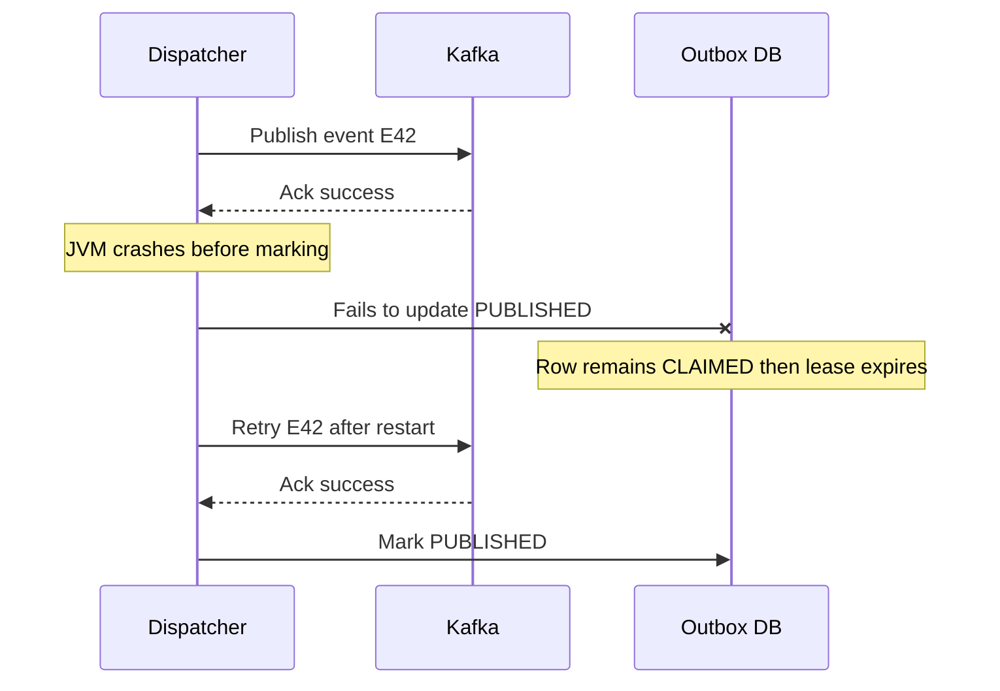
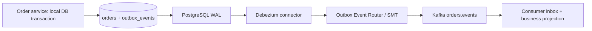
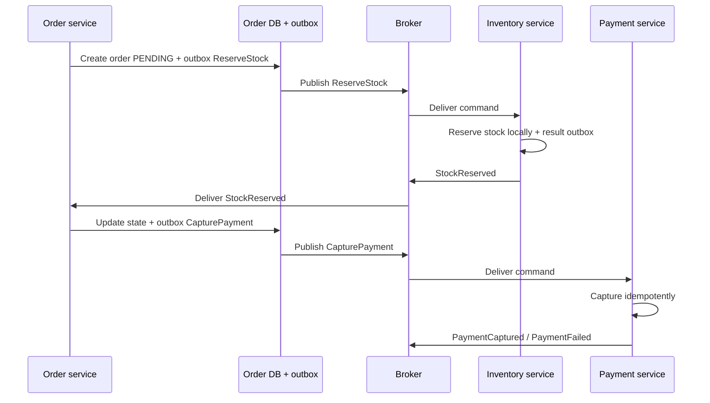
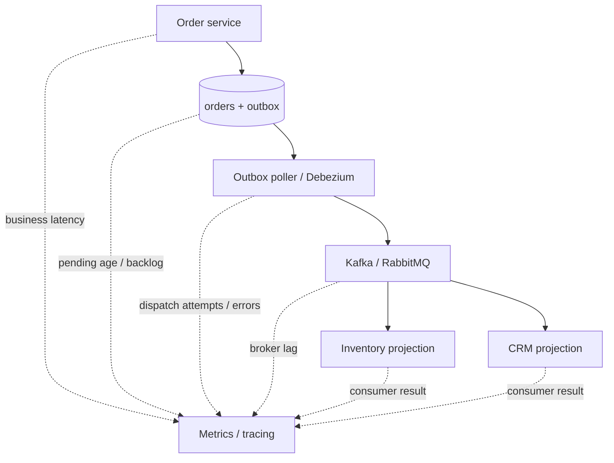

# Transactional Outbox and Persisting Events in the Same Business Transaction

## 1. Root problem: one business change, two storage systems

Suppose an order system uses Spring Boot, PostgreSQL, and Kafka. When a payment succeeds, the application must:

1. Update order `O-42` to `PAID` in PostgreSQL.
2. Emit an `OrderPaid` event so Inventory, CRM, and Analytics process it via Kafka.

If the database commits while Kafka publishing fails, subscribers never learn the order was paid. If Kafka publishes first while the database rolls back, subscribers observe an event **that does not reflect committed state**.

This is the **dual-write** problem: a single business operation mutates at least two independent resources. A `@Transactional` call wrapping only JDBC/JPA does not automatically create an atomic transaction between PostgreSQL and Kafka, RabbitMQ, or an HTTP API.

**Transactional Outbox** closes this gap by **writing the business state and a record of the event to be published inside the same transaction of a single database**. After commit, a dispatcher or Change Data Capture (CDC) mechanism moves the outbox record to the broker. If the broker is temporarily unavailable, the publish intent stays in the database for retry.

This is the topic **"Transactional Outbox and Persisting Events in the Same Business Transaction"** in the **"Consistency and Deduplication"** chapter of the **SPRING_BOOT_INTEGRATION** module. The module organizes Spring Boot integration across HTTP clients, databases, caches, message brokers, and Spring Integration adapters, emphasizing configuration, data contracts, transactions, failures, deduplication, testing, and observability.

After this lesson, you will be able to:

- Distinguish local transactions, dual-writes, outboxes, inboxes, and sagas.
- Design schemas and `@Transactional` code that persist domain state + event records together.
- Understand dispatcher polling or CDC mechanisms, publisher acknowledgments, and crash recovery.
- Manage duplicates, ordering, schema versioning, retries, backpressure, and retention.
- Integrate with Kafka/RabbitMQ, JDBC/jOOQ/JPA, HTTP clients, and Spring Integration.
- Write tests verifying commit/rollback and failure windows, rather than merely mocking `send()`.

**Key point:** An outbox guarantees atomicity between **domain writes and publish intent** within the same database; it does **not** guarantee that a broker receives a message only once or that every subscriber triggers side effects only once.

## 2. Why is the "save then send" approach usually wrong?

A familiar code snippet:

```java
@Transactional
public void markPaid(String orderId) {
    orderRepository.markPaid(orderId);
    kafkaTemplate.send("orders.events", orderId, orderPaidJson);
}
```

This code looks transactional, yet `KafkaTemplate.send(...)` sends via the Kafka producer; Kafka is not automatically part of the JDBC transaction. The future may not even complete before the method returns, and even if a broker acknowledgment arrives, PostgreSQL can still roll back.

Possible outcomes:

| Sequence | Consequence |
|---|---|
| DB update → DB commit → Kafka send fails | Order is `PAID`, yet no event reaches other systems. |
| Kafka send succeeds → DB commit fails | `OrderPaid` exists, yet DB remains in the old state. |
| Kafka send returns incomplete Future → method returns | Unknown whether publish succeeded or failed; callers are misled. |
| App crashes between commit and send | Publish intent is not stored durably enough to resume. |
| Retrying the whole method after an unclear failure | May update/publish twice if no stable business key is used. |

### 2.1. `@TransactionalEventListener(AFTER_COMMIT)` is still not enough

A common improvement:

```java
@TransactionalEventListener(phase = TransactionPhase.AFTER_COMMIT)
public void publish(OrderPaid event) {
    kafkaTemplate.send("orders.events", event.orderId(), event);
}
```

The listener runs **only after DB commit**, reducing the chance of publishing events from rolled-back transactions. However, a gap remains:

```text
DB COMMIT succeeds
  JVM crashes
AFTER_COMMIT listener never runs
=> no durable event left to retry
```

Or the listener fails to send to Kafka after commit; the database will not roll back to "take back" the event. `AFTER_COMMIT` is useful for non-critical notifications or waking up a dispatcher, **not as a replacement for an outbox** when events must not be lost. If using a post-commit listener to wake a worker, **the outbox record must already have been saved in the preceding transaction**.

### 2.2. Kafka transactions do not equal distributed transactions

Kafka supports producer transactions and exactly-once semantics within **properly configured Kafka operations**. It does not automatically turn a database transaction, a Kafka publish, a Redis invalidation, and an ERP HTTP call into one unified ACID transaction. Synchronizing multiple transaction managers still leaves failure windows without true 2PC; outbox/inbox designs are usually easier to operate than distributed two-phase commit in standard integration systems.

## 3. How does an outbox change the execution order?

```mermaid
sequenceDiagram
    participant API as Order application service
    participant DB as PostgreSQL
    participant D as Outbox dispatcher
    participant B as Kafka/RabbitMQ
    participant C as Inventory consumer
    API->>DB: BEGIN
    API->>DB: UPDATE orders status=PAID
    API->>DB: INSERT outbox_events(OrderPaid, eventId=E42)
    API->>DB: COMMIT (both or neither)
    DB-->>API: COMMIT success
    D->>DB: Claim/find pending outbox event
    D->>B: Publish E42
    B-->>D: Broker acknowledgment / confirm
    D->>DB: Mark event published
    B->>C: Deliver E42
    C->>C: Apply idempotently; commit own state
```

Here there are **two independent transactions or milestones**:

1. **Business transaction:** update business tables and insert the outbox row inside **one local database transaction**.
2. **Delivery workflow:** read committed events, publish to the broker, confirm, and record dispatch progress (or let CDC store progress offsets).

If the JVM dies right after the business commit, the outbox row remains. If publishing succeeds and the dispatcher dies before marking it published, the queue may emit **E42 again**. Hence an outbox typically achieves **at-least-once delivery** when retries are configured properly, not end-to-end exactly-once.

### 3.1. Core invariants

For a committed business operation:

- No new `PAID` state exists **without** the corresponding outbox event for that operation, when the event is an obligation of that transaction.
- No committed outbox event exists for a business change that rolled back in the **same transaction**.
- The dispatcher sees only **committed** rows, never publishing from in-flight transactions.
- Events have stable identifiers that do not change across publish/retry attempts.
- Until publishing is reliably confirmed, the row must remain eligible for recovery.

These invariants hold only when domain state and the outbox **share the same database and transaction manager** (or an equivalent atomic transaction source). Two independent `DataSource` instances are not automatically combined into one local transaction by `@Transactional`.

## 4. Event contract: store business facts, not vague callbacks

An outbox event should carry identity and metadata so downstream consumers know **which event**, from which aggregate, and at which version:

```json
{
  "eventId": "3b318dd3-4edf-48b5-a9c2-13de59487ea1",
  "eventType": "OrderPaid",
  "schemaVersion": 1,
  "aggregateType": "Order",
  "aggregateId": "O-42",
  "aggregateVersion": 7,
  "occurredAt": "2026-11-21T03:00:00Z",
  "correlationId": "flow-821",
  "causationId": "payment-cmd-93",
  "data": {
    "orderId": "O-42",
    "paymentReference": "pay-5"
  }
}
```

| Field | Responsibility |
|---|---|
| `eventId` | Unique ID **for the logical event**, kept unchanged when the dispatcher retries. |
| `eventType` | Meaningful event name; `OrderPaid` states what happened. |
| `schemaVersion` | Enables reading older events after producer/consumer upgrades. |
| `aggregateType` and `aggregateId` | Groups events by business object; serves as broker partition key. |
| `aggregateVersion` | Solves ordering and conditional projection updates. |
| `occurredAt` | Timestamp when the event was recorded by the business logic. |
| `correlationId`/`causationId` | Traces the flow and identifies the operation that caused the event. |
| `data` | Minimal payload needed by subscribers, excluding unnecessary secrets. |

JSON payloads and key metadata can also be stored in separate columns. If the broker uses Avro/Protobuf or a schema registry, the outbox can store a versioned envelope or format reference instead of JSON; ensure the dispatcher serializer is deterministic and tested for compatibility.

**Never generate a new `eventId` on dispatch retries.** If the dispatcher changes eventId on every send, consumer inbox deduplication cannot tell that two deliveries are the same event.

## 5. PostgreSQL schema design: business table and outbox table

An illustrative schema:

```sql
CREATE TABLE orders (
    order_id VARCHAR(100) PRIMARY KEY,
    status VARCHAR(30) NOT NULL,
    version BIGINT NOT NULL,
    paid_at TIMESTAMPTZ
);

CREATE TABLE outbox_events (
    event_id UUID PRIMARY KEY,
    aggregate_type VARCHAR(80) NOT NULL,
    aggregate_id VARCHAR(100) NOT NULL,
    aggregate_version BIGINT NOT NULL,
    event_type VARCHAR(120) NOT NULL,
    schema_version INT NOT NULL,
    payload JSONB NOT NULL,
    status VARCHAR(20) NOT NULL DEFAULT 'PENDING',
    attempts INT NOT NULL DEFAULT 0,
    available_at TIMESTAMPTZ NOT NULL DEFAULT now(),
    claimed_by VARCHAR(100),
    claimed_until TIMESTAMPTZ,
    claim_generation BIGINT NOT NULL DEFAULT 0,
    published_at TIMESTAMPTZ,
    last_error_code VARCHAR(100),
    created_at TIMESTAMPTZ NOT NULL DEFAULT now(),

    CONSTRAINT ck_outbox_status CHECK (
        status IN ('PENDING', 'CLAIMED', 'PUBLISHED', 'QUARANTINED')
    )
);

CREATE INDEX ix_outbox_pending
    ON outbox_events (available_at, created_at, event_id)
    WHERE status = 'PENDING';

CREATE INDEX ix_outbox_expired_claim
    ON outbox_events (claimed_until, event_id)
    WHERE status = 'CLAIMED';

CREATE INDEX ix_outbox_aggregate
    ON outbox_events (aggregate_type, aggregate_id, aggregate_version);
```

This is a **polling dispatcher model**, not a mandatory schema for every implementation. With **CDC/Debezium**, you may only need the event/envelope and metadata columns—omitting `status`, `claimed_by`, or polling indexes. Do not force one complex schema onto every delivery strategy.

### 5.1. Explaining dispatcher statuses

| Status | Meaning | Who sets it? |
|---|---|---|
| `PENDING` | Event committed, ready to publish once `available_at` is due. | Business transaction or retry scheduler. |
| `CLAIMED` | A dispatcher holds a lease to publish. | Poller claim transaction. |
| `PUBLISHED` | Dispatcher received producer acknowledgment/confirm per policy and marked it. | Dispatch completion transaction. |
| `QUARANTINED` | Retries exhausted or contract/config error requiring human intervention. | Recovery/operations workflow. |

**`PUBLISHED` does not mean every subscriber has processed the event.** It is a milestone at the producer/broker boundary. To track whether CRM/Inventory completed processing, use separate subscriber inboxes/statuses/projections.

### 5.2. Domain-specific additional constraints

You may add a unique key on `(aggregate_type, aggregate_id, aggregate_version, event_type)` **only if** the contract guarantees at most one event of that type per aggregate version. Many systems emit multiple events for the same type/version; adding a blind unique constraint will drop legitimate events.

Include a **business operation ID** or stable idempotency key on business tables to prevent API retries from unintentionally creating a second operation. `event_id UUID` can be generated inside the transaction when accepting a command, yet retries of *the same intent* after an uncertain commit error must look up the business key before generating a different event.

## 6. Spring Boot code: writing domain state and event in exactly one transaction

This example uses Spring Framework 6.1+/Boot compatible `JdbcClient`, PostgreSQL, and Jackson. In real systems, manage schemas with Flyway/Liquibase and configure a consistent `DataSource` and `PlatformTransactionManager`.

DTO and JSON event:

```java
public record OrderPaidData(
        String orderId, String paymentReference) {}

public record OrderPaidEnvelope(
        String eventId,
        String eventType,
        int schemaVersion,
        String aggregateType,
        String aggregateId,
        long aggregateVersion,
        java.time.Instant occurredAt,
        OrderPaidData data) {}
```

Application service:

```java
import java.time.Clock;
import java.util.UUID;

import com.fasterxml.jackson.core.JsonProcessingException;
import com.fasterxml.jackson.databind.ObjectMapper;
import org.springframework.jdbc.core.simple.JdbcClient;
import org.springframework.stereotype.Service;
import org.springframework.transaction.annotation.Transactional;

@Service
public class OrderPaymentService {

    private final JdbcClient jdbc;
    private final ObjectMapper mapper;
    private final Clock clock;

    public OrderPaymentService(
            JdbcClient jdbc, ObjectMapper mapper, Clock clock) {
        this.jdbc = jdbc;
        this.mapper = mapper;
        this.clock = clock;
    }

    @Transactional
    public UUID recordPayment(String orderId, String paymentReference) {
        // Example assumes order is NEW; real code must handle
        // business idempotency and optimistic versioning per schema.
        int updated = jdbc.sql("""
                UPDATE orders
                SET status = 'PAID',
                    version = version + 1,
                    paid_at = now()
                WHERE order_id = :orderId
                  AND status = 'NEW'
                  AND version = 6
                """)
            .param("orderId", orderId)
            .update();

        if (updated != 1) {
            throw new IllegalStateException(
                    "Order not in expected state/version");
        }

        UUID eventId = UUID.randomUUID();
        OrderPaidEnvelope event = new OrderPaidEnvelope(
                eventId.toString(),
                "OrderPaid", 1, "Order", orderId, 7L,
                clock.instant(),
                new OrderPaidData(orderId, paymentReference));

        String json = toJson(event);

        jdbc.sql("""
                INSERT INTO outbox_events(
                    event_id, aggregate_type, aggregate_id,
                    aggregate_version, event_type,
                    schema_version, payload)
                VALUES (
                    :eventId, 'Order', :orderId,
                    :version, 'OrderPaid', 1,
                    CAST(:payload AS jsonb))
                """)
            .param("eventId", eventId)
            .param("orderId", orderId)
            .param("version", 7L)
            .param("payload", json)
            .update();

        return eventId;
    }

    private String toJson(Object event) {
        try {
            return mapper.writeValueAsString(event);
        } catch (JsonProcessingException ex) {
            throw new IllegalStateException(
                    "Cannot serialize outbox event", ex);
        }
    }
}
```

`Clock` should be provided as a bean or replaced with a managed time source; in tests, use a fixed clock for deterministic assertions. The values `version=6/7` here **only illustrate a specific transition**; production code must read the expected version from validated input or concurrency policy, and embed the **actual updated version** into the event.

What matters is not the specific numbers in the example, but that **both SQL statements execute inside the same `@Transactional` method and on the same connection/transaction manager**. If inserting the outbox fails or JSON serialization throws an exception, the domain update must roll back. If the domain update is invalid, **no event is emitted**.

### 6.1. Why separate the business service and the dispatcher?

The business service confirms only **the business change alongside the publish intent**. It does not wait for Kafka or an ERP. The dispatcher is responsible for **delivering to the broker**. During a broker outage, the API can still accept business commands if the contract permits eventual consistency—while monitoring backlog, rate-limiting, and eventual dependency catch-up capacity.

Depending on the domain, the API should return a status like `PAID (event propagation pending)` or an operation ID. Never answer "Inventory updated" when you have only committed to the local outbox.

## 7. Writing it more accurately: protecting idempotency in the business transaction

The `recordPayment` example above is intentionally brief to illustrate the transaction. In production, you must stop two HTTP requests/retries sharing the same `paymentReference` from generating two logical events.

A sensible contract:

- `paymentReference` or `commandId` is generated by the payment provider/business workflow and stays **stable** across retries.
- The orders/payments table has a matching unique constraint and stores processing state.
- On a duplicate command with the same payload/outcome, the application returns the **previous result** or confirms already processed without creating a new outbox event.
- On the same key with a different payload, report a **conflict** rather than pretending idempotency.
- If the commit outcome is `UNKNOWN` due to a lost connection, the caller looks up by key before retrying.

Example command table:

```sql
CREATE TABLE payment_commands (
    command_id VARCHAR(100) PRIMARY KEY,
    order_id VARCHAR(100) NOT NULL,
    request_hash VARCHAR(64) NOT NULL,
    state VARCHAR(30) NOT NULL,
    event_id UUID,
    updated_at TIMESTAMPTZ NOT NULL DEFAULT now()
);
```

The business transaction can claim/insert the command row first, check hash and state, and then update order + outbox + command outcome in the **same transaction**. Never insert a succeeded marker in a separate transaction before processing; a crash would leave a marker blocking retries even though the operation never completed.

### 7.1. Outbox does not replace unique business keys

Generating a new `event_id` on every caller retry creates multiple distinct events even though each outbox row was committed "technically cleanly." An outbox guarantees **no lost events for a given commit**, yet **cannot tell on its own whether two commits share the same business intent**. Business idempotency and outbox must work together.

## 8. `@Transactional`: where operational bugs usually begin

Conditions for the Java pattern above to be genuinely atomic:

1. Spring transaction management is enabled and the service is invoked **through a Spring proxy**, not `new OrderPaymentService(...)` directly.
2. The `@Transactional` method is called from another bean; self-invocation within the same class can bypass the proxy.
3. Domain repository and outbox repository share the **same JDBC DataSource/transaction manager**.
4. Do not use `REQUIRES_NEW` for the outbox insert if it must share the same outcome as the business update.
5. Do not offload the outbox insert to `@Async` or another executor inside the transaction expecting it to join the thread-bound JDBC transaction.
6. Exceptions propagate to the transaction boundary to trigger rollback; never catch them and commit partial state.
7. Data required for event serialization is finalized before commit.

### 8.1. Why `REQUIRES_NEW` is usually wrong for outbox writes

```java
@Transactional
void changeBusinessState() {
    orderRepository.markPaid(...);
    outboxService.insertInRequiresNew(...); // Anti-pattern.
    // Next step throws an exception -> outer transaction rolls back.
}
```

If the outbox insert commits in an independent transaction while the domain update rolls back, the broker may receive **an event for a change that never existed**. To guarantee atomicity, the outbox must join the **transaction changing business state** (`REQUIRED` or an equivalently configured boundary).

`REQUIRES_NEW` can suit independent audit/failure logging, but that is a different contract; never use it and call it a Transactional Outbox.

### 8.2. `@TransactionalEventListener` can help wake up the dispatcher

Once the business transaction writes the outbox:

```text
BEGIN
  UPDATE orders...
  INSERT outbox_events...
COMMIT
  -> AFTER_COMMIT callback signals dispatcher (best-effort)
```

A post-commit callback can lower publish latency by waking the poller. If the callback misses, the scheduled poller still finds pending outbox rows. **Never turn the callback into the sole delivery path.**

## 9. Does using JPA/Hibernate or jOOQ change the principle?

No. A Spring Boot integration can write domain entities with JPA and outbox entries with a JPA entity, or use jOOQ's `DSLContext` with a JDBC table. The principle remains **the same database transaction**, not "the same repository interface."

### 9.1. JPA entity and outbox entity

Skeleton example:

```java
import jakarta.persistence.Entity;
import jakarta.persistence.Id;
import jakarta.persistence.Column;

@Entity
public class OutboxEntry {

    @Id
    private java.util.UUID eventId;

    private String aggregateType;
    private String aggregateId;
    private String eventType;
    private long aggregateVersion;
    private int schemaVersion;

    @Column(nullable = false, columnDefinition = "jsonb")
    private String payload;

    protected OutboxEntry() {}

    // Constructors/factories/getters defined by the application.
}
```

`@Column(columnDefinition="jsonb")` is PostgreSQL-specific; binding a `String` to JSONB through Hibernate/JDBC may require explicit JSON type mapping—do not assume every version works with just that annotation. In production, use Hibernate JSON support or insert outbox rows via `JdbcClient` with `CAST(:payload AS jsonb)`.

`JpaRepository.save(...)` may defer SQL until flush/commit; **do not assume calling `save()` means the DB has committed**. Test unique constraints, optimistic locks, rollbacks, and `AFTER_COMMIT` listeners against a real transaction.

### 9.2. jOOQ and JDBC sharing one transaction

A Spring Boot-managed `DSLContext` can participate in Spring transactions when wired to the matching `DataSource`/transaction provider. If you manually build a `DSLContext` from a separate `DriverManager.getConnection(...)`, operations run outside the domain transaction. Verify actual transaction wiring rather than guessing based on both pointing to the same PostgreSQL hostname.

## 10. Two outbox distribution strategies: polling or CDC?

After the business commit, rows must be pushed to the broker. Two common strategies:

| Aspect | Polling dispatcher | CDC / transaction log tailing |
|---|---|---|
| Data source | Queries outbox table periodically. | Reads database change log/WAL/binlog. |
| Component | Dedicated Spring scheduler/worker. | Connector such as Debezium and Kafka Connect or equivalent. |
| Latency | Driven by poll interval, backlog, and query time. | Usually low when connector is healthy; depends on log/connector lag. |
| DB load | Frequent query/claim/update; needs indexes and cleanup. | CDC reads logs; still incurs WAL, replication slot, and snapshot overhead. |
| Retries | Lease/status/next-attempt managed by worker. | Connector offsets/checkpoints/restarts and producer behavior. |
| Ordering | Must design claim/partition/serialization carefully. | Can preserve commit/log order per connector, though downstream still needs keys/versions. |
| Deploy/ops | Simple for small systems; needs HA scheduling. | Requires operating connectors, slots, storage/retention, and compatibility. |
| When broker is down | `PENDING` rows grow. | Connector pauses progress; WAL/connector backlog grows. |

Both can achieve at-least-once delivery. CDC **does not eliminate** duplicate risks from retries/restarts/offset commit gaps. Polling **does not need** WAL reading, yet must manage leases and multi-replica concurrency itself.

**Choose one primary publishing path** for a given outbox table. Having both a poller and Debezium publish the same events without coordination creates needless duplicates.

## 11. Single-replica polling: simple but not production-ready

An easy-to-follow version:

```text
@Scheduled:
  SELECT pending outbox events ORDER BY created_at LIMIT 100
  FOR EACH:
      publish to Kafka
      wait for producer acknowledgment
      mark event PUBLISHED
```

With one dispatcher and low load, this is easy to implement. In a multi-pod environment, however, **two pollers can pick the same row**; a crash after publishing yet before marking causes a republish; and a transaction holding locks while waiting on Kafka can block DB writes.

Production systems need:

- **Temporary exclusive claims** per row or proper sharding.
- **Lease timeouts** so rows recover after a worker dies.
- Bounded batch/publish concurrency, with durable retry/backoff state.
- `PUBLISHED` status written only after producer confirm/ack per policy.
- Protections preventing stale workers from overwriting outcomes after a lease changes hands.
- Metrics and runbooks for pending/claimed/quarantined backlogs.

One failed worker must never leave a row stuck in `CLAIMED` forever.

## 12. PostgreSQL: claiming with `FOR UPDATE SKIP LOCKED`

PostgreSQL pattern for multiple dispatchers:

```sql
WITH selected AS (
    SELECT event_id
    FROM outbox_events
    WHERE
        (status = 'PENDING' AND available_at <= now())
        OR
        (status = 'CLAIMED' AND claimed_until < now())
    ORDER BY created_at, event_id
    FOR UPDATE SKIP LOCKED
    LIMIT :batchSize
)
UPDATE outbox_events AS o
SET status = 'CLAIMED',
    claimed_by = :workerId,
    claimed_until =
        now() + (:leaseSeconds * INTERVAL '1 second'),
    claim_generation = claim_generation + 1,
    attempts = attempts + 1
FROM selected
WHERE o.event_id = selected.event_id
RETURNING
    o.event_id,
    o.aggregate_id,
    o.aggregate_version,
    o.event_type,
    o.payload,
    o.claim_generation,
    o.attempts;
```

Run this statement in a **short transaction**, commit the claim, and only then publish over the network.

Key points:

- `FOR UPDATE SKIP LOCKED` prevents workers from blocking on rows currently locked by another worker during claiming.
- `claim_generation` increments on each claim, preventing an old worker from marking success for a newer claim.
- `claimed_until` enables recovery after a JVM crash; it is not an absolute distributed lock.
- `attempts` increments on claim, which does not necessarily mean the broker received an attempt.
- `LIMIT`/`ORDER BY` only orders **row selection** in a single query; it does not guarantee event ordering when multiple workers publish in parallel.
- Requires proper transaction isolation and real indexes; the query is **PostgreSQL-specific**—do not copy verbatim to MySQL/SQL Server without verification.
- If the lease is shorter than publish duration, a row can be reclaimed while the original worker is still running → duplicates; tune or conditionally renew leases.

### 12.1. Guarding the mark operation with generation

```sql
UPDATE outbox_events
SET status = 'PUBLISHED',
    published_at = now(),
    claimed_by = NULL,
    claimed_until = NULL,
    last_error_code = NULL
WHERE event_id = :eventId
  AND status = 'CLAIMED'
  AND claimed_by = :workerId
  AND claim_generation = :generation;
```

Always check `updatedRows == 1`. If 0, ownership changed or another worker already handled the event. Never update unconditionally by `event_id`: a stale worker could overwrite status even if its broker send finished late.

While the generation guard protects **row state**, it **does not prevent** two workers from both publishing an event when a lease expires. Consumers must be idempotent.

## 13. Publisher boundary: Kafka acknowledgment before marking

A Kafka dispatcher can use Spring Boot's `KafkaTemplate<String, String>` with the JSON stored in the outbox:

```java
import java.util.concurrent.TimeUnit;
import org.springframework.kafka.core.KafkaTemplate;
import org.springframework.stereotype.Component;

@Component
class KafkaOutboxSender {

    private final KafkaTemplate<String, String> kafka;

    KafkaOutboxSender(KafkaTemplate<String, String> kafka) {
        this.kafka = kafka;
    }

    void publish(OutboxMessage message) throws Exception {
        kafka.send(
                "orders.events",
                message.aggregateId(),
                message.payloadJson())
            .get(5, TimeUnit.SECONDS);
    }
}
```

`OutboxMessage` is an application-defined record/DTO populated from the claim query. `KafkaTemplate.send` returns `CompletableFuture` in compatible Spring Kafka generations. Using `get(...)` here illustrates **awaiting broker acknowledgment with a timeout**, appropriate for a bounded-concurrency blocking worker, **not** on a Reactor Netty event loop.

On the producer, configure:

- `acks=all` when stronger confirmation is required (paired with broker `min.insync.replicas`/replication policies).
- `enable.idempotence=true` where appropriate to reduce duplicates during producer retries within a session/protocol.
- Compatible `delivery.timeout.ms`, `request.timeout.ms`, retries, and ordering settings.
- Use `aggregateId` as the key so events for the same aggregate land in the same partition.
- Ensure producer metrics/logs omit raw payment details.

### 13.1. A publish timeout is an uncertain state

If `get(5, TimeUnit.SECONDS)` times out, the producer may still be attempting delivery or the broker may have accepted the record before the callback arrived. **Do not mark `PUBLISHED`**, and do not assume "broker never got it." Schedule the row for retry or transition appropriately; duplicate delivery is an intentional possibility that subscribers must tolerate.

For thread interruption hygiene, if catching `InterruptedException`, call `Thread.currentThread().interrupt()` and exit the worker cycle cleanly; never swallow interruptions.

### 13.2. Marking after ack also has a failure window



Two Kafka records may carry the same `eventId=E42`. **There is no way to make "Kafka ack" and "DB mark published" atomic using JDBC `@Transactional` alone.** That is why consumer deduplication is mandatory.

## 14. Polling worker pattern: short transactions, network outside transactions

A minimal production architecture separates three beans:

- `OutboxClaimStore`: `claimBatch(...)` executes in a short DB transaction.
- `KafkaOutboxSender`: sends messages and awaits acknowledgments in a bounded worker.
- `OutboxCompletionStore`: `markPublished(...)` / `scheduleRetry(...)` updates conditionally with generation checks.

Java pseudocode illustrating the orchestration:

```java
import java.time.Duration;
import java.util.List;
import org.springframework.scheduling.annotation.Scheduled;
import org.springframework.stereotype.Component;

@Component
class OutboxDispatcher {

    private final OutboxClaimStore claims;
    private final KafkaOutboxSender sender;
    private final OutboxCompletionStore completion;

    OutboxDispatcher(
            OutboxClaimStore claims,
            KafkaOutboxSender sender,
            OutboxCompletionStore completion) {
        this.claims = claims;
        this.sender = sender;
        this.completion = completion;
    }

    @Scheduled(fixedDelayString =
            "${integration.outbox.poll-delay-ms:500}")
    public void dispatch() {
        String worker = "replica-01"; // Obtain from runtime identity.
        List<OutboxMessage> batch =
                claims.claimBatch(worker, 100, Duration.ofSeconds(30));

        for (OutboxMessage event : batch) {
            try {
                sender.publish(event);

                completion.markPublished(
                        event.eventId(),
                        worker,
                        event.claimGeneration());
            } catch (InterruptedException ex) {
                Thread.currentThread().interrupt();
                return;
            } catch (Exception ex) {
                completion.scheduleRetry(
                        event.eventId(),
                        worker,
                        event.claimGeneration(),
                        classify(ex));
            }
        }
    }

    private String classify(Exception ex) {
        return "BROKER_PUBLISH_ERROR"; // Classify more cleanly in production.
    }
}
```

This is a **structural skeleton**, not standalone buildable code: applications must define DTOs/stores, `@EnableScheduling` (or configured scheduler), unique runtime worker IDs, timeout/retry policies, metrics, and shutdown handling. Claim and completion calls must cross **Spring beans with active transaction proxies**; placing `@Transactional` on a private method called within the same class will not work.

### 14.1. Never wrap the entire send loop in one transaction

Wrong:

```java
@Transactional
public void dispatch() {
    List<OutboxMessage> events = queryPending();
    for (OutboxMessage e : events) {
        kafka.send(...).get(...);
        markPublished(e);
    }
}
```

This holds JDBC connections/row locks across network waits and backoffs, exhausting the DB pool and raising lock contention. And it **still fails** to make Kafka acknowledgments atomic with DB commits. Commit the claim, publish outside the transaction, then commit completion separately.

### 14.2. Leases must account for queue wait and retries

If a batch claims 100 records with a 30-second lease while sequential sends take 5 seconds each, trailing rows will expire **before their turn**. Reduce batch size, use bounded concurrency, claim incrementally, or renew leases with generation checks; measure p99 publish latency and backlog rather than guessing a lease duration.

## 15. How does publishing to RabbitMQ differ?

Transactional outbox is **not tied to Kafka**. With RabbitMQ, a dispatcher can publish to an exchange and routing key via `RabbitTemplate`. Key differences:

| Kafka | RabbitMQ |
|---|---|
| Producer acknowledgments via `acks`/broker protocol. | Publisher confirms when configured. |
| Topics/partitions and consumer groups. | Exchange routing, queues/bindings, and competing consumers. |
| Retained log allowing replays within retention. | Queues usually drop messages after ack; replays need dedicated DLT/retention. |
| Partition key via aggregate ID. | Routing key determines queue; ordering also depends on queues/consumers. |
| Producer futures/callbacks. | Confirm correlation/callbacks or equivalent `RabbitTemplate` APIs. |

**A publisher confirm does not prove a message routed to the intended queue** in all configurations; with RabbitMQ, verify mandatory publishing, publisher returns, exchange/binding/topology, queue durability, and persistent delivery mode. Never mark an outbox row published merely because `convertAndSend(...)` returned normally when the system requires broker receipt and routing confirmation.

Delayed routing or DLX support on the broker is a **downstream retry/error handling** policy and does not alter the requirement for business + outbox atomicity in PostgreSQL.

## 16. CDC: streaming from the transaction log to Kafka

With PostgreSQL, Debezium can tail the WAL/replication slot and stream outbox table changes into Kafka via Kafka Connect. Debezium's **Outbox Event Router** is an option for transforming rows into events with target keys, topics, and payloads.



Key points:

- Business code still **inserts into the outbox in the same transaction**; this part is unchanged.
- CDC reads only **committed changes** from the transaction log per connector semantics.
- The connector requires managing replication slots, WAL retention, snapshot phases, offsets/checkpoints, and broker credentials.
- Mapping event IDs, aggregate keys, routes/topics, payloads, and schema versions must be explicit.
- If the connector crashes after publishing but before checkpointing, duplicate records can appear.
- Polling-specific `status/claim` columns are generally unnecessary in CDC-only designs; frequent status updates can emit extra change events unless operations are filtered properly.

### 16.1. CDC schemas should be minimal and append-only

One variation:

```sql
CREATE TABLE outbox_events_cdc (
    event_id UUID PRIMARY KEY,
    aggregate_type VARCHAR(80) NOT NULL,
    aggregate_id VARCHAR(100) NOT NULL,
    event_type VARCHAR(120) NOT NULL,
    aggregate_version BIGINT NOT NULL,
    schema_version INT NOT NULL,
    payload JSONB NOT NULL,
    occurred_at TIMESTAMPTZ NOT NULL DEFAULT now()
);
```

Never copy these column names/formats into connector configuration without checking **Outbox Event Router field mappings** and the deployed Debezium version requirements. To track publisher progress, use connector lag/checkpoints and broker telemetry instead of having another polling worker update row statuses.

### 16.2. WAL growth can become a production incident

If Kafka or the connector goes down and a replication slot retains WAL for too long, PostgreSQL disk can fill up. Outbox via CDC does not eliminate backlogs; it **shifts where backlogs are managed**. Alert on connector lag, replication slot retention, WAL disk usage, and event propagation delay.

## 17. Ordering: saving in order does not guarantee publishing in order

Suppose aggregate `O-42` has:

```text
version 7: OrderPaid(event E7)
version 8: OrderRefunded(event E8)
```

In an outbox transaction, the event's version must reflect the **committed business version**. However, with multiple polling workers:

1. Worker A claims E7; the broker is slow.
2. Worker B claims E8 and publishes successfully.
3. The consumer receives E8 before E7.

Even `ORDER BY created_at` in SQL does **not** force two workers to publish sequentially. With Kafka key `orderId`, both messages may land in the same partition, yet the log order becomes the **order the broker received them**—potentially E8 then E7.

### 17.1. Strategies for preserving order

- **Serial per aggregate:** one worker/partition processes events for the same aggregate by `aggregateVersion`, emitting the next version only after the previous one is confirmed per contract.
- **Partition/shard outbox polling:** shard by `hash(aggregateId)`, guarantee a single serial owner per shard, and handle takeovers carefully.
- **CDC by commit/log order:** preserves source commit order under supported conditions, though connector/producer config and partition assignment must still be verified.
- **Consumer version guard:** update projections only when `incomingVersion` matches policy, skipping or buffering stale/gapped events.
- **Commutative event design:** where possible, use deltas/operations whose semantics are order-tolerant; idempotency is still required.

Never claim CDC "always preserves all ordering" across multiple tables/topics/partitions or during replays. Ordering must be defined **per aggregate and scope**.

### 17.2. Version check at the consumer

```sql
UPDATE order_projection
SET status = :status,
    aggregate_version = :incomingVersion
WHERE order_id = :orderId
  AND aggregate_version < :incomingVersion;
```

This statement **prevents version regression**, yet does not prevent skipping version 7 if version 8 arrives first. When the business requires processing every step (especially financial ledgers), check `incomingVersion = currentVersion + 1`, buffer events missing a predecessor, or rebuild from the source of truth per policy. Do not treat "higher version" as sufficient for every system.

## 18. Inbox: preventing consumers from applying the same event multiple times

The producer's outbox supplies a stable event ID; the consumer needs **durable deduplication** when Kafka/RabbitMQ redelivers or the dispatcher republishes.

Example inbox table:

```sql
CREATE TABLE consumed_events (
    consumer_name VARCHAR(100) NOT NULL,
    event_id UUID NOT NULL,
    payload_hash VARCHAR(64) NOT NULL,
    processed_at TIMESTAMPTZ NOT NULL DEFAULT now(),
    PRIMARY KEY (consumer_name, event_id)
);
```

A Spring Boot consumer can handle it as follows:

```java
import org.springframework.jdbc.core.simple.JdbcClient;
import org.springframework.stereotype.Service;
import org.springframework.transaction.annotation.Transactional;

@Service
class OrderPaidProjectionService {

    private final JdbcClient jdbc;

    OrderPaidProjectionService(JdbcClient jdbc) {
        this.jdbc = jdbc;
    }

    @Transactional
    public void apply(OrderPaidReceived event) {
        int inserted = jdbc.sql("""
                INSERT INTO consumed_events(
                    consumer_name, event_id, payload_hash)
                VALUES ('inventory-projection',
                        :eventId, :payloadHash)
                ON CONFLICT (consumer_name, event_id) DO NOTHING
                """)
            .param("eventId", event.eventId())
            .param("payloadHash", event.payloadHash())
            .update();

        if (inserted == 0) {
            verifyPreviouslyProcessed(event);
            return;
        }

        // Update inventory projection and/or secondary outbox event
        // in the SAME transaction as consumed_events.
        applyBusinessChange(event);
    }

    private void verifyPreviouslyProcessed(OrderPaidReceived event) {
        // Read stored hash/outcome and reject same ID with different payload.
    }

    private void applyBusinessChange(OrderPaidReceived event) {
        // Domain logic to implement.
    }
}
```

`OrderPaidReceived` is an application-defined DTO containing `UUID eventId` and a hash computed/verified from the payload—do not trust an unverified hash string supplied arbitrarily by the producer. The two helper methods are **implementation placeholders**, not advice to treat every duplicate as a no-op success.

**Invariant:** writing the inbox marker, updating the projection, and creating any secondary outbox events (if needed) must happen in the **same DB transaction**. If you commit the marker first and the service crashes before the business update, redelivery will wrongly skip an incomplete operation.

### 18.1. When to ack the broker?

Kafka offset commits or RabbitMQ consumer acks should occur only after the **corresponding business effect or durable handoff has committed**. If the DB commits and the ack fails, the broker redelivers and the inbox prevents duplicates. If you ack before the DB commits, a crash can lose work.

For downstream HTTP/ERP calls with side effects outside the DB transaction, an inbox alone is insufficient. You need a **command/outbox + ERP-side idempotency key or reconciliation** to resolve post-write timeouts.

## 19. Outbox paired with sagas/compensation for multi-service workflows

An outbox guarantees local state + event intent; it **does not** execute an atomic transaction across the Order DB, Inventory DB, Payment Provider, and Shipment API. A long-running workflow can span steps:



On `PaymentFailed`, a saga/orchestrator can emit `ReleaseStock`. Each service owns its local transaction/outbox and inbox/idempotency; compensation is **business undoing**, not automatic distributed rollback.

Never declare in an event that "the entire order completed" simply because Outbox reached `PUBLISHED`. Maintain a state machine driven by actual business outcomes.

## 20. Event data and schema evolution

An outbox is a form of **asynchronous contract**. Events may be redelivered **days** later when consumers are running a different deployed version.

Principles:

1. Include `eventType` and `schemaVersion`, with clear versioning semantics.
2. Favor backward-compatible changes: add optional fields, preserve meanings of existing fields.
3. Avoid removing or changing the semantics of fields older consumers still rely on.
4. On major bumps, support upcasting/migration or explicit new topics/contracts.
5. Keep metadata like `eventId`, aggregate info, and versions outside the payload if dispatchers route without parsing the full schema.
6. Test serializers/deserializers between current code and historical outbox records.
7. Never depend on internal Java class names on the wire when producers and consumers deploy independently.

A **committed outbox row's payload should not be arbitrarily mutated** merely because new code has a new schema. If data errors must be repaired or quarantined, record an audit trail and replay rules. For CDC routers, verify schema mapping and behavior for `UPDATE`/`DELETE` if the table is designed as insert-only.

## 21. Retries and quarantine: when to stop automatically?

Broker publish retries can fail due to network issues, ACLs, missing topics, serialization errors, oversized messages, timeouts, or broker quotas.

| Error | Typical sound policy |
|---|---|
| Temporary network/broker loss, short timeout | Bounded retries, exponential backoff + jitter. |
| Broker 429/quota/throttling | Reduce rate and concurrency; respect quotas. |
| Wrong authentication/authorization | Alert on misconfiguration; avoid tight hot retries. |
| Missing topic/exchange | Check provisioning/config; pause dispatch cleanly if needed. |
| Unserializable payload or schema incompatibility | Quarantine, fix contract/serializer, avoid poison loops. |
| Oversized message | Classify non-retryable; use payload references or trim data. |
| Producer ack timeout | Publish outcome is **uncertain**; retries may create duplicates. |
| Mark PUBLISHED fails after broker ack | Row retries and may republish; consumers stay idempotent. |

### 21.1. Persisting retry state in the database

Example when publishing fails:

```sql
UPDATE outbox_events
SET status = 'PENDING',
    available_at = :nextAttemptAt,
    claimed_by = NULL,
    claimed_until = NULL,
    last_error_code = :errorCode
WHERE event_id = :eventId
  AND claimed_by = :workerId
  AND claim_generation = :generation;
```

`nextAttemptAt` can use exponential backoff with jitter and an upper cap. For permanent errors or exhausted retry budgets, move rows to `QUARANTINED` with an error code, **never deleting the row** merely because the dispatcher failed to send it.

`QUARANTINED` means the event has not been published and requires an owner; it does not mean the domain transaction rolled back. A business-committed operation may require **urgent intervention** if event emission exceeds SLO.

## 22. Outbox table maintenance and retention

The outbox table grows with business transaction volume. If rows are only appended, pending queries and indexes degrade while vacuum/WAL/disk grow. Yet deleting too early sacrifices auditing, replays, and reconciliation.

Design explicitly:

- How long are `PUBLISHED` rows retained based on broker retention and audit requirements?
- When are old partitions archived, partitioned, or dropped?
- `PENDING/CLAIMED/QUARANTINED` events must never be deleted by routine cleanup jobs.
- Deletion/archival runs in batches with rate limits to avoid long table locks.
- If CDC tails the WAL, ensure the connector has checkpointed and respect retention/snapshot constraints before purging.
- Should full payloads be kept, or only event IDs, hashes, and references for later lookup?
- Personal data has distinct retention/deletion policies; avoid keeping raw PII indefinitely.

A partial index for `status='PENDING'` lowers polling cost, while expired-claim queries need their own index. Inspect execution plans and `VACUUM` on real PostgreSQL; do not assume a sample schema scales untouched to billions of events.

## 23. Backpressure and load shedding when the broker slows down

An outbox converts broker outages into a **durable backlog in the database**, yet backlogs cannot grow unboundedly without impacting the application.

Measure and bound:

| Signal | Operational question |
|---|---|
| Pending rows and oldest pending age | How old is the oldest unpublished event? |
| Claimed rows and expired leases | Are dispatchers stalling or crashing? |
| Publish throughput and success/failure | Is the broker keeping up with business commit rates? |
| Attempts/exhausted/quarantined | Are retries recovering or causing a storm? |
| Active/pending DB pool, query latency | Is polling competing with business writes? |
| WAL/CDC connector lag | Is CDC retaining too much WAL? |
| Broker consumer lag | Are events published yet subscribers lagging behind? |
| Business operation SLA | Is slow event propagation hurting users? |

### 23.1. Throttling ingestion and dispatchers

If incoming order volume exceeds broker publish capacity for hours, the database will fill even as local business transactions commit. Production designs need capacity planning, alerts on pending age, API rate limiting when backlogs cross safe bounds, and clear degraded-mode behavior.

Never spin up unlimited workers while the broker is rate-limiting. Too many dispatchers heighten PostgreSQL contention, network connections, and duplicates from expired leases.

### 23.2. Do not publish directly on the HTTP thread just to shave latency

Some apps both insert into the outbox and call Kafka directly inside the HTTP transaction to "go faster." Treating that call as the primary path reintroduces dual-write and long transaction hold times. For lower latency, use CDC or notify the dispatcher after commit as a **best-effort optimization**, keeping the outbox row as the source of truth for retries.

## 24. Testing transactions: don't just mock `KafkaTemplate`

A unit test calling `verify(kafkaTemplate).send(...)` proves nothing about outbox atomicity. Crucial tests must exercise **repositories, transaction managers, and a real database**:

| Test | What to prove |
|---|---|
| Business update and outbox insert both succeed | Single commit contains state + event with exact payload/ID. |
| Outbox insert fails (constraint/JSON) | Business state rolls back; no event row commits. |
| Domain validation/optimistic version fails | No outbox event is written. |
| Two commands with same business idempotency key | Does not create two unauthorized operations/events. |
| Transaction commit fails | Never claims event was published merely because the method was invoked. |
| Dispatcher ignores uncommitted rows | Never emits events from uncommitted transactions. |
| Broker down after business commit | Pending row survives and retries once broker recovers. |
| Publish ack succeeds, DB mark fails | May republish; consumer deduplicates via eventId. |
| Worker crashes between claim and send | Lease expires; another worker reclaims the row. |
| Worker lease expires mid-send | Generation guard blocks stale writes; duplicates are still handled. |
| Two pollers claim concurrently | Never grab the same row during an active claim; CAS/leases hold. |
| E7/E8 for same aggregate processed concurrently | Ordering/version policy prevents projection corruption. |
| Consumer commits SQL then crashes before offset/ack | Redelivery produces zero duplicate business effects. |
| DLT/quarantine/replay after bugfix | Replay enforces auth/audit and keeps original event ID. |

### 24.1. PostgreSQL + Kafka with Testcontainers

An integration test can use `PostgreSQLContainer` and `KafkaContainer`/`ConfluentKafkaContainer` depending on the Testcontainers release. Where Spring Boot supports `@ServiceConnection`, let Boot supply datasource/bootstrap connection details; otherwise use `@DynamicPropertySource`.

Structural test skeleton:

```java
@SpringBootTest
@Testcontainers
class OrderOutboxIntegrationIT {

    @Container @ServiceConnection
    static PostgreSQLContainer<?> postgres =
            new PostgreSQLContainer<>("postgres:16-alpine");

    @Container @ServiceConnection
    static KafkaContainer kafka =
            new KafkaContainer(
                DockerImageName.parse("apache/kafka:3.8.0"));

    @Autowired OrderPaymentService service;
    @Autowired JdbcClient jdbc;

    @Test
    void businessAndEventAreCommittedTogether() {
        // Arrange: INSERT orders(order_id='O-42', status='NEW', version=6)
        UUID eventId = service.recordPayment("O-42", "pay-test");

        // Assert: order status PAID, version 7.
        // Assert: exactly one outbox_events row with eventId and payload.
        // Test in a separate transaction to inspect committed state.
    }
}
```

Imports, topic provisioning, migrations, `Clock` bean, test fixtures, and assertions must be completed in the project; this snippet is a **skeleton**, not a standalone runnable test. Testcontainers Kafka class/image/package names vary across versions (e.g., `org.testcontainers.kafka.KafkaContainer` in newer generations), so pick the module matching your BOM. If testing only domain + outbox atomicity, **starting Kafka is not mandatory**; test the dispatcher separately to save overhead.

### 24.2. Meaningful rollback tests

```java
@Test
void outboxWriteFailureRollsBackBusinessState() {
    // Arrange: a constraint or fault injection guaranteed to fail
    // the outbox INSERT inside the service transaction.
    assertThrows(DataAccessException.class,
            () -> service.recordPayment("O-43", "pay-test"));

    // Assert via a fresh transaction/connection:
    // O-43 remains NEW, with no committed event.
}
```

Do not let a test method's own `@Transactional` roll everything back and then conclude the service rolls back cleanly in production. Require the **business transaction to genuinely commit or roll back**, and verify state after the boundary closes. Use `TestTransaction` when tests need explicit commit control.

### 24.3. Post-crash replay test with immutable event ID

Have the dispatcher publish E42 to Kafka, then **inject a failure right at the `PUBLISHED` marking step**. Once the lease expires and the dispatcher runs again, Kafka may receive two E42 records. The consumer uses its inbox to process once. Assertions must verify:

- Both Kafka records, if present, carry the **same eventId** and identical payload/hash.
- Business projection applies the effect only once.
- Dispatcher never assigns a new eventId E43 on retry.
- Final event state is `PUBLISHED` and the inbox table holds one record.
- Matching retry/backoff/quarantine metrics increment.

Use bounded polling assertions rather than arbitrary `Thread.sleep(...)`. The priority is verifying **failure behavior**, not just the happy path.

## 25. Observability and milestone tracing

An outbox workflow has at least three distinct latencies:

1. **Domain transaction latency:** from receiving the command to DB commit.
2. **Outbox dispatch latency:** from `created_at`/commit until broker publish confirmation.
3. **Consumer propagation latency:** from broker delivery until the subscriber finishes updating its projection.

Do not lump all three into one HTTP request timer or infer them from producer send counts.



Suggested **application-defined metrics** (not guaranteed built-in Spring Boot names):

| Metric | Safe dimensions |
|---|---|
| `integration.outbox.pending.count` | Bounded `eventType`, `status`. |
| `integration.outbox.oldest.age` | `aggregateType`, `status`. |
| `integration.outbox.dispatch.attempts` | `broker`, `outcome`, `errorCategory`. |
| `integration.outbox.claim.expired` | `workerPool` or `dependency`. |
| `integration.outbox.quarantine.count` | `errorCategory`, `eventType`. |
| `integration.consumer.deduplicated` | `consumerName`, `eventType`. |
| `integration.projection.lag` | `subscriber`/`operation`. |

Never put `orderId`, `eventId`, `paymentReference`, trace IDs, or tenant identities into metric labels due to high cardinality and data risk. Place IDs in protected logs/traces with proper redaction and retention policies.

### 25.1. Cross-process correlation

Place `correlationId`/`causationId` in the outbox envelope/headers before commit. The dispatcher forwards metadata through the broker; the consumer creates a new observation/span from message context. Technical traces do not live forever across multi-day workflows, so **business event IDs and operation IDs** remain the reliable reconciliation keys. Do not hand-roll non-standard W3C `traceparent` headers when Micrometer Tracing/OpenTelemetry propagation is available.

## 26. Security: the outbox is durable data, not a dumping ground

An outbox row can outlive an HTTP request or Kafka retention in the database; enforce controls:

- Include only fields subscribers genuinely need in payloads.
- Never write access tokens, bearer headers, passwords, private keys, raw card data, or unnecessary full PII.
- Encrypt and restrict access to outbox/DLT/replay dashboards.
- Consider `payloadReference` pointing to permissioned/TTL-governed object storage for large or sensitive payloads.
- Version schemas and enforce ownership over event types/topics.
- Validate content length/schema before persisting and before publishing to the broker.
- Never allow external callers to pick arbitrary broker topics/headers if the client holds credentials.
- Control `replay`/`quarantine`/`delete` permissions, auditing actor, reason, event ID, and timestamp.
- Separate automatic retries from operator replays; never edit `eventId` to "bypass dedup."

Especially in multi-tenant setups, a subscriber must never assume `tenantId` inside an event is automatically authenticated. Producer and broker ACLs must be trustworthy, and consumers must still validate scope/tenant per contract and policy.

## 27. Troubleshooting: we have an outbox, yet events are still lost or duplicated

| Symptom | Possible causes | Investigation path |
|---|---|---|
| DB shows `PAID` without an outbox row | Outbox insert ran in a separate transaction, exception swallowed, code path skipped outbox. | Trace transaction boundaries and assert atomicity. |
| Outbox row exists, no Kafka record | Dispatcher stopped, pending not due, topic/ACL error, producer failing, CDC lag. | Check pending age, worker logs, broker confirms, connector status. |
| Kafka record exists, outbox still `PENDING` | Ack succeeded, mark `PUBLISHED`/claim update failed. | Inspect `claim_generation`, DB errors; expect duplicates. |
| Every retry gets a new event ID | ID generated inside dispatcher instead of business transaction. | Persist eventId on outbox insert; preserve on replay. |
| Same event processed twice at consumer | Missing inbox, or marker/business update not sharing transaction. | Check unique constraints, ack/offset gap, transaction logs. |
| Outbox stuck `CLAIMED` for long | Lease never expired, poller died, stale worker ID. | Query `claimed_until`, `claim_generation`, worker health. |
| Later message overtakes earlier one for same order | Parallel dispatchers, retry topic/partition routing. | Aggregate version, partition key, ordering strategy. |
| Outbox backlog grows rapidly during broker errors | Low dispatcher throughput, retry storm, no backpressure. | Check oldest pending age, publish latency, broker quotas, DB pool. |
| Abnormal Debezium WAL growth | Connector/replication slot lag, broker down. | Inspect connector offsets, slot status, PostgreSQL WAL metrics. |
| CDC emits duplicate events | Restart/checkpoint gap, converter/snapshot semantics. | Deduplicate by eventId; never assume exactly-once. |
| `@TransactionalEventListener` ran yet event lost | Non-durable callback, crash after DB commit. | Move source of truth to outbox rows. |
| JPA-inserted outbox invisible in test | Deferred flush/commit or test-level rollback. | Verify real commits and persistence context. |
| Cleanup accidentally deletes unprocessed rows | Retention job failed to filter status/connector progress. | Block deleting `PENDING`/`QUARANTINED`; audit purges. |
| Replay double-charges or double-reserves | No remote outcome reconciliation/idempotency. | Operation key, upstream contract, approval workflow. |

### 27.1. Step-by-step investigation runbook

1. Retrieve the **business operation ID** and confirm domain state committed.
2. Locate the corresponding outbox event: `eventId`, aggregate/version, status, attempts.
3. If the row is missing, inspect transaction boundaries and code paths rather than bumping Kafka retries.
4. If the row is pending/claimed, inspect leases, dispatchers, broker credentials, and publish acknowledgments.
5. If the row is published, locate the Kafka/RabbitMQ record by event ID and inspect broker offsets/queue deliveries.
6. If the broker holds the record, inspect consumer group/queue lag, DLT, and inbox/projection state.
7. Cross-check duplicate event IDs, aggregate versions, and transaction/ack timing.
8. Replay only after confirming idempotency policy, ordering, authorization, and business impact.
9. After fixing, add an integration test covering the exact failure window encountered.

## 28. Common anti-patterns

1. **Calling Kafka send inside `@Transactional` and believing DB and broker commit together.**
2. **Relying solely on `@TransactionalEventListener(AFTER_COMMIT)`** without persisting publish intent.
3. **Inserting into the outbox using `REQUIRES_NEW`**, committing events even when the domain rolls back.
4. **Writing the outbox from an `@Async` thread**, detaching it from the domain transaction.
5. **Generating a new event ID on dispatcher retries**, preventing consumer deduplication.
6. **Marking `PUBLISHED` before broker acknowledgment**, losing messages when the broker rejects them.
7. **Holding JDBC transactions open while awaiting Kafka/network**, exhausting pools and holding locks.
8. **Running multiple pollers without claims/leases**, causing unintended duplicates.
9. **Assuming `SKIP LOCKED` preserves per-aggregate order** while workers publish concurrently.
10. **Treating publisher acknowledgment as subscriber completion** and reporting business complete.
11. **Omitting an inbox/idempotency**, letting a crash between Kafka ack and DB mark double side effects.
12. **Deleting outbox rows immediately upon dispatch** without retention, audit, or recovery policies.
13. **Running both polling and CDC on the same events** without coordination.
14. **Letting a CDC replication slot retain WAL until disk fills** without alerts.
15. **Tightly retrying auth/schema errors infinitely**, causing backlogs and storms.
16. **Storing raw tokens/PII in event JSON**, widening long-term data exposure.
17. **Using Kafka transactions and assuming PostgreSQL + HTTP ERP are exactly-once**.
18. **Testing only with mocked `KafkaTemplate`** and concluding business+event atomicity works.
19. **Acking the source broker after queuing an in-memory task**, before outbox/job commit.
20. **Replaying an already-processed event with a new operation ID**, creating duplicate side effects.

## 29. Transactional Outbox implementation checklist

- [ ] Identified business transactions and which events must be emitted on commit.
- [ ] Domain state and outbox writes share the same database and transaction manager.
- [ ] `@Transactional` crosses a Spring proxy; no misused `REQUIRES_NEW` boundaries.
- [ ] Business idempotency keys, stable eventIds, aggregateId/version, and schemaVersion are defined.
- [ ] JSON/Avro events are serialized or referenced in a way replayable after future deploys.
- [ ] Outbox records omit unnecessary sensitive data and follow retention/access policies.
- [ ] One clear delivery strategy is chosen: polling dispatcher or CDC.
- [ ] If polling: atomic claims, lease expiration, generation guards, and short transactions are in place.
- [ ] If CDC: connector offsets, replication slot/WAL monitoring, and schema mapping are configured.
- [ ] Dispatcher publishes outside DB transactions and marks success only after broker ack/confirm.
- [ ] Publish timeouts are treated as potential duplicates; retries never assign new IDs.
- [ ] Exponential backoff/jitter, max attempts, quarantine, and replay approvals are implemented.
- [ ] Cleanup routines never delete pending or quarantined rows.
- [ ] Per-aggregate ordering/version strategy exists; never rely on a single query's `ORDER BY` alone.
- [ ] Consumer inbox markers and business updates commit inside the same local transaction.
- [ ] Kafka offsets/RabbitMQ acks happen only after durable business outcomes or durable handoffs.
- [ ] DB transactions are never assumed to span Kafka, HTTP, or Redis.
- [ ] Fallback/reconciliation exists for remote commands with `UNKNOWN` outcomes.
- [ ] Metrics cover oldest pending age, claim expiry, retries, publish latency, and CDC lag.
- [ ] Alerts fire when event propagation breaches SLO or WAL/DB storage nears capacity.
- [ ] Tests cover commit, rollback, duplicate publishes, consumer redeliveries, stale claims, and ordering.
- [ ] Broker-down and dispatcher-restart scenarios are tested with real PostgreSQL/brokers in Testcontainers.
- [ ] Runbooks cover quarantine, replay, purge, manual recovery, and auditing.
- [ ] Deployment clearly assigns ownership, credentials, resources, and cleanup for schedulers/connectors.

## 30. Summary

**Transactional Outbox turns "save business state and publish an event" from two fragile steps into one atomic decision on a single data store:** inside the same local transaction, domain state mutates **and** the event intent is durably stored, or both roll back. A polling dispatcher or CDC can then publish post-commit, retry on broker failures, and recover after JVM restarts.

That does **not** mean events are delivered only once. Broker acknowledgments and DB marking always leave a failure window; therefore **stable eventIds, consumer inboxes, unique business keys, aggregate versions, bounded retries, observability, and reconciliation** are mandatory companions for high-correctness systems.

In **SPRING_BOOT_INTEGRATION**, treat the outbox as the boundary between local data transactions and the asynchronous integration world. When that boundary is explicitly designed, tested, and operated, HTTP clients, JDBC/jOOQ/JPA, Redis, Kafka/RabbitMQ, and Spring Integration flows can scale independently without trading off "order committed yet notification lost" or "notified of a change that never occurred."
