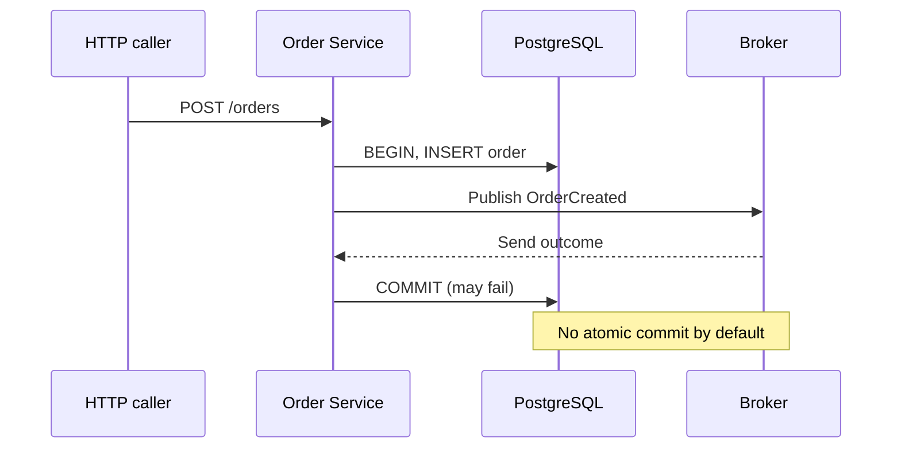
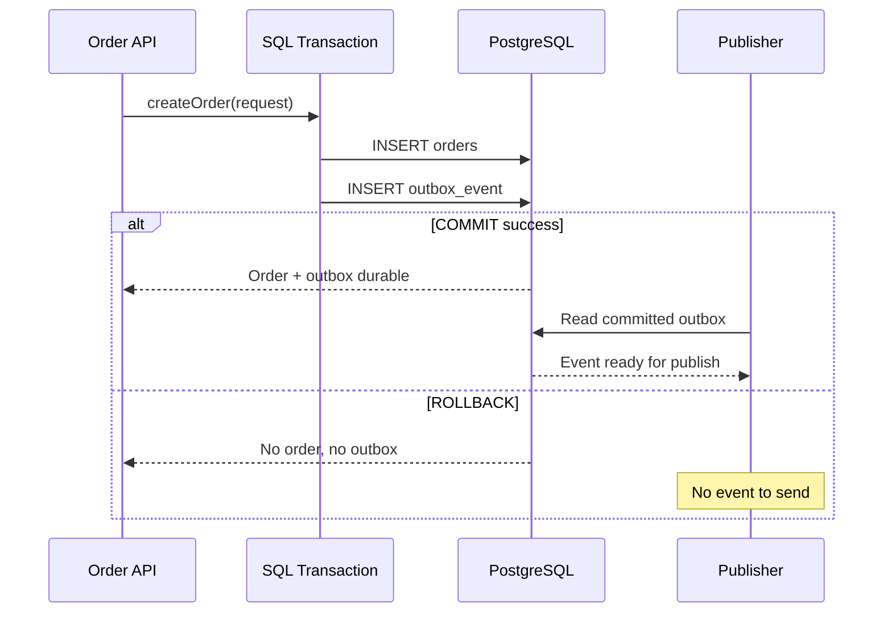
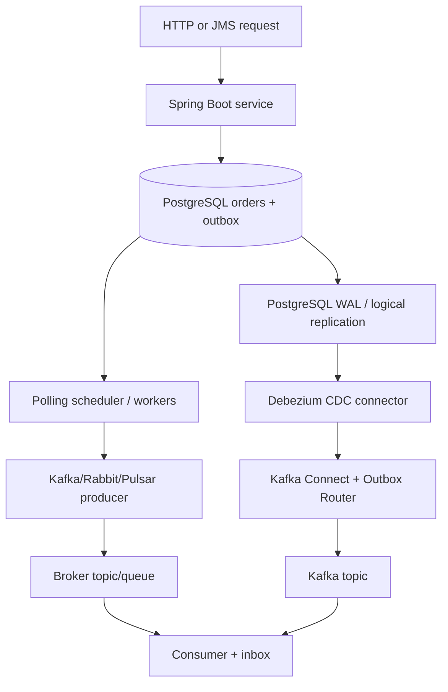
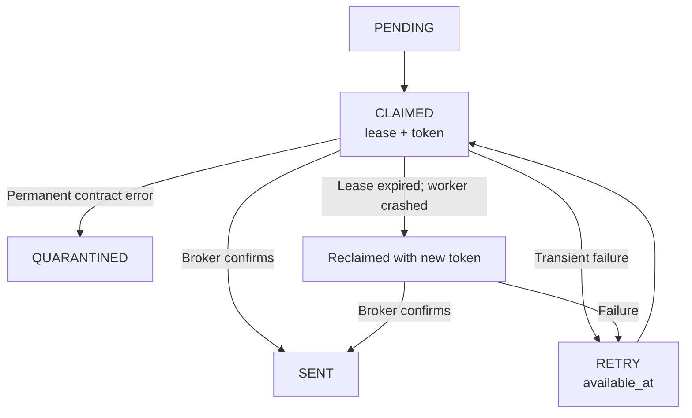
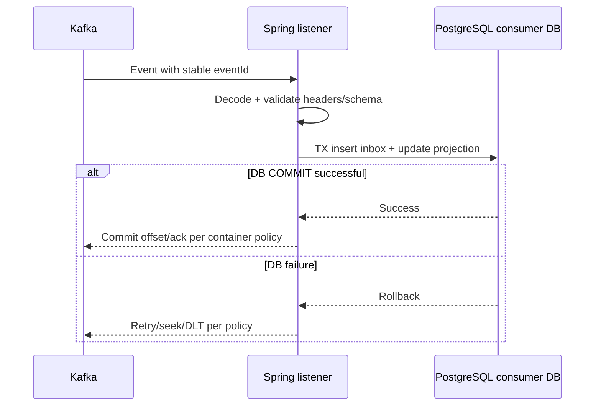
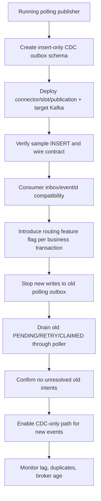
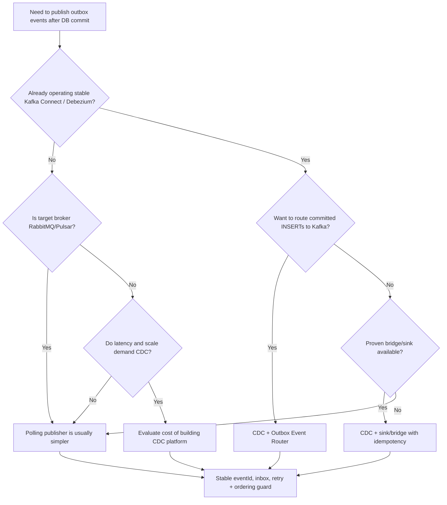

# Polling Publisher vs. CDC for Publishing Outbox Data

## 1. The problem: database committed, yet the event never reached the broker

Within **SPRING_BOOT_INTEGRATION**, a Spring Boot application frequently receives an HTTP request, writes to PostgreSQL, and then publishes a message to RabbitMQ, Kafka, or Apache Pulsar for another system to process. A consistency problem arises because the **database transaction** and **sending the message to the broker** are two independent actions.

Suppose an order creation API does:

```java
@Transactional
public OrderReceipt create(CreateOrderRequest request) {
    Order order = orderRepository.save(
        Order.from(request)
    );
    brokerPublisher.publish(
        new OrderCreated(order.id())
    );
    return new OrderReceipt(order.id());
}
```

This snippet illustrates an anti-pattern; the types are illustrative. `@Transactional` typically manages a **PostgreSQL/JPA transaction**, not a distributed transaction encompassing Kafka, RabbitMQ, or Pulsar sends.

Two failure windows:

- **Broker receives event, DB rolls back:** consumers process an order that was never committed.
- **DB commits, broker never receives event:** the order exists, yet no event updates shipping, inventory, emails, or reporting.



**Transactional outbox** solves this by **recording the intent to emit an event in the same database transaction as the business change**, followed by an independent process that reads outbox rows and delivers them to the broker.

```text
POST /orders
   |
   v
PostgreSQL transaction:
  INSERT orders
  INSERT outbox_event
  COMMIT
   |
   +--> Polling publisher  ---> Broker ---> Consumer
   |
   +--> CDC connector ------> Broker ---> Consumer
```

There are two prominent strategies for publishing outbox data:

1. **Polling publisher:** one or more workers periodically query the outbox, claim due rows, send to the broker, and mark success or schedule retries.
2. **Change Data Capture (CDC):** a connector reads the database **transaction log** (such as PostgreSQL WAL) and emits outbox INSERTs as events; Debezium Outbox Event Router with Kafka Connect is one option.

**Shared goal:** turn **durable intent in the DB** into broker-accepted events while tolerating app/broker failures and recognizing duplicates. Neither approach guarantees **exactly-once business effects** out of the box.

### Learning outcomes

After this lesson, you will:

- Understand the exact atomicity boundary of DB transactions and outboxes.
- Design a mutable outbox schema for pollers and an insert-only schema suited for CDC.
- Implement claims, leases, fencing tokens, retries/backoff, and broker confirmations for polling.
- Understand CDC with WAL, replication slots, Debezium, Kafka Connect offsets, and Outbox Event Router.
- Analyze per-aggregate ordering, keys/partitions, and multi-producer effects.
- Deduplicate using inboxes, unique constraints, optimistic versions, and partner idempotency keys.
- Choose between polling and CDC based on latency, operations, scale, and existing infrastructure.
- Test fresh failure windows, crashes/restarts, connector lag, and lossless cutovers.
- Observe backlog, oldest pending age, WAL lag, duplicate counts, and poison events.
- Design reconciled migrations from poller to CDC or vice versa.

> This lesson uses **Java 17+, Spring Boot 3.x, PostgreSQL, and popular brokers** for illustration. `FOR UPDATE SKIP LOCKED`, `jsonb`, and logical replication are PostgreSQL features—do not apply them mechanically to every RDBMS. Exact API/deployment details of Debezium, Kafka Connect, Spring Kafka, RabbitMQ, and Pulsar must be verified against your actual versions.

## 2. What an outbox is—and what it is not

An outbox row is an **immutable record of the intent to publish an event or command** produced by a committed business change.

Example:

```json
{
  "eventId": "7a7d90ee-32e8-42db-a519-f779c1beef10",
  "aggregateType": "order",
  "aggregateId": "ORD-501",
  "aggregateVersion": 3,
  "eventType": "OrderConfirmed",
  "schemaVersion": 1,
  "destination": "orders.events",
  "payload": {
    "orderId": "ORD-501",
    "status": "CONFIRMED"
  }
}
```

**An outbox is NOT:**

- A broker queue replacing Kafka, RabbitMQ, or Pulsar.
- Proof that consumers received or successfully processed the event.
- An HTTP retry log you can delete at any moment.
- A transaction manager guaranteeing atomic commits across DB and broker.
- An arbitrary record written outside the business transaction.
- A full event-sourcing log capable of rebuilding all state without such a contract.
- A complete deduplication mechanism if consumers lack idempotency.

The same pattern works for **domain events** (`OrderConfirmed`) or **integration commands** (`ReserveStock`), though their semantics differ: an event states what happened; a command asks another party to act. Choose `destination`, `eventType`, retry deadlines, and idempotency accordingly.

## 3. Most critical invariant: business change and publish intent must commit together



**Design rules:**

1. One database transaction stores both the business data and the outbox row.
2. If the business command rolls back, the outbox row must roll back too.
3. The outbox gets a stable `event_id` at insert time; worker retries **never generate a new ID**.
4. Never use `REQUIRES_NEW` for the outbox insert if that allows the outbox to commit when the business transaction rolls back.
5. Never call the broker inside the SQL transaction assuming the broker rolls back with SQL.
6. Never put `@Transactional` on a method bypassed by self-invocation (skipping the Spring proxy) and assume a transaction exists.
7. If orders and the outbox live in **two different databases**, a local transaction is not atomic; a different design is required.
8. If SQL commits successfully yet the HTTP response drops, callers retry POST; use an **inbound idempotency key** to avoid creating two orders/outbox rows.

**An outbox guarantees durability of publish intent**, subject to database storage, commits, and backup/HA working per contract. It does not make the broker available inside the HTTP transaction itself.

## 4. Two architectures solving the same publishing problem



The diagram shows **two alternative paths**. The Debezium Outbox Event Router path typically emits to **Kafka via Kafka Connect**; it does not automatically produce RabbitMQ/Pulsar messages. Pushing to another broker requires an additional **bridge/sink/CDC connector** with matching semantics.

**Each event needs one publishing owner.** If both a poller and CDC publish the same rows during a transition, treat **dual-publish duplicates** as possible and execute an explicit cutover plan rather than assuming automatic coordination.

## 5. Quick comparison: Polling publisher vs. CDC

| Criterion | Polling publisher | CDC from transaction log |
| --- | --- | --- |
| How events are detected | `SELECT`/claim due rows | Reads committed DB changes from WAL/binlog |
| Minimum infrastructure | Spring Boot + JDBC + broker client | Log replication permissions, connector runtime, offsets, broker |
| Latency | Usually bounded by polling interval + processing | Can be low; depends on log/connector lag |
| Database overhead | Scans/claims/updates/indexes/vacuum | WAL/log reading, replication slot, serialization |
| Retry management | In outbox table: leases, attempts, backoff | Connector offsets/restarts and downstream retry/DLQ |
| Outbox schema | Usually mutable: PENDING/CLAIMED/SENT/RETRY | Usually insert-only event rows |
| Target broker | Flexible by writing the desired publisher | Debezium Outbox Router typically → Kafka |
| Ordering | Polling/claims/retries can invert order | Follows log/transaction source, though full pipeline still needs key/ordering contracts |
| Scaling | Multiple workers with SKIP LOCKED/leases | Connector/tasks depend on DB partitioning/topology and sink |
| Cleanup | Delete/archive SENT rows per retention | Deletion/archival must consider CDC DELETE impact |
| Operational risks | Hot polling, table bloat, lease expiry | WAL retention, replication slot lag, connector snapshot/restart |
| Observability | Pending age, attempt count, stale claims | Source lag, connector health, replication slot retained WAL |
| Switching brokers | Swap publisher implementation | Requires matching connector/bridge and operations |
| Complexity | Low–medium, easy to understand in Spring Boot | Medium–high, strong fit when a CDC platform already exists |

**Neither option is universally superior.** If the application is small, uses RabbitMQ, and lacks CDC infrastructure, a well-built poller makes sense. If the organization already operates Debezium/Kafka Connect and needs low latency across many services, CDC is often worth considering.

## 6. Event contract before choosing a publishing technology

Whether using polling or CDC, every event should carry:

| Field | Role | Common mistake |
| --- | --- | --- |
| `eventId` | Stable identity across retries/republishes | Generating a new UUID on each send |
| `aggregateType` | Aggregate kind: order/payment | Using internal Java class names as long-lived contracts |
| `aggregateId` | Logical routing/ordering key | Sometimes orderId, sometimes customerId |
| `aggregateVersion` | Detects out-of-order events/gaps | Missing sequence or assigning from wall clock |
| `eventType` | Business meaning | Renaming events without versioning |
| `schemaVersion` | Payload contract version | Confusing with Liquibase migration numbers |
| `destination` | Logical topic/queue/stream | Letting clients arbitrarily specify broker destinations |
| `payload` | Schema-governed data | Serializing JPA entities or unneeded PII |
| `occurredAt` | Business occurrence timestamp | Using it to infer strict total order |
| `createdAt` | Outbox insertion timestamp | Treating it as commit sequence across transactions |
| `traceId` | Observability correlation | Using it as a business idempotency key |

**Immutable payload:** once an outbox row commits, never rewrite its event payload to reflect newer business state. Updating **SENT/RETRY** status in polling is delivery metadata, not mutating event meaning. With CDC Outbox Router, prefer an **append-only** table so only event INSERTs are captured.

## 7. Schema pattern 1 — polling outbox on PostgreSQL

Example table where workers manage delivery state:

```sql
CREATE TABLE integration_outbox (
    event_id UUID PRIMARY KEY,
    aggregate_type VARCHAR(80) NOT NULL,
    aggregate_id VARCHAR(120) NOT NULL,
    aggregate_version BIGINT NOT NULL,
    event_type VARCHAR(120) NOT NULL,
    schema_version INTEGER NOT NULL,
    destination VARCHAR(120) NOT NULL,
    payload_json JSONB NOT NULL,

    status VARCHAR(16) NOT NULL DEFAULT 'PENDING',
    attempt_count INTEGER NOT NULL DEFAULT 0,
    available_at TIMESTAMPTZ NOT NULL DEFAULT now(),

    claimed_by VARCHAR(120),
    claim_token UUID,
    claimed_until TIMESTAMPTZ,

    created_at TIMESTAMPTZ NOT NULL DEFAULT now(),
    published_at TIMESTAMPTZ,
    last_error_code VARCHAR(80),

    CONSTRAINT ck_outbox_status CHECK (
        status IN ('PENDING','CLAIMED','RETRY','SENT','QUARANTINED')
    ),
    CONSTRAINT ck_outbox_attempt CHECK (attempt_count >= 0),
    CONSTRAINT ck_outbox_schema CHECK (schema_version >= 1)
);

CREATE INDEX idx_outbox_due
    ON integration_outbox(available_at, created_at, event_id)
    WHERE status IN ('PENDING','RETRY');

CREATE INDEX idx_outbox_expired_claim
    ON integration_outbox(claimed_until, event_id)
    WHERE status = 'CLAIMED';
```

**Design explanation:**

- `event_id` is the durable identifier for consumer deduplication.
- `status` represents publishing state, **not** Order business state.
- `available_at` enables backoff retries without hot scanning.
- `claimed_by`, `claim_token`, and `claimed_until` support claiming, leases, and fencing.
- `attempt_count` counts claim/send attempts per policy; clarify whether one attempt includes internal transport retries.
- Partial indexes target PENDING/RETRY and CLAIMED, avoiding indexing all SENT rows as a hot queue.
- `payload_json JSONB` fits PostgreSQL and enforces valid JSON syntax; business schema validation still belongs in the application.
- `published_at` records when the worker confirmed the publish outcome; it **does not prove the consumer processed it**.
- `last_error_code` should hold only normalized error codes, never stack traces or PII.

This is a **polling schema**, not the default schema for Debezium Outbox Event Router. CDC usually uses a separate insert-only event table presented later.

## 8. Polling states as a state machine



A valid state machine requires:

1. Claim only due rows or `CLAIMED` rows whose lease expired.
2. A lease is not a permanent business lock; past the deadline, another worker may claim the row.
3. Only the **worker owning the current claim token** may update the outcome.
4. Transition to `SENT` only after satisfying broker acceptance/confirmation policy.
5. If the broker outcome is unknown, keep the event eligible for retry or reconciliation.
6. Permanent schema/authorization failures must quarantine/alert rather than hot-looping forever.
7. Cleanup rules for `SENT`/`QUARANTINED` must preserve investigation and controlled replay capabilities.
8. TTL/retry deadlines must not **discard business obligations** when time expires.

Never treat `SENT` as "delivered to all subscribers" or "user received email." Those are downstream stages with separate acknowledgments and statuses.

## 9. Inserting the outbox row in the business transaction

`JdbcTemplate` example in a Spring service:

```java
import java.util.UUID;

import org.springframework.jdbc.core.JdbcTemplate;
import org.springframework.stereotype.Service;
import org.springframework.transaction.annotation.Transactional;

@Service
public class OrderCreationService {

    private final JdbcTemplate jdbc;

    public OrderCreationService(JdbcTemplate jdbc) {
        this.jdbc = jdbc;
    }

    @Transactional
    public void create(
            String orderId,
            String customerId,
            String eventPayloadJson) {

        jdbc.update(
            """
            INSERT INTO orders(order_id, customer_id, status)
            VALUES (?, ?, 'CREATED')
            """,
            orderId, customerId
        );

        jdbc.update(
            """
            INSERT INTO integration_outbox(
                event_id, aggregate_type, aggregate_id,
                aggregate_version, event_type,
                schema_version, destination, payload_json)
            VALUES (?, 'order', ?, 1, 'OrderCreated',
                    1, 'orders.events', CAST(? AS jsonb))
            """,
            UUID.randomUUID(), orderId, eventPayloadJson
        );
    }
}
```

This snippet assumes `orders` exists and `eventPayloadJson` was serialized/validated from a DTO. In real systems:

- `orderId` must be stably resolved via an inbound request idempotency key; two HTTP retries must not create two orders.
- `aggregate_version=1` holds only when this is the first event in the order's lifecycle.
- `eventId` is generated once when creating the outbox row; workers never regenerate it.
- `@Transactional` is atomic only if both statements use the **same transaction manager/DataSource**.
- If the PostgreSQL driver rejects UUID arguments under the current configuration, verify parameter binding/type support.
- Never hold the transaction open while calling Kafka, RabbitMQ, or Pulsar.
- If the event belongs to a new order yet downstream doesn't need a sensitive customer ID, do not include it out of habit.

**Keep business updates and outbox inserts in one meaningful business transaction**; never use fire-and-forget `@Async` for the outbox insert.

## 10. Naive polling: why SELECT then SEND is not enough

A tempting starter draft:

```java
@Scheduled(fixedDelayString = "1000")
void publishPending() {
    for (OutboxEvent event : repository.findPending()) {
        broker.send(event);
        repository.markSent(event.id());
    }
}
```

What happens with two replicas:

```text
Worker A: SELECT eventId=e1 status=PENDING
Worker B: SELECT eventId=e1 status=PENDING
Worker A: SEND e1 -> broker
Worker B: SEND e1 -> broker
Worker A: UPDATE e1 SENT
Worker B: UPDATE e1 SENT
```

Both published duplicates. Reordering to `markSent` before `send` to avoid duplicates risks **losing events** if the worker dies after marking SENT yet before broker receipt.

You need an **atomic claim** or controlled DB row locking. Production pollers typically use **`FOR UPDATE SKIP LOCKED` + short claim transactions + leases/fencing**, then send to the broker **outside** the claim transaction.

## 11. Atomic claim with FOR UPDATE SKIP LOCKED and leases

A PostgreSQL query illustrating claiming a batch:

```sql
WITH candidates AS (
    SELECT event_id
    FROM integration_outbox
    WHERE (
        status IN ('PENDING', 'RETRY')
        AND available_at <= now()
    ) OR (
        status = 'CLAIMED'
        AND claimed_until < now()
    )
    ORDER BY created_at, event_id
    FOR UPDATE SKIP LOCKED
    LIMIT :batchSize
)
UPDATE integration_outbox o
SET status = 'CLAIMED',
    claimed_by = :workerId,
    claim_token = :claimToken,
    claimed_until = now() + INTERVAL '45 seconds',
    attempt_count = o.attempt_count + 1
FROM candidates c
WHERE o.event_id = c.event_id
RETURNING o.event_id,
          o.aggregate_type,
          o.aggregate_id,
          o.aggregate_version,
          o.event_type,
          o.schema_version,
          o.destination,
          o.payload_json,
          o.claim_token,
          o.attempt_count;
```

This is PostgreSQL SQL with named parameters for `NamedParameterJdbcTemplate` or compatible jOOQ.

**Key properties:**

- `FOR UPDATE` locks candidate rows inside the current transaction.
- `SKIP LOCKED` lets worker B skip rows currently being claimed by worker A, lowering contention.
- The CTE + `UPDATE ... RETURNING` claims and returns rows in one atomic statement/transaction.
- `:claimToken` is a fresh UUID **per batch claim**. The pair `(event_id, claim_token)` identifies the owner for each row; generating a distinct token per row is also valid.
- `claimed_until` allows reclaim if a worker dies; if a slow worker runs past the lease, another worker may publish the same event.
- `attempt_count` increments only upon claiming; enforce attempt limits in the actual query/workflow.
- `ORDER BY created_at, event_id` is **selection priority**, not a business ordering guarantee.
- Proper indexes and small batch sizes minimize SQL cost and lock hold time.

**COMMIT the claim transaction before calling the broker.** Holding a DB transaction open for 5–30 seconds awaiting broker acks increases lock contention, exhausts connection pools, and complicates rollbacks.

### Note: SKIP LOCKED does not replace an ordered queue

If one worker stalls on `event A`, another worker can skip A and publish `event B`. Thus **parallel polling does not guarantee per-aggregate ordering** merely because of `ORDER BY created_at`. If ordering by orderId is required, add per-aggregate serialization, sharding/partitioned claims, or consumer version guards.

## 12. Leases and fencing tokens: stopping stale workers from overwriting state

A failure window:

```text
t0 Worker A claims e1, token=A, lease=45s
t1 Worker A stalls for 60s
t2 Worker B reclaims e1, token=B
t3 Worker B publishes successfully and marks SENT
t4 Worker A wakes up; tries to mark SENT / RETRY
```

If the UPDATE does not check the token, A can overwrite `SENT` back to `RETRY`. Use an owner token predicate:

```sql
UPDATE integration_outbox
SET status = 'SENT',
    published_at = now(),
    claimed_by = NULL,
    claimed_until = NULL,
    claim_token = NULL,
    last_error_code = NULL
WHERE event_id = :eventId
  AND status = 'CLAIMED'
  AND claim_token = :claimToken;
```

**Always assert affected rows = 1.** If 0, the claim expired; the old worker must no longer act as owner. For retries:

```sql
UPDATE integration_outbox
SET status = 'RETRY',
    available_at = :retryAt,
    last_error_code = :errorCode,
    claimed_by = NULL,
    claimed_until = NULL,
    claim_token = NULL
WHERE event_id = :eventId
  AND status = 'CLAIMED'
  AND claim_token = :claimToken;
```

Fencing tokens protect **DB row state**. They **do not stop** worker A from calling the broker or partner HTTP API after losing its lease while B reclaims. Therefore duplicate publishes can still happen, and **consumer inbox/idempotency** remains mandatory.

### When are heartbeats/lease extensions needed?

If a single broker send can exceed 45 seconds due to connection failover or large payloads:

1. Prefer tight send timeouts, failing fast and retrying in a later batch.
2. If long processing is genuinely needed, extend the lease conditionally on `event_id + claim_token`.
3. Never continue extending after ownership has changed.
4. Set a maximum total lease duration and alert on hung workers.
5. Never use infinite lease extensions to mask bottlenecks.

## 13. `@Scheduled` polling: never hold transactions too long

A minimal Spring Boot coordinator showing boundaries:

```java
import java.util.List;

import org.springframework.scheduling.annotation.Scheduled;
import org.springframework.stereotype.Component;

@Component
public class OutboxPollingPublisher {

    private final OutboxClaimService claims;
    private final ConfirmingBrokerPublisher publisher;

    public OutboxPollingPublisher(
            OutboxClaimService claims,
            ConfirmingBrokerPublisher publisher) {
        this.claims = claims;
        this.publisher = publisher;
    }

    @Scheduled(
        fixedDelayString = "${outbox.poll.interval-ms:1000}"
    )
    public void poll() {
        List<ClaimedEvent> batch = claims.claimDue(50);

        for (ClaimedEvent event : batch) {
            try {
                // Must return only after the chosen broker
                // acceptance/confirmation boundary.
                publisher.publishAndConfirm(event);
                claims.markSent(event.eventId(), event.claimToken());
            } catch (Exception failure) {
                claims.retryOrQuarantine(event, failure);
            }
        }
    }
}
```

`OutboxClaimService`, `ClaimedEvent`, and `ConfirmingBrokerPublisher` are application-defined abstractions, not built-in Spring Boot APIs. Enable `@EnableScheduling` as needed and size the scheduler thread pool appropriately.

**Requirements on `claims`:**

- `claimDue` executes a short transaction and returns payloads/tokens only after the claim commits.
- `markSent` runs in a **separate transaction** with `WHERE claim_token = ?`, checking affected rows.
- `retryOrQuarantine` classifies errors and schedules the next backoff retry; never swallow exceptions leaving rows stuck indefinitely.
- `publishAndConfirm` sends **outside any DB transaction** and enforces broker acceptance/confirm semantics.
- If `markSent` fails after publishing, **do not immediately republish in the same loop**; let state/lease reconciliation handle retries alongside consumer deduplication.
- If `claimDue` throws, log/alert clearly; never treat an unavailable DB as an empty batch success.
- Do not derive worker IDs solely from PIDs when containers/instances can collide; use a lifecycle-unique instance identity and fencing tokens.

**This example deliberately focuses on orchestration**; production systems need bounded concurrency, graceful shutdown, retry budgets, metrics, and dedicated exception handling.

## 14. Backoff, retry budgets, and the QUARANTINED state

Illustrative policy:

| Error type | Example | Handling |
| --- | --- | --- |
| Broker unavailable | Connection refused/TLS reset | Retry with backoff, keep outbox durable |
| Broker rate limit/quota | Too many requests/queue full | Bounded backoff + alert |
| Unknown publish outcome | Timeout after send/confirm unclear | Retry with same eventId; consumer deduplicates |
| Malformed payload schema | Valid JSON violating contract | Quarantine, fix producer/schema |
| Missing destination | Wrong topic/permissions | Alert config owner, no hot retry |
| Auth/ACL failure | Producer lacks permissions | Fail fast/quarantine or pause pipeline |
| Permanent max size | Oversized payload | Quarantine, switch to object reference |
| DB unavailable during claim | PostgreSQL down | Poller sends nothing from unclaimed data |
| DB unavailable during markSent | Broker received, update failed | May republish; never assume exactly once |

An example backoff schedule:

```text
attempt 1 -> 1s + jitter
attempt 2 -> 2s + jitter
attempt 3 -> 4s + jitter
attempt 4 -> 8s + jitter
...
cap at 5m, max attempts per policy
```

Conditions:

- Compute `next_attempt_at` using a consistent DB/server clock or tested UTC timestamps; avoid clock skew across workers.
- Exhausted events must remain traceable in state, never auto-deleted from the table.
- `QUARANTINED` requires an owner, error code, metadata, retention, and replay procedure.
- Never log raw payloads containing PII/credentials in `last_error_code`.
- Do not count retry budgets solely by application calls if the broker client retries internally as well.
- Never let one poison event starve all worker slots and block healthy events.

**Backoff does not preserve event ordering.** While event version 10 waits to retry, another worker can publish version 11 unless a per-aggregate guard is enforced.

## 15. Broker confirmation: "send() returned" does not guarantee durability

Before a poller marks `SENT`, define what counts as broker acceptance:

| Broker/client | Signal to understand | What it does NOT prove |
| --- | --- | --- |
| Spring Kafka `KafkaTemplate.send` | `CompletableFuture<SendResult>` succeeds per producer `acks` config | Consumer processed it |
| Spring AMQP `RabbitTemplate` | Publisher confirm/returned-message semantics when configured; routing/mandatory checks too | Message entered target queue and consumer processed it, if routing checks are missing |
| Spring Pulsar `PulsarTemplate` / producer | Send result/`MessageId` per Pulsar producer semantics | PostgreSQL and Pulsar committed atomically |
| Generic HTTP webhook | 2xx per contract + idempotency | Remote action won't duplicate after timeout |

### Kafka

Do not just call async `kafkaTemplate.send(topic, key, payload)` and immediately mark `SENT`. Observe/await the future result, timeouts, producer settings such as `acks`, idempotent producer, and errors. Kafka idempotent producer protects a specific producer-session retry scope; it **does not prevent duplicate business events emitted when an outbox republishes after a crash**.

### RabbitMQ

Publisher confirms report broker handling of the publish per configuration. If an exchange accepts a message without routing it to any queue and mandatory/returns are **not** enabled, confirms alone do not prove delivery to a consumer queue. Explicitly verify exchanges, routing keys, bindings, and return handling. Consumer acks are a separate step.

### Pulsar

A successful Pulsar send yields a `MessageId` per producer/broker semantics; unknown outcomes still exist if the network drops mid-flight. `MessageId` is not a stable business `eventId` for deduplicating republishes.

**Principle:** define a clear **acceptance boundary**, encode it inside `ConfirmingBrokerPublisher`, test outages/timeouts, and pass `eventId` in message headers/payloads.

## 16. Polling failure windows—and why duplicates are normal

| Failure point | State after recovery | Consequence |
| --- | --- | --- |
| Before SQL commit of order/outbox | No outbox row | No event emitted |
| After SQL commit, before poll | `PENDING` row | Another worker will send |
| Inside claim transaction before commit | No durable claim | Row remains due |
| After claim commit, before send | `CLAIMED` until lease deadline | Reclaimed after expiry |
| Broker rejects publish | `RETRY` or `CLAIMED` until lease expiry | Resent after backoff |
| Broker accepts event, ACK/confirm lost | Unknown outcome | Retry may create a duplicate |
| Broker accepts, worker dies before `markSent` | `CLAIMED` row gets reclaimed | Retry may create a duplicate |
| `markSent` commits, consumer hasn't run | `SENT`, broker retains per policy | Monitor broker/consumer backlog separately |
| Consumer commits DB then dies before ack | Broker redelivers | Inbox unique key prevents duplicate business effects |
| Old worker wakes after lease expiry | Stale claim token | Forbidden from overwriting new worker's state |

**Expected healthy behavior:** never lose a **committed intent** during temporary broker outages; events may be delivered **at least once**; business consumers handle duplicates safely. Claiming "polling guarantees exactly once" is false without specifying exact boundaries and additional mechanisms.

## 17. Delivery, ordering, and SKIP LOCKED: three non-equivalent properties

For events sharing an `orderId`:

```text
outbox rows:
  seq=10 created_at=12:00:00.100
  seq=11 created_at=12:00:00.120

Worker A claims seq=10, broker slow
Worker B SKIP LOCKED and claims seq=11, broker fast

Broker receives seq=11 before seq=10.
```

Even `ORDER BY created_at` in the claim SQL **does not guarantee publish order**, because:

- One worker can claim a row and run slowly.
- `SKIP LOCKED` intentionally bypasses locked rows.
- Retries/backoff push older events later in time.
- Timestamps do not necessarily reflect commit order across concurrent transactions.
- Async producer sends can be accepted by the broker out of submission order.
- Kafka/Pulsar partitions or RabbitMQ consumer concurrency can reorder completion.

If business logic requires per-aggregate order:

1. Include `aggregate_version` assigned by the transaction owner (not just `createdAt`).
2. Use **key=aggregateId** so events for the same aggregate hit the same partition/routing path.
3. Consider **per-aggregate serialization** in the poller (claim fences/shards) when publish order is mandatory.
4. Enforce inbox/state version guards at the consumer; event N+1 must not apply before N.
5. When N fails, hold durable pending/reconcile state rather than acking N+1 as successful.
6. Never increase partition counts or alter key hashing without evaluating ordering migrations.
7. Never equate "broker accepted" with "all consumers committed in order."

## 18. What is CDC and why read the transaction log instead of polling with SELECT?

**Change Data Capture (CDC)** detects committed data changes from a change stream provided by the DBMS. With PostgreSQL, a common approach is **logical decoding from the Write-Ahead Log (WAL)** via replication slots and publications.

```mermaid
sequenceDiagram
    participant APP as Spring Boot
    participant DB as PostgreSQL
    participant WAL as WAL / logical replication
    participant D as Debezium Connector
    participant K as Kafka
    participant C as Consumer
    APP->>DB: BEGIN; update orders; INSERT outbox_event
    DB->>DB: COMMIT
    DB->>WAL: Log committed changes
    WAL->>D: Logical changes from replication slot
    D->>D: Outbox Event Router SMT
    D->>K: Kafka record key=aggregateid
    K->>C: Deliver to subscribed group
    C->>C: Inbox + business DB commit
```

Benefits:

- The connector avoids scanning the outbox table every second for new rows.
- Only **committed INSERTs** appear in the change stream; rolled-back transactions are never emitted as committed business events.
- Eliminates updating `PENDING`/`SENT` statuses on the outbox table when using an append-only schema.
- Fits well when Kafka Connect, Debezium, topic governance, and monitoring already exist.
- Achieves low latency when DB/connector/broker are healthy—though **not instantaneous**, as queuing and connector lag still exist.

Limitations:

- Logical replication requires permissions, WAL retention/disk budgets, and publication/slot lifecycle management.
- Connector offsets and broker durability must be configured properly; restarts can replay events.
- Concurrent DB commits get serialized in the log, yet application-side ordering still needs keys/versions.
- The Event Router is a **Debezium-event-to-business-message transformation layer**, not a distributed transaction with consumers.
- Direct CDC on business tables leaks internal schema changes and creates tight coupling; an outbox provides a clean contract.

## 19. Schema pattern 2 — insert-only outbox for Debezium Event Router

Debezium Outbox Event Router has typical naming conventions such as `id`, `aggregatetype`, `aggregateid`, `type`, and `payload`. Illustrative table:

```sql
CREATE TABLE outbox_event (
    id UUID PRIMARY KEY,
    aggregatetype VARCHAR(80) NOT NULL,
    aggregateid VARCHAR(120) NOT NULL,
    type VARCHAR(120) NOT NULL,
    payload JSONB NOT NULL,
    aggregateversion BIGINT NOT NULL,
    schemaversion INTEGER NOT NULL,
    created_at TIMESTAMPTZ NOT NULL DEFAULT now()
);

CREATE INDEX idx_outbox_event_created
    ON outbox_event(created_at);
```

**Differences from the polling schema:**

- `outbox_event` has no `status`, `attempt_count`, `claimed_until`, or `published_at`.
- The connector observes **INSERTs** from the WAL and forwards them to Kafka; no UPDATE is needed after publishing.
- `id` corresponds to the stable `eventId`; never reuse IDs across different events.
- `aggregatetype` typically routes topics; `aggregateid` sets the message key for Kafka partition affinity.
- `aggregateversion` and `schemaversion` can be placed in headers or payload per contract.
- `created_at` is purely time metadata, never a global commit sequence.

**Treat rows as append-only:** updating `payload` on a committed outbox row emits an UPDATE unexpected by Event Router; consumers may see duplicates/broken semantics or the connector may error depending on config. For corrections, emit a **new event** with a new eventId and explicit adjustment reference.

### Never blend the two schema patterns unconsciously

A single table can temporarily serve both CDC and polling during a migration, yet if CDC captures `UPDATE status` statements executed by the poller, you must filter operations/events and protect idempotency. The clean approach is choosing **one authoritative owner**, or designing an explicit bridge/cutover state machine.

## 20. Inserting CDC outbox events in the same PostgreSQL transaction

Java service using JDBC:

```java
import java.util.UUID;

import org.springframework.jdbc.core.JdbcTemplate;
import org.springframework.stereotype.Service;
import org.springframework.transaction.annotation.Transactional;

@Service
public class OrderConfirmationService {

    private final JdbcTemplate jdbc;
    private final OrderEventCodec codec;

    public OrderConfirmationService(
            JdbcTemplate jdbc,
            OrderEventCodec codec) {
        this.jdbc = jdbc;
        this.codec = codec;
    }

    @Transactional
    public void confirm(String orderId, long nextVersion) {

        int updated = jdbc.update(
            """
            UPDATE orders
            SET status = 'CONFIRMED',
                aggregate_version = ?
            WHERE order_id = ?
              AND aggregate_version = ?
            """,
            nextVersion, orderId, nextVersion - 1
        );

        if (updated != 1) {
            throw new IllegalStateException(
                "ORDER_VERSION_CONFLICT"
            );
        }

        UUID eventId = UUID.randomUUID();
        String json = codec.orderConfirmedJson(
            eventId, orderId, nextVersion
        );

        jdbc.update(
            """
            INSERT INTO outbox_event(
                id, aggregatetype, aggregateid,
                type, payload, aggregateversion, schemaversion)
            VALUES (?, 'order', ?, 'OrderConfirmed',
                    CAST(? AS jsonb), ?, 1)
            """,
            eventId, orderId, json, nextVersion
        );
    }
}
```

`OrderEventCodec` is an application-defined abstraction; generated JSON must keep `eventId`/`aggregateVersion` consistent and validated before insertion. The code assumes `orders.aggregate_version` exists and is properly migrated.

**Why use optimistic `WHERE aggregate_version = nextVersion - 1`:** two service threads confirming the same order cannot both insert the same version step without concurrency checks. For systems needing **multiple events per business transition**, define a separate sub-sequence/event ordering instead of forcing unique versions where semantics differ.

Transaction rollback on version conflict → no outbox event. Transaction commit → outbox row appears in the logical CDC stream provided the connector monitors that table with adequate retention.

## 21. PostgreSQL logical replication: three operational components

For PostgreSQL, a typical CDC pipeline involves:

| Component | Role | Risk |
| --- | --- | --- |
| **WAL** | Records changes for recovery/replication | Disk pressure and retention growth when slots lag |
| **Logical replication slot** | Tracks WAL position consumed by connector | Prolonged connector downtime retains WAL and can fill storage |
| **Publication** | Defines tables/operations included in logical replication | Missing `outbox_event` causes zero events emitted |
| **Debezium PostgreSQL connector** | Reads logical changes, produces source records | Permissions, restarts, offset/slot mismatches |
| **Kafka Connect runtime** | Manages connector tasks, configs, offsets, status | Worker/offset topic/broker failures impact availability |
| **Outbox Event Router SMT** | Transforms row INSERTs into business-oriented Kafka events | Column name mismatches, wrong topic/routing |
| **Kafka topic** | Holds event records for consumer groups | Retention, partitioning, ACLs, producer settings |

Common prerequisites:

- PostgreSQL has `wal_level=logical` per operational procedures; may require restart/reconfiguration on the DB platform.
- Connector DB user has replication and SELECT privileges on the relevant tables/resources per version documentation.
- Replication slots/publications are provisioned systematically, avoiding name collisions across connectors.
- Kafka Connect internal topics and target topics have matching durability and ACLs.
- One replication slot must not be shared carelessly by two active connector processes on the same source/slot.
- Monitor connector health **and** WAL retained bytes; checking only whether messages appear in Kafka is insufficient.

Example inspection queries (requires appropriate privileges):

```sql
SHOW wal_level;

SELECT slot_name,
       slot_type,
       active,
       restart_lsn,
       confirmed_flush_lsn
FROM pg_replication_slots
WHERE slot_name = 'orders_outbox_slot';

SELECT pubname
FROM pg_publication
WHERE pubname = 'orders_outbox_pub';
```

**Never drop a production replication slot just to free WAL storage** without a recovery/snapshot plan. Dropping the slot prevents the connector from resuming at its previous position; recovery then requires reconciling log history, offsets, snapshots, and duplicate/loss risks.

## 22. Debezium Outbox Event Router: from WAL row to Kafka record

When the Debezium PostgreSQL connector reads an INSERT on `outbox_event`, the raw change stream record contains operation metadata, before/after/source structs, and transaction details. **Outbox Event Router SMT** transforms this into a consumer-friendly business event.

Illustrative Kafka Connect connector config (security placeholders are symbolic):

```json
{
  "name": "orders-outbox-postgres",
  "config": {
    "connector.class": "io.debezium.connector.postgresql.PostgresConnector",
    "tasks.max": "1",
    "database.hostname": "postgres",
    "database.port": "5432",
    "database.dbname": "orders",
    "database.user": "cdc_reader",
    "database.password": "<load-with-config-provider>",
    "topic.prefix": "ordersdb",
    "plugin.name": "pgoutput",
    "slot.name": "orders_outbox_slot",
    "publication.name": "orders_outbox_pub",
    "table.include.list": "public.outbox_event",

    "transforms": "outbox",
    "transforms.outbox.type": "io.debezium.transforms.outbox.EventRouter",
    "transforms.outbox.route.by.field": "aggregatetype",
    "transforms.outbox.route.topic.replacement": "outbox.event.${routedByValue}",
    "transforms.outbox.table.field.event.id": "id",
    "transforms.outbox.table.field.event.key": "aggregateid",
    "transforms.outbox.table.field.event.payload": "payload",
    "transforms.outbox.table.field.event.timestamp": "created_at",
    "transforms.outbox.table.fields.additional.placement":
      "type:header:eventType,aggregateversion:header:aggregateVersion,schemaversion:header:schemaVersion"
  }
}
```

Items to verify on your actual Debezium version:

1. `table.include.list` filters the exact schema and table.
2. `publication.name` and publication creation mode/permissions ensure the publication actually contains the outbox table.
3. `slot.name` is stable and dedicated to the owning connector.
4. `topic.prefix` identifies the Debezium source; it is not the Outbox Router's target topic.
5. `route.by.field=aggregatetype` and `route.topic.replacement` map `aggregatetype='order'` to `outbox.event.order`.
6. `table.field.event.key=aggregateid` sets the Kafka record key to the aggregate ID, aiding per-key partition ordering.
7. `table.field.event.id=id` places the event ID into record metadata per Event Router semantics; consumers must inspect the actual received header.
8. `table.fields.additional.placement` maps columns to Kafka headers for consumer contracts.
9. `database.password` in the snippet is **not deployment-ready**; use your organization's Kafka Connect ConfigProvider/secret integration.
10. **Do not** assume JSON string formatting is identical across all converters; key/value/header serialization depends on Kafka Connect converters and schemas.
11. `snapshot.mode` is omitted from the snippet to avoid implicitly picking a baseline strategy; production must choose snapshot/resume behavior deliberately.
12. This snippet illustrates the **contract config**, not full Kafka Connect worker settings, security, ACLs, converters, or retry/offset policies.

**Note:** Outbox Router SMT is designed for event rows and should not be applied blindly to schema history, heartbeat, or transaction metadata records. If a connector emits other record types, use predicates/transform filters and test snapshots, tombstones, and DELETE/UPDATE behavior.

## 23. Kafka key, headers, and value after routing

Given the schema in Section 19 and row:

```text
id = e1
aggregatetype = order
aggregateid = ORD-501
type = OrderConfirmed
aggregateversion = 3
schemaversion = 1
payload = {"orderId":"ORD-501","status":"CONFIRMED"}
```

After Outbox Event Router, the desired Kafka contract is:

```text
Topic:   outbox.event.order
Key:     ORD-501
Headers: eventId (via router's event ID header),
         eventType=OrderConfirmed,
         aggregateVersion=3,
         schemaVersion=1
Value:   {"orderId":"ORD-501","status":"CONFIRMED"}
```

**Event ID header note:** Debezium Outbox Event Router uses its own convention for the ID header (commonly `id` when mapped from field `id`); **do not assume it is named `eventId` without configuring header mapping and testing**. If consumers expect `eventId`, configure header placement or controlled adapter renaming. Ensure IDs read from headers/payloads are not lost across bridges or converter changes.

**Serialization policy:** depending on Kafka Connect key/value converters, payloads may be encoded as JSON, strings, or structured schemas. Consumer contract tests must verify the **actual wire bytes, keys, and headers**, not just SQL source rows. Use identical event IDs, aggregate IDs, types, and versions across polling and CDC if you want seamless cutovers without breaking business logic.

## 24. Direct CDC on arbitrary tables comes with trade-offs

You can point Debezium CDC directly at the `orders` table, yet consumers then observe **database schema mutations** (column names, updates, persistence mechanics) instead of clean business events.

Risks of direct CDC:

- `UPDATE orders SET updated_at=...` looks like a business event even though only an audit timestamp changed.
- A business action touching 5 tables emits 5 technical change records instead of one `OrderConfirmed` event.
- Consumers become coupled to internal column names, breaking on JPA/Liquibase migrations.
- Sensitive columns in the table leak onto the event stream unintentionally.
- One transaction emits multiple row changes, making it hard for consumers to infer business invariants from row order.
- Initial snapshots capture table state, not business event history.

An outbox exists specifically so the **application decides what constitutes an event**, with a filtered/versioned payload, while CDC acts purely as transport from the transaction log.

**Not every system needs Outbox Event Router.** Direct table CDC fits certain analytical replication/sync use cases, but must be distinguished from integration event contracts.

## 25. Snapshots: which rows will a newly started CDC emit?

When a Debezium connector connects for the first time or recovers, **snapshot behavior** may trigger depending on `snapshot.mode`, offset state, slot position, and connector version.

Why this matters for outboxes:

- If `outbox_event` already holds 1 million historical rows, an initial snapshot may publish **masses of old events** if configured to capture existing rows.
- If snapshots are skipped and the connector starts after rows were inserted, events prior to its start position may **not be published** via that path.
- If the connector restarts with old offsets and the WAL slot still retains logs, it resumes, yet a duplicate window still exists.
- If the slot is lost or required WAL segments were pruned, you cannot assume "restarting automatically catches everything."
- Signal/incremental snapshots exist depending on connector version, yet outbox rows are **business intents** that cannot be blindly replayed like an analytics dimension table.

Safe CDC rollout checklist:

1. Determine whether the outbox table already holds rows or is created fresh with the feature release.
2. Choose snapshot mode and cutoff time/sequence explicitly.
3. Identify which rows were **already published by the poller**, if migrating from polling to CDC.
4. Decide handling for historical rows: replay with deduplication, or exclude with proof.
5. Verify Kafka consumer offsets and subscription readiness before opening producer traffic.
6. Monitor the first events emitted by the connector for correct topics and headers.
7. Never trigger a full-table snapshot during peak hours without sizing Kafka, storage, and consumers.

**Snapshot correctness is a business decision**, not merely a Debezium property.

## 26. Replication slot lag and WAL retention: a risk absent in polling

When a connector stops or lags, a PostgreSQL replication slot retains unconsumed WAL so the connector can resume. Under high DB write throughput, retained WAL can grow huge even when `outbox_event` itself is tiny.

```text
orders DB generates 20 GB WAL/hour
Debezium connector down for 6 hours
potential WAL retention pressure grows substantially
(determined by slot/DB retention controls and workload)
```

Signals to monitor:

- `pg_replication_slots.active`, `restart_lsn`, `confirmed_flush_lsn`.
- LSN lag delta, disk usage, `pg_wal` storage pressure.
- Debezium source queue/backpressure and connector task failures.
- Kafka Connect offset lag/commit failures and Kafka broker availability.
- Retention/max-slot-WAL limits configured by PostgreSQL or your managed DB provider.
- Long-running transactions delaying logical decoding, holding snapshots/cleanup, and increasing lag.
- Alerts on inactive slots or retained WAL bytes crossing thresholds.

Reference query (PostgreSQL with appropriate privileges):

```sql
SELECT slot_name,
       active,
       pg_size_pretty(
           pg_wal_lsn_diff(pg_current_wal_lsn(), restart_lsn)
       ) AS approximate_retained_wal
FROM pg_replication_slots
WHERE slot_name = 'orders_outbox_slot'
  AND restart_lsn IS NOT NULL;
```

**This is an LSN-difference estimate**, not an exact byte count of outbox events alone. It reflects total database WAL and storage/replication management. Test on your specific database/managed provider.

Deleting outbox rows does not directly release WAL held by a lagging slot. Worse, running a cleanup deleting millions of rows **generates additional WAL**, compounding CDC pressure.

## 27. CDC offsets, broker delivery, and end-to-end consistency

Saying "Debezium reads the WAL once" is not enough to conclude every business effect happens once.

Multiple milestones exist:

```text
PostgreSQL COMMIT
   |
Logical WAL position
   |
Debezium reads change
   |
Kafka Connect produces record
   |
Kafka broker accepts
   |
Connect offset checkpoint
   |
Kafka consumer handles
   |
Consumer DB transaction commit
   |
Kafka consumer offset commit/ack
```

Failure windows:

- Debezium sends a record then crashes before checkpointing offsets → same change can replay depending on guarantees/config.
- Kafka broker unavailable → connector backlogs, replication slot/WAL lags.
- Kafka consumer commits business SQL then dies before offset commit → record is reprocessed.
- A Kafka → RabbitMQ bridge publishes then dies before committing source offset → duplicate publish in RabbitMQ.
- Outbox cleanup deleting rows early cannot "recall" published messages or guarantee the connector captured them.
- Misconfigured `table.include.list`/publication silently drops events even though the DB committed.

**Kafka Connect/Debezium offer delivery/offset features and, in specific versions/configs, exactly-once source support.** Those do not turn **PostgreSQL transaction + Kafka broker + HTTP business side effect** into a universal atomic transaction. The default design remains **at-least-once delivery assumption + idempotent consumer**.

## 28. Ordering: WAL commit order, Kafka partition order, and business version

CDC has the advantage of reading the **database transaction log**, yet application-level ordering still needs explicit definition:

| Layer | What you can rely on | What you must NOT infer |
| --- | --- | --- |
| PostgreSQL transaction | Outbox INSERTs commit atomically with business updates | Concurrent transactions always have `createdAt` matching commit order |
| Logical CDC source | Observes committed changes per source log semantics | Global order across multiple databases/connectors |
| Debezium Event Router | Maps events to topics/keys per configured fields | Total order across different keys |
| Kafka partition | Records within one partition have offset order | Topic-wide order across multiple partitions |
| Kafka consumer group | Partition ownership and delivery | DB/HTTP side effects automatically commit in offset order |
| Business DB | `aggregateVersion` guard can block gaps | Guards do not automatically fetch missing events |

If all events for an aggregate share a stable `aggregateid` and Kafka routing maps them to the same partition under a fixed topology, consumers can preserve **per-aggregate processing order** by processing serially per partition/key lane. However:

1. Keys may differ across certain event producers.
2. Changing partition counts or routing strategies alters mapping.
3. One source transaction emitting multiple events for the same aggregate needs an explicit **sequence/sub-order**.
4. Consumers using `@Async` can commit side effects out of order.
5. Retry topics/DLQs can deliver event N+1 while N is stuck failing.
6. Kafka Connect bridges and multi-topic routes can alter ordering assumptions.

**Never use `created_at` as a sequence number**; timestamps are not guaranteed unique, monotonic with commits, or synchronized across producers/DBs.

## 29. Cleaning up CDC outbox tables: not just DELETE after a few minutes

With polling, `SENT` rows can be deleted/archived after an intentional retention period. With an insert-only CDC outbox, there is no `SENT` flag showing whether the connector pushed the message to Kafka.

Strategies:

| Strategy | Benefit | Warning |
| --- | --- | --- |
| Retain rows for a fixed period | Simple, supports short-term replay/audit | Table growth and PII retention |
| Time-partition table and drop old partitions | Efficient cleanup | Logical replication/DDL effects; test with connector |
| Batch DELETE old rows | Low complexity | DELETE generates WAL and CDC change events |
| Archive to external storage | Preserves audit/replay | Requires access/PII/retention controls and checksums |
| Cleanup up to a confirmed watermark | Tighter bound | Requires accurate offset/slot mapping and recovery logic |

**Never delete CDC rows with `created_at < now() - interval '10 minutes'` without checking connector lag.** If the connector lagged or lost its slot, you may lose the source rows needed to recover unpublished events.

**UPDATE/DELETE events:** these operations appear in raw Debezium CDC streams, while Event Router/outbox SMTs handle operations, tombstones, and errors differently by version. Test that cleanup neither emits bogus business events nor breaks the connector. For large purges, monitor WAL pressure and replication lag.

Keeping enough data for recovery does not mean keeping raw PII forever; follow retention/legal compliance and safe deletion procedures.

## 30. CDC to RabbitMQ/Pulsar: not just changing one property

Debezium Outbox Event Router is typically demonstrated in a **Kafka Connect pipeline** producing Kafka records. If your stack uses RabbitMQ or Pulsar, options include:

1. Keep a **polling publisher** directly using `RabbitTemplate`/`PulsarTemplate`: fewer bridge moving parts.
2. Use Debezium → Kafka → **bridge/sink** to the target broker, with durable offsets, publisher confirmations, and idempotency.
3. Use a CDC platform/connector with a direct broker sink, after evaluating schemas, routing, retries, and delivery guarantees.
4. Migrate consumers to consume directly from Kafka where appropriate for the product.

A bridge requires this contract:

```text
Debezium Kafka topic
  |
Bridge receives eventId
  |
Publish to RabbitMQ/Pulsar
  |
Wait for broker durable acceptance
  |
Commit Kafka consumer offset
```

If the bridge commits the Kafka offset **before** the target broker accepts the message, events can be lost. If the target broker accepts and the bridge crashes before committing the offset, duplicates occur. Thus **stable eventId + idempotent consumer** remains essential.

Do not introduce a Kafka bridge purely "to use CDC" if its operational cost, latency, security/ACL footprint, and failure windows outweigh polling in your current architecture.

## 31. Polling vs. CDC when deploying Spring Boot with multiple replicas

A Spring Boot service may scale from 1 to 20 replicas. Outbox publishing takes two shapes:

### Polling publisher

- Run pollers on all replicas with `SKIP LOCKED`, leases, and fencing.
- Or split into a **dedicated worker deployment** sharing the same codebase/DB.
- Scheduler uses fixed delay/jitter, batch sizes, max in-flight limits, and graceful shutdown.
- Scale pollers by backlog/DB load, capped by DB contention and broker throughput.

### CDC

- API instances **only insert outbox rows**; HTTP pods run zero polling.
- Debezium/Kafka Connect is a separate pipeline with its own deployment, monitoring, and security credentials.
- Scaling API pods does not scale source replication; connector tasks and DB slot architecture govern parallelism.
- Kafka consumer groups scale with topic partitions and processing model.
- Deploying a new app does not spin up a CDC connector unless infra provisions it; manage connector configs and offsets via a pipeline.

**Different ownership boundaries:** pollers live in the Spring Boot application/worker layer; CDC shifts much of the publishing pipeline into the data integration platform. Teams must clarify who owns connectors, slots, topics, alerts, incident response, and disaster recovery.

## 32. Security: sensitive data, permissions, and broker credentials

Both models create a pipeline replicating business data from DB to broker. Security checkpoints:

| Surface | Polling | CDC |
| --- | --- | --- |
| DB permissions | Poller reads/updates outbox + app DML | Connector needs replication/SELECT and metadata privileges |
| Broker credentials | Application publisher credentials | Kafka Connect producer credentials / bridge credentials |
| TLS/auth | DB JDBC + broker client TLS | DB logical replication TLS + Kafka Connect/broker TLS |
| Topic authorization | Allowlist destinations in publisher | Route topics via allowlisted `aggregatetype`/policy |
| PII | Serialize minimal payloads | Outbox fields can be captured into the event stream |
| Secrets | Spring config/secrets manager | Kafka Connect ConfigProvider/secret store |
| Logging | Never log raw payloads/claimed rows | Never log raw Debezium events/config secrets |
| ACLs | Workers publish only to approved topics | Connectors read only approved tables/schemas |

**Never let HTTP callers supply arbitrary `aggregatetype` or `destination` values that route to sensitive Kafka topics.** Map routes/types from application enums/allowlists after verifying tenant ownership and ACLs.

**Never attach payloads to Micrometer metric labels.** Stable eventIds belong in sanitized structured logs/traces, while metric labels must stay low-cardinality.

## 33. Schema versioning: DB migration is not event contract migration

Suppose Liquibase modifies `orders.status`, while the shipping consumer still reads `OrderConfirmed v1`. Separate three distinct versions:

1. **Database schema version:** Liquibase/Flyway altering tables, indexes, constraints.
2. **Outbox storage version:** polling/CDC table layout and column mappings for Event Router.
3. **Event payload schema version:** JSON/Avro/Protobuf understood by external consumers.

Example v2 JSON event:

```json
{
  "eventId": "e1",
  "orderId": "ORD-501",
  "aggregateVersion": 3,
  "schemaVersion": 2,
  "currency": "VND",
  "totalMinorUnits": 125000
}
```

Questions to answer:

- Can v1 consumers ignore new optional fields?
- If removing/renaming fields, is a dual-publish or compatibility window needed?
- Which compatibility mode does Schema Registry (if using Avro/Protobuf) enforce?
- Does Outbox Event Router map `schemaversion` to the right header?
- Should event ID stay the same across v1→v2 for the **same business intent**, or create a new event per policy?
- When replaying old events, do consumers still support decoding older versions?
- Do DLQ/quarantine records preserve `schemaVersion` for remediation?

**Never bump event `schemaVersion` merely because Liquibase migration 015 ran.** The two versioning lifecycles are independent yet must stay compatible.

## 34. Multiple databases, sharding, or multi-region: losing total order at the source

A deployment might have:

- Order DB in region A, Payment DB in region B.
- Schema-per-tenant or database-per-tenant.
- Multiple outbox tables across bounded contexts.
- Separate WALs, logs, and connectors per source.
- One Kafka topic aggregating events from multiple sources.

In that setup:

- PostgreSQL commit order in database A establishes no ordering relative to database B.
- Each connector maintains its own offsets/slots; merging streams creates no total order.
- Two events sharing `orderId` emitted by two DB owners can conflict or leave version gaps.
- Reasonably synced NTP clocks cannot replace serialized aggregate versions.
- Outbox rows written to a different DB than the business transaction are **no longer atomic** without external coordination.
- Active-active multi-region requires conflict resolution and single-writer ownership per aggregate.

**The solution is not picking CDC over polling to "get system-wide order."** Define **aggregate ownership, command serialization, versioning/fencing, eventual consistency, and reconciliation**. If an invariant demands tight synchronous consistency across two databases, revisit bounded contexts and transaction boundaries before picking a transport.

## 35. Inbox: the other half of transactional outbox

An outbox stops producers from losing **publish intent** after DB commit. Yet to prevent consumers from creating duplicate side effects on broker redelivery, you need an **idempotent consumer/inbox**.

PostgreSQL inbox table:

```sql
CREATE TABLE processed_message (
    consumer_name VARCHAR(100) NOT NULL,
    event_id UUID NOT NULL,
    processed_at TIMESTAMPTZ NOT NULL DEFAULT now(),
    PRIMARY KEY (consumer_name, event_id)
);
```

`consumer_name` identifies the **business processing group** (e.g., `shipping-v1`), not a pod ID. Multiple fan-out groups may each need to process the same event once, so deduplicating globally by `eventId` alone is wrong.

Single-transaction processing pattern:

```java
import java.util.UUID;

import org.springframework.jdbc.core.JdbcTemplate;
import org.springframework.stereotype.Service;
import org.springframework.transaction.annotation.Transactional;

@Service
public class ShippingEventHandler {

    private final JdbcTemplate jdbc;

    public ShippingEventHandler(JdbcTemplate jdbc) {
        this.jdbc = jdbc;
    }

    @Transactional
    public void apply(UUID eventId, String orderId, long nextVersion) {

        int firstClaim = jdbc.update(
            """
            INSERT INTO processed_message(consumer_name, event_id)
            VALUES ('shipping-v1', ?)
            ON CONFLICT DO NOTHING
            """,
            eventId
        );

        if (firstClaim == 0) {
            // Previously processed in committed transaction.
            return;
        }

        int updated = jdbc.update(
            """
            UPDATE shipping_projection
               SET aggregate_version = ?,
                   shipping_status = 'CONFIRMED'
             WHERE order_id = ?
               AND aggregate_version = ?
            """,
            nextVersion, orderId, nextVersion - 1
        );

        if (updated != 1) {
            // Roll back BOTH inbox insert and projection update.
            throw new IllegalStateException(
                "AGGREGATE_VERSION_GAP_OR_CONFLICT"
            );
        }
    }
}
```

Conditions:

1. `shipping_projection` and `processed_message` share the same PostgreSQL transaction and `DataSource`.
2. An `UPDATE` returning 0 rows is **not automatically a duplicate**: it could be a missing aggregate, a version gap, or a conflict. Roll back, classify, and retry/park per policy.
3. Duplicate `eventId` relies on a unique constraint; if the same ID carries a different payload, that violates contract and must alert/audit rather than being silently ignored.
4. `apply` must be invoked through a Spring transaction proxy. Ack messages **only after the method finishes and the transaction commits**.
5. Consumers must handle **aggregate creation events** separately (controlled INSERT/UPSERT), never assuming a projection row already exists.
6. `ON CONFLICT DO NOTHING` is PostgreSQL-specific; adapt for MySQL/SQL Server.
7. If processing includes non-atomic external HTTP partner side effects, this inbox **is not enough**; add partner idempotency keys and reconciliation state.

**Never mark the inbox "processed" in a separate transaction before running business updates**, as a crash between transactions skips the event permanently.

## 36. Consumer broker ack must follow business commit, not message receipt

A Kafka consumer reads CDC events from `outbox.event.order`. Desired flow:



With Spring Kafka, `@KafkaListener` receives a `ConsumerRecord<K,V>`, and the listener container commits offsets based on `AckMode`, transactions, and error handlers. Never annotate a listener with JDBC `@Transactional` assuming Kafka offset commits happen atomically with the DB.

Skeleton illustrating boundaries:

```java
import org.apache.kafka.clients.consumer.ConsumerRecord;
import org.springframework.kafka.annotation.KafkaListener;
import org.springframework.stereotype.Component;

@Component
public class OrderOutboxConsumer {

    private final OutboxEventDecoder decoder;
    private final ShippingEventHandler handler;

    public OrderOutboxConsumer(
            OutboxEventDecoder decoder,
            ShippingEventHandler handler) {
        this.decoder = decoder;
        this.handler = handler;
    }

    @KafkaListener(
        topics = "outbox.event.order",
        groupId = "shipping-v1"
    )
    public void onRecord(ConsumerRecord<String, byte[]> record) {
        // Decoder validates actual Kafka Connect wire format,
        // event ID header, aggregate ID, schema version.
        DecodedOrderEvent event = decoder.decode(record);
        handler.apply(
            event.eventId(),
            event.orderId(),
            event.aggregateVersion()
        );
        // Do not swallow failures: let listener container
        // retry/DLT policy handle them.
    }
}
```

`OutboxEventDecoder` and `DecodedOrderEvent` are application-defined; test actual converter/serializer bytes and headers before deploying. To receive `byte[]`, configure matching consumer key/value deserializers; Kafka Connect's source converter does not dictate the Java consumer's generic type.

**Warning:** never launch `@Async` or return early from a `CompletableFuture` inside a listener before the DB commits when the container auto-acks on method completion. Some async listener modes have version-specific lifecycles; verify actual behavior with tests.

With RabbitMQ, use `@RabbitListener` and appropriate queue ack/nack; with Pulsar, use `@PulsarListener` and matching subscription acks. **API names differ, yet the core principle stays identical**: acknowledge only after a durable business commit.

## 37. External side effects: Kafka/Rabbit acks do not undo HTTP calls

A shipping consumer might update PostgreSQL and also call a Carrier HTTP API to create a shipment.

```text
Receive OrderConfirmed
  |
  +--> SQL update projection
  |
  +--> POST /shipments to partner
  |
  +--> Ack message
```

If the partner creates the shipment and the consumer crashes before acking, the message redelivers and risks creating a second shipment. A DB inbox prevents duplicates only if side effects and state transitions are designed properly.

A durable workflow:

1. Consumer receives `eventId`, validates, and writes **inbox + shipping intent** in one transaction.
2. Commit the transaction; ack the incoming message.
3. A dedicated worker claims the shipping intent and sends HTTP with a **stable Idempotency-Key** (e.g., `shipment:ORD-501` per business rules).
4. On 201/200 confirmation, persist the tracking ID and `CONFIRMED` status.
5. On timeout/unknown outcome, never create a new ID; query remote status or reconcile.
6. On 409, distinguish "already created for this idempotency key" from "unrecoverable business conflict."
7. Worker retries with bounded backoff and quarantines/escalates to manual review if unrecoverable.

This applies **two layers of outbox/durable intent** across two boundaries: Order Service → broker, and Shipping Service → Carrier API. Switching from polling to CDC cannot turn that into one global transaction.

## 38. Optimizing polling: batch size, connection pools, and database load

Polling can achieve low latency, yet excessive querying adds load.

Example:

```text
20 replicas
x poll interval 100 ms
= 200 poll queries / second, even when no event

each batch 100 events
x multiple broker publish retries
= potential burst load to DB + broker
```

Parameters to tune via benchmarking:

| Parameter | Effect | Failure mode if misconfigured |
| --- | --- | --- |
| Poll interval | Event detection latency | Too short: DB query storm; too long: lag |
| Batch size | Rows per claim | Too large: lease expires before batch finishes |
| Max in-flight | Concurrently publishing events | Too large: saturates broker/DB/connections |
| Lease duration | Time before reclaim | Too short: concurrent duplicates; too long: slow recovery |
| Broker send timeout | Speed of failure detection | Too long: stalled workers; too short: unknown outcomes |
| Retry backoff | Load shedding during broker errors | Too short: hot retry storm; too long: missed SLAs |
| DB pool | Connections for claim/mark | Pool exhaustion starves API transactions |
| Cleanup cadence | Controls table growth | Too early: loses audit/replay |
| Event payload size | Network/serialization cost | Large blobs throttle worker throughput |
| Worker count | Parallelism | Exceeds DB/broker capacity or ordering constraints |

**Batch lease safety:** if claiming 100 rows while serial sends take 1 second per row on average, a 45-second lease is insufficient for the batch. Shrink batches, add bounded concurrency, renew leases per event, or claim on demand.

**Separate pools:** API transaction latency should take priority over polling. Use separate DB users/pools and quotas where infrastructure allows; never spawn hundreds of scheduler threads hammering `SKIP LOCKED`.

Adaptive polling (backing off when the queue is empty) reduces empty queries, though its impact on p95 publication latency should be measured.

## 39. Optimizing CDC: backpressure, connector tasks, and WAL throughput

With CDC, poll query storms disappear, yet different bottlenecks emerge:

- Database WAL generation and logical decoding throughput.
- Connector `max.queue.size`, `max.batch.size`, and connector poll/flush intervals per version.
- Kafka Connect producer throughput, acks, retries, and offset flushes.
- Kafka brokers, topic partitions, storage retention, ACLs, and quotas.
- Logical replication slot `restart_lsn` and retained WAL.
- Network latency from DB to connector and connector to Kafka.
- Consumer lag and backpressure downstream of Kafka.

**`tasks.max` does not mean a single-source Debezium PostgreSQL connector can split one replication slot across 20 tasks.** Parallelism depends on the source connector/version and DB topology; sharded/multi-DB setups generally need separate connectors/slots with clear ownership.

When target Kafka slows down, CDC can hold WAL longer. Thus **broker outages push back onto PostgreSQL storage** in a way SQL pollers do not directly cause.

Never blindly bump `max.queue.size` to millions of events in connector memory to "clear lag." Size DB logs, connector heap, Kafka brokers, consumer throughput, and recovery windows holistically.

## 40. Observability: two distinct kinds of backlog

Measure signals at each layer.

### Polling metrics

| Signal | Meaning |
| --- | --- |
| `outbox.pending.count` | Unclaimed events |
| `outbox.oldest_pending_age` | Age of oldest intent not yet delivered to broker |
| `outbox.claimed_expired.count` | Worker crashes/slowness/bad lease policy |
| `outbox.claim.duration` | DB claim SQL latency |
| `outbox.publish.confirm.latency` | Broker acceptance delay |
| `outbox.publish.failed` | Retry/error categories |
| `outbox.retry.count` | Churn/retry storm intensity |
| `outbox.quarantined.count` | Events unable to auto-publish |
| `outbox.stale_claim_token.count` | Stale workers attempting updates |
| `outbox.sent.cleanup_lag` | Table growth/retention lag |
| `outbox.sent.count` | Broker-accepted per policy, **not** consumer done |

Illustrative monitoring query:

```sql
SELECT status, count(*) AS count,
       min(created_at) AS oldest_created_at
FROM integration_outbox
GROUP BY status;

SELECT EXTRACT(
         EPOCH FROM now() - min(created_at)
       ) AS oldest_pending_seconds
FROM integration_outbox
WHERE status IN ('PENDING','RETRY','CLAIMED');
```

### CDC metrics

| Signal | Meaning |
| --- | --- |
| Replication slot active | Is the connector attached to a healthy source? |
| WAL retained bytes / source lag | Risk of disk exhaustion and delay |
| Connector/task status | RUNNING/FAILED and restart loops |
| Kafka Connect source record rate | Is the source streaming steadily? |
| Kafka Connect offset checkpoint lag | Resumability after crashes |
| Kafka topic production/consumer lag | Broker ingestion vs. consumer progress |
| Outbox event insert rate | Rate of business intent creation |
| Source-to-Kafka event age | Event publication latency |
| Schema/SMT transform errors | Contract/routing misconfigurations |
| DLQ/error topic rate | Poison pipeline records |
| DB disk usage/WAL growth | Risk to the entire database |

**Do not confuse:** a Debezium connector showing `RUNNING` only proves the task process is alive—not that the source emits data or Kafka topics/consumers match contracts. Conversely, zero Kafka consumer backlog does not prove the Shipping DB holds complete state if consumers acked prematurely.

Metric labels should use allowlisted `client`, `destination`, `outcome`, and coarse `eventType`; **never** put raw `eventId`/`aggregateId` into high-cardinality labels. Specific IDs belong in access-controlled logs and traces.

## 41. Testing database transactions: rollbacks must never emit events

Before testing the broker, prove transactional invariants against real PostgreSQL:

1. Execute a valid transaction: INSERT order + INSERT outbox, commit.
2. Assert both order and outbox exist.
3. Start a new transaction, insert order/outbox, and intentionally throw an exception before commit.
4. Assert **neither** order nor outbox from the failed transaction exists.
5. For idempotent HTTP requests, send the same client request key twice: only one order/event if required by contract.
6. For the same aggregate, have two threads update versions concurrently: only one valid transition succeeds.
7. Verify consistency of outbox payload, schemaVersion, eventId, and key.

**Spring test caveat:** `@Transactional` on a test method **rolls back by default after the test**, preventing Debezium from seeing a committed outbox INSERT. For end-to-end CDC tests, deliberately **commit the transaction** rather than assuming an uncommitted test insert enters the committed WAL stream.

Tests on H2 may not reflect PostgreSQL `jsonb`, `SKIP LOCKED`, `ON CONFLICT`, and logical replication; prefer **PostgreSQL Testcontainers** matching production versions.

## 42. Integration tests for Polling publisher

A polling test matrix using PostgreSQL Testcontainers and a test broker instance:

| Case | Trigger | Expected outcome |
| --- | --- | --- |
| Fresh event | Commit order + PENDING outbox | Published; row becomes SENT |
| DB rollback | Throw before commit | No outbox row, nothing published |
| Two workers claim concurrently | Run claims in parallel | Never own the same row while claims remain valid |
| Worker dies after claim | Skip send, wait for lease expiry | Another worker reclaims; event not lost |
| Broker rejects publish | Broker down / ACL deny | Retries/quarantines; no false SENT |
| Broker receives, `markSent` fails | Drop DB before update | May republish; inbox deduplicates |
| Worker A stale token | B reclaims then A updates | A cannot overwrite B's state |
| Poison JSON | Invalid payload/schema | Quarantined, no hot retry loop |
| 100 interleaved events across 2 aggregates | Claim multiple batches | Tests order guards and throughput |
| Lease shorter than send time | Slow mock broker | Observes duplicates and guides lease sizing |
| Shutdown mid-send | Kill process | Recovery loses zero events |
| Large backlog | 1 million rows scale test | Index/claim latency meets SLA |
| Retention cleanup | Delete old SENT rows | Never deletes unresolved PENDING/CLAIMED |

Assertions:

- The same `eventId` may appear multiple times on the broker, yet **only one business effect** occurs at the consumer.
- Zero `PENDING` outbox rows are stranded permanently on worker crashes (assuming DB/broker eventually recover).
- `SENT` is written only after the broker confirmation boundary.
- Stale claim updates never regress `SENT` back to `RETRY`.
- Benchmark p95/p99 claim latency, not just unit tests with mocked repositories.

## 43. Integration tests for CDC Debezium

A real CDC test requires **PostgreSQL logical replication + Debezium connector/Kafka Connect + Kafka + consumer**, run via Testcontainers or a provisioned test environment. A mocked JDBC repository **never** proves CDC semantics.

Scenarios:

| Test | Goal |
| --- | --- |
| COMMIT outbox INSERT | Kafka receives event on right topic/key/headers/payload |
| ROLLBACK outbox INSERT | Kafka never receives the rolled-back event |
| Multi-row transaction | Verifies events, aggregate versions, and routing |
| Two concurrent transactions | Verifies per-aggregate ordering guards |
| Wrong table include/publication | Fails visibly rather than trusting `RUNNING` status |
| Invalid table field mapping | SMT reports error; never silently drops events |
| Restart connector after publish | Surfaces duplicate/recovery behavior |
| Kafka broker outage | Connector lag, retained WAL, and clean recovery |
| Initial snapshot with existing history | Replays/excludes historical events per chosen policy |
| DELETE/cleanup old rows | Emits no bogus business events and does not break connector |
| Changing JSON `schemaVersion` | Consumer handles or quarantines properly |
| Topic partition expansion | Key routing and ordering contract tested |
| Kafka Connect converter change | Verifies actual serialized headers and wire bytes |
| Replication slot loss | Tests recovery/snapshot runbook and duplicate/loss impact |
| Consumer commits then dies before ack | Inbox blocks duplicate effects |

When running multi-container tests, supply proper test credentials/ports/ACLs while **never** hardcoding production secrets. Never let integration tests create or drop replication slots or publications on a production database.

**Critical:** capture tests must distinguish the `eventId` in headers/router (commonly `id`) from the Kafka record key `aggregateid`. If a consumer drops the event ID header, the inbox cannot deduplicate properly.

## 44. Migrating from Polling to CDC: avoiding dropped or uncontrolled duplicate events

A tempting infrastructure shortcut is: "Just turn off the poller and turn on Debezium." Yet two incompatible state planes exist:

- Polling tracks rows as `PENDING/RETRY/CLAIMED/SENT`.
- CDC tracks WAL positions, replication slot/offsets, and captured rows.
- Kafka consumers maintain their own offsets and inboxes.

A controlled cutover plan:



Key principles:

1. **Never switch publishing paths mid-flight for an event** without coordinating both publishers; event ownership must be unambiguous.
2. Shadow/parallel testing can run, provided test/shadow events are isolated so they never double business effects.
3. If intentionally dual-writing/dual-publishing the same business event during cutover, **keep the exact same stable eventId** per one contract and tolerate duplicates.
4. For aggregates needing strict ordering, draining/serialization/version guards must stop new CDC events from overtaking retrying polling events.
5. The CDC connector must be `RUNNING` with resumable slot offsets and verified output topics/headers **before** routing live traffic.
6. When adopting a new insert-only table, rolling app code back to the poller requires keeping a write path to the old outbox or an explicit migration/backfill—not simply shutting off CDC.
7. Initial snapshot behavior must be chosen consciously for any backlog/historical rows; avoid accidentally "replaying everything" via misunderstood defaults.
8. Post-cutover, monitor **source outbox inserts vs. Kafka publishes vs. consumer inbox completions**, not just broker throughput.
9. Purge the old outbox only after retention/reconciliation periods expire, not as soon as dashboards look quiet.
10. Record cutoff timestamps/aggregate sequences/cursor positions, deployment versions, and approvers.

**Zero duplicates across every failure window cannot be guaranteed by cutover scripts alone**, yet zero lost intents is achievable with proper design and idempotent business effects.

## 45. Falling back from CDC to polling or switching brokers

A prolonged Kafka Connect outage may pressure teams to "fall back to the poller." Yet an insert-only CDC outbox lacks `PENDING`/`SENT` statuses showing which rows were already published.

Prepare in advance:

- Retain outbox rows long enough to recover per policy, compliant with PII retention.
- Have a way to identify **cutoff positions/event IDs** already accepted by the broker, not just `created_at`.
- If creating a new poller table/status, backfill from an **authoritative source** with deduplication.
- Never let a poller and CDC publish the same row with **different eventIds**.
- With Kafka → RabbitMQ/Pulsar bridges, track committed Kafka offsets and target broker publisher confirmations.
- When switching brokers, key/routing/partition/order semantics differ; run consumer contract tests.
- Outbox schemas may need expand migrations before app code reverts to polling.
- Recovery may require **controlled replay tolerating duplicates**, rather than guessing zero duplicates.
- Maintain a runbook for lost replication slots and WAL retention hitting limits.

**"Shut down Debezium and SELECT all outbox rows" is unsafe** without knowing which rows already published or having sufficient data to replay cleanly. Each fallback path needs its own recovery playbook.

## 46. Decision tree: Polling publisher or CDC?



**Conditional recommendations:**

- **Choose polling** when infrastructure is modest, throughput/latency needs are moderate, the broker is not Kafka, and the team owns Spring Boot workers and index/lease management well.
- **Choose CDC** when a Kafka/Debezium platform already exists, near-commit latency is desired, updating outbox status rows creates unwanted write load, and a team operates replication slots/offsets.
- **Use both for separate workstreams** only with disjoint event ownership and destinations, never letting two publishers accidentally emit the same intent.
- **Never choose CDC** merely because someone said "exactly once"; it still carries failure windows, offset replays, snapshots, and WAL pressure.
- **Never reject CDC in favor of polling** solely to avoid infra work if the database is already saturated by tens of millions of scans or ultra-low latency is required.

Unchanging principle: **event contracts, DB transactions, producer acknowledgments, and consumer deduplication matter more than which tool reads the outbox rows.**

## 47. Case study: 8 replicas, existing RabbitMQ, and new analytics Kafka

An order platform runs:

- Spring Boot REST API across 8 replicas.
- PostgreSQL storing `orders`, `payments`, and `integration_outbox`.
- RabbitMQ for shipping commands; Kafka for analytics.
- The initial poller ran only on replica A, selecting `status=PENDING`.
- When A died, nothing published for 20 minutes; when B was also enabled, A and B occasionally double-sent.
- Partner HTTP calls sometimes timed out after creating a shipment.
- The team wants to install Debezium to replace all pollers, yet lacks replication slot alerts.
- The producer did not attach `eventId` to RabbitMQ messages; the consumer deduplicated using transport delivery tags.
- A migration added `aggregateVersion`, leaving older events unversioned.

### Problem-by-problem analysis

**Step 1 — Fix source atomicity.** Confirm `OrderService` inserts both orders and outbox rows in the same PostgreSQL transaction. Use an inbound `Idempotency-Key` so HTTP retries do not create two orders.

**Step 2 — Design a multi-replica poller.** Use `FOR UPDATE SKIP LOCKED`, short claim transactions, leases, and claim tokens. Workers can run across multiple pods while only the current owner marks `SENT`.

**Step 3 — Define RabbitMQ confirmation.** Enable publisher confirms and routing/returns policies; never mark `SENT` right after `convertAndSend()` without verifying broker receipt and routing per contract.

**Step 4 — Add eventId and inbox.** Put the outbox's stable UUID into message headers/payloads; the Shipping consumer enforces a DB unique key and processes idempotently after DB commit.

**Step 5 — Guard HTTP side effects.** The shipping worker calls the Carrier API with a stable idempotency key; timeouts are treated as unknown outcomes and reconciled rather than creating new shipments.

**Step 6 — Enforce aggregateVersion.** Each order gets an incrementing version assigned by its owner in SQL transactions; consumers refuse to apply N+1 if N is missing. Legacy rows receive upcasting/adapters or explicit version migrations.

**Step 7 — Evaluate CDC separately for analytics.** If Kafka Connect/Debezium is already operated, a dedicated insert-only CDC table and Kafka Event Router can feed analytics events while shipping commands stay on polling/RabbitMQ. Keep event ownership and destinations strictly separate.

**Step 8 — Operate replication.** Monitor WAL retention/slot lag, connector status, and Kafka topic/consumer offsets. Never stop at checking if the Connect task is `RUNNING`.

**Step 9 — Fault-injection testing.** Kill the poller after broker confirm before `markSent`, kill the connector after publish before checkpoint, kill the consumer after DB commit before ack; assert business state is accurate and zero events are lost.

**Step 10 — Cutover if needed.** When moving an event family from RabbitMQ polling to Kafka CDC, align new consumers, event IDs, topic routing, drain/replay, and rollback plans—never enable both paths and hope they sync up.

**Outcome:** business operations tolerate duplicates without duplicating effects, queues recover cleanly from crashes, CDC never fills PostgreSQL WAL silently, and the team clearly distinguishes **SENT at the producer** from **DONE at the consumer**.

## 48. Implementation checklist and self-assessment questions

- [ ] Business data and outbox rows are written in the **same database transaction**.
- [ ] Inbound HTTP idempotency keys prevent creating duplicate business commands on client retries.
- [ ] Outbox `eventId` stays stable across all publish attempts; broker `MessageId` is never used as the business ID.
- [ ] Payloads carry `aggregateId`, `aggregateVersion`, `eventType`, `schemaVersion`, and validated contracts.
- [ ] **Polling** or **CDC** is chosen intentionally based on infrastructure, SLAs, complexity, and target broker.
- [ ] Pollers use `SKIP LOCKED` or DBMS-appropriate atomic claims, never race-prone `SELECT`/`UPDATE`.
- [ ] Pollers enforce lease expiry, claim tokens/fencing, and affected-row checks when marking `SENT`/retry.
- [ ] Brokers are never called inside long DB transactions, and `SENT` is never marked before confirmation.
- [ ] Retries/backoff use budgets and quotas; poison events are quarantined with clear ownership.
- [ ] Indexes cover due rows and expired claims; cleanup/retention never deletes outstanding intents.
- [ ] Batch size fits lease/send timeouts; never claim 1,000 rows and send serially at 1 second/row.
- [ ] Broker confirmation boundaries and routing/acks policies are verified for Kafka/RabbitMQ/Pulsar.
- [ ] CDC outboxes favor append-only tables with schemas tested against Event Router or custom mappings.
- [ ] PostgreSQL `wal_level`, publications, replication slots, permissions, and TLS are properly managed.
- [ ] Connector source/table filters, SMT mappings, topic prefixes, event ID headers, and Kafka keys are tested.
- [ ] Snapshot strategy is explicitly decided, covering existing rows/replays and retention windows.
- [ ] Alerts exist for retained WAL bytes, source lag, connector offsets, and Kafka broker availability.
- [ ] Replication slots are never dropped or CDC tables purged arbitrarily while connectors lag.
- [ ] Kafka Connect source delivery guarantees are never confused with exactly-once business effects.
- [ ] Bridges to RabbitMQ/Pulsar commit source offsets only **after** target broker acceptance per policy.
- [ ] Consumer inboxes enforce unique keys and commit in the same transaction as same-DB business effects.
- [ ] Consumers ack only after durable commits; message replays cause zero duplicate business effects.
- [ ] External HTTP side effects use stable idempotency keys and unknown-outcome reconciliation.
- [ ] Per-aggregate ordering uses version guards, never `createdAt` as a total order.
- [ ] Partition counts and routing keys are never altered without ordering migration plans.
- [ ] PostgreSQL/broker/CDC integration tests verify COMMIT/ROLLBACK/crash/duplicate/poison/restart.
- [ ] In CDC tests, test transactions **commit** so Debezium observes events.
- [ ] Metrics cover pending/oldest age/claimed expired, broker lag, WAL lag, and inbox duplicates.
- [ ] Logs never dump full payloads, secrets, or PII, and raw eventId/orderId are excluded from metric labels.
- [ ] Polling↔CDC cutovers have explicit event ownership, drain/snapshot/cutoff/replay/rollback plans.
- [ ] Runbooks exist for broker outages, stuck leases, lost connector slots, schema drift, and DLQs.
- [ ] Teams distinguish **producer published**, **broker accepted**, **consumer processed**, and **business completed**.

### Short exercises

**Question 1.** A poller receives a broker confirm, yet the process dies before `UPDATE status='SENT'`. What can happen?  
**Answer:** The row will be reclaimed and republished after lease expiry; consumers must deduplicate using `eventId`. This is acceptable at-least-once behavior.

**Question 2.** A Debezium connector is `RUNNING`, yet Kafka has no new events even though PostgreSQL has outbox INSERTs. What should you check?  
**Answer:** Verify whether the transaction actually COMMITted, check publication/`table.include.list`, replication slot/offset/WAL, snapshot/filter/SMT errors, Kafka topic naming/ACLs, and converters. Never jump straight to "the database lost the event."

**Question 3.** Why does `created_at` in an outbox table not guarantee exact ordering of two transactions?  
**Answer:** Timestamps may be assigned before commit, or concurrent transactions may share timestamps; commit order, routing, and consumer execution can differ. Use `aggregateVersion`/state guards per business domain.

**Question 4.** Should you UPDATE every CDC outbox row to `status=SENT` once Kafka receives it?  
**Answer:** Not necessary, and it works against append-only designs unless explicitly handled. Kafka Connect/CDC maintains its own offsets/cursors; UPDATEs can generate extra CDC operations. If progress auditing is needed, use separate telemetry/tables and understand reconciliation.

**Question 5.** Why does replacing a poller with Debezium not stop an HTTP Carrier API from creating two shipments after a timeout?  
**Answer:** CDC covers only source event → broker transport; downstream HTTP calls still face unknown outcomes. You still need a stable `Idempotency-Key`, durable intent, and reconciliation.

**Key takeaway:** A polling publisher fetches **outbox rows** via SQL and manages delivery state; CDC streams **committed INSERTs** from the transaction log. Both turn a database commit into an asynchronous integration stream, yet **neither provides an automatic atomic commit with brokers or consumer DBs**. Correctness in **SPRING_BOOT_INTEGRATION** comes from **transactional intent, stable eventIds, publisher confirmations, bounded retries, inboxes/unique constraints, business version guards, and testing failure windows**.

## References

- [Transactional Outbox Pattern – microservices.io](https://microservices.io/patterns/data/transactional-outbox.html): atomic business update + outbox intent pattern.
- [Debezium Documentation – Outbox Event Router](https://debezium.io/documentation/reference/stable/transformations/outbox-event-router.html): field conventions, routing, event key/ID, SMT configuration.
- [Debezium Documentation – PostgreSQL Connector](https://debezium.io/documentation/reference/stable/connectors/postgresql.html): logical decoding, publications, slots, snapshots, and offsets.
- [Apache Kafka Connect Documentation](https://kafka.apache.org/documentation/#connect): source connectors, offsets, transformations, and worker runtime.
- [PostgreSQL Documentation – Logical Replication](https://www.postgresql.org/docs/current/logical-replication.html): publications/subscriptions and logical decoding concepts.
- [PostgreSQL Documentation – SKIP LOCKED](https://www.postgresql.org/docs/current/sql-select.html): row-level locks, `FOR UPDATE`/`SKIP LOCKED`.
- [PostgreSQL Documentation – WAL and Replication Slots](https://www.postgresql.org/docs/current/warm-standby.html): WAL generation/retention and replication recovery.
- [Spring Framework Reference – Declarative Transaction Management](https://docs.spring.io/spring-framework/reference/data-access/transaction/declarative.html): `@Transactional` and proxy-boundary behavior.
- [Spring Boot Reference – Scheduling](https://docs.spring.io/spring-framework/reference/integration/scheduling.html): `@Scheduled` and task execution.
- [Spring for Apache Kafka Reference](https://docs.spring.io/spring-kafka/reference/): `KafkaTemplate`, `@KafkaListener`, acknowledgements, error handling.
- [Spring AMQP Reference](https://docs.spring.io/spring-amqp/reference/): `RabbitTemplate`, publisher confirms/returns, listener acks.
- [Spring for Apache Pulsar Reference](https://docs.spring.io/spring-pulsar/reference/): Pulsar producers, listeners, and acknowledgement modes.
- [Testcontainers for Java](https://java.testcontainers.org/): PostgreSQL/Kafka/broker integration tests.

The references above may describe newer versions than your current project. Before implementing, verify your actual **Spring Boot BOM, PostgreSQL version, Debezium connector/SMT version, Kafka Connect converter/security settings, and broker confirmation policies**. These are engineering models; run integration tests on your own system, especially around commits, timeouts, and restarts.
