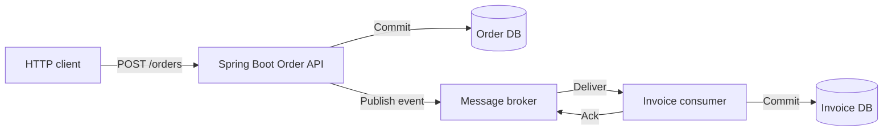
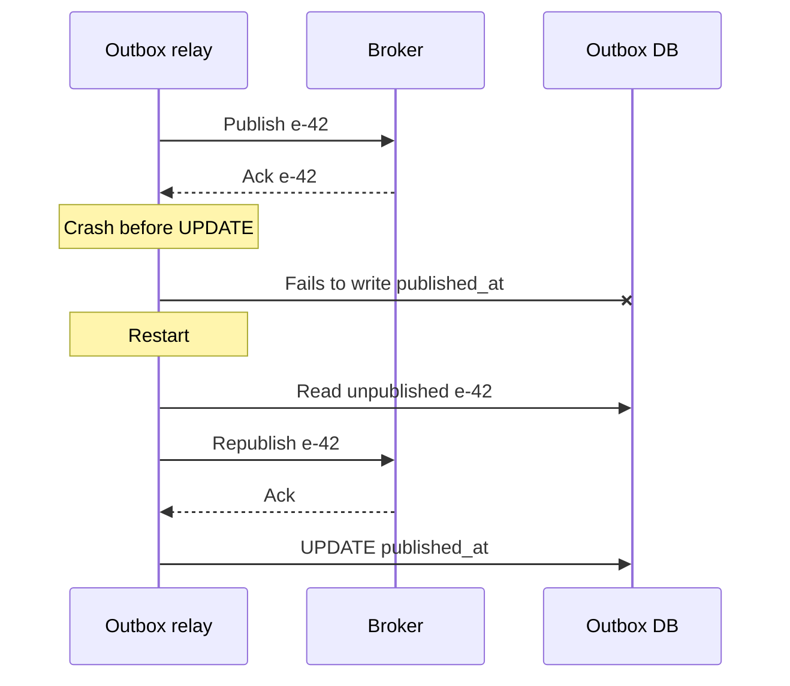
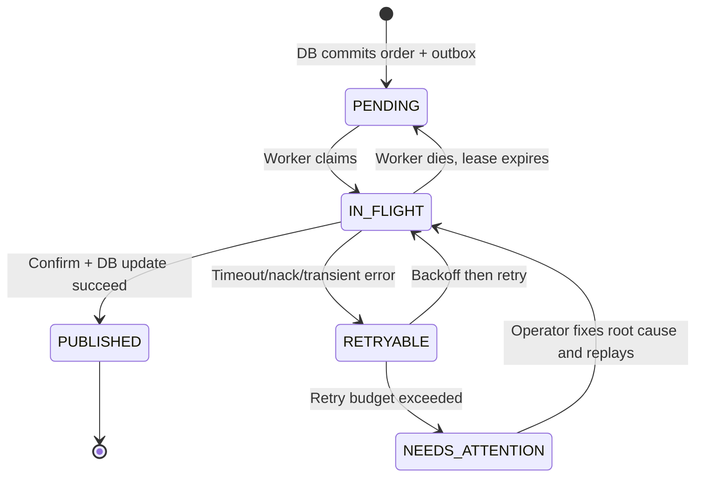

# Publish Confirmation and Duplicate Publishing After Failure

In a Spring Boot integration system, sending an event to Kafka, RabbitMQ, an HTTP endpoint, or a Spring Integration adapter usually has not finished when `send(...)` returns. Data may still sit in a client buffer, may have been accepted by the broker while the producer missed the acknowledgment, or may have reached the consumer without being processed yet. When a process fails at an ambiguous moment, **retrying is necessary to avoid losing data, yet it can produce duplicate publishes**.

This lesson belongs to the **Consistency and Deduplication** topic in the `SPRING_BOOT_INTEGRATION` module. The focus is on understanding **publish/send acknowledgements** accurately, identifying uncertain-outcome windows, choosing retry policies, designing a transactional outbox, and protecting consumers from repeated side effects. Examples span HTTP, database transactions, message brokers, and Spring Integration adapters, along with testing and production observability.

## 1. "Send succeeded" — succeeded at which boundary?

An ordering system may execute the following chain:



The phrase "succeeded" can refer to at least six distinct milestones:

| Milestone | What is actually confirmed | What must **NOT** be inferred |
| --- | --- | --- |
| 1. API client receives HTTP 2xx | Server sent a 2xx response per HTTP contract | Downstream async tasks have necessarily finished |
| 2. `send` or `convertAndSend` does not throw | Client library accepted the call or performed the defined send step | Broker durably stored it or consumer processed it |
| 3. Producer receives broker publish acknowledgement | Broker confirmed according to protocol rules and current durability config | Consumer read or committed business logic |
| 4. Consumer receives message | Data was delivered to the consumer | Consumer's DB transaction committed |
| 5. Consumer commits result to DB | Side effect inside the DB transaction was persisted | Broker received consumer acknowledgement |
| 6. Broker receives consumer acknowledgement | Broker can treat that delivery as acknowledged | Other systems outside the consumer transaction committed together |

**Producer acknowledgement and consumer acknowledgement are two different signals.** Kafka expresses producer success via `acks`, while consumer progress is typically recorded via offset commits. RabbitMQ has **publisher confirms** on the publish side and **consumer acknowledgements** on the delivery side. Never substitute one signal for the other.

Even when one step is confirmed, the guarantee scope still depends on configuration. A broker accepting a message under weak replication/durability settings can still lose it during severe outages. A consumer that acked yet called HTTP outside the transaction can still land in an uncertain state regarding whether the partner executed it.

### 1.1. Delivery guarantee levels

| Model | Characteristics | Trade-off |
| --- | --- | --- |
| *At-most-once* | Does not proactively resend after ambiguous outcomes; messages may be lost | Few duplicates, unsuitable for workflows that cannot lose data |
| *At-least-once* | Retries until a success signal arrives or moves to dedicated error handling | Same event may be emitted or delivered multiple times |
| *Exactly-once* within a defined scope | Defined operations take effect once **within the supported mechanism's boundaries** | Does not automatically extend to all DBs, HTTP endpoints, and brokers |
| *Effectively-once* at the business layer | Duplicates may arrive, yet idempotency/unique constraints yield one business effect | Requires tracking state, designing keys, and handling concurrency |

Never broadly state "the system guarantees exactly-once" without specifying **exactly-once for which operations, on which systems, and under which failure conditions**. For example, Kafka transactions can coordinate consume/produce and offsets inside Kafka, yet do not automatically turn a bank API call or an external SQL write into a single global transaction.

## 2. The uncertain-outcome window is the root cause of duplicates

Suppose a producer sends `OrderCreated(eventId=e-42)`, the broker records the event, and the confirmation packet is lost:

```mermaid
sequenceDiagram
    participant P as Spring Boot producer
    participant B as Broker
    P->>B: Publish e-42
    B->>B: Accept / store event
    B--xP: Publish ack lost
    Note over P: Timeout; uncertain if received?
    P->>B: Retry e-42
    B-->>P: Ack
    Note over B: 2 copies of e-42 may exist
```

A timeout **does not prove** publishing failed. From the producer's viewpoint, two opposite realities look identical:

1. The request never reached the broker; without retrying, the event is lost.
2. The broker accepted it, yet the reply was lost; retrying may send the event twice.

This is an information boundary across the network. It cannot be solved merely by raising timeouts or wrapping publish in a `try/catch`. You must define a retry contract and prepare to handle duplicates.

### 2.1. Analyzing failure points

| Failure timing | Possible state of the event | What the application should do |
| --- | --- | --- |
| Before sending | Broker definitely did not receive that attempt | Safe to send via retry mechanism |
| Mid-send, connection drops | Broker may or may not have received it | Treat as **uncertain**; safely retry with the same event ID |
| Broker accepts, ack lost | Event already exists, unknown to producer | Retry may create a duplicate; consumer must be idempotent |
| Ack received, producer dies before updating DB/outbox | Broker accepted it, outbox row still says "unsent" | Relay resends after restart; duplicates are expected |
| Producer marks "sent" before broker confirmation, then crashes | May be marked sent even though broker never received it | **Risk of losing events**; avoid this ordering |
| Consumer commits DB then dies before ack/offset commit | Side effect exists; broker may redeliver message | Reprocessing at consumer must not repeat the side effect |
| Consumer acks/commits offset before DB commit then crashes | Broker assumes processed; DB lacks changes | **Risk of losing effects**; avoid acking before commit |

Broker "retries" do not always mean two copies land in the log. Some brokers/clients support protocol-level deduplication, such as Kafka producer idempotence. Yet those mechanisms are scoped to a producer session, deduplication key, or specific transaction; when an application starts a fresh logical publish after a restart or runs multiple producers, business logic must still guard on a **stable event ID**.

### 2.2. Event ID vs. correlation ID and message ID

| Identifier | Usage | Preserved across retries? |
| --- | --- | --- |
| `eventId` / business event ID | Identifies **the same business event** across all publishes/deliveries | **Must be preserved** |
| Command idempotency key | Identifies the same order/payment creation request | Preserved within the contract's retry window |
| Correlation ID | Connects logs, request/reply, and traces across systems | Often preserved across a flow, not necessarily unique per event |
| Broker message ID / Kafka offset | Client/broker metadata or log position | Can change upon republishing |
| Order ID / aggregate ID | Identifies the updated entity | Many distinct events can share the same order ID |

For instance, `OrderCreated(e-42, order-7)` relayed twice must keep `eventId=e-42`. An `OrderShipped(e-43, order-7)` is a **different** event despite sharing `order-7`; never use order ID as the deduplication key across all event types.

## 3. Kafka: what does producer acknowledgement mean?

With `KafkaTemplate` in Spring Kafka, calling `send(...)` typically returns a `CompletableFuture<SendResult<K,V>>`. Receiving the future object **is not** broker confirmation. Success or failure is observed only when the future completes.

The `acks` setting controls how the broker must confirm:

| `acks` | Interpretation | Risk |
| --- | --- | --- |
| `0` | Producer does not wait for broker receipt confirmation | Records can be lost without the producer knowing |
| `1` | Leader confirms after writing the record locally | If the leader fails before replicas catch up, records can be lost |
| `all` / `-1` | Broker waits for confirmation from in-sync replicas per config | Stronger, though it does not replace replication factor/`min.insync.replicas` and full-system checks |

For reliable data, consider `acks=all`, an appropriate replication factor, `min.insync.replicas`, and ISR health monitoring. Concrete values must match broker count and fault tolerance needs. `acks=all` does not guarantee consumers processed the event.

### 3.1. Enabling idempotent producer and controlling retries

Example `application.yml`:

```yaml
spring:
  kafka:
    bootstrap-servers: localhost:9092
    producer:
      acks: all
      properties:
        enable.idempotence: true
        delivery.timeout.ms: 120000
```

Kafka producer idempotence uses a producer ID and sequence numbers so the broker avoids writing duplicates when **the client retries the same record within that producer session's idempotent scope**. Compatible settings must align (such as `acks=all`, retry counts, and bounded in-flight requests); modern Kafka clients may enforce or default several of these constraints, yet you should verify against your actual runtime version.

Important limitations:

- Producer idempotence covers Kafka-client retries; it does **not** stop an application relay from publishing the same `eventId` as a fresh record after a restart.
- Kafka transactions protect consume-process-produce operations inside **Kafka** and coordinate offsets under specific contracts. PostgreSQL writes, HTTP calls, and RabbitMQ sends retain separate boundaries.
- If the future fails or times out, the application cannot assume the record never reached the broker; some scenarios still leave an uncertain outcome.

### 3.2. Observing a publish outcome with `KafkaTemplate`

Java example with Spring Kafka returning `CompletableFuture`:

```java
public record OrderCreated(
        UUID eventId,
        String orderId,
        Instant occurredAt) {
}

@Service
public class KafkaOrderPublisher {
    private final KafkaTemplate<String, OrderCreated> kafkaTemplate;

    public KafkaOrderPublisher(
            KafkaTemplate<String, OrderCreated> kafkaTemplate) {
        this.kafkaTemplate = kafkaTemplate;
    }

    public CompletableFuture<SendResult<String, OrderCreated>> publish(
            OrderCreated event) {
        return kafkaTemplate.send(
                "orders.events",
                event.orderId(),
                event);
    }
}
```

The application must configure a matching serializer for `OrderCreated`. Typical imports: `java.util.UUID`, `java.time.Instant`, `java.util.concurrent.CompletableFuture`, `org.springframework.kafka.core.KafkaTemplate`, `org.springframework.kafka.support.SendResult`. In a relay worker, you can observe:

```java
publisher.publish(event).whenComplete((result, error) -> {
    if (error != null) {
        // Record failure/uncertain state per outbox retry rules.
        return;
    }

    // Only here do we have producer acknowledgement per acks config.
    // Record result by eventId and offset/partition for monitoring if needed.
    log.info("Published eventId={}, topic={}, partition={}, offset={}",
            event.eventId(),
            result.getRecordMetadata().topic(),
            result.getRecordMetadata().partition(),
            result.getRecordMetadata().offset());
});
```

This callback illustrates distinguishing **future completed successfully** from **send was called**; `log` is the application logger. In a real outbox, update durable state after confirmation in a separate transaction, coordinate concurrency, and handle callback errors. Avoid blocking long on DB work directly inside the library's callback thread.

Using `orderId` as the Kafka record key usually routes events for the same order to the same partition while topology stays constant; still account for partition counts, partitioning strategy, reordering from retries or multiple producers, and event versions when ordered processing is required.

## 4. RabbitMQ: publisher confirm vs. message return and consumer ack

RabbitMQ separates three distinct events:

1. **Publisher confirm:** the broker replies `ack`/`nack` to the publisher on a confirm-mode channel. This indicates the broker handled the publish according to queue/storage durability rules, **not** that a consumer processed it.
2. **Return when unroutable:** if published with `mandatory=true` and no bound queue matches, the broker returns the message to the publisher. Note that this can still receive a **publisher confirm ack**, because the exchange processed the publish even though it routed to no queue.
3. **Consumer acknowledgement:** the consumer acks/nacks/rejects a delivery; acking before the business transaction commits risks losing effects if the consumer crashes.

In Spring Boot using Spring AMQP, example confirmation configuration:

```yaml
spring:
  rabbitmq:
    host: localhost
    port: 5672
    publisher-confirm-type: correlated
    publisher-returns: true
    template:
      mandatory: true
```

Here `correlated` correlates publisher confirms with individual sends via `CorrelationData`. `publisher-returns` and `mandatory` surface unroutable messages. Declare matching exchanges, bindings, and queues; durable queues, persistent messages, and queue types must fit actual retention needs rather than relying on a single flag.

Example publish call with a correlation ID:

```java
public void publish(OrderCreated event) {
    CorrelationData correlation =
            new CorrelationData(event.eventId().toString());

    rabbitTemplate.convertAndSend(
            "orders.exchange",
            "orders.created",
            event,
            correlation);

    correlation.getFuture().whenComplete((confirm, error) -> {
        if (error != null || confirm == null || !confirm.isAck()) {
            // Record so relay handles retry/uncertain status.
            return;
        }

        if (correlation.getReturned() != null) {
            // Broker acked, yet message was not routed to any queue.
            return;
        }

        // Confirm ack received and no returned message detected.
        // Still cannot conclude the consumer committed business logic.
    });
}
```

The example assumes `RabbitTemplate rabbitTemplate` is injected and a matching `MessageConverter` is configured for the event type. `CorrelationData` lives in `org.springframework.amqp.rabbit.connection`. Depending on the Spring AMQP version, callback APIs and returned-message handling may vary; compile against your actual dependency version before deploying.

Never treat a single publisher confirm callback as proof the message was processed: confirms close ambiguity only at **broker acceptance**, while consumers maintain their own acknowledgements and retries. If the connection drops before the confirm arrives, whether the publish reached the broker remains uncertain.

## 5. Transactional outbox: closing the gap between DB commit and publish

An ordering system typically has two side effects that must stay consistent:

1. Write the order to the database.
2. Emit `OrderCreated` to the broker for other services.

Calling `repository.save(order)` followed by `kafkaTemplate.send(event)` inside one `@Transactional` method **does not create an atomic transaction across the database and Kafka**. The DB can commit while publish fails, or the broker can receive the event while the DB transaction rolls back.

**Transactional outbox** writes the business record and event record inside **the same database transaction**. A separate process (relay) reads the outbox and publishes. Publishing may repeat after errors; this is acceptable behavior because consumers must be idempotent.

```mermaid
sequenceDiagram
    participant API as Spring Boot API
    participant DB as Database
    participant R as Outbox relay
    participant B as Broker
    participant C as Consumer
    API->>DB: BEGIN
    API->>DB: INSERT orders
    API->>DB: INSERT outbox_event (eventId=e-42)
    API->>DB: COMMIT
    API-->>API: Order + event both durable
    R->>DB: Read unconfirmed e-42
    R->>B: Publish e-42
    B-->>R: Publish confirm
    R->>DB: Mark published e-42
    B->>C: Deliver e-42
    C->>C: Deduplicate + commit DB
    C-->>B: Consumer ack
```



### 5.1. Minimal outbox schema

PostgreSQL example:

```sql
CREATE TABLE outbox_events (
    event_id UUID PRIMARY KEY,
    aggregate_type VARCHAR(80) NOT NULL,
    aggregate_id VARCHAR(120) NOT NULL,
    event_type VARCHAR(120) NOT NULL,
    payload JSONB NOT NULL,
    created_at TIMESTAMPTZ NOT NULL DEFAULT NOW(),
    published_at TIMESTAMPTZ NULL,
    attempts INTEGER NOT NULL DEFAULT 0,
    last_error TEXT NULL
);

CREATE INDEX ix_outbox_unpublished
    ON outbox_events (created_at)
    WHERE published_at IS NULL;
```

`event_id` is generated **once when creating the event** and stored alongside the payload. The relay never generates a new UUID per publish attempt. `published_at` is updated only after meeting producer acknowledgement criteria and broker routing checks per contract; when uncertain, the record must stay eligible for retry.

### 5.2. Writing the outbox inside a Spring Boot transaction

```java
@Service
public class PlaceOrderService {
    private final OrderRepository orders;
    private final OutboxRepository outbox;

    public PlaceOrderService(
            OrderRepository orders,
            OutboxRepository outbox) {
        this.orders = orders;
        this.outbox = outbox;
    }

    @Transactional
    public OrderResult place(PlaceOrder command) {
        // Business repository must enforce a unique constraint for requestId.
        Order order = orders.insertIdempotently(command);

        // Emit an event only for an actual state transition.
        if (order.isNewlyCreated()) {
            UUID eventId = UUID.randomUUID();
            outbox.insert(
                    eventId,
                    "Order",
                    order.id(),
                    "OrderCreated",
                    serializeOrderCreated(eventId, order));
        }

        return new OrderResult(order.id(), order.status());
    }
}
```

The code above illustrates two application-defined repositories and DTOs, not built-in Spring Data APIs. `insertIdempotently` must use transactions, concurrency control, and DB unique constraints. Both repositories must participate in the same transaction manager and database; if they target two separate DBs, atomicity no longer holds.

For HTTP retries, never rely solely on `findByRequestId` followed by `insert`, as two concurrent requests can both find nothing. Enforce a scoped unique constraint (e.g., `tenant_id + request_id`), handle conflict exceptions, and return the already created status/result. Tie outbox insertion strictly to actual state transitions so retries never generate multiple distinct events.

### 5.3. Why can an outbox still publish duplicates?



If you set `published_at` **before** publishing to eliminate duplicates, an error after marking yet before broker receipt loses the event. Therefore an outbox prioritizes **no lost events** and accepts **at-least-once publishing**, paired with consumer deduplication. Nor does an outbox automatically preserve order when multiple relays run concurrently; concurrency and ordering require dedicated design.

## 6. Outbox relay: confirmation, contention, and processing order

The relay can be a `@Scheduled` job in Spring Boot, a Spring Integration polling flow, a standalone worker, or a CDC (change data capture) process reading the transaction log. Regardless of implementation, the core rule is that **outbox records must remain republishable until broker confirmation satisfies the publish policy**.

### 6.1. State progression

A simple state machine:



The diagram shows logical state, not necessarily exact string columns in SQL. With a minimal table that only has `published_at`, add lease/claim and error columns if running multiple workers or supporting controlled reprocessing.

### 6.2. Preventing two relays from picking the same record

With multiple Spring Boot replicas, two relays can read the same `published_at IS NULL` row before either marks it complete. That triggers duplicate publishes even with zero network errors.

A PostgreSQL approach is having a worker **claim** rows in a short transaction via `SELECT ... FOR UPDATE SKIP LOCKED`, setting `claimed_by` and `claim_until`, then committing. Actual publishing runs **after releasing the DB transaction**; upon confirmation, a new transaction updates `published_at`. Claims must expire so a dead worker never locks a record forever.

Example additional columns:

```sql
ALTER TABLE outbox_events
    ADD COLUMN claimed_by VARCHAR(120),
    ADD COLUMN claim_until TIMESTAMPTZ,
    ADD COLUMN next_attempt_at TIMESTAMPTZ;

CREATE INDEX ix_outbox_ready
    ON outbox_events (next_attempt_at, created_at)
    WHERE published_at IS NULL;
```

*Illustrative* query allowing one transaction to claim a small batch:

```sql
WITH candidates AS (
    SELECT event_id
    FROM outbox_events
    WHERE published_at IS NULL
      AND (claim_until IS NULL OR claim_until < NOW())
      AND (next_attempt_at IS NULL OR next_attempt_at <= NOW())
    ORDER BY created_at, event_id
    FOR UPDATE SKIP LOCKED
    LIMIT 50
)
UPDATE outbox_events AS o
SET claimed_by = :worker_id,
    claim_until = NOW() + INTERVAL '60 seconds'
FROM candidates AS c
WHERE o.event_id = c.event_id
RETURNING o.*;
```

`:worker_id` is a JDBC bind parameter, never concatenated from external input. Add claim renewal rules, retry policies, batch sizing, and broker call timeouts. If a publish takes longer than 60 seconds, another worker can reclaim the row once the lease expires: **leases only reduce concurrent publishing, they do not eliminate duplicates**.

### 6.3. Marking success with owner verification

After broker ack, the worker records completion in a separate DB transaction. Example:

```sql
UPDATE outbox_events
SET published_at = NOW(),
    claimed_by = NULL,
    claim_until = NULL,
    last_error = NULL
WHERE event_id = :event_id
  AND claimed_by = :worker_id
  AND published_at IS NULL;
```

The application must inspect the updated row count. If `0`, the claim may have expired or another worker claimed it. Never blindly record success; read current state and reconcile. In high-contention systems, add `claim_version` or a fencing token to distinguish claims cleanly.

Never hold a database transaction open across the entire wait for broker confirmation, as holding locks and connections increases deadlocks and lowers throughput. Claim → publish → finalize accepts duplicate sends in exchange for avoiding distributed transactions and long-held locks.

### 6.4. Event ordering

Suppose an order has:

```text
OrderCreated(order-7, version=1, eventId=e-42)
OrderPaid(order-7, version=2, eventId=e-43)
OrderCancelled(order-7, version=3, eventId=e-44)
```

If multiple workers publish the outbox concurrently, `e-43` can reach the consumer before `e-42`. Using the aggregate ID as the Kafka key routes records with the same key to the same partition under a stable partition layout, yet **cannot fix out-of-order publishing by the producer**. Order can also shift during retries, repartitioning, or multi-service publishing.

When ordering is required, choose a *per-aggregate ordering* strategy: serialize publishing per aggregate, route consistently by partition/key, and store `aggregate_version` so consumers accept only valid state transitions. Where eventual consistency is acceptable, consumers can buffer early messages, skip stale versions, or resync state from an authoritative source.

## 7. Consumer idempotency: protecting business effects

Because of producer retries, relay republishes, broker redeliveries, and consumer restarts, consumers must treat **duplicates as normal** under at-least-once delivery.

Consider an invoicing service receiving two copies of `OrderCreated(eventId=e-42)`. If both execute `INSERT invoice` and send an email, the buyer may receive two invoices or notifications. An idempotent consumer must detect that `e-42` was already applied and refrain from repeating the effect.

### 7.1. Recording processed markers in the same transaction as business logic

PostgreSQL example:

```sql
CREATE TABLE processed_events (
    consumer_name VARCHAR(120) NOT NULL,
    event_id UUID NOT NULL,
    processed_at TIMESTAMPTZ NOT NULL DEFAULT NOW(),
    PRIMARY KEY (consumer_name, event_id)
);

CREATE TABLE invoices (
    invoice_id UUID PRIMARY KEY,
    order_id VARCHAR(120) NOT NULL UNIQUE,
    amount NUMERIC(18, 2) NOT NULL
);
```

The primary key `(consumer_name, event_id)` allows multiple distinct business consumers to share an event ID while each tracks its own processing record. `UNIQUE(order_id)` on invoices protects an additional business invariant: **at most one invoice per order per the example contract**.

Spring Boot service:

```java
@Service
public class InvoiceEventProcessor {
    private final JdbcTemplate jdbc;

    public InvoiceEventProcessor(JdbcTemplate jdbc) {
        this.jdbc = jdbc;
    }

    @Transactional
    public void handleOnce(OrderCreated event) {
        int inserted = jdbc.update(
                """
                INSERT INTO processed_events (consumer_name, event_id)
                VALUES (?, ?)
                ON CONFLICT (consumer_name, event_id) DO NOTHING
                """,
                "invoice-service",
                event.eventId());

        if (inserted == 0) {
            return; // eventId already recorded in a committed transaction.
        }

        // Create invoice, mutate state, or insert next outbox event.
        // All DB writes must share the transaction with processed_events.
        createInvoiceFrom(event);
    }
}
```

`createInvoiceFrom(event)` is application business logic. The code assumes the event carries or allows looking up the data needed to build an invoice; since the Kafka example record earlier had only `eventId` and `orderId`, supplement it with a lookup or contract field for `amount`. Main imports: `org.springframework.jdbc.core.JdbcTemplate`, `org.springframework.stereotype.Service`, `org.springframework.transaction.annotation.Transactional`.

The core lies in the **transaction**:

1. If inserting into `processed_events` succeeds yet creating the invoice fails, the transaction rolls back both; the next redelivery can retry.
2. If the invoice and marker commit yet the consumer dies before acking the broker, redelivery hits the duplicate key; the service returns cleanly without creating a second invoice.
3. If two consumers race on `e-42`, the DB unique constraint arbitrates contention. Never run a separate `SELECT EXISTS` then `INSERT`, because both can concurrently read "absent."

If handling one event performs multiple DB writes in the **same database**, keep all of them in the transaction. If it also sends emails, calls HTTP, or updates external systems, the DB transaction **cannot roll back external side effects**; use target-side idempotency, an outbox for the next step, or reconciliation.

One limitation of this minimal example is that `processed_events` stores only the event ID. If the same `eventId` could ever arrive with a **different payload**, also store a hash of the business content (or version/schema plus fingerprint), compare on re-encounter, and raise a contract error on mismatch. Skipping an existing event ID is safe only when the system guarantees every emission of that ID represents the exact same event.

### 7.2. Kafka consumer: commit offset after durable effect

Example listener using manual acknowledgment:

```java
@Component
public class InvoiceKafkaListener {
    private final InvoiceEventProcessor processor;

    public InvoiceKafkaListener(InvoiceEventProcessor processor) {
        this.processor = processor;
    }

    @KafkaListener(
            topics = "orders.events",
            groupId = "invoice-service")
    public void onEvent(
            OrderCreated event,
            Acknowledgment acknowledgment) {
        processor.handleOnce(event);
        acknowledgment.acknowledge();
    }
}
```

Matching configuration example:

```yaml
spring:
  kafka:
    consumer:
      enable-auto-commit: false
    listener:
      ack-mode: manual
```

`Acknowledgment` is in `org.springframework.kafka.support`; `@KafkaListener` is in `org.springframework.kafka.annotation`. Note that `InvoiceEventProcessor` must be a **separate** bean so `@Transactional` applies via Spring's proxy under default settings. Only when `handleOnce` returns successfully—meaning the DB transaction completed—does the listener call `acknowledge()`.

In `manual` mode, calling acknowledge marks progress per container mechanics; when the offset actually commits depends on the ack mode and container configuration. When synchronous per-record commits are required, select the appropriate mode and account for latency cost. Whether the offset commit succeeds or times out, if a record is redelivered, the transaction + unique constraint still prevents duplicate effects.

Never ack before the transaction commits. On exceptions, let error handlers and retry/DLT policies decide whether to redeliver or dead-letter; swallowing exceptions and acking turns real failures into lost work.

### 7.3. RabbitMQ consumer: corresponding semantics

With RabbitMQ, a listener can let the container ack after the handler returns normally under a supported mode, or manage manual acknowledgements. With manual ack, the desired sequence is:

```text
Rabbit delivery e-42
    -> check and write processed_events + invoice in DB transaction
    -> DB commit succeeds
    -> basicAck(deliveryTag, multiple=false)
```

Calling `basicNack`/`basicReject` with `requeue=true` endlessly on a permanently failing message creates a hot loop. Use bounded retries, dead-letter queues, and operational workflows for failed records. Message delivery tags belong to a **specific RabbitMQ channel**; never reuse tags carelessly after a channel closes.

### 7.4. When is Redis deduplication enough?

Redis can store counters, leases, or seen event IDs to shed load ahead of the DB. Yet a `SET NX EX` key expiring or getting evicted allows old messages through again. Nor are "set Redis key" and "write DB" atomic with each other.

When duplicate effects carry serious consequences (issuing invoices, charging money, ledger entries), make **unique constraints and transactions on the destination store** the final line of defense. Redis can reduce short-term duplicate work, but should never be the sole proof that a financial side effect executed.

## 8. HTTP and partner APIs: timeouts also create duplicate publishes

The same scenario occurs outside brokers. A service calls:

```http
POST /partner/payments
Idempotency-Key: tenant-31:payment-request-456
Content-Type: application/json

{"orderId":"order-7","amount":120000}
```

The partner may have created the payment while the HTTP 200 response dropped; the caller only sees a timeout. Retrying `POST` when the partner lacks idempotency support can double-charge.

How to handle it:

- Send the **same idempotency key** across all retries of the same business command; the partner must support the key with contracted scope and retention.
- Keep the payload fixed or attach a fingerprint so same-key, different-payload calls fail rather than pretending to match.
- After a timeout, query status by request ID/payment ID when the API supports it; never assume "the partner hasn't processed it."
- For multi-step transactions, persist request state in the DB and design reconciliation—adding sagas/compensation when systems cannot commit atomically.

An HTTP 2xx or producer ack closes only one leg of the journey. In a `DB → broker → consumer → HTTP partner` flow, failures and duplicates can arise at every hop. Enforce idempotency at **every point that produces a side effect**, not just the initial entry point.

## 9. Safe retries when publish status is uncertain

Good retry logic distinguishes "retryable," "non-retryable," and "must reconcile."

| Situation | Handling |
| --- | --- |
| Connection drop, broker timeout, transient network error | Retry with the **same event ID**, backoff, and attempt tracking |
| Kafka/RabbitMQ overloaded, throttling, quotas | Slow down, bound concurrency, retry with jitter |
| Missing exchange/queue/topic, schema serializer error, bad credentials | Surface config error; usually needs human/deployment fix before retrying |
| RabbitMQ returned unroutable message | Fix routing/bindings; publisher confirm ack alone does not prove queue delivery |
| API accepted request, response timed out | Query status if possible; reuse idempotency key on retry |
| Permanent consumer validation failure | Route to error handling/DLT; avoid infinite requeues |
| Consumer committed DB then lost ack | Accept redelivery; detect duplicate and ack after verifying state |

An example retry schedule is `1s → 2s → 4s → 8s` with jitter, a 30-second cap, and an SLA-aligned attempt limit. Never run infinite retries inside synchronous loops blocking HTTP threads or consumer threads, as that exhausts resources.

### 9.1. Error states and dedicated dead-letter queues

In an outbox, records failing past their retry budget should be flagged `NEEDS_ATTENTION` (or equivalent), recording `eventId`, last error, attempt count, and next retry timestamp. Never delete rows simply because publishing "tried many times": deleting loses committed DB events.

At consumers, Dead Letter Topics/Queues (DLT/DLQ) hold messages requiring inspection once retries exhaust. Moving a message to a DLT **does not mean** business work completed. Provide dashboards, alerts, owners, data-fix procedures, and replay tooling that preserves the same event ID. Replays must still pass through idempotency checks.

### 9.2. Timeouts must align with retry budgets

Suppose a producer waits up to 10 seconds for confirmation while workers claim records for only 5 seconds. A second worker can reclaim before the first hears back, increasing concurrent duplicates. Align claim timeouts, connect/request/delivery timeouts, total retry budgets, and graceful shutdown periods.

Setting timeouts too high holds worker resources too long during broker outages. Raising concurrency unboundedly overwhelms brokers and downstreams. Balancing throughput and reliability requires real measurements, not isolated timeout tweaks.

## 10. Testing blind spots commonly missed

Critical scenarios should be integration-tested against real DBs and brokers (such as via Testcontainers) or controlled fault injection. Unit tests mocking `KafkaTemplate`/`RabbitTemplate` do not verify broker acks, offset commits, or redeliveries.

| Scenario | Outcome to prove |
| --- | --- |
| Order-creation transaction rolls back | Neither order nor corresponding outbox event exists |
| DB commits successfully, broker unavailable | Outbox retains pending event; relay retries once broker recovers |
| Broker accepts, confirm/response lost | Relay retains ability to retry same event ID; consumer avoids duplicate side effects |
| Worker dies right after confirm, before `published_at` | Relay republishes after restart; consumer deduplication holds |
| Worker dies while holding claim lease | Expired claim is taken over by another worker, never stranded forever |
| Two relays fetch batches concurrently | No lost events; bounded concurrency; expected duplicates handled safely |
| Consumer commits DB then dies before broker ack/offset commit | Redelivery creates no extra invoice or side effect |
| Consumer acks before DB commit (simulated design bug) | Test exposes lost-effect risk and prevents regressions |
| Two consumers process same event ID concurrently | Unique constraint/transaction guarantees single application |
| Same event ID, different payload | Contract conflict detected; bad data not silently ignored |
| RabbitMQ publisher confirm ack yet message returned | Not marked "delivered to queue" when unroutable |
| Permanently failing message exhausts retries | Saved in DLT/quarantine with alerts and controlled replay |
| Events for same aggregate arrive out of order | Consumer enforces version/sequence rules; state does not regress |

A decisive outbox test is **killing the relay process after broker confirmation yet before the relay updates the DB**. When designed correctly, restarting republishes while the consumer still keeps exactly one invoice. Tests checking only "published once when everything works" miss the architecture's most important failure mode.

### 10.1. Consumer duplicate test example

For `InvoiceEventProcessor` above, an integration test can assert:

```java
@Test
void repeatedEventCreatesOnlyOneInvoice() {
    OrderCreated event = knownOrderCreatedEvent();

    processor.handleOnce(event);
    processor.handleOnce(event); // Simulates a redelivery.

    assertThat(invoiceRepository.countByOrderId(event.orderId()))
            .isEqualTo(1);
    assertThat(processedRepository.count(
            "invoice-service", event.eventId()))
            .isEqualTo(1);
}
```

`knownOrderCreatedEvent` and the repository query methods are project-defined test helpers. This test proves deduplication on committed DB state; pair it with two-transaction concurrency tests and real broker redelivery tests to cover the entire flow.

## 11. Post-deployment observability and diagnostics

To detect lost publish confirms, stuck records, or abnormal duplicate spikes, unify logs and metrics across producers, outbox relays, brokers, and consumers.

| Metric group | Examples | Helps detect |
| --- | --- | --- |
| Outbox backlog | Unpublished record count, oldest record age, p95 age | Growing backlog or stopped relay |
| Publish outcome | Confirm ack/nack, timeouts, returns, retry count | Broker or routing instability |
| Producer latency | Time from `send` call to future/confirm completion | Broker, network, or ISR pressure |
| Consumer progress | Consumer lag, unacked deliveries, processing duration | Consumer bottlenecks or errors |
| Deduplication | Messages skipped by `eventId`, duplicate ratio | Rising relay/consumer retries or abnormal redeliveries |
| Business consistency | Orders with outbox vs. events reaching consumers vs. successful side effects | Pipeline drops at a boundary |
| Recovery | DLT backlog, records needing manual intervention, last error age | Post-incident recovery health |

Logs should include `eventId`, `aggregateId`, `correlationId`, `attempt`, `producer/client instance`, and processing phase (created, claimed, sent, confirmed, marked published, consumed, committed). Never log tokens, personal data, or full sensitive payloads.

Example log sequence suitable for reconciliation:

```text
eventId=e-42 phase=OUTBOX_COMMITTED aggregate=order-7
eventId=e-42 phase=PUBLISH_ATTEMPT attempt=1
eventId=e-42 phase=PUBLISH_CONFIRM broker=kafka partition=2 offset=913
eventId=e-42 phase=MARK_PUBLISHED_FAILED reason=db_timeout
eventId=e-42 phase=PUBLISH_ATTEMPT attempt=2
eventId=e-42 phase=CONSUMER_DUPLICATE consumer=invoice-service
```

This is not necessarily a data incident: the broker received two copies while the consumer applied the business logic once. Even so, track duplicate ratios to spot when relays, networks, or configs generate needless load.

Practical alerts should cover: outbox records older than SLA, surging confirm timeouts, prolonged consumer lag, unhandled DLT entries, and unroutable message counts. Beyond technical metrics, periodically reconcile source state (e.g., created orders) against destination outcomes (processed invoices/events).

## 12. Common misconceptions

| Wrong conclusion | Correct understanding |
| --- | --- |
| "`send()` didn't throw, so the message is durably stored." | Inspect the future/confirm and know what the broker actually guarantees. |
| "Timeout means the broker never received it." | Timeout can happen after broker acceptance; the outcome may be uncertain. |
| "Publisher confirm ack means the consumer processed it." | Publisher confirms and consumer acks belong to two different boundaries. |
| "RabbitMQ ack guarantees a queue received it." | On mandatory returns, a publish can still receive confirm ack even when unroutable. |
| "Kafka `enable.idempotence=true` means business is exactly-once." | Producer-level retry dedup does not replace business event IDs and consumer idempotency. |
| "`@Transactional` rolls back DB and broker together." | DB transactions do not span networks, HTTP, or brokers; use an outbox or proper architecture. |
| "An outbox publishes strictly once." | An outbox ensures events aren't forgotten after DB commit, yet has a duplicate window before marking sent. |
| "Inserting `processed_events` first and creating the invoice afterward is safe." | Both writes must share one transaction; if the marker commits and invoicing fails, the event can be skipped forever. |
| "Receiving duplicate messages means the broker is buggy." | Redelivery is normal when acks/offsets remain unconfirmed; consumers must handle it. |
| "Handle errors by retrying forever." | Use backoff, bounded resources, DLT/quarantine, alerts, and recovery paths. |
| "Using order ID as event ID is good enough." | One aggregate emits many distinct events; event IDs must distinguish each business event. |

## 13. Checklist for Spring Boot integration flows

Before running an `HTTP → DB → broker → consumer` flow in production, answer clearly:

1. **Success scope:** At which step do the API, producer, broker, and consumer report success? Who owns the next step?
2. **Stable IDs:** Where are event IDs and idempotency keys generated? Are they preserved across retries and scoped by tenant/operation?
3. **DB and publish:** Do business data and outbox rows commit in the same transaction? Does the relay mark sent only after matching broker confirmation?
4. **Broker:** Are Kafka `acks`, replication/ISR, idempotent producers, or RabbitMQ publisher confirms/mandatory returns configured as required?
5. **Uncertain states:** On timeout or connection loss, does the system retry safely, reconcile, and preserve the event ID?
6. **Consumer:** Do `processed_events` and DB side effects share a transaction protected by DB unique constraints against concurrent duplicates?
7. **Receipt confirmation:** Do consumer offset commits/RabbitMQ acks run after business commits, with clear error/poison-message policies?
8. **Cross-system:** Do HTTP calls, emails, payments, caches, or other adapters have dedicated idempotency/outbox/reconciliation matched to real consequences?
9. **Concurrency and ordering:** Do relay claims expire properly with multi-worker control; do same-aggregate events enforce valid versions/ordering?
10. **Testing and monitoring:** Have you tested crashes before/after ack, replays, concurrency, and configured alerts on backlog/duplicates/DLTs?

**Design principle:** a publish confirmation tells you **which boundary accepted responsibility**, whereas timeouts and network errors leave an **uncertain state**. To avoid losing data, systems must retry; to keep retries from duplicating effects, keep event IDs stable and enforce protection with **transactional outboxes, consumer idempotency, and business constraints where side effects are persisted**. Together, these guarantees yield Spring Boot integration flows that recover cleanly from failures, even when messages are published or delivered multiple times.
